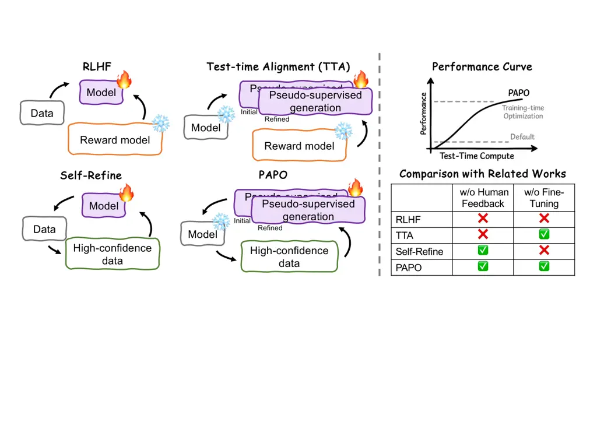
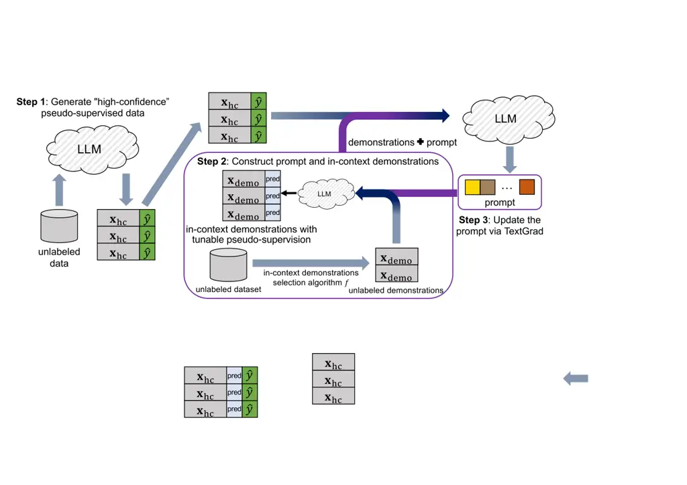

Zhen-Yu Zhang, Jiandong Zhang, Huaxiu Yao, Gang Niu, and Masashi
Sugiyama.

# In-context Demonstration Matters: On Prompt Optimization for Pseudo-Supervision Refinement

Zhen-Yu Zhang zhen-yu.zhang@riken.jp Affiliation: Center for Advanced
Intelligence Project, RIKEN    Jiandong Zhang
zhang.jiando@northeastern.edu Affiliation: Northeastern University   
Huaxiu Yao huaxiu@cs.unc.edu Affiliation: UNC-Chapel Hill    Gang Niu
gang.niu@riken.jp Affiliation: Center for Advanced Intelligence Project,
RIKEN    Masashi Sugiyama sugi@k.u-tokyo.ac.jp Affiliation: Center for
Advanced Intelligence Project, RIKEN Affiliation: Graduate School of
Frontier Sciences, The University of Tokyo

###### Abstract

*Large language models* (LLMs) have achieved great success across
diverse tasks, and fine-tuning is sometimes needed to further enhance
generation quality. Most existing methods rely on human supervision or
parameter retraining, both of which are costly in terms of data
collection and computational resources. To handle these challenges, a
direct solution is to generate “high-confidence” data from unsupervised
downstream tasks and use them for in-context prompting or prompt
optimization to refine the pseudo-supervision. However, relying solely
on such data may lead to _overfitting_. In this paper, we leverage the
*in-context learning* (ICL) abilities of LLMs and propose a novel
approach, *pseudo-supervised demonstrations aligned prompt
optimization* (PAPO) algorithm, which jointly refines both the prompt
and the overall pseudo-supervision. The proposed learning objective
ensures that the optimized prompt guides the LLM to generate consistent
responses for a given input when pseudo-supervised data from the
downstream task are used as demonstrations, enabling refinement over the
entire pseudo-supervision. The prompt is optimized by translating
gradient signals into textual critiques, which serve as feedback to
iteratively refine the prompt and model responses. Theoretical analysis
in a simplified classification setting shows that the refined
pseudo-supervision exhibits a geometric clustering structure, helping to
mitigate overfitting. Experiments on question answering, natural
language inference benchmarks, and a real-world molecule optimization
task, show the effectiveness of the proposed algorithm.

^(†)^(†)heading: 1 2024 1- 4/00 10/00 Zhang et al^(†)^(†)shortheadings:
In-context Demonstration Matters: On Prompt Optimization for
Pseudo-Supervision Refinement / Zhang, Zhang, Yao, Niu,
Sugiyama^(†)^(†)firstpage: 1

## 1 Introduction

Large language models have shown impressive performance on various
real-world tasks (Brown et al., 2020; Achiam et al., 2023; Yang et al.,
2024). Since most LLMs are trained for general purpose use, fine-tuning
is often necessary to enhance their performance on specific downstream
applications. For instance, *reinforcement learning from human
feedback* (RLHF) techniques align LLMs using human preference
data (Ouyang et al., 2022; Rafailov et al., 2023). Despite their
effectiveness, these approaches typically involve retraining, which can
be time-consuming and limit the model’s responsiveness to rapidly
changing data distributions and task requirements. Meanwhile, these
methods require supervised data to update the model, while human
feedback is hard to obtain in many real-world tasks. Therefore, it is
important to design algorithms that _improve the generation quality of
LLMs at test time using unsupervised data, without retraining the model
parameters_.

Existing approaches relevant to this learning problem include _test-time
alignment_ and _self-refinement_ strategies. However, current test-time
alignment methods mostly consider the preference alignment task and
heavily rely on human supervision, whereas self-refinement approaches
typically require retraining model parameters, which can be
computationally expensive. For instance, Best-of-N sampling is a typical
test-time alignment method (Lightman et al., 2024; Zhang et al., 2024)
that generates multiple candidate responses and selects the one with the
highest score according to a reward model trained on human feedback.
Although these methods are effective, their dependence on human
supervision can limit generalization. To handle this challenge,
self-refinement techniques (Huang et al., 2023; Wang et al., 2023; Sun
et al., 2024) allow models to explore “high-confidence” self-generated
responses and update themselves accordingly. Nevertheless, these methods
require retraining of model parameters, resulting in substantial
computational overhead.

To support test-time refinement without retraining model parameters, a
feasible method is to first identify “high-confidence” pseudo-supervised
data, which can be obtained either via the *chain-of-thought* (CoT)
mechanism (Wei et al., 2022) or through scoring functions. Building on
this, recent seminal works leverage these selected data as in-context
demonstrations (Brown et al., 2020) to guide final predictions (Wan
et al., 2023a; Wan et al., 2023b; Guo et al., 2024; Li et al., 2024).
While effective, these approaches depend heavily on the selected
“high-confidence” data. In practice, over-reliance on such self-selected
pseudo-supervised data may lead to *overfitting* (Bishop, 2006;
Goodfellow et al., 2016). This may lead the model to reinforce biases
present in these data, ultimately resulting in degraded performance.

In this paper, we explore the *in-context learning* (Brown et al., 2020)
ability of LLMs for test-time refinement. ICL generates responses by
conditioning on labeled demonstrations, and has been theoretically shown
to perform equivalently to gradient descent under certain conditions,
without updating model parameters (Bai et al., 2023). We incorporate
pseudo-supervised data in the downstream task as demonstrations during
prompt optimization to mitigate overfitting. This is achieved by
regularizing the refined pseudo-supervised data to exhibit internal
consistency: when used as in-context demonstrations, they should guide
the model to produce aligned outputs, even when those demonstrations are
not explicitly provided. Ideally, in a simplified classification
setting, the empirical risk minimizer over any subset is expected to
yield consistent pseudo-labels on the rest of the data after refinement.
In other words, we propose encouraging a cluster structure in the
refined pseudo-supervised data to mitigate overfitting, a
well-established principle in semi-supervised learning and
self-supervised learning (Chapelle et al., 2006; Belkin et al., 2006).



Figure 1: Comparison between training-time optimization (e.g., RLHF and
Self-Refine) and test-time optimization with or without human
supervision (e.g., Test-time Alignment and PAPO). PAPO enables test-time
refinement without retraining model parameters or requiring human
supervision.

Building on this idea, we propose a novel test-time refinement
algorithm, called *pseudo-supervised demonstrations aligned prompt
optimization* (PAPO), which enhances generation quality without relying
on human supervision or retraining model parameters, as illustrated in
Figure 1. Specifically, we integrate prompt optimization with the ICL
capability of LLMs by iteratively identifying a set of
“high-confidence”pseudo-labeled data, and then jointly refining the
model’s generation and optimizing the prompt based on these examples.
The learning objective is to minimize the loss on these
“high-confidence” data, with the pseudo-supervised data serving as
in-context demonstrations. We use TextGrad (Yuksekgonul et al., 2024) to
optimize the prompt through gradient-based updates with textual
feedback, similar to gradient descent. Theoretical analysis shows that,
in the simplified setting of classification, the refined output exhibits
a cluster structure that helps alleviate the overfitting issue. We
evaluate the quality of the refined generation by PAPO and other
contenders on several benchmark datasets and a real-world molecule
optimization task. Experimental results demonstrate the effectiveness of
PAPO in producing high-quality refined generation without human
supervision.

## 2 Related Work

#### Test-Time Alignment.

Different from RLHF methods that directly update model parameters,
recent studies have explored test-time alignment approaches that align
LLMs with human preferences at inference time. *Best-of-N* (BoN)
sampling (Lightman et al., 2024) selects the most preferred output from
multiple candidates generated by the LLM using a reward model. To
improve its efficiency, Speculative BoN accelerates generation by
discarding low-quality responses early in the decoding process (Zhang
et al., 2024). Building on BoN, TreeBoN further enhances inference-time
alignment by a speculative tree-search framework (Qiu et al., 2024).
TPO (Li et al., 2025) introduces an iterative refinement approach in
which the model receives and incorporates textual feedback at test time
to align its generations with implicit preferences.

Some prior works also explore prompt optimization to for test-time
alignment. For example, BPO first collects human feedback data, and then
trains a prompt optimization model to guide the LLM toward generating
more preferred responses (Cheng et al., 2024). However, this method
still relies on human feedback for alignment. URIAL employs three fixed
stylistic examples with a system prompt, achieving results comparable to
RLHF (Lin et al., 2024). In contrast, our method jointly optimizes the
prompt and downstream pseudo-supervision to achieve more tailored
performance on specific tasks.

#### Self-Refinement.

Self-refinement algorithms allow an LLM to generate initial responses on
a downstream task, provide feedback on them, and iteratively refine its
responses, leading to improved performance. For instance, LMSI employs
CoT prompting (Wei et al., 2022) to generate high-quality labels for
unlabeled datasets, which were then used to optimize the model (Huang
et al., 2023). LLMRefine employs a fine-grained feedback model to
identify defects in outputs and guide iterative refinements, optimizing
performance during inference without additional training (Xu et al.,
2024). Similarly, SALMON retrieves high-quality samples relevant to the
downstream task and used them as ICL demonstrations to generate
additional samples, which were then iteratively employed to fine-tune
the LLM (Sun et al., 2024). ISARA is an improved self-refinement methods
without human-crafted instructions and labeled rewards (Guo et al.,
2024).

Several recent seminal works explored using ICL prompting for
self-refinement without retraining model parameters (Wan et al., 2023a;
Wan et al., 2023b; Li et al., 2024). These methods first identify
“high-confidence” pseudo-supervised data using carefully designed
scoring functions, and then leverage the selected data as in-context
demonstrations to guide final predictions. We further explore the
pseudo-supervision across the entire downstream task as an implicit form
of regularization to mitigate overfitting, drawing on well-established
principles from self-supervised learning (Chapelle et al., 2006; Belkin
et al., 2006).

#### Prompt Optimization.

Prompt learning provides a lightweight alternative for enhancing the
generation quality of LLMs on downstream tasks without requiring
fine-tuning on model parameters. BBT optimizes the prompt for adaptation
using derivative-free optimization techniques such as evolutionary
algorithms (Sun et al., 2022). BDPL employs policy gradient algorithms
to optimize the prompt (Diao et al., 2022). Typically, these methods
still require labeled data to optimize the prompt.

## 3 Our Approach

In this section, we begin by introducing the notations, then describe
the PAPO algorithm in detail, and finally provide a theoretical analysis
of its properties in a simplified setting of classification.

### 3.1 Notations

In this part, we introduce the notations. Let
$`\mathbf{x}_{l}\in\mathcal{X}`$ be the $`l`$-th query in the
unsupervised dataset of size $`n`$, where $`\mathcal{X}`$ is the textual
space. We denote by $`\mathbf{z}\in\mathcal{X}`$ the prompt and
$`\mathbf{z}_{0}`$ be the system default prompt. We define two functions
associated with the LLM. First, let
$`\textnormal{LLM}_{\textnormal{opt}}(\cdot):\mathbf{x}\mapsto\bm{p}`$
denote the prompt optimization function, where $`\bm{p}\in\mathcal{X}`$.
It takes a textual prompt (e.g., loss or gradient information) as input
and outputs a response $`\bm{p}`$. To model the ICL capability of LLMs,
we define the generation function as
$`\textnormal{LLM}_{\textnormal{gen}}(\cdot,\cdot,\cdot):(\mathbf{x},\mathbf{z},D)\mapsto\mathbf{y}`$,
where $`\mathbf{x}`$ is the query, $`\mathbf{y}\in\mathcal{X}`$ is the
response in textual space, $`\mathbf{z}`$ is the prompt, and
$`D=\{(\mathbf{x}_{k},\widehat{y}_{k})\}_{k=1}^{K}`$ is a set of $`K`$
pseudo-supervised demonstrations drawn from the downstream task. $`D`$
can be an empty set, e.g.,
$`\textnormal{LLM}_{\textnormal{gen}}(\cdot,\mathbf{z}_{0},\emptyset)`$,
indicating that the LLM is used with default prompt for prediction
without demonstrations.

Following the formulation in TextGrad (Yuksekgonul et al., 2024), we use
a prompting function
$`P_{\textnormal{loss}}(\cdot\mid\cdot,\cdot,\cdot):(\mathbf{z}\mid\mathbf{x},\mathbf{y},\mathbf{y})\mapsto\bm{p}`$
to represent the loss function (e.g., prediction consistency), where
$`\bm{p}\in\mathcal{X}`$ denotes the loss expressed in textual format.
The LLM then generates critiques that evaluate how well the
pseudo-supervision $`\widehat{y}`$, produced using prompt
$`\mathbf{z}`$, addresses the query $`\mathbf{x}`$ with its underlying
supervision $`y`$. Formally, the loss $`L(\mathbf{z})`$ associated with
prompt $`\mathbf{z}`$ is defined as follows:

```math
L(\mathbf{z}):=\textnormal{LLM}_{\textnormal{opt}}(P_{\textnormal{loss}}(\mathbf{z}\mid\mathbf{x},\widehat{y},y)) \tag{1}
```

Next, we define the prompting function $`P_{\textnormal{grad}}(\cdot)`$,
which incorporates the textual loss $`L(\mathbf{z})`$ to elicit update
instructions, resulting in a textual gradient as follows:

```math
\frac{\partial L}{\partial\mathbf{z}}:=\textnormal{LLM}_{\textnormal{opt}}(P_{\textnormal{grad}}(L(\mathbf{z}))) \tag{2}
```

Finally, we define the prompting function
$`P_{\textnormal{update}}(\cdot)`$, which applies the textual gradient
to generate a refined variable, analogous to a gradient descent update,
as follows:

```math
\mathbf{z}_{\text{new}}=\textnormal{LLM}_{\textnormal{opt}}(P_{\textnormal{update}}(\frac{\partial L}{\partial\mathbf{z}})) \tag{3}
```

Since the downstream task is unsupervised, we propose to identify
“high-confidence” pseudo-supervised data to optimize the prompt.
Following the approach used in previous self-refinement methods (Huang
et al., 2023), we adopt the self-consistency CoT (Wang et al., 2022) to
identify “high-confidence” data and estimate the confidence of
pseudo-supervised outputs with prompt $`\mathbf{z}`$. Specifically, we
perform multiple-path decoding with a sampling temperature $`T>0`$,
automatically generating $`m`$ reasoning paths with $`\mathbf{z}`$ and
corresponding answers $`\{y_{l_{1}},\ldots,y_{l_{m}}\}`$ for each query
$`\mathbf{x}_{l}`$. We then apply majority voting (self-consistency) to
select the most consistent and highest-confidence answer as
$`\widehat{y}_{l}`$, and define the confidence as follows (Huang et al.,
2023):

```math
c_{l}=\frac{1}{m}\sum_{j=1}^{m}\mathbbm{1}(y_{l_{j}}=\widehat{y}_{l}). \tag{4}
```

### 3.2 Pseudo-supervised Demonstrations Aligned Prompt Optimization

In this part, we present the proposed PAPO algorithm, which jointly
optimizes the prompt and refines the pseudo-supervision for the
downstream task in an iterative manner.

To optimize the prompt for specific downstream tasks, a straightforward
approach is to generate the responses, identify “high-confidence”
pseudo-supervised data, and then optimize the prompt based on these
data, following the principle idea from (Wan et al., 2023b; Guo et al.,
2024; Li et al., 2024). For example, we optimize the following:

```math
\argmin_{\mathbf{z}\in\mathcal{Z}}\sum_{l=1}^{n}\mathbbm{1}[c_{l}\geq\gamma]\cdot\textnormal{LLM}_{\textnormal{opt}}(P_{\textnormal{loss}}(\mathbf{z}\mid\mathbf{x}_{l},\textnormal{LLM}_{\textnormal{gen}}(\mathbf{x}_{l},\mathbf{z},\emptyset),\textnormal{LLM}_{\textnormal{gen}}(\mathbf{x}_{l},\mathbf{z}_{0},\emptyset))), \tag{5}
```

where $`\mathbbm{1}[\cdot]`$ is the indicator function and
$`\gamma\in[0,1]`$ is a threshold for selecting “high-confidence”
pseudo-supervised data in the downstream task.



We iteratively identify “high-confidence” pseudo-supervised data and
construct demonstrations for each data by selecting a set of data from
the downstream task using a specific sample selection algorithm. Each
selected sample is assigned pseudo-supervision generated by the LLM,
guided by the current prompt and its corresponding demonstrations. We
jointly refine the pseudo-supervision and optiomize the prompt by
learning with the “high-confidence” data, ensuring that the LLM’s
predictions, generated based on the prompt and corresponding
demonstrations, align with the original pseudo-supervision of the
“high-confidence” data.

Figure 2: An illustration of the PAPO algorithm.

Although learning prompts with “high-confidence” pseudo-supervised data
is feasible, relying solely on such data may lead to overfitting, since
the prompt training procedure in Eqn. (5) does not consider the use of
the entire downstream dataset. To handle this problem, we propose to
refine the pseudo-supervision for the entire unsupervised downstream
task and optimize the prompt simultaneously. Since the in-context
learning capability allows LLMs to implicitly learn a classifier from
pseudo-supervised demonstrations and apply it to other data in
downstream tasks, we define the objective function for prompt
optimization with pseudo-supervised demonstrations as follows:

```math
L_{\textnormal{m}}(\mathbf{z})=\sum_{l=1}^{n}\mathbbm{1}[c_{l}\geq\gamma]\cdot\textnormal{LLM}_{\textnormal{opt}}(P_{\textnormal{loss}}(\mathbf{z}\mid\mathbf{x}_{l},\textnormal{LLM}_{\textnormal{gen}}(\mathbf{x}_{l},\mathbf{z},D_{l}),\textnormal{LLM}_{\textnormal{gen}}(\mathbf{x}_{l},\mathbf{z}_{0},\emptyset))), \tag{6}
```

where $`D_{l}`$ is a set of in-context demonstrations for the query
$`\mathbf{x}_{l}`$ selected by algorithm
$`f(\mathbf{x}_{l};\mathbf{z})`$, with the pseudo-supervision of these
demonstrations determined with the prompt $`\mathbf{z}`$. Specifically,
$`f(\mathbf{x}_{l},\mathbf{z})`$ outputs a set of pseudo-supervised
demonstrations selected from the downstream task:

```math
D_{l}=\left\{(\mathbf{x}_{k},\textnormal{LLM}_{\textnormal{gen}}(\mathbf{x}_{k},\mathbf{z},\mathcal{D}_{k}))|\mathbf{x}_{k}\in S_{l}\right\}_{k=1}^{K},
```

where
$`\textnormal{LLM}_{\textnormal{gen}}(\mathbf{x}_{k},\mathbf{z},\mathcal{D}_{k})`$
is the pseudo-supervision of $`\mathbf{x}_{k}`$, guided by both
$`\mathbf{z}`$ and $`\mathcal{D}_{k}`$.

For demonstration selection, following the seminal works on in-context
example selection (Liu et al., 2022; Min et al., 2022), we choose the
$`K`$ nearest samples for each input $`\mathbf{x}_{l}`$ as its
in-context demonstration set, denoted by $`S_{l}`$:

```math
S_{l}=\argmin_{\{k_{j}\}_{j=1}^{K}\subset\{1,\ldots,n\}}\sum_{j=1}^{K}d(\mathbf{x}_{l},\mathbf{x}_{k_{j}}), \tag{7}
```

where $`d(\cdot,\cdot)`$ is a distance measure between two queries. We
follow the same procedure outlined in (Liu et al., 2022), introducing a
sentence encoder $`\theta(\cdot)`$ and defining the distance as
$`d(\mathbf{x}_{l},\mathbf{x}_{k})=\|\theta(\mathbf{x}_{l})-\theta(\mathbf{x}_{k})\|_{2}`$.
In addition, to address majority label bias in the in-context
demonstrations, we incorporate the plug-in de-biasing method (Zhao
et al., 2021) into our algorithm in practice.

We illustrate the proposed PAPO algorithm in Figure 2 and summarize it
with pseudo-code in Algorithm 1. We explore the entire downstream
dataset by iteratively identifying ”high-confidence” pseudo-supervised
data, then simultaneously optimizing the prompt and refining the
pseudo-supervision.

### 3.3 Theoretical Analysis

In this part, we provide theoretical insights to help explain why PAPO
is effective. We emphasize that the presented theorem is standard and
only serves to support our approach from a theoretical perspective;
however, it is not intended as a theoretical contribution of this work.

The following theoretical analysis shows that PAPO refines generation in
a way that encourages the pseudo-supervision to exhibit a clustering
structure in the output space. In the simplified case of multi-class
classification, PAPO encourages the refined labels to exhibit a
multi-manifold structure, where each class occupies a disjoint convex
region. When queries convey similar meanings, the refinement process
encourages their labels to belong to the same class.

Recent seminal works have shown that ICL can be interpreted as a form of
implicit empirical risk minimization (Min et al., 2022; Xie et al.,
2022; Bai et al., 2023). We first introduce the following lemma in (Bai
et al., 2023).

###### Lemma 1 (Corollary G.1 in (Bai et al., 2023)).

For any transformer with layer $`L\geq 1`$, under the same setting as
Theorem G.1 in (Bai et al., 2023), the $`(2L)`$-layer transformer
$`TF_{\theta}`$ there approximates the true gradient descent trajectory
$`\{\mathbf{w}^{\ell}_{\textnormal{GD}}\}_{\ell\geq 0}`$: For the
intermediate iterates $`\{\widehat{\mathbf{w}}^{\ell}\}_{\ell\in[L]}`$
considered therein, we have

```math
\|\widehat{\mathbf{w}}^{\ell}-\mathbf{w}^{\ell}_{\textnormal{GD}}\|_{2}\leq L_{f}^{-1}(1+\eta L_{f})^{\ell}\varepsilon,
```

where
$`L_{f}=\sup_{\mathbf{w}\in\mathcal{W}}\|\nabla^{2}\widehat{L}_{N}(\mathbf{w})\|_{\textnormal{op}}`$
denotes the smoothness of $`\widehat{L}_{N}`$ within $`\mathcal{W}`$.

Lemma 1 shows that transformers implement gradient descent on two-layer
neural networks in-context. Similarly, the outputs of PAPO exhibit
comparable behavior: for any pseudo-supervised example, when other
pseudo-supervised examples are provided as in-context demonstrations,
the model generates the same pseudo-label as when using the prompt. We
build on this observation and Lemma 1 to make the following assumption
about the refined outputs produced by PAPO.

###### Assumption 1 (Linear Separability).

Consider a multi-class classification task, such as multiple-choice
question answering. Let $`\{x_{1},\dots,x_{n}\}\subset\mathbb{R}^{d}`$
be data points, and $`y_{i}\in\{1,2,\dots,K\}`$ be multi-class labels
refined by PAPO. Suppose there exists a linear multi-class classifier
defined by $`K`$ weight vectors $`\{w_{1},\dots,w_{K}\}`$ and bias terms
$`\{b_{1},\dots,b_{K}\}`$ such that:

```math
A(x)=\arg\max_{k=1,\dots,K}\left(w_{k}^{\top}x+b_{k}\right)
```

and for every $`i`$, $`A(x_{i})=y_{i}`$.

We now show that linearly separable labels reveal an underlying
clustering structure in the data.

###### Theorem 1.

Suppose the linear separability in Assumption 1 holds. For each class
$`k`$, the class-specific sample set $`S_{k}:=\{x_{i}\mid y_{i}=k\}`$ is
contained in a convex polyhedral region

```math
R_{k}:=\left\{x\in\mathbb{R}^{d}\,\middle|\,w_{k}^{\top}x+b_{k}>w_{j}^{\top}x+b_{j},\ \forall j\neq k\right\},
```

with pairwise disjointness

```math
R_{k}\cap R_{j}=\emptyset,\quad\forall k\neq j,
```

and separation

```math
\operatorname{dist}(R_{k},R_{j})>0.
```

Theorem 1 shows that the geometry of the pseudo-supervision refined by
PAPO exhibits a low-dimensional, cluster-aligned structure that aligns
with the clustering induced by graph Laplacian minimization. Detailed
proofs are deferred to the Appendix B.

1:  Set total number of iterations $`T`$, number of in-context
demonstrations $`K`$, total number of sampling $`m`$ for confidence
estimation, and confidence threshold $`\gamma`$.

2:  for $`t=1`$ to $`T`$ do

3:   Stochastic sampling: Sample a mini-batch of data from the
downstream task

4:   Confidence estimation: Estimate the confidence by Eqn. (4) with
$`\mathbf{z}^{(t)}`$

5:   Compute loss: Compute loss by Eqn. (6) and generate gradient by
Eqn. (2)

6:   Update prompt:
$`\mathbf{z}^{(t+1)}=\textnormal{LLM}_{\textnormal{opt}}(P_{\textnormal{update}}(\frac{\partial L}{\partial\mathbf{z}^{(t)}}))`$

7:   Refine output: $`\forall l\in[n]`$,
$`\widehat{y}_{l}=\textnormal{LLM}_{\textnormal{gen}}(\mathbf{x}_{l},\mathbf{z}^{(t+1)},D_{l})`$

8:  end for

Algorithm 1 Pseudo-supervised-demonstrations Aligned Prompt Optimization
(PAPO)

## 4 Experiments

In this section, we evaluate the proposed PAPO algorithm alongside
several contenders using a range of benchmarks. We then conduct ablation
studies to assess the contribution of each component in our approach.
Finally, we apply the proposed method to a real world molecular
optimization task.

### 4.1 Experimental Setup

#### Tasks and Datasets.

We evaluate PAPO on three tasks: two benchmarks (question answering and
natural language inference) and one real-world application (molecule
optimization).

-   
  Question Answering. We use google-proof question answering (GPQA)
  dataset (Rein et al., 2024), SimpleQA dataset (Wei et al., 2024), and
  the MMLU subsets (Hendrycks et al., 2021) astronomy (AST),
  high-school-cs (HSCS), high-school-mathematics (HSM),
  college-mathematics (Cmath), college-cs (CCS), college-medicine
  (CMed), management (MAN), marketing (MAR), and all-random (RND).
-   
  Natural Language Inference. We use the GLUE subsets (Wang et al.,
  2018), CoLA, SST-2, QQP, MRPC, MNLI, WNLI, and RTE, which contain
  sentences labeled as entailment, neutrality, or contradiction.
-   
  Molecule Optimization: We also evaluate PAPO on a real-world molecular
  optimization task using the DOCKSTRING dataset (García-Ortegón et al.,
  2022). Each molecule is represented as a SMILES string (Yuksekgonul
  et al., 2024), and the learning problem is to generate an improved
  version that surpasses the original in terms of important chemical
  properties, specifically the Vina score, which reflects binding
  affinity, and the QED score, which measures drug-likeness (Trott and
  Olson, 2010).

#### Contenders.

We compare our proposed algorithm against one baseline and five strong
contenders. The baseline is Direct, where the LLM is prompted with the
default prompt to generate predictions. We include Auto-CoT (Zhang
et al., 2022) as a contender, which automatically generates intermediate
reasoning steps in inference. This encourages the LLM to follow a CoT
process before producing a final answer, improving generation quality on
downstream tasks. Moreover, we include USP (Wan et al., 2023b), which
uses carefully designed scoring functions to select “high-confidence”
data and applies ICL for prediction.

For the other three contenders, we identify the “high-confidence”
pseudo-supervised examples using the same mechanism as in the proposed
PAPO algorithm. Based on these examples, we apply ICL (Liu et al.,
2022), using these examples as demonstrations to predict the remaining
unlabeled instances. We further include two approaches that integrate
prompt learning algorithms with the self-refinement strategy proposed
by Huang et al. (2023): SR (BDPL) (Diao et al., 2022) and SR
(RLprompt) (Deng et al., 2022). Specifically, SR (BDPL) employs a policy
gradient method to optimize prompts based on the “high-confidence”
pseudo-labeled data, while SR (RLprompt) uses a parameter-efficient
policy network that adaptively generates prompts conditioned on these
“high-confidence” pseudo-labeled examples. For both the SR (BDPL) and SR
(RLprompt) algorithms, we use the default parameter settings from their
original papers. Moreover, we incorporated the plug-in de-bias
method (Zhao et al., 2021) in all contenders.

|      |          |                  |                  |                  |                  |                  |                  |                                    |
| ---- | -------- | ---------------- | ---------------- | ---------------- | ---------------- | ---------------- | ---------------- | ---------------------------------- |
| Task | Dataset  | Direct           | ICL              | Auto-CoT         | USP              | SR (BDPL)        | SR (RLprompt)    | PAPO                               |
| QA   | GPQA     | 37.9 $`\pm`$ 1.3 | 37.3 $`\pm`$ 0.9 | 38.4 $`\pm`$ 0.5 | 38.6 $`\pm`$ 0.7 | 37.9 $`\pm`$ 1.0 | 37.5 $`\pm`$ 0.9 | 39.9 $`\pm`$ 0.6 ($`\uparrow`$2.0) |
|      | SimpleQA | 38.2 $`\pm`$ 0.8 | 37.5 $`\pm`$ 1.2 | 38.9 $`\pm`$ 1.0 | 38.2 $`\pm`$ 0.9 | 38.1 $`\pm`$ 1.3 | 37.4 $`\pm`$ 1.1 | 39.6 $`\pm`$ 0.9 ($`\uparrow`$1.4) |
|      | MAR      | 90.2 $`\pm`$ 2.0 | 90.7 $`\pm`$ 1.7 | 88.9 $`\pm`$ 1.7 | 92.4 $`\pm`$ 0.9 | 91.3 $`\pm`$ 1.8 | 91.0 $`\pm`$ 0.8 | 92.1 $`\pm`$ 0.8 ($`\uparrow`$1.9) |
|      | MAN      | 76.8 $`\pm`$ 1.4 | 76.4 $`\pm`$ 1.0 | 76.5 $`\pm`$ 1.0 | 77.5 $`\pm`$ 1.6 | 79.0 $`\pm`$ 1.2 | 78.2 $`\pm`$ 0.9 | 81.1 $`\pm`$ 1.4 ($`\uparrow`$4.3) |
|      | HSM      | 50.9 $`\pm`$ 2.9 | 47.5 $`\pm`$ 2.2 | 47.4 $`\pm`$ 2.2 | 51.4 $`\pm`$ 2.3 | 53.4 $`\pm`$ 1.8 | 53.2 $`\pm`$ 1.1 | 55.6 $`\pm`$ 1.6 ($`\uparrow`$4.7) |
|      | HCS      | 90.8 $`\pm`$ 2.7 | 91.0 $`\pm`$ 2.1 | 89.1 $`\pm`$ 2.1 | 89.9 $`\pm`$ 2.3 | 92.5 $`\pm`$ 2.1 | 91.3 $`\pm`$ 2.2 | 93.1 $`\pm`$ 1.4 ($`\uparrow`$2.3) |
|      | CMed     | 61.9 $`\pm`$ 1.8 | 58.4 $`\pm`$ 3.4 | 58.4 $`\pm`$ 3.4 | 61.8 $`\pm`$ 2.1 | 61.4 $`\pm`$ 1.7 | 59.5 $`\pm`$ 3.0 | 63.8 $`\pm`$ 2.3 ($`\uparrow`$1.9) |
|      | CMath    | 40.7 $`\pm`$ 4.2 | 40.8 $`\pm`$ 2.5 | 40.2 $`\pm`$ 2.5 | 41.1 $`\pm`$ 2.8 | 44.3 $`\pm`$ 2.7 | 43.3 $`\pm`$ 1.3 | 46.1 $`\pm`$ 1.6 ($`\uparrow`$5.4) |
|      | CCS      | 68.4 $`\pm`$ 2.4 | 71.5 $`\pm`$ 1.3 | 69.6 $`\pm`$ 1.3 | 69.8 $`\pm`$ 2.3 | 71.8 $`\pm`$ 1.8 | 71.0 $`\pm`$ 1.6 | 73.2 $`\pm`$ 1.0 ($`\uparrow`$4.8) |
|      | AST      | 86.6 $`\pm`$ 2.5 | 86.8 $`\pm`$ 2.3 | 86.5 $`\pm`$ 2.3 | 87.1 $`\pm`$ 2.1 | 85.6 $`\pm`$ 3.6 | 88.0 $`\pm`$ 2.8 | 87.2 $`\pm`$ 1.5 ($`\uparrow`$0.6) |
|      | RND      | 68.7 $`\pm`$ 1.1 | 68.9 $`\pm`$ 1.2 | 68.3 $`\pm`$ 1.2 | 70.4 $`\pm`$ 1.7 | 70.6 $`\pm`$ 1.7 | 70.5 $`\pm`$ 1.3 | 72.8 $`\pm`$ 2.0 ($`\uparrow`$4.1) |
| NLI  | MNLI     | 91.7 $`\pm`$ 2.3 | 90.4 $`\pm`$ 2.0 | 90.4 $`\pm`$ 2.0 | 90.8 $`\pm`$ 1.1 | 92.8 $`\pm`$ 1.6 | 92.1 $`\pm`$ 0.8 | 92.0 $`\pm`$ 1.8 ($`\uparrow`$0.3) |
|      | QQP      | 71.5 $`\pm`$ 1.0 | 71.6 $`\pm`$ 2.0 | 68.6 $`\pm`$ 2.0 | 71.8 $`\pm`$ 1.6 | 71.9 $`\pm`$ 1.6 | 69.3 $`\pm`$ 3.1 | 73.2 $`\pm`$ 2.0 ($`\uparrow`$1.7) |
|      | SST-2    | 89.6 $`\pm`$ 1.5 | 88.4 $`\pm`$ 0.7 | 88.4 $`\pm`$ 0.7 | 90.0 $`\pm`$ 1.9 | 90.3 $`\pm`$ 2.1 | 89.6 $`\pm`$ 2.0 | 92.7 $`\pm`$ 1.1 ($`\uparrow`$3.1) |
|      | MRPC     | 90.9 $`\pm`$ 2.0 | 91.0 $`\pm`$ 1.5 | 90.1 $`\pm`$ 1.5 | 69.8 $`\pm`$ 2.8 | 90.9 $`\pm`$ 1.0 | 90.1 $`\pm`$ 1.8 | 93.4 $`\pm`$ 1.7 ($`\uparrow`$2.5) |
|      | CoLA     | 69.7 $`\pm`$ 1.7 | 69.7 $`\pm`$ 2.3 | 65.8 $`\pm`$ 2.3 | 68.9 $`\pm`$ 2.3 | 67.4 $`\pm`$ 2.9 | 69.9 $`\pm`$ 1.3 | 71.2 $`\pm`$ 1.1 ($`\uparrow`$1.5) |
|      | WNLI     | 90.8 $`\pm`$ 1.6 | 87.3 $`\pm`$ 1.7 | 87.3 $`\pm`$ 1.7 | 89.0 $`\pm`$ 2.3 | 88.8 $`\pm`$ 2.0 | 88.5 $`\pm`$ 1.8 | 91.1 $`\pm`$ 1.4 ($`\uparrow`$1.1) |
|      | RTE      | 92.9 $`\pm`$ 1.2 | 93.1 $`\pm`$ 1.0 | 88.7 $`\pm`$ 1.0 | 70.5 $`\pm`$ 2.1 | 91.9 $`\pm`$ 1.3 | 90.0 $`\pm`$ 1.5 | 94.9 $`\pm`$ 1.6 ($`\uparrow`$2.0) |

Table 1: Performance comparisons across Question Answering (QA), Natural
Language Inference (NLI) tasks. We report the average accuracy (%) and
standard deviation over 5 runs. The best results are in bold and
($`\uparrow\cdot`$) indicates the improvement over Direct in terms of
average accuracy.

#### Implementation Details.

In all experiments, we used GPT-4o¹¹ 1
https://platform.openai.com/docs/models/gpt-4o and GPT-4o-mini²² 2
https://platform.openai.com/docs/models/gpt-4o-mini, provided by OpenAI,
where GPT-4o-mini is much cheaper than GPT-4o. In all experiments,
except for the ablation study on the choice of LLM, we use GPT-4o. Due
to page limits, more implementation details on hyperparameters setting
and prompts design are provided in Appendix C.

In some real-world tasks, users may prefer a customized model instead of
relying on refined generation for downstream applications. To support
this, we use the refined pseudo-supervision and apply OpenAI’s
commercial fine-tuning service to obtain a customized model. Fine-tuning
is performed using the official OpenAI API³³ 3
https://platform.openai.com/docs/guides/fine-tuning.

### 4.2 Performance Comparison on Benchmarks

In this section, we compare the proposed PAPO algorithm with other
contenders on benchmark datasets. We set all termination $`T=10`$. For
both ICL and PAPO, the number of demonstrations is set to 5. The
confidence threshold is fixed at $`\gamma=0.65`$ for PAPO and all
competing methods.

We first report the average accuracy and standard deviation of the
refined generations by the proposed PAPO algorithm and other contenders
on question answering and natural language inference tasks, as shown in
Table 1. The proposed PAPO algorithm consistently outperforms nearly all
other methods across the evaluated datasets. Compared to the Direct
algorithm and the Auto-CoT method, our approach achieves superior
performance, demonstrating the effectiveness of leveraging downstream
unsupervised data and prompt optimization to refine model generation.
Furthermore, the proposed PAPO algorithm outperforms USP, SR (BDPL), and
SR (RLPrompt), highlighting the importance of refining in-context
pseudo-supervised demonstrations during the learning process, rather
than solely relying on “high-confidence” data to predict the remaining
examples.

In certain cases, users may prefer a customized model over refined
generation for downstream tasks. To evaluate the performance of the
fine-tuned model for both the proposed method and the baselines, we
first learn the prompt and pseudo-supervision using 20% of the original
dataset. The model is then fine-tuned on this refined dataset and
evaluated on the remaining 80% of the data. Our proposed method
consistently outperforms other contenders, indicating higher quality in
the refined generation compared to existing approaches. Due to space
constraints, additional comparison results for customized models
fine-tuned with the refined outputs from all contenders and PAPO are
provided in Appendix A, example outputs on the benchmark datasets are
provided in Appendix D.

### 4.3 Ablation Studies

In this part, we conduct ablation studies on the proposed PAPO
algorithm, analyzing the impact of generation of “high-confidence”
pseudo-supervised data, the selection of in-context demonstrations, the
computational overhead of PAPO, and the choice of LLM used in the
pipeline.

#### Generation of “high-confidence” pseudo-supervised data.

We first investigate the confidence threshold $`\gamma`$ for generating
“high-confidence” pseudo-labeled data. Experiments are conducted across
both the question answering and natural language inference tasks, using
average accuracy as the evaluation metric. The results are presented in
Figure 3(a). We observe that setting the confidence threshold between
$`0.6`$ and $`0.7`$ yields stable and satisfactory performance across
all experiments. A lower threshold may introduce incorrect
pseudo-labels, negatively affecting performance, while a higher
threshold can limit the amount of selected pseudo-supervised data, also
leading to performance degradation. Based on these findings, we
recommend setting the confidence threshold in the range of $`0.6`$ to
$`0.7`$ for practical applications.

(a) Acc. on different $`\gamma`$.

|           |           |           |           |
| --------- | --------- | --------- | --------- |
| Method    | SST-2     | GPQA      | SimpleQA  |
| Direct    | 89.6/5.5  | 37.9/5.9  | 38.2/5.8  |
| USP       | 90.0/9.6  | 38.6/10.1 | 38.2/9.8  |
| ICL       | 88.4/10.4 | 37.3/10.7 | 37.5/10.5 |
| SR (BDPL) | 90.3/11.3 | 37.9/10.8 | 38.1/11.6 |
| PAPO      | 92.7/13.5 | 39.9/13.9 | 39.9/14.1 |

(b) Acc. (%) and Runtime (s).

(c) Acc. on different LLMs.

Figure 3: Ablation studies of the PAPO algorithm.

#### Computational overhead of PAPO.

Next, we analyze the computational overhead of PAPO. Our method incurs
additional overhead from computing the distance matrix for the unlabeled
data and performing pseudo-supervision refinement during each round of
prompt updating. We empirically compare the average accuracy and average
runtime (10 rounds) of our method against other methods, as reported in
Figure 3(b). The results show PAPO achieves better performance with an
acceptable increase in computational and time resources.

#### Choice of LLM used in the pipeline.

We then evaluate the performance of the PAPO algorithm with different
LLMs. Experiments are conducted on both question answering and natural
language inference tasks, with the number of demonstrations fixed at
$`5`$ for fair comparison. Figure 3(c) presents the average accuracy on
unlabeled data using GPT-4o and GPT-4o-mini. The proposed algorithm
achieves higher accuracy with GPT-4o than with GPT-4o-mini, which aligns
with the relative capabilities of the two models. These results suggest
that PAPO benefits from stronger LLMs, leading to improved performance.

|                |                  |                  |                  |                  |                  |                  |                  |                  |
| -------------- | ---------------- | ---------------- | ---------------- | ---------------- | ---------------- | ---------------- | ---------------- | ---------------- |
| Method         | MNLI             | QQP              | SST-2            | MRPC             | CoLA             | WNLI             | RTE              | RND              |
| Direct         | 91.7 $`\pm`$ 2.3 | 71.4 $`\pm`$ 1.0 | 89.6 $`\pm`$ 1.5 | 90.9 $`\pm`$ 2.0 | 69.7 $`\pm`$ 1.7 | 90.8 $`\pm`$ 1.6 | 92.9 $`\pm`$ 1.2 | 68.7 $`\pm`$ 1.1 |
| ICL ($`k=3`$)  | 89.3 $`\pm`$ 1.9 | 68.5 $`\pm`$ 2.1 | 88.9 $`\pm`$ 2.4 | 88.3 $`\pm`$ 1.7 | 66.4 $`\pm`$ 2.3 | 87.5 $`\pm`$ 1.7 | 88.3 $`\pm`$ 1.2 | 67.5 $`\pm`$ 1.5 |
| ICL ($`k=5`$)  | 90.4 $`\pm`$ 2.0 | 71.6 $`\pm`$ 2.0 | 88.4 $`\pm`$ 0.7 | 91.0 $`\pm`$ 1.5 | 69.7 $`\pm`$ 2.3 | 87.3 $`\pm`$ 1.7 | 93.1 $`\pm`$ 1.0 | 68.9 $`\pm`$ 1.2 |
| PAPO ($`k=3`$) | 91.5 $`\pm`$ 2.1 | 72.5 $`\pm`$ 2.1 | 91.3 $`\pm`$ 1.7 | 92.3 $`\pm`$ 1.8 | 71.8 $`\pm`$ 1.5 | 91.0 $`\pm`$ 1.7 | 93.1 $`\pm`$ 2.0 | 71.5 $`\pm`$ 2.6 |
| PAPO ($`k=5`$) | 92.0 $`\pm`$ 1.8 | 73.2 $`\pm`$ 2.0 | 92.7 $`\pm`$ 1.1 | 93.4 $`\pm`$ 1.7 | 71.2 $`\pm`$ 1.1 | 91.1 $`\pm`$ 1.4 | 94.9 $`\pm`$ 1.6 | 72.8 $`\pm`$ 2.0 |

Table 2: Performance comparisons with varying number of in-context
demonstrations on benchmark datasets. We report the average accuracy (%)
and standard deviation over 5 runs. The best results are in bold.

#### Selection of in-context demonstrations.

Finally, we investigate the impact of the number of in-context
demonstrations by selecting different numbers of $`K`$-nearest samples
for each query, following the distance metric used in (Liu et al.,
2022). The comparison results are reported in Table 2. It can be
observed that the PAPO algorithm outperforms both the Direct and ICL
methods on nearly all datasets across different values of $`K`$. This
highlights the benefit of leveraging pseudo-supervised data as
in-context demonstrations during the prompt optimization phase. Based on
our empirical results, setting $`K=5`$ is recommended to achieve
satisfactory performance.

### 4.4 Molecule Optimization

Figure 4: Vina score and QED score of the molecules refined by PAPO and
Auto-CoT compared to clinically approved compounds. The molecule refined
by PAPO exhibits greater structural similarity to its closest approved
counterpart while achieving better QED and Vina scores.

In this part, we apply the proposed PAPO algorithm to a real world drug
molecular optimization task. The supervision for each molecule is
defined by the optimal counterparts, evaluated based on the Vina score
and QED score. We begin with five clinically approved drugs from the
dataset as the initial set of “high-confidence” pseudo-supervised data.
GPT-4o is used as the LLM, with the prompt text adopted from
TextGrad (Yuksekgonul et al., 2024).

In Figure 4, we present the drug molecules refined by the proposed PAPO
in the final three iterations, alongside the molecule refined by
Auto-CoT and three clinically approved drugs Ciprofibrate, Fenofibrate,
and Fenofibric acid. We observe that the molecule refined by PAPO is
structurally close to clinically approved drugs, while achieving better
QED and Vina scores and outperforming the Auto-CoT method.

Based on this empirical result, PAPO explores the entire unsupervised
dataset to generate more refined outputs, while leveraging the TextGrad
framework to produce explainable decisions, which allow researchers to
clearly understand how and why a molecule’s structure is generated.
These results underscore the promising potential of the proposed PAPO
algorithm in scientific discovery tasks.

## 5 Conclusion

In this paper, we investigate test-time pseudo-supervision refinement
without retraining model parameters or relying on human supervision. A
direct solution is to use “high-confidence” pseudo-supervised data for
in-context prompting or prompt tuning, but relying solely on such data
can lead to the overfitting issue. We propose PAPO, a novel algorithm
that iteratively identifies “high-confidence” pseudo-supervised data and
jointly optimizes the prompt and refines the pseudo-supervision. We
regularize the refined pseudo-supervised data to exhibit internal
consistency: when used as in-context demonstrations, they guide the LLM
to generate consistent outputs on the “high-confidence”
pseudo-supervised data. Theoretical analysis shows that, in a simplified
multi-class classification setting, PAPO encourages pseudo-supervision
to form a low-dimensional structure aligned with graph Laplacian
clustering, helping to mitigate overfitting and improve generalization.
Experiments on question answering and natural language inference
benchmarks, and a real-world molecule optimization task, show the
effectiveness of PAPO. The refined pseudo-supervised data can further be
used to obtain a customized model with commercial fine-tuning service,
and the experimental results also show the superiority of the proposed
PAPO algorithm.

## References

- Achiam et al. (2023) J. Achiam, S. Adler, S. Agarwal, L. Ahmad,
  I. Akkaya, F. L. Aleman, D. Almeida, J. Altenschmidt, S. Altman,
  S. Anadkat, et al. Gpt-4 technical report. _arXiv preprint
  arXiv:2303.08774_, 2023.
- Bai et al. (2023) Y. Bai, F. Chen, H. Wang, C. Xiong, and S. Mei.
  Transformers as statisticians: Provable in-context learning with
  in-context algorithm selection. _Advances in Neural Information
  Processing Systems (NeurIPS)_, 36:57125–57211, 2023.
- Belkin et al. (2006) M. Belkin, P. Niyogi, and V. Sindhwani. Manifold
  regularization: A geometric framework for learning from labeled and
  unlabeled examples. _Journal of Machine Learning Research_,
  7(11), 2006.
- Bishop (2006) C. M. Bishop. _Pattern Recognition and Machine
  Learning_. Springer, 2006.
- Brown et al. (2020) T. Brown, B. Mann, N. Ryder, M. Subbiah, J. D.
  Kaplan, P. Dhariwal, A. Neelakantan, P. Shyam, G. Sastry, A. Askell,
  et al. Language models are few-shot learners. _Advances in Neural
  Information Processing Systems (NeurIPS)_, 33:1877–1901, 2020.
- Chapelle et al. (2006) O. Chapelle, B. Schölkopf, and A. Zien.
  _Semi-Supervised Learning_. MIT Press, 2006.
- Cheng et al. (2024) J. Cheng, X. Liu, K. Zheng, P. Ke, H. Wang,
  Y. Dong, J. Tang, and M. Huang. Black-box prompt optimization:
  Aligning large language models without model training. In _Proceedings
  of the 62nd Annual Meeting of the Association for Computational
  Linguistics (ACL)_, pages 3201–3219, 2024.
- Deng et al. (2022) M. Deng, J. Wang, C.-P. Hsieh, Y. Wang, H. Guo,
  T. Shu, M. Song, E. Xing, and Z. Hu. Rlprompt: Optimizing discrete
  text prompts with reinforcement learning. In _Proceedings of the 2022
  Conference on Empirical Methods in Natural Language Processing
  (EMNLP)_, pages 3369–3391, 2022.
- Diao et al. (2022) S. Diao, Z. Huang, R. Xu, X. Li, L. Yong, X. Zhou,
  and T. Zhang. Black-box prompt learning for pre-trained language
  models. _Transactions on Machine Learning Research_, 2022.
- García-Ortegón et al. (2022) M. García-Ortegón, G. N. Simm, A. J.
  Tripp, J. M. Hernández-Lobato, A. Bender, and S. Bacallado.
  Dockstring: easy molecular docking yields better benchmarks for ligand
  design. _Journal of Chemical Information and Modeling_,
  62(15):3486–3502, 2022.
- Goodfellow et al. (2016) I. Goodfellow, Y. Bengio, and A. Courville.
  _Deep Learning_. MIT Press, 2016.
- Guo et al. (2024) H. Guo, Y. Yao, W. Shen, J. Wei, X. Zhang, Z. Wang,
  and Y. Liu. Human-instruction-free llm self-alignment with limited
  samples. _arXiv preprint arXiv:2401.06785_, 2024.
- Hendrycks et al. (2021) D. Hendrycks, C. Burns, S. Basart, A. Zou,
  M. Mazeika, D. Song, and J. Steinhardt. Measuring massive multitask
  language understanding. In _The 10th International Conference on
  Learning Representations (ICLR)_, 2021.
- Huang et al. (2023) J. Huang, S. S. Gu, L. Hou, Y. Wu, X. Wang, H. Yu,
  and J. Han. Large language models can self-improve. In _Proceedings of
  the 2023 Conference on Empirical Methods in Natural Language
  Processing (EMNLP)_, pages 1051–1068, 2023.
- Li et al. (2024) R. Li, G. Wang, and J. Li. Are human-generated
  demonstrations necessary for in-context learning? In _The 12th
  International Conference on Learning Representations_, 2024.
- Li et al. (2025) Y. Li, X. Hu, X. Qu, L. Li, and Y. Cheng. Test-time
  preference optimization: On-the-fly alignment via iterative textual
  feedback. _arXiv preprint arXiv:2501.12895_, 2025.
- Lightman et al. (2024) H. Lightman, V. Kosaraju, Y. Burda, H. Edwards,
  B. Baker, T. Lee, J. Leike, J. Schulman, I. Sutskever, and K. Cobbe.
  Let’s verify step by step. In _The 12th International Conference on
  Learning Representations_, 2024.
- Lin et al. (2024) B. Y. Lin, A. Ravichander, X. Lu, N. Dziri,
  M. Sclar, K. Chandu, C. Bhagavatula, and Y. Choi. The unlocking spell
  on base llms: Rethinking alignment via in-context learning. In _The
  12th International Conference on Learning Representations_, 2024.
- Liu et al. (2022) J. Liu, D. Shen, Y. Zhang, W. B. Dolan, L. Carin,
  and W. Chen. What makes good in-context examples for gpt-3? In _The
  3rd Workshop on Knowledge Extraction and Integration for Deep Learning
  Architectures_, pages 100–114, 2022.
- Min et al. (2022) S. Min, X. Lyu, A. Holtzman, M. Artetxe, M. Lewis,
  H. Hajishirzi, and L. Zettlemoyer. Rethinking the role of
  demonstrations: What makes in-context learning work? In _Proceedings
  of the 2022 Conference on Empirical Methods in Natural Language
  Processing (EMNLP)_, pages 11048–11064, 2022.
- Ouyang et al. (2022) L. Ouyang, J. Wu, X. Jiang, D. Almeida,
  C. Wainwright, P. Mishkin, C. Zhang, S. Agarwal, K. Slama, A. Ray,
  et al. Training language models to follow instructions with human
  feedback. _Advances in Neural Information Processing Systems
  (NeurIPS)_, 35:27730–27744, 2022.
- Qiu et al. (2024) J. Qiu, Y. Lu, Y. Zeng, J. Guo, J. Geng, H. Wang,
  K. Huang, Y. Wu, and M. Wang. Treebon: Enhancing inference-time
  alignment with speculative tree-search and best-of-n sampling. _arXiv
  preprint arXiv:2410.16033_, 2024.
- Rafailov et al. (2023) R. Rafailov, A. Sharma, E. Mitchell, C. D.
  Manning, S. Ermon, and C. Finn. Direct preference optimization: Your
  language model is secretly a reward model. _Advances in Neural
  Information Processing Systems (NeurIPS)_, 36:53728–53741, 2023.
- Rein et al. (2024) D. Rein, B. L. Hou, A. C. Stickland, J. Petty,
  R. Y. Pang, J. Dirani, J. Michael, and S. R. Bowman. Gpqa: A
  graduate-level google-proof q&a benchmark. In _First Conference on
  Language Modeling_, 2024.
- Sun et al. (2022) T. Sun, Y. Shao, H. Qian, X. Huang, and X. Qiu.
  Black-box tuning for language-model-as-a-service. In _Proceedings of
  the 39th International Conference on Machine Learning (ICML)_, pages
  20841–20855, 2022.
- Sun et al. (2024) Z. Sun, Y. Shen, Q. Zhou, H. Zhang, Z. Chen, D. Cox,
  Y. Yang, and C. Gan. Principle-driven self-alignment of language
  models from scratch with minimal human supervision. _Advances in
  Neural Information Processing Systems (NeurIPS)_, 36:2511–2565, 2024.
- Trott and Olson (2010) O. Trott and A. J. Olson. Autodock vina:
  improving the speed and accuracy of docking with a new scoring
  function, efficient optimization, and multithreading. _Journal of
  computational chemistry_, 31(2):455–461, 2010.
- Wan et al. (2023a) X. Wan, R. Sun, H. Dai, S. Arik, and T. Pfister.
  Better zero-shot reasoning with self-adaptive prompting. In _Findings
  of the 61st Annual Meeting of the Association for Computational
  Linguistics (ACL)_, pages 3493–3514, 2023a.
- Wan et al. (2023b) X. Wan, R. Sun, H. Nakhost, H. Dai, J. M.
  Eisenschlos, S. O. Arik, and T. Pfister. Universal self-adaptive
  prompting. In _The 2023 Conference on Empirical Methods in Natural
  Language Processing (EMNLP)_, pages 7437–7462, 2023b.
- Wang et al. (2018) A. Wang, A. Singh, J. Michael, F. Hill, O. Levy,
  and S. Bowman. Glue: A multi-task benchmark and analysis platform for
  natural language understanding. In _Proceedings of the 2018 EMNLP
  Workshop BlackboxNLP: Analyzing and Interpreting Neural Networks for
  NLP_, pages 353–355, 2018.
- Wang et al. (2022) X. Wang, J. Wei, D. Schuurmans, Q. V. Le, E. H.
  Chi, S. Narang, A. Chowdhery, and D. Zhou. Self-consistency improves
  chain of thought reasoning in language models. In _The 11th
  International Conference on Learning Representations (ICLR)_, 2022.
- Wang et al. (2023) Y. Wang, Y. Kordi, S. Mishra, A. Liu, N. A. Smith,
  D. Khashabi, and H. Hajishirzi. Self-instruct: Aligning language
  models with self-generated instructions. In _Proceedings of the 61st
  Annual Meeting of the Association for Computational Linguistics
  (ACL)_, pages 13484–13508, 2023.
- Wei et al. (2022) J. Wei, X. Wang, D. Schuurmans, M. Bosma, F. Xia,
  E. Chi, Q. V. Le, D. Zhou, et al. Chain-of-thought prompting elicits
  reasoning in large language models. _Advances in Neural Information
  Processing Systems (NeurIPS)_, 35:24824–24837, 2022.
- Wei et al. (2024) J. Wei, N. Karina, H. W. Chung, Y. J. Jiao,
  S. Papay, A. Glaese, J. Schulman, and W. Fedus. Measuring short-form
  factuality in large language models. _arXiv preprint
  arXiv:2411.04368_, 2024.
- Xie et al. (2022) S. M. Xie, A. Raghunathan, P. Liang, and T. Ma. An
  explanation of in-context learning as implicit bayesian inference. In
  _The 11th International Conference on Learning Representations_, 2022.
- Xu et al. (2024) W. Xu, D. Deutsch, M. Finkelstein, J. Juraska,
  B. Zhang, Z. Liu, W. Y. Wang, L. Li, and M. Freitag. Llmrefine:
  Pinpointing and refining large language models via fine-grained
  actionable feedback. In _Findings of the Association for Computational
  Linguistics (NAACL)_, pages 1429–1445, 2024.
- Yang et al. (2024) A. Yang, B. Yang, B. Zhang, B. Hui, B. Zheng,
  B. Yu, C. Li, D. Liu, F. Huang, H. Wei, et al. Qwen2. 5 technical
  report. _arXiv preprint arXiv:2412.15115_, 2024.
- Yuksekgonul et al. (2024) M. Yuksekgonul, F. Bianchi, J. Boen, S. Liu,
  Z. Huang, C. Guestrin, and J. Zou. Textgrad: Automatic”
  differentiation” via text. _arXiv preprint arXiv:2406.07496_, 2024.
- Zhang et al. (2024) R. Zhang, M. Haider, M. Yin, J. Qiu, M. Wang,
  P. Bartlett, and A. Zanette. Accelerating best-of-n via speculative
  rejection. In _ICML 2024 Workshop on Structured Probabilistic
  Inference and Generative Modeling_, 2024.
- Zhang et al. (2022) Z. Zhang, A. Zhang, M. Li, and A. Smola. Automatic
  chain of thought prompting in large language models. In _The 11th
  International Conference on Learning Representations (ICLR)_, 2022.
- Zhao et al. (2021) Z. Zhao, E. Wallace, S. Feng, D. Klein, and
  S. Singh. Calibrate before use: Improving few-shot performance of
  language models. In _Proceedings of the 38th International Conference
  on Machine Learning (ICML)_, pages 12697–12706, 2021.

## Appendix

## Appendix A Additional Experimental Results

In this section, we report the performance of fine-tuned models on
benchmark datasets. As shown in Table 3, we compare models fine-tuned on
pseudo-supervised datasets generated by PAPO and other methods. Results
show that the model trained with PAPO achieves better performance.
Notably, consistent improvements in pseudo-supervised data quality
directly translate to better fine-tuning results, highlighting the
superiority of the proposed PAPO algorithm.

|      |          |                  |                  |                  |                  |                  |                  |                                    |
| ---- | -------- | ---------------- | ---------------- | ---------------- | ---------------- | ---------------- | ---------------- | ---------------------------------- |
| Task | Dataset  | Direct           | ICL              | Auto-CoT         | USP              | SR (BDPL)        | SR (RLprompt)    | PAPO                               |
| QA   | GPQA     | 38.5 $`\pm`$ 1.7 | 38.7 $`\pm`$ 1.0 | 39.5 $`\pm`$ 0.7 | 39.5 $`\pm`$ 0.2 | 38.2 $`\pm`$ 1.5 | 37.8 $`\pm`$ 1.2 | 40.1 $`\pm`$ 0.3 ($`\uparrow`$1.6) |
|      | SimpleQA | 38.6 $`\pm`$ 0.4 | 37.9 $`\pm`$ 1.0 | 39.4 $`\pm`$ 0.9 | 39.0 $`\pm`$ 0.9 | 38.8 $`\pm`$ 1.6 | 37.9 $`\pm`$ 0.8 | 40.6 $`\pm`$ 0.9 ($`\uparrow`$2.0) |
|      | MAR      | 91.1 $`\pm`$ 2.3 | 88.9 $`\pm`$ 1.5 | 89.9 $`\pm`$ 1.3 | 92.7 $`\pm`$ 1.1 | 91.5 $`\pm`$ 1.7 | 92.4 $`\pm`$ 0.4 | 93.6 $`\pm`$ 0.8 ($`\uparrow`$2.5) |
|      | MAN      | 76.9 $`\pm`$ 1.1 | 77.8 $`\pm`$ 1.5 | 77.0 $`\pm`$ 1.3 | 78.5 $`\pm`$ 2.0 | 79.5 $`\pm`$ 1.6 | 79.0 $`\pm`$ 1.0 | 82.0 $`\pm`$ 1.8 ($`\uparrow`$5.1) |
|      | HSM      | 51.1 $`\pm`$ 2.8 | 47.9 $`\pm`$ 2.0 | 47.6 $`\pm`$ 2.2 | 52.0 $`\pm`$ 1.9 | 54.0 $`\pm`$ 2.1 | 53.7 $`\pm`$ 0.7 | 56.9 $`\pm`$ 2.1 ($`\uparrow`$5.8) |
|      | HCS      | 91.6 $`\pm`$ 2.5 | 89.6 $`\pm`$ 2.4 | 89.7 $`\pm`$ 1.8 | 91.6 $`\pm`$ 1.8 | 93.7 $`\pm`$ 2.0 | 92.2 $`\pm`$ 1.7 | 94.1 $`\pm`$ 1.7 ($`\uparrow`$2.5) |
|      | CMed     | 62.9 $`\pm`$ 1.5 | 59.9 $`\pm`$ 2.9 | 59.4 $`\pm`$ 3.0 | 62.6 $`\pm`$ 2.5 | 62.7 $`\pm`$ 1.9 | 61.2 $`\pm`$ 2.6 | 64.1 $`\pm`$ 2.4 ($`\uparrow`$1.2) |
|      | CMath    | 41.6 $`\pm`$ 4.0 | 41.2 $`\pm`$ 2.3 | 41.3 $`\pm`$ 2.0 | 42.4 $`\pm`$ 2.9 | 45.1 $`\pm`$ 2.6 | 44.3 $`\pm`$ 1.6 | 47.2 $`\pm`$ 1.8 ($`\uparrow`$5.6) |
|      | CCS      | 69.7 $`\pm`$ 2.0 | 70.8 $`\pm`$ 1.4 | 70.6 $`\pm`$ 1.1 | 70.6 $`\pm`$ 2.5 | 72.9 $`\pm`$ 1.6 | 72.4 $`\pm`$ 1.8 | 74.7 $`\pm`$ 1.3 ($`\uparrow`$5.0) |
|      | AST      | 87.4 $`\pm`$ 2.6 | 87.7 $`\pm`$ 2.4 | 87.3 $`\pm`$ 2.1 | 88.5 $`\pm`$ 2.1 | 86.7 $`\pm`$ 3.1 | 89.1 $`\pm`$ 2.4 | 88.7 $`\pm`$ 1.9 ($`\uparrow`$1.3) |
|      | RND      | 69.4 $`\pm`$ 1.3 | 69.3 $`\pm`$ 1.4 | 69.5 $`\pm`$ 1.1 | 71.3 $`\pm`$ 1.4 | 71.9 $`\pm`$ 1.4 | 71.6 $`\pm`$ 1.0 | 73.8 $`\pm`$ 1.8 ($`\uparrow`$4.4) |
| NLI  | MNLI     | 92.2 $`\pm`$ 2.1 | 91.2 $`\pm`$ 1.6 | 91.4 $`\pm`$ 1.8 | 91.6 $`\pm`$ 1.0 | 93.8 $`\pm`$ 1.6 | 92.7 $`\pm`$ 1.0 | 93.5 $`\pm`$ 1.4 ($`\uparrow`$1.3) |
|      | QQP      | 72.2 $`\pm`$ 0.9 | 69.6 $`\pm`$ 1.7 | 69.7 $`\pm`$ 1.5 | 73.1 $`\pm`$ 1.5 | 73.0 $`\pm`$ 1.8 | 70.7 $`\pm`$ 2.8 | 74.5 $`\pm`$ 2.1 ($`\uparrow`$2.3) |
|      | SST-2    | 90.8 $`\pm`$ 1.6 | 89.8 $`\pm`$ 0.8 | 89.7 $`\pm`$ 0.9 | 91.2 $`\pm`$ 1.8 | 91.4 $`\pm`$ 2.3 | 90.7 $`\pm`$ 2.1 | 93.8 $`\pm`$ 1.3 ($`\uparrow`$3.0) |
|      | MRPC     | 91.6 $`\pm`$ 2.1 | 90.8 $`\pm`$ 1.4 | 91.1 $`\pm`$ 1.7 | 70.9 $`\pm`$ 2.9 | 92.1 $`\pm`$ 1.2 | 91.2 $`\pm`$ 1.7 | 94.5 $`\pm`$ 1.6 ($`\uparrow`$2.9) |
|      | CoLA     | 70.7 $`\pm`$ 1.6 | 66.9 $`\pm`$ 2.1 | 66.9 $`\pm`$ 2.4 | 70.1 $`\pm`$ 2.5 | 68.7 $`\pm`$ 2.6 | 71.1 $`\pm`$ 1.1 | 72.2 $`\pm`$ 1.3 ($`\uparrow`$1.5) |
|      | WNLI     | 91.9 $`\pm`$ 1.4 | 88.7 $`\pm`$ 1.4 | 88.9 $`\pm`$ 1.8 | 90.0 $`\pm`$ 2.2 | 89.9 $`\pm`$ 2.0 | 89.6 $`\pm`$ 1.5 | 92.8 $`\pm`$ 1.7 ($`\uparrow`$0.9) |
|      | RTE      | 94.1 $`\pm`$ 1.3 | 89.5 $`\pm`$ 1.2 | 89.6 $`\pm`$ 1.1 | 72.0 $`\pm`$ 1.8 | 93.1 $`\pm`$ 1.1 | 91.4 $`\pm`$ 1.2 | 96.2 $`\pm`$ 1.7 ($`\uparrow`$2.1) |

Table 3: Performance comparisons across Question Answering (QA), Natural
Language Inference (NLI) tasks. We report the average accuracy (%) and
standard deviation over 5 runs. The best results are in bold.

## Appendix B Proof of Theorem 1

By the assumption that $`A(x_{i})=y_{i}`$, we have for each $`i`$ with
$`y_{i}=k`$:

```math
w_{k}^{\top}x_{i}+b_{k}>w_{j}^{\top}x_{i}+b_{j},\quad\forall j\neq k.
```

Therefore, $`x_{i}`$ lies in the region

```math
R_{k}:=\left\{x\in\mathbb{R}^{d}\,\middle|\,w_{k}^{\top}x+b_{k}>w_{j}^{\top}x+b_{j}\ \forall j\neq k\right\},
```

which is the intersection of $`K-1`$ open half-spaces and hence is a
convex open polyhedron.

Because the regions are defined by strict inequalities, any two distinct
regions $`R_{k}`$ and $`R_{j}`$ are disjoint:

```math
R_{k}\cap R_{j}=\emptyset,\quad\forall k\neq j.
```

Furthermore, since each $`x_{i}`$ lies in one of finitely many disjoint
convex regions, and the dataset is finite, there exists a minimum
separation margin:

```math
\delta:=\min_{\begin{subarray}{c}x\in S_{k},x^{\prime}\in S_{j}\\
k\neq j\end{subarray}}\|x-x^{\prime}\|>0.
```

Assume now that the data points $`\{x_{i}\}`$ are sampled from a smooth
probability distribution $`\mathbb{P}`$ supported on a compact subset of
$`\mathbb{R}^{d}`$. Then, for each class $`k`$, the conditional
distribution $`\mathbb{P}(x\mid y=k)`$ is supported within $`R_{k}`$.

Since $`R_{k}`$ is convex and bounded (from finite data), and
$`\mathbb{P}`$ is smooth, the support of $`\mathbb{P}(x\mid y=k)`$ is a
compact, connected set with locally regular density. This satisfies the
regularity conditions for being locally approximated by a smooth
low-dimensional manifold $`\mathcal{M}_{k}\subset R_{k}`$.

Therefore, the dataset exhibits a _multi-manifold structure_, with each
class associated to a well-separated, compact, structured region in
$`\mathbb{R}^{d}`$.

## Appendix C Implementation Details

In this section, we present the prompts (manual templates) used by
TextGrad for each dataset.

### C.1 Prompt Design in TextGrad

For every task we compose a system prompt that fixes the global
behaviour of GPT-4o and a task prompt that encodes the input variables.

The forward model receives the concatenation: \<task-prompt\> +
\<in-context demos\> + \<query\>.

#### Confidence filter.

A sample is kept in the loss only if

```math
\max_{c}p_{\theta}(y=c\mid x)\geq 0.80
```

This threshold was tuned once on GLUE and reused everywhere else.

#### Hyper-parameters.

- •
  Optimiser: TGD (step size 1.0, temperature 0.7);
- •
  Prompt length cap: 256 GPT-4o tokens;
- •
  Demonstrations per query: $`K=4`$;
- •
  PAPO iterations $`T`$: 10 (classification) / 5 (reasoning datasets).

### C.2 Prompt Design for Each Task

|           |                                                                                                                                                                                                           |
| --------- | --------------------------------------------------------------------------------------------------------------------------------------------------------------------------------------------------------- |
| Dataset   | Initial prompt $`\mathbf{z}_{0}`$                                                                                                                                                                         |
| SST-2     | Review: {sentence}, Options: {options}. Answer:                                                                                                                                                           |
| CoLA      | Sentence: {sentence} Options: {options}. Answer:                                                                                                                                                          |
| MNLI      | Premise: {premise}\\nHypothesis: {hypothesis}\\nOptions: {options}. Answer:                                                                                                                               |
| QQP       | Question 1: {question1}\\nQuestion 2: {question2}\\nOptions: {options}. Answer:                                                                                                                           |
| MRPC      | Sentence 1: {sentence1}\\nSentence 2: {sentence2}\\nOptions: {options}. Answer:                                                                                                                           |
| RTE       | Premise: {sentence1}\\nHypothesis: {sentence2}\\nOptions: {options}. Answer:                                                                                                                              |
| WNLI      | Sentence 1: {sentence1}\\nSentence 2: {sentence2}\\nOptions: {options}. Answer:                                                                                                                           |
| CAIS/MMLU | Question: {question}, Options: {options}. Answer:                                                                                                                                                         |
| SimpleQA  | You will answer a general-knowledge question on \$topic topic. Always conclude the last line of your response should be of the following format: ’Answer: \$VALUE’ where VALUE is a \$answer_type value.” |
| GPQA      | You will answer a professional knowledge question. Think step-by-step. Always finish with Answer: \$OPTION where OPTION is the letter of the correct choice.                                              |

Table 4: Initial prompt templates for all datasets evaluated in the
paper.

## Appendix D Illustrative Example

In this section, we present the optimized prompts for the SimpleQA (Wei
et al., 2024) dataset as an illustration.


