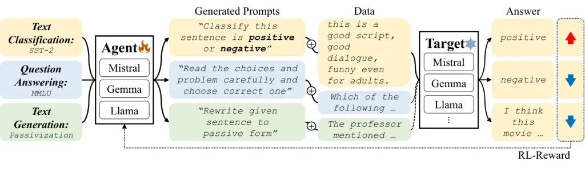
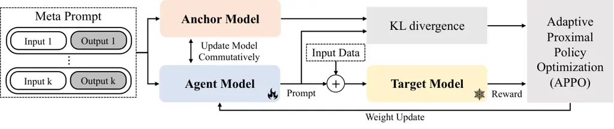
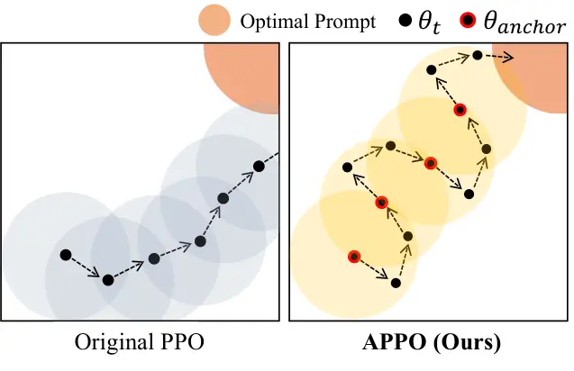
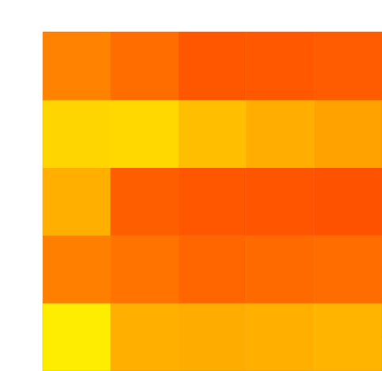

# StablePrompt: Automatic Prompt Tuning using Reinforcement Learning for Large Language Models

Minchan KwonGaeun KimJongsuk KimHaeil LeeJunmo Kim Affiliation: KAIST
Email: [{kmc0207, gkstha5176, jskpop, haeil.lee,
junmo.kim}@kaist.ac.kr](mailto:)

###### Abstract

Finding appropriate prompts for the specific task has become an
important issue as the usage of Large Language Models (LLM) has
expanded. Reinforcement Learning (RL) is widely used for prompt tuning,
but its inherent instability and environmental dependency make it
difficult to use in practice. In this paper, we propose StablePrompt,
which strikes a balance between training stability and search space,
mitigating the instability of RL and producing high-performance prompts.
We formulate prompt tuning as an online RL problem between the agent and
target LLM and introduce Adaptive Proximal Policy Optimization (APPO).
APPO introduces an LLM anchor model to adaptively adjust the rate of
policy updates. This allows for flexible prompt search while preserving
the linguistic ability of the pre-trained LLM. StablePrompt outperforms
previous methods on various tasks including text classification,
question answering, and text generation. Our code can be found in
[github](https://github.com/kmc0207/Stableprompt).



Figure 1: Overview of StablePrompt. We formulate prompt tuning as an
RL-framework using LLMs. We use the target LLM and the given dataset as
the world model, and the agent LLM as the policy. We use the response of
the target LLM to the prompt generated by the agent LLM as the reward.

## 1 Introduction

From Semantics Bréal (1900) to GPT-4 Achiam et al. (2023), language
models have undergone a huge evolution. Recently, large language models
(LLM) are not only used in traditional natural language processing tasks
such as text classification Wang et al. (2018) and summarization Wang
et al. (2019), but are also being applied to a wider range of tasks
including question answering Hendrycks et al. (2020), chatting Ding
et al. (2023), math problem solving Cobbe et al. (2021), and
planning Yao et al. (2022). While LLMs perform well in these areas, they
rely heavily on hand-crafted prompts. Finding or tuning the prompts
automatically is crucial to use and evaluate the ability of LLMs in a
wider range of applications. Reinforcement Learning (RL) is a prominent
method for prompt tuning due to its ability to update prompts without
gradients in the discrete word space. However, RL is vulnerable to
overfitting and is highly dependent on the environment. This challenge
limits the use of RL for a wide variety of LLMs and tasks Previous
methods addressed this by limiting the prompt length Deng et al. (2022)
or constraining the action space Zhang et al. (2022b), but these
approaches reduce the performance of the prompt due to the restricted
search space.

In this paper, we propose StablePrompt that keeps training stability
while ensuring search space flexibility. We define prompt tuning as an
online, on-policy RL problem for a given dataset and target LLM.
StablePrompt sets the agent model as the LLM and optimizes the agent
model with adaptive proximal policy optimization (APPO). APPO adaptively
adjusts the policy update rate by introducing an anchor model, a
snapshot of a point in time on the training trajectory. This leverages
the strong language understanding capabilities of the pre-trained LLMs
to give the agent model search space flexibility while maintaining
training stability. We propose two prompt tuning frameworks using APPO:
StablePrompt and Test-Time Editing StablePrompt (TTE-StablePrompt).
StablePrompt generates a single prompt appropriate for the entire
dataset, while TTE-StablePrompt generates appropriate prompts for each
input.

We validate our methods on a variety of tasks and LLMs. The datasets
include text classification Wang et al. (2018), text understanding Wang
et al. (2019), question answering Hendrycks et al. (2020), and
instruction induction Honovich et al. (2022). For agent and target LLMs,
we conduct experiments on different sizes ranging from 2B to 13B, using
various models such as Llama Touvron et al. (2023), Mistral Jiang et al.
(2023), Gemma Team et al. (2024), and Falcon Almazrouei et al. (2023).
To the best of our knowledge, our method is the first RL-based approach
that works on agents LLM larger than 7B. StablePrompt achieves
State-of-The-Art performance across various tasks.

Our contributions are summarized as follows:

- •
  We propose StablePrompt, which is an RL-based prompt tuning method
  using APPO. APPO introduces an anchor model and modifies the
  KL-divergence term to keep training stable while ensuring the search
  space is flexible.
- •
  StablePrompt achieves SoTA performance on various tasks including text
  classification, question answering, and text generation. It can be
  also used with various types and sizes of agents and target LLMs.
- •
  We extend StablePrompt to create an input-dependent prompt. It
  achieves high performance on tasks that are hard to solve with a
  single prompt.

## 2 Related Work

### 2.1 Automatic Prompt Tuning

Automatic prompt tuning aims to find the appropriate prompts for a given
dataset and target model. Soft prompt tuning or Continuous prompt
tuning Bailey et al. (2023); Lester et al. (2021) uses direct gradient
descent to search prompts. While it can find the optimal prompt, the
generated prompt is often not readable and requires a substantial amount
of data to converge. By contrast, discrete prompt tuning aims to find
prompts in the form of natural language. This approach often operates
like black-box optimization, making it suitable for API-based LLMs.
Discrete prompt tuning methods can be broadly categorized into
generation-based methods and RL-based methods.

### 2.2 Discrete Prompt Tuning

Generation-based methods rely on the text generation abilities of LLMs
to find prompts. For example, APE Zhou et al. (2022) generates prompts
by using example input-output pairs, ProTeGi Pryzant et al. (2023)
improves prompts through iterative conversation, and PromptAgent Wang
et al. (2023) edits prompts based on a Monte Carlo tree search. Since
these methods rely on the performance of a pre-trained LLM without
additional tuning, they struggle with tasks that are outside the scope
of pre-training.

RL-based methods formulate prompt tuning as an online, on-policy RL
problem. For example, GrIPS Prasad et al. (2022), BoostPrompt Hou et al.
(2023), and PACE Dong et al. (2023) use RL to edit the initial manual
prompt. While these methods are relatively stable in training, they
heavily depend on the quality of the manual prompt and the predefined
action space for editing. RLprompt Deng et al. (2022) is a pioneering
work that proposed a method for training agent LLMs using RL. RLprompt
adds an MLP layer to the agent LLM for training stability and trains
only on this layer. However, as the hidden size of the agent LLM
increases, the computational overhead increases rapidly. This is
impractical for use in modern LLMs with large hidden sizes.
TEMPERA Zhang et al. (2022b) used RL to explore input-dependent
prompting. It adopts an agent model that shares a stem of the target LLM
to generate input-dependent prompts. However, TEMPERA is limited by a
predefined action space and struggles with scalability as the hidden
size of the target LLM increases. StablePrompt is designed for a
scalable and stable RL-based method.



Figure 2: Training framework of StablePrompt. Generate prompts using the
Task agnostic meta-prompt, and calculate the reward of the generated
prompts with training data.



Figure 3: Illustration comparing APPO to the original PPO. The circle
represents the constraint of KL-divergence, and each dot represents the
parameter of the agent model at each time step. APPO is robust to
incorrect rewards because it maintains an anchor model, while PPO
deviates from the optimal prompt as incorrect rewards accumulate.

## 3 Method

### 3.1 RL Formulation

We formulate the discrete prompt tuning as a problem of finding the
optimal discrete prompt $`\mathbf{z}^{\star}`$ for a given target model
$`M_{T}`$ and a dataset $`D`$. $`\mathbf{z}`$ is defined in the
vocabulary of target model $`V`$ and prompt length $`L`$. $`\mathbf{z}`$
satisfies the following equation.

```math
\operatorname{max}_{\mathbf{z}\in V^{L}}R(M_{T}(\mathbf{z},x),y) \tag{1}
```

where $`R`$ is pre-defined reward function, and input-output
pair$`x,y\in D`$.

We introduce an agent model $`M_{a}`$ as LLM that generates prompts
autoregressively from random input-output pair $`(x_{r},y_{r})\in D`$
and task-agnostic meta prompt. We define this set of inputs as state
$`s`$. Detailed meta-prompt can be found in Figure 6. Agent model
generates prompts up to the length $`l`$ according to the
$`M_{a}(z_{l}|s,\mathbf{z}_{<l})`$. After $`\mathbf{z}`$ is created, it
receives a reward from the $`R(M_{T}(\mathbf{z},x),y)`$. The full
training objective function is below:

```math
\operatorname{max}_{M_{a}}R(M_{T}(\mathbf{z},x),y),\mathbf{z}\sim\displaystyle\prod^{L}_{l=1}M_{a}(z_{l}|s,\mathbf{z}_{<l}) \tag{2}
```

#### Original PPO.

As a method for training LLM agents with RL, we improved Proximal Policy
Optimization (PPO). We refer to the PPO proposed in  Schulman et al.
(2017) as the original PPO, to distinguish it from the version modified
for RLHF Ouyang et al. (2022). To implement PPO on the LLM agent, we add
a value head to the last layer of the LLM agent, which is trained using
MSE loss to predict reward values for inputs.

```math
L_{v}=(v_{\text{preds}}-\text{reward})^{2} \tag{3}
```

The value expected from the value head is used with reward to compute
advantage $`A`$, which uses Generalized Advantage Estimation (GAE) and
clipped.

```math
A=\operatorname{GAE}(v_{\text{preds}},\text{reward}) \tag{4}
```

```math
\text{ratio}=\frac{\theta_{t}(\mathbf{z}|s)}{\theta_{t-1}(\mathbf{z}|s)} \tag{5}
```

```math
A_{clipped}=\operatorname{clip}(\text{ratio},1-\epsilon,1+\epsilon)*A \tag{6}
```

where $`\theta`$ is parameter of agent model and $`t`$ is timestep.

Then calculate the penalty $`P`$ which is the KL-divergence between the
previous version of the agent model and the current version. The full
agent loss is as the follows:

```math
P=\operatorname{KL}(\theta_{t}(\mathbf{z}|s)||\theta_{t-1}(\mathbf{z}|s)) \tag{7}
```

```math
L_{\text{agent}}=A_{\text{clipped}}+P \tag{8}
```

The final PPO objective is as follows:

```math
L_{PPO}=L_{v}+L_{agent} \tag{9}
```

In practice, we perform parameter-efficient training using the LoRA Hu
et al. (2021) and update only the value head and the LoRA adaptor.

### 3.2 StablePrompt

#### Anchor Model.

Traditional PPO methods limit updates relative to the previous step,
making it difficult to prevent errors from accumulating. We introduce an
anchor model, which is a copy of the agent model with validated
performance improvements in the training trajectory. The anchor model
starts as a copy of the initial agent and is carefully updated at a
predefined update period $`u_{t}`$. If the performance of the current
agent model is higher than an update threshold compared to the anchor
model, the anchor model is updated to the copy of the current agent
model. Conversely, if the agent model underperforms the anchor model by
less than a rollback threshold, the agent model is rolled back to the
anchor model.

This allows the anchor model to adaptively update based on the
characteristics of the task. If the reward signal is stable or requires
several update steps to find the optimal prompt, the anchor model is
updated accordingly. On the other hand, if the reward signal is unstable
or does not require many updates to find the optimal prompt, the anchor
model is updated in a few steps or not.

#### Adaptive PPO.

The KL-divergence penalty term (Equation 7) uses the parameters of the
previous model to prevent the current model from changing too much. But
as the steps get longer, the model can gradually diverge from the
initial. When unstable reward signals accumulate, this can lead the
model into a local minima.

In RLHF-style PPO Ouyang et al. (2022), the penalty term (Equation 7) is
modified by
$`\operatorname{KL}(\theta_{t}(\mathbf{z}|s)||\theta_{0}(\mathbf{z}|s))`$
to prevent the agent model from deviating too far from the initial
version. This is appropriate for a task like RLHF that needs to answer a
wide variety of questions while not losing the initial language
generation capability. However, in prompt tuning, RLHF-style PPO limits
the search space of the agent to the initial agent, which leads to
suboptimal prompts.

We propose Adaptive PPO (APPO), which combines the advantages of
RLHF-style and original PPO, achieving both training stability and an
extensive search space. We leverage the anchor model to modify
Equation 7 as follows :

```math
P_{\text{APPO}}=KL(\theta_{t}(\mathbf{z}|s)||\theta_{\text{anchor}}(\mathbf{z}|s)) \tag{10}
```

This term restricts the agent model from diverging too far from an
anchor model. This approach allows for more conservative agent updates
compared to the original PPO while ensuring a larger search space
compared to RLHF-style PPO. The full objective of APPO is below:

```math
L^{\text{APPO}}_{\text{agent}}=A_{\text{clipped}}+P_{\text{APPO}} \tag{11}
```

```math
L_{\text{APPO}}=L_{v}+L^{\text{APPO}}_{\text{agent}} \tag{12}
```

#### Reward Function.

We design reward functions for two tasks: text classification and text
generation. For text classification, we use accuracy and softmax
difference. While accuracy is a good reward function, it has discrete
values, which can lead to many prompts having the same accuracy. This
problem is often encountered in scenarios with limited training data,
such as few-shot text classification. To mitigate this, we introduce the
softmax difference, which subtracts the highest value among the
incorrect options from the value of the correct answer from the softmax
output. The following expression combines accuracy and the softmax
difference, with coefficients $`c_{a}`$ and $`c_{s}`$ applied
respectively.

```math
R(\mathbf{z},x,y)=c_{a}\operatorname{Acc}(\mathbf{z},x,y)+c_{s}\operatorname{D}(\mathbf{z},x,y) \tag{13}
```

```math
\operatorname{D}=M_{T}(\mathbf{z},x)_{i=y}-\operatorname{max}[M_{T}(\mathbf{z},x)_{i\neq y}] \tag{14}
```

This metric is used to rank prompts when they have the same accuracy.
The softmax difference is also widely used in other RL frameworks for
classification Han et al. (2023).

For text generation, we use the F1 score directly as the reward
function.

[TABLE]

Table 1: Result for 6 few-shot text classification datasets.
StablePrompt outperforms other discrete prompt tuning methods. Generated
prompts can found in Section C.1

### 3.3 Test Time Editing StablePrompt.

For tasks that are difficult to solve with a single prompt, we expand
StablePrompt to generate prompts that depend on the input query. We call
this extended version as Test-Time Editing StablePrompts
(TTE-StablePrompt).

In TTE-StablePrompt, the input state $`s`$ consists of a meta prompt
that includes randomly chosen input-output pairs and the current input.
The agent generates a prompt for the current input. The generated prompt
and current input are fed into the target model to calculate rewards.
Detailed meta prompt can be found in Figure 6. We keep the same settings
for the other parts of the method.

This approach is different from StablePrompt, which uses the average
value of the training batch as its reward. The reward of
TTE-StablePrompt is calculated using only the current input. In
TTE-StablePrompt, the instance reward signals train the agent model to
generate prompts optimized for specific inputs, rather than the entire
dataset.



Figure 4: Heatmap of few-shot text classification tasks on diverse
target-agent pairs. Reported numbers are an average of 6 datasets. MP :
Manual prompt, G2: Gemma-2B, G7: Gemma-7B, M7: Mistral-7B, L8:
Llama-3-8B, F11: Falcon-11B. StablePrompt works well with a variety of
LLMs.

## 4 Experiment

### 4.1 Few Shot Text Classification

#### Datasets.

Few-shot text classification is used in many previous prompt tuning
studies, including  Deng et al. (2022); Zhang et al. (2022b). We use the
subsets of GLUE Wang et al. (2018) and SuperGLUE Wang et al. (2019),
including sentiment analysis datasets (SST-2) and natural language
inference datasets (MRPC, MNLI, QNLI, SNLI, and RTE).

For inference, we use a verbalizer with predefined class label tokens.
When determining the prediction of models, we select candidates only
from the set of verbalizers. Detailed dataset statistics and verbalizer
settings can be found in the Table 7.

#### Baselines.

Our baselines include supervised fine-tuning methods such as LoRA
fine-tuning and soft prompt tuning Bailey et al. (2023). We also use
fixed prompts including hand-crafted manual prompts, few-shot prompts,
and zero-shot chain of thought (Zero-Shot CoT) prompts Wei et al.
(2022).

For direct comparison with StablePrompt, we use various discrete prompt
tuning methods. These include generation-based methods such as APE Zhou
et al. (2022) and ProTeGi Pryzant et al. (2023), and RL-based method
such as GrIPS Prasad et al. (2022), PromptBoosting Hou et al. (2023) and
RLprompt Deng et al. (2022), which is directly comparable to ours.
Therefore, we conduct experiments on the 330M RoBERTa-large  Liu et al.
(2019) model and include the results in the Table 8.

[TABLE]

Table 2: Result for 6 selected tasks and an average of all 24 tasks in
the Instruction induction dataset with InstructGPT3.5 as the target
model. Full results can be found in Table 12.

[TABLE]

Table 3: Result for BigBench-Hard Instruction Induction (BBII) and
Instruction Induction (II) datasets. For BBII, we divided it into two
parts based on the type of task. Full results can be found in  Table 10
and Table 11.

#### Implementation Details.

We perform two settings on Few-Shot Text Classification. One is an
experiment with both the target and the agent model fixed to
gemma-1.1-7B-it (Gemma-7B)  Team et al. (2024) for comparison with the
baselines. For RLprompt, we use GPT2-XL Radford et al. (2019) as the
agent due to computational overhead.

The other experiment runs StablePrompt on five target models:
gemma-1.1-2B-it (Gemma-2B), Gemma-7B, Mistral-7B-it-v2.0
(Mistral-7B) Jiang et al. (2023), llama3-8B-it (Llama3-8B) Touvron
et al. (2023), and falcon-11B (Falcon-11B) Almazrouei et al. (2023), and
four agent models: Gemma-2B, Gemma-7B, Mistral-7B, Llama3-8B. We report
the average accuracy of 6 datasets in Table 1.

All experiments are performed with three distinct random seeds. For the
generated prompts, we use the template "\[prompt\] Input : \[input\]
Output :" for prediction. We use only 16 samples per label for training.
The generated prompts of each step are queued in pairs with rewards. At
the test time, the top 5 prompts in order of reward are selected for
testing and report the highest performance. This is the same method as
RLprompt. Detailed numbers are shown in the Table 6.

#### Results.

Table 1 shows the performance of various baselines and StablePrompt.
StablePrompt achieves State-of-The-Art (SoTA) performance on all tasks
except QNLI. In QNLI, StablePrompt also achieves the best performance
among the discrete prompt tuning methods. The average score also
outperforms APE and achieves SoTA. We present the full generated prompt
in the Section C.1.

Figure 4 illustrates the performance of StablePrompt across various
Agent-Target pairs. The values in the heatmap are the averages of six
datasets. StablePrompt outperforms manual prompts across all pairs
except (Gemma-2B, Llama3-8B) pair. These results demonstrate that our
method is robust to model sizes, such as a small agent model of 2B and a
large target model of 11B.

Specifically, when comparing Mistral-7B and Falcon-11B, the manual
prompt performance is higher with falcon-11B, but with appropriate
prompting from StablePrompt, Mistral-7B outperforms falcon-11B. This
demonstrates that an appropriate prompt allows a small model to easily
understand a task and achieve performance comparable to a large model.

[TABLE]

Table 4: Results for QA tasks. We use MMLU and OpenbookQA datasets with
Gemma-7B as the target model. Full results can be found in Table 13.

### 4.2 Induction Task

#### Datasets.

We experiment with an induction task in which the agent has to provide a
rule for an input-output pair as a prompt. We use the Instruction
Induction dataset (II) Mishra et al. (2022) and BigBench-Instruction
Induction dataset (BBII) Zhou et al. (2022), a subset of
BiG-Bench Ghazal et al. (2013). These include tasks such as editing the
input sentence or finding answers according to rules. Each task requires
prompts in the form of instructions designed to help the target model
induce the correct answer.

The tasks consist of text classification and text generation, requiring
an understanding of various fields such as spelling, morphosyntax, and
phonetics. We conduct experiments on BBII, which has 20 subsets, and
Instruction Induction, which has 23 subsets. The dataset details can be
found in Section A.3.

#### Implementation Details.

We perform experiments with two different target models. One is the
Gemma-7B and the other is InstructGPT3.5. For the first experiments, due
to the large number of datasets, we use APE and ProTeGi as baselines,
and we include PromptAgent Wang et al. (2023) which is a Monte Carlo
tree search-based generation method designed for BigBench text
classification tasks.

In experiments with InstructGPT3.5, we use APE to reduce the number of
steps due to cost. For APE, we use various agent models such as  Zhang
et al. (2022a); Zeng et al. (2022). We use PACE Dong et al. (2023), an
RL-based editing method designed for induction tasks, and a human prompt
from the same paper as the baseline.

For text classification, we use the same reward function as Section 4.1.
For text generation, we use the F1 score as a reward function. We use
the same template as Section 4.1 for both BBII and II.

#### Results.

Experiments on the Gemma-7B target model are presented in Table 3. Our
method achieves SoTA on both BBII and II. In particular, it outperforms
the text generation tasks II and BBII. This shows the effectiveness of
the RL framework on the text generation tasks, where the format of the
output is important.

Table 2 shows the experiments conducted using InstructGPT3.5.
StablePrompt outperforms even when using the large black-box model
InstructGPT3.5 as the target model. This highlights the benefits of the
RL-based method, which works well when the target model is not publicly
accessible.

Note that our method outperforms APE, which uses models larger than 100B
as the agent. In particular, the 7B model trained by StablePrompt
produces better prompts than the commercial black box model
InstructGPT3.5. This shows that our method does not rely on the ability
of the agent model and is cost-efficient by using a small model.

### 4.3 Question Answering

#### Datasets.

We conduct an experiments on a Question Answering (QA) task. In this
paper, we use the MMLU Hendrycks et al. (2020) and OpenbookQA Mihaylov
et al. (2018) dataset, which requires users to answer questions from
various fields. We report the performance of 57 question topics from
MMLU, categorized into STEM, Humanity, Social Science, and Others. For
OpenbookQA, in addition to the question, a fact relevant to each
question is provided as a hint, which we include as a prompt before the
question during experiments. The verbalizer is used in the same way as
for text classification. We present 4 options (A,B,C,D) in a question
and use the alphabet corresponding to each option as a verbalizer. The
reward function is the same as Section 4.1. Detailed numbers of datasets
can be found in Section A.3.

#### Implementation Details.

The target and agent models are both fixed with Gemma-7B. For the
prompt, we use the template "\[Prompt\] Question : \[Question\] Choice :
\[Choice\] Output :". We train the model using 20 question-answer pairs
from the validation dataset for each topic.

Figure 5: Generated prompts and input in machine learning subset of MMLU
dataset. We truncate the latter part of the generated prompt for
readability. The full prompt can be found in Section C.5

[TABLE]

Table 5: Result for ablation study of PPO components on few-shot text
classification tasks. We report the average and standard deviation of
experiments from 5 distinct random seeds.

#### Results.

Table 4 shows the performance of various baselines. StablePrompt
achieves the highest performance among the baselines. In particular,
StablePrompt shows comparable results with STEM while outperforming all
other methods.

There are many different questions on the same topic that are difficult
to solve with a single prompt. TTE-StablePrompt, which gives different
instructions depending on the input within the same subject, is more
effective than StablePrompt, which only uses a single prompt.
TTE-StablePrompt also performs better than Zero-Shot CoT, which uses the
same multi-step reasoning and is known to perform well on maths and
science tasks.

Figure 5 shows question-choice pairs from the machine learning dataset
in MMLU, along with the prompts generated by APE, StablePrompt, and
TTE-StablePrompt. APE and StablePrompt generate almost semantically
similar prompts which can be generally used for all questions in
subject. However, TTE-StablePrompt generates prompts appropriate to the
given question (emphasized with underlining). This shows that a simple
TTE extension effectively creates an input-dependent prompt.

### 4.4 Ablation Study

#### Experiment Settings.

We conduct an ablation study for APPO. We use the same settings as
few-shot text classification. We fix the agent and the target model to
Gemma-7B.

#### Results.

Table 5 shows the performance of PPO variants. APPO outperforms on
average across all tasks by leveraging the strengths of both the
original PPO and RLHF-style PPO through adaptive anchor model updates.
APPO can either behave like the RLHF-style PPO, with no updates, or like
the original PPO, with updates in each update period. In particular,
when the performance gap between the original PPO and RLHF-style PPO is
significant, APPO adapts to the better-performing model. This pattern is
observed in tasks like MRPC, QNLI, and MNLI. Additionally, in tasks such
as SNLI, APPO can identify more appropriate prompts than either the
original or RLHF-style PPO alone. This shows that APPO takes advantage
of PPO and RLHF-style PPO and reaches a better convergence point.

## 5 Conclusion

In this paper, we propose a novel RL-based prompt tuning method,
StablePrompt. StablePrompt defines prompt tuning as an online, on-policy
RL problem and introduces APPO. We validate that StablePrompt
outperforms than other methods across various target models and tasks.
To the best of our knowledge, this is the first RL-based prompt tuning
method for models larger than 7B. StablePrompt demonstrates the
potential to integrate existing RL methodologies into prompt tuning, and
we believe there is a capacity for further expansion of RL-based prompt
tuning approaches.

## Limitation

The limitations of this study can be summarized as follows: (1) This
paper does not cover experiments that are significantly beyond the scope
of prior learning, such as medical and legal domains; however, since it
is a training-based method, it is expected to be scalable in future
work. (2) This paper can be used to abuse LLM for specific purposes.
This is a particular threat to commercial LLMs in the API format because
they are based on black-box optimization.

## Acknowledgments

This work was supported by Institute of Information & Communications
Technology Planning & Evaluation(IITP) grant funded by the Korea
government(MSIT) (RS-2024-00439020, Developing Sustainable, Real-Time
Generative AI for Multimodal Interaction, SW Starlab)

## References

- Achiam et al. (2023) Josh Achiam, Steven Adler, Sandhini Agarwal, Lama
  Ahmad, Ilge Akkaya, Florencia Leoni Aleman, Diogo Almeida, Janko
  Altenschmidt, Sam Altman, Shyamal Anadkat, et al. 2023. Gpt-4
  technical report. _arXiv preprint arXiv:2303.08774_.
- Almazrouei et al. (2023) Ebtesam Almazrouei, Hamza Alobeidli,
  Abdulaziz Alshamsi, Alessandro Cappelli, Ruxandra Cojocaru, Merouane
  Debbah, Etienne Goffinet, Daniel Heslow, Julien Launay, Quentin
  Malartic, et al. 2023. Falcon-40b: an open large language model with
  state-of-the-art performance. _Findings of the Association for
  Computational Linguistics: ACL_, 2023:10755–10773.
- Bailey et al. (2023) Luke Bailey, Gustaf Ahdritz, Anat Kleiman,
  Siddharth Swaroop, Finale Doshi-Velez, and Weiwei Pan. 2023. Soft
  prompting might be a bug, not a feature.
- Bréal (1900) Michel Bréal. 1900. _Semantics: Studies in the science of
  meaning_. W. Heinemann.
- Cobbe et al. (2021) Karl Cobbe, Vineet Kosaraju, Mohammad Bavarian,
  Mark Chen, Heewoo Jun, Lukasz Kaiser, Matthias Plappert, Jerry Tworek,
  Jacob Hilton, Reiichiro Nakano, et al. 2021. Training verifiers to
  solve math word problems. _arXiv preprint arXiv:2110.14168_.
- Deng et al. (2022) Mingkai Deng, Jianyu Wang, Cheng-Ping Hsieh, Yihan
  Wang, Han Guo, Tianmin Shu, Meng Song, Eric P Xing, and Zhiting
  Hu. 2022. Rlprompt: Optimizing discrete text prompts with
  reinforcement learning. _arXiv preprint arXiv:2205.12548_.
- Ding et al. (2023) Ning Ding, Yulin Chen, Bokai Xu, Yujia Qin, Zhi
  Zheng, Shengding Hu, Zhiyuan Liu, Maosong Sun, and Bowen Zhou. 2023.
  Enhancing chat language models by scaling high-quality instructional
  conversations. _arXiv preprint arXiv:2305.14233_.
- Dong et al. (2023) Yihong Dong, Kangcheng Luo, Xue Jiang, Zhi Jin, and
  Ge Li. 2023. Pace: Improving prompt with actor-critic editing for
  large language model. _arXiv preprint arXiv:2308.10088_.
- Ghazal et al. (2013) Ahmad Ghazal, Tilmann Rabl, Minqing Hu, Francois
  Raab, Meikel Poess, Alain Crolotte, and Hans-Arno Jacobsen. 2013.
  Bigbench: Towards an industry standard benchmark for big data
  analytics. In _Proceedings of the 2013 ACM SIGMOD international
  conference on Management of data_, pages 1197–1208.
- Han et al. (2023) Gyojin Han, Jaehyun Choi, Haeil Lee, and Junmo
  Kim. 2023. Reinforcement learning-based black-box model inversion
  attacks. In _Proceedings of the IEEE/CVF Conference on Computer Vision
  and Pattern Recognition_, pages 20504–20513.
- Hendrycks et al. (2020) Dan Hendrycks, Collin Burns, Steven Basart,
  Andy Zou, Mantas Mazeika, Dawn Song, and Jacob Steinhardt. 2020.
  Measuring massive multitask language understanding. _arXiv preprint
  arXiv:2009.03300_.
- Honovich et al. (2022) Or Honovich, Uri Shaham, Samuel R Bowman, and
  Omer Levy. 2022. Instruction induction: From few examples to natural
  language task descriptions. _arXiv preprint arXiv:2205.10782_.
- Hou et al. (2023) Bairu Hou, Joe O’connor, Jacob Andreas, Shiyu Chang,
  and Yang Zhang. 2023. Promptboosting: Black-box text classification
  with ten forward passes. In _International Conference on Machine
  Learning_, pages 13309–13324. PMLR.
- Hu et al. (2021) Edward J Hu, Yelong Shen, Phillip Wallis, Zeyuan
  Allen-Zhu, Yuanzhi Li, Shean Wang, Lu Wang, and Weizhu Chen. 2021.
  Lora: Low-rank adaptation of large language models. _arXiv preprint
  arXiv:2106.09685_.
- Jiang et al. (2023) Albert Q Jiang, Alexandre Sablayrolles, Arthur
  Mensch, Chris Bamford, Devendra Singh Chaplot, Diego de las Casas,
  Florian Bressand, Gianna Lengyel, Guillaume Lample, Lucile Saulnier,
  et al. 2023. Mistral 7b. _arXiv preprint arXiv:2310.06825_.
- Lester et al. (2021) Brian Lester, Rami Al-Rfou, and Noah
  Constant. 2021. The power of scale for parameter-efficient prompt
  tuning. _arXiv preprint arXiv:2104.08691_.
- Liu et al. (2019) Yinhan Liu, Myle Ott, Naman Goyal, Jingfei Du,
  Mandar Joshi, Danqi Chen, Omer Levy, Mike Lewis, Luke Zettlemoyer, and
  Veselin Stoyanov. 2019. Roberta: A robustly optimized bert pretraining
  approach. _arXiv preprint arXiv:1907.11692_.
- Mihaylov et al. (2018) Todor Mihaylov, Peter Clark, Tushar Khot, and
  Ashish Sabharwal. 2018. Can a suit of armor conduct electricity? a new
  dataset for open book question answering. In _EMNLP_.
- Mishra et al. (2022) Swaroop Mishra, Daniel Khashabi, Chitta Baral,
  and Hannaneh Hajishirzi. 2022. Cross-task generalization via natural
  language crowdsourcing instructions. In _ACL_.
- Ouyang et al. (2022) Long Ouyang, Jeffrey Wu, Xu Jiang, Diogo Almeida,
  Carroll Wainwright, Pamela Mishkin, Chong Zhang, Sandhini Agarwal,
  Katarina Slama, Alex Ray, et al. 2022. Training language models to
  follow instructions with human feedback. _Advances in neural
  information processing systems_, 35:27730–27744.
- Prasad et al. (2022) Archiki Prasad, Peter Hase, Xiang Zhou, and Mohit
  Bansal. 2022. Grips: Gradient-free, edit-based instruction search for
  prompting large language models. _arXiv preprint arXiv:2203.07281_.
- Pryzant et al. (2023) Reid Pryzant, Dan Iter, Jerry Li, Yin Tat Lee,
  Chenguang Zhu, and Michael Zeng. 2023. Automatic prompt optimization
  with" gradient descent" and beam search. _arXiv preprint
  arXiv:2305.03495_.
- Radford et al. (2019) Alec Radford, Jeffrey Wu, Rewon Child, David
  Luan, Dario Amodei, Ilya Sutskever, et al. 2019. Language models are
  unsupervised multitask learners. _OpenAI blog_, 1(8):9.
- Schulman et al. (2017) John Schulman, Filip Wolski, Prafulla Dhariwal,
  Alec Radford, and Oleg Klimov. 2017. Proximal policy optimization
  algorithms. _arXiv preprint arXiv:1707.06347_.
- Team et al. (2024) Gemma Team, Thomas Mesnard, Cassidy Hardin, Robert
  Dadashi, Surya Bhupatiraju, Shreya Pathak, Laurent Sifre, Morgane
  Rivière, Mihir Sanjay Kale, Juliette Love, et al. 2024. Gemma: Open
  models based on gemini research and technology. _arXiv preprint
  arXiv:2403.08295_.
- Touvron et al. (2023) Hugo Touvron, Thibaut Lavril, Gautier Izacard,
  Xavier Martinet, Marie-Anne Lachaux, Timothée Lacroix, Baptiste
  Rozière, Naman Goyal, Eric Hambro, Faisal Azhar, et al. 2023. Llama:
  Open and efficient foundation language models. _arXiv preprint
  arXiv:2302.13971_.
- Wang et al. (2019) Alex Wang, Yada Pruksachatkun, Nikita Nangia,
  Amanpreet Singh, Julian Michael, Felix Hill, Omer Levy, and Samuel
  Bowman. 2019. Superglue: A stickier benchmark for general-purpose
  language understanding systems. _Advances in neural information
  processing systems_, 32.
- Wang et al. (2018) Alex Wang, Amanpreet Singh, Julian Michael, Felix
  Hill, Omer Levy, and Samuel R Bowman. 2018. Glue: A multi-task
  benchmark and analysis platform for natural language understanding.
  _arXiv preprint arXiv:1804.07461_.
- Wang et al. (2023) Xinyuan Wang, Chenxi Li, Zhen Wang, Fan Bai,
  Haotian Luo, Jiayou Zhang, Nebojsa Jojic, Eric P Xing, and Zhiting
  Hu. 2023. Promptagent: Strategic planning with language models enables
  expert-level prompt optimization. _arXiv preprint arXiv:2310.16427_.
- Wei et al. (2022) Jason Wei, Xuezhi Wang, Dale Schuurmans, Maarten
  Bosma, Fei Xia, Ed Chi, Quoc V Le, Denny Zhou, et al. 2022.
  Chain-of-thought prompting elicits reasoning in large language models.
  _Advances in neural information processing systems_, 35:24824–24837.
- Yao et al. (2022) Shunyu Yao, Howard Chen, John Yang, and Karthik
  Narasimhan. 2022. Webshop: Towards scalable real-world web interaction
  with grounded language agents. _Advances in Neural Information
  Processing Systems_, 35:20744–20757.
- Zeng et al. (2022) Aohan Zeng, Xiao Liu, Zhengxiao Du, Zihan Wang,
  Hanyu Lai, Ming Ding, Zhuoyi Yang, Yifan Xu, Wendi Zheng, Xiao Xia,
  et al. 2022. Glm-130b: An open bilingual pre-trained model. _arXiv
  preprint arXiv:2210.02414_.
- Zhang et al. (2022a) Susan Zhang, Stephen Roller, Naman Goyal, Mikel
  Artetxe, Moya Chen, Shuohui Chen, Christopher Dewan, Mona Diab, Xian
  Li, Xi Victoria Lin, et al. 2022a. Opt: Open pre-trained transformer
  language models. _arXiv preprint arXiv:2205.01068_.
- Zhang et al. (2022b) Tianjun Zhang, Xuezhi Wang, Denny Zhou, Dale
  Schuurmans, and Joseph E Gonzalez. 2022b. Tempera: Test-time prompting
  via reinforcement learning. _arXiv preprint arXiv:2211.11890_.
- Zhou et al. (2022) Yongchao Zhou, Andrei Ioan Muresanu, Ziwen Han,
  Keiran Paster, Silviu Pitis, Harris Chan, and Jimmy Ba. 2022. Large
  language models are human-level prompt engineers. _arXiv preprint
  arXiv:2211.01910_.

## Appendix A Experiment Details

### A.1 RL parameters

We summarize the RL-related hyperparameters used in our experiments in
the  Table 6. We used the same hyperparameters for all tasks.

### A.2 Meta Prompt

We show the meta-prompt used as input to StablePrompt in  Figure 6.

|                        |              |
| ---------------------- | ------------ |
| HyperParameters        | Stableprompt |
| Learning Rate          | 1.00E-05     |
| Value loss Coefficient | 0.1          |
| Gamma                  | 1            |
| GAE Lambda             | 0.95         |
| cliprange              | 0.2          |
| $`u_{t}`$              | 5            |
| Update Threshold(%)    | 0.05         |
| Rollback Threshold(%)  | 0.1          |
| Prompt per Batch       | 4            |
| Maximum Prompt Length  | 150          |
| $`c_{a}`$              | 10           |
| $`c_{s}`$              | 0.1          |

Table 6: Detail parameters used in StablePrompt.

Figure 6: Detail template of meta prompt used in StablePrompt and
TTE-StablePrompt

### A.3 Dataset Details

| Dataset | Type      | \|C\| | \|Train\|=\|Dev\| | \|Test\| | Verbalizer       |
| ------- | --------- | ----- | ----------------- | -------- | ---------------- |
| SST2    | sentiment | 2     | 32                | 1.8k     | \[yes,no\]       |
| MRPC    | NLI       | 2     | 32                | 1.7k     | \[yes,no\]       |
| RTE     | NLI       | 2     | 32                | 0.3k     | \[yes,no\]       |
| QNLI    | NLI       | 2     | 32                | 9.8k     | \[yes,no\]       |
| MNLI    | NLI       | 3     | 48                | 10k      | \[yes,maybe,no\] |
| SNLI    | NLI       | 3     | 48                | 9.8k     | \[yes,maybe,no\] |
| MMLU    | QA        | 4     | \-                | \-       | \[A,B,C,D\]      |

Table 7: Details of the datasets for few-shot classification.

#### Few-shot Text Classification

Detailed number and verbalizer settings can be found in Table 7.

#### Induction Task

BIG-Bench Instruction Induction (BBII) is a subset of 21 tasks with
clear and human-written instructions that can be applied to all examples
in the dataset Zhou et al. (2022). The detailed type and metric for each
dataset can be found in Table 10.

Instruction Induction is conducted with 24 induction tasks proposed in
 Honovich et al. (2022). The tasks span many features of language
understanding, from simple phrase structure to similarity and causality
identification. The detailed metric for each dataset can be found
in Table 11.

#### Question Answering

The MMLU QA dataset consists of 15,908 questions. The dataset is divided
into subsets according to 57 subjects. We use the validation set of all
subsets as the training set. The total number of validation sets is
1,540. Each subset has a minimum of 100 test samples, with a total of
14,079 test questions.

### A.4 Baseline Details

#### APE

For a fair comparison, we scale the number of prompts generated by APE
to be the same as the number that StablePrompt generates during
training. Also, unlike the original APE, we use the entire validation
set to determine the final prompt. This setting is more favorable than
the original APE and improves performance.

#### ProTeGi

We use additional settings same as APE and limited the number of
consecutive conversations to two.

#### RLprompt

For RLprompt, as the hidden size of the agent model increases, the size
of the MLP layer increases as well, making it difficult to train the
model. Therefore, we use GPT2-XL Radford et al. (2019) 1.5B, which is
the largest model in the official implementation.

#### PromptAgent

We utilize the official repository and only used it for the text
classification problem as no evaluation metric was specified for text
generation. PromptAgent is known to work well on high-performance LLMs
such as GPT-4. However, in our experiments, we found that using small
7B-level models as agents significantly degrades performance.

### A.5 Training Details

We experiment on a single A100 GPU. For text classification, we use 100
epochs and need 2-3 GPU hours per task. For question-answering and
induction tasks, we use 30 epochs and need 1-2 GPU hours per task.
Training time can be changed by the average length of inputs.

## Appendix B Additional Experiments

### B.1 Text Classification in Small Target Model

#### Implementation Details

To compare the performance of our methods with traditional prompt tuning
baselines, we perform text classification again on a relatively smaller
target model. The target model is fixed as RoBERTa-Large (330M). We
replace the MRPC dataset with the MR dataset from glue. Note that the MR
dataset is a sentiment classification task, not NLI. For RLprompt, the
agent model is GPT-2, as specified in the original paper. For
StablePrompt, the agent model used is Mistral-7B.

[TABLE]

Table 8: Mean and standard deviation of accuracy on three random seeds
of the few-shot text classification task on the roberta-large (330M)
target model setting.

#### Results

The experimental results are shown in  Table 8. StablePrompt
demonstrates the highest performance across all datasets except MR. Even
in MR, it shows comparable performance to TEMPERA, which uses Test-Time
Editing for multi-step reasoning, thereby proving the high performance
of our model.

### B.2 Ablation Study

Figure 7: Training curve of mean reward and value loss by steps.

#### Training curve

Figure 7 shows the mean reward and value loss by steps. We experiment on
the few-shot text classification task with the SST2 dataset. This shows
a steady increase in reward, indicating that our method is training
well. In addition, value loss, the MSE loss of the reward expected by
the value head, also falls steadily over time. This shows that the value
head is also aligned with the reward model.

| Dataset                | SST2              |
| ---------------------- | ----------------- |
| Ours                   | 94.6($`\pm`$0.6)  |
| w/o softmax difference | 93.31($`\pm`$0.8) |

Table 9: Ablation study of reward function terms on sst2 dataset.

#### Reward Function Ablation

Table 9 shows an ablation study for reward function. We use the same
setting as  section 4.1, but change the agent and target model to
Mistral-7B. For text generation, we use only the f1 score. The
continuous value of the f1 score is proper for the reward function. But
in text classification, we introduce softmax difference. A smaller batch
size will result in many prompts with the same accuracy, which will
confuse the model. To avoid this, softmax difference ranks prompts with
the same accuracy. In practice, not using softmax difference results in
a performance penalty.

## Appendix C Generated Prompt

We attach the generated prompts below, which we can not show on the
page. For each task, we post one of the best-performing prompts.

### C.1 Few-Shot Text Classification

#### SST2

\*\*Write yes or no for each input, based on whether the input describes
a movie that would be reasonably entertaining or not.\*\* \*\*Input
1:\*\* Reasonably entertaining sequel \*\*Output:\*\* yes \*\*Input
2:\*\* Familiar and predictable, and 4/5ths of it \*\*Output:\*\* no

#### MRPC

\*\*Write "Yes" or "No" for each sentence pair, based on whether the
second sentence is a paraphrase of the first sentence.\*\* \*\*Here are
the outputs:\*\* - Sentence1 : The woman was hospitalized June 15 ,
Kansas health officials said . Sentence2 : Missouri health officials
said he had not been hospitalized and is recovering . \*\*Output:\*\*
No - Sentence1 : CS ’s other main division , Financial Services , made a
666 million franc net profit , six percent below the prior quarter .
Sentence2 : CS Financial Services made a 666 million franc net profit ,
six percent less than in the fourth quarter of last year .
\*\*Output:\*\* Yes - Sentence1 : It has been named Colymbosathon
ecplecticos , which means " astounding swimmer with a large penis " .
Sentence2 : He and colleagues named it Colymbosathon ecplecticos , which
means " swimmer with a

#### RTE

\*\*For each input-output pair:\*\* \* Carefully read the premise. \*
Consider the relationship between the premise and the hypothesis. \*
Based on the information provided, determine whether the output (yes/no)
is consistent with the premise and hypothesis. \* Provide your reasoning
and explanation for your answer.

#### QNLI

\*\*Given a question and a sentence, determine whether the sentence
provides evidence that the statement in the question is true or
false.\*\* From the input-output pairs, it can be observed that your
friend has a correct understanding of the instruction. They correctly
identified whether the given sentence provides evidence to support the
claim in the question for each of the five inputs.

#### MNLI

\*\*Step 1: Analyze the premise\*\* - Carefully read the given
premise. - Identify the main points mentioned. - Understand the
emotional tone or sentiment expressed. \*\*Step 2: Consider the
hypothesis\*\* - Examine the proposed hypothesis. - Determine the
reasoning behind it. - Identify the evidence or logic supporting it.
\*\*Step 3: Predic the output\*\* - Based on your understanding of the
premise and hypothesis, predict the likely output.

#### SNLI

Imagine you’re given some information about a scene, like a sentence
describing what’s happening. Your job is to analyze the information and
predict whether the provided hypothesis is true or false based on the
given premise. For example: \*\*Premise:\*\* A dog catches a disk in the
air. \*\*Hypothesis:\*\* A dog is eating kibble out of a red bowl.
\*\*Output:\*\* No Remember to carefully analyze the details of the
scene and consider how they relate to the hypothesis

### C.2 BigBench-Hard Insstruction Induction

We choose random 3 tasks from the BBH-II dataset.

#### Causal Judgment

For each input, write an output indicating whether the person
intentionally obtained the item in question. From the outputs, we can
see that: \*\*Input 1:\*\* Joe intentionally did not want the
commemorative cup, despite being offered it. \*\*Input 2:\*\* Professor
Smith intentionally took the pen despite knowing it was only for
administrative assistants. Therefore, both outputs indicate that the
people intentionally obtained the items they received.

#### Navigate

\*\*Write True or False based on the following statement:\*\* "If you
always face forward and take an even number of steps, you will end up at
the same starting point." \*\*The outputs shows that the statement is
True for all of the input except for the last one.\*\* Therefore, the
answer is \*\*B : False.\*\*

#### Tense

Change each sentence given into the Past Perfect Tense. \*\*The provided
input-output pairs are all correct.\*\* \*\*Here are the sentences in
Past Perfect Tense:\*\* 1. She had washed her hands before she cooked
the dinner. 2. The weather changed, but the team had planned its next
move. 3. The girl bought the telescope her teacher had recommended to
her. 4. I had finished the meal. 5. Raj had read a novel.

### C.3 Instruction Induction

We choose random 3 tasks from the II dataset.

#### Negation

For each of the following statements, simply negate the main clause.
\*\*Here are the corrected outputs:\*\* \*\*1.\*\* Fritschel said the
man’s sleep was disturbed by dreams. \*\*Output:\*\* Fritschel did not
say the man’s sleep was disturbed by dreams. \*\*2.\*\* In terms of most
populous counties in the United States the lowest ranking is Riverside.
\*\*Output:\*\* In terms of most populous counties in the United States
the lowest ranking is not Riverside.

#### Num to Verbal

\*\*Write the word form of the given number for each input.\*\* The
outputs are correct for all the inputs. \*\*Input :\*\* 87
\*\*Output:\*\* Eighty-seven \*\*Input :\*\* 75 \*\*Output:\*\*
Seventy-five \*\*Input :\*\* 77 \*\*Output:\*\* Seventy-seven \*\*Input
:\*\* 88 \*\*Output:\*\* Eighty-eight \*\*Input :\*\* 82 \*\*Output:\*\*
Eighty-two

#### Taxonomy Animal

\*\*For each input, write the three most common animals from the
input.\*\* \*\*Here are the outputs:\*\* \*\*1. sock, helicopter,
dolphin, cat, shirt, lion\*\* - Dolphin, cat, lion \*\*2. motorway,
truck, octopus, dress, fly, tortoise\*\* - Fly, octopus, tortoise \*\*3.
lizard, dolphin, nurse, goat, white, gold\*\* - Goat, lizard, dolphin
\*\*4. kiwi, bat, gray

### C.4 Question Answering

We choose random 4 subjects from MMLU.

#### Moral Scenarios

Look at these input-output pairs. Each pair consists of a scenario and a
judgment about whether the main character in the scenario does something
clearly morally wrong, according to ordinary moral standards in the US
as of 2020. Try to understand the logic behind each judgment. Can you
guess the output for the next scenario, based on the patterns you’ve
identified?

#### Machine Learning

\*\*For each input-output pair:\*\* 1. \*\*Look at the input
carefully.\*\* Identify the key terms, concepts, or characteristics. 2.
\*\*Consider the output.\*\* What does it suggest about the relationship
between the input and the desired result? 3. \*\*Reflect on your
knowledge\*\* of related concepts and theories. Identify any connections
between the input and output. 4. \*\*Make an educated guess\*\* about
the output based on your understanding of the input and the
relationships you identified.

#### High School Biology

\*\*For each question:\*\* - Carefully read the input information. -
Identify the main idea or central detail in the input. - Consider the
available options and think about which one best matches the input. -
Select the option that aligns with the information given in the input.
Remember to take your time and focus on understanding the input before
making your guess.

#### College Chemistry

\*\*For each input-output pair:\*\* 1. \*\*Analyze the input:\*\*
Carefully review the given information about the elements or the
chemical compound. Look for any relevant properties or characteristics. 2. \*\*Consider the possibilities:\*\* Recall the different options
given in the choices (A, B, C, D). 3. \*\*Apply your knowledge:\*\* Use
your understanding of the relevant concepts or principles to determine
which option is most likely to be the correct output. 4. \*\*Check your
reasoning:\*\*

### C.5 Full prompt of Figure 5

#### Question

question : In building a linear regression model for a particular data
set, you observe the coefficient of one of the features having a
relatively high negative value. This suggests that

#### Choices

choices : A : This feature has a strong effect on the model (should be
retained) B : This feature does not have a strong effect on the model
(should be ignored) C : It is not possible to comment on the importance
of this feature without additional information D : Nothing can be
determined.

#### APE

For each input-output pair provided, carefully read the statement and
consider the available choices. Based on your understanding of the
information presented, choose the option that best aligns with the given
output. Remember to analyze the statements, identify key concepts, and
apply your knowledge to make an informed guess about the correct answer

#### StablePrompt

\*\*Instructions:\*\* Look at the input and try to understand what
information is being presented. Consider the possible outputs based on
the input characteristics. Choose the most likely

#### TTE-StablePrompt

Remember the bias-variance trade-off in model building. Consider whether
a high negative coefficient for a feature might indicate that the model
is overly tuned to the training set (high variance) or truly capturing
meaningful information from the feature.

## Appendix D Full Experiment Results

### D.1 Question Answering

We show the performance on the entire QA dataset in the Table 13.

### D.2 Instruction Induction

We show the performance on the BBH-II and II full datasets in
the Table 10 and Table 11. We also show the results for APE,
StablePrompt, and human prompt for both the Target and Agent models
using InstructGPT3.5.

[TABLE]

Table 10: Results of full experiment of BigBench-Hard Instruction
Induction datasets with Gemma-7B as target model.

|                         |             |         |         |        |         |              |
| ----------------------- | ----------- | ------- | ------- | ------ | ------- | ------------ |
| taskname                | Metric      | fewshot | manual  | APE    | ProTeGi | StablePrompt |
| antonyms                | Exact Match | 0       | 0.43    | 0.625  | 0.25    | 0.75         |
| word in context         | Exact Match | 0.55    | 0.46    | 0.375  | 0.5     | 0.8125       |
| rhymes                  | Exact Match | 0       | 0.03    | 0.0625 | 0.25    | 0.0625       |
| num to verbal           | Exact Match | 0       | 0.61    | 0.9375 | 1       | 1            |
| cause and effect        | Exact Match | 0       | 0.24    | 0.6    | 0       | 0.7          |
| larger animal           | Exact Match | 0       | 0.03    | 0.5625 | 0.25    | 0.9375       |
| second word letter      | Exact Match | 0.12    | 0.08    | 0.0625 | 0.25    | 0.1875       |
| taxonomy animal         | Exact Set   | 0       | 0       | 0.375  | 0.375   | 0.5          |
| negation                | Exact Match | 0       | 0.16    | 0.6875 | 0.5     | 0.75         |
| common concept          | F1          | 0.03    | 0.04    | 0.5    | 0.5     | 0.75         |
| diff                    | Exact Match | 0.02    | 0.99    | 1      | 1       | 1            |
| translation en-es       | Exact Match | 0       | 0.15    | 0.25   | 0.25    | 0.4375       |
| orthography starts with | Exact Set   | 0       | 0.375   | 0.125  | 0       | 0.375        |
| sentiment               | Exact Match | 0.5     | 0.83    | 0.6875 | 1       | 1            |
| informal to formal      | F1          | 0       | 0.27384 | 0.425  | 0.2422  | 0.4641       |
| sum                     | Exact Match | 0       | 0.99    | 1      | 1       | 1            |
| singular to plural      | Exact Match | 0       | 0.75    | 0.9375 | 1       | 1            |
| active to passive       | Exact Match | 0       | 0.53    | 1      | 1       | 1            |
| translation en-de       | Exact Match | 0       | 0.1     | 0.1875 | 0.5     | 0.3125       |
| sentence similarity     | Exact Match | 0       | 0.2     | 0.315  | 0.25    | 0.5          |
| translation en-fr       | Exact Match | 0       | 0.07    | 0.06   | 0.5     | 0.315        |
| letters list            | Exact Match | 0       | 0       | 0.6875 | 0.5     | 0.875        |
| first word letter       | Exact Match | 0.03    | 0.73    | 0.8775 | 1       | 0.9375       |
| synonyms                | Contains    | 0       | 0.02    | 0.125  | 0.25    | 0.125        |

Table 11: Results of full experiment of Instruction Induction datasets
with Gemma-7B as target model.

| InstructGPT3.5      | APE   | Human | Human + PACE | StablePrompt(Ours) |
| ------------------- | ----- | ----- | ------------ | ------------------ |
| larger animal       | 95.0  | 93.0  | 95.0         | 93.0               |
| antonyms            | 80.0  | 85.0  | 87.0         | 85.0               |
| common concept      | 11.9  | 15.0  | 16.0         | 24.4               |
| sentence similarity | 10.0  | 38.0  | 35.0         | 31.0               |
| synonyms            | 27.0  | 15.0  | 17.0         | 43.0               |
| word in context     | 57.0  | 54.0  | 58.0         | 60.0               |
| second letter       | 100.0 | 99.0  | 100.0        | 100.0              |
| cause selection     | 80.0  | 84.0  | 85.0         | 92.0               |
| passivization       | 100.0 | 100.0 | 100.0        | 100.0              |
| Translation en-fr   | 87.0  | 89.0  | 88.0         | 90.0               |
| sentiment           | 89.0  | 91.0  | 92.0         | 90.0               |
| diff                | 100.0 | 100.0 | 100.0        | 100.0              |
| first word letter   | 100.0 | 100.0 | 100.0        | 100.0              |
| informal to formal  | 50.1  | 64.0  | 67.0         | 58.0               |
| letters list        | 100.0 | 100.0 | 100.0        | 100.0              |
| negation            | 76.0  | 79.0  | 83.0         | 84.0               |
| num to verbal       | 99.0  | 100.0 | 100.0        | 99.0               |
| ortho starts with   | 68.0  | 72.0  | 71.0         | 66.0               |
| rhymes              | 100.0 | 61.0  | 61.0         | 95.0               |
| singular to plural  | 96.0  | 100.0 | 100.0        | 99.0               |
| sum                 | 100.0 | 100.0 | 100.0        | 100.0              |
| taxonomy animal     | 70.0  | 98.0  | 96.0         | 75.0               |
| Translation en-es   | 91.0  | 90.0  | 89.0         | 89.0               |
| Translation en-de   | 83.0  | 89.0  | 88.0         | 83.0               |

Table 12: Detail accuracy of 24 tasks of instruction induction datasets
with InstructGPT3.5 as target model

[TABLE]

Table 13: Full results of MMLU QA datasets.
