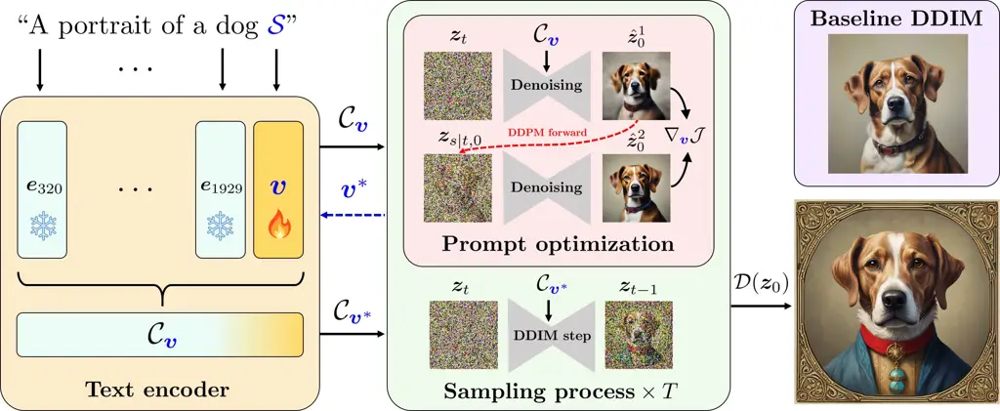
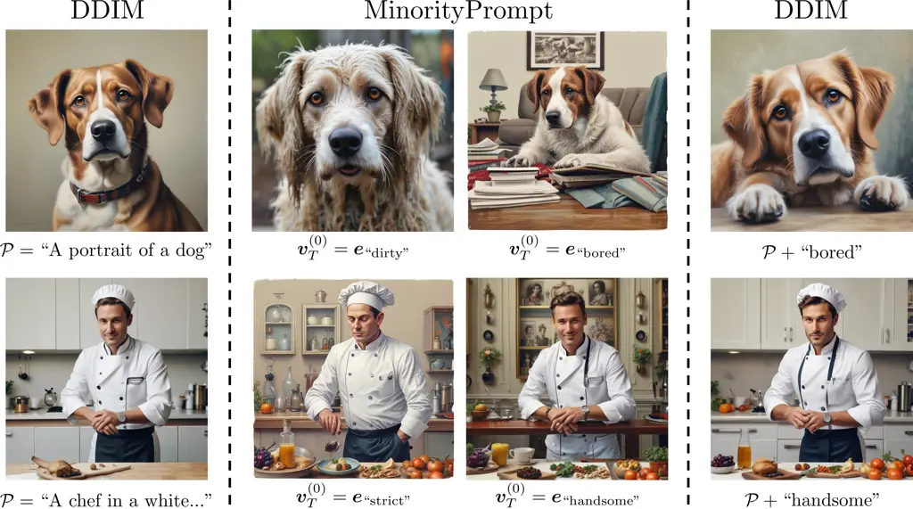
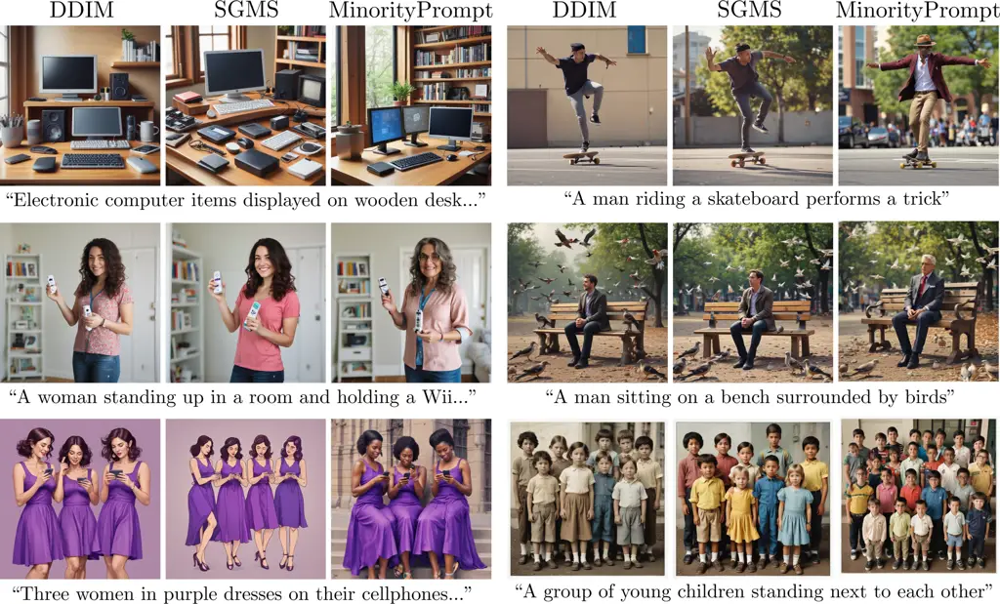
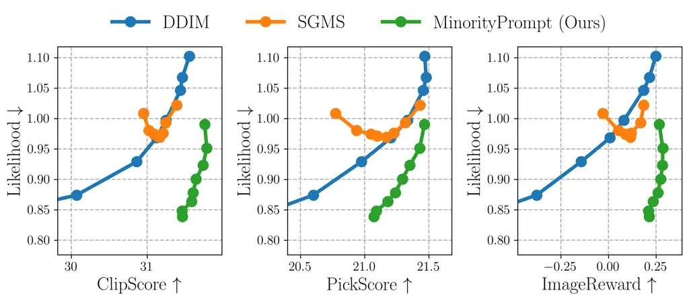
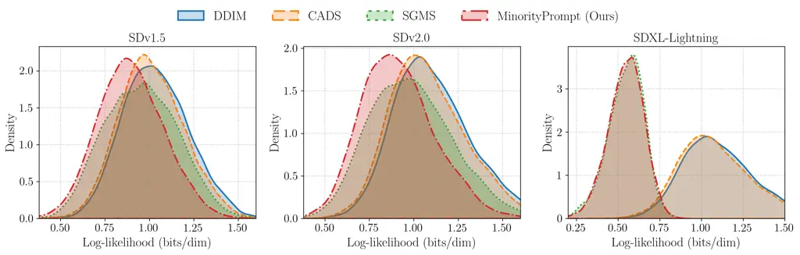
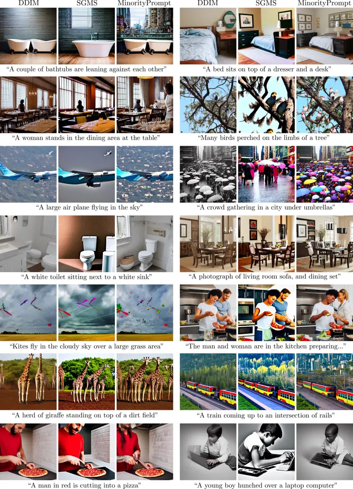
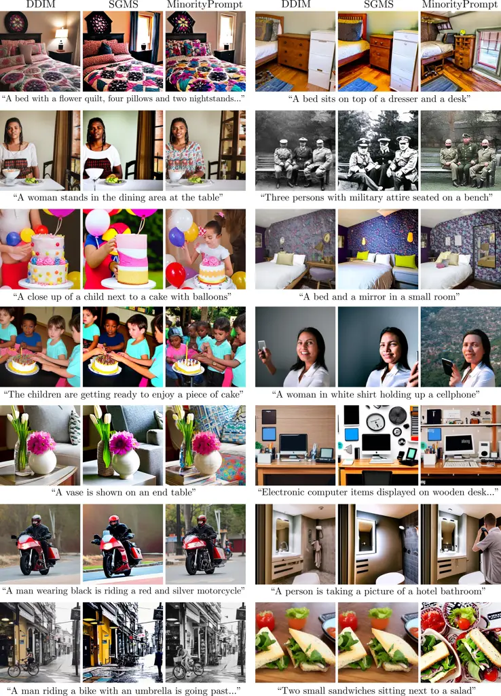
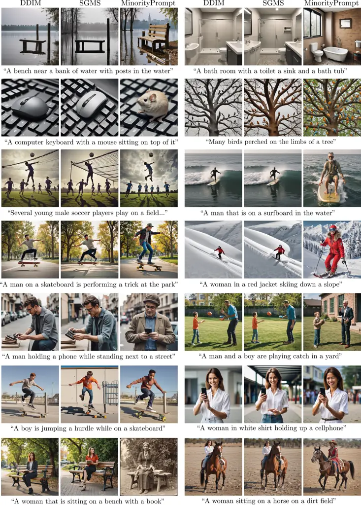
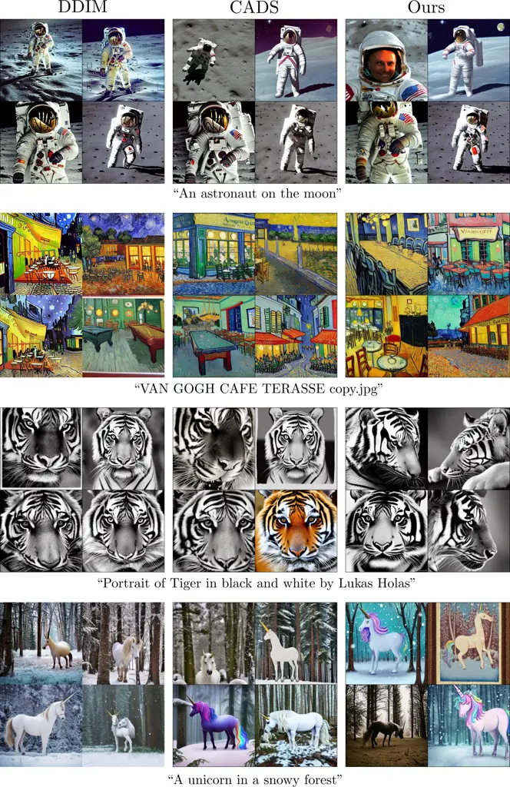

# Minority-Focused Text-to-Image Generation via Prompt Optimization

Soobin Um    Jong Chul Ye Affiliation: Graduate School of AI
Affiliation: KAIST, Daejeon, Republic of Korea
Email: [{sum,jong.ye}@kaist.ac.kr](mailto:)

###### Abstract

We investigate the generation of minority samples using pretrained
text-to-image (T2I) latent diffusion models. Minority instances, in the
context of T2I generation, can be defined as ones living on low-density
regions of text-conditional data distributions. They are valuable for
various applications of modern T2I generators, such as data augmentation
and creative AI. Unfortunately, existing pretrained T2I diffusion models
primarily focus on high-density regions, largely due to the influence of
guided samplers (like CFG) that are essential for high-quality
generation. To address this, we present a novel framework to counter the
high-density-focus of T2I diffusion models. Specifically, we first
develop an online prompt optimization framework that encourages
emergence of desired properties during inference while preserving
semantic contents of user-provided prompts. We subsequently tailor this
generic prompt optimizer into a specialized solver that promotes
generation of minority features by incorporating a carefully-crafted
likelihood objective. Extensive experiments conducted across various
types of T2I models demonstrate that our approach significantly enhances
the capability to produce high-quality minority instances compared to
existing samplers. Code is available at
[https://github.com/soobin-um/MinorityPrompt](https://github.com/soobin-um/MinorityPrompt).

![[Uncaptioned
image]](arxiv-2410-07838v3--4fe3c17582eb.figures/figure-1.webp)

Figure 1: Example results from our minority generation approach using
SDXL-Lightning. Our framework is designed to produce unique _minority_
samples w.r.t. user-provided prompts, which are rarely generated by
standard samplers like DDIM \[46\]. Due to its low-likelihood
encouraging nature, our sampler often demonstrates counteracting results
against demographic biases in text-to-image models \[13\]. See the
samples in the last row for instance, where our sampler mitigates
prevalent age and racial biases (_e.g_., associating “man” with “young”
and “woman” with “white”) by modifying the demographic traits of the
subjects.

## 1 Introduction

Text-to-image (T2I) generative models \[54, 40, 35\] have recently
attracted substantial interest for their capability to convert textual
descriptions into visually striking images. At the forefront of the
surge are diffusion models \[47, 20\], augmented by guidance
techniques \[11, 19\] such as classifier-free guidance (CFG) \[19\]. The
guided T2I samplers encourage generations from high-density regions of a
data manifold \[11\], producing realistic images that faithfully respect
the provided prompts.

A key challenge is that the inherent high density focus of modern T2I
samplers makes it difficult to generate _minority_ samples – instances
that reside in low-density regions of the manifold. This limitation is
particularly significant as T2I-generated data is increasingly
incorporated in downstream applications \[49, 50, 1\] where the
majority-focused bias within the data may be perpetuated. Furthermore,
the unique attributes found in minority instances are crucial for
applications like creative AI \[41, 16\], where generating novel and
highly creative outputs is essential.

In this work, we present a novel approach dubbed as _MinorityPrompt_
that counteracts the high-density bias of T2I samplers to improve their
capability of minority generation. Our framework is built upon the
concept of _prompt optimization_, an intuitive technique that exhibits
strong performance in enhancing T2I diffusion models for various
tasks \[14, 6, 36\]. Unlike existing T2I-based online prompt-tuning
methods that modify the entire input prompts (_e.g_., by optimizing
their text-embeddings during inference), our approach updates the
prompts in a _selective_ fashion to preserve the intended semantics
while encouraging generations of unique low-density features.

Specifically during inference, we incorporate learnable tokens into the
input prompts, _e.g_., by appending them to the end of the text. The
embeddings of these tokens are iteratively refined across sampling
timesteps to optimize the proposed objective for minority generation,
which approximates the likelihood of noisy intermediate samples in T2I
generation. See Fig. 2 for an overview. We highlight that our prompt
optimization framework is versatile, _i.e_., it can be applied to
various tasks with distinct optimization objectives beyond minority
generation.

Comprehensive experiments validate that our method can significantly
improve the ability of creating minority instances of modern
widely-adopted T2I models (including Stable Diffusion (SD) \[41\]) with
minimal compromise in sample quality and text-image alignment. In
addition, we emphasize that our framework can work on distilled
backbones like SDXL-Lightning \[29\], which demonstrates its robustness
and practical relevance. As an additional application, we explore the
potential of our prompt optimization framework to improve the diversity
of T2I models, further exhibiting its versatility as a general-purpose
solver applicable across various tasks.

Our key contributions are summarized as follows:

- •
  We propose a token-based online prompt optimization framework that
  iteratively updates learnable tokens during inference, achieving
  superior text-image alignment over existing online prompt tuners.
- •
  We develop a novel objective for minority sampling in the T2I context,
  which mathematically approximates the target log-likelihood in T2I
  generation.
- •
  We empirically demonstrate that our approach achieves state-of-the-art
  performance in generating minority samples for T2I generation.



Figure 2: Overview of MinorityPrompt. Unlike existing online prompt
tuning approaches that adjust the entire text-embedding (_e.g_., the
output of the text-encoder) during inference, our framework focuses on
optimizing a dedicated _token-embedding_ to better preserve the
semantics within the prompt. Specifically given a user-prompt (_e.g_.,
“A portrait of a dog”), we integrate a placeholder string (_e.g_.,
$`{\cal S}`$ in the figure) into the prompt, marking the position of the
learnable token embedding $`\boldsymbol{v}`$. With the text-embedding
$`{\cal C}_{\boldsymbol{v}}`$ that incorporates the contents of
$`\boldsymbol{v}`$, we update $`{\boldsymbol{v}}`$ _on-the-fly_ during
the inference process to maximize the reconstruction loss of the
denoised version of $`{\boldsymbol{z}}_{t}`$ (i.e.,
$`\hat{\boldsymbol{z}}_{0}^{1}`$ in the figure). The optimized token
$`{\boldsymbol{v}}^{*}`$ is subsequently used to progress the inference
at the corresponding timestep; see Sec. 3 for details.

## 2 Related Work

The generation of minority samples has been explored in a range of
different scenarios and generative frameworks \[56, 31, 44, 38, 22, 51,
52\]. However, significant progress has been recently made with the
introduction of diffusion models, due to their ability to faithfully
capture data distributions \[44, 51, 52\]. As an initial effort, \[44\]
incorporate separately-trained classifiers into the sampling process of
diffusion models to yield guidance for low-density regions. The approach
by \[51\] shares similar intuition of integrating an additional
classifier into the reverse process for low-density guidance. A
limitation is that their methods rely upon external classifiers that are
often difficult to obtain, especially for large-scale datasets such as
T2I benchmarks \[43\]. The challenge was recently addressed by \[52\]
where the authors develop a self-contained minority sampler that works
without expensive extra components (such as classifiers). However, their
method is tailored for canonical image benchmarks (like LSUN \[55\] and
ImageNet \[9\]) and exhibits limited performance gain in more
challenging scenarios like T2I generation.

A related yet distinct objective is enhancing the diversity of diffusion
models, an area that has been relatively overlooked compared to
improving their quality. Significant progress was recently made
in \[42\], where the authors demonstrated that adding noise
perturbations, if gradually annealed over time, to conditional
embeddings could greatly enhance the diversity of generated samples.
However, unlike our approach, their method focuses on producing diverse
samples that remain consistent with the ground-truth data distribution,
rather than targeting the low-density regions of the distribution.
Another notable contribution was done by \[8\]. Their idea is to repel
intermediate latent samples that share the same condition, thereby
encouraging the final generated samples to exhibit distinct features. A
disadvantage is that it requires generating multiple instances for each
prompt, which can be redundant in many practical scenarios.

Prompt optimization has been widely explored in the context of T2I
diffusion models due to their strong dependence on language models. This
approach has exhibited significant performance across various tasks,
including inverse problems \[6\] and image editing \[36, 33\]. A key
difference is that most existing methods in these lines tune the
_entire_ prompts to find the ones that best perform the focused tasks
(_e.g_., minimizing data consistency loss \[6\]). In contrast, our
framework updates only the attached learnable tokens, thereby preserving
the original prompt’s semantics while encouraging the emergence of
low-density features. Additional use cases of prompt tuning include
personalization \[14, 15\] and object counting \[57\]. Similar to ours,
their frameworks introduce variable tokens and tune their embeddings.
However, their optimizations aim to learn visual concepts captured in
user-provided images, whereas our focus is to invoke low-density
features through optimized prompts. Also, their methods are not online,
requiring separate training procedure which can be potentially
expensive.

## 3 Method

Our focus is to generate high-quality minority instances using
text-to-image (T2I) diffusion models, which faithfully reflect
user-provided prompts while featuring unique visual attributes rarely
produced via standard generation techniques¹¹ 1 More formally, this can
be expressed as drawing instances from
$`{\cal S}_{\boldsymbol{c}}\coloneqq\{{\boldsymbol{z}}\in{\cal M}_{\boldsymbol{c}}:p_{\boldsymbol{\theta}}({\boldsymbol{z}}|{\cal C})<\epsilon\}`$,
where $`{\cal C}`$ is the prompt, $`{\cal M}_{c}`$ represents the
(latent) data manifold associated with $`{\cal C}`$, and
$`p_{\boldsymbol{\theta}}`$ denotes the probability density captured by
the T2I diffusion model. Here $`\epsilon`$ is a small positive
constant.. To this end, we start with providing a brief overview on T2I
diffusion frameworks and the essential background necessary to
understand the core of our work. We subsequently present our proposed
framework for minority generation based on the idea of prompt
optimization.

### 3.1 Background and preliminaries

The task of T2I diffusion models is to generate an output image
$`{\boldsymbol{x}}_{0}\in\mathbb{R}^{d}`$ from a random noise vector
$`{\boldsymbol{z}}_{T}\in\mathbb{R}^{k}`$ (where typically $`k<d`$),
given a user-defined text prompt $`{\cal P}`$. Similar to standard
(non-T2I) diffusion frameworks, the core of T2I diffusion sampling lies
in an iterative denoising process that progressively removes noise from
$`{\boldsymbol{z}}_{T}`$ until a clean version $`{\boldsymbol{z}}_{0}`$
is obtained. This denoising capability is learned through
noise-prediction training \[20, 47\], mathematically written as:

```math
\displaystyle\min_{\boldsymbol{\theta}}\mathbb{E}_{{{\boldsymbol{z}}_{0},y,{\boldsymbol{\epsilon}}\sim{\cal N}({\boldsymbol{0}},{\boldsymbol{I}}),t\sim\text{Unif}\{1,\dots,T\}}}[\|{\boldsymbol{\epsilon}}-{\boldsymbol{\epsilon}}_{\boldsymbol{\theta}}({\boldsymbol{z}}_{t},{\cal C})\|_{2}^{2}],
```

where $`{\boldsymbol{z}}_{0}\coloneqq{\cal E}({\boldsymbol{x}}_{0})`$,
yielded by passing a training image $`{\boldsymbol{x}}_{0}`$ through a
compressive model $`{\cal E}`$ (_e.g_., the encoder of VQ-VAE \[12,
41\]). Here, $`{\boldsymbol{z}}_{t}`$ represents a noise-perturbed
version of $`{\boldsymbol{z}}_{0}`$, given by
$`{\boldsymbol{z}}_{t}\coloneqq\sqrt{\alpha_{t}}{\boldsymbol{z}}_{0}+\sqrt{1-\alpha_{t}}{\boldsymbol{\epsilon}}`$,
where $`\{\alpha_{t}\}_{t=1}^{T}`$ defines the noise-schedule.
$`{\boldsymbol{\epsilon}}_{\boldsymbol{\theta}}`$ refers to a T2I
diffusion model parameterized to predict the noise
$`{\boldsymbol{\epsilon}}`$, and $`{\cal C}`$ represents the embedding
of the text prompt $`{\cal P}`$. See below for details on how to obtain
$`{\cal C}`$ from $`{\cal P}`$.

Once trained, T2I generation can be done by starting from
$`{\boldsymbol{z}}_{T}\sim{\cal N}({\boldsymbol{0}},{\boldsymbol{I}})`$
and implementing an iterative noise removal process guided by the text
embedding $`{\cal C}`$. A common approach is to follow the deterministic
DDIM sampling \[46, 5\]:

```math
\displaystyle\boldsymbol{z}_{t-1}=\sqrt{\alpha_{t-1}}\hat{\boldsymbol{z}}_{0}(\boldsymbol{z}_{t},{\cal C})+\sqrt{1-\alpha_{t-1}}\boldsymbol{\epsilon}_{\boldsymbol{\theta}}(\boldsymbol{z}_{t},{\cal C}), \tag{1}
```

where
$`\hat{\boldsymbol{z}}_{0}(\boldsymbol{z}_{t},{\cal C})\coloneqq(\boldsymbol{z}_{t}-\sqrt{1-\alpha_{t}}\boldsymbol{\epsilon}_{\boldsymbol{\theta}}(\boldsymbol{z}_{t},{\cal C}))/\sqrt{\alpha_{t}}`$.
Here $`\hat{\boldsymbol{z}}_{0}(\boldsymbol{z}_{t},{\cal C})`$ indicates
a denoised estimate of $`\boldsymbol{z}_{t}`$ conditioned on the text
embedding $`{\cal C}`$, implemented via Tweedie’s formula \[4\].

To further strengthen the impact of text conditioning, classifier-free
guidance (CFG) \[19\] is commonly integrated into the sampling process.
In particular, one can obtain a high-density-focused noise estimation
through extrapolation using an unconditional prediction:

```math
\displaystyle\tilde{\boldsymbol{\epsilon}}_{\boldsymbol{\theta}}^{w}({\boldsymbol{z}}_{t},{\cal C})\coloneqq w\boldsymbol{\epsilon}_{\boldsymbol{\theta}}(\boldsymbol{z}_{t},{\cal C})+(1-w)\boldsymbol{\epsilon}_{\boldsymbol{\theta}}(\boldsymbol{z}_{t}), \tag{2}
```

where
$`\boldsymbol{\epsilon}_{\boldsymbol{\theta}}(\boldsymbol{z}_{t})`$
indicates an unconditional noise prediction, often implemented via
null-text conditioning \[19\]. CFG refers to the technique that employs
$`\tilde{\boldsymbol{\epsilon}}_{\boldsymbol{\theta}}^{w}({\boldsymbol{z}}_{t},{\cal C})`$
in place of
$`{\boldsymbol{\epsilon}}_{\boldsymbol{\theta}}({\boldsymbol{z}}_{t},{\cal C})`$
(in Eq. (1)), which has been shown in various scenarios to significantly
improve both sample quality and text alignment yet at the expense of
diversity \[42\].

Text processing. A key distinction from non-T2I diffusion models is the
incorporation of the text embedding $`{\cal C}`$, a continuous vector
yielded by a text encoder $`{\cal T}`$ (such as BERT \[10\]) based on
the user prompt $`{\cal P}`$. To obtain this embedding, each word (or
sub-word) in $`{\cal P}`$ is first converted into a token – an index in
a pre-defined vocabulary. Each token is then mapped to a unique
embedding vector through an index-based lookup. These token-wise
embedding vectors, often referred to as _token_ embeddings, are
typically learned as part of the text encoder. The token embeddings are
then passed through a transformer model, yielding the final text
embedding $`{\cal C}`$. For simplicity, we denote this text processing
operation as the forward pass of the text encoder $`{\cal T}`$; thus,
$`{\cal C}={\cal T}({\cal P})`$.

Prompt optimization. In the context of T2I diffusion models, prompt
tuning is performed by intervening in the text-processing stage. A
common approach is to adjust the text embedding $`{\cal C}`$ over
inference time, which is widely adopted in existing online prompt
optimizers \[6, 36\]. Specifically at sampling timestep $`t`$, existing
online prompt tuners can be formulated as the following optimization
problem:

```math
\displaystyle{\cal C}_{t}^{*}\coloneqq\arg\max_{{\cal C}}{\cal J}({\boldsymbol{z}}_{t},{\cal C}), \tag{3}
```

where $`{\boldsymbol{z}}_{t}`$ is a noisy latent at step $`t`$, and
$`{\cal J}`$ represents a task-specific objective function, such as data
consistency in inverse problems \[6\]. Once $`{\cal C}_{t}^{*}`$ is
obtained, it is used as a drop-in replacement for $`{\cal C}`$ at time
$`t`$ (_e.g_., in Eq. (1)), encouraging the desired property to manifest
in subsequent timesteps.

A problem is that the optimization in Eq. (3) may lead to a loss of
user-intended semantics in $`{\cal P}`$, due to the comprehensive
updating of the entire text-embedding $`{\cal C}`$. This is critical,
especially in the context of our focused T2I minority generation where
preserving prompt semantics is essential; see the supplementary for our
empirical results that support this. One can resort to tuning the
null-text embedding while keeping $`{\cal C}`$ intact (as suggested
by \[33\]). However, this method requires reserving the null-text
dimension for this specific purpose, limiting its potential use for
improving sample quality or serving other functions. In the following
section, we present an online prompt optimization framework designed to
better preserve semantics. Building on this foundation, we develop our
T2I minority sampler, which promotes the generation of minority features
while maintaining both sample quality and text-alignment performance.

1:
$`\boldsymbol{\epsilon}_{\boldsymbol{\theta}},{\cal T},{\cal D},\boldsymbol{v}_{T}^{(0)},{\cal P}_{\cal S},{\cal C},N,K,w,T,s,\lambda`$.

2: $`\boldsymbol{z}_{T}\sim{\cal N}({\boldsymbol{0}},{\boldsymbol{I}})`$

3: for $`t\leftarrow T`$ to $`1`$ do

4:   $`{\cal C}_{\boldsymbol{v}_{t}^{*}}\leftarrow{\cal C}`$

5:   if $`t\bmod N=0`$ then

6:
   $`\boldsymbol{v}_{t}^{*}\leftarrow{\textsc{OptimizeEmb}}(\boldsymbol{z}_{t},\boldsymbol{v}_{t}^{(0)},\boldsymbol{\epsilon}_{\boldsymbol{\theta}},{\cal T},K,s,\lambda)`$

7:
   $`{\cal C}_{\boldsymbol{v}_{t}^{*}}\leftarrow{\cal T}({\cal P}_{\cal S};{\boldsymbol{v}_{t}^{*}})`$

8:   end if

9:
  $`\tilde{\boldsymbol{\epsilon}}_{\boldsymbol{\theta}}^{w}\leftarrow w\boldsymbol{\epsilon}_{\boldsymbol{\theta}}(\boldsymbol{z}_{t},{\cal C}_{\boldsymbol{v}_{t}^{*}})+(1-w)\boldsymbol{\epsilon}_{\boldsymbol{\theta}}(\boldsymbol{z}_{t})`$

10:
  $`\hat{\boldsymbol{z}}_{0}^{w}\leftarrow(\boldsymbol{z}_{t}-\sqrt{1-\alpha_{t}}\tilde{\boldsymbol{\epsilon}}_{\boldsymbol{\theta}}^{w})/\sqrt{\alpha_{t}}`$

11:
  $`\boldsymbol{z}_{t-1}\leftarrow\sqrt{\alpha_{t-1}}\hat{\boldsymbol{z}}_{0}^{w}+\sqrt{1-\alpha_{t-1}}\tilde{\boldsymbol{\epsilon}}_{\boldsymbol{\theta}}^{w}`$

12:   $`\boldsymbol{v}_{t-1}^{(0)}\leftarrow\boldsymbol{v}_{t}^{*}`$

13: end for

14: return
$`{\boldsymbol{x}}_{0}\leftarrow{\cal D}(\boldsymbol{z}_{0})`$

Algorithm 1 MinorityPrompt

1: function
$`{\textsc{OptimizeEmb}}(\boldsymbol{z}_{t},\boldsymbol{v}_{t}^{(0)},\boldsymbol{\epsilon}_{\boldsymbol{\theta}},{\cal T},K,s,\lambda)`$

2:   for $`k\leftarrow 1`$ to $`K`$ do

3:
   $`{\cal C}_{\boldsymbol{v}}\leftarrow{\cal T}({\cal P}_{\cal S};{\boldsymbol{v}_{t}^{(k-1)}})`$

4:
   $`\boldsymbol{\epsilon}_{\boldsymbol{\theta}}^{1}\leftarrow\boldsymbol{\epsilon}_{\boldsymbol{\theta}}(\boldsymbol{z}_{t},{\cal C}_{\boldsymbol{v}})`$

5:
   $`\hat{\boldsymbol{z}}_{0}^{1}\leftarrow(\boldsymbol{z}_{t}-\sqrt{1-\alpha_{t}}\boldsymbol{\epsilon}_{\boldsymbol{\theta}}^{1})/\sqrt{\alpha_{t}}`$

6:
   $`\boldsymbol{\epsilon}\sim{\cal N}({\boldsymbol{0}},{\boldsymbol{I}})`$

7:
   $`\boldsymbol{z}_{s|t,0}\leftarrow\sqrt{\alpha_{s}}\hat{\boldsymbol{z}}_{0}^{1}+\sqrt{1-\alpha_{s}}\boldsymbol{\epsilon}`$

8:
   $`\boldsymbol{\epsilon}_{\boldsymbol{\theta}}^{2}\leftarrow\boldsymbol{\epsilon}_{\boldsymbol{\theta}}(\boldsymbol{z}_{s|t,0},{\cal C})`$

9:
   $`\hat{\boldsymbol{z}}_{0}^{2}\leftarrow(\boldsymbol{z}_{s|t,0}-\sqrt{1-\alpha_{s}}\boldsymbol{\epsilon}_{\boldsymbol{\theta}}^{2})/\sqrt{\alpha_{s}}`$

10:
   $`{\cal J}_{t}\leftarrow\|\hat{\boldsymbol{z}}_{0}^{1}-\texttt{sg}(\hat{\boldsymbol{z}}_{0}^{2})\|_{2}^{2}+\lambda\|\texttt{sg}(\hat{\boldsymbol{z}}_{0}^{1})-\hat{\boldsymbol{z}}_{0}^{2}\|_{2}^{2}`$

11:
   $`\boldsymbol{v}_{t}^{(k)}\leftarrow\boldsymbol{v}_{t}^{(k-1)}+\texttt{AdamGrad}({\cal J}_{t})`$

12:   end for

13:   return
$`\boldsymbol{v}_{t}^{*}\leftarrow\boldsymbol{v}_{t}^{(K)}`$

14: end function

Algorithm 2 Prompt optimization

### 3.2 Semantic-preserving prompt optimization

The key idea of our optimization approach is to incorporate learnable
tokens into a given prompt $`{\cal P}`$ and update its embedding
_on-the-fly_ during inference. Specifically, we append a placeholder
string²² 2 The placeholder string can be placed at any position in the
prompt, but we empirically found that inserting it at the end of the
prompt yields the best performance; see the supplementary for details.
$`{\cal S}`$ to the prompt $`{\cal P}`$, which acts as a mark for the
learnable tokens. For instance, the augmented prompt could be
$`{\cal P}_{\cal S}\coloneqq\text{``A portrait of a dog ${\cal S}$''}`$.
This additional string is treated as a new vocabulary item for the
text-encoder $`{\cal T}`$. We assign a token embedding
$`{\boldsymbol{v}}`$ to $`{\cal S}`$, and denote the text encoder
incorporating it as $`{\cal T}(\>\cdot\>;{\boldsymbol{v}})`$.

We propose optimizing this embedding $`{\boldsymbol{v}}`$ rather than
$`{\cal C}`$. The proposed online prompt optimization at sampling step
$`t`$ can then be formalized as follows:

```math
\displaystyle{\boldsymbol{v}}_{t}^{*}\coloneqq\arg\max_{{\boldsymbol{v}}}{\cal J}({\boldsymbol{z}}_{t},{\cal C}_{{\boldsymbol{v}}}), \tag{4}
```

where
$`{\cal C}_{\boldsymbol{v}}\coloneqq{\cal T}({\cal P}_{\cal S};{\boldsymbol{v}})`$.
Afterward, the optimized text-embedding
$`{\cal C}_{{\boldsymbol{v}}_{t}^{*}}`$ is obtained by text-processing
$`{\cal P}_{\cal S}`$ with the updated token-embedding of $`{\cal S}`$,
therefore
$`{\cal C}_{\boldsymbol{v}_{t}^{*}}\coloneqq{\cal T}({\cal P}_{\cal S};{{\boldsymbol{v}}_{t}^{*}})`$.

Note that our optimization does not affect the embeddings of the tokens
w.r.t. the original prompt $`{\cal P}`$. This is inherently more
advantageous for preserving semantics compared to existing methods,
which alter the entire text-embedding $`{\cal C}`$ and thereby
effectively impact all token embeddings. We also highlight that unlike
existing learnable-token-based approaches that share the same embedding
throughout inference \[14, 15, 57\], our framework allows the token
embedding $`{\boldsymbol{v}}`$ to change over timesteps $`t`$. This
adaptive feature offers potential advantages, since the role of
$`{\boldsymbol{v}}`$ in maximizing $`{\cal J}`$ can vary with
$`{\boldsymbol{z}}_{t}`$ that changes over timesteps. This point is also
implied in previous works that employ adaptive text-embeddings over
time \[6, 36\].

Intuitively, our optimization can be understood as capturing a specific
concept relevant to noisy latent $`{\boldsymbol{z}}_{t}`$ within the
token $`\boldsymbol{v}_{t}^{*}`$, guided by the objective function
$`{\cal J}`$. Thanks to its general design that accommodates any
arbitrary objective function $`{\cal J}`$, this framework is versatile
and can be employed in various contexts beyond minority generation. For
instance, it can be used to diversify the outputs of T2I models. See
details in Tab. 3.

### 3.3 MinorityPrompt: minority-focused prompt tuning

We now specialize the generic solver in Eq. (4) for the task of minority
generation. The key question is how to formulate an appropriate
objective function $`{\cal J}`$ for this purpose. To address this, we
draw inspiration from Um and Ye \[52\], employing their likelihood
metric as the starting point for developing our objective function.

Since the metric was originally defined in the pixel domain using
non-T2I diffusion models (see the supplementary for details), we
initially perform a naive adaptation to accommodate the latent space of
interest, $`{\boldsymbol{z}}_{t}\in\mathbb{R}^{k}`$, and integrate text
conditioning using CFG as is typical in the T2I context \[23\]. The
adapted version of the metric reads:

```math
\displaystyle{\cal J}({\boldsymbol{z}}_{t},{\cal C})\coloneqq\mathbb{E}_{\boldsymbol{\epsilon}}\big[\|\hat{\boldsymbol{z}}_{0}^{w}(\boldsymbol{z}_{t},{\cal C})-\texttt{sg}(\hat{\boldsymbol{z}}_{0}^{w}(\boldsymbol{z}_{s|t,0}^{w},{\cal C}))\|_{2}^{2}\big], \tag{5}
```

where $`\hat{\boldsymbol{z}}_{0}^{w}(\boldsymbol{z}_{t},{\cal C})`$
represents a clean estimate of $`\boldsymbol{z}_{t}`$ using the CFG
noise term
$`\tilde{\boldsymbol{\epsilon}}_{\boldsymbol{\theta}}^{w}({\boldsymbol{z}}_{t},{\cal C})`$
(in Eq. (2)). Here $`\boldsymbol{z}_{s|t,0}^{w}`$ indicates a noised
version of $`\hat{\boldsymbol{z}}_{0}^{w}(\boldsymbol{z}_{t},{\cal C})`$
w.r.t. timestep $`s`$:
$`\boldsymbol{z}_{s|t,0}^{w}\coloneqq\sqrt{\alpha_{s}}\hat{\boldsymbol{z}}_{0}^{w}(\boldsymbol{z}_{t},{\cal C})+\sqrt{1-\alpha_{s}}\boldsymbol{\epsilon}`$,
and
$`\hat{\boldsymbol{z}}_{0}^{w}(\boldsymbol{z}_{s|t,0}^{w},{\cal C})`$ is
a clean version of $`\boldsymbol{z}_{s|t,0}^{w}`$ conditioned on
$`{\cal C}`$. $`\texttt{sg}(\cdot)`$ denotes the stop-gradient operator
for reducing computational cost when used in guided sampling \[52\].
Notice that the squared L2 error is used as the discrepancy loss, rather
than the originally used LPIPS \[58\], due to its incompatibility with
our latent space. The quantity in Eq. (5) is interpretable as a
reconstruction loss of
$`\hat{\boldsymbol{z}}_{0}^{w}(\boldsymbol{z}_{t},{\cal C})`$. As
exhibited in Um and Ye \[52\], the loss may become large if
$`\boldsymbol{z}_{t}`$ (represented by
$`\hat{\boldsymbol{z}}_{0}^{w}(\boldsymbol{z}_{t},{\cal C})`$) contains
highly-unique minority features that often vanish during the
reconstruction process. The comprehensive details regarding the original
metric due to Um and Ye \[52\] are provided in the supplementary.

Considering Eq. (5) as the objective function, a natural approach for
minority-focused prompt tuning would be to incorporate
$`{\cal C}_{\boldsymbol{v}}`$ and optimize for the best
$`\boldsymbol{v}`$:

```math
\displaystyle\boldsymbol{v}_{t}^{*}\coloneqq \displaystyle\arg\max_{{\boldsymbol{v}}}{\cal J}({\boldsymbol{z}}_{t},{\cal C}_{\boldsymbol{v}}). \tag{6}
```

However, we argue that this naively extended framework has theoretical
issues that lead to limited performance gain over standard samplers.
Specifically, three aspects of this objective weaken the desired
connection to the target log-likelihood
$`\log p_{\boldsymbol{\theta}}(\boldsymbol{z}_{0}|{\cal C})`$ that we
aim to capture: (i) the reliance on the CFG-based clean predictions
$`\hat{{\boldsymbol{z}}}_{0}^{w}`$; (ii) obstructed gradient flow
through the second term in the squared L2 loss due to sg($`\cdot`$); and
(iii) the incorporation of $`{\cal C}_{\boldsymbol{v}}`$ within the
second term in the loss. See the supplementary on a detailed analysis on
these points.

Hence, we propose the following optimization to address the theoretical
issues:

```math
\displaystyle\begin{split}\boldsymbol{v}_{t}^{*}&\coloneqq\arg\max_{{\boldsymbol{v}}}{\cal J}_{\cal C}({\boldsymbol{z}}_{t},{\cal C}_{\boldsymbol{v}})\\
\text{where}\;\;{\cal J}_{\cal C}({\boldsymbol{z}}_{t},{\cal C}_{\boldsymbol{v}})&\coloneqq\mathbb{E}_{\boldsymbol{\epsilon}}\big[\|\hat{\boldsymbol{z}}_{0}(\boldsymbol{z}_{t},{\cal C}_{\boldsymbol{v}})-\hat{\boldsymbol{z}}_{0}(\boldsymbol{z}_{s|t,0},{\cal C})\|_{2}^{2}\big].\end{split} \tag{7}
```

Here
$`\hat{\boldsymbol{z}}_{0}(\boldsymbol{z}_{t},{\cal C}_{\boldsymbol{v}})\coloneqq(\boldsymbol{z}_{t}-\sqrt{1-\alpha_{t}}{\boldsymbol{\epsilon}}_{\boldsymbol{\theta}}(\boldsymbol{z}_{t},{\cal C}_{\boldsymbol{v}}))/\sqrt{\alpha_{t}}`$,
indicating a non-CFG clean estimate. $`\boldsymbol{z}_{s|t,0}`$ is a
perturbed version of
$`\hat{\boldsymbol{z}}_{0}(\boldsymbol{z}_{t},{\cal C}_{\boldsymbol{v}})`$
w.r.t. timestep $`s`$:
$`\boldsymbol{z}_{s|t,0}\coloneqq\sqrt{\alpha_{s}}\hat{\boldsymbol{z}}_{0}(\boldsymbol{z}_{t},{\cal C}_{\boldsymbol{v}})+\sqrt{1-\alpha_{s}}\boldsymbol{\epsilon}`$.
Notice that this formulation eliminates the problematic components
in Eq. (6): $`\hat{\boldsymbol{z}}_{0}^{w}`$, sg($`\cdot`$) and
$`{\cal C}_{\boldsymbol{v}}`$ in the second term. We found that the
proposed optimization maintains a close connection to the focused
log-likelihood. Below we provide a formal statement of our finding. See
the supplementary for the proof.

###### Proposition 1.

The objective function in Eq. (7) is equivalent (upto a constant factor)
to the negative ELBO w.r.t.
$`\log p_{\boldsymbol{\theta}}(\hat{\boldsymbol{z}}_{0}(\boldsymbol{z}_{t},{\cal C}_{\boldsymbol{v}})\mid{\cal C})`$
when integrated over timesteps with
$`\bar{w}_{s}\coloneqq\alpha_{s}/(1-\alpha_{s})`$:

```math
\displaystyle\sum_{s=1}^{T}\bar{w}_{s}{\cal J}_{\cal C}({\boldsymbol{z}}_{t},{\cal C}_{\boldsymbol{v}}) \displaystyle=\sum_{s=1}^{T}{\mathbb{E}}_{\boldsymbol{\epsilon}}[\|{\boldsymbol{\epsilon}}-{\boldsymbol{\epsilon}}_{\boldsymbol{\theta}}(\boldsymbol{z}_{s|t,0},{\cal C})\|_{2}^{2}]
```

```math
\displaystyle\gtrapprox-\log p_{\boldsymbol{\theta}}(\hat{\boldsymbol{z}}_{0}(\boldsymbol{z}_{t},{\cal C}_{\boldsymbol{v}})\mid{\cal C}),
```

where
$`\boldsymbol{z}_{s|t,0}\coloneqq\sqrt{\alpha_{s}}\hat{\boldsymbol{z}}_{0}(\boldsymbol{z}_{t},{\cal C}_{\boldsymbol{v}})+\sqrt{1-\alpha_{s}}\boldsymbol{\epsilon}`$.

Intuitively, our optimization seeks to make the text-conditioned clean
view
$`\hat{\boldsymbol{z}}_{0}(\boldsymbol{z}_{t},{\cal C}_{\boldsymbol{v}})`$
of the current sample $`\boldsymbol{z}_{t}`$ as unique as possible, from
the perspective of the log-likelihood
$`\log p_{\boldsymbol{\theta}}(\hat{\boldsymbol{z}}_{0}(\boldsymbol{z}_{t},{\cal C}_{\boldsymbol{v}})|{\cal C})`$.

Techniques for improvement. In practice, we found that our optimization
could be further stabilized by introducing a sg-related trick into the
objective function:

```math
\displaystyle\begin{split}\tilde{{\cal J}}_{\cal C}&\coloneqq{\cal J}_{\cal C}^{1}+\lambda{\cal J}_{\cal C}^{2},\quad\lambda>0\\
\text{where}\quad{\cal J}_{\cal C}^{1}&\coloneqq\mathbb{E}_{\boldsymbol{\epsilon}}\left[\left\|\hat{\boldsymbol{z}}_{0}(\boldsymbol{z}_{t},{\cal C}_{\boldsymbol{v}})-\texttt{sg}\left(\hat{\boldsymbol{z}}_{0}(\boldsymbol{z}_{s|t,0},{\cal C})\right)\right\|_{2}^{2}\right]\\
{\cal J}_{\cal C}^{2}&\coloneqq\mathbb{E}_{\boldsymbol{\epsilon}}\left[\left\|\texttt{sg}\left(\hat{\boldsymbol{z}}_{0}(\boldsymbol{z}_{t},{\cal C}_{\boldsymbol{v}})\right)-\hat{\boldsymbol{z}}_{0}(\boldsymbol{z}_{s|t,0},{\cal C})\right\|_{2}^{2}\right].\end{split} \tag{8}
```

In our empirical results, setting $`\lambda=1`$ consistently produces
the best performance across all considered T2I models. We note that this
technique allows the gradient flow through the second term (contrary to
the case of Eq. (6)), thereby sidestepping the gradient blocking issue
that we mentioned earlier. Another significant improvement comes from
the use of an annealed timestep $`s`$, which was originally adhered to a
fixed value in Um and Ye \[52\]. We empirically found that employing an
annealing schedule based on the inverse of the sampling step (_e.g_.,
$`s=T-t`$) outperforms other fixed choices of $`s`$. Similar to Um and
Ye \[52\], we conduct our prompt optimization intermittently (_i.e_.,
once every $`N`$ sampling steps) to reduce computational costs. We found
that during non-optimizing steps, employing the base prompt $`{\cal C}`$
instead of $`{\cal C}_{\boldsymbol{v}}`$ (with the most recently updated
token embedding) yields improvements in text-alignment and sample
quality. See Algorithms 1 and 2 for the pseudocode of our approach.



Figure 3: Improved semantic controllability by MinorityPrompt. The
samples in the first column are generations due to DDIM using the two
base prompts (_e.g_., “A chef in a white coat leans on a table” for the
second row). The second and third columns exhibit generated samples from
our framework, where we selected the corresponding word embeddings as
the starting points of the prompt optimizations. In the the last column,
we also present DDIM samples produced using attached prompts with the
corresponding words for comparison. All samples were obtained using
SDXL-Lightning \[29\].

Enhanced semantic controllability. A key benefit of our prompt
optimization approach is its ability to provide an additional dimension
of semantic control over the generated samples. Specifically, by
selecting an appropriate initial point for $`\boldsymbol{v}`$ (_i.e_.,
$`\boldsymbol{v}_{T}^{(0)}`$ in Algorithm 1), such as a word embedding
with relevant semantics, one can impart the desired semantics to the
generated output; see Fig. 3 for instance. Note that the controllability
is not achievable with existing minority samplers that rely upon
latent-space optimizations \[44, 51, 52\]. We found that properly
choosing initial words can yield improved minority generation
performance compared to approaches that rely upon random starting
points; see the supplementary for detailed results.



Figure 4: Sample comparison on SDXL-Lightning. Generated samples from
three different approaches: (i) DDIM \[46\]; (ii) SGMS \[52\]; (iii)
MinorityPrompt (ours). Six distinct prompts were used for this
comparison, and random seeds were shared across all three methods.

## 4 Experiments

### 4.1 Setup

T2I backbones and dataset. Our experiments were conducted using three
distinct versions of Stable Diffusion (SD) \[41\], encompassing both
standard and distilled versions to demonstrate the robustness of our
approach. Specifically, we consider: (i) SDv1.5; (ii) SDv2.0; (iii)
SDXL-Lightning (SDXL-LT) \[29\]. For all pretrained models, we employed
the widely-adopted HuggingFace checkpoints trained on LAION \[43\]
without any further modifications. As convention, we randomly selected
10K captions from the validation set of MS-COCO \[30\] for our main
results (_e.g_., in Tab. 1). While for analyses, smaller subsets of
captions were used to enhance efficiency.

Baselines. The same four baselines were considered over all SD versions:
(i) the standard DDIM \[46\]; (ii) a null-prompted DDIM; (iii)
CADS \[42\]; (iv) SGMS \[52\]. The null-prompted DDIM serves as a
baseline that leverages T2I models’ capability to visualize specific
concepts for minority generation by incorporating an appropriate
null-text prompt (_e.g_., “commonly-looking”). CADS \[42\] is the
state-of-the-art diversity-focused sampler that may rival our approach
in minority generation, while SGMS \[52\] is the state-of-the-art of
minority generation outside the T2I domain. We adhered to standard
sampling setups for all methods. Specifically, 50 DDIM steps (_i.e_.,
$`T=50`$) with $`w=7.5`$ were used for SDv1.5 and SDv2.0, while
$`w=1.0`$ was employed for the 4-step SDXL-Lightning model.

Evaluations. For evaluating text-alignment, we consider three distinct
quantities: (i) ClipScore \[17\]; (ii) PickScore \[25\]; (iii)
Image-Reward \[53\]. We note that the latter two metrics also describe
quality of generated samples, in the perspectives of
user-preference \[25, 53\]. In addition, we employ two pairs of metrics
for quality and diversity: (i) Precision and Recall \[26\]; (ii) Density
and Coverage \[34\]. For the likelihood of generated samples, we rely
upon the exact likelihood computation method based on PF-ODE as proposed
by \[48\]. We also conduct user study to more investigate human
preferences. Notably, we do not include Fréchet Inception Distance
(FID) \[18\] as an evaluator, since FID measures closeness to baseline
real data (_e.g_., the MS-COCO validation set), which diverges from our
focus on promoting generations in low-density regions.

### 4.2 Results

| Model   | Method         | CLIPScore $`\uparrow`$ | PickScore $`\uparrow`$ | ImageReward $`\uparrow`$ | Precision $`\uparrow`$ | Recall $`\uparrow`$ | Density $`\uparrow`$ | Coverage $`\uparrow`$ | Likelihood $`\downarrow`$ |
| ------- | -------------- | ---------------------- | ---------------------- | ------------------------ | ---------------------- | ------------------- | -------------------- | --------------------- | ------------------------- |
| SDv1.5  | DDIM           | 31.4801                | 21.4830                | 0.2106                   | 0.5907                 | 0.6328              | 0.6072               | 0.7492                | 1.0367                    |
|         | DDIM + null    | 31.1007                | 21.5391                | 0.2422                   | 0.5660                 | 0.6236              | 0.5362               | 0.7134                | 1.0339                    |
|         | CADS \[42\]    | 31.4178                | 21.2836                | 0.1012                   | 0.5696                 | 0.6346              | 0.5562               | 0.7388                | 1.0127                    |
|         | SGMS \[52\]    | 31.1665                | 21.2126                | 0.1230                   | 0.4943                 | 0.5960              | 0.4357               | 0.6470                | 0.9540                    |
|         | MinorityPrompt | 31.5376                | 21.3111                | 0.2352                   | 0.5671                 | 0.6228              | 0.5375               | 0.7328                | 0.8971                    |
| SDv2.0  | DDIM           | 31.8490                | 21.6801                | 0.3821                   | 0.5930                 | 0.6292              | 0.6592               | 0.7760                | 1.1100                    |
|         | DDIM + null    | 31.7223                | 21.7190                | 0.4024                   | 0.5861                 | 0.6308              | 0.5959               | 0.7378                | 1.0769                    |
|         | CADS \[42\]    | 31.7687                | 21.5225                | 0.2981                   | 0.5811                 | 0.6194              | 0.5865               | 0.7388                | 1.0851                    |
|         | SGMS \[52\]    | 31.4750                | 21.4457                | 0.2981                   | 0.5166                 | 0.6130              | 0.4713               | 0.6718                | 0.9898                    |
|         | MinorityPrompt | 31.9586                | 21.5958                | 0.4249                   | 0.6047                 | 0.6100              | 0.6192               | 0.7602                | 0.9143                    |
| SDXL-LT | DDIM           | 31.5238                | 22.6733                | 0.7331                   | 0.5323                 | 0.6116              | 0.5206               | 0.6686                | 0.6082                    |
|         | DDIM + null    | 31.5259                | 22.6884                | 0.7368                   | 0.5256                 | 0.6144              | 0.5368               | 0.6700                | 0.6077                    |
|         | CADS \[42\]    | 31.0418                | 22.3554                | 0.5017                   | 0.5211                 | 0.6176              | 0.5220               | 0.6560                | 0.6019                    |
|         | SGMS \[52\]    | 31.2961                | 22.5784                | 0.6801                   | 0.4823                 | 0.6616              | 0.4018               | 0.5852                | 0.5462                    |
|         | MinorityPrompt | 31.3366                | 22.6050                | 0.7098                   | 0.4777                 | 0.6580              | 0.3856               | 0.5770                | 0.5457                    |

Table 1: Quantitative comparisons. “SDXL-LT” denotes SDXL-Lightning
(4-step version) \[29\]. “DDIM + null” indicates a baseline that
leverages a properly-chosen null-prompt to encourage minority
generations, where we used “commonly-looking” for the results herein.
“CADS \[42\]” is the state-of-the-art in diverse sampling, while
SGMS \[52\] denotes a minority sampler similar to ours, representing the
state-of-the-art outside the T2I context. “Likelihood” represents
log-likelihood values measured in bpd (bits per dimension).

| Method                                  | CLIPScore $`\uparrow`$ | PickScore $`\uparrow`$ | ImageReward $`\uparrow`$ | Precision $`\uparrow`$ | Recall $`\uparrow`$ | Density $`\uparrow`$ | Coverage $`\uparrow`$ | Likelihood $`\downarrow`$ |
| --------------------------------------- | ---------------------- | ---------------------- | ------------------------ | ---------------------- | ------------------- | -------------------- | --------------------- | ------------------------- |
| DDIM                                    | 31.4395                | 21.4570                | 0.1845                   | 0.6070                 | 0.7094              | 0.6460               | 0.8410                | 1.0465                    |
| Eq. (7) (proposed)                      | 31.7369                | 21.3522                | 0.2839                   | 0.5420                 | 0.7340              | 0.5534               | 0.7860                | 0.9230                    |
| Eq. (7) + $`\hat{z}_{0}^{w}`$           | 30.5193                | 20.7307                | -0.1468                  | 0.4890                 | 0.7182              | 0.4910               | 0.7450                | 0.9399                    |
| Eq. (7) + sg                            | 31.6597                | 21.3114                | 0.2738                   | 0.5230                 | 0.7284              | 0.4986               | 0.7470                | 0.9290                    |
| Eq. (7) + $`{\cal C}_{\boldsymbol{v}}`$ | 31.6676                | 21.3652                | 0.2808                   | 0.5550                 | 0.7262              | 0.5414               | 0.7500                | 0.9281                    |
| Eq. (7) + all (_i.e_., Eq. (6))         | 30.2994                | 20.4840                | -0.1944                  | 0.4760                 | 0.6864              | 0.4762               | 0.7220                | 0.9245                    |

Table 2: Ablation study results. “+ $`\hat{z}_{0}^{w}`$” indicates the
case that further incorporates the CFG clean predictions into Eq. (7).
“+ sg” refers to the one employing the stop-gradient on
$`\hat{\boldsymbol{z}}_{0}(\boldsymbol{z}_{s|t,0},{\cal C})`$. “+
$`{\cal C}_{\boldsymbol{v}}`$” represents the setting of feeding
$`{\cal C}_{\boldsymbol{v}}`$ in the computations of
$`\hat{\boldsymbol{z}}_{0}(\boldsymbol{z}_{s|t,0},{\cal C})`$ in place
of $`{\cal C}`$. “+ all” is the case that employs all the above three
flawed choices, _i.e_., Eq. (6). We observe clear performance benefits
of our theory-driven design choices over the naive framework in Eq. (6).
The results were obtained on SDv1.5.

Qualitative comparisons. Fig. 4 presents a comparison of generated
samples of our approach with two baselines. Notice that our
MinorityPrompt tends to yield highly more distinct and complex features
(_e.g_., intricate visual elements \[2, 45\]) compared to the baseline
samplers. A significant observation, also reflected in Fig. 1, is that
MinorityPrompt often counters the inherent demographic biases of T2I
models, _e.g_., by adjusting age or skin color. See the samples in the
second and third rows of the figure. A more extensive set of generated
samples, including those from SDv1.5 and v2.0, can be found in the
supplementary.

Quantitative evaluations. Tab. 1 exhibits performance comparisons across
three distinct T2I models. Observe that our sampler outperforms all
baselines in generating low-likelihood samples while maintaining
reasonable performance in text-alignment and user preference; see the
supplementary for the corresponding log-likelihood distributions. An
important point is that MinorityPrompt significantly improves the
previous state-of-the-art in minority generation (_i.e_., SGMS \[52\])
in almost all cases, highlighting the effectiveness of our approach in
the T2I context. As expected, our advantage often comes with some
compromise in image quality, _e.g_., evidenced by lower PickScore and
Density values compared to the DDIM sampler. We leave the user study
results in the supplementary.

Ablation studies. Tab. 2 exhibits the impacts of the three theoretical
flaws in the naive framework in Eq. (6). Observe that incorporating any
of these flaws into our framework results in immediate performance
degradation, validating our claim made in Sec. 3.3. See the
supplementary for theoretical evidence. A more comprehensive analysis
and ablation study, including explorations of other design choices and
applications to trending sampling techniques (like CFG++ \[7\]), is
presented in the supplementary.

| Method      | CS $`\uparrow`$ | PS $`\uparrow`$ | Prec $`\uparrow`$ | Rec $`\uparrow`$ | Den $`\uparrow`$ | Cov $`\uparrow`$ | IBS $`\downarrow`$ |
| ----------- | --------------- | --------------- | ----------------- | ---------------- | ---------------- | ---------------- | ------------------ |
| DDIM        | 31.4393         | 21.2478         | 0.5860            | 0.6390           | 0.7688           | 0.8220           | 0.6164             |
| CADS \[42\] | 31.2692         | 21.0262         | 0.5620            | 0.5980           | 0.7964           | 0.8180           | 0.5494             |
| Ours        | 31.2724         | 21.0404         | 0.5480            | 0.6316           | 0.7672           | 0.8460           | 0.5439             |

Table 3: Effectiveness of our diversity-focused prompt optimization
framework in Eq. (9). “IBS” refers to In-Batch Similarity, a diversity
metric \[8\] that measures cosine similarity in the DINO feature
space \[3\]. We employed SDv1.5 for the results.

Further application. Beyond our primary focus on minority generation, we
explore a distinct realm of diverse generation with our optimizer
in Eq. (4) to demonstrate the versatility of the proposed optimization
framework for solving various tasks. Our specific goal herein is to
encourage diversity in an inference batch that shares the same text
prompt $`\cal{P}`$, similar to the focus in Corso et al. \[8\]. To
achieve this, we introduce a new objective function that enforces
repulsion between intermediate instances, formally written as:

```math
\displaystyle\bar{{\cal J}}\coloneqq\sum_{i=1}^{\cal B}\sum_{k\neq i}\|\hat{\boldsymbol{z}}_{0}(\boldsymbol{z}_{t}^{(i)},{\cal C}_{\boldsymbol{v}})-\hat{\boldsymbol{z}}_{0}(\boldsymbol{z}_{t}^{(j)},{\cal C}_{\boldsymbol{v}})\|_{2}^{2}, \tag{9}
```

where $`{\cal B}`$ is the batch size, and
$`\{\boldsymbol{z}_{t}^{(i)}\}_{i=1}^{\cal B}`$ denotes the intermediate
samples in the batch at $`t`$. We found that incorporating Eq. (9)
into Eq. (4) yields impressive results, even rivaling the
state-of-the-art diverse sampler \[42\] (see Tab. 3). We leave generated
samples in the supplementary.

## 5 Conclusion

We developed a novel framework for generating minority samples in the
context of T2I generation. Built upon our prompt optimization framework
that updates the embeddings of additional learnable tokens, our minority
sampler offers significant performance improvements compared to existing
approaches. To accomplish this, we meticulously tailor the objective
function with theoretical justifications and implement several
techniques for further enhancements. Beyond our focus of minority
generation, we further demonstrated the potential of our framework in
promoting diversity in generated samples. During this process, we also
showed that the proposed optimization framework can serve as a general
solution, with potential applicability to various optimization tasks
associated with T2I generation.

## Acknowledgments

This work was supported by the National Research Foundation of Korea
(NRF) under Grants RS-2024-00336454 and RS-2023-00262527, and by Basic
Science Research Program through the NRF funded by the Ministry of
Education (RS-2024-00406726).

## References

- \[1\] Arash Afkanpour, Vahid Reza Khazaie, Sana Ayromlou, and
  Fereshteh Forghani. Can generative models improve self-supervised
  representation learning? _arXiv preprint arXiv:2403.05966_, 2024.
- \[2\] Marius Arvinte, Cory Cornelius, Jason Martin, and Nageen
  Himayat. Investigating the adversarial robustness of density
  estimation using the probability flow ode. _arXiv preprint
  arXiv:2310.07084_, 2023.
- \[3\] Mathilde Caron, Hugo Touvron, Ishan Misra, Hervé Jégou, Julien
  Mairal, Piotr Bojanowski, and Armand Joulin. Emerging properties in
  self-supervised vision transformers. In _Proceedings of the
  International Conference on Computer Vision (ICCV)_, 2021.
- \[4\] Hyungjin Chung, Jeongsol Kim, Michael T Mccann, Marc L Klasky,
  and Jong Chul Ye. Diffusion posterior sampling for general noisy
  inverse problems. _arXiv preprint arXiv:2209.14687_, 2022.
- \[5\] Hyungjin Chung, Suhyeon Lee, and Jong Chul Ye. Decomposed
  diffusion sampler for accelerating large-scale inverse problems.
  _arXiv preprint arXiv:2303.05754_, 2023a.
- \[6\] Hyungjin Chung, Jong Chul Ye, Peyman Milanfar, and Mauricio
  Delbracio. Prompt-tuning latent diffusion models for inverse problems.
  _arXiv preprint arXiv:2310.01110_, 2023b.
- \[7\] Hyungjin Chung, Jeongsol Kim, Geon Yeong Park, Hyelin Nam, and
  Jong Chul Ye. Cfg++: Manifold-constrained classifier free guidance for
  diffusion models. _arXiv preprint arXiv:2406.08070_, 2024.
- \[8\] Gabriele Corso, Yilun Xu, Valentin De Bortoli, Regina Barzilay,
  and Tommi Jaakkola. Particle guidance: non-iid diverse sampling with
  diffusion models. _arXiv preprint arXiv:2310.13102_, 2023.
- \[9\] Jia Deng, Wei Dong, Richard Socher, Li-Jia Li, Kai Li, and Li
  Fei-Fei. Imagenet: A large-scale hierarchical image database. In _2009
  IEEE conference on computer vision and pattern recognition_, pages
  248–255. Ieee, 2009.
- \[10\] Jacob Devlin. Bert: Pre-training of deep bidirectional
  transformers for language understanding. _arXiv preprint
  arXiv:1810.04805_, 2018.
- \[11\] Prafulla Dhariwal and Alexander Nichol. Diffusion models beat
  gans on image synthesis. _Advances in neural information processing
  systems_, 34:8780–8794, 2021.
- \[12\] Patrick Esser, Robin Rombach, and Bjorn Ommer. Taming
  transformers for high-resolution image synthesis. In _Proceedings of
  the IEEE/CVF conference on computer vision and pattern recognition_,
  pages 12873–12883, 2021.
- \[13\] Felix Friedrich, Manuel Brack, Lukas Struppek, Dominik
  Hintersdorf, Patrick Schramowski, Sasha Luccioni, and Kristian
  Kersting. Fair diffusion: Instructing text-to-image generation models
  on fairness. _arXiv preprint arXiv:2302.10893_, 2023.
- \[14\] Rinon Gal, Yuval Alaluf, Yuval Atzmon, Or Patashnik, Amit H
  Bermano, Gal Chechik, and Daniel Cohen-Or. An image is worth one word:
  Personalizing text-to-image generation using textual inversion. _arXiv
  preprint arXiv:2208.01618_, 2022.
- \[15\] Inhwa Han, Serin Yang, Taesung Kwon, and Jong Chul Ye. Highly
  personalized text embedding for image manipulation by stable
  diffusion. _arXiv preprint arXiv:2303.08767_, 2023.
- \[16\] Jiyeon Han, Hwanil Choi, Yunjey Choi, Junho Kim, Jung-Woo Ha,
  and Jaesik Choi. Rarity score: A new metric to evaluate the
  uncommonness of synthesized images. _arXiv preprint
  arXiv:2206.08549_, 2022.
- \[17\] Jack Hessel, Ari Holtzman, Maxwell Forbes, Ronan Le Bras, and
  Yejin Choi. Clipscore: A reference-free evaluation metric for image
  captioning. _arXiv preprint arXiv:2104.08718_, 2021.
- \[18\] Martin Heusel, Hubert Ramsauer, Thomas Unterthiner, Bernhard
  Nessler, and Sepp Hochreiter. Gans trained by a two time-scale update
  rule converge to a local nash equilibrium. _Advances in neural
  information processing systems_, 30, 2017.
- \[19\] Jonathan Ho and Tim Salimans. Classifier-free diffusion
  guidance. _arXiv preprint arXiv:2207.12598_, 2022.
- \[20\] Jonathan Ho, Ajay Jain, and Pieter Abbeel. Denoising diffusion
  probabilistic models. _Advances in neural information processing
  systems_, 33:6840–6851, 2020.
- \[21\] Chunsan Hong, ByungHee Cha, and Tae-Hyun Oh. Cas: A
  probability-based approach for universal condition alignment score. In
  _International Conference on Learning Representations_, 2024.
- \[22\] Gaofeng Huang and Amir Hossein Jafari. Enhanced balancing gan:
  Minority-class image generation. _Neural computing and applications_,
  35(7):5145–5154, 2023.
- \[23\] Jeongsol Kim, Geon Yeong Park, Hyungjin Chung, and Jong Chul
  Ye. Regularization by texts for latent diffusion inverse solvers.
  _arXiv preprint arXiv:2311.15658_, 2023.
- \[24\] Diederik P Kingma. Adam: A method for stochastic optimization.
  _arXiv preprint arXiv:1412.6980_, 2014.
- \[25\] Yuval Kirstain, Adam Polyak, Uriel Singer, Shahbuland Matiana,
  Joe Penna, and Omer Levy. Pick-a-pic: An open dataset of user
  preferences for text-to-image generation. 2023.
- \[26\] Tuomas Kynkäänniemi, Tero Karras, Samuli Laine, Jaakko
  Lehtinen, and Timo Aila. Improved precision and recall metric for
  assessing generative models. _Advances in Neural Information
  Processing Systems_, 32, 2019.
- \[27\] Tuomas Kynkäänniemi, Miika Aittala, Tero Karras, Samuli Laine,
  Timo Aila, and Jaakko Lehtinen. Applying guidance in a limited
  interval improves sample and distribution quality in diffusion
  models, 2024.
- \[28\] Alexander C Li, Mihir Prabhudesai, Shivam Duggal, Ellis Brown,
  and Deepak Pathak. Your diffusion model is secretly a zero-shot
  classifier. _arXiv preprint arXiv:2303.16203_, 2023.
- \[29\] Shanchuan Lin, Anran Wang, and Xiao Yang. Sdxl-lightning:
  Progressive adversarial diffusion distillation. _arXiv preprint
  arXiv:2402.13929_, 2024.
- \[30\] Tsung-Yi Lin, Michael Maire, Serge Belongie, James Hays, Pietro
  Perona, Deva Ramanan, Piotr Dollár, and C Lawrence Zitnick. Microsoft
  coco: Common objects in context. In _Computer Vision–ECCV 2014: 13th
  European Conference, Zurich, Switzerland, September 6-12, 2014,
  Proceedings, Part V 13_, pages 740–755. Springer, 2014.
- \[31\] Zinan Lin, Hao Liang, Giulia Fanti, Vyas Sekar, Rahul Anand
  Sharma, Elahe Soltanaghaei, Anthony Rowe, Hun Namkung, Zaoxing Liu,
  Daehyeok Kim, et al. Raregan: Generating samples for rare classes.
  _arXiv preprint arXiv:2203.10674_, 2022.
- \[32\] Cheng Lu, Yuhao Zhou, Fan Bao, Jianfei Chen, Chongxuan Li, and
  Jun Zhu. Dpm-solver++: Fast solver for guided sampling of diffusion
  probabilistic models. _arXiv preprint arXiv:2211.01095_, 2022.
- \[33\] Ron Mokady, Amir Hertz, Kfir Aberman, Yael Pritch, and Daniel
  Cohen-Or. Null-text inversion for editing real images using guided
  diffusion models. In _Proceedings of the IEEE/CVF Conference on
  Computer Vision and Pattern Recognition_, pages 6038–6047, 2023.
- \[34\] Muhammad Ferjad Naeem, Seong Joon Oh, Youngjung Uh, Yunjey
  Choi, and Jaejun Yoo. Reliable fidelity and diversity metrics for
  generative models. In _International Conference on Machine Learning_,
  pages 7176–7185. PMLR, 2020.
- \[35\] Alex Nichol, Prafulla Dhariwal, Aditya Ramesh, Pranav Shyam,
  Pamela Mishkin, Bob McGrew, Ilya Sutskever, and Mark Chen. Glide:
  Towards photorealistic image generation and editing with text-guided
  diffusion models. _arXiv preprint arXiv:2112.10741_, 2021.
- \[36\] Geon Yeong Park, Jeongsol Kim, Beomsu Kim, Sang Wan Lee, and
  Jong Chul Ye. Energy-based cross attention for bayesian context update
  in text-to-image diffusion models. _Advances in Neural Information
  Processing Systems_, 36, 2024.
- \[37\] Adam Paszke, Sam Gross, Francisco Massa, Adam Lerer, James
  Bradbury, Gregory Chanan, Trevor Killeen, Zeming Lin, Natalia
  Gimelshein, Luca Antiga, et al. Pytorch: An imperative style,
  high-performance deep learning library. _Advances in neural
  information processing systems_, 32, 2019.
- \[38\] Yiming Qin, Huangjie Zheng, Jiangchao Yao, Mingyuan Zhou, and
  Ya Zhang. Class-balancing diffusion models. _arXiv preprint
  arXiv:2305.00562_, 2023.
- \[39\] Alec Radford, Jong Wook Kim, Chris Hallacy, Aditya Ramesh,
  Gabriel Goh, Sandhini Agarwal, Girish Sastry, Amanda Askell, Pamela
  Mishkin, Jack Clark, et al. Learning transferable visual models from
  natural language supervision. In _International conference on machine
  learning_, pages 8748–8763. PMLR, 2021.
- \[40\] Aditya Ramesh, Mikhail Pavlov, Gabriel Goh, Scott Gray, Chelsea
  Voss, Alec Radford, Mark Chen, and Ilya Sutskever. Zero-shot
  text-to-image generation. In _International conference on machine
  learning_, pages 8821–8831. Pmlr, 2021.
- \[41\] Robin Rombach, Andreas Blattmann, Dominik Lorenz, Patrick
  Esser, and Björn Ommer. High-resolution image synthesis with latent
  diffusion models. In _Proceedings of the IEEE/CVF conference on
  computer vision and pattern recognition_, pages 10684–10695, 2022.
- \[42\] Seyedmorteza Sadat, Jakob Buhmann, Derek Bradely, Otmar
  Hilliges, and Romann M Weber. Cads: Unleashing the diversity of
  diffusion models through condition-annealed sampling. _arXiv preprint
  arXiv:2310.17347_, 2023.
- \[43\] Christoph Schuhmann, Romain Beaumont, Richard Vencu, Cade
  Gordon, Ross Wightman, Mehdi Cherti, Theo Coombes, Aarush Katta,
  Clayton Mullis, Mitchell Wortsman, et al. Laion-5b: An open
  large-scale dataset for training next generation image-text models.
  _Advances in Neural Information Processing Systems_,
  35:25278–25294, 2022.
- \[44\] Vikash Sehwag, Caner Hazirbas, Albert Gordo, Firat Ozgenel, and
  Cristian Canton. Generating high fidelity data from low-density
  regions using diffusion models. In _Proceedings of the IEEE/CVF
  Conference on Computer Vision and Pattern Recognition_, pages
  11492–11501, 2022.
- \[45\] Joan Serrà, David Álvarez, Vicenç Gómez, Olga Slizovskaia,
  José F Núñez, and Jordi Luque. Input complexity and
  out-of-distribution detection with likelihood-based generative models.
  _arXiv preprint arXiv:1909.11480_, 2019.
- \[46\] Jiaming Song, Chenlin Meng, and Stefano Ermon. Denoising
  diffusion implicit models. _arXiv preprint arXiv:2010.02502_, 2020a.
- \[47\] Yang Song and Stefano Ermon. Generative modeling by estimating
  gradients of the data distribution. _Advances in Neural Information
  Processing Systems_, 32, 2019.
- \[48\] Yang Song, Jascha Sohl-Dickstein, Diederik P Kingma, Abhishek
  Kumar, Stefano Ermon, and Ben Poole. Score-based generative modeling
  through stochastic differential equations. _arXiv preprint
  arXiv:2011.13456_, 2020b.
- \[49\] Yonglong Tian, Lijie Fan, Kaifeng Chen, Dina Katabi, Dilip
  Krishnan, and Phillip Isola. Learning vision from models rivals
  learning vision from data. In _Proceedings of the IEEE/CVF Conference
  on Computer Vision and Pattern Recognition_, pages 15887–15898, 2024a.
- \[50\] Yonglong Tian, Lijie Fan, Phillip Isola, Huiwen Chang, and
  Dilip Krishnan. Stablerep: Synthetic images from text-to-image models
  make strong visual representation learners. _Advances in Neural
  Information Processing Systems_, 36, 2024b.
- \[51\] Soobin Um and Jong Chul Ye. Don’t play favorites: Minority
  guidance for diffusion models. _arXiv preprint
  arXiv:2301.12334_, 2023.
- \[52\] Soobin Um and Jong Chul Ye. Self-guided generation of minority
  samples using diffusion models. _arXiv preprint
  arXiv:2407.11555_, 2024.
- \[53\] Jiazheng Xu, Xiao Liu, Yuchen Wu, Yuxuan Tong, Qinkai Li, Ming
  Ding, Jie Tang, and Yuxiao Dong. Imagereward: Learning and evaluating
  human preferences for text-to-image generation, 2023.
- \[54\] Tao Xu, Pengchuan Zhang, Qiuyuan Huang, Han Zhang, Zhe Gan,
  Xiaolei Huang, and Xiaodong He. Attngan: Fine-grained text to image
  generation with attentional generative adversarial networks. In
  _Proceedings of the IEEE conference on computer vision and pattern
  recognition_, pages 1316–1324, 2018.
- \[55\] Fisher Yu, Ari Seff, Yinda Zhang, Shuran Song, Thomas
  Funkhouser, and Jianxiong Xiao. Lsun: Construction of a large-scale
  image dataset using deep learning with humans in the loop. _arXiv
  preprint arXiv:1506.03365_, 2015.
- \[56\] Ning Yu, Ke Li, Peng Zhou, Jitendra Malik, Larry Davis, and
  Mario Fritz. Inclusive gan: Improving data and minority coverage in
  generative models. In _European Conference on Computer Vision_, pages
  377–393. Springer, 2020.
- \[57\] Oz Zafar, Lior Wolf, and Idan Schwartz. Iterative object count
  optimization for text-to-image diffusion models. _arXiv preprint
  arXiv:2408.11721_, 2024.
- \[58\] Richard Zhang, Phillip Isola, Alexei A Efros, Eli Shechtman,
  and Oliver Wang. The unreasonable effectiveness of deep features as a
  perceptual metric. In _CVPR_, 2018.

Supplementary Material

## 6 Theoretical Results

### 6.1 Proof of Proposition 1

###### Proposition 1.

The objective function in Eq. (7) is equivalent (upto a constant factor)
to the negative ELBO w.r.t.
$`\log p_{\boldsymbol{\theta}}(\hat{\boldsymbol{z}}_{0}(\boldsymbol{z}_{t},{\cal C}_{\boldsymbol{v}})\mid{\cal C})`$
when integrated over timesteps with
$`\bar{w}_{s}\coloneqq\alpha_{s}/(1-\alpha_{s})`$:

```math
\displaystyle\sum_{s=1}^{T}\bar{w}_{s}{\cal J}_{\cal C}({\boldsymbol{z}}_{t},{\cal C}_{\boldsymbol{v}}) \displaystyle=\sum_{s=1}^{T}{\mathbb{E}}_{\boldsymbol{\epsilon}}[\|{\boldsymbol{\epsilon}}-{\boldsymbol{\epsilon}}_{\boldsymbol{\theta}}(\boldsymbol{z}_{s|t,0},{\cal C})\|_{2}^{2}] \tag{10}
```

```math
\displaystyle\gtrapprox-\log p_{\boldsymbol{\theta}}(\hat{\boldsymbol{z}}_{0}(\boldsymbol{z}_{t},{\cal C}_{\boldsymbol{v}})\mid{\cal C}),
```

where
$`\boldsymbol{z}_{s|t,0}\coloneqq\sqrt{\alpha_{s}}\hat{\boldsymbol{z}}_{0}(\boldsymbol{z}_{t},{\cal C}_{\boldsymbol{v}})+\sqrt{1-\alpha_{s}}\boldsymbol{\epsilon}`$.

###### Proof.

Remember the definition of the objective function in Eq. (7):

```math
\displaystyle{\cal J}_{\cal C}({\boldsymbol{z}}_{t},{\cal C}_{\boldsymbol{v}}) \displaystyle\coloneqq\mathbb{E}_{\boldsymbol{\epsilon}}\big[\|\hat{\boldsymbol{z}}_{0}(\boldsymbol{z}_{t},{\cal C}_{\boldsymbol{v}})-\hat{\boldsymbol{z}}_{0}(\boldsymbol{z}_{s|t,0},{\cal C})\|_{2}^{2}\big].
```

Plugging this into the LHS of Eq. (10) yields:

```math
\displaystyle\begin{split}&\sum_{s=1}^{T}\bar{w}_{s}{\cal J}_{\cal C}({\boldsymbol{z}}_{t},{\cal C}_{\boldsymbol{v}})\\
=&\sum_{s=1}^{T}\frac{\alpha_{s}}{1-\alpha_{s}}\mathbb{E}_{\boldsymbol{\epsilon}}\big[\|\hat{\boldsymbol{z}}_{0}(\boldsymbol{z}_{t},{\cal C}_{\boldsymbol{v}})-\hat{\boldsymbol{z}}_{0}(\boldsymbol{z}_{s|t,0},{\cal C})\|_{2}^{2}\big]\\
=&\sum_{s=1}^{T}\frac{\alpha_{s}}{1-\alpha_{s}}\mathbb{E}_{\boldsymbol{\epsilon}}\Bigg[\bigg\|\frac{1}{\sqrt{\alpha_{s}}}(\boldsymbol{z}_{s|t,0}-\sqrt{1-\alpha_{s}}\boldsymbol{\epsilon})\\
&\;\;\;\;\;\;\;\;-\frac{1}{\sqrt{\alpha_{s}}}(\boldsymbol{z}_{s|t,0}-\sqrt{1-\alpha_{s}}\boldsymbol{\epsilon}_{\boldsymbol{\theta}}(\boldsymbol{z}_{s|t,0},{\cal C}))\bigg\|_{2}^{2}\Bigg]\\
=&\sum_{s=1}^{T}\frac{\alpha_{s}}{1-\alpha_{s}}\mathbb{E}_{\boldsymbol{\epsilon}}\left[\left\|\frac{\sqrt{1-\alpha_{s}}}{\sqrt{\alpha_{s}}}(\boldsymbol{\epsilon}-\boldsymbol{\epsilon}_{\boldsymbol{\theta}}(\boldsymbol{z}_{s|t,0},{\cal C}))\right\|_{2}^{2}\right]\\
=&\sum_{s=1}^{T}{\mathbb{E}}_{\boldsymbol{\epsilon}}[\|{\boldsymbol{\epsilon}}-{\boldsymbol{\epsilon}}_{\boldsymbol{\theta}}(\boldsymbol{z}_{s|t,0},{\cal C})\|_{2}^{2}],\end{split} \tag{11}
```

where the second equality is from the definitions of
$`\boldsymbol{z}_{s|t,0}`$ and
$`\hat{\boldsymbol{z}}_{0}(\boldsymbol{z}_{s|t,0},{\cal C})`$:

```math
\displaystyle\boldsymbol{z}_{s|t,0} \displaystyle\coloneqq\sqrt{\alpha_{s}}\hat{\boldsymbol{z}}_{0}(\boldsymbol{z}_{t},{\cal C}_{\boldsymbol{v}})+\sqrt{1-\alpha_{s}}\boldsymbol{\epsilon}
```

```math
\displaystyle\hat{\boldsymbol{z}}_{0}(\boldsymbol{z}_{s|t,0},{\cal C}) \displaystyle\coloneqq\frac{1}{\sqrt{\alpha_{s}}}(\boldsymbol{z}_{s|t,0}-\sqrt{1-\alpha_{s}}\boldsymbol{\epsilon}_{\boldsymbol{\theta}}(\boldsymbol{z}_{s|t,0},{\cal C})).
```

Note that the last expression in Eq. (11), which is the same as the RHS
of Eq. (10), is equivalent (up to a constant) to the expression of the
negative ELBO w.r.t.
$`\hat{\boldsymbol{z}}_{0}(\boldsymbol{z}_{t},{\cal C}_{\boldsymbol{v}})`$ \[20,
28\]. The distinction here is that now we use a text-conditional
diffusion model
$`\boldsymbol{\epsilon}_{\boldsymbol{\theta}}(\cdot,{\cal C})`$ that
approximates $`\log p_{\boldsymbol{\theta}}(\cdot|{\cal C})`$. This
completes the proof. ∎

### 6.2 Theoretical issues on Eq. (6)

We continue from Sec. 3.3 to scrutinize the theoretical challenges that
arise in the naively-extended optimization framework in Eq. (6). To
proceed, we first restate the objective function in Eq. (6):

```math
\displaystyle\begin{split}{\cal J}({\boldsymbol{z}}_{t},{\cal C}_{\boldsymbol{v}})&\coloneqq\mathbb{E}_{\boldsymbol{\epsilon}}\big[\|\hat{\boldsymbol{z}}_{0}^{w}(\boldsymbol{z}_{t},{\cal C}_{\boldsymbol{v}})-\texttt{sg}(\hat{\boldsymbol{z}}_{0}^{w}(\boldsymbol{z}_{s|t,0}^{w},{\cal C}_{\boldsymbol{v}}))\|_{2}^{2}\big].\end{split}
```

Remember that we identified three theoretical issues that impair the
connection to the target log-likelihood
$`\log p_{\boldsymbol{\theta}}(\boldsymbol{z}_{0}|{\cal C})`$: (i) the
reliance on the CFG-based clean predictions; (ii) obstructed gradient
flow through the second term in the squared-L2 loss; and (iii) the
incorporation of $`{\cal C}_{\boldsymbol{v}}`$ within the second term in
the loss.

CFG-based clean prediction. We start by examining the first point, the
pathology due to the CFG-based clean predictions. Suppose we incorporate
the CFG-based clean predictions $`\hat{\boldsymbol{z}}_{0}^{w}`$ in our
framework Eq. (7), in place of the non-CFG terms
$`\hat{\boldsymbol{z}}_{0}`$. The objective function then becomes:

```math
\displaystyle{\cal J}_{\cal C}^{w}({\boldsymbol{z}}_{t},{\cal C}_{\boldsymbol{v}})\coloneqq\mathbb{E}_{\boldsymbol{\epsilon}}\big[\|\hat{\boldsymbol{z}}_{0}^{w}(\boldsymbol{z}_{t},{\cal C}_{\boldsymbol{v}})-\hat{\boldsymbol{z}}_{0}^{w}(\boldsymbol{z}_{s|t,0}^{w},{\cal C})\|_{2}^{2}\big].
```

To see its connection to log-likelihood, let us consider the weighted
sum of this objective with
$`\bar{w}_{s}\coloneqq\alpha_{s}/(1-\alpha_{s})`$ (as in Proposition 1).
Manipulating the averaged objective similarly as in Sec. 6.1 then
yields:

```math
\displaystyle\sum_{s=1}^{T}\bar{w}_{s}{\cal J}_{\cal C}^{w}({\boldsymbol{z}}_{t},{\cal C}_{\boldsymbol{v}})
```

```math
\displaystyle= \displaystyle\sum_{s=1}^{T}\bar{w}_{s}\mathbb{E}_{\boldsymbol{\epsilon}}\big[\|\hat{\boldsymbol{z}}_{0}^{w}(\boldsymbol{z}_{t},{\cal C}_{\boldsymbol{v}})-\hat{\boldsymbol{z}}_{0}^{w}(\boldsymbol{z}_{s|t,0}^{w},{\cal C})\|_{2}^{2}\big]
```

```math
\displaystyle= \displaystyle\sum_{s=1}^{T}\frac{\alpha_{s}}{1-\alpha_{s}}\mathbb{E}_{\boldsymbol{\epsilon}}\Bigg[\bigg\|\frac{1}{\sqrt{\alpha_{s}}}(\boldsymbol{z}_{s|t,0}^{w}-\sqrt{1-\alpha_{s}}\boldsymbol{\epsilon})
```

```math
\displaystyle\;\;\;\;\;\;\;\;\;\;\;\;-\frac{1}{\sqrt{\alpha_{s}}}(\boldsymbol{z}_{s|t,0}^{w}-\sqrt{1-\alpha_{s}}\tilde{\boldsymbol{\epsilon}}_{\boldsymbol{\theta}}^{w}(\boldsymbol{z}_{s|t,0}^{w},{\cal C}))\bigg\|_{2}^{2}\Bigg]
```

```math
\displaystyle= \displaystyle\sum_{s=1}^{T}{\mathbb{E}}_{\boldsymbol{\epsilon}}[\|{\boldsymbol{\epsilon}}-\tilde{{\boldsymbol{\epsilon}}}_{\boldsymbol{\theta}}^{w}(\sqrt{\alpha_{s}}\hat{\boldsymbol{z}}_{0}^{w}(\boldsymbol{z}_{t},{\cal C}_{\boldsymbol{v}})+\sqrt{1-\alpha_{s}}{\boldsymbol{\epsilon}},{\cal C})\|_{2}^{2}]. \tag{12}
```

Observe that in the RHS of Eq. (12), we see the CFG noise estimation
term $`\tilde{{\boldsymbol{\epsilon}}}_{\boldsymbol{\theta}}^{w}`$,
instead of $`{\boldsymbol{\epsilon}}_{\boldsymbol{\theta}}`$ as in
 Eq. (11). This comes from the use of
$`\hat{\boldsymbol{z}}_{0}^{w}(\boldsymbol{z}_{s|t,0}^{w},{\cal C})`$ in
the second term of the squared-L2 loss. Since
$`\tilde{{\boldsymbol{\epsilon}}}_{\boldsymbol{\theta}}^{w}`$ represents
a distinct probability density, say
$`\tilde{p}_{\boldsymbol{\theta}}(\cdot\mid{\cal C})`$, the averaged
objective in Eq. (12) is no longer connected to our focused conditional
log-likelihood $`\log p_{\boldsymbol{\theta}}(\cdot\mid{\cal C})`$.

One may wonder whether the use of CFG for the first term in the
squared-L2 loss of Eq. (7) is safe. However, we claim that it is also
problematic. To show this, we derive the associated log-likelihood,
which is immediate with the algebra used for Eq. (12):

```math
\displaystyle\sum_{s=1}^{T}\bar{w}_{s}\mathbb{E}_{\boldsymbol{\epsilon}}\big[\|\hat{\boldsymbol{z}}_{0}^{w}(\boldsymbol{z}_{t},{\cal C}_{\boldsymbol{v}})-\hat{\boldsymbol{z}}_{0}(\boldsymbol{z}_{s|t,0}^{w},{\cal C})\|_{2}^{2}\big]
```

```math
\displaystyle\gtrapprox-\log p_{\boldsymbol{\theta}}(\hat{\boldsymbol{z}}_{0}^{w}(\boldsymbol{z}_{t},{\cal C}_{\boldsymbol{v}})\mid{\cal C}).
```

We see that now the diffusion model (represented by
$`p_{\boldsymbol{\theta}}`$) should estimate the conditional log-density
w.r.t. the CFG clean prediction
$`\hat{\boldsymbol{z}}_{0}^{w}(\boldsymbol{z}_{t},{\cal C}_{\boldsymbol{v}})`$.
We argue that this estimation may be inaccurate, since the CFG clean
sample in the T2I context is potentially off-manifold. As analyzed
in Chung et al. \[7\], the CFG clean prediction
$`\hat{\boldsymbol{z}}_{0}^{w}(\boldsymbol{z}_{t},{\cal C}_{\boldsymbol{v}})`$
is in fact an extrapolation between
$`\hat{\boldsymbol{z}}_{0}(\boldsymbol{z}_{t},{\cal C}_{\boldsymbol{v}})`$
and $`\hat{\boldsymbol{z}}_{0}(\boldsymbol{z}_{t})`$ (controlled by
$`w`$). As a result, it may deviate from the data manifold, particularly
for high $`w`$ values commonly used in standard T2I scenarios; see
Figure 3 in Chung et al. \[7\] for details. This off-manifold issue is
especially pronounced during the initial phase of inference, as also
reported in other studies \[27\]. See Tab. 2 for experimental results
that support this claim.

Obstructed gradient. Now we move onto the second issue. From the above
analysis, we saw that the noise prediction in the second term is crucial
for relating the objective function to the log-likelihood, meaning that
allowing gradient flow through the second term is essential for accurate
likelihood optimization. However, blocking the gradient via the
stop-gradient on the second term contradicts this theoretical intuition.
We found that the use of stop-gradient actually degrades performance;
see Tab. 2 for instance.

$`{\cal C}_{\boldsymbol{v}}`$ in the second term. The reasoning behind
the third challenge follows naturally from the previous analyses. In
this case, the corresponding log-likelihood term can be derived as:

```math
\displaystyle\sum_{s=1}^{T}\bar{w}_{s}\mathbb{E}_{\boldsymbol{\epsilon}}\big[\|\hat{\boldsymbol{z}}(\boldsymbol{z}_{t},{\cal C}_{\boldsymbol{v}})-\hat{\boldsymbol{z}}_{0}(\boldsymbol{z}_{s|t,0},{\cal C}_{\boldsymbol{v}})\|_{2}^{2}\big]
```

```math
\displaystyle\gtrapprox-\log p_{\boldsymbol{\theta}}(\hat{\boldsymbol{z}}_{0}(\boldsymbol{z}_{t},{\cal C}_{\boldsymbol{v}})\mid{\cal C}_{\boldsymbol{v}}).
```

We see that $`{\cal C}_{\boldsymbol{v}}`$ appears in conditioning
variable, which diverges from our interest of approximating
$`\log p_{\boldsymbol{\theta}}(\cdot\mid{\cal C})`$. See Tab. 2 for
experimental results that corroborate this.

## 7 Supplementary Details

### 7.1 Details on the metric in Um and Ye \[52\]

We continue from Sec. 3.3 to provide additional details on the
likelihood metric developed by Um and Ye \[52\]. This original version
is defined on pixel space $`{\boldsymbol{x}}_{0}\in\mathbb{R}^{d}`$
(rather than latent domain $`{\boldsymbol{z}}_{0}\in\mathbb{R}^{k}`$ as
ours), formally written as \[52\]:

```math
\displaystyle{\cal J}({\boldsymbol{x}}_{t};s)\coloneqq\mathbb{E}_{\boldsymbol{\epsilon}}\big[d(\hat{\boldsymbol{x}}_{0}(\boldsymbol{x}_{t}),\hat{\boldsymbol{x}}_{0}(\boldsymbol{x}_{s|t,0}))\big],
```

where $`{\boldsymbol{x}}_{t}`$ is a noisy pixel-domain image, and
$`\hat{\boldsymbol{x}}_{0}(\boldsymbol{x}_{t})`$ represents a clean
estimate of $`\boldsymbol{x}_{t}`$:
$`\hat{\boldsymbol{x}}_{0}(\boldsymbol{x}_{t})\coloneqq(\boldsymbol{x}_{t}-\sqrt{1-\alpha_{t}}{\boldsymbol{\epsilon}}_{\boldsymbol{\theta}}^{\prime}(\boldsymbol{x}_{t}))/\sqrt{\alpha_{t}}`$,
where $`{\boldsymbol{\epsilon}}_{\boldsymbol{\theta}}^{\prime}`$ denotes
a pixel diffusion model (different from our
$`\boldsymbol{\epsilon}_{\boldsymbol{\theta}}`$). Here
$`\boldsymbol{x}_{s|t,0}`$ indicates a noised version of
$`\hat{\boldsymbol{x}}_{0}(\boldsymbol{x}_{t})`$ according to timestep
$`s`$:
$`\boldsymbol{x}_{s|t,0}\coloneqq\sqrt{\alpha_{s}}\hat{\boldsymbol{x}}_{0}(\boldsymbol{x}_{t})+\sqrt{1-\alpha_{s}}\boldsymbol{\epsilon}`$,
and $`\hat{\boldsymbol{x}}_{0}(\boldsymbol{x}_{s|t,0})`$ is a denoised
version of $`\boldsymbol{x}_{s|t,0}`$. $`d`$ indicates a discrepancy
metric (_e.g_., LPIPS \[58\]). This quantity is interpretable as a
reconstruction loss of $`\hat{\boldsymbol{x}}_{0}(\boldsymbol{x}_{t})`$,
and theoretically, it is an estimator of the negative log-likelihood of
$`\hat{\boldsymbol{x}}_{0}(\boldsymbol{x}_{t})`$ \[52\].

Similar to ours, the authors in Um and Ye \[52\] employs this metric as
a guidance function for minority sampling, sharing similar spirit as
ours. In doing so, they propose several techniques such as
stop-gradient, learning-rate scheduling, and the incorporation of LPIPS
as $`d`$. Their proposed metric for the guidance function is expressible
as:

```math
\displaystyle{\cal J}({\boldsymbol{x}}_{t};s)\coloneqq\eta_{t}\mathbb{E}_{\boldsymbol{\epsilon}}\big[\texttt{LPIPS}(\hat{\boldsymbol{x}}_{0}(\boldsymbol{x}_{t}),\texttt{sg}(\hat{\boldsymbol{x}}_{0}(\boldsymbol{x}_{s|t,0})))\big], \tag{13}
```

where $`\eta_{t}`$ indicates learning rate at time $`t`$ designed to
decrease over time, and LPIPS is the perceptual metric proposed by Zhang
et al. \[58\]. Although this approach offers considerable advantages in
traditional image generation tasks (such as unconditional generation),
it is not optimized for T2I generation, which presents unique challenges
and requires more specialized techniques. This is confirmed by our
experimental results, where a straightforward extension of their
framework yields only modest performance improvements. See Tab. 2
and Tab. 4(b) for details.

| Target       | CS $`\uparrow`$ | IR $`\uparrow`$ | LL $`\downarrow`$ |
| ------------ | --------------- | --------------- | ----------------- |
| Text         | 31.3503         | 0.2406          | 0.9263            |
| Null-text    | 31.1089         | 0.1575          | 1.0175            |
| Token (ours) | 31.6465         | 0.2744          | 0.9006            |

(a) Influence of optimization target

| Method          | CS $`\uparrow`$ | IR $`\uparrow`$ | LL $`\downarrow`$ |
| --------------- | --------------- | --------------- | ----------------- |
| Unoptimized     | 31.4395         | 0.1845          | 1.0465            |
| Naive (Eq. (6)) | 30.2994         | -0.1944         | 0.9245            |
| Ours (Eq. (7))  | 31.7369         | 0.2839          | 0.9230            |

(b) Impact of objective function $`{\cal J}`$

| Type      | CS $`\uparrow`$ | IR $`\uparrow`$ | LL $`\downarrow`$ |
| --------- | --------------- | --------------- | ----------------- |
| Default   | 31.5154         | 0.2492          | 0.9355            |
| Gaussian  | 31.5054         | 0.2405          | 0.9429            |
| Word init | 31.7369         | 0.2839          | 0.9230            |

(c) Effect of initializing $`{\boldsymbol{v}}`$

Table 4: Impact of key design choices. “CS” denotes ClipScore \[17\],
and “IR” is Image-Reward \[53\]. ‘LL’ indicates log-likelihood. “Text”
is the optimization framework focused on updating the text-embedding
$`{\cal C}`$, and “Null-text” refers to the one that adjusts the
null-text embedding (as in \[33\]). “Unoptimized” corresponds to the
standard DDIM sampler. “Default” denotes the case that simply employs
the default embedding assigned with an added learnable token, while
“Gaussian” initializes $`\boldsymbol{v}`$ from a multivariate Gaussian
distribution constructed using the mean and variance of the token
embeddings from the text-encoder $`{\cal T}`$. “Word init” indicates
initializing with a specific word embedding. We used SDv1.5 for the
results herein.

| Target  | CS $`\uparrow`$ | IR $`\uparrow`$ | LL $`\downarrow`$ |
| ------- | --------------- | --------------- | ----------------- |
| Eq. (7) | 31.3658         | 0.7207          | 0.5449            |
| Eq. (8) | 31.4194         | 0.7331          | 0.5449            |

(a) Influence of sg-trick

| Type        | CS $`\uparrow`$ | IR $`\uparrow`$ | LL $`\downarrow`$ |
| ----------- | --------------- | --------------- | ----------------- |
| $`s=0.75T`$ | 31.4534         | 0.1569          | 0.9469            |
| $`s=T-t`$   | 31.7369         | 0.2839          | 0.9230            |

(b) Impact of adaptive $`s`$

| Type                                | CS $`\uparrow`$ | IR $`\uparrow`$ | LL $`\downarrow`$ |
| ----------------------------------- | --------------- | --------------- | ----------------- |
| $`{\cal C}`$                        | 31.7548         | 0.2293          | 0.9744            |
| $`{\cal C}_{{\boldsymbol{v}}^{*}}`$ | 31.7871         | 0.2858          | 0.9511            |

(c) Effect of using $`{\cal C}`$

Table 5: Effectiveness of our new techniques. “$`{\cal C}`$” refers to
the use of $`{\cal C}`$ during sampling steps without prompt
optimization (when incorporating an intermittent prompt update, _i.e_.,
$`N>1`$). On the other hand, “$`{\cal C}_{{\boldsymbol{v}}^{*}}`$”
refers to the use of optimized token embeddings in the latest steps. Our
results show that the proposed design choices consistently outperform
naive approaches. The results in (a) were obtained using SDXL-Lightning,
while SDv1.5 was employed for (b) and (c).

### 7.2 Implementation details

Pretrained models and baselines. We employed the official checkpoints
provided in HuggingFace for all three pretrained models. For the
null-prompted DDIM baselines, we employed “commonly-looking” as the
null-text prompt for all three pretrained models. The CADS baselines
were primarily obtained using the recommended settings in the
paper \[42\], while we adjusted the hyperparameters on SDXL-Lightning
for adaptation to distilled models. Specifically, we set
$`\tau_{1}=0.8`$, $`\tau_{2}=1.0`$, and $`s=0.1`$, while keeping other
settings unchanged. For SGMS, we respected the original design choices
(like the use of sg) and tuned the remaining hyperparameters to attain
the optimal performance in the T2I context. In particular, we used the
squared-L2 loss as the discrepancy metric and employed $`s=0.75T`$. For
their latent optimizations, we employed Adam optimizer \[24\] (as ours)
with learning rates between 0.005 and 0.01. Similar to ours, latent
updates were performed intermittently, with $`N=3`$ (_i.e_., one update
per three sampling steps). Each latent optimization consisted of three
distinct update steps: $`K=3`$.

Evaluations. The ClipScore values reported in our paper were due to
torchmetrics³³ 3
[https://lightning.ai/docs/torchmetrics/stable/multimodal/clip_score.html](https://lightning.ai/docs/torchmetrics/stable/multimodal/clip_score.html).
For PickScore and Image-Reward, we employed the implementations provided
in the official code repositories⁴⁴ 4
[https://github.com/yuvalkirstain/PickScore](https://github.com/yuvalkirstain/PickScore)⁵⁵
5
[https://github.com/THUDM/ImageReward](https://github.com/THUDM/ImageReward).
Precision and Recall were computed with $`k=5`$ using the official
codebase of Han et al. \[16\]⁶⁶ 6
[https://github.com/hichoe95/Rarity-Score](https://github.com/hichoe95/Rarity-Score).
The computations of Density and Coverage were based on the authors’
official codebase⁷⁷ 7
[https://github.com/clovaai/generative-evaluation-prdc](https://github.com/clovaai/generative-evaluation-prdc).
The log-likelihood values were evaluated based on the implementation
of Hong et al. \[21\]⁸⁸ 8
[https://github.com/unified-metric/unified_metric](https://github.com/unified-metric/unified_metric).
In-Batch Similarity that we used in the diversity optimization
(in Tab. 3) were computed with the repository of Corso et al. \[8\]⁹⁹ 9
[https://github.com/gcorso/particle-guidance](https://github.com/gcorso/particle-guidance).

Hyperparameters. Our results were obtained using $`s=T-t`$, and we used
Adam optimizer with $`K=3`$, similar to SGMS. Learning rates were set
between 0.001 and 0.002 across all experiments. We shared the same
intermittent update rate of $`N=3`$ with SGMS. For initializing
$`\boldsymbol{v}`$, we shared the same word embedding for “cool” for the
main results (presented in Tab. 1). The number of learnable tokens for
our approaches was set to $`1`$. As described in Sec. 3.3, we globally
used $`\lambda=1`$ across all experiments. For the experiments on
SDXL-Lightning that involves two distinct text-encoders, we employed a
single Adam optimizer to jointly update both embedding spaces to
minimize parameter complexity. We also synchronized other design choices
for the two encoders, _e.g_., sharing the same initial token embedding.

Computational complexity. The inference time for DDIM is approximately
1.136 seconds per sample, with CADS requiring a similar amount of time.
The complexities of SGMS and our approach are rather higher due to the
inclusion of backpropagation and iterative updates of latents or
prompts. Specifically, SGMS takes 5.756 seconds per sample, while our
sampler requires slightly more time – 6.205 seconds per sample – which
we attribute to the additional backpropagation pass introduced by our
removal of gradient-blocking. All computations herein were performed on
SDv2.0 using a single NVIDIA A100 GPU.

Other details. Our implementation is based on PyTorch \[37\], and
experiments were performed on twin NVIDIA A100 GPUs. Code is available
at
[https://github.com/soobin-um/MinorityPrompt](https://github.com/soobin-um/MinorityPrompt).

| Init word  | CS $`\uparrow`$ | IR $`\uparrow`$ | LL $`\downarrow`$ |
| ---------- | --------------- | --------------- | ----------------- |
| “uncommon” | 31.6971         | 0.2825          | 0.8868            |
| “special”  | 31.6178         | 0.2922          | 0.9342            |
| “cool”     | 31.7369         | 0.2839          | 0.9230            |

(a) Sensitivity to the initial word

| Position | CS $`\uparrow`$ | IR $`\uparrow`$ | LL $`\downarrow`$ |
| -------- | --------------- | --------------- | ----------------- |
| –        | 31.4395         | 0.1845          | 1.0465            |
| Prefix   | 31.5519         | 0.2809          | 0.9249            |
| Postfix  | 31.7369         | 0.2839          | 0.9230            |

(b) Impact of the position of $`\cal S`$

| \# of tokens | CS $`\uparrow`$ | IR $`\uparrow`$ | LL $`\downarrow`$ |
| ------------ | --------------- | --------------- | ----------------- |
| 1            | 31.6465         | 0.2744          | 0.9006            |
| 2            | 31.5866         | 0.2204          | 0.9163            |
| 4            | 31.4989         | 0.2679          | 0.9419            |

(c) Effect of \# of learnable tokens

Table 6: Exploring the design space of learnable tokens. “Init word”
indicates the word embedding used for initializing $`\boldsymbol{v}`$.
“–” refers to standard DDIM sampling without prompt optimization.
“Prefix” denotes prepending the placeholder string $`{\cal S}`$ to
$`{\cal P}`$, while “Postfix” indicates appending it to the end of
$`{\cal P}`$. “# of tokens” represents the number of tokens assigned to
the string $`{\cal S}`$. We observe that the proposed approach is not
highly sensitive to the choice of initial word, and as suggested,
attaching $`{\cal S}`$ at the end of the prompts yields the best
performance. Additionally, using a single token is sufficient to achieve
performance gains. We used SDv1.5 for the results herein.

| Method                      | CLIPScore $`\uparrow`$ | PickScore $`\uparrow`$ | ImageReward $`\uparrow`$ | Precision $`\uparrow`$ | Recall $`\uparrow`$ | Density $`\uparrow`$ | Coverage $`\uparrow`$ | Likelihood $`\downarrow`$ |
| --------------------------- | ---------------------- | ---------------------- | ------------------------ | ---------------------- | ------------------- | -------------------- | --------------------- | ------------------------- |
| DDIM-SDE (_i.e_., Eq. (14)) | 31.5806                | 21.5693                | 0.2451                   | 0.5840                 | 0.6940              | 0.6772               | 0.8040                | 1.1666                    |
| + MinorityPrompt            | 31.5002                | 21.3508                | 0.2907                   | 0.5070                 | 0.7030              | 0.5452               | 0.7820                | 1.0069                    |
| DPM-Solver++(2M) \[32\]     | 31.4447                | 21.4659                | 0.2161                   | 0.5930                 | 0.7160              | 0.6666               | 0.8520                | 0.9744                    |
| + MinorityPrompt            | 31.8595                | 21.3827                | 0.3035                   | 0.5510                 | 0.7446              | 0.5482               | 0.7910                | 0.8522                    |
| CFG++ \[7\]                 | 31.4755                | 21.4490                | 0.1938                   | 0.5710                 | 0.7100              | 0.6400               | 0.8470                | 1.0452                    |
| + MinorityPrompt            | 31.7627                | 21.3399                | 0.3062                   | 0.5540                 | 0.7284              | 0.5394               | 0.7670                | 0.9183                    |

Table 7: Compatibility with existing ODE/SDE solvers. The term
“DDIM-SDE” indicates a stochastic DDIM sampler \[46\] (see Eq. (14) for
definition), where we used 50 sampling steps with a CFG weight of
$`w=7.5`$. “DPM-Solver++(2M)” is a fast ODE solver introduced by Lu
et al. \[32\]; for this, we adhered to the recommended settings of 25
steps with a CFG weight of $`w=7.5`$. “CFG++” represents a DDIM sampler
featuring enhanced CFG mixing recently proposed by Chung et al. \[7\],
for which we incorporated the authors’ suggested parameters: 50 steps
with a guidance weight of $`\lambda=0.6`$. We emphasize that
MinorityPrompt exhibits robust compatibility and substantial performance
improvements when integrated with existing solvers, encompassing both
ODE and SDE frameworks. All results were derived using SDv1.5.

## 8 Ablations, Analyses, and Discussions

### 8.1 Additional ablation studies

Tab. 4 investigates the impact of some key design choices in our
framework. Specifically, Tab. 4(a) highlights the benefits of optimizing
small sets of token embeddings, which outperform alternatives targeting
text or null-text embeddings in both text alignment and log-likelihood.
The advantage of using the proposed objective function Eq. (7) is
exhibited in Tab. 4(b), where the naively-extended framework based
on Eq. (6) demonstrates significant performance gap compared to our
carefully-crafted approach. Tab. 4(c) explores various initialization
techniques for $`\boldsymbol{v}`$. While all methods yield substantial
improvements over the unoptimized sampler (see “unoptimized” in
Tab. 4(b) for comparison), we observe that further gains can be achieved
with properly chosen initial words.



Figure 5: Trade-off analysis. The DDIM curves were calculated using a
range of CFG weights. In particular, we employed:
$`w\in\{1.0,2.0,\ldots,5.0,7.5,9.0,12.5\}`$. For the SGMS
baseline \[52\], we fixed the CFG weight as $`w=7.5`$ and swept the
learning rate (_i.e_., $`\eta_{t}`$ in Eq. (13)) over
$`[2\times 10^{-3},2\times 10^{-2}]`$. Similarly for MinorityPrompt, we
shared the same CFG weight of $`w=7.5`$ while controlling the learning
rate (used with AdamGrad in Algorithm 2) over
$`[5\times 10^{-4},4\times 10^{-3}]`$. We highlight that our trade-off
is significantly more favorable compared to the baselines that suffer
from substantial degradation when attempting to generate low-likelihood
samples. We employed SDv1.5 for obtaining the curves.



Figure 6: Comparison of log-likelihood distributions. The likelihood
values were measured using the PF-ODE-based computation proposed by Song
et al. \[48\]. We observe that MinorityPrompt better produces
low-likelihood instances compared to the considered baselines across all
three pretrained models.

Tab. 5 explores the impact of our techniques developed for further
improvements in Sec. 3.3. We see consistent enhancements over naive
design choices. A key insight from Tab. 5(c) is that reusing token
embeddings optimized at earlier timesteps, denoted as
“$`{\cal C}_{{\boldsymbol{v}}^{*}}`$” in the table, offers limited
benefit compared to simply using the base prompts $`{\cal C}`$. This
finding highlights the evolutionary nature of our prompt-tuning
framework, which supports continual updates to embeddings across
sampling timesteps.

Tab. 6 investigates the design choices related to learnable tokens in
our framework. Observe in Tab. 6(a) that our framework consistently
delivers significant performance gains across different initial word
embeddings. Regarding the position of $`{\cal S}`$, appending it to the
end of the prompts yields better results. We speculate that prepending
may have a greater impact on the semantics of the text embeddings due to
the front-weighted nature of the training process for the CLIP text
encoders \[39\] employed in our T2I models. As exhibited in Tab. 6(c), a
single token is sufficient to realize the performance benefits of our
approach. The performance degradation observed with increasing tokens is
likely due to their heightened influence on semantics, similar to the
effect of $`{\cal S}`$’s position.

Tab. 7 evaluates the performance of MinorityPrompt when integrated with
existing ODE/SDE solvers. Specifically, we investigate three notable
solvers: (i) DDIM-SDE, (ii) DPM-Solver++(2M)\[32\], and (iii)
CFG++\[7\]. DDIM-SDE denotes a stochastic version of the DDIM sampler,
formally written as \[46\]:

```math
\displaystyle\begin{split}\boldsymbol{z}_{t-1}=\sqrt{\alpha_{t-1}}\hat{\boldsymbol{z}}_{0}(\boldsymbol{z}_{t})+\sqrt{1-\alpha_{t-1}-\sigma_{t}^{2}}\boldsymbol{\epsilon}_{\boldsymbol{\theta}}(\boldsymbol{z}_{t})+\sigma_{t}\boldsymbol{\epsilon}_{t},\end{split} \tag{14}
```

where
$`\sigma_{t}\coloneqq\sqrt{(1-\alpha_{t-1})/(1-\alpha_{t})}\sqrt{1-\alpha_{t}/\alpha_{t-1}}`$
and
$`\boldsymbol{\epsilon}_{t}\sim{\cal N}({\boldsymbol{0}},{\boldsymbol{I}})`$.
We omit the dependence of $`\hat{\boldsymbol{z}}_{0}`$ and
$`\boldsymbol{\epsilon}_{\boldsymbol{\theta}}`$ on $`{\cal C}`$ for
simplicity.

Observe in Tab. 7 that MinorityPrompt consistently enhances the baseline
versions of each solver, exhibiting the same trend we saw in our main
results (_e.g_., in Tab. 1) evaluated with the baseline DDIM. This
demonstrates the robustness and adaptability of our approach, further
emphasizing its practical significance as a method that can be
seamlessly integrated with a range of powerful solvers. The results also
demonstrate that our framework is effective even with a small number of
sampling steps (_e.g_., 25 steps), as evidenced by its superior
performance when applied to DPM-Solver++(2M).

### 8.2 Trade-off analysis

We explore the trade-off characteristics of our framework controlled by
the learning rate (used with AdamGrad in Algorithm 2). For comparison,
we present the trade-off performances of two key baselines: DDIM and
SGMS \[52\]. For DDIM, we evaluate the performance across various CFG
weights $`w`$ to examine its ability to produce low-likelihood
instances. While for the SGMS baseline, we adjusted the learning rate
(_i.e_., $`\eta_{t}`$ in Eq. (13)) with a fixed CFG weight of $`w=7.5`$.
The evaluation of ours was conducted under a similar condition as SGMS,
with a fixed CFG weight (_i.e_., $`w=7.5`$) and varying learning rates.

Fig. 5 shows the trade-off performances of the considered three
approaches. Observe that the trade-off achieved by our framework
significantly outperforms the baselines that experience substantial
quality degradation when generating low-likelihood instances. A notable
point is that SGMS often enters a degeneration regime at high learning
rates, where further increases fail to yield lower-likelihood samples.
In contrast, our framework does not exhibit such pathological behavior,
demonstrating the robustness of the proposed approach compared to
existing baselines. Also, we see the effect of controlling the learning
rate within our framework: a higher learning rate tends to produce
instances with lower likelihoods, accompanied by some degradation in
text alignment and sample quality.

| Method         | Text alignment $`\uparrow`$ | Uniqueness $`\uparrow`$ | Image quality $`\uparrow`$ |
| -------------- | --------------------------- | ----------------------- | -------------------------- |
| DDIM           | 4.1159                      | 2.6029                  | 3.8725                     |
| DDIM + null    | 3.8986                      | 2.6841                  | 3.7768                     |
| CADS \[42\]    | 3.8029                      | 2.9362                  | 3.6696                     |
| SGMS \[52\]    | 3.6667                      | 3.1217                  | 2.9246                     |
| MInorityPrompt | 4.2145                      | 4.2812                  | 3.8565                     |

Table 8: User study results. We present human evaluation results
focusing on three key aspects: (i) Text alignment, (ii) Uniqueness
(i.e., the degree of minority representation), and (iii) Image quality.
Feedback was collected from 23 participants, where they were asked to
rate 15 image sets each containing generated outputs by 5 distinct
methods. Ratings were provided on a scale from 1 to 5. We see a
consistent performance benefit of ours, with a significant improvement
in the uniqueness of generated samples while maintaining text alignment
and image quality.

### 8.3 Limitations and discussion

A disadvantage is that our framework introduces additional computational
costs (similar to \[52\]), particularly when compared to standard
samplers like DDIM. As noted in Sec. 7.2, this is mainly due to the
incorporation of backpropagation and iterative updates of prompts.
Additionally, the removal of gradient-blocking, aimed at restoring the
theoretical connection to the target conditional density, further
contributes to the overhead. Future work could focus on optimizing these
processes to reduce computational demands. One potential approach is to
develop an approximation of our objective that mitigates the need for
extensive backpropagation while maintaining its alignment with the
target log-likelihood.

## 9 Additional Experimental Results

### 9.1 Log-likelihood distributions

Fig. 6 exhibits the log-likelihood distributions for MinorityPrompt and
the baseline models across all three pretrained architectures. We see
that MinorityPrompt consistently produces lower log-likelihood
instances, further demonstrating its improved capability of generating
minority samples. The distributions for SDXL-Lightning are more
dispersed than in other scenarios, which may be attributed to the larger
latent space upon which SDXL-Lightning is based. The competitive results
compared to SGMS observed in SDXL-Lightning may arise from the limited
optimization opportunities available in distilled models (as discussed
in the manuscript).

### 9.2 User preference study

For a more comprehensive evaluation of our approach from the perspective
of human preference, we conducted a user study based on participant
feedback. Specifically, we asked 23 participants to evaluate 15 sets of
images generated by five distinct methods, rating each image set on
three key aspects: (i) Text alignment, (ii) Uniqueness (i.e., the degree
of minority representation), and (iii) Image quality. Ratings were
provided on a scale from 1 to 5.

Tab. 8 exhibits the detailed user study results. Notably, MinorityPrompt
demonstrates a consistent performance advantage, as observed in the main
results (e.g., Tab. 1), by significantly enhancing the uniqueness of
generated samples with only marginal compromises in text alignment and
image quality. This further validates the effectiveness of our approach
as a text-to-image minority generator.



Figure 7: Generated samples on SDv1.5. Generated samples from three
distinct samplers: (i) DDIM \[46\]; (ii) SGMS \[52\]; (iii)
MinorityPrompt (ours). Random seeds were shared across all three
methods.



Figure 8: Generated samples on SDv2.0. Generated instances from three
different techniques: (i) DDIM \[46\]; (ii) SGMS \[52\]; (iii)
MinorityPrompt (ours). We shared the same random seeds across all three
approaches.



Figure 9: Additional generated samples on SDXL-Lightning. Generated
samples from three different approaches: (i) DDIM \[46\]; (ii)
SGMS \[52\]; (iii) MinorityPrompt (ours). We employed the same initial
noises across all three samplers.



Figure 10: Generated samples from diversity-enhancing approaches on
SDv1.5. Samples generated using three distinct methods: (i) DDIM \[46\];
(ii) CADS \[42\]; (iii) Ours (_i.e_., Eq. (9)). All samplers shared the
same initial noise for generation.

### 9.3 Additional generated samples

To facilitate a more comprehensive qualitative comparison among the
samplers, we provide an extensive showcase of generated samples for all
the focused T2I pretrained models. See Figures 7-9 for details. In
addition, we exhibit samples generated using various diversity-focused
approaches (discussed at the end of Sec. 4.2); see Fig. 10 for further
details.
