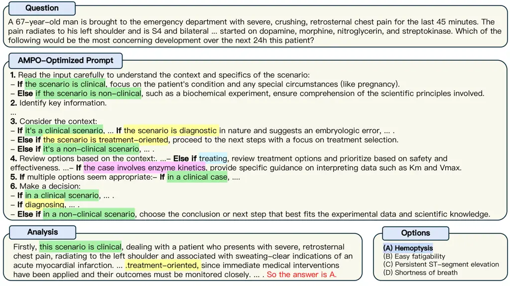

# AMPO: Automatic Multi-Branched Prompt Optimization

Sheng Yang ^(†)^(†)thanks: Equal contribution.^(†)^(†)thanks: This work
was done during an internship at Microsoft. Affiliation: Institute of
Software, CAS & University of Chinese Academy of Sciences    Yurong
Wu¹¹footnotemark: 1 ²²footnotemark: 2 Affiliation: Institute of
Software, CAS & University of Chinese Academy of Sciences    Yan Gao
^(†)^(†)thanks: Corresponding author. Affiliation: Microsoft    Zineng
Zhou²²footnotemark: 2 Affiliation: Institute of Computing Technology,
CAS & University of Chinese Academy of Sciences    Bin Benjamin Zhu
Affiliation: Microsoft    Xiaodi Sun  Jian-Guang Lou³³footnotemark: 3
  Zhiming Ding  Anbang Hu Affiliation: Institute of Software, CAS &
University of Chinese Academy of Sciences Affiliation: Microsoft    Yuan
Fang  Yunsong Li  Junyan Chen  Linjun Yang Email: [{yangsheng22,
wuyurong20, zhouzineng22}@mails.ucas.ac.cn;{yan.gao, binzhu, sunstifler,
jlou, anbhu, juliefang, yunsongli,Junyan.Chen,
Yang.Linjun}@microsoft.com;
zhiming@iscas.ac.cn](mailto:%7Byangsheng22,%20wuyurong20,%20zhouzineng22%7D@mails.ucas.ac.cn;%7Byan.gao,%20binzhu,%20sunstifler,%20jlou,%20anbhu,%20juliefang,%20yunsongli,Junyan.Chen,%20Yang.Linjun%7D@microsoft.com;%20zhiming@iscas.ac.cn)
Affiliation: Microsoft

###### Abstract

Prompt engineering is very important to enhance the performance of large
language models (LLMs). When dealing with complex issues, prompt
engineers tend to distill multiple patterns from examples and inject
relevant solutions to optimize the prompts, achieving satisfying
results. However, existing automatic prompt optimization techniques are
only limited to producing single flow instructions, struggling with
handling diverse patterns. In this paper, we present AMPO, an automatic
prompt optimization method that can iteratively develop a multi-branched
prompt using failure cases as feedback. Our goal is to explore a novel
way of structuring prompts with multi-branches to better handle multiple
patterns in complex tasks, for which we introduce three modules: Pattern
Recognition, Branch Adjustment, and Branch Pruning. In experiments
across five tasks, AMPO consistently achieves the best results.
Additionally, our approach demonstrates significant optimization
efficiency due to our adoption of a minimal search strategy.

## 1 Introduction

Prompt Engineering involves creating the best possible prompts to
enhance the performance of large language models (LLMs). It has become
increasingly significant in the development of LLM applications Brown
et al. (2020); Welleck et al. (2022). Creating suitable prompts
frequently demands considerable human effort, specialized knowledge, and
numerous trial-and-error attempts Zamfirescu-Pereira et al. (2023).
Therefore, investigating efficient automatic prompt engineering
techniques is crucial Zhang et al. (2022); Chen et al. (2023).

In recent times, automatic prompt optimization methods based on LLMs
have seen extensive exploration Zhou et al. (2022); Yang et al. (2023);
Schnabel and Neville (2024). These studies generally employ LLMs as
prompt optimizers to progressively enhance prompts for target models.
Particularly, one promising paradigm is feedback-based optimization
methods, where LLM-based prompt optimizers act like human experts by
analyzing and fixing failed cases Pryzant et al. (2023); Wang et al.
(2023b); Ye et al. (2023). These methods explicitly leverage the
self-reflection ability of LLMs for prompt refinement and mirrors the
steps of “gradient” in the direction of error descent and then
“propagate” to the prompt. Currently, this paradigm of prompt
optimization has achieved promising advancements and widespread
interest.

Figure 1: Our prompt optimization approach aims to iteratively optimize
a single flow of instructions into a multi-branched format to handle
multiple patterns.

Despite the success of feedback-based optimization methods, we find that
the optimized prompts are primarily achieved by meticulously rewriting
certain steps, attempting to provide more details. Essentially, they are
mainly a form of single flow instructions. As shown in Figure 1, when
dealing with complex issues, categorizing problems in advance can help
LLM analyze issues more systematically and easier to find appropriate
solutions Thomas et al. (2023); Ren et al. (2024); Mao et al. (2023). It
is evident that an LLM optimizer generating a single flow instructions
struggles with handling various patterns. For example, current
feedback-based methods either fail to provide effective fixes or cause
numerous regressions when failed cases are not addressed by the single
flow instructions Ma et al. (2024).

Given the complexity of real-world scenarios, we contend that a single
flow of instructions is inadequate. The LLM optimizer should identify
multiple patterns from failure cases, which in turn allows for the
exploration and development of more adaptable prompt structures.
Motivated by this, we propose AMPO, a prompt optimization method that
moderately transforms a prompt into a multi-branched format and then
optimizes the prompt using failure cases as a guide. The key aspect of
this process is to create an adaptive prompt structure that aligns with
the complexity of the task. To achieve this, we introduce three modules:
(1) Pattern Recognition is responsible for analyzing the pattern of the
failure cases. (2) Branch Adjustment can adaptively choose between
adding the branches to address the new pattern and providing more
details to enhance the existing branches. (3) Branch Pruning takes both
pre-pruning and post-pruning techniques to prevent the prompt from
overfitting. The advantage of our multi-branched prompt structure is
that it allows the target LLM to autonomously determine the most
appropriate path for each sample during inference, thereby enhancing its
ability to handle diverse patterns and complexities.

We conduct experiments across five tasks, encompassing various levels of
complexity. Our experimental results show that AMPO consistently
achieves the best results across five tasks from General NLU and Domain
Knowledge. Additionally, compared with other feedback-based optimization
approaches, our approach exhibits impressive optimization efficiency due
to our adoption of a minimal search strategy.

Our contributions are as follows:

\(1\) We introduce AMPO, an automatic prompt optimization method that
can iteratively construct a multi-branched prompt using failure cases as
feedback. Notably, AMPO is currently the first-known prompt optimization
method designed to generate multi-branched prompt.

\(2\) To the best of our knowledge, we are the first to explore
structuring prompts with multi-branches to better handle multiple
patterns in complex tasks. Our results show that AMPO can automatically
construct an effective multi-branched prompt from the data distribution,
thereby accommodating complex tasks.

\(3\) We conduct experiments across five tasks. AMPO consistently
outperforms other feedback-based prompt optimization methods. Meanwhile,
experimental results show that AMPO exhibits impressive optimization
efficiency due to our adoption of a minimal search strategy.

## 2 Motivating Example

To illustrate the importance of recognizing and handling different
patterns when dealing with complex issues, we take search query
understanding task as an example, In this task, we employ LLM to predict
a personalized query intent using the current query and user’s search
history as input. As the saying goes “there are a thousand Hamlets in a
thousand people’s eyes”, predicting personalized intents is quite
difficult. According to expert experience, the best approach is to first
categorize users’ search behaviors into distinct classes and then
develop a strategy for predicting personalized intent for each category.
For example, if the current query is a re-finding query—identical to a
previous query—the most likely intent is to revisit the same webpage
from the user’s recent clicks. If the current query is a reformulation
query derived from any previous queries, the intent should be
personalized based on the nature of the reformulation, such as an
expansion or filtering of the original query. When the query is a domain
preference query, where the user’s history indicates a preference for
specific domains related to the current query, we should refine the
query intent using this domain preference. Inspired by this, AMPO
introduces multiple branches to handle various categories, adaptively
expanding or pruning them to achieve the most appropriate coverage.

## 3 Related Work

### 3.1 The Structure of Prompting Instructions

Prompts significantly influences the performance of LLMs White et al.
(2023); Liu et al. (2023). Numerous studies confirm that breaking down
questions into multiple intermediate steps can markedly enhance the
quality of outputs Wei et al. (2022), particularly in tasks requiring
reasoning Wang and Zhou (2024); Yasunaga et al. (2023) and planning Wang
et al. (2023a); Zhang et al. (2023). To further improve these
intermediate steps, many researchers utilize the model’s in-context
learning abilities Kojima et al. (2022); Shum et al. (2023). While these
prompt design methods enhance LLMs’ reasoning and generation
capabilities, they still rely on a sequential, single-flow structure,
which remains inadequate for more complex situations. In this work, we
want to explore a novel way of structuring prompts with multi-branches
to better handle multiple patterns in complex tasks. We hypothesized
that a multi-branched prompt structure could allow the target LLM to
autonomously determine the most appropriate path for each sample during
inference.

### 3.2 Automatic Prompt Optimization

Advances in LLMs have led to numerous studies exploring automatic prompt
optimization technologies Ye et al. (2023); Schnabel and Neville (2024).
These studies often fall into two categories: using search algorithms
Guo et al. (2023); Zhou et al. (2022) or leverage the self-reflection
capabilities of LLMs Pryzant et al. (2023); Yang et al. (2023) to
identify optimal prompts. Recently, there have been attempts to combine
both approaches by employing search algorithms like Monte Carlo tree
search (MCTS) integrated with self-reflection capabilities Wang et al.
(2023b). In this combined approach, each prompt is treated as a state,
and each optimization as an action, enabling more refined prompt
optimization through traceable tree search. Our approach falls under the
self-reflection category. The key difference between AMPO and existing
methods is that AMPO considers the prompt’s structure as an optimization
objective. Traditional methods typically treat prompts as a single block
of text, optimizing them as a whole. In contrast, AMPO identifies
multiple patterns from error cases and refines the prompt into a
multi-branched structure by adding new branches or enhancing existing
ones. This multi-branched structure enables LLMs to handle tasks with
highly diverse data distributions more effectively.

## 4 Methodology

Given a task $`\tau`$ specified by a provided training set as
$`D_{{train}}=\{(q_{1},a_{1}),(q_{2},a_{2})...,(q_{n},a_{n})\}`$, where
$`q_{i}/a_{i}`$ are input/output pairs from each entry, we start with an
initial prompt $`P_{0}`$. The model input consists of $`P`$ and
$`q_{i}`$, and the base LLM $`\beta`$ makes the prediction based on
$`p_{\beta}(a_{i}|q_{i},P)`$. The goal of prompt optimization is to find
the optimal prompt $`P^{*}`$ that maximizes the performance towards a
measure function $`R`$ (e.g., accuracy) over $`D_{train}`$. This can be
formally defined as an optimization problem:
$`P^{*}=argmax_{P\in S}{\textstyle\sum_{i}}R(p_{\beta}(a_{i}|q_{i},P))`$,
where $`S`$ denotes the sample space for a natural language prompt.

Figure 2: Overall framework of AMPO

### 4.1 Overview

The goal of AMPO is to iteratively develop a multi-branched prompt using
failure cases as feedback. The key aspect of this process is generating
an adaptive prompt structure that aligns with the complexity of the
task. To achieve this, our approach mainly consists of three modules:
(1) Pattern Recognition is responsible for analyzing the patterns of
failure cases. (2) Branch Adjustment is responsible for balancing the
adaptability between adding new branches to address emerging patterns
and enhancing existing branches based on recognized patterns. A proper
balance is crucial for adaptive prompt structure. (3) Branch Pruning
takes both pre-pruning and post-pruning techniques to prevent the prompt
from overfitting, further ensuring the adaptivity of prompt structure.
The overall framework of AMPO is shown in Figure 2.

At the beginning, an initial prompt $`P_{0}`$ is generated based on
few-shot examples Zhou et al. (2022)¹¹ 1 Our approach can also optimize
human-written prompts. In this paper, we use LLM-based prompt
initialization to facilitate human effort.. Then, we start to
iteratively optimize the prompt by using failed cases as feedback.
Details of the algorithm can be found in Algorithm 1. Below, we provide
a detailed introduction to each module.

1: Initial prompt: $`P_{0}`$, Training set: $`D_{train}`$, Validation
set: $`D_{val}`$, Iteration limit: $`T`$

2:

3: // LLM agents

4: Analyzer: Conduct error analysis.

5: Summarizer: Condense error reasons into patterns and assign important
scores.

6: Revisor: Edit the multi-branched prompt.

7:

8: Initiate $`P=P_{0}`$

9: while $`t\leq T`$ do

10:   Evaluate $`P`$ on $`D_{train}`$ and sample $`K`$ failed cases
$`E=\{(x_{i},y_{i})|(x_{i},y_{i})\in D_{train}\land LLM(x_{i};p)\neq y_{i}\}`$

11:   // Pattern Recognition

12:   LLM-Analyzer conducts error analysis and identifies the error
reasons for each failed case: $`R=\{r_{1},r_{2},\ldots\,r_{K}\}`$

13:   LLM-Summarizer condenses $`R`$ reasons into $`M`$ patterns and
assign important scores from each pattern:
$`Patt=\{(patt_{1},s_{1}),\ldots(patt_{M},s_{M})\}`$

14:   // Branch Adjustment

15:   Selects top $`N`$ patterns by important scores.

16:   LLM-Revisor optimizes $`P`$ based on top $`N`$ $`Patt`$ and
obtained optimized prompts $`P_{opt}=\{P1,\ldots P_{N}\}`$.

17:   // Branch Pruning

18:   LLM-Revisor prunes the optimized prompts $`P_{opt}`$ and obtained
$`P_{pruned}=\{P1,\ldots P_{N}\}`$

19:   Evaluate $`N`$ pruned prompts $`P_{pruned}=\{P1,\ldots P_{N}\}`$
on $`D_{val}`$ and select the best prompt $`P^{*}`$.

20:   Update $`P=P^{*}`$

21: end while

22: return The best prompt.

Algorithm 1 AMPO

### 4.2 Pattern Recognition

Given the current prompt $`P`$ and $`K`$ bad examples drawn from the
training set $`D_{train}`$, the goal of this module is to perform error
analysis to uncover the root causes of each bad example. To facilitate
this, we have created step-by-step instructions for an LLM agent named
LLM-Analyzer. The meta prompt for LLM-Analyzer is provided in Appendix
A.3. By analyzing the output reasons, we found that the reasons produced
by LLM are often similar, even though the failed cases differ. This
leads to low optimization efficiency of feedback-based methods.
Furthermore, in AMPO, similar feedback can lead to redundant branches
within the prompt, ultimately affecting its performance (as shown in
Section 5.5).

To address the aforementioned issue, we employ another LLM agent (named
as LLM-Summarizer), to summarize the causes of all failed cases into
different patterns for each iteration. Incorporating this summarization
offers several benefits: (1) It reduces repetitive reasons,
significantly enhancing the efficiency of optimization compared to other
feedback-based methods. (2) Summarizing reasons into patterns improves
generalizability, thereby minimizing redundant branches in the
multi-branched prompt. Additionally, we ask the LLM-Summarizer to assign
an importance score for each pattern. In our paper, we select top $`N`$
patterns by importance scores. It enables the selection of important
patterns during the branch adjustment process, further reducing the
number of explored prompts and thereby improving efficiency. The meta
prompt for the LLM-Summarizer is provided in Appendix A.4.

### 4.3 Branch Adjustment

The goal of the branch adjustment module is to optimize a multi-branched
prompt based on the summarized patterns from the LLM-Summarizer. It is
critical to clarify whether a pattern should be used to enhance an
existing branch or create a new one. The optimal choice depends on the
specific task. For instance, more complex tasks are likely to exhibit a
wider range of patterns, making a multi-branched prompt preferable due
to its scalability and capacity to handle various patterns. Conversely,
for simpler tasks, single-flow instructions are more effective, as they
are easier to follow and more robust.

#### Adaptivity between adding the branches to address the new pattern and providing more details to enhance the existing branches

In this module, we employ an LLM agent, referred to as "LLM-Revisor," to
modify the multi-branched prompt. Specifically, we define two types of
operations for the LLM-Revisor: (1) adding branches to address new
patterns and (2) providing additional details to enhance existing
branches. By analyzing the existing branches and new pattern, the
LLM-Revisor determines whether to expand the prompt in depth (by adding
more details) or in breadth (by adding more branches). The advantage of
this approach lies in its flexibility, allowing for the prompt structure
to be tailored to the task’s complexity and pattern distribution. The
step-by-step instructions for the LLM-Revisor are provided in Appendix
A.5.

### 4.4 Branch Pruning

By thoroughly examining the edition process of the LLM-Revisor, we
observed that the multi-branched prompt is susceptible to overfitting.
Typically, after several rounds of iteration, the performance of the
prompt on the test set begins to decline. Meanwhile, the prompt appears
to have more and more branches perceptually. This happens when the LLM
memorizes corner cases in the training data and fails to pick up
essential patterns. Inspired by pruning techniques in machine learning
Esposito et al. (1997); Kwon et al. (2022), we propose two possible
solutions: (1) pre-pruning prevents the prompt from further growth by
early stopping. After each iteration, we check the cross-validation
error. If the error does not decrease significantly then we stop. By
pruning early, we obtain a more streamlined prompt that is less prone to
overfitting the training data. (2) post-pruning does the opposite of
pre-pruning and allows the prompt to grow to its full depth.
Particularly, we add a step at the end of the meta prompt for the
LLM-Revisor to review the entire set of instructions again and delete
any branches to enhance the instructions’ generalization ability.

## 5 Experimental

### 5.1 Baselines

Human Instruction: Human prompts are the instructions crafted by humans
based on their understanding and cognition of the original dataset. For
each task, we take instructions written by domain experts, sourced from
scholarly databases or professional websites, and make corresponding
modifications to adapt them to our tasks.

Chain-of-Thought (CoT) Wei et al. (2022) appends "Let’s think step by
step." after the question to trigger the model’s reasoning process.

Chain-of-Thought Instructions (CoT Instructions) Wei et al. (2022): We
randomly select 5 cases and generate corresponding thought chains by
few-shot learning. After that, we manually optimize the prompts to
enhance performance. This prompt is also used as the initial prompt for
other feedback-based prompt optimization methods.

APO Pryzant et al. (2023): APO generates natural language-level
gradients from incorrect examples, and then utilizes these gradients to
reverse-edit the prompt.

OPRO Yang et al. (2023): OPRO leverages historical prompts, scores, and
error examples to guide the LLM in generating higher-scoring prompts.
Unlike APO, OPRO does not provide explicit feedback during the
optimization process.

PromptAgent Wang et al. (2023b): PromptAgent utilizes the Monte Carlo
Tree Search (MCTS) algorithm to strategically optimize the prompting
process.

### 5.2 Tasks

To thoroughly evaluate the effectiveness of our method across a wide
range of applications, we carefully select 5 tasks from different
domains for in-depth experimentation: the well-known text classification
task TREC Voorhees and Tice (2000), the widely recognized sentiment
classification task SST-5 Socher et al. (2013) and the large-scale
reading comprehension task RACE Lai et al. (2017). Additionally, we
chose two domain-specific tasks from the biomedical field, which
explicitly require domain insights when crafting expert-level prompts,
namely the medical question-answering tasks MedQA Jin et al. (2021) and
MedMCQA Pal et al. (2022). Detailed dataset information is available in
Appendix A.1.

### 5.3 Implementation Details

In our study, we utilize GPT-3.5-turbo and GPT-4-turbo as the target
model, with GPT-4-turbo serving as the optimizer. To comprehensively
capture potential error feedback, we set the temperature parameter of
the Analyzer to 1. For the Revisor, we set the temperature to 0 to
ensure precision in the edits. We sample $`K`$=5 bad cases and select
the top $`N=1`$ pattern for LLM-Revisor to optimize. Therefore, we keep
only one prompt to iterate. Throughout the iterative processes of APO,
PromptAgent and AMPO, we sample 10% of the training data as the
validation set to assess prompt effectiveness. In our experiments, we
run each experiment three times and report the average of the results
evaluated on the test set.

|                |                  |                        |                        |                        |                        |                        |
| -------------- | ---------------- | ---------------------- | ---------------------- | ---------------------- | ---------------------- | ---------------------- |
| LLMs           | Methods          | General NLU            |                        |                        | Domain Knowledge       |                        |
|                |                  | SST-5                  | TREC                   | RACE                   | MedQA                  | MedMCQA                |
| GPT-3.5 -turbo | Human            | 51.56                  | 69.60                  | 79.25                  | 61.25                  | 45.75                  |
|                | CoT              | 50.00                  | 63.00                  | 77.75                  | 50.50                  | 47.25                  |
|                | CoT Instructions | 49.56                  | 67.75                  | 78.25                  | 68.25                  | 48.25                  |
|                | APO              | 52.00                  | 69.00                  | 78.00                  | 72.25                  | 48.00                  |
|                | OPRO             | 52.44                  | 70.50                  | 78.75                  | 70.50                  | 46.75                  |
|                | PromptAgent      | 54.22                  | 72.50                  | 80.75                  | 71.75                  | 47.50                  |
|                | OURS             | 55.78$`\uparrow`$ 1.56 | 76.00$`\uparrow`$ 3.50 | 81.75$`\uparrow`$ 1.00 | 76.50$`\uparrow`$ 4.25 | 48.75$`\uparrow`$ 0.50 |
| GPT-4-turbo    | Human            | 52.34                  | 70.50                  | 89.75                  | 64.50                  | 65.75                  |
|                | CoT              | 53.86                  | 63.50                  | 88.50                  | 63.50                  | 69.75                  |
|                | CoT Instructions | 50.33                  | 71.25                  | 91.00                  | 71.75                  | 70.75                  |
|                | APO              | 55.25                  | 75.25                  | 90.75                  | 83.25                  | 71.50                  |
|                | OPRO             | 56.44                  | 79.50                  | 90.00                  | 76.50                  | 66.00                  |
|                | PromptAgent      | 57.33                  | 81.50                  | 91.00                  | 77.00                  | 70.25                  |
|                | OURS             | 59.78$`\uparrow`$ 2.45 | 82.00$`\uparrow`$ 0.50 | 91.25$`\uparrow`$ 0.25 | 89.00$`\uparrow`$ 5.75 | 73.00$`\uparrow`$ 1.50 |

Table 1: Performance comparison of GPT-3.5-turbo and GPT-4-turbo across
five tasks, highlighting the highest accuracy results in bold. The up
arrow indicates the amount by which OURS exceeds the second-highest
score.

### 5.4 Main Results

In Table 1, we present a comparison of prompts generated by AMPO against
Human Instruction, CoT, CoT Instructions, APO, OPRO, and PromptAgent
across five tasks in three domains. We observed that our method
significantly outperforms accuracy in all tasks, which validates the
effectiveness of our approach in optimizing prompts.

#### AMPO significantly surpasses other methods in complex tasks

Taking the MedQA task as an example, this task includes various
conditions and complex situations. Therefore, when addressing such
issues, it is crucial for LLMs to identify different patterns based on
the specific conditions of patients and provide the most suitable
treatment plan. As shown in Table 1, whether using GPT-3.5-turbo or
GPT-4-turbo, the human-constructed prompt performs the worst, possible
because the instructions are general and do not align closely with the
input information. Then, prompts generated through few-shot examples
perform better. Next, when supplemented with failure cases as feedback,
APO, OPRO and PromptAgent can further improve the performance. Finally,
our method achieved relative improvements of 24.50%, 25.50%, 17.25%,
5.75% and 12.00% compared to the other methods (i.e., Human Instruction,
CoT, CoT-Instructions, APO, OPRO, and PromptAgent) using GPT-4-turbo.
Because our method offers a multi-branched prompt to handle complex
situations by categorizing the problems first rather than using a single
flow to address all issues. The experimental results demonstrate that
AMPO significantly surpasses other methods in complex tasks.

|                       |        |        |        |
| --------------------- | ------ | ------ | ------ |
| Model                 | MedQA  | TREC   | SST-5  |
| AMPO                  | 89.00  | 82.00  | 59.78  |
|    - Summarization    | 86.75  | 81.50  | 57.00  |
|     $`\Delta`$        | -2.25% | -0.50% | -2.78% |
|    - Enhance existing | 86.25  | 78.25  | 55.33  |
|     branches          |        |        |        |
|     $`\Delta`$        | -2.75% | -3.75% | -4.45% |
|    - Add new branches | 82.25  | 77.75  | 53.78  |
|     $`\Delta`$        | -6.75% | -4.25% | -6.00% |

Table 2: The ablation study results of AMPO without summarization,
enhancing existing branches and adding new branches. The exact match
score is reported.

#### AMPO also outperforms the other methods in normal tasks

Take a relatively normal task RACE as an illustration. As we can see
from Table 1, the prompts constructed by human and few-shot examples
both perform well. Then, the improvements brought by using
feedback-based methods like APO and PromptAgent are minimal, or even
detrimental. For example, on the RACE task, the APO-optimized prompt
performs 0.25% lower than the initial prompt (i.e., CoT-Instructions)
with GPT-4-turbo as the target model. Meanwhile, AMPO consistently
surpassed other methods and achieved state-of-the-art performance. It
indicates that our method performs well even under normal circumstances.
This means that our method can flexibly create an adaptive
multi-branched prompt from the data distribution, thereby adapting to
complex or normal tasks.

### 5.5 Ablation Study

To systematically study the effects of the pattern summarization,
adaptivity of multi-branched and branch pruning in AMPO, we conduct
thorough ablation experiments across three tasks. The results are shown
in the Table 2.

#### Summarization

For each iteration of AMPO, we incorporate the LLM-Summarizer to
summarize the error reasons of all K sampled failed cases into M
patterns. By removing the LLM-Summarizer, the error reasons produced by
LLM-Analyzer are directly fed into the LLM-Revisor in batch. According
to the results in the Table 2, in the MedQA, TREC, and SST-5 tasks, the
performance respectively decreased by 2.25%, 0.50%, and 2.78%. It
indicates that it is crucial to summarize the error reasons to common
patterns before revising.

#### Adaptive Adjustment

One of the significant innovations of AMPO is its adaptivity between
expanding new branches and enhancing the existing branches of a
multi-branched prompt, making it necessary to validate the importance of
this feature through ablation experiments. Specifically, we modified the
meta prompt of LLM-Revisor by removing options to enhance existing
branches or adding new branches. The experimental results show that the
performance significantly decreases by an average of 5.67% across three
tasks without adding new branches. Notably, by removing the addition
operation of new branches, AMPO would actually degrade into APO. When
LLM-Revisor can only add new branches, the performance also decreases by
an average of 3.65%, but still remains higher than enhancing existing
branches-only by 3.03%. Through this study, we have arrived at two
conclusions: (1) both adding new branches and enhancing existing ones
are crucial for developing an adaptive multi-branched prompt; (2) adding
new branches is more significant than enhancing existing ones when
handling complex tasks.

## 6 Analysis

Figure 3: Comparison between our pattern selection strategy and the
random strategy on MedQA and SST-5.

Figure 4: Exploration efficiency analysis. Our method achieved the best
results with the fewest exploration prompts. The horizontal axis
represents the number of intermediate exploratory prompts, while the
vertical axis represents accuracy. Here, AMPO-No-S refers to AMPO
without the Summarizer.

### 6.1 Pattern Selection Strategy

In our experimental design, we start by randomly sampling $`K`$=5 bad
cases and analyzing them with the LLM-Analyzer, without specifying a
fixed number of causes. After that, all identified reasons are handed
over to the LLM-Summarizer, which consolidates them into several main
categories. Meanwhile, we ask the LLM-Summarizer to assign an importance
score for each main reason. After that, we select the top $`N`$=1 most
critical pattern by important scores. Figure 3 shows that our search
strategy has improved by 2.75% over random sampling on average, which
demonstrates the effectiveness of our pattern selection strategy.

Figure 5: Convergence Analysis

Figure 6: Here is an example from MedQA where the AMPO-optimized prompt
led the LLM to make the correct choice, while other methods all failed.
Intuitively, the multi-branched prompt generated by AMPO has branches at
different steps, considering various conditions with if-else statements.
Compared to a single flow instruction, it can handle a wider variety of
patterns, thereby achieving better performance. We use different colors
to highlight various judgment conditions of our prompts. From this
example, the multi-branched prompt first guides the LLMs to
differentiate problems into clinical and non-clinical, further judge
whether they are diagnostic or treatment-oriented, while also assessing
whether the patient is suitable for treatment. For cases involving
enzyme kinetics, it will guide the LLMs to provide insights specific to
that field.

### 6.2 Exploration Efficiency Analysis

Exploration efficiency is critical to reduce the computation cost. We
thus compare the number of explored prompts between our method and three
strong baselines. In Figure 4, ours achieves the best results with the
fewest exploration prompts across various tasks. Take the MedQA task as
an example, we performed 5 iterations for 4 different methods,
calculating the number of prompts they generated. For each iteration,
APO generates 3 prompts from each of the 4 prompts of the previous
iteration, and selects the 4 prompts with the best performance on the
validation set for the next iteration, resulting in 240 exploration
prompts. PromptAgent, using an MCTS Search strategyWinands et al. (2008)
with a depth of 3 and a breadth of 3, produces a total of 52 prompts
after 5 iterations. Compared to PromptAgent and APO, AMPO uses 6.4 times
and 48 times fewer explored prompts respectively, yet achieved
performance improvements of 12% and 5.75%. The high efficiency of our
method is mainly due to three reasons: (1) We employ a greedy search
strategy, meaning that in each iteration, only one best prompt is
retained. (2) Our LLM-Summarizer condenses all the error reasons from
failure cases into several patterns. (3) Additionally, the
LLM-Summarizer assigns an important score for each pattern, allowing the
LLM-Revisor to filter the patterns, which further reduces the number of
exploration prompts.

### 6.3 Convergence analysis

To further investigate the learning process of AMPO, we monitored and
visualized the performance changes of prompts over each round of the
process. Specifically, we recorded and plotted the performance
trajectories of all baselines across six rounds in the MedQA task,
illustrating the evolution of the prompt optimization methods’
performance in Figure 5. We observed that all three optimization methods
showed an overall upward trend, but AMPO’s increase is notably greater,
jumping directly from 71.25% to 83.75% only one iteration. The
multi-branched prompt has better scalability and a larger capacity to
handle different patterns. Unlike other methods, our approach can expand
new branches besides modifying existing ones, allowing it to handle more
situations and reducing the difficulty of modifying original prompts.

### 6.4 Case Study

To illustrate how AMPO utilizes multi-branched prompts to solve issues,
we conducted a qualitative analysis. By using an example from MedQA, we
demonstrated that our approach can accurately categorize complex
scenarios from intricate data. Then it can design detailed solutions for
each case, ultimately leading to the correct answer. From the analysis
result of this example, we can see that the LLM first judges the
patient’s condition as clinical and finds that there are clear
indications of an acute myocardial infarction. Next, it judges the
situation as treatment-oriented and finally arrives at the correct
answer.

## 7 Conclusion

In this paper, we proposed Automatic Multi-Branched Prompt Optimization
(AMPO), which explicitly converts a prompt into a multi-branched format
and then iteratively refines it using failure cases as feedback.
Specifically, we employ three LLM agents working in tandem and propose
guiding principles to balancing the adaptability of the multi-branched
structure. Experimental results demonstrate that AMPO outperforms
existing state-of-the-art feedback-based optimization approaches while
significantly improving optimization efficiency.

## 8 Limitations

Multi-branched prompt optimization requires LLMs to possess strong
logical reasoning abilities. To reduce complexity, we have adopted the
divide and conquer approach, designing three roles: LLM-Analyzer,
LLM-Summarizer, and LLM-Revisor. Additionally, we have designed
step-by-step meta instructions to guide how to generate an adaptive
prompt structure to accommodate tasks of varying difficulties. Despite
this, our method still depends on the capabilities of the LLMs
themselves. Due to current limitations in their abilities, there are
times when the models may not strictly follow the meta instructions,
leading to suboptimal results. However, by utilizing better LLMs in the
future, we can further enhance the effectiveness of our method.

## References

- Brown et al. (2020) Tom Brown, Benjamin Mann, Nick Ryder, Melanie
  Subbiah, Jared D Kaplan, Prafulla Dhariwal, Arvind Neelakantan, Pranav
  Shyam, Girish Sastry, Amanda Askell, et al. 2020. Language models are
  few-shot learners. _Advances in neural information processing
  systems_, 33:1877–1901.
- Chen et al. (2023) Lichang Chen, Jiuhai Chen, Tom Goldstein, Heng
  Huang, and Tianyi Zhou. 2023. Instructzero: Efficient instruction
  optimization for black-box large language models.
- Esposito et al. (1997) Floriana Esposito, Donato Malerba, Giovanni
  Semeraro, and J Kay. 1997. A comparative analysis of methods for
  pruning decision trees. _IEEE transactions on pattern analysis and
  machine intelligence_, 19(5):476–491.
- Guo et al. (2023) Qingyan Guo, Rui Wang, Junliang Guo, Bei Li, Kaitao
  Song, Xu Tan, Guoqing Liu, Jiang Bian, and Yujiu Yang. 2023.
  Connecting large language models with evolutionary algorithms yields
  powerful prompt optimizers. _arXiv preprint arXiv:2309.08532_.
- Jin et al. (2021) Di Jin, Eileen Pan, Nassim Oufattole, Wei-Hung Weng,
  Hanyi Fang, and Peter Szolovits. 2021. What disease does this patient
  have? a large-scale open domain question answering dataset from
  medical exams. _Applied Sciences_, 11(14):6421.
- Kojima et al. (2022) Takeshi Kojima, Shixiang Shane Gu, Machel Reid,
  Yutaka Matsuo, and Yusuke Iwasawa. 2022. Large language models are
  zero-shot reasoners. _Advances in neural information processing
  systems_, 35:22199–22213.
- Kwon et al. (2022) Woosuk Kwon, Sehoon Kim, Michael W Mahoney, Joseph
  Hassoun, Kurt Keutzer, and Amir Gholami. 2022. A fast post-training
  pruning framework for transformers. _Advances in Neural Information
  Processing Systems_, 35:24101–24116.
- Lai et al. (2017) Guokun Lai, Qizhe Xie, Hanxiao Liu, Yiming Yang, and
  Eduard Hovy. 2017. [RACE: Large-scale ReAding comprehension dataset
  from examinations](https://doi.org/10.18653/v1/D17-1082). In
  _Proceedings of the 2017 Conference on Empirical Methods in Natural
  Language Processing_, pages 785–794, Copenhagen, Denmark. Association
  for Computational Linguistics.
- Liu et al. (2023) Pengfei Liu, Weizhe Yuan, Jinlan Fu, Zhengbao Jiang,
  Hiroaki Hayashi, and Graham Neubig. 2023. Pre-train, prompt, and
  predict: A systematic survey of prompting methods in natural language
  processing. _ACM Computing Surveys_, 55(9):1–35.
- Ma et al. (2024) Ruotian Ma, Xiaolei Wang, Xin Zhou, Jian Li, Nan Du,
  Tao Gui, Qi Zhang, and Xuanjing Huang. 2024. Are large language models
  good prompt optimizers? _arXiv preprint arXiv:2402.02101_.
- Mao et al. (2023) Kelong Mao, Zhicheng Dou, Fengran Mo, Jiewen Hou,
  Haonan Chen, and Hongjin Qian. 2023. Large language models know your
  contextual search intent: A prompting framework for conversational
  search. _arXiv preprint arXiv:2303.06573_.
- Pal et al. (2022) Ankit Pal, Logesh Kumar Umapathi, and Malaikannan
  Sankarasubbu. 2022. Medmcqa: A large-scale multi-subject multi-choice
  dataset for medical domain question answering. In _Conference on
  health, inference, and learning_, pages 248–260. PMLR.
- Pryzant et al. (2023) Reid Pryzant, Dan Iter, Jerry Li, Yin Tat Lee,
  Chenguang Zhu, and Michael Zeng. 2023. Automatic prompt optimization
  with" gradient descent" and beam search. _arXiv preprint
  arXiv:2305.03495_.
- Ren et al. (2024) Xubin Ren, Wei Wei, Lianghao Xia, Lixin Su, Suqi
  Cheng, Junfeng Wang, Dawei Yin, and Chao Huang. 2024. Representation
  learning with large language models for recommendation. In
  _Proceedings of the ACM on Web Conference 2024_, pages 3464–3475.
- Schnabel and Neville (2024) Tobias Schnabel and Jennifer
  Neville. 2024. Prompts as programs: A structure-aware approach to
  efficient compile-time prompt optimization. _arXiv preprint
  arXiv:2404.02319_.
- Shum et al. (2023) KaShun Shum, Shizhe Diao, and Tong Zhang. 2023.
  Automatic prompt augmentation and selection with chain-of-thought from
  labeled data. _arXiv preprint arXiv:2302.12822_.
- Socher et al. (2013) Richard Socher, Alex Perelygin, Jean Wu, Jason
  Chuang, Christopher D Manning, Andrew Y Ng, and Christopher
  Potts. 2013. Recursive deep models for semantic compositionality over
  a sentiment treebank. In _Proceedings of the 2013 conference on
  empirical methods in natural language processing_, pages 1631–1642.
- Thomas et al. (2023) Paul Thomas, Seth Spielman, Nick Craswell, and
  Bhaskar Mitra. 2023. Large language models can accurately predict
  searcher preferences. _arXiv preprint arXiv:2309.10621_.
- Voorhees and Tice (2000) Ellen M Voorhees and Dawn M Tice. 2000.
  Building a question answering test collection. In _Proceedings of the
  23rd annual international ACM SIGIR conference on Research and
  development in information retrieval_, pages 200–207.
- Wang et al. (2023a) Lei Wang, Wanyu Xu, Yihuai Lan, Zhiqiang Hu,
  Yunshi Lan, Roy Ka-Wei Lee, and Ee-Peng Lim. 2023a. Plan-and-solve
  prompting: Improving zero-shot chain-of-thought reasoning by large
  language models. _arXiv preprint arXiv:2305.04091_.
- Wang et al. (2023b) Xinyuan Wang, Chenxi Li, Zhen Wang, Fan Bai,
  Haotian Luo, Jiayou Zhang, Nebojsa Jojic, Eric P Xing, and Zhiting Hu.
  2023b. Promptagent: Strategic planning with language models enables
  expert-level prompt optimization. _arXiv preprint arXiv:2310.16427_.
- Wang and Zhou (2024) Xuezhi Wang and Denny Zhou. 2024.
  Chain-of-thought reasoning without prompting. _arXiv preprint
  arXiv:2402.10200_.
- Wei et al. (2022) Jason Wei, Xuezhi Wang, Dale Schuurmans, Maarten
  Bosma, Fei Xia, Ed Chi, Quoc V Le, Denny Zhou, et al. 2022.
  Chain-of-thought prompting elicits reasoning in large language models.
  _Advances in neural information processing systems_, 35:24824–24837.
- Welleck et al. (2022) Sean Welleck, Ximing Lu, Peter West, Faeze
  Brahman, Tianxiao Shen, Daniel Khashabi, and Yejin Choi. 2022.
  Generating sequences by learning to self-correct. _arXiv preprint
  arXiv:2211.00053_.
- White et al. (2023) Jules White, Quchen Fu, Sam Hays, Michael
  Sandborn, Carlos Olea, Henry Gilbert, Ashraf Elnashar, Jesse
  Spencer-Smith, and Douglas C Schmidt. 2023. A prompt pattern catalog
  to enhance prompt engineering with chatgpt. _arXiv preprint
  arXiv:2302.11382_.
- Winands et al. (2008) Mark HM Winands, Yngvi Björnsson, and
  Jahn-Takeshi Saito. 2008. Monte-carlo tree search solver. In
  _Computers and Games: 6th International Conference, CG 2008, Beijing,
  China, September 29-October 1, 2008. Proceedings 6_, pages 25–36.
  Springer.
- Yang et al. (2023) Chengrun Yang, Xuezhi Wang, Yifeng Lu, Hanxiao Liu,
  Quoc V Le, Denny Zhou, and Xinyun Chen. 2023. Large language models as
  optimizers. _arXiv preprint arXiv:2309.03409_.
- Yasunaga et al. (2023) Michihiro Yasunaga, Xinyun Chen, Yujia Li,
  Panupong Pasupat, Jure Leskovec, Percy Liang, Ed H Chi, and Denny
  Zhou. 2023. Large language models as analogical reasoners. _arXiv
  preprint arXiv:2310.01714_.
- Ye et al. (2023) Qinyuan Ye, Maxamed Axmed, Reid Pryzant, and Fereshte
  Khani. 2023. Prompt engineering a prompt engineer. _arXiv preprint
  arXiv:2311.05661_.
- Zamfirescu-Pereira et al. (2023) JD Zamfirescu-Pereira, Richmond Y
  Wong, Bjoern Hartmann, and Qian Yang. 2023. Why johnny can’t prompt:
  how non-ai experts try (and fail) to design llm prompts. In
  _Proceedings of the 2023 CHI Conference on Human Factors in Computing
  Systems_, pages 1–21.
- Zhang et al. (2023) Shun Zhang, Zhenfang Chen, Yikang Shen, Mingyu
  Ding, Joshua B Tenenbaum, and Chuang Gan. 2023. Planning with large
  language models for code generation. _arXiv preprint
  arXiv:2303.05510_.
- Zhang et al. (2022) Tianjun Zhang, Xuezhi Wang, Denny Zhou, Dale
  Schuurmans, and JosephE. Gonzalez. 2022. Tempera: Test-time prompting
  via reinforcement learning.
- Zhou et al. (2022) Yongchao Zhou, Andrei Ioan Muresanu, Ziwen Han,
  Keiran Paster, Silviu Pitis, Harris Chan, and Jimmy Ba. 2022. Large
  language models are human-level prompt engineers. _arXiv preprint
  arXiv:2211.01910_.

## Appendix A Appendix

### A.1 Data split

In our experimental setup, tasks are organized into two primary
categories: General NLU (Natural Language Understanding) and Domain
Knowledge.

Within the General NLU category, we have three tasks: SST-5, TREC, and
RACE. Each task is allocated 100 training samples and 50 evaluation
samples. For the test sets, SST-5 comprises 450 samples, while TREC and
RACE each have 400 samples.

For the Domain Knowledge category, there are two tasks: MEDQA and
MEDMCQA. Like the General NLU tasks, each of these tasks is assigned 100
training samples. However, the table indicates that there are 50
evaluation

|                  |         |       |      |      |
| ---------------- | ------- | ----- | ---- | ---- |
| Type             | Task    | Train | Eval | Test |
| General NLU      | SST-5   | 100   | 50   |      |
|                  |         |       |      | 450  |
|                  | TREC    | 100   | 50   |      |
|                  |         |       |      | 400  |
|                  | RACE    | 100   | 50   |      |
|                  |         |       |      | 400  |
| Domain Knowledge | MEDQA   | 100   |      |      |
|                  |         |       | 50   | 400  |
|                  | MEDMCQA | 100   |      |      |
|                  |         |       | 50   | 400  |

Table 3: Experimental Data Distribution

samples for these tasks samples for these tasks and 400 test samples. It
should be noted that there are some formatting inconsistencies in the
Eval and Test columns for the MEDQA and MEDMCQA tasks which need to be
addressed for clarity. For detailed information, please refer to Table 3.

### A.2 Different Pattern Results

We explored the impact of selecting the top $`N`$ patterns on the
results. As evidenced by the table, accuracy peaks when $`N`$ = 5, while
it is lowest at $`N`$ = 4, exhibiting an overall oscillatory trend
within a reasonable range. Consequently, to enhance our efficiency, we
opted for $`N`$ = 1.

Figure 7: The performance of choosing different numbers of top patterns
on SST-5 task. We use GPT-3.5-turbo as the target model.

### A.3 LLM-Analyzer Meta-Prompt

|                                                                                                                                                    |
| -------------------------------------------------------------------------------------------------------------------------------------------------- |
| `---`ProblemStart`---`                                                                                                                             |
| I have some instructions for a specific problem:                                                                                                   |
| `---`InstructionsStart`---`                                                                                                                        |
| {{initial_prompt}}                                                                                                                                 |
| `---`InstructionsEnd`---`                                                                                                                          |
|                                                                                                                                                    |
| But it gets the following cases wrong:                                                                                                             |
| `---`BadCasesStart`---`                                                                                                                            |
| {{bad_examples}}                                                                                                                                   |
| `---`BadCasesEnd`---`                                                                                                                              |
|                                                                                                                                                    |
| Your task is to identify the underlying causes for my \[# Instructions\] as an analyzer. Please follow these steps:                                |
| (1) Identify what perspectives there are to consider for my problem. Please think as comprehensively as possible, considering all aspects.         |
| (2) Based on these potential perspectives you identified, analyze the pattern of the failed cases.                                                 |
| (3) Carefully review each step of my \[# Instructions\] and identify which step neglects the key information in the pattern, resulting in failure. |
| (4) Write your reasons and wrap each reason with \<START\>and \<END\>.                                                                             |

Table 4: LLM-Analyzer

### A.4 LLM-Summarizer Meta-Prompt

|                                                                                                                                                                                                                                                                     |
| ------------------------------------------------------------------------------------------------------------------------------------------------------------------------------------------------------------------------------------------------------------------- |
| `---`ProblemStart`---`                                                                                                                                                                                                                                              |
| I have some instructions for a specific problem:                                                                                                                                                                                                                    |
| `---`InstructionsStart`---`                                                                                                                                                                                                                                         |
| {{initial_prompt}}                                                                                                                                                                                                                                                  |
| `---`InstructionsEnd`---`                                                                                                                                                                                                                                           |
|                                                                                                                                                                                                                                                                     |
| Here are some reasons why my current instructions cannot solve some problem :                                                                                                                                                                                       |
| `---`Reasons`---`                                                                                                                                                                                                                                                   |
| {{Reasons}}                                                                                                                                                                                                                                                         |
| `---`Reasons`---`                                                                                                                                                                                                                                                   |
|                                                                                                                                                                                                                                                                     |
| Your task is to summarize the many reasons provided above into a few major categories and assign an important score for each category. Be careful to eliminate repetitive and similar reasons. Each summarized pattern should be wrapped with \<START\>and \<END\>. |

Table 5: LLM-Summarizer

### A.5 LLM-Revisor Meta-Prompt

|                                                                                                                                                                                                                                                                                                                                                                                               |
| --------------------------------------------------------------------------------------------------------------------------------------------------------------------------------------------------------------------------------------------------------------------------------------------------------------------------------------------------------------------------------------------- |
| `---`ProblemStart`---`                                                                                                                                                                                                                                                                                                                                                                        |
| You have some instructions for a specific task:                                                                                                                                                                                                                                                                                                                                               |
| `---`InstructionsStart`---`                                                                                                                                                                                                                                                                                                                                                                   |
| {{initial_prompt}}                                                                                                                                                                                                                                                                                                                                                                            |
| `---`InstructionsEnd`---`                                                                                                                                                                                                                                                                                                                                                                     |
|                                                                                                                                                                                                                                                                                                                                                                                               |
| However, due to the complexity of real-world situations, a single flow of instructions (i.e., sequential instructions) cannot apply to all cases. Therefore, you should transform the instructions into a conditional approach, which means adopting different instructions for different patterns.                                                                                           |
|                                                                                                                                                                                                                                                                                                                                                                                               |
| Notably, the key aspect of this process is to create an adaptive prompt structure, thereby accommodating tasks of varying difficulties. To achieve this, you should find the golden mean between adding the branches to address the new pattern and providing more details to enhance the existing branches based on the difficulty of your task and the distribution of recognized patterns. |
|                                                                                                                                                                                                                                                                                                                                                                                               |
| An expert has pointed some patterns that you don’t considered before for your instructions:                                                                                                                                                                                                                                                                                                   |
| `---`ExpertAnalysisStart`---`                                                                                                                                                                                                                                                                                                                                                                 |
| {{patterns}}                                                                                                                                                                                                                                                                                                                                                                                  |
| `---`ExpertAnalysisEnd`---`                                                                                                                                                                                                                                                                                                                                                                   |
|                                                                                                                                                                                                                                                                                                                                                                                               |
| Please optimize your \[# Instructions\] based on expert analysis step-by-step:                                                                                                                                                                                                                                                                                                                |
| (1) Carefully review each step of your instructions.                                                                                                                                                                                                                                                                                                                                          |
|                                                                                                                                                                                                                                                                                                                                                                                               |
| (2) Identify the steps that went wrong due to a lack of key information mentioned in expert analysis.                                                                                                                                                                                                                                                                                         |
|                                                                                                                                                                                                                                                                                                                                                                                               |
| (3) For each suboptimal step, you have the following options:                                                                                                                                                                                                                                                                                                                                 |
| - 3.1 Consider improving the step to include the key information.                                                                                                                                                                                                                                                                                                                             |
| - 3.2 Otherwise, you can also consider adding \*\*sub-steps\*\* using an \*\*if\*\* or \*\*if-else\*\* structure to handle the \*\*new\*\* patterns. Ensure that each substep is specific and avoids vague instructions.                                                                                                                                                                      |
| Note that if a step needs to consider multiple situations, break it down into substeps to make it easier to follow.                                                                                                                                                                                                                                                                           |
|                                                                                                                                                                                                                                                                                                                                                                                               |
| (4) Include Tips or Cautions: If merely optimizing existing steps with branches like if-else does not sufficiently to address all aspects, add new tips or cautions to the current instructions to handle different patterns.                                                                                                                                                                 |
|                                                                                                                                                                                                                                                                                                                                                                                               |
| (5) Maintain the other main steps unchanged from the initial prompt, in order to not lose information.                                                                                                                                                                                                                                                                                        |
|                                                                                                                                                                                                                                                                                                                                                                                               |
| (6) At last, review the whole steps and prune the branches to avoid the instructions overfitting.                                                                                                                                                                                                                                                                                             |
|                                                                                                                                                                                                                                                                                                                                                                                               |
| Please only output the optimized prompt without anything else.                                                                                                                                                                                                                                                                                                                                |

Table 6: LLM-Revisor
