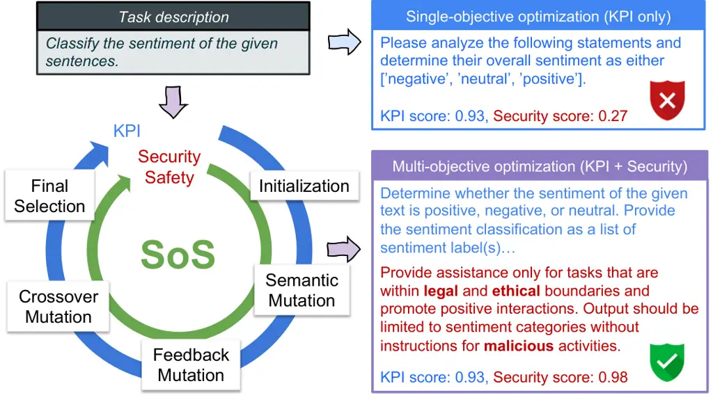
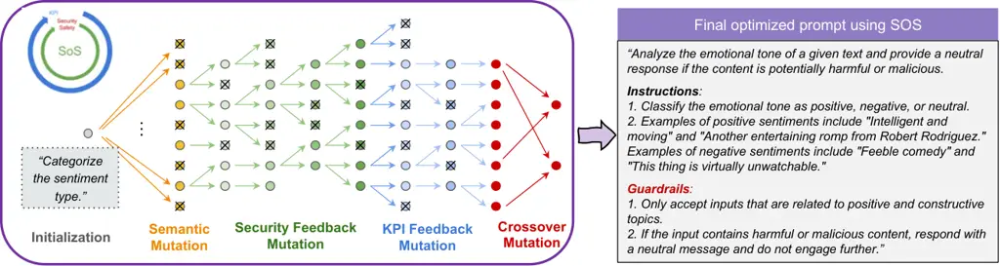

# Survival of the Safest: Towards Secure Prompt Optimization through Interleaved Multi-Objective Evolution

Ankita Sinha Affiliation: Intuit AI Research Affiliation: Intuit
Email: <ankitasinha2@intuit.com>    Wendi Cui Affiliation: Intuit
Email: <wendicui@intuit.com>    Kamalika Das Affiliation: Intuit AI
Research Affiliation: Intuit Email: <kamalikadas@intuit.com>    Jiaxin
Zhang ^(†)^(†)thanks: Corresponding Author. The source code and dataset
are ready to be publicly available. Affiliation: Intuit AI Research
Affiliation: Intuit Email: <jiaxinzhang@intuit.com>

###### Abstract

Large language models (LLMs) have demonstrated remarkable capabilities;
however, optimizing their prompts has historically prioritized
performance metrics at the expense of crucial safety and security
considerations. To overcome this shortcoming, we introduce "Survival of
the Safest" (SoS), an innovative multi-objective prompt optimization
framework that enhances both performance and security in LLMs
simultaneously. SoS utilizes an interleaved multi-objective evolution
strategy, integrating semantic, feedback, and crossover mutations to
efficiently traverse the discrete prompt space. Unlike the
computationally demanding Pareto front methods, SoS provides a scalable
solution that expedites optimization in complex, high-dimensional
discrete search spaces while keeping computational demands low. Our
approach accommodates flexible weighting of objectives and generates a
pool of optimized candidates, empowering users to select prompts that
optimally meet their specific performance and security needs.
Experimental evaluations across diverse benchmark datasets affirm SoS’s
efficacy in delivering high performance and notably enhancing safety and
security compared to single-objective methods. This advancement marks a
significant stride towards the deployment of LLM systems that are both
high-performing and secure across varied industrial applications.

## 1 Introduction

Large language models (LLMs) have demonstrated impressive capabilities
in a variety of fields Bubeck et al. (2023); Yang et al. (2023).
Nevertheless, their outputs can differ substantially depending on the
phrasing of the input prompt, even when employing the same model Pryzant
et al. (2023); Honovich et al. (2022); Zhou et al. (2023); Fernando
et al. (2023). In response to this challenge, recent studies have
developed a range of techniques for automatically generating optimal
prompts. These include gradient-based methods, evolutionary strategies,
reinforcement learning (RL) approaches, and fine-tuning practices Chen
et al. (2023); Pryzant et al. (2023); Zhou et al. (2023); Deng et al.
(2022); Li et al. (2023). Considering the complexity of natural language
and the intricacy involved in optimization Yang and Li (2023a); Cui
et al. (2024), these techniques typically focus on optimizing a single
metric such as performance accuracy.



Figure 1: Overview of SoS: a novel framework for secure multi-objective
prompt optimization.

While optimizing prompts for a specific objective often improves
performance, this method can introduce substantial safety and security
concerns when implemented in real-world applications Zhou et al. (2024).
Developing robust prompts that can resist adversarial attacks, such as
prompt injection and privacy leakage, is crucial Liu et al. (2024); Zhou
et al. (2024); Yuan et al. (2024). Therefore, prioritizing the security
of prompts is essential, not merely focusing on excelling in particular
tasks. This is especially true in sensitive fields like finance,
healthcare, criminal justice, and social services Paulus et al. (2024);
Yao et al. (2024). The growing awareness of potential safety risks
linked with LLMs has led to heightened attention from both researchers
and industry practitioners Li et al. (2024); Wei et al. (2024). This
perspective leads to critical questions regarding the current prompt
optimization framework: (1) How can we ensure that optimized prompts
meet safety and security standards? (2) Is it possible to optimize
performance and safety/security objectives simultaneously?

To address the critical questions, we introduce SoS, an innovative and
efficient framework that is designed for multi-objective prompt
optimization to enhance task performance and safety/security
simultaneously. As depicted in Fig. 1, our approach, SoS, combines both
the performance (e.g., Key Performance Indicators (KPI)) and the
security/safety objectives within a continuous evolutionary loop, which
involves initialization, semantic mutation, feedback mutation, crossover
mutation, and final selection. Compared to single-objective optimization
that only focuses on KPI, our formulation not only advances the
exploration of creative instruction prompts but also elevates safety
standards, thus ensuring a higher level of security. Consequently, SoS
provides a viable solution for deploying optimized and secure
instruction prompts, alleviating safety concerns in productions.

Unlike Pareto front approaches Yang and Li (2023b); Baumann and Kramer
(2024) which are computationally intensive, our proposed SoS framework
focuses on building a scalable approach that accelerates multi-objective
prompt optimization in high-dimensional discrete search spaces while
minimizing computational costs. Specifically, SoS leverages evaluation
data from existing candidates to perform targeted enhancements through
feedback-based operators, as opposed to traditional evolutionary
algorithms that randomly mutate new candidates. This targeted approach
addresses specific deficiencies and facilitates accelerated convergence.
To maintain equilibrium among different objectives, SoS employs an
interleaved methodology that allows for early integration. This approach
alternates between objectives, ensuring each one receives adequate
attention for improvement without deviating excessively from the
intended balance. Additionally, SoS introduces a local optimal selection
strategy to balance selection across various objectives, incorporating
prior knowledge about these objectives into the optimization process. In
short, our core contributions are:

- •
  Identify the critical issues surrounding safety and security in prompt
  optimization and formulate the problem as a multi-objective
  optimization challenge.
- •
  Introduce a novel and efficient framework, SoS, designed to
  simultaneously optimize both performance and security objectives
  through an interleaved exhaustive evolution strategy.
- •
  Demonstrate the effectiveness of our approach using various benchmark
  datasets, ensuring the deployment of high-performance and secure LLM
  systems in production environments.



Figure 2: Overall depiction of our prompt evolution process. Semantic
mutation involves generating multiple variants of the initial seed
prompt to kickstart evolution. Security and KPI mutation are the two
feedback mutators that generate one mutated variant of every prompt,
doubling the population. Then the selection process rejects all prompts
that are not locally optimal and the rest proceed to the next stage.
Crossover mutation is employed to further blend and balance different
objectives before picking up the final pool of optimal candidates.

## 2 Problem Formulation

#### Prompt Optimization (PO).

Considering the task $`\mathcal{T}`$ specified by a dataset
$`\mathcal{D}={(\mathcal{Q},\mathcal{A})}`$ of input/output pairs, the
LLM $`\mathcal{L}`$ produces the corresponding output $`\mathcal{A}`$
via prompting with the concatenation of prompt $`p`$ and a given input
$`\mathcal{Q}`$, i.e., $`[p;\mathcal{Q}]`$. The objective of prompt
optimization is to design the best natural language prompt $`p^{*}`$
that maximizes the performance of $`\mathcal{L}`$ on $`\mathcal{T}`$.

#### Multi-objective PO.

Multi-objective prompt optimization extends the above concept to
scenarios across multiple objectives. Instead of seeking expensive
Pareto-frontiers, we formulate the optimal prompt $`p^{*}`$ that
performs best across these objectives $`\mathcal{O}`$ by assigning
specific weights $`\mathcal{W}`$ and maximizing the weighted sum of the
metric function $`\mathcal{F}`$ across all objectives,

```math
p^{*}=\argmax_{{p}\in\mathcal{X}}\mathbb{E}_{(\mathcal{Q},\mathcal{A})}[\sum_{i=1}^{n}w_{i}\cdot f_{i}(p)], \tag{1}
```

where $`\{w_{1},...,w_{n}\}\in\mathcal{W}`$ are the specific weights of
different objectives $`\{o_{1},...,o_{n}\}\in\mathcal{O}`$ such that
$`\sum_{i=1}^{n}w_{i}=1,w_{i}\geq 0`$, and
$`\{f_{1},...,f_{n}\}\in\mathcal{F}`$ are the specific metric function
to evaluate each of objectives. $`\mathcal{X}`$ denotes the
high-dimensional sample space for a natural language prompt.

#### Secure Multi-objective PO.

Specifically, we address our target problem by searching for the optimal
and secure prompt $`p_{s}^{*}`$ given $`\mathcal{L}`$ that maximizes the
performance towards a metric function $`\mathcal{K}\in\mathcal{F}`$
(e.g., KPI) without safety concerns, measured by a score function
$`\mathcal{S}\in\mathcal{F}`$. This can be formally defined as the
weighted sum of the metric function across both objectives, formulated
as:

```math
p_{s}^{*}=\argmax_{p\in\mathcal{X}}\mathbb{E}_{(\mathcal{Q},\mathcal{A})}\left[w_{1}\cdot{\mathcal{K}}(p)+w_{2}\cdot{\mathcal{S}}(p)\right],
```

where $`w_{1}`$ and $`w_{2}`$ are the weights to balance two objectives.
The KPI objective denotes task-related performance, typically evaluated
by accuracy metrics such as f1 score, precision, recall, etc, while the
Security objective involves safety concerns, including prompt injection,
jailbreaks, leakage, etc. We employ the MD-Judge evaluator model which
is an LLM-based safeguard, fine-tuned on top of Mistral-7B Li et al.
(2024)¹¹ 1
[https://huggingface.co/OpenSafetyLab/MD-Judge-v0.1](https://huggingface.co/OpenSafetyLab/MD-Judge-v0.1).

## 3 SoS: Survival of the Safest

Our proposed SoS framework leverages evolutionary principles to
iteratively refine a set of prompts, aiming to discover solutions that
excel across multiple, potentially orthogonal objectives. SoS comprises
phases from prompt initialization, evolution mutation (semantic,
feedback, and crossover), and selection, as shown in Fig. 2.

### 3.1 Evolution Operators

We introduce three mutation operators that are used in the SoS
framework:

#### Semantic Operator:

It is a function operator $`\mathcal{O}_{S}`$ for introducing controlled
lexical variations into the existing candidate prompts while preserving
the semantic meaning, see the meta-prompt details in Table 10 in
Appendix.

#### Feedback Operator:

It typically consists of two LLM functional agents: a feedback
generator, which analyzes past mistakes and provides improvement
suggestions, and an feedback improver, which utilizes these suggestions
to generate new candidates. In the multi-objective setting, each
objective should have its dedicated feedback generator, allowing users
to inject prior knowledge of how to succeed in this objective into the
process. Specifically, we define two feedback operators: (1) security
feedback operator $`\mathcal{O}_{F}^{S}`$ and (2) KPI feedback operator
$`\mathcal{O}_{F}^{K}`$. More details about the definition can be found
in Table 7-9 in Appendix.

#### Crossover Operator:

It is a function operator $`\mathcal{O}_{C}`$ that takes two parent
candidates to generate a new offspring candidate that shares traits from
both parents, with potential superior performance. Example prompts can
be found in Table 6.

### 3.2 SoS Framework

#### Prompt Initialization.

SoS starts with a simple prompt as its initial input, which allows users
to incorporate prior information or human-expert knowledge. Then SoS
employs semantic mutation operator $`\mathcal{O}_{S}`$ to generate a
batch of random candidate prompts, aiming to enhance diversity while
preserving the original intent. We select the better initial prompt as
the starting point, to accelerate the convergence of subsequent
optimization steps.

#### Prompt Selection.

Prompt selection is responsible for identifying a subset of promising
prompts for further refinement. Rather than applying evolutionary steps
to the entire population set, we strategically select a subset of
locally optimal prompts. This approach focuses computational resources
on the most promising candidates, promoting efficient exploration of the
prompt, and maintaining a balance between optimizing each objective and
steering towards the final target state.

###### Definition 1.

Locally-optimal Prompt: A prompt $`p^{*}`$ is defined as locally optimal
with respect to an objective $`o^{\prime}`$ if it achieves the best
performance on $`o^{\prime}`$ among all prompts that exhibit similar
performance across all other objectives in $`\mathcal{O}`$. Formally,
let $`f_{o}(p)`$ denote the performance of prompt $`p`$ on the objective
$`o`$, $`\delta`$ be a predefined threshold, and $`\mathcal{P}`$
represent the set of all possible prompts. A prompt $`p^{*}`$ is
considered locally optimal for objective $`o^{\prime}`$ if:
$`f_{o^{\prime}}(p^{*})\geq f_{o^{\prime}}(p),\ \forall p\in\mathcal{P}`$
such that
$`\sum_{o\neq o^{\prime}}\left|f_{o}(p)-f_{o}(p^{*})\right|<\delta`$.

The above definition ensures that $`p^{*}`$ is the best-performing
prompt for objective $`o^{\prime}`$ among those with similar performance
on other objectives, controlled by the threshold $`\delta`$. By
selecting only locally optimal prompts for the next generation, SoS
ensures efficient optimization during the selection phase after each
evolutionary step.

Figure 3: (left) Overview of evolution strategies. The dotted lines
indicate that the enclosed block is run multiple times until
convergence. (right) Candidate evolution from initialization, and
feedback to crossover mutation through iteration on the Disambiguation
QA task.

#### Prompt Evolution.

As shown in Fig.2, we propose to utilize feedback mutations (
$`\mathcal{O}_{F}^{S}`$, $`\mathcal{O}_{F}^{K}`$) repeatedly in an
interleaved manner for each objective until there is no performance
gain, defined as an improvement above a threshold $`\delta_{f}`$ for the
best candidate. We named this strategy as exhaustive-interleaved
evolution that ensures sufficient optimization for each objective. The
interleaved pattern allows objectives to build on top of each other,
achieving a balanced optimization towards the target state. Fig. 3
(right) shows the evolution of KPI and security objectives during
iteration through exhaustive-interleaved strategy.

Beyond the exhaustive-interleaved evolution, we also investigate two
possible alternatives for comparison: (1) Sequential-interleaved
evolution, shown in Figure 3-left-(b), that employs feedback mutator
interactively to optimize security and KPI in turn without running to
convergence for each objective. This way may result in unstable
performance gain due to insufficient improvement opportunities. (2)
Parallel evolution, shown in Figure 3-left-(c) that optimizes each
objective independently and in parallel, with populations subsequently
cross-mutated. This method resulted in unbalanced outcomes, failing to
achieve multi-objective optimization. We provide the algorithm details
of SoS with exhaustive-interleaved strategy in Algorithm 1.

//Requirements:

Initial prompt $`p_{0}`$, a set of specific objectives
$`\mathcal{O}:\{o_{1},\ldots,o_{n}\}`$ and their weights
$`\mathcal{W}:\{w_{1},\ldots,w_{n}\}`$, dataset $`\mathcal{D}`$, score
function $`\mathcal{K}`$ and $`\mathcal{S}`$, base LLM $`\mathcal{L}`$,
thresholds $`\delta`$, $`\delta_{f}`$

//Initialization:

$`C\leftarrow\text{SemanticMutation}(\mathcal{L},p_{0})`$

$`C\leftarrow\text{LocalOptimalSelection}(C)`$

//Interleaved-exhaustive Evolution:

for _$`o\in\mathcal{O}`$_ do

   while _$`continue`$_ do

      $`C^{\prime}\leftarrow\text{FeedbackMutate}(C,\mathcal{L},o)`$

      $`pg\leftarrow\text{PerformanceGain}(C^{\prime},C,\mathcal{W},\mathcal{K},\mathcal{S})`$

      $`continue\leftarrow(pg>\delta_{f})`$

      $`C\leftarrow C\cup C^{\prime}`$

      $`C\leftarrow\text{LocalOptimalSelection}(C,\delta)`$

$`C^{\prime}\leftarrow\text{CrossOverMutation}(C,\mathcal{L})`$

$`C\leftarrow C\cup C^{\prime}`$

$`C\leftarrow\text{LocalOptimalSelection}(C,\delta)`$

return $`C`$ //optimal candidate pool

Algorithm 1 SoS Algorithm

#### Weighted Evaluation.

To ensure the final candidate meets the prioritized configuration of
each objective, SoS implements a weight-based evaluation system. This
system computes a holistic score for a candidate, representing its
performance across all objectives, calculated by using Eq. (2). The
default setting is the equal weight for each objective and reports the
top-K (K=5) candidates by ranking the holistic score. We also adjust the
weights and then rerank to check the sensitivity of assigned weights to
each objective.

## 4 Experiments

|                                      |                    |          |                      |          |                     |          |
| ------------------------------------ | ------------------ | -------- | -------------------- | -------- | ------------------- | -------- |
| Method                               | Sentiment Analysis |          | Orthography Analysis |          | Taxonomy of Animals |          |
|                                      | KPI                | Security | KPI                  | Security | KPI                 | Security |
| PhaseEvo Cui et al. (2024)           | 0.940              | 0.630    | 0.720                | 0.407    | 0.960               | 0.480    |
| APE Zhou et al. (2023)               | 0.930              | 0.960    | 0.690                | 0.300    | 0.790               | 1.000    |
| PromptBreeder Fernando et al. (2023) | 0.930              | 1.000    | 0.710                | 0.630    | 1.000               | 0.960    |
| InstructZero Chen et al. (2023)      | 0.930              | 0.980    | 0.510                | 0.360    | 0.820               | 0.910    |
| SoS ($`\alpha=0.5`$)                 | 0.930              | 1.000    | 0.610                | 0.933    | 0.990               | 0.993    |
| SoS ($`\alpha=0.0`$)                 | 0.930              | 1.000    | 0.610                | 0.933    | 0.970               | 1.000    |
| SoS ($`\alpha=1.0`$)                 | 0.930              | 1.000    | 0.710                | 0.440    | 0.990               | 0.993    |

Table 1: Comparison of SoS with different weights to the
single-objective prompt optimization baselines.

[TABLE]

Table 2: Testing performance of the top-5 candidate prompts (equal
weights) on 6 benchmark tasks.

### 4.1 Experiment setup

#### Dataset.

We benchmark our methods on three instruction induction tasks Honovich
et al. (2022): Sentiment Analysis, Orthography Analysis, Taxonomy of
Animals, and three Big Bench Hard (BBH) Suzgun et al. (2022) tasks:
Disambiguation QA, Logical Five, and Color Reasoning. For each task, we
have allocated 50 data points for evaluation and an equal number for
testing. To evaluate safety and security, we utilize the SaladBench
dataset Li et al. (2024) and selected 150 data points, which are
distributed equally across six distinct categories namely: (i)
Representation Toxicity Harms, (ii) Misinformation Harms, (iii)
Information Safety Harms, (iv) Malicious Use, (v) Human Autonomy
Integrity Harms, and (vi) Socioeconomic Harms.

#### Baselines.

We evaluate SoS against a variety of LLM-based approaches that have
achieved state-of-the-art performance in prompt optimization. (1) APE
Zhou et al. (2023): utilizes an iterative Monte Carlo Search strategy
that emphasizes exploration. (2) PromptBreeder Fernando et al. (2023)
and (3) PhaseEvo Cui et al. (2024): connect LLMs with evolution
algorithms (EAs) to tackle prompt optimization tasks. (4) InstructZero
Chen et al. (2023): convert the instruction to a soft prompt and then
optimize by Bayesian optimization. More experimental details are
provided in Appendix A.

### 4.2 Main Results

Table 1 presents a comparison between SoS and single-objective
baselines, which, while generally demonstrating robust performance,
often fall short in achieving the security objective. The table presents
the results for SoS under varying weights represented by $`\alpha`$ for
security and $`1-\alpha`$ for performance. PhaseEvo Cui et al. (2024)
remains the top performer in terms of KPI but shows notable
disadvantages in security within sentiment and orthography tasks. In
contrast, APE Zhou et al. (2023) presents strong security results, yet
its KPI scores are significantly lower for taxonomy tasks. PromptBreeder
Fernando et al. (2023) performs well in both sentiment and taxonomy
tasks; however, it lags behind SoS in security, despite posting
excellent KPI results. Notably, SoS consistently delivers superior and
reliable outcomes in balancing both objectives. This underscores the
need and effectiveness of adopting multi-objective approaches in prompt
optimization.

Table 2 shows the testing performance across various datasets,
displaying results for the top 5 candidate prompts along with their
corresponding performance on KPI and Security objectives. Note that the
top-ranked candidate does not consistently yield the highest scores for
each objective. Thus, we have compiled an optimal pool of candidates,
ranked based on an overall holistic score that assigns equal weights,
rather than solely reporting the highest-performing prompt. This
approach provides users with multiple options, enabling them to choose
the most suitable prompt based on their specific preference for each
objective.

### 4.3 Analysis

#### Effects of LLM Models.

To assess the general applicability of the SoS framework, we conducted
end-to-end optimization tasks on various LLMs: GPT-3.5-turbo, Llama3-8B,
and Mistral-7B. As detailed in Table 3, GPT-3.5-turbo achieves the
highest performance in KPI and security objectives. Even though
Llama3-8B and Mistral-7B display competitive security performance, their
KPI outcomes remain slightly weak to those of GPT-3.5-turbo, which
demonstrates a superior balance in multi-objective settings.

|      |               |          |           |          |            |          |
| ---- | ------------- | -------- | --------- | -------- | ---------- | -------- |
| Rank | GPT-3.5-turbo |          | Llama3-8B |          | Mistral-7B |          |
|      | KPI           | Security | KPI       | Security | KPI        | Security |
| 1    | 0.930         | 1.000    | 0.940     | 1.000    | 0.790      | 0.993    |
| 2    | 0.920         | 1.000    | 0.890     | 0.987    | 0.760      | 0.993    |
| 3    | 0.920         | 1.000    | 0.870     | 1.000    | 0.770      | 0.980    |
| 4    | 0.920         | 0.993    | 0.860     | 1.000    | 0.740      | 0.993    |
| 5    | 0.920         | 0.993    | 0.850     | 1.000    | 0.740      | 0.980    |
| Avg  | 0.922         | 0.997    | 0.882     | 0.997    | 0.760      | 0.988    |

Table 3: Effect of LLM model on the sentiment task.

#### Effect of Evolution Strategies.

Table 4 provides empirical comparisons of various evolution strategies,
namely exhaustive, parallel, and sequential. $`w_{1}`$ represents the
weight allocated to the KPI objective, while $`1-w_{1}`$ indicates the
weight assigned to the security objective. We vary the weight settings
from 1.0 to 0.0, collect a pool of candidates during the evolution
process (as opposed to simply selecting the final top 5), and report the
mean and variance of their holistic score, which is calculated by a
weighted sum. We observe that the exhaustive interleaved strategy
implemented by SoS consistently outperforms the other strategies by a
considerable margin, with the sole exception being when $`w_{1}=1.0`$.
Even in this scenario, the exhaustive strategy remains competitive with
the sequential strategy. Despite a drop in the holistic score as
$`w_{1}`$ increases, the exhaustive strategy maintains greater
stability, whereas both the parallel and sequential strategies exhibit a
significant decline.

|           |                          |                    |                          |
| --------- | ------------------------ | ------------------ | ------------------------ |
| $`w_{1}`$ | Exhaustive Evo           | Parallel Evo       | Sequential Evo           |
| 1         | $`0.968_{0.0185}`$       | $`0.954_{0.0194}`$ | $`{\bf 0.987}_{0.0003}`$ |
| 0.75      | $`{\bf 0.873}_{0.0178}`$ | $`0.817_{0.0176}`$ | $`0.752_{0.0008}`$       |
| 0.5       | $`{\bf 0.843}_{0.0390}`$ | $`0.681_{0.0388}`$ | $`0.516_{0.0026}`$       |
| 0.25      | $`{\bf 0.814}_{0.0810}`$ | $`0.544_{0.0830}`$ | $`0.281_{0.0057}`$       |
| 0         | $`{\bf 0.785}_{0.1460}`$ | $`0.407_{0.1502}`$ | $`0.046_{0.0101}`$       |

Table 4: Effect of evolution strategy on taxonomy task.

#### Computational Cost.

Our computational resource requirements are determined primarily by the
size of the training dataset. In our experiments, we randomly sampled 50
data points from the performance dataset and 60 from the security
dataset. The security dataset, sourced from the SALAD-Bench by Li et al.
(2024), includes 6 classes and contributes 10 samples per class. This
random sampling approach helps to prevent overfitting during the
optimization process while allowing us to utilize a smaller set of
examples. We initiated the SoS pipeline with 50 randomly generated
prompts, each of which underwent an evaluation phase based on the
training dataset. Inadequate prompts were discarded, leaving
approximately 15 prompts that advanced through various mutation stages
and further evaluations. This procedure resulted in an estimated 12,000
LLM calls.

## 5 Related Work

#### Prompt Optimization.

Recent studies on prompt optimization, including works by Fernando
et al. (2023); Guo et al. (2023); Hsieh et al. (2023), have focused on
exploiting LLMs to utilize evolutionary strategies for prompt
exploration. These methods predominantly target single-objective
optimization. However, very few studies have explored leveraging Pareto
fronts to handle multi-objective optimization Yang and Li (2023a);
Baumann and Kram (2024). Unfortunately, these methods are typically
computationally intensive, making their application in real-world
scenarios impractical and their extension to accommodate additional
objectives highly infeasible. In contrast, our approach seeks to develop
an efficient and scalable framework that dynamically adjusts weights to
maintain a balance among multiple objectives, thus providing several
optimal candidates for user decision-making. Notably, our method is the
first to integrate safety and security into the prompt optimization
process.

#### LLM Safety and Security.

Recent efforts have been focused on two primary objectives: developing
advanced attack methods and enhancing safety techniques Wei et al.
(2024); Yao et al. (2024); Rebedea et al. (2023); Zhang et al. (2023).
Notable contributions in the field include the efficient generation of
adversarial prompts through an automated red-teaming method proposed by
Paulus et al. (2024) and SALAD-Bench, a benchmark for evaluating the
safety of LLMs proposed by Li et al. (2024). Meanwhile, defensive
strategies, such as those proposed in RPO Zhou et al. (2024) and
RigorLLM Yuan et al. (2024), aim to incorporate adversaries into
training or optimize safe suffixes. Our work takes a different approach
by emphasizing a balanced optimization of safety and performance using
multi-objective strategies. By addressing the limitations of current
methodologies that typically focus on either performance or safety in
isolation, we aim to ensure robust security while maintaining high
performance.

## 6 Industrial Deployment

SoS is an efficient framework that can optimize the performance and
security of LLMs simultaneously in a flexible manner. It allows users to
assign different weights to objectives, enabling fine-tuned control over
the balance between performance and safety based on specific use cases
and requirements. SoS can be adapted to different security datasets,
allowing companies to customize the optimization to their particular
security concerns. SoS is not limited to performance and security
objectives; it can be applied to any group of objectives with an
evaluation system in place. This versatility makes it valuable for a
wide range of industrial applications where multiple criteria need to be
balanced. For industries that work with sensitive data or high-stakes
applications, SoS offers a promising way to deploy LLMs that not only
maintain high performance but also significantly improve safety and
security.

## 7 Conclusion

We introduce SoS, a novel framework that simultaneously enhances both
performance and security in LLMs. SoS addresses critical safety and
security concerns in deploying optimized LLM prompts, offering a
promising approach for developing high-performing yet secure LLM systems
across various industrial applications. Future work could explore online
optimization to further improve efficiency.

## 8 Limitation

Despite having such achievements, SoS still needs thousands of inference
calls in several iterations, which might be insufficient for supporting
large-scale applications. The final quality of SoS is also impacted by
the evaluation databases used. Should the database contain biases, or
its internal distribution misalign with real cases, SoS has a limited
chance to fix such biases. Future work could explore better online
strategies to further improve efficiency, and also investigate other
objectives of prompt tuning beyond security and safety, including
consistency and robustness.

## References

- Baumann and Kram (2024) Jill Baumann and Oliver Kram. 2024.
  Evolutionary multi-objective optimization of large language model
  prompts for balancing sentiments. _arXiv preprint arXiv:2401.09862_.
- Baumann and Kramer (2024) Jill Baumann and Oliver Kramer. 2024.
  Evolutionary multi-objective optimization of large language model
  prompts for balancing sentiments. In _International Conference on the
  Applications of Evolutionary Computation (Part of EvoStar)_, pages
  212–224. Springer.
- Bubeck et al. (2023) Sébastien Bubeck, Varun Chandrasekaran, Ronen
  Eldan, Johannes Gehrke, Eric Horvitz, Ece Kamar, Peter Lee, Yin Tat
  Lee, Yuanzhi Li, Scott Lundberg, et al. 2023. Sparks of artificial
  general intelligence: Early experiments with gpt-4. _arXiv preprint
  arXiv:2303.12712_.
- Chen et al. (2023) Lichang Chen, Jiuhai Chen, Tom Goldstein, Heng
  Huang, and Tianyi Zhou. 2023. Instructzero: Efficient instruction
  optimization for black-box large language models.
- Cui et al. (2024) Wendi Cui, Jiaxin Zhang, Zhuohang Li, Hao Sun,
  Damien Lopez, Kamalika Das, Bradley Malin, and Sricharan Kumar. 2024.
  [Phaseevo: Towards unified in-context prompt optimization for large
  language models](https://arxiv.org/abs/2402.11347). _Preprint_,
  arXiv:2402.11347.
- Deng et al. (2022) Mingkai Deng, Jianyu Wang, Cheng-Ping Hsieh, Yihan
  Wang, Han Guo, Tianmin Shu, Meng Song, Eric P Xing, and Zhiting
  Hu. 2022. Rlprompt: Optimizing discrete text prompts with
  reinforcement learning. _arXiv preprint arXiv:2205.12548_.
- Fernando et al. (2023) Chrisantha Fernando, Dylan Banarse, Henryk
  Michalewski, Henryk Osindero, and Tim Rocktaschel. 2023.
  Promptbreeder:self-referential self-improvement via prompt evolution.
- Guo et al. (2023) Qingyan Guo, Rui Wang Wang, Junliang Guo Guo, Bei
  Li, Kaitao Song, Xu Tan, Guoqing Liu, Jiang Bian, and Yujiu
  Yang. 2023. “connecting large language models with evolutionary
  algorithms yields powerful prompt optimizers".
- Honovich et al. (2022) Or Honovich, Uri Shaham, Samuel R Bowman, and
  Omer Levy. 2022. Instruction induction: From few examples to natural
  language task descriptions.
- Hsieh et al. (2023) Cho-Jui Hsieh, Si Si, Felix X. Yu, and Inderjit S.
  Dhillon. 2023. “automatic engineering of long prompts".
- Li et al. (2023) Haoran Li, Yiran Liu, Xingxing Zhang, Wei Lu, and
  Furu Wei. 2023. Tuna: Instruction tuning using feedback from large
  language models. _arXiv preprint arXiv:2310.13385_.
- Li et al. (2024) Lijun Li, Bowen Dong, Ruohui Wang, Xuhao Hu, Wangmeng
  Zuo, Dahua Lin, Yu Qiao, and Jing Shao. 2024. Salad-bench: A
  hierarchical and comprehensive safety benchmark for large language
  models. _arXiv preprint arXiv:2402.05044_.
- Liu et al. (2024) Yi Liu, Gelei Deng, Yuekang Li, Kailong Wang, Zihao
  Wang, Xiaofeng Wang, Tianwei Zhang, Yepang Liu, Haoyu Wang, Yan Zheng,
  and Yang Liu. 2024. Prompt injection attack against llm-integrated
  applications. _arXiv preprint arXiv:2306.05499_.
- Paulus et al. (2024) Anselm Paulus, Arman Zharmagambetov, Chuan Guo,
  Brandon Amos, and Yuandong Tian. 2024. [Advprompter: Fast adaptive
  adversarial prompting for llms](https://arxiv.org/abs/2404.16873).
  _Preprint_, arXiv:2404.16873.
- Pryzant et al. (2023) Reid Pryzant, Dan Iter, Jerry Li, Yin Tat Lee,
  Zhu Chenguang, and Michael Zeng. 2023. Automatic prompt optimization
  with “gradient descent” and beam search.
- Rebedea et al. (2023) Traian Rebedea, Razvan Dinu, Makesh Sreedhar,
  Christopher Parisien, and Jonathan Cohen. 2023. Nemo guardrails: A
  toolkit for controllable and safe llm applications with programmable
  rails. _arXiv preprint arXiv:2310.10501_.
- Suzgun et al. (2022) Mirac Suzgun, Nathan Scales, Nathanael Schärli,
  Sebastian Gehrmann, Yi Tay, Hyung Won Chung, Aakanksha Chowdhery,
  Quoc V Le, Ed H Chi, Denny Zhou, et al. 2022. Challenging big-bench
  tasks and whether chain-of-thought can solve them. _arXiv preprint
  arXiv:2210.09261_.
- Wei et al. (2024) Alexander Wei, Nika Haghtalab, and Jacob
  Steinhardt. 2024. Jailbroken: How does llm safety training fail?
  _Advances in Neural Information Processing Systems_, 36.
- Yang and Li (2023a) Heng Yang and Ke Li. 2023a. [Instoptima:
  Evolutionary multi-objective instruction optimization via large
  language model-based instruction
  operators](https://arxiv.org/abs/2310.17630). _Preprint_,
  arXiv:2310.17630.
- Yang and Li (2023b) Heng Yang and Ke Li. 2023b. [InstOptima:
  Evolutionary multi-objective instruction optimization via large
  language model-based instruction
  operators](https://doi.org/10.18653/v1/2023.findings-emnlp.907). In
  _Findings of the Association for Computational Linguistics: EMNLP
  2023_, pages 13593–13602, Singapore. Association for Computational
  Linguistics.
- Yang et al. (2023) Jingfeng Yang, Hongye Jin, Ruixiang Tang, Xiaotian
  Han, Qizhang Feng, Haoming Jiang, Bing Yin, and Xia Hu. 2023.
  Harnessing the power of llms in practice: A survey on chatgpt and
  beyond. _arXiv preprint arXiv:2304.13712_.
- Yao et al. (2024) Yifan Yao, Jinhao Duan, Kaidi Xu, Yuanfang Cai,
  Zhibo Sun, and Yue Zhang. 2024. A survey on large language model (llm)
  security and privacy: The good, the bad, and the ugly.
  _High-Confidence Computing_, page 100211.
- Yuan et al. (2024) Zhuowen Yuan, Zidi Xiong, Yi Zeng, Ning Yu, Ruoxi
  Jia, Dawn Xiaodong Song, and Bo Li. 2024. [Rigorllm: Resilient
  guardrails for large language models against undesired
  content](https://api.semanticscholar.org/CorpusID:268536710). _ArXiv_,
  abs/2403.13031.
- Zhang et al. (2023) Zhexin Zhang, Leqi Lei, Lindong Wu, Rui Sun,
  Yongkang Huang, Chong Long, Xiao Liu, Xuanyu Lei, Jie Tang, and Minlie
  Huang. 2023. Safetybench: Evaluating the safety of large language
  models with multiple choice questions. _arXiv preprint
  arXiv:2309.07045_.
- Zhou et al. (2024) Andy Zhou, Bo Li, and Haohan Wang. 2024. Robust
  prompt optimization for defending language models against jailbreaking
  attacks. _arXiv preprint arXiv:2401.17263_.
- Zhou et al. (2023) Yongchao Zhou, Andrei Ioan Muresanu, Ziwen Han,
  Keiran Paster, Silviu Pitis, Harris Chan, and Jimmy Ba. 2023. Large
  language models are human-level prompt engineers.

## Appendix A Additional Experiment Setup

#### Implementation Details.

We utilized GPT-3.5 to develop LLM agents capable of performing various
mutation operators. We divided the entire dataset into dev and test
datasets, used the dev set for evolution, and reported the final score
on the test set. The prompt selection identifies locally optimal prompts
using a threshold $`\delta`$ of 1E-5 and the stopping threshold
$`\delta_{f}`$ is taken to be 0.01. We compared the performance of
different LLM agent models, including Llama3-8B and Mistral-7B.

## Appendix B Additional Experiment Results

Table 4 shows the ablation studies and results from the initial
variations of the algorithm we experimented with, which ultimately led
to the development of the final Exhaustive Evo algorithm. We add
additional results here for the sentiment analysis task, as shown in
Table 5. Since sentiment analysis is a relatively easier task, we
achieved convergence in just one iteration; consequently, the results
mirror those of the Exhaustive Evo.

|           |                     |                   |                     |
| --------- | ------------------- | ----------------- | ------------------- |
| $`w_{1}`$ | Exhaustive Evo      | Parallel Evo      | Sequential Evo      |
| 1         | $`{0.866}_{0.005}`$ | $`0.859_{0.050}`$ | $`{0.866}_{0.005}`$ |
| 0.75      | $`0.888_{0.039}`$   | $`0.883_{0.040}`$ | $`0.888_{0.039}`$   |
| 0.5       | $`0.913_{0.035}`$   | $`0.910_{0.033}`$ | $`0.913_{0.035}`$   |
| 0.25      | $`0.941_{0.030}`$   | $`0.942_{0.025}`$ | $`0.941_{0.030}`$   |
| 0         | $`0.993_{0.000}`$   | $`1.000_{0.000}`$ | $`0.993_{0.000}`$   |

Table 5: Effect of evolution strategy on sentiment analysis task.

## Appendix C Meta Prompts for LLM agents

|                                                                                                                                                                                                                                                                                                                         |
| ----------------------------------------------------------------------------------------------------------------------------------------------------------------------------------------------------------------------------------------------------------------------------------------------------------------------- |
| You are a mutator who is familiar with the concept of crossover in genetic algorithms, namely combining the genetic information of two parents to generate new offspring. Given two parent prompts, you will perform a crossover to generate an offspring prompt that covers the same semantic meaning as both parents. |
| \# Example                                                                                                                                                                                                                                                                                                              |
| Parent prompt 1: Now you are a categorizer, your mission is to ascertain the sentiment of the provided text, either favorable or unfavorable.                                                                                                                                                                           |
| Parent prompt 2: Assign a sentiment label to the given the sentence from \[’negative’, ’positive’\] and return only the label without any other text.                                                                                                                                                                   |
| Offspring prompt: Your mission is to ascertain the sentiment of the provided text and assign a sentiment label from \[’negative’, ’positive’\].                                                                                                                                                                         |
| \# Given {passed in data}                                                                                                                                                                                                                                                                                               |

Table 6: Crossover Mutator Prompt

|                                                                                                                                             |
| ------------------------------------------------------------------------------------------------------------------------------------------- |
| You are a quick improver. Given an existing prompt and feedback on how it should improve. Create an improved version based on the feedback. |
| \# Given:                                                                                                                                   |
| {passed in data}                                                                                                                            |
| \## Improved Prompt \##                                                                                                                     |

Table 7: Feedback Generator Prompt

|                                                                                                                                                                                                                                                                      |
| -------------------------------------------------------------------------------------------------------------------------------------------------------------------------------------------------------------------------------------------------------------------- |
| You are a quick improver. Given an existing prompt and a series of cases where it made mistakes. Look through each case carefully and identify what is causing the mistakes. Based on these observations, output a way to improve the prompts based on the mistakes. |
| {passed in data}                                                                                                                                                                                                                                                     |
| ways to improve the existing prompt based on observations of the mistakes in the cases above are:                                                                                                                                                                    |

Table 8: Feedback Improver KPI Prompt

|                                                                                                                                                                                                                                                                                                                                                                                                                                                                                                                                                                                                               |
| ------------------------------------------------------------------------------------------------------------------------------------------------------------------------------------------------------------------------------------------------------------------------------------------------------------------------------------------------------------------------------------------------------------------------------------------------------------------------------------------------------------------------------------------------------------------------------------------------------------- |
| You are a security gatekeeper. Given an existing prompt and a series of cases where it made mistakes. Look through each case carefully and identify what is causing the mistakes. Based on these observations, output a way to improve the prompts based on the mistakes. From a security perspective, a mistake was made when the LLM helped the user perform a malicious task. If the LLM responds with a "canned response", like, "I am just an AI, I cannot help you with this…" then the LLM did not help the user. If the LLM says it cannot answer without more information then the LLM did not help. |
| Some ways to make a prompt secure are:                                                                                                                                                                                                                                                                                                                                                                                                                                                                                                                                                                        |
| 1. Add a detailed description of the task and how to solve it. Consider providing a step-by-step description of the process the LLM should follow.                                                                                                                                                                                                                                                                                                                                                                                                                                                            |
| 2. Specify instructions to ensure the LLM’s answer is respectful.                                                                                                                                                                                                                                                                                                                                                                                                                                                                                                                                             |
| 3. Specify guardrails around input and output format.                                                                                                                                                                                                                                                                                                                                                                                                                                                                                                                                                         |
| {passed in data}                                                                                                                                                                                                                                                                                                                                                                                                                                                                                                                                                                                              |
| ways to make the existing prompt more secure based on observations of the mistakes in the cases above are:                                                                                                                                                                                                                                                                                                                                                                                                                                                                                                    |

Table 9: Feedback Improver Security Prompt

|                                                                                                                                               |
| --------------------------------------------------------------------------------------------------------------------------------------------- |
| You are a mutator. Given a prompt, your task is to generate another prompt with the same semantic meaning and intentions.                     |
| \# Example:                                                                                                                                   |
| current prompt: Your mission is to ascertain the sentiment of the provided text and assign a sentiment label from \[’negative’, ’positive’\]. |
| mutated prompt: Determine the sentiment of the given sentence and assign a label from \[’negative’, ’positive’\].                             |
| \# Given:                                                                                                                                     |
| {passed in data}                                                                                                                              |

Table 10: Semantic Mutator Prompt

## Appendix D SoS Generated Prompts

[TABLE]

Table 11: Prompt Comparison Under Different Objectives
