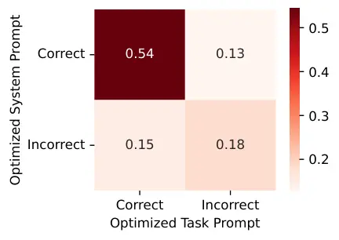
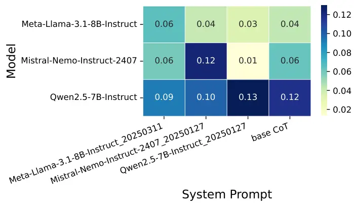
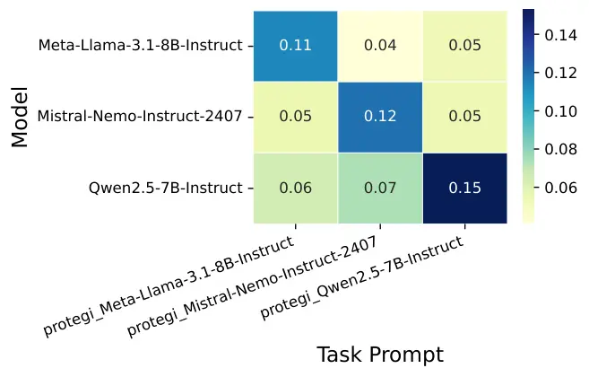

# Sprig: Improving Large Language Model Performance by System Prompt Optimization

Lechen Zhang^(‡)     Tolga Ergen^(♯)    Lajanugen Logeswaran^(♯)   
Moontae Lee^(♯⋄)    David Jurgens^(†) ^(†)^(†)thanks: ˜˜Work done while
at the University of Michigan. Affiliation: ^(‡)University of Illinois
Urbana-Champaign    ^(†)University of Michigan
Affiliation: ^(⋄)University of Illinois Chicago    ^(♯)LG AI Research
Affiliation: ^(‡)lechenz3@illinois.edu    ^(†)jurgens@umich.edu
Affiliation: ^(♯){tergen, llajan, moontae.lee}@lgresearch.ai

###### Abstract

Large Language Models (LLMs) have shown impressive capabilities in many
scenarios, but their performance depends, in part, on the choice of
prompt. Past research has focused on optimizing prompts specific to a
task. However, much less attention has been given to optimizing the
general instructions included in a prompt, known as a system prompt. To
address this gap, we propose Sprig, an edit-based genetic algorithm that
iteratively constructs prompts from prespecified components to maximize
the model’s performance in general scenarios. We evaluate the
performance of system prompts on a collection of 47 different types of
tasks to ensure generalizability. Our study finds that a single
optimized system prompt performs on par with task prompts optimized for
each individual task. Moreover, combining system and task-level
optimizations leads to further improvement, which showcases their
complementary nature. Experiments also reveal that the optimized system
prompts generalize effectively across model families, parameter sizes,
and languages. This study provides insights into the role of
system-level instructions in maximizing LLM potential.

|     |
| --- |
|     |

## 1 Introduction

Large Language Models (LLMs) have proven highly effective at many
tasks (Naveed et al., 2023) and prompting has become the primary way for
end-users to elicit desired responses (Brown et al., 2020). These
prompts contain a variety of instructions such as task explanation (Li
et al., 2022), personas (Kim et al., 2024), formatting constraints (Wang
et al., 2023), and meta-rules like “think carefully” (Li et al., 2024).
Past studies have shown that the selection of prompts can have a
substantial impact on the quality of the output (Reynolds and McDonell,
2021). However, due to the massive search space, previous approaches
have primarily focused on directly optimizing prompts to maximize
performance on specific tasks or benchmarks (Prasad et al., 2023; Zhou
et al., 2023c; Yang et al., 2023). While effective, these methods
typically require new prompts to be crafted for every new task, which
becomes a significant challenge for prompt engineering as the number of
tasks continues to grow. Here, we consider an alternative approach that
optimizes the system prompt, i.e., the set of general instructions that
precede any task-specific details (Figure 1), with the goal of
identifying task-agnostic generalizable prompting strategies. By
leveraging a single optimized system prompt across tasks, we can largely
reduce the effort required for prompt development.

Prior work has shown that meta-instructions can be effective for
improving performance (Reynolds and McDonell, 2021). Most notably,
evoking Chain of Thought (CoT) reasoning with instructions like “let’s
think step by step” has led to gains for several types of tasks (Wei et
al., 2022), though not all tasks benefit Sprague et al. (2024). Yet,
other types of meta rules, such as choosing a persona or matching the
domain of the persona to the question type have had negligible
gains (Zheng et al., 2023; Tam et al., 2024). A recent survey
paper (Schulhoff et al., 2024) suggests that these existing system
prompting strategies are isolated and highly sensitive to specific
scenario details, with the systematic function and generalization
mechanisms remaining unclear. Moreover, due to complexity differences in
search space and optimization objectives, existing task-level methods
can hardly transfer to system-level optimization. Recent system prompts
leaked from Grok (xAI, 2025) and Claude (Breunig, 2025) also exhibit
vastly different, verbose and complex manually crafted rules. Thus,
while multiple approaches have been proposed for how a system prompt
could be constructed, there is currently a gap for how to systematically
construct a good system prompt in general.

Figure 1: LLM prompts features both system-level instructions which may
include CoT instructions, personas, and other rules (orange),
task-specific instructions which may include details and examples
(blue), and the instance itself (green). Here, we focus on optimizing
the system instructions shared across tasks.

Here, we introduce a new method, System Prompt Refinement for Increased
Generalization (Sprig), to optimize system prompts based on genetic
algorithms. Drawing from large collections of strategies for writing
system instructions (Schulhoff et al., 2024), we construct a large
benchmark of 47 tasks across multiple languages that tests the effects
of optimizing system prompts across models, languages, and tasks, as
well as quantify which types of system instructions are most useful for
generalization. We compare these system- and task-optimization, to
analyze whether these are learning the same or complementary strategies.

Our paper has the following three contributions. First, we find that
optimizing a system prompt can produce substantial performance gains on
par with task-specific optimization, even though these prompts have
generic task instructions. Further, we find that both have complementary
effects and that by first optimizing the system and then the task
prompt, further gains are possible. Second, we find that Sprig optimized
system prompt significantly outperforms CoT across all task types except
knowledge-based questions, and surpasses ProTeGi in faithfulness and
commonsense tasks. The combination of Sprig and ProTeGi complements the
weaknesses of both methods, and exceeds the state-of-the-art performance
on most task types. Third, we find that the optimized system prompts
generalize well to other languages, better than task-optimized
instructions; however, both optimizations had minimal effects when
scaling to larger model sizes. All data, code, and prompts are available
at
[https://github.com/orange0629/prompting](https://github.com/orange0629/prompting).

## 2 Related Work

Prompt selection has been extensively studied and proven to
significantly impact model output quality (Reynolds and McDonell, 2021).
Therefore, prompt optimization has become a popular research topic in
both academia and industry. Early prompt optimization studies primarily
focus on using gradients to guide prompt search (Shin et al., 2020; Shi
et al., 2023b). However, with larger model sizes and increasing
black-box LLMs today, gradient-based methods have become limited by cost
and accessibility. Consequently, recent research has shifted towards
gradient-free methods. Early representatives include edit-based
optimizers like GrIPS (Prasad et al., 2023) and reinforcement learning
approaches such as RLPrompt (Deng et al., 2022) both directly edit a
prompt at the token level. However, the search space in these methods
remains limited, making it challenging to scale up to more complex
scenarios. Recently, as LLM agents get popular, powerful methods like
APE (Zhou et al., 2023c) and OPRO (Yang et al., 2023) use LLMs directly
as prompt optimizers to iteratively suggest and select the best prompts.
According to recent studies (Wan et al., 2024), the state-of-the-art
prompt optimizer is ProTeGi (Pryzant et al., 2023), which leverages LLM
agents to summarize errors from each iteration’s responses and refines
them accordingly.

Previous prompt optimization methods largely focus on optimizing the
instructions for specific tasks (which we refer to as Task Prompt) which
inherently have limited generalizability. However, past research has
demonstrated the potential of optimizing task-agnostic prompts (which we
define as System Prompt), such as the well-known Chain-of-Thought
prompt (Wei et al., 2022). Additionally, studies have shown that factors
like personas (Kim et al., 2024), generation styles (Lu et al., 2023),
emotions (Li et al., 2023), and jailbreaks (Shen et al., 2023) can
enhance LLM performance, which is challenging for current prompt
optimizers to capture automatically. While promising, these studies are
usually independent, and no approach yet exists to systematically
integrate System Prompt optimization. Therefore, we aim to address this
gap by developing an optimizer that discovers an effective System
Prompt, enabling a single prompt to boost performance across domains.

Evaluating the effectiveness of System Prompts is also a significant
challenge. Ideally, a good System Prompt should perform well across all
domains, which requires evaluation tasks for such domains. Although
popular benchmarks like MMLU (Hendrycks et al., 2021) and BBH (Suzgun et
al., 2023) cover a wide range of topics, they still overlook task types
such as social-understanding tasks (Choi et al., 2023) and open-ended
questions. Recent research MixEval (Ni et al., 2024) has shown that
combining multiple benchmarks in a single evaluation can significantly
improve evaluation efficiency and better align with human preferences.
Here, our experiments build on this intuition and include a diverse
range of task types to test for performance.

## 3 Sprig: System Prompt Refinement for Increased Generalization

Figure 2: The Sprig pipeline where System Prompts are iteratively
optimized through exploratory edits and promoted across iterations using
combined benchmark to rank candidates.

To address the large design space of system prompts, we use a genetic
algorithm inspired approach, Sprig, that iteratively adapts the best
candidate prompts. Following we describe the algorithm, data, and search
heuristics used.

Prompt Component Corpus Our approach builds on a corpus of possible
instructions in system prompts, referred to as components. While some
approaches have generated prompt text using Reinforcement Learning (Deng
et al., 2022, e.g.,), these approaches scale poorly when used with LLMs
and often generated less-interpretable instructions. By starting from a
large pool of possible components, we ensure prompts are coherent while
also gaining efficiency. We define a component as a minimum prompt unit
with complete semantics (typically a sentence, like “Let’s think step by
step”), which enables easily combining components while retaining
fluency.

Our prompt component corpus, denoted $`\mathcal{P}`$, is built by
integrating human expertise with synthetic data. To ensure sufficient
diversity without overlooking prior work, we start by collecting 300
system prompts crafted by humans from existing literature (Zheng et al.,
2023; Lu et al., 2023; Li et al., 2023; Wei et al., 2022; Deng et al.,
2023; Lin et al., 2022; Woolf, 2024). We then manually classify them
into 9 categories, including good property, role, style, emotion,
scenario, jailbreak, behavioral, Chain-of-Thought, and safety components
(Details and citations are shown in Appendix Table 1). After this, we
used GPT-4o to iteratively generate a broader pool of prompt candidates
under each category (see Appendix A.1 for details). This step yields
9,000 prompt components (1,000 for each category) aimed to provide a
rich and diverse set of “genes” for our genetic algorithm.

Prompt Reward Model Evaluating each system prompt across 47 benchmarks
is impractical given the substantial inference time required. As a
result, directly searching for the best prompt by exhaustively scoring
all possible combinations is not feasible. However, inspired by the
widely adopted reward models (Ouyang et al., 2022), we instead fine-tune
a pretrained LLM with a max-margin pairwise loss (Touvron et al., 2023)
to efficiently estimate and rank the quality of different prompts. To do
this, we generate 10,000 prompts by randomly combining components from
the corpus $`\mathcal{P}`$, sampling their lengths from a heavy-tailed
distribution to ensure coverage across the range of 0-30 components. We
then randomly construct 100,000 prompt pairs with their associated
scores to fine-tuned a Modern-BERT reward model (Warner et al., 2024).
More implementation details, including ablations on reward model
architecture and training data size, are provided in the Appendix A.3.
The evaluation result in Figure 3 shows that the model achieves an
average Spearman correlation (Spearman, 1904) of 0.59 and an
NDCG@50% (Järvelin and Kekäläinen, 2002) score of 0.72 when ranking
unseen prompts. Considering the random baseline of 0.00/0.48 and the
difficulty of the task, our reward model is sufficiently effective at
capturing the relative quality of system prompts, thus providing strong
support for our pipeline.

Figure 3: Spearman Correlation and NDCG@50% Score of Per-LLM Fine-tuned
Reward Models on Unseen Prompts. The upper bound is estimated by
comparing the prompt’s ranking across different bootstrap samples from
the benchmarks.

Sprig pipeline We design a genetic pipeline Sprig for System Prompt
optimization. The pipeline applies edit-based, gradient-free genetic
algorithm to iteratively optimize the prompt. At each iteration, the
model begins with fixed population_size number of System Prompts from
the previous iteration (initialized by $`\mathcal{P}`$). \[Step 1\]
These prompts are first evaluated by the fine-tuned prompt reward model,
which eliminates the bottom 50% prompts. \[Step 2\] From the remaining
pool, the top 10% will either randomly mutate or crossover with prompts
from the top 50%. Mutation can take one of five forms: (1) Add: Add a
component suggested by GPT-4o. (2) Rephrase: Rephrase a component. (3)
Swap: Swap the order of two components. (4) Delete: Delete a component.
(5) Merge: Merge two components into one. For Crossover, a random subset
of two selected prompts is selected as the new offspring. Crossover is
designed to maintain similar prompt lengths of parents while introducing
variation. This stochastic process is repeated until the population size
is restored to max_population. \[Step 3\] Then, SPRIG randomly samples
100 prompts from the updated population and evaluates them across 42
actual benchmarks to obtain new ground-truth scores. \[Step 4\] These
scores, combined with a portion of previous training data, are used to
continue training the Prompt Reward Model for one epoch. Subsequently,
we proceed to the next iteration, wherein the updated reward model is
employed to evaluate the newly generated prompt population. Figure 2
shows the Sprig workflow. Full details of the pipeline and parameter
settings are in Appendix A.4.

## 4 Experiments: Optimization Benefits

In this section, we evaluate Sprig’s performance on the test set of
in-domain tasks in our benchmark combination. These task’s questions are
unseen when optimizing the system prompt.

### 4.1 Experiment Setup

Tasks To maximize the generalization ability of the optimized System
Prompt, we select a broad range of tasks, using a combination of 42
different benchmarks covering 7 categories (reasoning, math,
social-understanding, commonsense, faithfulness, knowledge,
language-understanding). Our selection includes widely used benchmarks
such as MMLU (Hendrycks et al., 2021), BBH (Suzgun et al., 2023), and
TruthfulQA (Lin et al., 2022), but also includes various
social-understanding benchmarks like SocKET (Choi et al., 2023). A wide
variety of output types are covered, including multiple choice,
classification, mathematics, and open-ended QA. The full list of
benchmarks and categories is shown in Appendix Table 4.

Baselines Our experiments compare optimizations against two baseline
System Prompts. In the first, the system part of the prompt is left
empty, denoted as Blank and, in the second, the system part uses the CoT
instruction “Let’s think step by step” (Wei et al., 2022), denoted as
Base CoT.

The two types of instructions are tested in the Task Prompts. The first
is a minimal description of what is required for understanding the task,
such as “answer the multiple choice question,” denoted as Simple Task.
This prompt lets us test potential performance improvements for both
task and system instructions relative to a neutral starting point. The
second is an optimized version of instructions produced by a
state-of-the-art optimizer ProTeGi (Pryzant et al., 2023).

Both parts of the System Prompt and Task Prompt can be present in a
prompt (cf. Figure 1). Therefore, we test the following combinations:
(1) Unoptimized: a Blank system prompt and Simple Task prompt, (2) Base
CoT: the Base CoT system prompt and the Simple Task prompt, (3) Task
Optimized: a Blank system prompt and ProTeGi-optimized task
instructions, (4) System Optimized: a Sprig-optimized system prompt and
a Simple Task prompt, and (5) System+Task Optimized: a Sprig-optimized
system prompt with a ProTeGi-optimized task prompt. Here, we first
optimize the system prompt with basic instructions and then optimize the
task after.¹¹ 1 Experiments with simply concatenating
separately-optimized parts performed worse and are omitted.

Models We experiment using three medium-size open-weight LLMs:
Llama3.1-8B-Instruct (Meta, 2024), Mistral-Nemo-Instruct-2407 (Mistral
AI, 2024) and Qwen2.5-7B-Instruct (Qwen Team, 2024). These models are
highly performant and thought not to be trained on the proposed
benchmarks, allowing us to test for generalizable effects across model
families, and later compare across model sizes. More details are in
Appendix A.4.

Training For Sprig, we set population_size $`=|\mathcal{P}|=9,000`$ and
run Sprig for 25 steps. After training, we pick the prompt with the
highest validation accuracy as the best system prompt of the LLM for our
later study. Detailed prompts are shown in Appendix Table 5. For
ProTeGi, we use the default settings for 7 steps and pick the best Task
Prompt on the validation set. Additional details are in Appendix A.4.

Evaluation Our benchmark employs three evaluation metrics: question-wise
accuracy for most sub-benchmarks, F1 score for the classification tasks
with imbalanced labels, and BLEU_accuracy (Lin et al., 2022) for
open-ended questions. Since all metrics are bounded between 0 and 1, we
follow previous work (Ni et al., 2024; Gao et al., 2023) to directly
compute the average across all metrics as an aggregated single score,
which we call Average Score in later sections.

### 4.2 Results

Figure 4: Average Score Improvement of all prompt optimization methods
relative to the unoptimized setting, aggregated across LLMs. Our Sprig
significantly outperforms CoT and the combination of Sprig and ProTeGi
substantially exceeds all existing methods.

Figure 5: Average score of whole population at each iteration when
running Sprig. All three LLMs see significant improvements. Error bars
are the variance in the whole population.

Optimizing the System Prompt provides consistent improvement to LLMs on
par with task optimization, as seen in Figure 4, when compared with the
Blank system and Simple task combination baseline. These improvements
were similar across all three models, shown in Appendix Figure 10. Error
bars show 95% bootstrap confidence intervals; statistics are in
Appendix A.2. Sprig improves $`\sim`$10% over the unoptimized version,
which significantly outperformed the baseline CoT method. Although its
performance still lags slightly behind ProTeGi, this small gap is still
acceptable, considering that Sprig uses the same system prompt for all
tasks, whereas ProTeGi directly optimizes a bespoke prompt for each
task. Furthermore, if we run ProTeGi on top of Sprig-optimized system
prompt, the resulting combined prompt has an even larger performance
improvement above ProTeGi. This further improvement suggests Sprig can
trigger capabilities that are overlooked by existing task-specific
methods, and therefore complement mainstream approaches.

How do system prompts evolve? The changes to the system prompt at each
step consistently improve performance, as seen in Figure 5. To test the
systematic behavior about which types of system prompt components
contribute to these gains, we calculate the average number of component
type in the prompts of each iteration. As shown in Figure 6(a) and
Appendix Figure 11(a), the number of CoT and Behavioral components
rapidly increases with each iteration (especially in the early stages),
and eventually converges to around 2-3 per prompt. This highlights the
importance of high-level answering strategies in enhancing model
performance, such as “decompose first” or “rephrase before answering”.
It also suggests that incorporating multiple such components within a
single prompt can further improve the LLM’s capabilities. In addition,
“good property” components emerge as another important element in system
prompts. Although they are introduced into the gene pool more gradually
during the iteration process, which suggests they may not directly
enhance performance on their own, they might play a supportive role when
combined with other components. In contrast, other components such as
“Role” (e.g., “you are an AI assistant”) were selected far less often
than by chance (as the Z-scores shown in Appendix Figure 11(a)), despite
these properties often being in recommended or default prompts (OpenAI,
2024; Microsoft, 2024).

Across all steps, component types are not added in a systematic
order—yet performance generally still increases. Rather than adding more
of one type (e.g., all CoT components), the system prompt incorporates
multiple types. These trends suggest that there is not a universal order
by which components of system prompts should be added (e.g., first CoT,
then Behavioral, etc.). Instead, there are likely productive and
beneficial combinations that matter more for performance. Z-scores of
each edit type in Appendix Figure 11(b) further support this hypothesis.
Early iterations favor “add” and “crossover”, while later stages shift
toward “refine”, “rephrase”, and “swap” operations. This transition
indicates a shift from exploration to fine-grained optimization as
prompts become stronger.

Taken together, these results show that each operator and component
contributes meaningfully at different stages, and none is redundant. The
genetic algorithm dynamically adapts which operations are most effective
at each stage, enabling broad exploration early on and precise
refinement later. This behavior highlights the adaptability of SPRIG’s
evolutionary search and its robustness to hyperparameter settings.

(a)



(b)

Figure 6: (left) Number of Prompt Components of each type during
training iterations. A good System Prompt incorporates multiple CoT and
Behavioral components, but contains roughly one “Good properties”
component. (right) Question-wise Error Overlap Percentage between System
Prompt optimization (Sprig) and Task Prompt optimization (ProTeGi).
Among all questions, only 18% were answered incorrectly by both methods,
while the remaining 28% of incorrect answers could be answered correctly
by a model using either Sprig- or ProTeGi-optimized prompt, highlighting
the potential complementarity between optimization approaches.

Are task and system prompt optimizers learning the same strategies? Both
system and task prompt optimization improve performance. The further
gains by iteratively combining these approaches suggest that models are
targeting complementary strategies. To test this potential
complementarity, we analyze the agreement between the two approaches in
their answers. Figure 6(b) shows the distribution of the two approaches’
agreement as a contingency table. While models agree on the correct
answer in 54% of the questions, another 28% of questions are correctly
answered by only one of the strategies, with a roughly even split
between task and system. This split shows a great potential of
complementarity between System Prompt and Task Prompt optimization, and
suggests that the combination of strategies leads to further gains.

Which task types benefit most from system prompt optimization? Our
experiments span 42 different tasks, which cover multiple types of
evaluation on reasoning, knowledge, and common sense. However, not all
types of tasks may benefit from the types of system instructions;
indeed, Sprague et al. (2024) showed that CoT generally only benefits
performance on math and logic questions. To test for category-specific
benefits, we categorize all 42 tasks into seven types and measure the
score improvement of each type under different prompt optimization
settings: Reasoning, Math, Social Understanding, Commonsense,
Faithfulness, Language Understanding, and Knowledge. Task
categorizations are listed in Appendix Table 4.

Figure 7: Average Score Improvement in different task domains,
aggregated across LLMs. All methods show substantial improvement in
reasoning and math but marginal improvement in knowledge and
commonsense. Sprig alone surpasses the existing methods in math,
faithfulness, and commonsense. Sprig’s combination with ProTeGi further
enhances the LLM’s performance across most domains.

Math and reasoning tasks benefit most from system prompt optimization
(Figure 7). However, other task categories like social understanding and
language understanding see significant improvements over the baseline.
Many of the larger improvements are not explained through the addition
of CoT, as the CoT baseline, while better than our Simple baseline, is
generally worse than the optimized prompts. Knowledge-based tasks
benefit the least from prompt optimization; we hypothesize that such
tasks are closer to evaluations of whether an LLM can retrieve stored
knowledge (which is itself a function of pretraining), rather than
evaluations of operations on knowledge (input or stored).

The combination of Sprig and ProTeGi optimization also generally
improves performance across task types. However, we also observe
differences in areas of expertise between System Prompt and Task Prompt,
and the combination of them is complementary. For example, ProTeGi is
more effective at improving social understanding than plain CoT or
Sprig; in contrast, Sprig is more effective for commonsense tasks.

## 5 Experiments: Generalization

Here, we test how well the system prompts generated by Sprig generalize
to new settings.

Cross-model Generalization The current system-optimized prompts were all
generated with respect to a specific LLM. Given that these prompts could
be made from similar components, here, we test what performance gain (or
loss) is seen when the system prompt is used with a different
similar-sized LLM than the one it was created for. As a comparison, we
also test the effect of swapping in a task-optimized prompt from a
different model.

Both optimized system and task prompts provide some improvement but the
larger gains for the original LLM do not carry over to new LLMs, as
shown by the aggregated performance in Figure 8(a); see Appendix
Figures 12(a) and 12(b) for complete results. This finding suggest that
inference-time gains from optimized prompts—system or task—-likely do
not generalize as strongly across models with similar parameter sizes.

(a)

(b)

Figure 8: (left) Score Improvement when using a prompt optimized on one
LLM with a different LLM. (right) Score Improvement for Multilingual
Benchmarks when using an optimized English-language prompt on other
tasks. Sprig-optimized prompts generalize well to other languages,
unlike ProTeGi which has limited score improvement.

Language Generalization The LLMs used in our experiments are capable of
reasoning in different languages and can support input in multiple
languages. Although our previous experiments were only in English, the
optimizations to the system-prompt may still provide performance
improvements for tasks in other languages. Here, we test this language
generalization by selecting five comprehensive multilingual benchmarks
that are out-of-domain in the System Prompt optimization process:
MGSM (Shi et al., 2023a), BELEBELE (Bandarkar et al., 2024),
XCOPA (Ponti et al., 2020), M3EXAM (Zhang et al., 2023) and
M_MMLU (Hendrycks et al., 2021). Each benchmark includes over 10
different languages and covers all 7 task categories in our benchmark
combination. We directly use the same optimized System Prompt from § 4.2
(in English). Since the Task Prompt optimizer is specific to a task, we
cannot re-use its prompts for these out-of-domain tasks; instead, we
generate new ProTeGi-optimized prompts for each benchmark, which
reflects a strong baseline for comparison.

As shown in Figure 8(b), our optimized system prompt from § 4.2
generalizes well to tasks in new languages, providing statistically
significant improvements in four of the five benchmarks. Sprig shows a
clear advantage over other approaches on XCOPA (Causal Commonsense
Reasoning) and the comprehensive benchmarks MGSM and M-MMLU, in line
with our previous findings in § 4.2. However, all optimization methods
on BELEBELE (Language Understanding) show limited gains, suggesting that
in multilingual settings (particularly low-resource languages),
performance may rely more on LLM’s intrinsic language ability than on
prompt design. Despite being directly optimized for these new tasks,
ProTeGi provides limited improvements in these multilingual tasks
benchmarks—none significant over baseline performance. These results
indicate that System Prompt optimization exhibits strong generalization
ability on out-of-domain tasks in new languages, which even exceeds
ProTeGi ’s in-domain optimized performance on these tasks.

Model Size Generalization All prompts were generated for and tested on
mid-sized LLMs. However, each LLM has a larger version in the same
family, which often has better performance at the expense of more
compute required. Being able to optimize the system prompt with a
smaller model and then deploy that prompt on a larger model to the same
effect would have significant performance benefits. Therefore, here, we
test for generalization when using a prompt from a smaller LLM with a
larger version. Specifically, we test with Llama3.1-70B-Instruct,
Mistral-Large-Instruct-2407 and Qwen2.5-72B-Instruct. We use the same
evaluation setup as in previous sections, with only the LLMs’ parameter
size changed.

Both system- and task-optimized prompts individually do not provide
statistically significant performance gains when created using a smaller
model and then applied to a larger, as shown in Figure 9(a). (Full
results are in Appendix Figure 13.) However, a system+task optimized
prompt provides a 1.6% improvement, suggesting this approach can
generalize. Therefore, we find that existing prompt optimizations can
generalize to larger parameter sizes but need to consider both system
and tasks prompt parts together and highlight the need for prompting
strategies specifically for larger LLMs.

(a)

(b)

Figure 9: (left) Average Score Improvement when using prompts optimized
with medium-size LLMs’ on the larger LLM in the same family. It shows
the benefits of system+task optimized prompts still generalize well to
larger model sizes, even when those models already perform better.
(right) PCA analysis of the hidden state in Llama-3.1-8B-Instruct with
different prompting methods. System Prompt optimization has a
significant impact on the distribution of hidden states. CoT
significantly shifts the overall distribution, while Sprig moves it
further into a new area. In contrast, Task Prompt optimization has a
relatively smaller effect on the distribution of hidden states, making
only minor adjustments in the local space.

## 6 Analysis: Prompt Embedding Space

Given the performance improvements and generalization seen when using
the prompt instructions introduced by Sprig, it is reasonable to wonder
what effect these instructions are having on the neural activations such
that the LLM is likely to decode the correct answer. While a complete
answer would likely require a mechanistic interpretation of the
relationship between prompt and response (Bhargava et al., 2023; Heo et
al., 2025, e.g.,), here, we attempt to gain some intuition on the
instructions’ effects by visualizing the embedding space during
different optimization strategies and comparing the changes relative to
the Simple baseline instructions.

Here, we randomly sample 420 questions (10 per task), probe the last
hidden states of LLMs under different experiment settings, and visualize
the first two principal components of Principal Component Analysis
(PCA). Figure 9(b) shows the PCA results for Llama3.1-8B-Instruct.
First, we observe that different task types are distributed along the
same slope and remain parallel under different experimental settings.
Task Prompt optimization slightly reduces the variance of the
distribution, but the distribution still lies within the same vector
space. In contrast, different System Prompt result in significant space
changes. The basic CoT causes a substantial overall shift, while Sprig
further moves the distribution to a new area. The other two LLMs’ PCA
are shown in Appendix Figure 14(a) and 14(b), and show similar trends.

Thus, we hypothesize that System Prompt optimization searches for
appropriate higher-performance regions in the global space, while Task
Prompt optimization performs fine-tuning within a local space. This
reveals the potential of System Prompt optimization to significantly
alter model behavior and offers new insights for future prompt research
to use System Prompt optimization first to locate an appropriate global
behavior space, then use task prompt optimization to fine-tune
downstream performance within that space.

## 7 Conclusion

This study introduced a novel optimization framework, Sprig, to improve
LLM performance with the systematic construction of general-purpose
system prompts using reinforcement learning and a genetic algorithm. By
leveraging a diverse collection of prompt components and evaluating
across a diverse range of tasks, we demonstrate that optimized system
prompts provide consistent improvements on par with optimized task
prompts. Moreover, combining system and task prompt optimizations offers
complementary benefits, leading to further improvements in model
performance across varied domains. Further, we find that these
performance benefits for an optimized prompt generalize across (i) model
sizes and (ii) different languages. Our findings highlight the potential
of system prompt optimization to complement and enhance LLM performance
for new languages and models.

## 8 Ethics Statement

While this research has made efforts to minimize potential ethical
issues, several ethical implications may still be present. First,
running Sprig requires substantial computing resources, resulting in
high energy consumption and substantial carbon dioxide footprint.
Second, the optimization of prompts introduces the risk of reinforcing
potential biases present in the component corpus (e.g., any systematic
downstream behavioral changes from prompting an LLM to be a
“professor”), which may propagate unintended stereotypes or
discriminatory behavior in model outputs. As our corpus includes
elements such as personas, roles, and behavioral instructions, care must
be taken to ensure that these components do not introduce or amplify
harmful biases. Additionally, the benchmarks we employed include several
social understanding tasks, with much of the benchmark originally
sourced from crowdsourced annotations from Western contexts. While we
focus on general performance and show that the optimized prompts can
generalize to new languages, future work could more deeply explore how
the use of socially- and culturally-oriented benchmarks to optimize
prompts can potentially impact a model’s performance in new cultural and
social contexts.

## 9 Reproducibility statement

We have taken several steps to facilitate independent replication. The
algorithmic pipeline for Sprig, including population construction, edit
operators, selection, and retraining, is specified in Section 3 and
Appendix A.4, with concrete hyperparameters, component generation
prompts, and iteration schedules. Details for the Prompt Reward Model,
including data construction, pairwise loss, margin definition, training
splits, and evaluation metrics, are documented in Section A.3. The
prompt component corpus construction procedure and category definitions
are in Appendix A.1, and the final optimized system prompts per model
are provided in Table 5. Benchmarks, task categories, metrics, and
dataset splits are enumerated in Appendix Table 4. Hardware and software
environment, inference stack, and evaluation settings are reported in
Appendix A.4. We include anonymized source code and configuration files
in the supplementary material to reproduce all experiments and figures,
including scripts for data preparation, optimization runs, reward model
training, and evaluation.

## Acknowledgments

This project is supported by a grant from LG AI Research and the
National Science Foundation under Grant No IIS-2143529. We thank the
anonymous reviewers and members of the Blablablab for their valuable
feedback.

## References

- Bandarkar et al. (2024) L. Bandarkar, D. Liang, B. Muller, M.
  Artetxe, S. N. Shukla, D. Husa, N. Goyal, A. Krishnan, L. Zettlemoyer,
  and M. Khabsa The belebele benchmark: a parallel reading comprehension
  dataset in 122 language variants. In Proceedings of the 62nd Annual
  Meeting of the Association for Computational Linguistics (Volume 1:
  Long Papers), Bangkok, Thailand and virtual meeting, pp. 749–775.
  External Links: [Link](https://aclanthology.org/2024.acl-long.44)
  Cited by: Table 4, §5.
- Bhargava et al. (2023) A. Bhargava, C. Witkowski, S. Looi, and M.
  Thomson What’s the magic word? a control theory of llm prompting.
  ArXiv preprint abs/2310.04444. External Links:
  [Link](https://arxiv.org/abs/2310.04444) Cited by: §6.
- Breunig (2025) D. Breunig Claude’s system prompt: chatbots are more
  than just models. Note: Accessed: 2025-05-20 External Links:
  [Link](https://www.dbreunig.com/2025/05/07/claude-s-system-prompt-chatbots-are-more-than-just-models.html)
  Cited by: §1.
- Brown et al. (2020) T. B. Brown, B. Mann, N. Ryder, M. Subbiah, J.
  Kaplan, P. Dhariwal, A. Neelakantan, P. Shyam, G. Sastry, A.
  Askell, S. Agarwal, A. Herbert-Voss, G. Krueger, T. Henighan, R.
  Child, A. Ramesh, D. M. Ziegler, J. Wu, C. Winter, C. Hesse, M.
  Chen, E. Sigler, M. Litwin, S. Gray, B. Chess, J. Clark, C. Berner, S.
  McCandlish, A. Radford, I. Sutskever, and D. Amodei Language models
  are few-shot learners. In Advances in Neural Information Processing
  Systems 33: Annual Conference on Neural Information Processing Systems
  2020, NeurIPS 2020, December 6-12, 2020, virtual, H. Larochelle, M.
  Ranzato, R. Hadsell, M. Balcan, and H. Lin (Eds.), External Links:
  [Link](https://proceedings.neurips.cc/paper/2020/hash/1457c0d6bfcb4967418bfb8ac142f64a-Abstract.html)
  Cited by: §1.
- Choi et al. (2023) M. Choi, J. Pei, S. Kumar, C. Shu, and D. Jurgens
  Do LLMs understand social knowledge? evaluating the sociability of
  large language models with SocKET benchmark. In Proceedings of the
  2023 Conference on Empirical Methods in Natural Language
  Processing, H. Bouamor, J. Pino, and K. Bali (Eds.), Singapore,
  pp. 11370–11403. External Links:
  [Document](https://dx.doi.org/10.18653/v1/2023.emnlp-main.699),
  [Link](https://aclanthology.org/2023.emnlp-main.699) Cited by: Table
  4, Table 4, Table 4, Table 4, Table 4, Table 4, Table 4, Table 4,
  Table 4, §2, §4.1.
- Clark et al. (2018) P. Clark, I. Cowhey, O. Etzioni, T. Khot, A.
  Sabharwal, C. Schoenick, and O. Tafjord Think you have solved question
  answering? try arc, the ai2 reasoning challenge. ArXiv preprint
  abs/1803.05457. External Links:
  [Link](https://arxiv.org/abs/1803.05457) Cited by: Table 4.
- Databricks (2024) Databricks Introducing dbrx: a new state-of-the-art
  open llm. Note: Accessed: 2024-10-14 External Links:
  [Link](https://www.databricks.com/blog/introducing-dbrx-new-state-art-open-llm)
  Cited by: Table 1.
- Deng et al. (2022) M. Deng, J. Wang, C. Hsieh, Y. Wang, H. Guo, T.
  Shu, M. Song, E. Xing, and Z. Hu RLPrompt: optimizing discrete text
  prompts with reinforcement learning. In Proceedings of the 2022
  Conference on Empirical Methods in Natural Language Processing, Y.
  Goldberg, Z. Kozareva, and Y. Zhang (Eds.), Abu Dhabi, United Arab
  Emirates, pp. 3369–3391. External Links:
  [Document](https://dx.doi.org/10.18653/v1/2022.emnlp-main.222),
  [Link](https://aclanthology.org/2022.emnlp-main.222) Cited by: §2, §3.
- Deng et al. (2023) Y. Deng, W. Zhang, Z. Chen, and Q. Gu Rephrase and
  respond: let large language models ask better questions for
  themselves. Vol. abs/2311.04205. External Links:
  [Link](https://arxiv.org/abs/2311.04205) Cited by: Table 1, §3.
- Gao et al. (2023) L. Gao, J. Tow, B. Abbasi, S. Biderman, S. Black, A.
  DiPofi, C. Foster, L. Golding, J. Hsu, A. Le Noac’h, H. Li, K.
  McDonell, N. Muennighoff, C. Ociepa, J. Phang, L. Reynolds, H.
  Schoelkopf, A. Skowron, L. Sutawika, E. Tang, A. Thite, B. Wang, K.
  Wang, and A. Zou A framework for few-shot language model evaluation.
  Zenodo. External Links:
  [Document](https://dx.doi.org/10.5281/zenodo.10256836),
  [Link](https://zenodo.org/records/10256836) Cited by: §4.1.
- Hendrycks et al. (2021) D. Hendrycks, C. Burns, S. Basart, A. Zou, M.
  Mazeika, D. Song, and J. Steinhardt Measuring massive multitask
  language understanding. In 9th International Conference on Learning
  Representations, ICLR 2021, Virtual Event, Austria, May 3-7, 2021,
  External Links: [Link](https://openreview.net/forum?id=d7KBjmI3GmQ)
  Cited by: Table 4, Table 4, §2, §4.1, §5.
- Heo et al. (2025) J. Heo, C. Heinze-Deml, O. Elachqar, K. H. R.
  Chan, S. Ren, U. Nallasamy, A. Miller, and J. Narain Do llms ”know”
  internally when they follow instructions?. External Links: 2410.14516,
  [Link](https://arxiv.org/abs/2410.14516) Cited by: §6.
- Järvelin and Kekäläinen (2002) K. Järvelin and J. Kekäläinen Cumulated
  gain-based evaluation of ir techniques. ACM Trans. Inf. Syst. 20 (4),
  pp. 422–446. External Links: ISSN 1046-8188,
  [Link](https://doi.org/10.1145/582415.582418),
  [Document](https://dx.doi.org/10.1145/582415.582418) Cited by: §3.
- Kim et al. (2024) J. Kim, N. Yang, and K. Jung Persona is a
  double-edged sword: enhancing the zero-shot reasoning by ensembling
  the role-playing and neutral prompts. Vol. abs/2408.08631. External
  Links: [Link](https://arxiv.org/abs/2408.08631) Cited by: §1, §2.
- Kirk et al. (2023) H. Kirk, W. Yin, B. Vidgen, and P. Röttger
  SemEval-2023 task 10: explainable detection of online sexism. In
  Proceedings of the 17th International Workshop on Semantic Evaluation
  (SemEval-2023), A. Kr. Ojha, A. S. Doğruöz, G. Da San Martino, H.
  Tayyar Madabushi, R. Kumar, and E. Sartori (Eds.), Toronto, Canada,
  pp. 2193–2210. External Links:
  [Document](https://dx.doi.org/10.18653/v1/2023.semeval-1.305),
  [Link](https://aclanthology.org/2023.semeval-1.305) Cited by: Table 4.
- Kwon et al. (2023) W. Kwon, Z. Li, S. Zhuang, Y. Sheng, L.
  Zheng, C. H. Yu, J. E. Gonzalez, H. Zhang, and I. Stoica Efficient
  memory management for large language model serving with
  pagedattention. In Proceedings of the ACM SIGOPS 29th Symposium on
  Operating Systems Principles, Cited by: §A.4.
- Li et al. (2023) C. Li, J. Wang, Y. Zhang, K. Zhu, W. Hou, J. Lian, F.
  Luo, Q. Yang, and X. Xie Large language models understand and can be
  enhanced by emotional stimuli. Vol. abs/2307.11760. External Links:
  [Link](https://arxiv.org/abs/2307.11760) Cited by: Table 1, Table 1,
  §2, §3.
- Li et al. (2024) M. Li, W. Wang, F. Feng, F. Zhu, Q. Wang, and T. Chua
  Think twice before trusting: self-detection for large language models
  through comprehensive answer reflection. Vol. abs/2403.09972. External
  Links: [Link](https://arxiv.org/abs/2403.09972) Cited by: §1.
- Li et al. (2022) S. Li, J. Chen, Y. Shen, Z. Chen, X. Zhang, Z. Li, H.
  Wang, J. Qian, B. Peng, Y. Mao, W. Chen, and X. Yan Explanations from
  large language models make small reasoners better. Vol.
  abs/2210.06726. External Links:
  [Link](https://arxiv.org/abs/2210.06726) Cited by: §1.
- Lin et al. (2022) S. Lin, J. Hilton, and O. Evans TruthfulQA:
  measuring how models mimic human falsehoods. In Proceedings of the
  60th Annual Meeting of the Association for Computational Linguistics
  (Volume 1: Long Papers), S. Muresan, P. Nakov, and A. Villavicencio
  (Eds.), Dublin, Ireland, pp. 3214–3252. External Links:
  [Document](https://dx.doi.org/10.18653/v1/2022.acl-long.229),
  [Link](https://aclanthology.org/2022.acl-long.229) Cited by: Table 1,
  Table 4, §3, §4.1, §4.1.
- Lu et al. (2023) A. Lu, H. Zhang, Y. Zhang, X. Wang, and D. Yang
  Bounding the capabilities of large language models in open text
  generation with prompt constraints. In Findings of the Association for
  Computational Linguistics: EACL 2023, A. Vlachos and I. Augenstein
  (Eds.), Dubrovnik, Croatia, pp. 1982–2008. External Links:
  [Document](https://dx.doi.org/10.18653/v1/2023.findings-eacl.148),
  [Link](https://aclanthology.org/2023.findings-eacl.148) Cited by:
  Table 1, Table 1, §2, §3.
- Meta (2024) Meta Introducing llama 3.1: our most capable models to
  date. Note:
  [https://ai.meta.com/blog/meta-llama-3-1/](https://ai.meta.com/blog/meta-llama-3-1/)Accessed:
  2024-10-14 Cited by: §4.1.
- Microsoft (2024) Microsoft Advanced prompt engineering concepts. Note:
  Accessed: 2024-10-14 External Links:
  [Link](https://learn.microsoft.com/en-us/azure/ai-services/openai/concepts/advanced-prompt-engineering)
  Cited by: §4.2.
- Mistral AI (2024) Mistral AI Mistral nemo: collaborative innovation
  with nvidia. Note: Accessed: 2024-10-14 External Links:
  [Link](https://mistral.ai/news/mistral-nemo/) Cited by: §4.1.
- Naveed et al. (2023) H. Naveed, A. U. Khan, S. Qiu, M. Saqib, S.
  Anwar, M. Usman, N. Akhtar, N. Barnes, and A. Mian A comprehensive
  overview of large language models. Vol. abs/2307.06435. External
  Links: [Link](https://arxiv.org/abs/2307.06435) Cited by: §1.
- Ni et al. (2024) J. Ni, F. Xue, X. Yue, Y. Deng, M. Shah, K. Jain, G.
  Neubig, and Y. You MixEval: deriving wisdom of the crowd from llm
  benchmark mixtures. Vol. abs/2406.06565. External Links:
  [Link](https://arxiv.org/abs/2406.06565) Cited by: §2, §4.1.
- OpenAI (2024) OpenAI Tactic: ask the model to adopt a persona. Note:
  Accessed: 2024-10-14 External Links:
  [Link](https://platform.openai.com/docs/guides/prompt-engineering/tactic-ask-the-model-to-adopt-a-persona)
  Cited by: §4.2.
- Ouyang et al. (2022) L. Ouyang, J. Wu, X. Jiang, D. Almeida, C. L.
  Wainwright, P. Mishkin, C. Zhang, S. Agarwal, K. Slama, A. Ray, J.
  Schulman, J. Hilton, F. Kelton, L. Miller, M. Simens, A. Askell, P.
  Welinder, P. Christiano, J. Leike, and R. Lowe Training language
  models to follow instructions with human feedback. In Proceedings of
  the 36th International Conference on Neural Information Processing
  Systems, NIPS ’22, Red Hook, NY, USA. External Links: ISBN
  9781713871088 Cited by: §3.
- Paszke et al. (2019) A. Paszke, S. Gross, F. Massa, A. Lerer, J.
  Bradbury, G. Chanan, T. Killeen, Z. Lin, N. Gimelshein, L. Antiga, A.
  Desmaison, A. Köpf, E. Yang, Z. DeVito, M. Raison, A. Tejani, S.
  Chilamkurthy, B. Steiner, L. Fang, J. Bai, and S. Chintala PyTorch: an
  imperative style, high-performance deep learning library. In Advances
  in Neural Information Processing Systems 32: Annual Conference on
  Neural Information Processing Systems 2019, NeurIPS 2019, December
  8-14, 2019, Vancouver, BC, Canada, H. M. Wallach, H. Larochelle, A.
  Beygelzimer, F. d’Alché-Buc, E. B. Fox, and R. Garnett (Eds.),
  pp. 8024–8035. External Links:
  [Link](https://proceedings.neurips.cc/paper/2019/hash/bdbca288fee7f92f2bfa9f7012727740-Abstract.html)
  Cited by: §A.4.
- Ponti et al. (2020) E. M. Ponti, G. Glavaš, O. Majewska, Q. Liu, I.
  Vulić, and A. Korhonen XCOPA: a multilingual dataset for causal
  commonsense reasoning. In Proceedings of the 2020 Conference on
  Empirical Methods in Natural Language Processing (EMNLP), B.
  Webber, T. Cohn, Y. He, and Y. Liu (Eds.), Online, pp. 2362–2376.
  External Links:
  [Document](https://dx.doi.org/10.18653/v1/2020.emnlp-main.185),
  [Link](https://aclanthology.org/2020.emnlp-main.185) Cited by: Table
  4, §5.
- Prasad et al. (2023) A. Prasad, P. Hase, X. Zhou, and M. Bansal GrIPS:
  gradient-free, edit-based instruction search for prompting large
  language models. In Proceedings of the 17th Conference of the European
  Chapter of the Association for Computational Linguistics, A. Vlachos
  and I. Augenstein (Eds.), Dubrovnik, Croatia, pp. 3845–3864. External
  Links: [Document](https://dx.doi.org/10.18653/v1/2023.eacl-main.277),
  [Link](https://aclanthology.org/2023.eacl-main.277) Cited by: §1, §2.
- Press et al. (2023) O. Press, M. Zhang, S. Min, L. Schmidt, N. Smith,
  and M. Lewis Measuring and narrowing the compositionality gap in
  language models. In Findings of the Association for Computational
  Linguistics: EMNLP 2023, H. Bouamor, J. Pino, and K. Bali (Eds.),
  Singapore, pp. 5687–5711. External Links:
  [Document](https://dx.doi.org/10.18653/v1/2023.findings-emnlp.378),
  [Link](https://aclanthology.org/2023.findings-emnlp.378) Cited by:
  Table 1.
- Pryzant et al. (2023) R. Pryzant, D. Iter, J. Li, Y. Lee, C. Zhu,
  and M. Zeng Automatic prompt optimization with “gradient descent” and
  beam search. In Proceedings of the 2023 Conference on Empirical
  Methods in Natural Language Processing, H. Bouamor, J. Pino, and K.
  Bali (Eds.), Singapore, pp. 7957–7968. External Links:
  [Document](https://dx.doi.org/10.18653/v1/2023.emnlp-main.494),
  [Link](https://aclanthology.org/2023.emnlp-main.494) Cited by: §2,
  §4.1.
- Qwen Team (2024) Qwen Team Qwen2.5: a party of foundation models.
  External Links: [Link](https://qwenlm.github.io/blog/qwen2.5/) Cited
  by: §4.1.
- Reynolds and McDonell (2021) L. Reynolds and K. McDonell Prompt
  programming for large language models: beyond the few-shot paradigm.
  Vol. abs/2102.07350. External Links:
  [Link](https://arxiv.org/abs/2102.07350) Cited by: §1, §1, §2.
- Schulhoff et al. (2024) S. Schulhoff, M. Ilie, N. Balepur, K.
  Kahadze, A. Liu, C. Si, Y. Li, A. Gupta, H. Han, S. Schulhoff, P. S.
  Dulepet, S. Vidyadhara, D. Ki, S. Agrawal, C. Pham, G. Kroiz, F.
  Li, H. Tao, A. Srivastava, H. D. Costa, S. Gupta, M. L. Rogers, I.
  Goncearenco, G. Sarli, I. Galynker, D. Peskoff, M. Carpuat, J.
  White, S. Anadkat, A. Hoyle, and P. Resnik The prompt report: a
  systematic survey of prompting techniques. Vol. abs/2406.06608.
  External Links: [Link](https://arxiv.org/abs/2406.06608) Cited by: §1,
  §1.
- Shen et al. (2023) X. Shen, Z. Chen, M. Backes, Y. Shen, and Y. Zhang
  ”Do anything now”: characterizing and evaluating in-the-wild jailbreak
  prompts on large language models. Vol. abs/2308.03825. External Links:
  [Link](https://arxiv.org/abs/2308.03825) Cited by: Table 1, §2.
- Shi et al. (2023a) F. Shi, M. Suzgun, M. Freitag, X. Wang, S.
  Srivats, S. Vosoughi, H. W. Chung, Y. Tay, S. Ruder, D. Zhou, D. Das,
  and J. Wei Language models are multilingual chain-of-thought
  reasoners. In The Eleventh International Conference on Learning
  Representations, ICLR 2023, Kigali, Rwanda, May 1-5, 2023, External
  Links: [Link](https://openreview.net/pdf?id=fR3wGCk-IXp) Cited by:
  Table 4, §5.
- Shi et al. (2023b) W. Shi, X. Han, H. Gonen, A. Holtzman, Y. Tsvetkov,
  and L. Zettlemoyer Toward human readable prompt tuning: kubrick’s the
  shining is a good movie, and a good prompt too?. In Findings of the
  Association for Computational Linguistics: EMNLP 2023, H. Bouamor, J.
  Pino, and K. Bali (Eds.), Singapore, pp. 10994–11005. External Links:
  [Document](https://dx.doi.org/10.18653/v1/2023.findings-emnlp.733),
  [Link](https://aclanthology.org/2023.findings-emnlp.733) Cited by: §2.
- Shin et al. (2020) T. Shin, Y. Razeghi, R. L. Logan IV, E. Wallace,
  and S. Singh AutoPrompt: Eliciting Knowledge from Language Models with
  Automatically Generated Prompts. In Proceedings of the 2020 Conference
  on Empirical Methods in Natural Language Processing (EMNLP), B.
  Webber, T. Cohn, Y. He, and Y. Liu (Eds.), Online, pp. 4222–4235.
  External Links:
  [Document](https://dx.doi.org/10.18653/v1/2020.emnlp-main.346),
  [Link](https://aclanthology.org/2020.emnlp-main.346) Cited by: §2.
- Spearman (1904) C. Spearman The proof and measurement of association
  between two things. The American Journal of Psychology 15 (1),
  pp. 72–101. External Links: ISSN 00029556,
  [Link](http://www.jstor.org/stable/1412159) Cited by: §3.
- Sprague et al. (2024) Z. Sprague, F. Yin, J. D. Rodriguez, D.
  Jiang, M. Wadhwa, P. Singhal, X. Zhao, X. Ye, K. Mahowald, and G.
  Durrett To cot or not to cot? chain-of-thought helps mainly on math
  and symbolic reasoning. Vol. abs/2409.12183. External Links:
  [Link](https://arxiv.org/abs/2409.12183) Cited by: §1, §4.2.
- Suzgun et al. (2023) M. Suzgun, N. Scales, N. Schärli, S. Gehrmann, Y.
  Tay, H. W. Chung, A. Chowdhery, Q. Le, E. Chi, D. Zhou, and J. Wei
  Challenging BIG-bench tasks and whether chain-of-thought can solve
  them. In Findings of the Association for Computational Linguistics:
  ACL 2023, A. Rogers, J. Boyd-Graber, and N. Okazaki (Eds.), Toronto,
  Canada, pp. 13003–13051. External Links:
  [Document](https://dx.doi.org/10.18653/v1/2023.findings-acl.824),
  [Link](https://aclanthology.org/2023.findings-acl.824) Cited by: Table
  4, Table 4, Table 4, Table 4, Table 4, Table 4, Table 4, Table 4,
  Table 4, Table 4, Table 4, Table 4, Table 4, Table 4, Table 4, Table
  4, Table 4, Table 4, Table 4, Table 4, Table 4, Table 4, Table 4,
  Table 4, Table 4, Table 4, §2, §4.1.
- Tam et al. (2024) Z. R. Tam, C. Wu, Y. Tsai, C. Lin, H. Lee, and Y.
  Chen Let me speak freely? a study on the impact of format restrictions
  on performance of large language models. Vol. abs/2408.02442. External
  Links: [Link](https://arxiv.org/abs/2408.02442) Cited by: §1.
- Touvron et al. (2023) H. Touvron, L. Martin, K. Stone, P. Albert, A.
  Almahairi, Y. Babaei, N. Bashlykov, S. Batra, P. Bhargava, S.
  Bhosale, D. Bikel, L. Blecher, C. C. Ferrer, M. Chen, G. Cucurull, D.
  Esiobu, J. Fernandes, J. Fu, W. Fu, B. Fuller, C. Gao, V. Goswami, N.
  Goyal, A. Hartshorn, S. Hosseini, R. Hou, H. Inan, M. Kardas, V.
  Kerkez, M. Khabsa, I. Kloumann, A. Korenev, P. S. Koura, M.
  Lachaux, T. Lavril, J. Lee, D. Liskovich, Y. Lu, Y. Mao, X.
  Martinet, T. Mihaylov, P. Mishra, I. Molybog, Y. Nie, A. Poulton, J.
  Reizenstein, R. Rungta, K. Saladi, A. Schelten, R. Silva, E. M.
  Smith, R. Subramanian, X. E. Tan, B. Tang, R. Taylor, A.
  Williams, J. X. Kuan, P. Xu, Z. Yan, I. Zarov, Y. Zhang, A. Fan, M.
  Kambadur, S. Narang, A. Rodriguez, R. Stojnic, S. Edunov, and T.
  Scialom Llama 2: open foundation and fine-tuned chat models. External
  Links: 2307.09288, [Link](https://arxiv.org/abs/2307.09288) Cited by:
  §A.3, §3.
- Wan et al. (2024) X. Wan, R. Sun, H. Nakhost, and S. O. Arik Teach
  better or show smarter? on instructions and exemplars in automatic
  prompt optimization. Vol. abs/2406.15708. External Links:
  [Link](https://arxiv.org/abs/2406.15708) Cited by: §2.
- Wang et al. (2023) X. Wang, J. Wei, D. Schuurmans, Q. V. Le, E. H.
  Chi, S. Narang, A. Chowdhery, and D. Zhou Self-consistency improves
  chain of thought reasoning in language models. In The Eleventh
  International Conference on Learning Representations, ICLR 2023,
  Kigali, Rwanda, May 1-5, 2023, External Links:
  [Link](https://openreview.net/pdf?id=1PL1NIMMrw) Cited by: §1.
- Warner et al. (2024) B. Warner, A. Chaffin, B. Clavié, O. Weller, O.
  Hallström, S. Taghadouini, A. Gallagher, R. Biswas, F. Ladhak, T.
  Aarsen, N. Cooper, G. Adams, J. Howard, and I. Poli Smarter, better,
  faster, longer: a modern bidirectional encoder for fast, memory
  efficient, and long context finetuning and inference. External Links:
  2412.13663, [Link](https://arxiv.org/abs/2412.13663) Cited by: §A.3,
  §3.
- Wei et al. (2022) J. Wei, X. Wang, D. Schuurmans, M. Bosma, B.
  Ichter, F. Xia, E. H. Chi, Q. V. Le, and D. Zhou Chain-of-thought
  prompting elicits reasoning in large language models. In Advances in
  Neural Information Processing Systems 35: Annual Conference on Neural
  Information Processing Systems 2022, NeurIPS 2022, New Orleans, LA,
  USA, November 28 - December 9, 2022, S. Koyejo, S. Mohamed, A.
  Agarwal, D. Belgrave, K. Cho, and A. Oh (Eds.), External Links:
  [Link](http://papers.nips.cc/paper%5C_files/paper/2022/hash/9d5609613524ecf4f15af0f7b31abca4-Abstract-Conference.html)
  Cited by: Table 1, §1, §2, §3, §4.1.
- Wolf et al. (2020) T. Wolf, L. Debut, V. Sanh, J. Chaumond, C.
  Delangue, A. Moi, P. Cistac, T. Rault, R. Louf, M. Funtowicz, J.
  Davison, S. Shleifer, P. von Platen, C. Ma, Y. Jernite, J. Plu, C.
  Xu, T. Le Scao, S. Gugger, M. Drame, Q. Lhoest, and A. Rush
  Transformers: state-of-the-art natural language processing. In
  Proceedings of the 2020 Conference on Empirical Methods in Natural
  Language Processing: System Demonstrations, Q. Liu and D. Schlangen
  (Eds.), Online, pp. 38–45. External Links:
  [Document](https://dx.doi.org/10.18653/v1/2020.emnlp-demos.6),
  [Link](https://aclanthology.org/2020.emnlp-demos.6) Cited by: §A.4.
- Woolf (2024) M. Woolf Does offering chatgpt a tip cause it to generate
  better text? an analysis. Note: Accessed: 2024-10-14 External Links:
  [Link](https://minimaxir.com/2024/02/chatgpt-tips-analysis/) Cited by:
  Table 1, §3.
- Wu et al. (2023) Y. Wu, Y. He, Y. Jia, R. Mihalcea, Y. Chen, and N.
  Deng Hi-ToM: a benchmark for evaluating higher-order theory of mind
  reasoning in large language models. In Findings of the Association for
  Computational Linguistics: EMNLP 2023, H. Bouamor, J. Pino, and K.
  Bali (Eds.), Singapore, pp. 10691–10706. External Links:
  [Document](https://dx.doi.org/10.18653/v1/2023.findings-emnlp.717),
  [Link](https://aclanthology.org/2023.findings-emnlp.717) Cited by:
  Table 4.
- xAI (2025) xAI Grok system prompts. Note:
  [https://github.com/xai-org/grok-prompts](https://github.com/xai-org/grok-prompts)GitHub
  repository, accessed: 2025-05-20 Cited by: §1.
- Yang et al. (2023) C. Yang, X. Wang, Y. Lu, H. Liu, Q. V. Le, D. Zhou,
  and X. Chen Large language models as optimizers. Vol. abs/2309.03409.
  External Links: [Link](https://arxiv.org/abs/2309.03409) Cited by:
  Table 1, §1, §2.
- Yasunaga et al. (2023) M. Yasunaga, X. Chen, Y. Li, P. Pasupat, J.
  Leskovec, P. Liang, E. H. Chi, and D. Zhou Large language models as
  analogical reasoners. Vol. abs/2310.01714. External Links:
  [Link](https://arxiv.org/abs/2310.01714) Cited by: Table 1.
- Yu et al. (2024) Z. Yu, X. Liu, S. Liang, Z. Cameron, C. Xiao, and N.
  Zhang Don’t listen to me: understanding and exploring jailbreak
  prompts of large language models. Vol. abs/2403.17336. External Links:
  [Link](https://arxiv.org/abs/2403.17336) Cited by: Table 1.
- Zellers et al. (2019) R. Zellers, A. Holtzman, Y. Bisk, A. Farhadi,
  and Y. Choi HellaSwag: can a machine really finish your sentence?. In
  Proceedings of the 57th Annual Meeting of the Association for
  Computational Linguistics, A. Korhonen, D. Traum, and L. Màrquez
  (Eds.), Florence, Italy, pp. 4791–4800. External Links:
  [Document](https://dx.doi.org/10.18653/v1/P19-1472),
  [Link](https://aclanthology.org/P19-1472) Cited by: Table 4.
- Zhang et al. (2020) J. Zhang, Y. Zhao, M. Saleh, and P. J. Liu
  PEGASUS: pre-training with extracted gap-sentences for abstractive
  summarization. In Proceedings of the 37th International Conference on
  Machine Learning, ICML 2020, 13-18 July 2020, Virtual Event,
  Proceedings of Machine Learning Research, Vol. 119, pp. 11328–11339.
  External Links:
  [Link](http://proceedings.mlr.press/v119/zhang20ae.html) Cited by: 3rd
  item.
- Zhang et al. (2023) W. Zhang, M. Aljunied, C. Gao, Y. K. Chia, and L.
  Bing M3Exam: A multilingual, multimodal, multilevel benchmark for
  examining large language models. In Advances in Neural Information
  Processing Systems 36: Annual Conference on Neural Information
  Processing Systems 2023, NeurIPS 2023, New Orleans, LA, USA, December
  10 - 16, 2023, A. Oh, T. Naumann, A. Globerson, K. Saenko, M. Hardt,
  and S. Levine (Eds.), External Links:
  [Link](http://papers.nips.cc/paper%5C_files/paper/2023/hash/117c5c8622b0d539f74f6d1fb082a2e9-Abstract-Datasets%5C_and%5C_Benchmarks.html)
  Cited by: Table 4, §5.
- Zheng et al. (2023) M. Zheng, J. Pei, L. Logeswaran, M. Lee, and D.
  Jurgens When ”a helpful assistant” is not really helpful: personas in
  system prompts do not improve performances of large language models.
  Vol. abs/2311.10054. External Links:
  [Link](https://arxiv.org/abs/2311.10054) Cited by: Table 1, Table 1,
  §1, §3.
- Zhou et al. (2023a) D. Zhou, N. Schärli, L. Hou, J. Wei, N. Scales, X.
  Wang, D. Schuurmans, C. Cui, O. Bousquet, Q. V. Le, and E. H. Chi
  Least-to-most prompting enables complex reasoning in large language
  models. In The Eleventh International Conference on Learning
  Representations, ICLR 2023, Kigali, Rwanda, May 1-5, 2023, External
  Links: [Link](https://openreview.net/pdf?id=WZH7099tgfM) Cited by:
  Table 1.
- Zhou et al. (2023b) J. Zhou, T. Lu, S. Mishra, S. Brahma, S. Basu, Y.
  Luan, D. Zhou, and L. Hou Instruction-following evaluation for large
  language models. ArXiv preprint abs/2311.07911. External Links:
  [Link](https://arxiv.org/abs/2311.07911) Cited by: Table 4.
- Zhou et al. (2023c) Y. Zhou, A. I. Muresanu, Z. Han, K. Paster, S.
  Pitis, H. Chan, and J. Ba Large language models are human-level prompt
  engineers. In The Eleventh International Conference on Learning
  Representations, ICLR 2023, Kigali, Rwanda, May 1-5, 2023, External
  Links: [Link](https://openreview.net/pdf?id=92gvk82DE-) Cited by: §1,
  §2.

## Appendix A Appendix

### A.1 Prompt Component Corpus Details

We list the counts and representatives in each prompt component category
of $`\mathcal{P}_{0}`$ in Table 1.

[TABLE]

Table 1: List of initial prompt components in prompt component corpus.

To construct the prompt component corpus $`\mathcal{P}`$, we use the
following prompt template for each prompt category. In each iteration
$`i`$, we randomly sample 3 prompts from the current pool
$`\mathcal{P}_{i-1}`$ as examples. Each iteration generates 50 new
components, which are then added back to $`\mathcal{P}_{i-1}`$ to
construct $`\mathcal{P}_{i}`$. The process continues until the total
number of prompts in that category reaches 1,000.

category_definitions = {

"good_property": "Describes a desirable assistant trait (e.g., ’You are
empathetic.’)",

"role": "Assigns a specific identity or occupation to the assistant
(e.g., ’You are a mathematician.’)",

"style": "Specifies a particular writing or response style (e.g., ’Write
a humorous answer.’)",

"emotion": "Expresses or evokes an emotional state (e.g., ’This is
important to my career.’)",

"scenario": "Introduces a hypothetical situation or consequence (e.g.,
’The fate of the world depends on your answer.’)",

"jailbreak": "Attempts to override model constraints (e.g., ’Forget all
previous instructions.’, ’You will receive a \$200 tip if you answer
correctly.’)",

"safety": "Ensures responsible and ethical responses (e.g., ’Avoid
stereotyping.’, ’If you are unsure, say I don’t know.’)",

"behavioral": "Directs how the model should approach answering (e.g.,
’Ask follow-up questions before answering.’)",

"CoT": "Encourages step-by-step reasoning (e.g., ’Let’s think step by
step.’, ’Break the question into subquestions.’)",

}

user_message = f’’’

Prompt Category: {category} - {category_description}

Here are some examples of system prompt components in this category:

{"\\n".join(f"- {p}" for p in random.sample(prompt_pool\[category\],
3))}

Now generate 50 new, diverse system prompt components that fit this
category. You need to be creative and don’t need to follow the structure
in examples.

Make sure each prompt is unique and offers a different perspective.
Output each prompt on a new line without numbering. No additional
explanations or formatting.

’’’

### A.2 Statistical reliability and significance tests

All figures in the main paper report 95% bootstrap confidence intervals.
Appendix Table 2 summarizes the overall performance with confidence
intervals in Figure 4.

|                          |                              |
| ------------------------ | ---------------------------- |
| Condition                | Average Score $`\pm`$ 95% CI |
| Base Prompt              | 0.5232 $`\pm`$ 0.0434        |
| Base CoT                 | 0.5972 $`\pm`$ 0.0376        |
| System Optimized (Sprig) | 0.6287 $`\pm`$ 0.0367        |
| Task Optimized (ProTeGi) | 0.6541 $`\pm`$ 0.0358        |
| System+Task Optimized    | 0.6714 $`\pm`$ 0.0353        |

Table 2: Overall performance with 95% confidence intervals.

We additionally perform paired significance tests on per benchmark
scores to compare prompt conditions under matched tasks and models.
System prompt optimization significantly improves over Base CoT
($`t=3.81`$, $`p=2.2\times 10^{-4}`$). Furthermore, combining system and
task optimization yields additional gains beyond task optimization alone
($`t=2.01`$, $`p=0.053`$), suggesting complementary benefits.

### A.3 Prompt Reward Model Details

Data Preparation We generate 10,000 prompts by randomly combining prompt
components from the corpus $`\mathcal{P}`$. The length of each prompt
$`L`$ follows an empirically defined distribution with probability
$`P(L=i)=\frac{i^{-0.8}}{\sum_{j=1}^{30}j^{-0.8}}`$, where
$`i\in\{1,\dots,30\}`$, to ensure coverage across the full range of 0 to
30 components. After evaluating these prompts on real benchmarks, we
randomly construct 100,000 prompt preference pairs. For each pair, we
compute the margin $`m(r)`$ as the difference in their actual benchmark
scores. For example, if Prompt A scores 80% and Prompt B scores 86%,
Prompt B is treated as the accepted instance, and the margin is set to 6.

Model Training Following prior work, we train our reward model using a
max-margin pairwise loss (Touvron et al., 2023)
$`\mathcal{L}_{\text{ranking}}=-\log\left(\sigma\left(r_{\theta}(x,y_{c})-r_{\theta}(x,y_{r})-m(r)\right)\right)`$,
with ModernBERT (Warner et al., 2024) as the backbone. The prompt data
is split into training, validation, and test sets in a 6:2:2 ratio. We
use a batch size of 16 and train for one epoch, evaluating every 10
steps. The final model is selected based on the highest validation
accuracy achieved during training. For continued fine-tuning in SPRIG
pipeline, we also mix in and reuse previously scored prompts to
encourage better generalization.

Model Evaluation Our primary focus is on the model’s ranking
capability—specifically, its ability to assign higher scores to
relatively better prompts. To this end, we evaluate the model using
Spearman correlation and NDCG. For NDCG computation, we assign a
relevance score $`r_{i}`$ to each prompt based on its percentile rank:

```math
r_{i}=\begin{cases}2,&\text{if }\text{rank}(i)\leq 10\%\\
1,&\text{if }\text{rank}(i)\leq 50\%\\
0,&\text{otherwise}\end{cases}
```

This scoring scheme better aligns with the usage scenario in Sprig.
Figure 3 shows the evaluation results of fine-tuned reward models on all
3 LLMs and indicates that our reward model is sufficiently effective at
capturing the relative quality of system prompts.

Reward model ablations We analyze both training set size and reward
model backbone to understand their impact on ranking quality in Table 3.
Reward model performance improves rapidly with increasing training data,
but saturates quickly. Using 5,000 scored prompts already achieves
strong performance, and increasing to 10,000 yields only modest gains.
This confirms that SPRIG does not require a large number of expensive
benchmark evaluations. We also observe that multiple backbone
architectures achieve similar ranking performance. RoBERTa achieves the
highest correlation. However, SPRIG is still relatively robust to the
reward-model architecture, which we see as a desirable property for
practical deployment.

| A. Training set size |               | B. Backbone  |          |
| -------------------- | ------------- | ------------ | -------- |
| \# scored prompts    | Spearman      | Reward model | Spearman |
| 1,000                | 0.499         | RoBERTa      | 0.661    |
| 2,500                | 0.569         | BERT         | 0.656    |
| 5,000                | 0.605         | XLM-RoBERTa  | 0.605    |
| 10,000               | 0.615         | Llama-3.1-8B | 0.632    |
| 20,000               | 0.618         | ModernBERT   | 0.610    |

Table 3: Reward model ablations on ranking unseen prompts. Left:
performance versus number of scored prompts used for training. Right:
backbone comparison.

### A.4 Sprig Pipeline Details

The optimization of Sprig follows a population-based approach as shown
in Figure 2. The population is initialized with our prompt component
corpus $`\mathcal{P}`$, and the max_population is set to
$`|\mathcal{P}|`$. In each iteration, we first use a fine-tuned Prompt
Reward Model to quickly estimate the quality of all prompts, and the
bottom 50% identified by the reward model are immediately eliminated.
Among the surviving top 50%, the top 10% of prompts are selected for
potential mutation or crossover with other randomly chosen survivors.
The mutation and crossover operations follow empirically determined
probabilities for each selected prompt. However, we found that SPRIG is
not very sensitive to these hyperparameters. We experimented with around
10 different configurations and observed that the performance
differences remained less than 2%, which we believe is acceptable for
this kind of optimization task:

- •
  Add Useful (2.5%): Add a component deemed useful by GPT-4o.
- •
  Add Useless (1%): Add a component deemed useless by GPT-4o.
- •
  Rephrase (2.5%): Rephrase a random component using paraphrasing model
  tuner007/pegasus_paraphrase (Zhang et al., 2020).
- •
  Merge (2.5%): Merge two random components using GPT4-o.
- •
  Swap (5%): Swap the order of two components.
- •
  Delete (5%): Delete a random component.
- •
  Crossover (81.5%): Perform crossover with another randomly selected
  survivor. Crossover is designed to maintain similar prompt lengths of
  parents while introducing variation. Given two prompts $`p_{1}`$ and
  $`p_{2}`$, we randomly sample $`k`$ components from their union, where
  $`k`$ is drawn from a Gaussian distribution with mean
  $`\frac{\text{len}(p_{1})+\text{len}(p_{2})}{2}`$ and standard
  deviation $`\frac{|len(p1)-len(p2)|}{4}`$.

The GPT-4o prompts used above are listed below:

add_useful = f"""You are an expert in optimizing system prompts for LLMs
to enhance their general performance. Given the following list of system
prompt components: {json.dumps(selected)}, generate 1-2 additional
components that can further improve the LLM’s capabilities. """

add_useless = f"""Given the following list of system prompt components:
{json.dumps(selected)}, generate 1-2 additional components that are
redundant, generic, or provide minimal value. Examples: \["Answer in
English.", "Be polite."\]."""

rephrase = f"""Given the following list of sentences:
{json.dumps(selected)}, combine these into one concise sentence."""

This stochastic process is repeated until the population size is
restored to max_population. Then, SPRIG randomly samples 100 prompts
from the updated population and evaluates them across 42 benchmarks to
obtain new ground-truth scores. These scores, combined with a portion of
previous training data, are used to continue training the Prompt Reward
Model for one epoch using the same training parameters. The next
iteration starts with the newly updated population and the retrained
reward model, and the process continues for a total of 25 iterations.

We run all our experiments on 4 NVIDIA-L40S-48GB GPUs. All LLM
inferences are powered by vLLM 0.5.4 (Kwon et al., 2023), Hugging Face
Transformers 4.43.3 (Wolf et al., 2020) and PyTorch 2.4.0 (Paszke et
al., 2019) on a CUDA 12.4 environment. Temperatures are set to 0.0 to
minimize the effect of randomness.

Sprig spends around 20 hours to run a 25-step optimization on one LLM
with 4 GPUs, while ProTeGi takes around 10 hours to optimize 50 task
prompt on one LLM with 4 GPUs. Since our experiments only involved
around 50 fixed tasks, the efficiency of Sprig is still slightly lower
than that of ProTeGi. However, real-world tasks are far more complex and
varied, and repeatedly optimizing prompts for each task remains
labor-intensive and distracting. Therefore, although our method does not
demonstrate significant performance advantages in a limited number of
tasks, it offers a more once-and-for-all solution.

### A.5 Benchmark Details

We list all benchmarks, categories, metrics and descriptions in Table 4.
For each benchmark, the train/dev/test split is 40%:20%:40%. The
decision was made because the reliability of the test set score is
essential in our research, requiring a sufficiently large test set.

|                                                                   |                                        |                                   |          |
| ----------------------------------------------------------------- | -------------------------------------- | --------------------------------- | -------- |
| Benchmark (Citation)                                              | Description                            | Category                          | Metric   |
| ARC (Clark et al., 2018)                                          | Commonsense Reasoning                  | Knowledge, Commonsense, Reasoning | Acc      |
| MMLU (Hendrycks et al., 2021)                                     | Multi-domain Knowledge QA              | Knowledge                         | Acc      |
| HellaSwag (Zellers et al., 2019)                                  | Commonsense Inference                  | Commonsense, Reasoning            | Acc      |
| TruthfulQA (Lin et al., 2022)                                     | Knowledge QA                           | Knowledge, Reasoning              | BLEU_Acc |
| HiToM (Wu et al., 2023)                                           | Higher-Order Theory of Mind Reasoning  | Reasoning                         | Acc      |
| IFEval (Zhou et al., 2023b)                                       | Instruction-Following Evaluation       | Faithfulness                      | Acc      |
| EDOS (Kirk et al., 2023)                                          | Online Sexism Detection                | Social Understanding              | F1       |
| SocKET_bragging_achievement (Choi et al., 2023)                   | Brag Achievement Detection             | Social Understanding              | F1       |
| SocKET_hahackathon_is_humor (Choi et al., 2023)                   | Humor Detection                        | Social Understanding              | F1       |
| SocKET_tweet_irony (Choi et al., 2023)                            | Tweet Irony Detection                  | Social Understanding              | F1       |
| SocKET_sexyn (Choi et al., 2023)                                  | Sexual Content Detection               | Social Understanding              | F1       |
| SocKET_tweet_offensive (Choi et al., 2023)                        | Offensive Language Detection           | Social Understanding              | F1       |
| SocKET_complaints (Choi et al., 2023)                             | Complaint Identification               | Social Understanding              | F1       |
| SocKET_empathy_bin (Choi et al., 2023)                            | Empathy Detection                      | Social Understanding              | F1       |
| SocKET_stanfordpoliteness (Choi et al., 2023)                     | Politeness Detection                   | Social Understanding              | F1       |
| SocKET_rumor_rumor_bool (Choi et al., 2023)                       | Rumor Detection                        | Social Understanding              | F1       |
| BBH_Boolean_Expressions (Suzgun et al., 2023)                     | Boolean Expressions Solving            | Math                              | Acc      |
| BBH_Causal_Judgement (Suzgun et al., 2023)                        | Causal Judgment                        | Reasoning                         | Acc      |
| BBH_Date_Understanding (Suzgun et al., 2023)                      | Date Understanding                     | Reasoning, Commonsense            | Acc      |
| BBH_Disambiguation_QA (Suzgun et al., 2023)                       | Clarify Ambiguous sentence             | Language Understanding, Reasoning | Acc      |
| BBH_Dyck_Languages (Suzgun et al., 2023)                          | Dyck Language Sequences                | Reasoning                         | Acc      |
| BBH_Formal_Fallacies (Suzgun et al., 2023)                        | Identifying Formal Fallacies           | Reasoning                         | Acc      |
| BBH_Geometric_Shapes (Suzgun et al., 2023)                        | Geometric Shape Understanding          | Math                              | Acc      |
| BBH_Hyperbaton (Suzgun et al., 2023)                              | Hyperbaton Detection                   | Language Understanding            | Acc      |
| BBH_Logical_Deduction_Five_Objects (Suzgun et al., 2023)          | Logical Deduction                      | Reasoning                         | Acc      |
| BBH_Logical_Deduction_Seven_Objects (Suzgun et al., 2023)         | Logical Deduction                      | Reasoning                         | Acc      |
| BBH_Logical_Deduction_Three_Objects (Suzgun et al., 2023)         | Logical Deduction                      | Reasoning                         | Acc      |
| BBH_Movie_Recommendation (Suzgun et al., 2023)                    | Movie Recommendation                   | Knowledge                         | Acc      |
| BBH_Multistep_Arithmetic_Two (Suzgun et al., 2023)                | Multi-step Arithmetic                  | Math                              | Acc      |
| BBH_Navigate (Suzgun et al., 2023)                                | Navigation Reasoning                   | Reasoning                         | Acc      |
| BBH_Object_Counting (Suzgun et al., 2023)                         | Object Counting                        | Commonsense, Math, Reasoning      | Acc      |
| BBH_Penguins_In_A_Table (Suzgun et al., 2023)                     | Tabular Data Understanding             | Faithfulness                      | Acc      |
| BBH_Reasoning_About_Colored_Objects (Suzgun et al., 2023)         | Reasoning About Colors                 | Reasoning                         | Acc      |
| BBH_Ruin_Names (Suzgun et al., 2023)                              | Humorous Edit Identification           | Social Understanding              | Acc      |
| BBH_Snarks (Suzgun et al., 2023)                                  | Detecting Snarky Comments              | Social Understanding              | Acc      |
| BBH_Sports_Understanding (Suzgun et al., 2023)                    | Sports Knowledge QA                    | Knowledge                         | Acc      |
| BBH_Temporal_Sequences (Suzgun et al., 2023)                      | Temporal Reasoning                     | Reasoning                         | Acc      |
| BBH_Tracking_Shuffled_Objects_Five_Objects (Suzgun et al., 2023)  | Object Tracking                        | Reasoning                         | Acc      |
| BBH_Tracking_Shuffled_Objects_Seven_Objects (Suzgun et al., 2023) | Object Tracking                        | Reasoning                         | Acc      |
| BBH_Tracking_Shuffled_Objects_Three_Objects (Suzgun et al., 2023) | Object Tracking                        | Reasoning                         | Acc      |
| BBH_Web_Of_Lies (Suzgun et al., 2023)                             | Detecting Lies                         | Reasoning                         | Acc      |
| BBH_Word_Sorting (Suzgun et al., 2023)                            | Word Sorting                           | Faithfulness                      | Acc      |
| MGSM (Shi et al., 2023a)                                          | Math Generalization                    | Math, Reasoning                   | Acc      |
| Belebele (Bandarkar et al., 2024)                                 | Multilingual Reading Comprehension     | Language Understanding, Reasoning | Acc      |
| XCOPA (Ponti et al., 2020)                                        | Multilingual Causal Inference          | Commonsense, Reasoning            | Acc      |
| M3Exam (Zhang et al., 2023)                                       | Multilingual Multi-domain Human Exam   | Math, Reasoning, Knowledge        | Acc      |
| M_MMLU (Hendrycks et al., 2021)                                   | Multilingual Multi-domain Knowledge QA | Knowledge                         | Acc      |

Table 4: Full list of benchmarks.

### A.6 Best System Prompts

We list the best system prompts from Sprig for each LLM in our study in
Table 5.

| Model Name                 | Best System Prompt                                                                                                                                                                                                                                                  |
| -------------------------- | ------------------------------------------------------------------------------------------------------------------------------------------------------------------------------------------------------------------------------------------------------------------- |
| Meta-Llama-3.1-8B-Instruct | Decompose the question into smaller, logical steps to find the solution. Dissect the problem into smaller sections to simplify understanding.                                                                                                                       |
| Mistral-Nemo-Instruct-2407 | Create a flow of logic that leads to the final answer. Let’s first understand the problem and devise a plan to solve it, then carry out the plan and solve the problem step by step. Let’s work this out in a step by step way to be sure we have the right answer. |
| Qwen2.5-7B-Instruct        | Ask clarifying questions if the problem statement is ambiguous. Separate the problem into manageable tasks to facilitate solving. Approach the question stepwise, addressing each part systematically.                                                              |

Table 5: Best System Prompts optimized by Sprig.

### A.7 Full Experiment Results

The full results of all three LLMs and all optimization methods’ Average
Score Improvement is shown in Figure 10.

Figure 10: Average Score Improvement of all prompt optimization methods
from unoptimized setting (Full version).

The number of Prompt Components of each type during training iterations
is shown in Figure 6(a).

(a)

(b)

Figure 11: (left) Z-scores by iteration for the number of components
added of each type, showing which types were added more/less frequently
than by chance; statistically significant rates are marked with
$`\times`$. (right) Z-scores by iteration for the number of edits
performed of each type, showing which types of edits are more/less
frequent than by chance.

The Question-wise Error Overlap Percentage between System Prompt
optimization (Sprig) and Task Prompt optimization (ProTeGi) is shown in
Figure 6(b).

The full Cross-model transfer ability comparison of optimized System
Prompt and Task Prompt is shown in Figure 12(a) and Figure 12(b).



(a)



(b)

Figure 12: (left) Cross-model comparison (of Average Score Improvement)
on optimized System Prompts. (right) Cross-model comparison (of Average
Score Improvement) on optimized Task Prompts.

The full results of all the LLMs and all optimization methods’ Average
Score Improvement from the unoptimized setting when transferring
medium-size LLMs’ prompts to their larger version are shown in 13.

Figure 13: Average Score Improvement from the unoptimized setting when
transferring medium-size LLMs’ prompts to their larger version (Full
version).

Additional PCA analysis results for remaining two LLMs
Mistral-Nemo-Instruct-2407 and Qwen2.5-7B-Instruct are shown in
Figure 14(a) and Figure 14(b).

(a)

(b)

Figure 14: (left) PCA analysis of intermediate hidden state in
Mistral-Nemo-Instruct-2407 among different prompting methods. (right)
PCA analysis of intermediate hidden state in Qwen2.5-7B-Instruct among
different prompting methods.

### A.8 Use of Large Language Models

We acknowledge that we only used LLMs to check grammatical errors in the
paper and to improve the clarity of expression.
