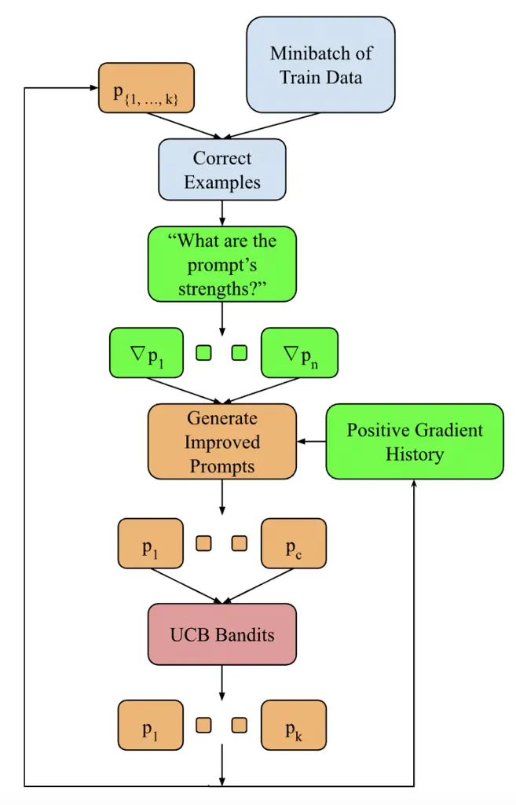
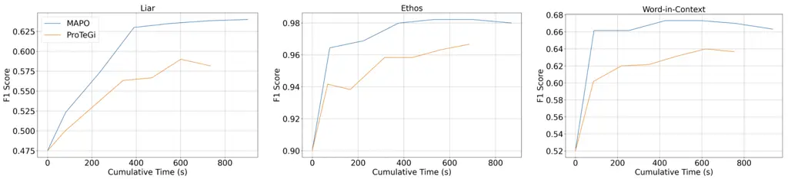
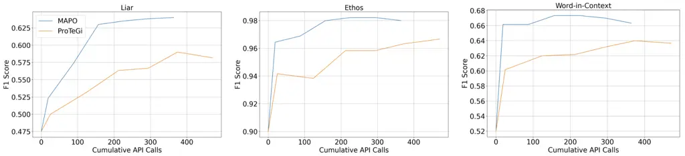
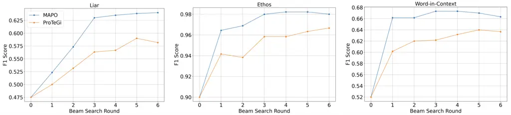

# Momentum-Aided Natural Language Gradient Descent for Prompt Optimization

Anthony Cui ^(†)^(†)thanks: Lead Author    Pranav Nandyalam    Andrew
Rufail    Ethan Cheung Affiliation: Aiden Lei    Kevin Zhu    Sean
O’Brien Affiliation: Algoverse AI Research
Affiliation: anthonycui@u.northwestern.edu, kevin@algoverse.us

###### Abstract

Prompt optimization is crucial for improving the output quality of Large
Language Models (LLMs), but many existing methods are inefficient,
requiring extensive computation and manual tuning. We propose
Momentum-Aided Prompt Optimization (MAPO), which builds on ProTeGi
(Pryzant et al., 2023) by incorporating positive natural language
"gradients" and a momentum-based memory mechanism to refine prompts
while avoiding local minima and oscillations. It also employs beam
search and an Upper Confidence Bound (UCB) algorithm for balanced
candidate expansion and selection. MAPO achieves faster convergence time
with fewer API calls and higher performance than ProTeGi, demonstrating
its effectiveness as a robust and scalable solution for automated prompt
optimization in LLMs. Our code is available online at
[https://github.com/AnthonyCui7/momentum-aided-prompt-optimization](https://github.com/AnthonyCui7/momentum-aided-prompt-optimization).

## 1 Introduction

Large Language Models (LLMs) have gained significant attention since the
release of ChatGPT OpenAI (2022), leading to the development of new
prompting techniques that have greatly improved LLM performance
(Schulhoff et al., 2024). While it has been shown that the prompts given
to the LLM greatly affect performance (Pawlik, 2025), prompts can still
be unclear, biased, or incomplete, limiting LLM capabilities (Sahoo
et al., 2024). For these reasons, prompt engineering has become a
critical aspect of leveraging an LLM’s capabilities. Often, current
prompt engineering methods require manual adjustments by the user,
making them time-consuming, error-prone, and constrained by human
limitations (Lin et al., 2024). This highlights an increasing need for
an automated system to improve the quality of prompts without the need
for human intervention.

Figure 1: High-Level Overview of MAPO

Recent work has explored implementing traditional machine learning
algorithms in a natural language format, with one of the first being
ProTeGi’s “Automatic Prompt Optimization with ‘Gradient Descent’ and
Beam Search” (Pryzant et al., 2023). While ProTeGi introduced an
innovative framework, it has limitations, including high computational
costs and resource consumption due to excessive API calls making
large-scale prompt optimization impractical. Furthermore, ProTeGi does
not track previous refinements, leading to oscillatory behavior and slow
convergence. Ultimately, the strengths of prompts are underutilized.

We introduce Momentum-Aided Prompt Optimization (MAPO), a method that
extends ProTeGi by using positive natural language “gradients” with
momentum to automate prompt refinement. Gradients are suggested feedback
for the current prompt generated using correct examples from a minibatch
of training data, guiding the LLM to refine prompts in a consistent
semantic direction. Beam search expands the generated candidate pool of
improved child prompts, and the best-arm identification algorithm using
UCB bandits, selects the top prompts for further evaluation. MAPO
significantly improves upon ProTeGi by enhancing efficiency and
effectiveness through momentum-based adjustments. Unlike ProTeGi, which
treats each optimization step as an independent improvement, MAPO tracks
the history of gradient updates, preventing oscillations and reducing
the risk of suboptimal prompts (local minima in the semantic space). In
our experimental results in Section 4, MAPO achieves a 77.9% reduction
in convergence time compared to ProTeGi, 88.0% reduction in convergence
API calls, as well as a 5.28% increase in peak performance, providing a
scalable solution for automated prompt engineering in LLMs.

## 2 Related Works

Prompt Optimization. In this work, we draw upon existing prompt
engineering techniques and focus on incorporating optimization
algorithms into our framework to enhance the effectiveness of prompt
optimization. There is an increasingly diverse set of general frameworks
that previous works have focused on: LLM optimization (Pryzant et al.,
2023; Zelikman et al., 2023; Fernando et al., 2023; Zhou et al., 2022;
Yang et al., 2023), reinforcement learning (Ma et al., 2023; Zhang
et al., 2022; Deng et al., 2022), and in-context learning (Shum et al.,
2023). However, these approaches are often infeasible when there is no
architectural information introduced and only an API is provided to the
LLM. More specifically, we base most of our work on improving automatic
prompt engineering techniques with LLM gradient-based methods (Shin
et al., 2020; Pryzant et al., 2023). Though, many of the current methods
involving some form of iterative refinement technique, such as APE (Zhou
et al., 2022) and ProTeGi all face similar struggles with cumulative
costs of running their programs.

## 3 Methods

### 3.1 Momentum-Aided Prompt Optimization

First, the current prompt $`\mathbf{p}`$ is evaluated based on a
minibatch of training data to obtain randomly sampled strings
$`\mathbf{s}`$ representing correct LLM predictions aligned with
ground-truth labels. We then provide the LLM with a static prompt
$`\tau`$ (see Appendix A) to generate numerous positive “gradients”
$`\nabla\mathbf{p}`$ in natural language, appraising the current prompt
$`\mathbf{p}`$ using the sampled strings $`\mathbf{s}`$. Our “gradients”
$`\nabla\mathbf{p}`$ are the natural language outputs of the LLM’s
continuation of static prompt $`\tau`$. In traditional machine learning,
gradient descent uses numerical gradients, representing a vector in
parameter space that points in the direction of steepest ascent of the
loss function, which the algorithm counters by moving in the opposite
direction to minimize the loss function and improve model performance;
in contrast, our natural language gradients $`\nabla\mathbf{p}`$
represent directions in semantic space (Pryzant et al., 2023). We use
another static prompt $`\alpha`$ (Appendix A) to apply these gradients
to the initial prompt $`\mathbf{p}`$, allowing us to move along the same
semantic direction as the positive natural language gradients, refining
and improving the initial prompt.

### 3.2 Expansion and Selection

1: $`p_{0}`$: initial prompt, $`b`$: beam width, $`r`$: search depth,
$`m`$: metric function, $`G`$: gradient history

2: $`B_{0}\leftarrow\{p_{0}\}`$

3: $`G_{0}\leftarrow\emptyset`$

4: for $`i\leftarrow 0`$ to $`r-1`$ do

5:   $`C\leftarrow\emptyset`$

6:   for all $`p\in B_{i}`$ do

7:    $`C\leftarrow C\cup\textit{Expand}(p,G_{i})`$ $`\triangleright`$
Section 3.2

8:   end for

9:   $`B_{i+1}\leftarrow\textit{Select}_{b}(C,m)`$ $`\triangleright`$
UCB Bandits

10:   $`G_{i+1}\leftarrow\textit{SampleGradient}(B_{i+1})`$

11: end for

12: $`\hat{p}\leftarrow\textit{argmax}_{p\in B_{r}}~m(p)`$

13: return $`\hat{p}`$

Algorithm 1 MAPO Beam Search

As outlined in Algorithm 1, our method employs beam search to explore
the space of prompt variations generated during optimization. In each
optimization round, the LLM utilizes static prompt $`\alpha`$ containing
sampled strings $`\mathbf{s}`$ and gradients $`\nabla\mathbf{p}`$ to
edit the top $`k`$ best-performing prompts from the previous round,
producing $`c`$ new candidate prompts, denoted as $`\mathbf{p}_{c}`$.
After each round, less promising candidates are pruned, and only the top
$`k`$ prompts are retained for further gradient-based improvements,
evaluated by a scoring function that assesses how well they meet our
predefined objectives, such as the F1 score (Manning et al., 2008).

In our implementation, we utilize an Upper Confidence Bound (UCB) Bandit
Selection algorithm, which is applied during each beam search expansion
to evaluate candidate prompts. The UCB Bandit Selection algorithm we
employ is outlined in Algorithm 2 (Pryzant et al., 2023).

1: $`n`$ prompts $`p_{1},\dots,p_{n}`$, dataset
$`\mathcal{D}_{\mathrm{tr}}`$, $`T`$ time steps, metric function $`m`$,
exploration $`c_{v}`$

2: Initialize
$`N(p_{i})\leftarrow 0,\;Q(p_{i})\leftarrow 0\quad\forall i\in[1..n]`$

3: for $`t=1,\dots,T`$ do

4:   Sample
$`\mathcal{D}_{\text{sample}}\subset\mathcal{D}_{\text{tr}}`$ uniformly

5:
  $`p_{i}\leftarrow\arg\max_{p}\left\{Q_{t}(p)+c_{v}\sqrt{\frac{\log t}{N_{t}(p)}}\right\}`$

6:   Observe reward $`r_{i,t}=m(p_{i},\mathcal{D}_{\text{sample}})`$

7:
  $`N_{t}(p_{i})\leftarrow N_{t}(p_{i})+|\mathcal{D}_{\text{sample}}|`$

8:
  $`Q_{t}(p_{i})\leftarrow Q_{t}(p_{i})+\frac{r_{i,t}}{N_{t}(p_{i})}`$

9: end for

10: return $`\textsc{SelectTop}_{b}(Q_{T})`$

Algorithm 2 UCB Bandits

We also record the gradients from static prompt $`\alpha`$ used to
generate the top $`k`$ candidates in each round to incorporate our novel
momentum extension into natural language gradient descent. Drawing on
the physics intuition of momentum, traditional gradient descent uses
this extension to improve stability and convergence, helping the model
avoid oscillations and escape local minima, thereby reaching global
minima more efficiently (Malingan, 2023). Analogously, our method
maintains a history of past gradients, guiding the movement of the
initial prompt $`\mathbf{p}`$ in each beam search round through semantic
space, helping it converge on the optimal prompt rather than just an
incremental improvement. A single positive gradient is randomly sampled
from a pool of all the gradients used to generate the top $`k`$ prompts
in each beam search round, representing the positive gradient history.
This gradient history is then incorporated into our static prompts
$`\tau`$ and $`\alpha`$ as textual momentum, guiding the LLM to generate
new gradients $`\nabla\mathbf{p}`$ and new prompt candidates
$`\mathbf{p}_{c}`$, allowing the initial prompt $`\mathbf{p}`$ to “roll
down the hill” faster, i.e., achieve a much faster rate of convergence
during prompt optimization.

## 4 Experiments

### 4.1 Setup

Our experimental setup closely follows that of ProTeGi, allowing for a
direct comparison between our extension method and their baseline. We
use 200 randomly sampled data points as the test set, retaining most
hyperparameters from ProTeGi’s configuration, including a temperature of
0, a minibatch size of 64, and 6 rounds of beam search with a beam width
of 4. Each parent prompt expands into 8 new candidate prompts, with 2
positive gradients generated from 3 randomly sampled correct examples
from the minibatch, which creates fewer gradients than ProTeGi’s method
of using 4 negative gradients. This trade-off improves runtime
efficiency while handling the added complexity of gradient history. The
primary evaluation metric is the F1 score, and results reflect the
highest score among the top $`k`$ beam search candidates, averaged over
three trial runs. All experiments use the October 2024 release of
GPT-3.5-turbo unless otherwise stated.

Figure 2: Test performance (F1 Score) versus Time for Liar, Ethos, and
Word-in-Context dataset.

Figure 3: Test performance (F1 Score) versus Cumulative API Calls for
Liar, Ethos, and Word-in-Context dataset.

Figure 4: Test performance (F1 Score) versus Beam Search Round for Liar,
Ethos, and Word-in-Context datasets.

|         |               |                                 |                                   |
| ------- | ------------- | ------------------------------- | --------------------------------- |
| Dataset | Method/Metric | GPT-3.5-Turbo                   | GPT-4o Mini                       |
| Ethos   | Initial F1    | 0.9                             | 0.975                             |
|         | MAPO          | 0.98 / 871 / 364 / 146 / 56 / 2 | 0.985 / 1325 / 364 / 96 / 19 / 1  |
|         | ProTeGi       | 0.965 / 687 / 472 / - / - / -   | 0.985 / 1328 / 423 / - / - / -    |
| Liar    | Initial F1    | 0.475                           | 0.52                              |
|         | MAPO          | 0.64 / 904 / 364 / 260 / 98 / 3 | 0.625 / 1414 / 364 / - / - / -    |
|         | ProTeGi       | 0.58 / 737 / 472 / - / - / -    | 0.64 / 1362 / 399 / - / - / -     |
| WiC     | Initial F1    | 0.52                            | 0.665                             |
|         | MAPO          | 0.66 / 937 / 364 / 73 / 16 / 1  | 0.73 / 1252 / 364 / 533 / 157 / 3 |
|         | ProTeGi       | 0.635 / 755 / 472 / - / - / -   | 0.73 / 1119 / 406 / - / - / -     |

Table 1: Comparison of MAPO (ProTeGi) and baselines across tasks and
models. Each cell shows: Final F1 Score / Total Time (s) / Total API
Calls / Convergence Time (s) / Convergence API Calls / Convergence
Optimization Steps. The row Initial F1 reports performance of the
initial prompt before optimization.

| Liar Dataset             |          |                |                |
| ------------------------ | -------- | -------------- | -------------- |
|                          | F1 Score | Conv. Time (s) | Total Time (s) |
| Positive Only (MAPO)     | 0.66     | 285            | 903            |
| Negative Only            | 0.60     | 303            | 1228           |
| Both Positive & Negative | 0.65     | 275            | 1467           |

Table 2: Comparison of Past Gradient Methods on the Liar Dataset.
Convergence time represents time to reach peak ProTeGi performance for
Liar

#### 4.1.1 Baseline

ProTeGi. Developed by Pryzant et al. (2023), ProTeGi employs natural
language gradient descent with negative gradients from incorrect example
sampling to refine prompts. It iteratively applies these gradients to
address prompt weaknesses, expanding the candidate pool using Monte
Carlo sampling to generate paraphrased versions with synonyms or
semantically similar variations. This ensures candidate diversity while
guiding the optimization process.

#### 4.1.2 Benchmarks

ProTeGi has been evaluated on benchmark datasets, such as the Liar
Dataset (Wang, 2017), which focuses on detecting fake news by
classifying claims as true or false, and the Ethos Dataset (Mollas
et al., 2022), which is designed for identifying hate speech in online
conversations. Our method will be evaluated on these same benchmarks for
comparison. Additionally, we evaluate on the Word-in-Context dataset
(Pilehvar and Camacho-Collados, 2018), which tests models on their
ability to understand and represent the meanings of certain words based
on the context in which they appear, to further expand the range of NLP
tasks tested. Despite utilizing the publicly available code from ProTeGi
to replicate the baseline, we were unable to reproduce the level of
metric performance for their method on the Liar Dataset as reported in
the original paper.

### 4.2 Analysis

Efficiency. Figures 2, 3, and 4 show the significant efficiency gains of
MAPO over ProTeGi in terms of convergence time for MAPO to reach the
same peak F1 score for ProTeGi. Overall, there is an average 77.9%
reduction in convergence time. This is notable since ProTeGi’s runtimes
can extend into hours (Pryzant et al., 2023), highlighting the
resource-intensive nature of automatic prompt optimization.

Figure 3illustrates that ProTeGi uses about 417 API calls to reach its
final F1 score, whereas MAPO requires an average of 56 to reach the same
performance, resulting in an average 88.0% reduction. MAPO also
completes all six rounds of beam search with 105 fewer API calls on
average, addressing critical computational constraints in large-scale
optimization.

Figure 4reinforces these efficiency gains by showing that MAPO surpasses
ProTeGi’s performance after just 2 or 3 optimization steps, while
ProTeGi requires 6 steps for lower performance. This reduction in steps
not only saves time but also suggests a more robust optimization
mechanism in MAPO.

We attribute MAPO’s efficiency primarily to its use of momentum, which
allows it to incorporate feedback from previous optimization steps when
refining prompts. Instead of treating each update independently, MAPO
builds on prior successful changes, resulting in more consistent
progress, fewer wasted iterations, and significantly faster convergence
across multiple metrics. The use of positive gradients further
constrains the search space to prompt edits supported by observed
success, rather than encouraging arbitrary variation. Together, these
design choices enable a more focused and informed optimization process,
reducing the number of steps and API calls required to reach strong
performance.

While MAPO does incur longer processing times per iteration due to more
complex prompt structures and the inclusion of positive gradient
history, the overall reduction in steps and runtime demonstrates that
these trade-offs do not detract from its overall efficiency.

| Liar Dataset  |          |          |
| ------------- | -------- | -------- |
|               | Time (s) | F1 Score |
| No Momentum   | 390      | 0.64     |
| With Momentum | 285      | 0.64     |
| Ethos Dataset |          |          |
|               | Time (s) | F1 Score |
| No Momentum   | 407      | 0.98     |
| With Momentum | 77       | 0.985    |

Table 3: Comparison of Momentum Ablation on Liar and Ethos Datasets:
Peak F1 Score and Convergence Time to Reach Peak ProTeGi Performance

| Math Dataset Accuracy |       |              |
| --------------------- | ----- | ------------ |
|                       | GSM8K | AGIEval-Math |
| MAPO                  | 95.5  | 75.3         |
| Original prompt       | 94.5  | 74.1         |

Table 4: Comparison of MAPO’s performance on math datasets.

Efficacy. Figure 4 shows that MAPO consistently outperforms ProTeGi at
every beam search round for both Liar and Ethos. MAPO’s F1 score
steadily increases while ProTeGi quickly converges and then plateaus or
slightly declines. This results in a notable 5.28% average increase in
peak performance for MAPO.

MAPO’s consistent improvement highlights its effectiveness in leveraging
positive gradients and the momentum-based extension to thoroughly
explore and refine the prompt search space. By incorporating momentum,
MAPO helps it avoid local minima and erratic updates that hinder
progress. This leads to a more robust optimization mechanism compared to
ProTeGi. In contrast, ProTeGi’s performance dips suggest it struggles
with optimization challenges like local minima and oscillations due to
the lack of a stabilizing mechanism. MAPO’s use of momentum and positive
gradient history allows it to maintain steady progress, effectively
"remembering" beneficial adjustments and reducing the likelihood of
stagnation. This results in more reliable convergence toward higher
performance levels, demonstrating the superior efficacy of MAPO’s
optimization strategy.

Evaluation Across Models. Focusing on the performance of GPT-4o mini in
Table 1, the model consistently demonstrates a strong initial F1 score,
likely attributable to its advanced architecture. While ProTeGi yields
competitive F1 scores with GPT-4o mini, MAPO achieves notably faster
convergence in terms of optimization steps (1 or 3 steps) and
convergence API calls (e.g., Ethos: 19 API calls for MAPO to reach
ProTeGi performance with 423 API calls). This consistency of improved
efficiency reinforces MAPO’s utility as a scalable and adaptable prompt
optimization framework beyond the original GPT-3.5-Turbo setting.

Gradient Ablation. As shown in Table 2, the method using only positive
gradients achieves the highest F1 score with the shortest total time,
demonstrating its efficiency and effectiveness. The method combining
both positive and negative gradients has the fastest convergence time,
but its F1 score is slightly lower, and it requires the longest total
time. This suggests that while the combined method offers faster
convergence, it sacrifices some performance. On the other hand, the
method using only negative gradients performs the worst across all
metrics. These results highlight the importance of positive gradients
for optimizing both accuracy and efficiency, while the combined method
excels in rapid convergence scenarios. Although it takes longer to
converge, the positive-only method significantly reduces overall
runtime, as well as a slightly higher peak F1 score. Overall, we
conclude that the benefits of a significantly shorter total time and a
higher F1 score outweigh the slightly higher convergence time.

Momentum Ablation. In our momentum ablation study, we compared the
convergence time required to reach peak ProTeGi performance with and
without the use of momentum, as well as the peak MAPO F1 score
performance. Table 3 shows that the peak F1 score of MAPO remains
essentially identical regardless of the inclusion of momentum,
indicating that momentum does not compromise model accuracy.

However, there is a significant difference in convergence speed: on
average, we observe a 54% decrease in convergence time when
incorporating momentum into MAPO. This substantial improvement in
convergence speed demonstrates that momentum effectively enhances the
optimization process by smoothing the loss landscape and helping the
model avoid getting trapped in local minima, an issue that ProTeGi
struggles with Pryzant et al. (2023). This is further evidenced by our
smoother test set curves depicted in Figure 2, 3, and 4, which contrast
sharply with the oscillations observed in ProTeGi’s data. The lack of
significant fluctuations in our graphs confirms that our method not only
maximizes convergence speed but also promotes stability during training.
Collectively, these findings validate the efficiency of incorporating
momentum in prompt optimization, proving that our approach accelerates
convergence while maintaining, or even slightly improving, the model’s
peak performance.

Mathematical Reasoning. Since MAPO is a general prompt optimization
algorithm, it can be easily generalized to many other tasks, not just
binary classification. We test MAPO on the GSM8K dataset (Cobbe et al., 2021) which contains grade-level math word problems that some LLMs
struggle with. We also test on the AGIEval-Math dataset (Zhong et al., 2023) which contains much harder questions. The results in Table 4 are
based on experiments using GPT-4o-mini and report accuracy as the
evaluation metric, rather than F1 score.

The results presented in Table 4 indicate that MAPO’s optimized prompt
yields modest accuracy improvements in mathematical reasoning tasks.
Specifically, it achieves a 1.2% increase on AGIEval-Math and a 1.0%
increase on GSM8K.

## 5 Conclusion

In this work, we introduced Momentum-Aided Prompt Optimization (MAPO), a
novel momentum-aided extension of natural language gradient descent for
prompt optimization in LLMs. Building on ProTeGi, MAPO uses positive
natural language gradients and momentum to refine prompts more
effectively, guiding optimization consistently and avoiding local
minima.

Momentum is crucial in overcoming ProTeGi’s limitations such as local
minima and oscillations. By leveraging gradient history, MAPO ensures a
more stable, directed search, resulting in faster convergence and a more
robust optimization process.

MAPO consistently outperforms ProTeGi, achieving a 77.9% reduction in
convergence time while improving peak F1 scores with fewer API calls and
smoother convergence.

## Limitations

While MAPO demonstrates promising results, our evaluation remains
limited in several key aspects. Firstly, we assessed MAPO on a narrow
set of benchmarks and did not compare against a wide range of strong
baselines, making it difficult to contextualize its performance relative
to existing state-of-the-art methods. Future work should include a more
extensive evaluation, including evaluations on diverse benchmarks and
more comparative analysis.

## References

- Deng et al. (2022) Mingkai Deng, Jianyu Wang, Cheng-Ping Hsieh, Yihan
  Wang, Han Guo, Tianmin Shu, Meng Song, Eric P. Xing, and Zhiting
  Hu. 2022. [RLPrompt: Optimizing Discrete Text Prompts with
  Reinforcement Learning](https://arxiv.org/abs/2205.12548).
  _arXiv.org_.
- Fernando et al. (2023) Chrisantha Fernando, Dylan Banarse, Henryk
  Michalewski, Simon Osindero, and Tim Rocktäschel. 2023.
  [PromptBreeder: Self-Referential Self-Improvement via Prompt
  Evolution](https://arxiv.org/abs/2309.16797). _arXiv.org_.
- Lin et al. (2024) Xiaohan Lin, Zhiqiang Dai, Anirudh Verma, Sufang Ng,
  Patrick Jaillet, and Bryan Kian Hsiang Low. 2024. [Prompt Optimization
  with Human Feedback](https://arxiv.org/abs/2405.17346). _arXiv.org_.
- Ma et al. (2023) Yecheng Jason Ma, William Liang, Guanzhi Wang, De-An
  Huang, Osbert Bastani, Dinesh Jayaraman, Yuke Zhu, Linxi Fan, and
  Anima Anandkumar. 2023. [Eureka: Human-Level Reward Design via Coding
  Large Language Models](https://arxiv.org/abs/2310.12931). _arXiv.org_.
- Malingan (2023) Navaneeth Malingan. 2023. [Momentum-Based Gradient
  Descent - Scaler
  Topics](https://www.scaler.com/topics/momentum-based-gradient-descent).
- Manning et al. (2008) Christopher D Manning, Prabhakar Raghavan, and
  Hinrich Schütze. 2008. _Introduction to Information Retrieval_.
  Cambridge University Press.
- Mollas et al. (2022) Ioannis Mollas, Zoi Chrysopoulou, Sergios Karlos,
  and Grigorios Tsoumakas. 2022. [ETHOS: A Multi-Label Hate Speech
  Detection Dataset](https://doi.org/10.1007/s40747-021-00608-2).
  _Complex & Intelligent Systems_.
- OpenAI (2022) OpenAI. 2022. [Introducing
  ChatGPT](https://openai.com/research/chatgpt). Accessed: 2024-10-19.
- Pawlik (2025) Lukasz Pawlik. 2025. How the choice of llm and prompt
  engineering affects chatbot effectiveness. _Electronics_, 14(5):888.
- Pilehvar and Camacho-Collados (2018) Mohammad Taher Pilehvar and Jose
  Camacho-Collados. 2018. [WiC: The Word-in-Context Dataset for
  Evaluating Context-Sensitive Meaning
  Representations](https://arxiv.org/abs/1808.09121). _arXiv.org_.
- Pryzant et al. (2023) Reid Pryzant, Dan Iter, Jerry Li, Yin Tat Lee,
  Chenguang Zhu, and Michael Zeng. 2023. [Automatic Prompt Optimization
  with “Gradient Descent” and Beam
  Search](https://arxiv.org/abs/2305.03495). _arXiv.org_.
- Sahoo et al. (2024) Pallavi Sahoo, Ankit Kumar Singh, Souvik Saha,
  Vipul Jain, Sourav Mondal, and Aditi Chadha. 2024. [A Systematic
  Survey of Prompt Engineering in Large Language Models: Techniques and
  Applications](https://arxiv.org/abs/2402.07927). _arXiv.org_.
- Schulhoff et al. (2024) Samuel Schulhoff, Madalina Ilie, Nihar
  Balepur, Kristine Kahadze, Alison Liu, Cheng Si, Yichen Li, Ananya
  Gupta, Hyejun Han, Samuel Schulhoff, Prashanth Dulepet, Suma
  Vidyadhara, Dong Ki, Saksham Agrawal, Christopher Pham, Guy Kroiz,
  Fangfei Li, Hao Tao, Aditya Srivastava, and Philip Resnik. 2024. [The
  Prompt Report: A Systematic Survey of Prompting
  Techniques](https://arxiv.org/abs/2406.06608). _arXiv.org_.
- Shin et al. (2020) Taylor Shin, Yasaman Razeghi, Robert L Logan IV,
  Eric Wallace, and Sameer Singh. 2020. [AutoPrompt: Eliciting Knowledge
  from Language Models with Automatically Generated
  Prompts](https://arxiv.org/abs/2010.15980). _arXiv.org_.
- Shum et al. (2023) KaShun Shum, Shizhe Diao, and Tong Zhang. 2023.
  [Automatic Prompt Augmentation and Selection with Chain-of-Thought
  from Labeled Data](https://arxiv.org/abs/2302.12822). _arXiv.org_.
- Wang (2017) William Yang Wang. 2017. [“Liar, Liar Pants on Fire”: A
  New Benchmark Dataset for Fake News
  Detection](https://arxiv.org/abs/1705.00648). _arXiv.org_.
- Yang et al. (2023) Chengrun Yang, Xuezhi Wang, Yifeng Lu, Hanxiao Liu,
  Quoc V. Le, Denny Zhou, and Xinyun Chen. 2023. [Large Language Models
  as Optimizers](https://arxiv.org/abs/2309.03409). _arXiv.org_.
- Zelikman et al. (2023) Eric Zelikman, Eliana Lorch, Lester Mackey, and
  Adam Tauman Kalai. 2023. [Self-Taught Optimizer (STOP): Recursively
  Self-Improving Code Generation](https://arxiv.org/abs/2310.02304).
  _arXiv.org_.
- Zhang et al. (2022) Tianjun Zhang, Xuezhi Wang, Denny Zhou, Dale
  Schuurmans, and Joseph E. Gonzalez. 2022. [TEMPERA: Test-Time
  Prompting via Reinforcement
  Learning](https://arxiv.org/abs/2211.11890). _arXiv.org_.
- Zhou et al. (2022) Yongchao Zhou, Andrei Ioan Muresanu, Ziwen Han,
  Keiran Paster, Silviu Pitis, Harris Chan, and Jimmy Ba. 2022. [Large
  Language Models are Human-Level Prompt
  Engineers](https://arxiv.org/abs/2211.01910). _arXiv.org_.

## Appendix A Prompts

MAPO uses two prompts. Prompt $`\tau`$ generates positive gradients
based on correct examples sampled from the minibatch of training data,
and prompt $`\alpha`$ applies these gradients to refine the current
prompt and create child prompts.

tau = f"""

I’m trying to write a zero-shot {task_type} prompt.

My current prompt is:

"{prompt}"

This prompt gets the following examples correct:

{correct_string}

In addition, consider the following strengths of past

iterations of this prompt:

{positive_gradient_history}

Based on the above information, give {num_gradients} reasons why the

prompt could have gotten these examples correct.

Wrap each reason with \<START\> and \<END\>

"""

alpha = f"""

I’m trying to write a zero-shot {task_type} solver.

My current prompt is:

"{prompt}"

It gets the following examples correct:

{correct_str}

Based on these examples the strengths

with this current prompt are that {positive_feedback_str}

Consider the following strengths

of past iterations of this prompt:

{positive_gradient_history}

Based on the above information,

modify and revise the current prompt to create a new

prompt which improves upon the strengths of the

original wording.

The new prompt is wrapped with \<START\> and \<END\>.

The 1 new prompt is:

"""

Ando2005, andrew2007scalable, rasooli-tetrault-2015
