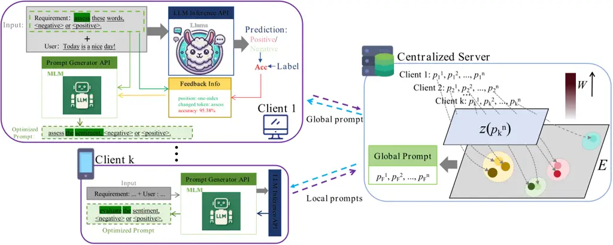

# FedDTPT: Federated Discrete and Transferable Prompt Tuning for Black-Box Large Language Models

Jiaqi Wu Email: [wjq11346@student.ubc.ca](mailto:) Affiliation: China
University of Mining and Technology, Beijing Affiliation: University of
British Columbia    Simin Chen Email: [sxc180080@utdallas.edu](mailto:)
Affiliation: University of Texas at Dallas    Yuzhe Yang
Email: [yuzheyang@link.cuhk.edu.cn](mailto:) Affiliation: The Chinese
University of Hong Kong, Shenzhen    Yijiang Li, Shiyue Hou, Rui Jing,
Zehua Wang, Wei Chen, Zijian Tian

###### Abstract

In recent years, large language models (LLMs) have significantly
advanced the field of natural language processing (NLP). By fine-tuning
LLMs with data from specific scenarios, these foundation models can
better adapt to various downstream tasks. However, the fine-tuning
process poses privacy leakage risks, particularly in centralized data
processing scenarios. To address user privacy concerns, federated
learning (FL) has been introduced to mitigate the risks associated with
centralized data collection from multiple sources. Nevertheless, the
privacy of LLMs themselves is equally critical, as potential malicious
attacks challenge their security, an issue that has received limited
attention in current research. Consequently, establishing a trusted
multi-party model fine-tuning environment is essential. Additionally,
the local deployment of large LLMs incurs significant storage costs and
high computational demands. To address these challenges, we propose for
the first time a federated discrete and transferable prompt tuning,
namely FedDTPT, for black-box large language models. In the client
optimization phase, we adopt a token-level discrete prompt optimization
method that leverages a feedback loop based on prediction accuracy to
drive gradient-free prompt optimization through the MLM API. For server
optimization, we employ an attention mechanism based on semantic
similarity to filter all local prompt tokens, along with an embedding
distance elbow detection and DBSCAN clustering strategy to enhance the
filtering process. Experimental results demonstrate that, compared to
state-of-the-art methods, our approach achieves higher accuracy, reduced
communication overhead, and robustness to non-iid data in a black-box
setting. Moreover, the optimized prompts are transferable.

   

|     |
| --- |
|     |

## 1 Introducation

Large language models (LLMs) have demonstrated significant success
across numerous natural language processing (NLP) tasks (Brown et al.,
2020; Devlin et al., 2019; Radford et al., 2019). Typically, these
models are trained on a vast text corpus and then applied to various
downstream tasks through fine-tuning or prompt tuning. However,
task-specific data is often necessary for tuning pre-trained LLMs, and
this process typically relies on user-labeled data. In practice,
securely leveraging these labeled data presents challenges. Data must be
collected and stored for training purposes, but sharing and exchanging
sensitive information can pose serious security risks and raise privacy
concerns. To mitigate the risk of potential data leakage, federated
learning (FL) is proposed. FL enables multiple devices to
collaboratively fine-tune pre-trained LLMs on decentralized data while
maintaining data privacy. Recent work, such as the bilevel optimization
method (Li et al., 2024), has demonstrated efficient strategies to
reduce communication overhead and improve optimization performance in FL
scenarios. Additionally, federated object detection frameworks (Kim
et al., 2024) and federated conditional stochastic optimization (Wu
et al., 2023) have provided further insights into addressing
communication and computational challenges in decentralized learning.
Privacy and security remain critical in FL settings, and proactive
defenses against model poisoning attacks, such as RECESS (Yan et al.,
2023), help safeguard model integrity while fine-tuning LLMs in
federated environments. Moreover, techniques like personalized federated
learning (Yan et al., 2024) have introduced new ways to enhance the
adaptability of global models to specific client data, addressing the
heterogeneity often encountered in FL systems.

When applying federated learning (FL) for tuning pre-trained LLMs,
existing approaches can be categorized into federated fine-tuning and
federated prompt tuning. However, both methods have their limitations.
For federated fine-tuning, the primary challenges include: (1) clients’
limited access to the parameters of pre-trained language models (PLMs),
(2) significant computational and storage demands on local clients, and
(3) high communication overhead within the FL system. These factors make
federated fine-tuning impractical in real-world scenarios. In practice,
devices primarily interact with LLMs by invoking LLM APIs, which do not
grant clients access to model parameters, thus preventing local
training. Moreover, even if access were available, devices with limited
computational resources would struggle to perform local LLM fine-tuning
(Zhou et al., 2024). Several approaches have been proposed to address
the challenges posed by client heterogeneity and communication costs,
such as leveraging model architectures designed to improve performance
in FL systems despite data heterogeneity (Pieri et al., 2023), as well
as bilevel optimization methods that offer communication-efficient
solutions for FL systems (Yang et al., 2024b). Additionally, methods
like dynamic personalized federated learning (Panchal et al., 2022),
model reassembly techniques (Wang et al., 2024), and federated
multi-objective optimization frameworks (Yang et al., 2024a) offer
solutions for efficient model adaptation in decentralized environments.
These innovations, which target the optimization of client-specific
models and data distribution challenges, may also inform strategies for
fine-tuning models in decentralized contexts.

An alternative approach, federated prompt tuning, as proposed by FedBPT
(Sun et al., 2023), focuses on optimizing continuous prompts injected
into text while keeping the PLM parameters frozen. Although this method
reduces computational costs for clients, continuous prompts still face
several limitations: (1) they are model-specific and cannot be directly
applied to prediction APIs, which only accept discrete inputs, (2)
continuous prompts lack interpretability, and (3) they lack
transferability, meaning they cannot be seamlessly applied to other
LLMs. To improve communication efficiency, methods like spectral
co-distillation (Chen et al., 2023) and one-pass distribution sketches
(Liu et al., 2024) have been explored, targeting efficient aggregation
and reduced overhead. Furthermore, the issue of communication efficiency
and local model performance trade-offs has been explored in works (Li &
Huang, 2024), where the tension between local client computations and
global model performance is thoroughly examined, providing further
insight into optimizing federated learning strategies.

To address the aforementioned challenges, we propose FedDTPT, On the
client side, we employ a token-level discrete prompt tuning strategy.
Given the absence of a probability distribution in the inference
results, we implement gradient-free prompts optimization through a
feedback loop based on prediction accuracy. On the server side, we
utilize an attention mechanism grounded in semantic similarity to filter
prompt tokens from all clients. This mechanism identifies the most
representative discrete tokens. Additionally, we enhance the filtering
effectiveness by employing an inflection point detection in embedding
distances and a Density-Based Spatial Clustering of Applications with
Noise (DBSCAN) clustering strategy. We conducted experiments on multiple
datasets using SOTA PLMs. The results indicate that, in comparison to
the current state-of-the-art techniques, our methodology attains
superior accuracy, diminished communication expenses, and resilience to
non-iid data within a black-box framework. Furthermore, the refined
prompts exhibit transferability. Our contributions include:

- •
  Problem Novelty: In this work, we introduce a new problem setting:
  discrete prompt learning in black-box federated learning. This setting
  enables the learning of transferable and interpretable prompts while
  safeguarding both the privacy of the server’s model parameters and the
  client’s data.
- •
  Approach Novelty: In this work, we propose FedDTPT, a novel discrete
  prompt learning framework in black-box federated learning scenarios.
  FedDTPT utilizes the novel token-level optimization strategy to update
  the client prompt and a token selection method based on semantic
  similarity to aggregate the discrete prompt.
- •
  Experimental effect: Our method achieves high accuracy and low
  communication overhead, and its optimized prompts exhibit
  transferability.

## 2 Background & Related Work

LLMs as API Service. Due to the significant computational demands of
large language models (LLMs), an increasing number of LLMs are being
deployed on servers as API services. From the model supplier’s
perspective, this approach allows them to retain proprietary control
over their models, avoiding open sourcing due to commercial
considerations and the risk of misuse. From the user’s perspective, even
when pre-trained LLMs are available, running them locally is often
prohibitively expensive or even infeasible due to hardware constraints
and the need for continuous updates (Bommasani et al., 2022). Given
these advantages, deploying LLMs as API services has become a mainstream
approach and is now the dominant trend.

Federated Learning. Federated Learning (FL) is a decentralized machine
learning approach where multiple clients collaboratively train a model
while keeping their data local, ensuring privacy (Konečnỳ, 2016). For
model suppliers, FL enables large-scale training without accessing user
data, reducing liability and complying with privacy regulations like
GDPR ¹¹ 1 [https://gdpr-info.eu/](https://gdpr-info.eu/). For users, it
allows participation in model improvements while maintaining control
over their data. Although FL offers privacy benefits, challenges like
data heterogeneity, communication costs, and system differences remain
key research areas. FL is increasingly applied to LLMs, especially in
privacy-sensitive applications, making it a critical tool in
privacy-preserving AI.

Prompt Tuning. Prompt tuning has gained considerable attention in the
field of large language models (LLMs). Its goal is to search for an
optimal prompt using minimal examples to guide an LLM towards generating
the desired output for a specific downstream task. In NLP applications,
there are two main types of prompt tuning methods: (1) continuous prompt
tuning and (2) discrete prompt tuning (Liu et al., 2023). In continuous
prompt tuning, a sequence of continuous vectors is appended to the input
text embedding. Unlike discrete prompt, which operates at the vocabulary
level, continuous prompt tuning (Li & Liang, 2021) optimizes the prompt
directly in the embedding space. In contrast, discrete prompt tuning
involves a sequence of discrete tokens, which remain interpretable to
humans.

## 3 Method

### 3.1 Problem Formulation

Prompt tuning is a widely adopted Parameter-Efficient Fine-Tuning (PEFT)
method for large language models (LLMs). The prompts are optimized to
adapt the model to specific downstream tasks. Discrete prompt tuning
refers to the independent optimization of discrete tokens
$`p_{n}\in\mathcal{P}`$ within the prompt set $`\mathcal{P}`$, where
$`n`$ denotes the number of tokens in $`\mathcal{P}`$. This approach is
more interpretable than continuous prompt tuning strategies, such as
soft prompt tuning. In a federated learning context, federated discrete
prompt tuning involves each client $`k`$, where $`k\in\mathcal{K}`$,
transmitting their local prompts
$`\mathcal{P}_{k}=\{\mathbf{p}_{k}^{n}\}_{n=1}^{N}`$ to a central server
for a knowledge exchange based on discrete prompts. The aggregated
global prompt $`\mathcal{P}_{F}=\{\mathbf{p}_{F}^{n}\}_{n=1}^{N}`$is
then distributed back to all clients, where it is further fine-tuned on
$`\mathcal{D}_{k}=\{(\mathbf{x}_{k},\mathbf{y}_{k})\}_{k=1}^{K}`$ be a
private local dataset in the $`k`$-th client for personalized
adaptation. The objective in this federated scenario can be expressed
as:

```math
P_{k}^{*}=\arg\min_{P_{F}}\sum_{k=1}^{K}w_{k}L_{k}\left(f\left(P_{F};D_{k}\right)\right), \tag{1}
```

where $`n`$ is the number of tokens in $`\mathcal{P}`$, and $`K`$
represents the number of clients involved. Prompt tuning based on
black-box LLMs refers to the process where the large model’s parameters
are entirely fixed, and the prompts are treated as learnable parameters.
Since the gradients of the LLM are inaccessible, gradient-free
zeroth-order optimization methods are commonly used instead of
traditional backpropagation techniques. Compared to standard prompt
tuning, pure black-box prompt tuning is a more challenging optimization
task. Since the inference result of the LLM prediction API, represented
as $`f(\mathcal{P};X)`$, is purely textual and does not provide a
probability distribution, Eq. (2), which relies on one-hot labels, is no
longer applicable. Consequently, prompt optimization is performed solely
at the token level, and we accordingly use a more direct measure of
accuracy as the optimization objective:

```math
P_{k}^{*}=\arg\max_{P_{F}}\sum_{k=1}^{K}w_{k}A_{k}\left(f\left(P_{F};D_{k}\right)\right), \tag{2}
```

where $`\textit{A}_{k}`$ is the accuracy in client k.

### 3.2 Design Overview

The overview of FedDTPT as shown in Figure 1. In the client optimization
phase of FedDTPT, we adopt a token-level discrete prompt tuning strategy
that establishes a new feedback mechanism for inference results to
enable gradient-free prompt optimization. During the federated learning
stage, we employ a semantic similarity-based attention mechanism to
sample prompt tokens from all clients, selecting the most representative
discrete tokens to construct optimized prompts. This approach
effectively facilitates knowledge transfer across clients while
preserving privacy. At the beginning of the optimization process, a
public dataset $`D_{g}`$, containing representative samples, is deployed
to each client to assist in computing the prediction accuracy during
local prompt tuning. In each global communication round, the server
first broadcasts a global prompt to all clients. In the initial round,
this prompt is based on the global task and can either be carefully
designed or straightforward. Subsequently, each client $`k`$ uses the
MLM API to fine-tune the global prompt, recording the tuning
information. The tuned prompt is then input into the LLM prediction API
to obtain inference results and calculate accuracy. The accuracy and
tuning information are aggregated as optimization feedback and fed back
to the MLM API for further fine-tuning. Upon completion of local
optimization, all clients upload their local prompts to the server for
knowledge aggregation. The server maps the discrete tokens of all
prompts to a high-dimensional latent space and employs a clustering
strategy based on the secondary-range elbow judgement strategy and
DBSCAN approach to cluster the embeddings. Finally, a latent space
similarity-based attention mechanism is applied to sample the embeddings
and generate a global prompt.



Figure 1: The structure of FedDTPT. The client uses prediction results
as feedback to drive the MLM API for discrete prompt optimization. The
locally optimized prompts are then uploaded to the server, where tokens
are mapped to a high-dimensional latent space. Similarity calculations
on these high-dimensional embeddings yield weight values $`W`$, and a
clustering strategy is applied to select high-weight tokens. These
tokens are then combined to form a global prompt, which is subsequently
distributed back to the clients.

### 3.3 Client Prompt Instruction Tuning

Unlike existing black-box prompt tuning tasks, in a purely black-box
setting, large language models only output prediction text without
probability distributions. The absence of loss information necessitates
that prompt optimization be performed solely at the token level, posing
significant challenges. In the client-side optimization phase, we set
accuracy improvement as the primary objective and leverage the
contextual understanding capabilities of masked language models (MLMs)
to achieve prompt tuning. Furthermore, we establish an inference
feedback loop, which, compared to random prompt optimization using MLMs,
creates a closed loop between forward inference and result feedback.
This approach allows the MLM to make informed predictions based on
comprehensive historical information.

Specifically, the client first receives the global prompt dispatched by
the server, uses the MLM for tuning, and stores the modification
details. The optimized prompt is then combined with input $`x_{k}`$ and
fed into the LLM Inference API for prediction. By comparing the
inference results with the labels $`y_{k}`$, we calculate the accuracy
on a batch basis. Finally, in subsequent iterations, the MLM receives
both the accumulated tuning modifications and accuracy results along
with the prompt to be optimized. This iterative process allows the MLM
to perform more informed and effective tuning. The optimization process
is detailed in Algorithm 1.

1: Input: Global prompt $`P_{\text{global}}`$, client data
$`\mathcal{D}_{k}=\{(\mathbf{x}_{k},\mathbf{y}_{k})\}_{k=1}^{K}`$

2: Output: Optimized prompt $`P_{k}^{*}`$ for accuracy
$`\text{{A}}_{k}`$

3: Initialize $`\mathcal{P}_{k}=\{\mathbf{p}_{k}^{n}\}_{n=1}^{N}`$
$`\leftarrow`$ $`P_{\text{global}}`$

4: for $`\text{iteration}=1`$ to max_iterations do

5:   Optimization Objective:

6:
  $`P_{k}^{*}=\arg\max_{P_{k}}A_{k}\left(f\left(P_{k};D_{k}\right)\right)`$

7:   MLM Tuning:

8:   $`P_{k}^{*}\leftarrow\text{MLM API}(P_{k})`$

9:   Inference and Accuracy Calculation:

10:
  $`\text{predictions}\leftarrow\text{LLM Inference API}(P_{k}^{*},x_{k})`$

11:
  $`\text{accuracy}_{k}\leftarrow\text{calculate\_accuracy}(\text{predictions},\text{y}_{k})`$

12:   Feedback fusion:

13:
  $`\text{feedback\_info}\leftarrow(\text{modifications},\text{accuracy}_{k})`$

14:   Next iteration:

15:   $`P_{k}^{*}\leftarrow\text{MLM API}(P_{k},\text{feedback\_info})`$

16: end for

17: return $`P_{k}^{*}`$ as the optimized prompt for client $`k`$

Algorithm 1 Token-level Prompt Optimization with Inference Feedback for
Client $`k`$

Additionally, to address potential data imbalance during accuracy
calculation in each iteration, we introduce a small, balanced public
dataset to assist in accuracy computation. Specifically, during the
accuracy calculation for each batch of client $`k`$’s data, the public
dataset is incorporated as auxiliary data. This approach effectively
mitigates the impact of data imbalance and helps to counteract non-iid
data distribution issues.

### 3.4 Server Prompt Instruction Aggregation

During client-side optimization, each client sends its locally optimized
prompt to the server for knowledge exchange. Since clients can only
access token-level information, traditional global aggregation
strategies, such as simple weighted averaging, are difficult to
implement. To address this, we propose an attention mechanism based on
semantic similarity, combined with high-dimensional clustering methods,
to effectively select and merge important tokens, thereby generating a
globally optimized prompt. The detailed methodology is outlined as
follows:

Mapping Tokens to a High-Dimensional Latent Space. Each token from the
prompts generated by the clients is mapped to a high-dimensional latent
space. Given the need for robust contextual understanding, leveraging
the embedding layers of pre-trained language models (MLMs) like BERT or
RoBERTa is well-suited for this purpose, as they can project
semantically similar tokens to proximate positions in the latent space.
Let
$`\mathbf{P}_{k}=\{\mathbf{p}_{k}^{1},\mathbf{p}_{k}^{2},\ldots,\mathbf{p}_{k}^{N}\}`$
represent the sequence of discrete tokens generated by the $`k`$-th
client, where $`k\in\{1,2,\ldots,K\}`$ and $`N`$ denotes the number of
tokens in each prompt. Each token $`\mathbf{p}_{k}^{n}`$ is mapped to a
high-dimensional embedding through a function $`z`$, resulting in an
embedding vector $`E_{k}^{n}`$. The mapping function $`z`$ can be
formally expressed as
$`z:\mathbf{P}_{k}\rightarrow\mathbb{R}^{N\times d},\mathbf{P}_{k}\mapsto\mathbf{E}_{k}=\{E_{k}^{1},E_{k}^{2},\ldots,E_{k}^{N}\}`$,
where $`E_{k}^{n}=z(\mathbf{p}_{k}^{n})\in\mathbb{R}^{d}`$ is the
high-dimensional embedding vector corresponding to the token
$`\mathbf{p}_{k}^{n}`$, $`d`$ is the dimensionality of the latent space,
and $`\mathbf{E}_{k}`$ is the matrix of embeddings for all tokens in the
$`k`$-th client’s prompt. To incorporate context and semantics into the
embeddings, the mapping function $`z`$ may depend on additional
parameters, such as contextual weights $`\theta`$ from a pre-trained
language model.

```math
E_{k}^{n}=z(\mathbf{p}_{k}^{n};\theta)=\text{MLM}_{\theta}(\mathbf{p}_{k}^{n}) \tag{3}
```

where, $`\theta`$ represents the parameters of the pre-trained language
model (MLM), such as BERT or RoBERTa, $`\text{MLM}_{\theta}`$ denotes
the model’s embedding layer that captures the context and semantic
similarity of each token. Therefore, the overall mapping process for all
tokens from all clients can be expressed as a set:

```math
\mathcal{E}=\bigcup_{k=1}^{K}\mathbf{E}_{k}=\bigcup_{k=1}^{K}\{E_{k}^{1},E_{k}^{2},\ldots,E_{k}^{N}\}=\bigcup_{k=1}^{K}\{z(\mathbf{p}_{k}^{1};\theta),z(\mathbf{p}_{k}^{2};\theta),\ldots,z(\mathbf{p}_{k}^{N};\theta)\} \tag{4}
```

where $`\mathcal{E}`$ represents the set of all high-dimensional
embeddings for tokens across all clients.

Attention-Based Weight Calculation via Semantic Similarity. To compute
the semantic similarity between tokens, we use the cosine similarity
between their high-dimensional embeddings. For a token
$`\mathbf{p}_{k}^{n}`$ from the $`k`$-th client and a token
$`\mathbf{p}_{k^{\prime}}^{n^{\prime}}`$ from another prompt (client
$`k^{\prime}`$), the cosine similarity is given by:

```math
\text{sim}(E_{k}^{n},E_{k^{\prime}}^{n^{\prime}})=\frac{E_{k}^{n}\cdot E_{k^{\prime}}^{n^{\prime}}}{\|E_{k}^{n}\|\|E_{k^{\prime}}^{n^{\prime}}\|} \tag{5}
```

where:$`E_{k}^{n}\cdot E_{k^{\prime}}^{n^{\prime}}`$ denotes the dot
product of the embeddings. $`\|E_{k}^{n}\|`$ and
$`\|E_{k^{\prime}}^{n^{\prime}}\|`$ are the Euclidean norms (magnitudes)
of the embeddings.

The attention weight $`w_{k}^{n}`$ for a token $`\mathbf{p}_{k}^{n}`$ is
computed by aggregating its cosine similarities with all tokens in other
clients’ prompts. This can be expressed as:

```math
w_{k}^{n}=\sum_{\begin{subarray}{c}k^{\prime}=1\\
k^{\prime}\neq k\end{subarray}}^{K}\sum_{n^{\prime}=1}^{N}\text{sim}(E_{k}^{n},E_{k^{\prime}}^{n^{\prime}}) \tag{6}
```

where $`k^{\prime}`$ iterates over all clients except the $`k`$-th
client, $`n^{\prime}`$ iterates over all tokens in the prompt of client
$`k^{\prime}`$, and
$`\text{sim}(E_{k}^{n},E_{k^{\prime}}^{n^{\prime}})`$ is the cosine
similarity between the embedding $`E_{k}^{n}`$ and each embedding
$`E_{k^{\prime}}^{n^{\prime}}`$. To normalize the attention weights
across all tokens in a prompt, we apply a softmax function to obtain a
normalized weight
$`\alpha_{k}^{n}=\frac{\exp(w_{k}^{n})}{\sum_{n=1}^{N}\exp(w_{k}^{n})}`$,
where $`\alpha_{k}^{n}`$ is the normalized attention weight of the token
$`\mathbf{p}_{k}^{n}`$. The final attention vector for all tokens in the
$`k`$-th client’s prompt is
$`\bm{\alpha}_{k}=\{\alpha_{k}^{1},\alpha_{k}^{2},\ldots,\alpha_{k}^{N}\}`$,
where $`\bm{\alpha}_{k}`$ represents the normalized attention weights
for all tokens in the $`k`$-th client’s prompt, indicating the relative
importance of each token based on its semantic similarity to tokens in
other prompts.

Semantic Aggregation Using High-Dimensional Clustering. After computing
attention weights for all tokens, we employ high-dimensional clustering
(e.g., k-means) to further filter semantically similar tokens. The
clustering process proceeds as follows: The embeddings of all tokens
serve as shown in Algorithm 2. To further enhance the flexibility of
token selection, we employ a strategy based on embedding distance elbow
detection and DBSCAN clustering. We calculate the distances between
token embeddings and sort these distances, identifying significant
changes as “elbow points” or inflection points. These points are used to
determine the $`\epsilon`$ parameter for DBSCAN clustering.
Subsequently, DBSCAN forms clusters based on the density and
connectivity of the embeddings. This approach allows the number of
clusters and the number of tokens within each cluster to be determined
by the data itself, enabling adaptive and flexible grouping. Finally,
the representative tokens from each cluster are reordered according to
their original positions in the respective prompts, forming a
consolidated global prompt. This step ensures that the global prompt
remains semantically coherent and retains the most important information
from each client.

1: Input:

2: embeddings: A list of high-dimensional embeddings for all tokens

3: attention_weights: A list of attention weights corresponding to each
token embedding

4: num_clusters: The number of clusters for k-means

5: Output:

6: cluster_representatives: A dictionary containing the representative
token for each cluster

7: Step 1: Perform High-Dimensional Clustering

8: clusters $`\leftarrow`$ KMeans(n_clusters =
num_clusters).fit_predict(embeddings)

9: Initialize cluster_representatives as an empty dictionary

10: Step 2: Find the Representative Token for Each Cluster

11: for cluster_id in unique(clusters) do

12:   cluster_indices $`\leftarrow`$ \[i for i, c in enumerate(clusters)
if c = cluster_id\]

13:   cluster_weights $`\leftarrow`$ \[attention_weights\[i\] for i in
cluster_indices\]

14:   max_weight_index $`\leftarrow`$
cluster_indices\[argmax(cluster_weights)\]

15:   cluster_representatives\[cluster_id\] $`\leftarrow`$
embeddings\[max_weight_index\]

16: end for

17: Return cluster_representatives: A dictionary where each key is a
cluster ID, and each value is the embedding of the representative token
for that cluster

Algorithm 2 Semantic Aggregation Using High-Dimensional Clustering

## 4 Evaluation

### 4.1 Evaluation Setup

Pre-trained LLMs. In our experiments, we selected two models as backbone
models: DeepSeek-V2-Lite (15B parameters) (DeepSeek-AI, 2024), and
Llama-3.1-8B-Instruct (AI@Meta, 2024).

Dataset. We conducted experiments on seven datasets from the GLUE
benchmark (Wang et al., 2019): SST-2, RTE, QNLI, MRPC, QQP, WNLI, and
CoLA. Additionally, we adopted the k-shot approach for prompt training,
which will be explained in detail in the following sections. Due to the
consistent number of classes across datasets, we used accuracy (ACC)
instead of the Matthews Correlation Coefficient (MCC) to evaluate the
prediction performance for the CoLA dataset. Similarly, for QQP and
MRPC, ACC was used in place of the F1 score as the evaluation metric.

Comparison Baselines. We evaluated our pure black-box prompt-tuning
federated learning method against seven state-of-the-art (SOTA)
approaches. Based on the amount of information obtained about the
backbone model, we categorized these methods into white-box and
black-box approaches. We define white-box LLM methods as those that have
access to the full parameters of the backbone model and can obtain
gradient information through backpropagation.

The White-Box comparison methods include the following: FedPrompt (Zhao
et al., 2023): A SOTA method that offers communication efficiency and
privacy protection by employing a prompt exchange strategy to facilitate
knowledge transfer between clients in federated learning. OpenFedLLM (Ye
et al., 2024): An open-source research library for training large
language models (LLMs) in a federated learning setting. OpenFedLLM
allows for various configurations through custom FL methods and LLM
replacements. In this study, we used the widely adopted FedAvg algorithm
to implement federated learning for the backbone model. Manual prompt:
It refers to a manually designed prompting approach based on commonly
used templates for zero-shot inference.

The Black-Box LLM methods do not have access to the model’s parameters
or gradients; they can only retrieve prediction outputs and the full
probability distribution generated by the model during forward
inference. These methods include the following: FedBiOT (Wu et al.,
2024): This method compresses the original LLM into a lightweight model
with similar performance, which is then distributed to each client.
FedAvg-BBT (McMahan et al., 2017; Sun et al., 2022): A hybrid method
that combines the widely used federated learning approach, FedAvg, with
a black-box discrete prompt tuning method called BBT.

Implementation & Hyperparameters . The federated learning (FL) setup of
our experiments follows the frameworks of FedPrompt and FedBPT. The FL
environment consists of 10 clients, with a 100% client participation
rate in each training round. Additionally, we adopted the few-shot
learning paradigm commonly used in large-scale model research. Following
the BDPL approach, for each dataset, we randomly sampled k instances
from each class to form a new training set and sampled a different set
of k instances to construct a new validation set. The new test set was
composed of the original validation set. Detailed hyperparameter
settings can be found in Appendix A.

### 4.2 Effectiveness Results

We first measure the accuracy of the tuned LLMs on each downstream
tasks. The accuracy of FedDTPT and each comparsion baseline methods are
listed on Table 4.2. From the results, we could observe that our
proposed black-box tuning significantly outperforms the other basaeline
methods in almost all settings. For Deepseek, in the most challenging
Black-Box scenario, our method still performs exceptionally well,
achieving 95.73 accuracy, whereas competing methods like Manual
Prompting score lower (82.63). For Llama-3.1, the pattern of improvement
is consistent. In Black-Box results, our method scores 95.52 and 95.9,
respectively, far surpassing other methods like Manual Prompting and
FedAvg-BBT, with the latter scoring as low as 46.88 in the Black-Box
setting. This indicates that our method excels even in scenarios with
limited or no model access, making it highly adaptable and robust.

### 4.3 Transferability Results

We now explore the transferability of our trained discrete prompt. It is
important to note that continuous baseline methods cannot be applied to
other large language models (LLMs) besides the one on which the prompt
was trained. As a result, these continuous baseline methods inherently
lack transferability. In contrast, we compare the transferability of
FedDTPT to manual prompt baselines.

The results, shown in Table 4.3, demonstrate that our learned discrete
prompt achieves higher accuracy across almost all benchmarks. This
suggests that the prompt from FedDTPT can be easily transferred to other
LLMs for various downstream tasks, significantly reducing the prompt
learning process needed to adapt to different LLMs—a common necessity as
LLMs are frequently updated. The transferability highlights the
advantage of discrete prompt optimization, where the learned discrete
prompt can be readily deployed across multiple LLMs.

### 4.4 Overhead Results

|                   |           |            |           |            |     |
| ----------------- | --------- | ---------- | --------- | ---------- | --- |
| Method            | FedPrompt | OpenFedLLM | FedPepTAO | FedAvg-BBT | Our |
| Trainable Params. | 614k      | 81k-80B    | 1796k     | 500        | 150 |

Table 3: Number of trainable parameters when adopting Llama 3.1 as the
backbone model

The number of trainable parameters when using Llama3.1 as the PLM is
presented in Table 3. From the results, we observe that FedDTPT requires
the fewest trainable parameters among all methods. This is because,
unlike continuous prompt learning methods, FedDTPT optimizes a discrete
prompt, which theoretically requires $`N\times`$ fewer parameters, where
$`N`$ is the embedding size of the LLM. The results in Table 3 further
highlight the advantage of discrete prompt tuning: it requires
significantly fewer tunable parameters, making it more
communication-efficient.

### 4.5 Ablation Studies

Client-Level. To evaluate the effectiveness of the improvements made
during client-level optimization, including the integration of
prediction feedback loops and the use of MLM-API for prompt
optimization, we conducted separate tests, as shown in Table 4. Here,
Client-1 represents the approach without the feedback loop and uses
random token replacement for optimization, while Client-2 only omits the
feedback loop. The results in Table 4 demonstrate that the proposed
client-level optimization significantly outperforms both Client-1 and
Client-2 across all tasks. Specifically, our approach improves accuracy
by a notable margin: for SST-2, it shows an increase of 14.6% over
Client-1 and 5.6% over Client-2; for RTE, it improves by 7.1% and 4.1%,
respectively. This clearly indicates the effectiveness of the feedback
loop and MLM-API optimizations. Additionally, the results show that
removing the feedback loop (Client-2) results in a consistent drop in
performance across all tasks, confirming that integrating feedback is
critical for enhancing model accuracy.

|                       |       |       |       |       |       |       |       |
| --------------------- | ----- | ----- | ----- | ----- | ----- | ----- | ----- |
|                Method | SST-2 | RTE   | QNLI  | MRPC  | QQP   | WNLI  | CoLA  |
| Client-1              | 83.36 | 87.92 | 84.18 | 86.35 | 81.59 | 88.48 | 79.95 |
| Client-2              | 90.56 | 91.29 | 87.95 | 89.44 | 87.62 | 92.07 | 83.2  |
| Our                   | 95.58 | 95.03 | 93.69 | 95.52 | 92.59 | 95.9  | 87.52 |

Table 4: The effectiveness of our propsoed client level optimization

Sever-Level. We evaluate the improvements made during the server
optimization phase, including attention-based token selection and token
clustering strategies, with the results presented in Table 5. Server-1
represents the method where high-dimensional embeddings are aggregated
using a fedavg approach. Server-2 indicates the method without the
clustering strategy, while Server-3 employs a fixed number of clusters.
The results in Table 5 show that the proposed server-level optimization,
which includes attention-based token selection and token clustering
strategies, significantly outperforms other methods across all tasks.
Compared to the baseline method Server-1, our approach demonstrates
considerable improvements, such as an increase of 65.51% for SST-2 and
36.97% for MRPC. In comparison to Server-2, our approach shows an
increase of 1.9% in SST-2 and 1.15% in WNLI, highlighting the benefits
of the clustering strategy. When compared to Server-3, our approach
improves accuracy by 2.31% in SST-2 and 9.1% in CoLA, confirming that a
flexible, adaptive clustering strategy enhances performance across
diverse tasks.

|                       |       |       |       |       |       |       |       |
| --------------------- | ----- | ----- | ----- | ----- | ----- | ----- | ----- |
|                Method | SST-2 | RTE   | QNLI  | MRPC  | QQP   | WNLI  | CoLA  |
| Sever-1               | 57.75 | 62.21 | 56.48 | 59.36 | 51.89 | 47.33 | 56.52 |
| Sever-2               | 94.68 | 93.97 | 92.81 | 93.6  | 91.77 | 94.25 | 95.65 |
| Sever-3               | 93.27 | 94.19 | 91.22 | 94.08 | 90.92 | 94.38 | 86.16 |
| Our                   | 95.58 | 95.03 | 93.69 | 95.52 | 92.59 | 95.9  | 87.52 |

Table 5: The effectiveness of our proposed server level optimization

Seed Impact.. To demonstrate the robustness of our optimization method
against different initial prompts, we design three types of
prompts—concise, moderate, and detailed formats—across each dataset and
evaluate the optimization performance. The results are shown in Figure
2, with all prompt examples provided in Appendix B. In Figure 2,
"Seed-n" represents the evaluation results using manual prompts
directly, while "Ours+Seed-n" indicates results after applying our
optimization method. For prompts of moderate and detailed formats, our
approach achieves outstanding performance. Moreover, for concise
prompts, although there is a larger drop in accuracy compared to other
types, our method still significantly demonstrates strong optimization
effects.

Figure 2: The accuracy of FedDTPT under different seed

Results on Non-iid Data. To demonstrate our method’s robustness against
non-iid data among clients in a federated learning scenario, we
conducted experiments on three datasets of varying scales: QQP, SST-2,
and CoLA, as shown in Table 6. The data was simulated with Dirichlet-0.1
to model non-iid distribution. Table 6 shows that all large-model-based
algorithms exhibit resistance to non-iid data, consistent with empirical
observations. Furthermore, our method maintains consistently strong
performance, demonstrating its superior adaptability in non-iid
federated scenarios.

|                          |           |           |           |        |            |       |
| ------------------------ | --------- | --------- | --------- | ------ | ---------- | ----- |
|                Benchmark | FedPrompt | OpenFedLL | FedPepTAO | Manual | FedAvg-BBT | Ours  |
| SST-2                    | 89.27     | 76.18     | 83.21     | 88.39  | 70.73      | 94.25 |
| QQP                      | 93.61     | 80.79     | 82.92     | 86.4   | 53.62      | 91.03 |
| CoLA                     | 79.34     | 76.11     | 74.58     | 81.73  | 61.72      | 85.79 |

Table 6: Performacne of FedDTPT on Non-iid Data

## 5 Conclusion

We propose FedDTPT, a FL framework that enables clients to tune discrete
and transferable prompts with LLMs in black-box settings. Our approach
eliminates the need for clients to access model parameters and requires
only forward propagation for local training, reducing computational and
storage demands for both devices and LLM service providers.
Additionally, our discrete prompts are interpretable to developers and
can be transferred to other LLMs without any modifications. Evaluations
on several datasets using state-of-the-art PLMs show that FedDTPT
outperforms existing white-box and black-box methods with significantly
lower communication and memory overhead. Furthermore, FedDTPT
demonstrates excellent transferability.

## References

- AI@Meta (2024) AI@Meta. Llama 3 model card. 2024. URL
  [https://github.com/meta-llama/llama3/blob/main/MODEL_CARD.md](https://github.com/meta-llama/llama3/blob/main/MODEL_CARD.md).
- Bommasani et al. (2022) Rishi Bommasani, Drew A. Hudson, Ehsan Adeli,
  Russ Altman, Simran Arora, Sydney von Arx, Michael S. Bernstein,
  Jeannette Bohg, Antoine Bosselut, Emma Brunskill, Erik Brynjolfsson,
  Shyamal Buch, Dallas Card, Rodrigo Castellon, Niladri Chatterji, Annie
  Chen, Kathleen Creel, Jared Quincy Davis, Dora Demszky, Chris Donahue,
  Moussa Doumbouya, Esin Durmus, Stefano Ermon, John Etchemendy, Kawin
  Ethayarajh, Li Fei-Fei, Chelsea Finn, Trevor Gale, Lauren Gillespie,
  Karan Goel, Noah Goodman, Shelby Grossman, Neel Guha, Tatsunori
  Hashimoto, Peter Henderson, John Hewitt, Daniel E. Ho, Jenny Hong,
  Kyle Hsu, Jing Huang, Thomas Icard, Saahil Jain, Dan Jurafsky,
  Pratyusha Kalluri, Siddharth Karamcheti, Geoff Keeling, Fereshte
  Khani, Omar Khattab, Pang Wei Koh, Mark Krass, Ranjay Krishna, Rohith
  Kuditipudi, Ananya Kumar, Faisal Ladhak, Mina Lee, Tony Lee, Jure
  Leskovec, Isabelle Levent, Xiang Lisa Li, Xuechen Li, Tengyu Ma, Ali
  Malik, Christopher D. Manning, Suvir Mirchandani, Eric Mitchell,
  Zanele Munyikwa, Suraj Nair, Avanika Narayan, Deepak Narayanan, Ben
  Newman, Allen Nie, Juan Carlos Niebles, Hamed Nilforoshan, Julian
  Nyarko, Giray Ogut, Laurel Orr, Isabel Papadimitriou, Joon Sung Park,
  Chris Piech, Eva Portelance, Christopher Potts, Aditi Raghunathan, Rob
  Reich, Hongyu Ren, Frieda Rong, Yusuf Roohani, Camilo Ruiz, Jack Ryan,
  Christopher Ré, Dorsa Sadigh, Shiori Sagawa, Keshav Santhanam, Andy
  Shih, Krishnan Srinivasan, Alex Tamkin, Rohan Taori, Armin W. Thomas,
  Florian Tramèr, Rose E. Wang, William Wang, Bohan Wu, Jiajun Wu,
  Yuhuai Wu, Sang Michael Xie, Michihiro Yasunaga, Jiaxuan You, Matei
  Zaharia, Michael Zhang, Tianyi Zhang, Xikun Zhang, Yuhui Zhang, Lucia
  Zheng, Kaitlyn Zhou, and Percy Liang. On the opportunities and risks
  of foundation models, 2022. URL
  [https://arxiv.org/abs/2108.07258](https://arxiv.org/abs/2108.07258).
- Brown et al. (2020) Tom Brown, Benjamin Mann, Nick Ryder, Melanie
  Subbiah, Jared Kaplan, Prafulla Dhariwal, Arvind Neelakantan, Pranav
  Shyam, Girish Sastry, Amanda Askell, et al. Language models are
  few-shot learners. _Advances in neural information processing
  systems_, 33:1877–1901, 2020.
- Chen et al. (2023) Zihan Chen, Howard Yang, Tony Quek, and Kai
  Fong Ernest Chong. Spectral co-distillation for personalized federated
  learning. _Advances in Neural Information Processing Systems_,
  36:8757–8773, 2023.
- DeepSeek-AI (2024) DeepSeek-AI. Deepseek-v2: A strong, economical, and
  efficient mixture-of-experts language model, 2024.
- Devlin et al. (2019) Jacob Devlin, Ming-Wei Chang, Kenton Lee, and
  Kristina Toutanova. Bert: Pre-training of deep bidirectional
  transformers for language understanding. In _Proceedings of the 2019
  Conference of the North American Chapter of the Association for
  Computational Linguistics: Human Language Technologies, Volume 1 (Long
  and Short Papers)_, pp. 4171–4186, 2019.
- Kim et al. (2024) Taehyeon Kim, Eric Lin, Junu Lee, Christian Lau, and
  Vaikkunth Mugunthan. Navigating data heterogeneity in federated
  learning a semi-supervised federated object detection, 2024. URL
  [https://arxiv.org/abs/2310.17097](https://arxiv.org/abs/2310.17097).
- Konečnỳ (2016) Jakub Konečnỳ. Federated learning: Strategies for
  improving communication efficiency. _arXiv preprint
  arXiv:1610.05492_, 2016.
- Li & Huang (2024) Junyi Li and Heng Huang. Resolving the tug-of-war: a
  separation of communication and learning in federated learning.
  _Advances in Neural Information Processing Systems_, 36, 2024.
- Li et al. (2024) Junyi Li, Feihu Huang, and Heng Huang.
  Communication-efficient federated bilevel optimization with global and
  local lower level problems. _Advances in Neural Information Processing
  Systems_, 36, 2024.
- Li & Liang (2021) Xiang Lisa Li and Percy Liang. Prefix-tuning:
  Optimizing continuous prompts for generation. _arXiv preprint
  arXiv:2101.00190_, 2021.
- Liu et al. (2023) Pengfei Liu, Weizhe Yuan, Jinlan Fu, Zhengbao Jiang,
  Hiroaki Hayashi, and Graham Neubig. Pre-train, prompt, and predict: A
  systematic survey of prompting methods in natural language processing.
  _ACM Computing Surveys_, 55(9):1–35, 2023.
- Liu et al. (2024) Zichang Liu, Zhaozhuo Xu, Benjamin Coleman, and
  Anshumali Shrivastava. One-pass distribution sketch for measuring data
  heterogeneity in federated learning. _Advances in Neural Information
  Processing Systems_, 36, 2024.
- McMahan et al. (2017) Brendan McMahan, Eider Moore, Daniel Ramage,
  Seth Hampson, and Blaise Aguera y Arcas. Communication-efficient
  learning of deep networks from decentralized data. In _Artificial
  intelligence and statistics_, pp. 1273–1282. PMLR, 2017.
- Panchal et al. (2022) Kunjal Panchal, Sunav Choudhary, and Hui Guan.
  Flow: Per-instance personalized federated learning through dynamic
  routing. _arXiv preprint arXiv:2211.15281_, 2022.
- Pieri et al. (2023) Sara Pieri, Jose Restom, Samuel Horvath, and
  Hisham Cholakkal. Handling data heterogeneity via architectural design
  for federated visual recognition. _Advances in Neural Information
  Processing Systems_, 36:4115–4136, 2023.
- Radford et al. (2019) Alec Radford, Jeffrey Wu, Rewon Child, David
  Luan, Dario Amodei, and Ilya Sutskever. Language models are
  unsupervised multitask learners. _OpenAI blog_, 1(8):9, 2019.
- Sun et al. (2023) Jingwei Sun, Ziyue Xu, Hongxu Yin, Dong Yang,
  Daguang Xu, Yiran Chen, and Holger R Roth. Fedbpt: Efficient federated
  black-box prompt tuning for large language models. _arXiv preprint
  arXiv:2310.01467_, 2023.
- Sun et al. (2022) Tianxiang Sun, Yunfan Shao, Hong Qian, Xuanjing
  Huang, and Xipeng Qiu. Black-box tuning for
  language-model-as-a-service, 2022. URL
  [https://arxiv.org/abs/2201.03514](https://arxiv.org/abs/2201.03514).
- Wang et al. (2019) Alex Wang, Amanpreet Singh, Julian Michael, Felix
  Hill, Omer Levy, and Samuel R. Bowman. Glue: A multi-task benchmark
  and analysis platform for natural language understanding, 2019. URL
  [https://arxiv.org/abs/1804.07461](https://arxiv.org/abs/1804.07461).
- Wang et al. (2024) Jiaqi Wang, Xingyi Yang, Suhan Cui, Liwei Che,
  Lingjuan Lyu, Dongkuan DK Xu, and Fenglong Ma. Towards personalized
  federated learning via heterogeneous model reassembly. _Advances in
  Neural Information Processing Systems_, 36, 2024.
- Wu et al. (2024) Feijie Wu, Zitao Li, Yaliang Li, Bolin Ding, and Jing
  Gao. Fedbiot: Llm local fine-tuning in federated learning without full
  model, 2024. URL
  [https://arxiv.org/abs/2406.17706](https://arxiv.org/abs/2406.17706).
- Wu et al. (2023) Xidong Wu, Jianhui Sun, Zhengmian Hu, Junyi Li,
  Aidong Zhang, and Heng Huang. Federated conditional stochastic
  optimization, 2023. URL
  [https://arxiv.org/abs/2310.02524](https://arxiv.org/abs/2310.02524).
- Yan et al. (2023) Haonan Yan, Wenjing Zhang, Qian Chen, Xiaoguang Li,
  Wenhai Sun, Hui Li, and Xiaodong Lin. Recess vaccine for federated
  learning: Proactive defense against model poisoning attacks, 2023. URL
  [https://arxiv.org/abs/2310.05431](https://arxiv.org/abs/2310.05431).
- Yan et al. (2024) Haonan Yan, Wenjing Zhang, Qian Chen, Xiaoguang Li,
  Wenhai Sun, Hui Li, and Xiaodong Lin. Recess vaccine for federated
  learning: Proactive defense against model poisoning attacks. _Advances
  in Neural Information Processing Systems_, 36, 2024.
- Yang et al. (2024a) Haibo Yang, Zhuqing Liu, Jia Liu, Chaosheng Dong,
  and Michinari Momma. Federated multi-objective learning. _Advances in
  Neural Information Processing Systems_, 36, 2024a.
- Yang et al. (2024b) Yifan Yang, Peiyao Xiao, and Kaiyi Ji. Simfbo:
  Towards simple, flexible and communication-efficient federated bilevel
  learning. _Advances in Neural Information Processing Systems_, 36,
  2024b.
- Ye et al. (2024) Rui Ye, Wenhao Wang, Jingyi Chai, Dihan Li, Zexi Li,
  Yinda Xu, Yaxin Du, Yanfeng Wang, and Siheng Chen. Openfedllm:
  Training large language models on decentralized private data via
  federated learning, 2024. URL
  [https://arxiv.org/abs/2402.06954](https://arxiv.org/abs/2402.06954).
- Zhao et al. (2023) Haodong Zhao, Wei Du, Fangqi Li, Peixuan Li, and
  Gongshen Liu. Fedprompt: Communication-efficient and privacy
  preserving prompt tuning in federated learning, 2023. URL
  [https://arxiv.org/abs/2208.12268](https://arxiv.org/abs/2208.12268).
- Zhou et al. (2024) Hanhan Zhou, Tian Lan, Guru Prasadh Venkataramani,
  and Wenbo Ding. Every parameter matters: Ensuring the convergence of
  federated learning with dynamic heterogeneous models reduction.
  _Advances in Neural Information Processing Systems_, 36, 2024.

Table 2: The Transferability Results

Table 1: Effectiveness Results
