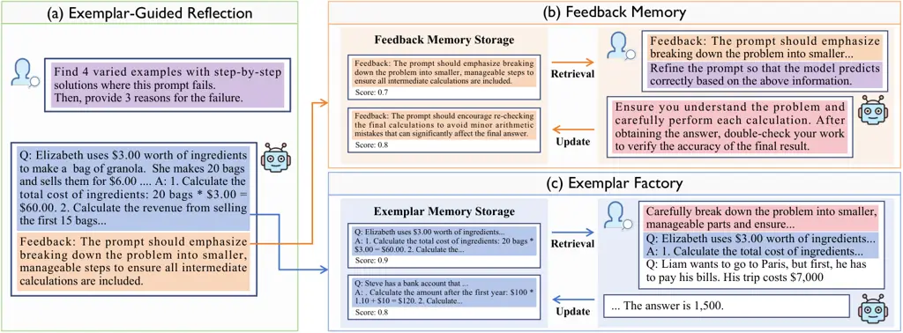
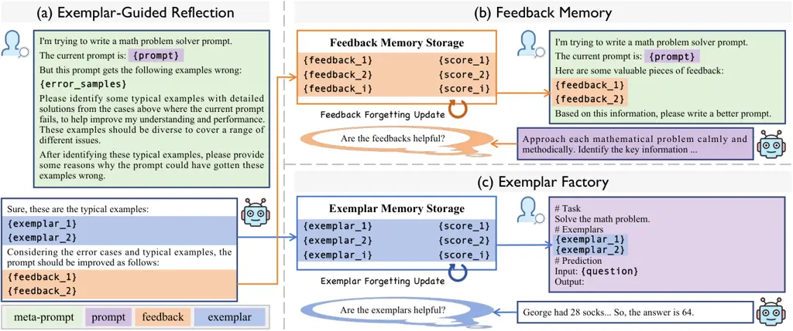

# Efficient and Accurate Prompt Optimization: the Benefit of Memory in Exemplar-Guided Reflection

Cilin Yan¹¹ 1 Equal contribution. ²² 2 This work was conducted when
Cilin Yan was interning at ByteDance. Affiliation: Beihang University
Email: [zhaoruihui@bytedance.com](mailto:)    Jingyun Wang¹¹ 1 Equal
contribution. Affiliation: Beihang University
Email: [wuxiaopu@bytedance.com](mailto:)    Lin Zhang¹¹ 1 Equal
contribution. Affiliation: ByteDance
Email: [xiongkai.kx@bytedance.com](mailto:)    Ruihui Zhao
Affiliation: ByteDance Email: [liuqingsong@bytedance.com](mailto:)   
Xiaopu Wu Affiliation: ByteDance
Email: [yangyangkang@bytedance.com](mailto:)    Kai Xiong
Affiliation: ByteDance    Qingsong Liu Affiliation: ByteDance   
Guoliang Kang ³³ 3 Corresponding authors. Affiliation: Beihang
University    Yangyang Kang³³ 3 Corresponding authors.
Affiliation: ByteDance Affiliation: Zhejiang University{clyanhh,
wangjingyun0730, kgl.prml}@gmail.com, zhanglin.hb@bytedance.com

###### Abstract

Automatic prompt engineering aims to enhance the generation quality of
large language models (LLMs). Recent works utilize feedbacks generated
from erroneous cases to guide the prompt optimization. During inference,
they may further retrieve several semantically related exemplars and
concatenate them to the optimized prompts to improve the performance.
However, those works only utilize the feedbacks at the current step,
ignoring historical and unseleccted feedbacks which are potentially
beneficial. Moreover, the selection of exemplars only considers the
general semantic relationship and may not be optimal in terms of task
performance and matching with the optimized prompt. In this work, we
propose an Exemplar-Guided Reflection with Memory mechanism (ERM) to
realize more efficient and accurate prompt optimization. Specifically,
we design an exemplar-guided reflection mechanism where the feedback
generation is additionally guided by the generated exemplars. We further
build two kinds of memory to fully utilize the historical feedback
information and support more effective exemplar retrieval. Empirical
evaluations show our method surpasses previous state-of-the-arts with
less optimization steps, _i.e.,_ improving F1 score by 10.1 on LIAR
dataset, and reducing half of the optimization steps on ProTeGi.

## 1 Introduction



Figure 1: Feedback-based automatic prompt engineering methods commonly
employ a meta-prompt, which guides LLMs to evaluate the current case,
provide feedbacks, and generate refined prompts. In this work, we design
an instructive meta-prompt to select exemplars with detailed solution
processes, and generate feedbacks for the current case. These feedbacks
are stored in Feedback Memory and periodically retrieved to efficiently
guide the optimization of prompts. Additionally, these exemplars are
stored and assessed in an Exemplar Factory to enhance prediction
accuracy.

Prompt optimization is crucial for enhancing the performance of Large
Language Models (LLMs). Even a subtle adjustment to the prompt may lead
to an obvious improvement or decline in performance, thereby
highlighting the critical role of prompt engineering for LLMs. Manual
prompt engineering demands significant human effort and expert
knowledge, while traditional fine-tuning methods Lester et al. (2021);
Shin et al. (2020) heavily rely on substantial computational resources
and powerful GPUs. Therefore, it is necessary to explore automatic
prompt engineering, which is compatible with black-box APIs (_e.g.,_
GPT-4) and does not require extensive resources.

Recently, feedback-based methods Ye et al. (2024); Juneja et al. (2024)
exhibit promising performance for automatic prompt engineering, which
generally leverage feedbacks generated from failure cases to facilitate
the prompt optimization process. Previous feedback-based
methods (Pryzant et al., 2023; Ye et al., 2024) have two main drawbacks.
Firstly, they throw unselected and historical feedbacks which may
benefit the prompt optimization, resulting in more optimization steps to
achieve satisfactory performance. Secondly, during inference, previous
methods (Hu et al., 2023; Juneja et al., 2024) may retrieve several
semantically related exemplars and concatenate them to the optimized
prompt to improve the performance. However, the retrieved exemplars are
not optimal without evaluating their influence on the task performance.
Those drawbacks largely constrain both the efficiency and accuracy of
the prompt optimization process.

In this work, we introduce an Exemplar-Guided Reflection with Memory
mechanism (ERM) to achieve efficient and accurate prompt optimization.
Firstly, we propose an exemplar-guided reflection mechanism. As shown in
Figure 1(a), we manually design an instructive meta-prompt. Unlike
previous meta-prompts which simply guide LLMs to reflect on the current
case, our instructive meta-prompt further directs LLMs to generate
exemplars by selecting typical wrong samples and providing detailed
solution processes for them. Thanks to the detailed solution processes
within exemplars, LLMs therefore yield more informative feedbacks. We
then propose Feedback Memory to store all feedbacks and assign a
priority score to each of them, as shown in Figure 1(b). During the
optimization process, we retrieve a group of feedbacks with the highest
priority scores and instruct LLMs to generate a new prompt for the
feedbacks. After evaluating the refined prompts, we update the priority
scores of the associated feedbacks accordingly, _i.e.,_ we increase the
score for improved performance and decrease it if no gain. Consequently,
feedbacks with valuable insights will be consistently selected rather
than ignored throughout the optimization process. As demonstrated in
Figure 1(c), we store all exemplars in Exemplar Factory and assign a
prior score to each piece. At the inference stage, we retrieve a set of
exemplars with the highest priority scores, and concatenate the
exemplars to our refined prompt to further improve the performance.

We conduct an extensive evaluation on seven tasks to compare ERM with
the latest prompt optimization approaches. Our results demonstrate
substantial improvements over state-of-the-art methods, notably
achieving a 10.1 F1 score improvement on the LIAR dataset. Furthermore,
the optimization speed of ERM is roughly twice as fast as
ProTeGi (Pryzant et al., 2023).

Our contributions are summarized as follows:

1\) We design an instructive meta-prompt, which guides LLMs to select
exemplars and therefore yield more informative feedbacks.

2\) We propose a Feedback Memory to store historical feedbacks by their
priority scores, enabling effective retrieval and utilization of
feedbacks for prompt optimization.

3\) We propose an Exemplar Factory to store and evaluate exemplars. By
retrieving exemplars and concatenating them to our refined prompt at the
inference stage, we further enhance the performance of LLMs.

4\) We conduct extensive experiments on various tasks and show superior
performance of our method to previous state-of-the-arts. Additionally,
our optimization steps can be largely reduced, _e.g._, the steps of our
method are approximately half of that in ProTeGi.

## 2 Related Work



Figure 2: Pipeline of ERM. In wrong prediction samples, the instructive
reflective meta-prompt is employed to select exemplars with detailed
answer processes, which are subsequently followed by feedback
generation. The feedbacks are stored in feedback memory storage, and the
exemplars are stored in exemplar memory storage. These stored feedbacks
are periodically retrieved to efficiently guide prompt optimization,
with selective forgetting based on their effectiveness in enhancing
optimization. Additionally, these exemplars are assessed to enhance
prediction accuracy.

### 2.1 Automatic Prompt Optimization

Prompt engineering Zhou et al. (2022) aims to identify suitable prompts
as inputs for large language models (LLMs) to perform various tasks. To
minimize human effort, researchers have explored automatic prompt
optimization Lester et al. (2021); Shin et al. (2020); Li and Liang
(2021). Previous works adopt various strategies for automatic prompt
optimization, such as evolutionary-based methods, trajectory-based
methods, and feedback-based methods. Evolutionary-based methods (Guo
et al., 2024; Fernando et al., 2024) utilize LLMs to rewrite a set of
prompts with evolutionary algorithms (Holland, 1992; Storn and Price,
1997), which select the best prompts on a validation set to simulate the
natural selection process for optimizing prompts. Trajectory-based
methods (Yang et al., 2024; Tang et al., 2024) employ an LLM prompt
optimizer to generate new prompts based on historical prompts, scores,
or error examples. Feedback-based methods (Pryzant et al., 2023; Juneja
et al., 2024) use LLMs to summarize feedbacks on erroneous cases,
leveraging the feedbacks to optimize and create new prompts. In this
work, we primarily focus on feedback-based methods, with the aim of
writing stronger feedbacks and efficiently utilizing them for
optimization.

### 2.2 Long-Term Memory Mechanisms

Existing automatic prompt optimization methods (Pryzant et al., 2023;
Juneja et al., 2024) face challenges in maintaining a robust long-term
memory function, limiting their ability to retain and utilize valuable
feedbacks for prompt optimization. MemoryBank (Zhong et al., 2024)
solves the challenge of maintaining a robust long-term memory
conversation history in previous LLMs (Touvron et al., 2023; Zeng
et al., 2022; Taori et al., 2023) by introducing a mechanism that
enhances their ability to store and recall relevant information over
time. This approach mimics human memory dynamics through a selective
retention strategy inspired by the Ebbinghaus Forgetting
Curve (Ebbinghaus, 2013). Our work builds on these advancements by using
memory storage to implement feedbacks and exemplars in long-term memory.
We implement a forgetting strategy for feedbacks and exemplars that are
retrieved but deemed unvaluable, thereby enhancing the efficiency and
accuracy of long-term memory retention in prompt optimization.

## 3 Method

In this section, we propose ERM, a novel method designed to achieve
efficient and accurate prompt optimization. As shown in Figure 2, ERM is
composed of three core components: (1) Exemplar-Guided Reflection,
employing an instructive meta-prompt (Section 3.2), guides prompt
optimizer to first generate exemplars by identifying typical wrong
samples and providing detailed solution processes, followed by
generating feedback. (2) We then propose a Feedback Memory (Section 3.3)
to store all feedbacks and assign a priority score to each piece of
them. These feedbacks can then be retrieved and utilized during
optimization efficiently. After evaluating the refined prompts, we
update the priority scores of the associated feedbacks. (3) Finally, we
utilize an Exemplar Factory (Section 3.4) to store and evaluate
exemplars, which serve as additional resources during prediction. By
incorporating the retrieved exemplars into our refined prompt, task
model are further guided to achieve improved accuracy.

### 3.1 Preliminary

Given a training set
$`\mathcal{D}_{train}=\{(q_{i},a_{i})\}^{n_{t}}_{i=1}`$ ($`q_{i}`$
represents the question, $`a_{i}`$ is the paired answer, and $`n_{t}`$
is the total number of training samples) and a test set
$`\mathcal{D}_{test}`$ drawn from a specific task, along with a score
function $`s(\cdot)`$ for this task, we aim to perform the task using a
black-box task model $`M_{s}`$ (_e.g._, ChatGPT), which combines the
prompt $`p`$ with questions from $`\mathcal{D}_{test}`$ as input to
generate responses. These responses are then evaluated by the score
function to calculate an average score over $`\mathcal{D}_{test}`$. The
goal of prompt optimization is to find an optimal prompt $`p^{*}`$ drawn
from the natural language space that maximizes the expectation of the
average score over $`\mathcal{D}_{test}`$:

```math
p^{*}=\arg\max_{p}\mathbb{E}_{(q_{i},a_{i})\sim\mathcal{D}_{test}}[s(M_{s}(q_{i};p),a_{i})], \tag{1}
```

where $`p=[p_{I},p_{R}(q_{i})]`$ might be composed of two parts: one
includes the invariant content $`p_{I}`$, which remains independent of
the question and may include task descriptions and general solution
steps, and the other is the variable content $`p_{R}(q_{i})`$ , which is
question-specific. We leverage a more powerful prompt optimizer
$`M_{e}`$  (_e.g._, GPT-4) compared with the task model $`M_{s}`$ to
summarize feedbacks and optimize the prompt.

Previous work typically divides prompt optimization into three steps:
prompt initialization, new prompt proposal, and prompt search.

1. Prompt initialization. Prompt initialization can be achieved by both
   manual initialization and induction initialization. Following
   ProTeGi (Pryzant et al., 2023), we initialize the original prompt
   $`p^{0}`$ manually.

2. New prompt proposal. Commonly, previous methods use task model
   $`M_{s}`$ to evaluate on a subset of $`\mathcal{D}_{train}`$, and then
   use prompt optimizer $`M_{e}`$ to summarize errors from $`n_{b}`$ wrong
   samples $`\mathcal{B}=\{(q_{i},a_{i})\}_{i=1}^{n_{b}}`$, where the
   response of task model $`M_{s}(q_{i},p^{t})`$ is different from
   $`a_{i}`$. Feedbacks is then generated as
   $`\mathcal{F}^{t}=M_{e}(p^{t},\mathcal{B};p^{meta}_{ref})`$ with
   $`p^{meta}_{ref}`$ serving as the meta-prompt that guides the prompt
   optimizer in generating feedback. The prompt optimizer then optimizes
   and refines the prompt $`p^{t}`$ based on the feedbacks to obtain
   refined prompts
   $`p^{t+1}=M_{e}(p^{t},\mathcal{B},f^{t};p^{meta}_{opt})`$, where
   $`f^{t}\in\mathcal{F}^{t}`$, and $`p^{meta}_{opt}`$ is the meta-prompt
   guiding the prompt optimizer to propose refined prompt.

3. Prompt search. Following ProTeGi, we employ a beam search strategy to
   further select the refined prompts. Among several candidate prompts
   $`\mathcal{P}^{t+1}`$, we select $`k`$ prompts which perform best on the
   validation set, which is the subset of the training set. These $`k`$
   prompts are then used for the next optimization step.

### 3.2 Exemplar-Guided Reflection

To encourage the prompt optimizer generate more informative feedbacks,
we propose an Exemplar-Guided Reflection in Figure 2(a), which utilizes
an instructive meta-prompt to select typical wrong samples with detailed
solution processes as exemplars and generate feedbacks for them.
Detailedly, we first utilize the instructive meta-prompt
$`p^{meta}_{ref*}`$, which guides the prompt optimizer to select
$`n_{e}`$ diverse and significantly representative wrong samples from
the wrong samples $`\mathcal{B}`$ as exemplars $`\mathcal{E}^{t}`$ and
provide detailed solution processes for them:

```math
\displaystyle\mathcal{E}^{t} \displaystyle=M_{e}(p^{t},\mathcal{B};p^{meta}_{ref*}), \tag{2}
```

where
$`\mathcal{E}^{t}=\{e_{i}\}_{i=1}^{n_{e}}=\{(q_{i},a_{i},\mathrm{cot}_{i})\}_{i=1}^{n_{e}}`$
is a set of exemplars $`e_{i}`$ with detailed solution processes
$`\mathrm{cot}_{i}`$. Then, the prompt optimizer generates $`n_{f}`$
feedbacks $`\mathcal{F}^{t}=\{f^{t}_{i}\}_{i=1}^{n_{f}}`$ , which offer
insights on example predictions and suggestions on modification of the
prompt:

```math
\displaystyle\mathcal{F}^{t} \displaystyle=M_{e}(p^{t},\mathcal{B},\mathcal{E}^{t};p^{meta}_{ref*}), \tag{3}
```

Based on the wrong samples $`\mathcal{B}`$ and each item in the
generated feedbacks $`f^{t}\in\mathcal{F}^{t}`$, the model finally
produce a refined prompt $`p^{t+1}`$ for each feedback:

```math
p^{t+1}=M_{e}(p^{t},\mathcal{B},f^{t};p^{meta}_{opt}). \tag{4}
```

### 3.3 Feedback Memory

Aiming to accelerate the convergence of prompt optimization process, we
propose a Feedback Memory in Figure 2(b). We store the feedbacks with
priority scores via a long-term memory mechanism and retrieve them
efficiently for optimization. By evaluating the generated prompts, we
selectively forget the feedbacks to ensure that all stored feedbacks
remain beneficial for prompt optimization.

Feedback Memory Storage In Feedback Memory, we store the valuable
feedbacks during the optimization process and assign a priority score to
each piece of them, which serves as a basic foundation for Feedback
Forgetting Updating. To effectively store useful feedbacks and prevent
adverse impacts on prompt optimization, we employ a feedback filtering
strategy: (1) We evaluate the refined prompts generated based on the
feedbacks, and only store the informative feedbacks whose corresponding
prompts bring improvements on the validation set. Such strategy ensures
that only valuable feedbacks are stored and retrieved. (2) Additionally,
we employ the BGE-M3 model (Chen et al., 2024a) to calculate the
semantic similarity between newly generated feedbacks and the stored
ones. We ignore the feedbacks of high similarity with the previous ones
to avoid redundant information.

Feedback Retrieval During the optimization process, we periodically
select historical feedbacks from the memory based on their priority
scores. Specifically, we calculate the selection probability for each
feedback as follows:

```math
P_{f}=\text{softmax}\left(\left\{e^{\frac{s_{p}(f_{i})}{\tau_{f}}}\right\}_{i=1}^{|\tilde{\mathcal{F}}|}\right), \tag{5}
```

where $`{\tau_{f}}`$ is the temperature, controlling the tendency to
select high-scoring feedbacks, and $`\tilde{\mathcal{F}}`$ denotes all
feedbacks stored in the memory. We then randomly select $`n_{\hat{f}}`$
feedbacks according to their selection probabilities:

```math
\hat{\mathcal{F}}=\{f_{i}\}_{i=1}^{n_{\hat{f}}}=\text{sample}(\tilde{\mathcal{F}},P_{f}). \tag{6}
```

Feedback Forgetting Updating The selected feedbacks
$`\hat{\mathcal{F}}`$ guide prompt optimizer generate new prompts
$`p^{t+1}=M_{e}(p^{t},\mathcal{B},\hat{\mathcal{F}};p^{meta}_{opt*})`$,
where $`p^{meta}_{opt*}`$ is the meta-prompt that efficiently utilizes
the feedback group to generate a refined prompt. We then update their
priority scores by evaluating the generated prompt: we increase the
priority score if the performance is improved but decrease it if no
gain.

```math
s^{t}_{p}(f)=(1-\beta)s_{p}(f)^{t-1}+\beta\mathbb{I}(f), \tag{7}
```

where $`\mathbb{I}(f)`$ represents whether sufficient performance gain
is achieved and $`\beta`$ is a hyper-parameter to control the speed of
updating. Besides, the feedback will be removed from the storage once
its priority score falls below a certain threshold $`\theta`$:

```math
\tilde{\mathcal{F}}^{t}=\{f\mid f\in\tilde{\mathcal{F}}^{t-1},s^{t}_{p}(f)\geq\theta\}. \tag{8}
```

With such Forgetting Updating mechanism, we ensure that the most
valuable feedbacks are continuously utilized, which efficiently
accelerate the convergence of our optimization process.

### 3.4 Exemplar Factory

As shown in Figure 2(c), we store the exemplars along with a priority
score to each piece of them, similar to that in Feedback Memory. These
exemplars are stored in memory and retrieved for prediction, allowing us
to assess their impact on the task. We selectively forget exemplars,
ensuring that the valuable ones will be retrieved to enhance the
prediction performance.

Exemplar Memory Storage The exemplar memory storage retains valuable
exemplars. We introduce an exemplar filtering strategy to ensure stored
exemplars benefit prediction: (1) We verify that the detailed solution
process of the exemplar generated by prompt optimizer matches to the
ground truth label. (2) When a new generated exemplar is identical to
the stored ones, we replace the stored exemplars with probability $`p`$
and reject the new exemplar with probability $`1-p`$ to avoid redundant
storage.

Exemplar Retrieval Each exemplar $`e_{i}`$ is assigned a priority score
$`s_{p}(e_{i})`$. During the prompt optimization process for question
$`q_{j}`$, we calculate the selection probability for each exemplar as
follows:

```math
P^{r}_{e}=\text{softmax}\left(\left\{e^{\frac{s_{p}(e_{i})\cdot s_{s}^{j}(e_{i})}{\tau_{e}}}\right\}_{i=1}^{|\tilde{\mathcal{E}}|}\right), \tag{9}
```

where $`s_{p}(e_{i})`$ is the priority score of exemplar $`e_{i}`$ and
$`s_{s}^{j}(e_{i})`$ is its semantic similarity to the question
$`q_{j}`$, $`\tilde{\mathcal{E}}`$ represents the stored exemplars, and
$`\tau_{e}`$ is the temperature. We then randomly sample five exemplars
as variable content $`p_{R}(q_{j})`$ of prompt. During the inference
stage, we select the five exemplars with the highest
$`s_{p}(e_{i})\cdot s_{s}^{j}(e_{i})`$ as variable content
$`p_{R}(q_{j})`$ of prompt for more accurate predictions.

Exemplar Forgetting Updating We adjust the priority scores of exemplars
based on whether incorporating them as the variable content
$`p_{R}(q_{j})`$ in the prompt leads to improvements. Exemplars with low
priority scores are promptly removed to ensure that only valuable ones
are stored.

|                                       |              |           |             |                |                  |              |                 |
| ------------------------------------- | ------------ | --------- | ----------- | -------------- | ---------------- | ------------ | --------------- |
| Method                                | True / False |           |             |                | Generative       |              | Multiple-choice |
|                                       |  LIAR (F1)   |  BBH (F1) |  ETHOS (F1) | ArSarcasm (F1) | WebNLG (Rouge-L) | GSM8K (Acc.) |  WSC (Acc.)     |
| Empty                                 | 46.4         | 69.4      | 93.0        | 83.7           | 49.4             | 89.0         | 77.3            |
| CoT (Kojima et al., 2022)             | 46.0         | 81.9      | 84.5        | 83.7           | 49.3             | 89.0         | 81.3            |
| APE (Zhou et al., 2022)               | 47.7         | 72.9      | 94.0        | 83.8           | 51.3             | 91.3         | 79.3            |
| ProTeGi (Pryzant et al., 2023)        | 58.5         | 73.6      | 96.5        | 84.1           | 55.7             | 91.0         | 80.0            |
| OPRO (Yang et al., 2024)              | 47.9         | 75.7      | 93.5        | 84.5           | 51.9             | 90.7         | 83.3            |
| Promptbreeder (Fernando et al., 2024) | 47.1         | 74.3      | 94.5        | 83.8           | 51.0             | 91.7         | 80.0            |
| EvoPrompt (Guo et al., 2024)          | 47.9         | 75.0      | 93.0        | 83.8           | 50.2             | 90.7         | 78.8            |
| GPO (Tang et al., 2024)               | 54.7         | 70.8      | 94.0        | 83.6           | 51.8             | 90.3         | 84.0            |
| ERM                                   | 68.6         | 86.1      | 98.0        | 85.1           | 59.6             | 93.3         | 86.0            |
| $`\Delta`$                            | +10.1        | +4.2      | +1.5        | +0.6           | +3.9             | +1.6         | +2.0            |

Table 1: Comparisons of our method with existing LLM-based prompt
optimizers under zero-shot setting.

|               |                                                                                                                                                                                                                                                                                                                                                                                          |         |
| ------------- | ---------------------------------------------------------------------------------------------------------------------------------------------------------------------------------------------------------------------------------------------------------------------------------------------------------------------------------------------------------------------------------------- | ------- |
| Method        | Prompt                                                                                                                                                                                                                                                                                                                                                                                   | Rouge-L |
| Empty         | Write the following triples as fluent English text.                                                                                                                                                                                                                                                                                                                                      | 49.4    |
| ProTeGi       | You are given a set of triples that need to be converted into coherent and fluent English sentences. Each triple consists of a subject, predicate, and object. Your task is to accurately convey the information from these triples into well-formed sentences. Ensure the sentences are complete, grammatically correct, and clearly express the relationships provided in the triples. | 55.7    |
| OPRO          | Convert the following sets of triples into coherent, natural, and fluent English sentences.                                                                                                                                                                                                                                                                                              | 51.9    |
| PromptBreeder | Transform these triples into smooth and stylish English sentences, and make them shine!                                                                                                                                                                                                                                                                                                  | 50.9    |
| EvoPrompt     | Turn the provided triples into smooth, flowing English sentences that will impress everyone!                                                                                                                                                                                                                                                                                             | 50.2    |
| GPO           | Rewrite these triples into fluent and natural English sentences.                                                                                                                                                                                                                                                                                                                         | 51.8    |
| ERM           | Convert the following triples into coherent and fluent English sentences. Ensure that all relationships and attributes are accurately conveyed. When multiple associations or attributes are involved, break down the information into smaller, logical sentences to maintain clarity.                                                                                                   | 59.6    |

Table 2: Prompts optimized by different methods on the WebNLG dataset.

## 4 Experiments

Datasets. We perform evaluation on 7 standard datasets : WSC (Levesque
et al., 2012), Ethos (Mollas et al., 2022), ArSarcasm (Farha and Magdy,
2020), Liar (Wang, 2017), BBH-navigate (Suzgun et al., 2022),
GSM8k (Cobbe et al., 2021), WebNLG (Gardent et al., 2017). Among these,
ArSarcasm, Ethos, and Liar, and BBH-navigate contain true/false
questions, WSC contains multiple-choice questions, GSM8K contains
questions with integer answers, and WebNLG contains questions requiring
natural language generation.

Baselines. We compare several representative methods, including existing
LLM-based prompt optimizers: APE (Zhou et al., 2022), ProTeGi (Pryzant
et al., 2023), OPRO (Yang et al., 2024), Promptbreeder (Fernando et al.,
2024), EvoPrompt (Guo et al., 2024), and GPO (Tang et al., 2024). In
addition, we consider the baseline using manually written simple prompts
(“Manual”), which we provide in the appendix, and the instruction “Let’s
think step by step.” from chain-of-thought prompting (“CoT”) (Kojima
et al., 2022) for performance comparison.

Evaluation Metrics. We report the F1 score on Ethos, ArSarcasm, Liar and
BBH-navigate following (Pryzant et al., 2023), accuracy on WSC and GSM8k
following (Tang et al., 2024; Juneja et al., 2024) and ROUGE-L on WebNLG
following (Tang et al., 2024).

Implementation Details. For the task model, we use
Doubao-Pro (ByteDance, 2024). For the prompt optimizer, we use
GPT-4o (OpenAI, 2024). We repeat all the experiments three times and
report the average of the results. Other details are presented in
appendix.

Figure 3: The efficiency of our approach ERM. The size of the circles
represents performance, with larger circles indicating better
performance. The vertical axis shows the optimization steps needed for
different methods to achieve peak performance across datasets.

### 4.1 Main Results

|                                       |              |           |             |                |                  |              |                 |
| ------------------------------------- | ------------ | --------- | ----------- | -------------- | ---------------- | ------------ | --------------- |
| Method                                | True / False |           |             |                | Generative       |              | Multiple-choice |
|                                       |  LIAR (F1)   |  BBH (F1) |  ETHOS (F1) | ArSarcasm (F1) | WebNLG (Rouge-L) | GSM8K (Acc.) |  WSC (Acc.)     |
| APE (Zhou et al., 2022)               | 51.2         | 74.3      | 93.2        | 84.3           | 53.1             | 91.8         | 80.3            |
| ProTeGi (Pryzant et al., 2023)        | 60.3         | 73.6      | 97.0        | 84.1           | 56.3             | 91.0         | 81.0            |
| OPRO (Yang et al., 2024)              | 52.1         | 75.0      | 94.8        | 84.7           | 52.4             | 90.8         | 85.0            |
| Promptbreeder (Fernando et al., 2024) | 51.8         | 75.7      | 95.7        | 84.5           | 52.7             | 91.7         | 81.5            |
| EvoPrompt (Guo et al., 2024)          | 52.3         | 76.4      | 94.3        | 83.9           | 51.8             | 90.9         | 80.4            |
| GPO (Tang et al., 2024)               | 56.6         | 75.0      | 95.5        | 83.8           | 53.4             | 90.5         | 84.9            |
| ERM                                   | 68.6         | 86.1      | 98.0        | 85.1           | 59.6             | 93.3         | 86.0            |

Table 3: Comparisons of our method with existing LLM-based prompt
optimizers under few-shot setting.

|                            |                 |                  |            |           |             |                |                  |              |             |
| -------------------------- | --------------- | ---------------- | ---------- | --------- | ----------- | -------------- | ---------------- | ------------ | ----------- |
| Exemplar-Guided Reflection | Feedback Memory | Exemplar Factory |  LIAR (F1) |  BBH (F1) |  ETHOS (F1) | ArSarcasm (F1) | WebNLG (Rouge-L) | GSM8K (Acc.) |  WSC (Acc.) |
|                            |                 |                  | 58.5       | 73.6      | 96.5        | 84.1           | 55.7             | 91.0         | 80.0        |
| ✓                          |                 |                  | 62.9       | 75.7      | 97.0        | 84.2           | 56.9             | 92.7         | 82.0        |
| ✓                          |                 | ✓                | 67.2       | 84.7      | 97.0        | 84.9           | 58.6             | 93.0         | 84.0        |
| ✓                          | ✓               |                  | 66.6       | 82.6      | 97.5        | 84.8           | 58.8             | 93.0         | 85.0        |
| ✓                          | ✓               | ✓                | 68.6       | 86.1      | 98.0        | 85.1           | 59.6             | 93.3         | 86.0        |

Table 4: Effect of each component in our method.

Comparison under Zero-shot Setting. Table 1 presents the results of
different methods for prompt optimization across true/false questions,
generative questions, and multiple-choice questions.

For true/false questions, our method demonstrates a significant
improvement over previous works. Specifically, our method outperforms
trajectory-based methods (OPRO and GPO) by 13.9. Trajectory-based
methods utilize an LLM prompt optimizer to generate new prompts based on
historical prompts, scores, or error examples, but may struggle to
identify “better prompts”, limiting their performance. Our method also
outperforms ProTeGi (feedback-based method) by 10.1, which can be
attributed to our exemplar-guided reflection, feedback memory and
example factory.

For generative questions and multiple-choice questions, our method also
significantly outperforms previous methods. Specifically, on the WebNLG
dataset, our approach surpasses previous methods by 3.9 in Rouge-L
score. Table 2 visualizes the optimized prompts on the WebNLG dataset,
demonstrating that our method’s optimized prompts are more effective at
capturing the critical information needed to enhance task performance.
The exemplar factory boosts the F1 score by 3.7 on the LIAR dataset,
while the feedback memory provides an improvement of 2.0.

Efficiency of Our Method. Our approach introduces a memory mechanism to
efficiently store and utilize feedbacks. We show the optimization steps
needed for different methods to achieve peak performance across datasets
in Figure 3, which highlights the superior efficiency of our method.
Specifically, according to Figure 3(a), on the LIAR dataset, our method
reaches an F1 score of 68.6 by the 7th step, while ProTeGi only achieves
58.5 by the 13th step, demonstrating that our method nearly doubles the
optimization speed.

Comparison under Few-shot Setting. Table 3 presents a comparison between
our method and others under few-shot settings. For each approach, we
dynamically select five relevant examples through k-nearest neighbors
(kNN) clustering in the embedding space. According to the results, ERM
consistently outperforms the previous methods. Notably, on the LIAR
dataset, our approach achieves an 8.3 F1 score improvement over previous
methods, demonstrating the effectiveness of selecting valuable wrong
examples as exemplars and equipping them with chain-of-thought-like
solution processes.

### 4.2 Ablation Study

Effect of Each Component. In Table 4, we conduct experiments to verify
the effectiveness of each key component in our method.

We adopt a strategy which dentify exemplars, contemplate the
corresponding chain of thought and then complete feedbacks, and observe
that ERM improves the F1 score by 4.4 on the LIAR dataset compared with
the approaches without the instructive meta-prompt, which validates the
effectiveness of the instructive meta-prompt. Additionally, the
introduction of the memory mechanism for feedback memory and exemplar
factory brought a further 5.7 improvement on the LIAR dataset,
confirming the effectiveness of the memory mechanism.

|           |                    |                   |            |           |                  |
| --------- | ------------------ | ----------------- | ---------- | --------- | ---------------- |
| Retrieval | Exemplar Filtering | Selective Forget. |  LIAR (F1) |  BBH (F1) | WebNLG (Rouge-L) |
|           |                    |                   | 62.9       | 75.7      | 56.9             |
| ✓         |                    |                   | 62.3       | 75.0      | 57.0             |
| ✓         | ✓                  |                   | 65.7       | 81.3      | 58.4             |
| ✓         | ✓                  | ✓                 | 66.6       | 82.6      | 58.8             |

Table 5: Effect of each component in Exemplar Factory.

Effect of Exemplar Factory. As shown in Table 5, incorporating exemplar
filtering when storing exemplars does not enhance performance. This is
because the behavior of the prompt optimizer is unpredictable and may
generate incorrect or unconventional questions. Retrieving such examples
does not enhance prediction performance. However, filtering out
erroneously generated exemplars and redundant ones already in storage
resulted in a 3.4 improvement, highlighting the importance of exemplar
filtering. The introduction of a selective forgetting further improved
the F1 score by 0.9 on the LIAR dataset, as it removes exemplars that do
not aid in prediction, thereby enhancing performance.

|           |                    |                   |            |           |                  |
| --------- | ------------------ | ----------------- | ---------- | --------- | ---------------- |
| Retrieval | Feedback Filtering | Selective Forget. |  LIAR (F1) |  BBH (F1) | WebNLG (Rouge-L) |
|           |                    |                   | 66.6       | 82.6      | 58.8             |
| ✓         |                    |                   | 66.4       | 81.9      | 58.8             |
| ✓         | ✓                  |                   | 67.5       | 82.6      | 59.2             |
| ✓         | ✓                  | ✓                 | 68.6       | 86.1      | 59.6             |

Table 6: Effect of each component in Feedback Memory.

Effect of Feedback Memory. As shown in Table 6, directly storing
feedbacks for periodic optimization without the feedback filtering
strategy does not improve performance. Introducing the filtering
strategy increased the F1 score on the LIAR dataset by 0.9 compared to
not using stored feedbacks. Additionally, incorporating selective
forgetting, which discards suboptimal feedback promptly, further
enhanced the F1 score by an additional 0.9.

## 5 Conclusion

In this paper, we introduce Exemplar-Guided Reflection with Memory
mechanism (ERM), a novel approach to achieve efficient and accurate
prompt optimization. Using a instructive reflection meta-prompt, ERM
instructs LLMs to select exemplars with detailed solution processes and
generate stronger feedback. We then propose Feedback Memory mechanism to
efficiently exploit potentially valuable feedback. Additionally,
Exemplar Factory is introduced to further enhance the accuracy of
prediction by pre-assessing the impact on the task. ERM refines prompts
authored by human experts and outperforms established automatic prompt
engineering baselines across various scenarios, with optimization steps
approximately half of that in previous work.

## 6 Limitations

In this work, we effectively utilize feedbacks and exemplars using a
long-term memory mechanism. However, in real-world applications, we
encounter additional challenges: some questions continue to be
incorrectly answered during the optimization process, and prompt
optimization doesn’t always align with human expectations. When the
model struggles to optimize, introducing human intervention might aid in
enhancing prompt optimization. This paper lacks exploration on how
humans could assist in the optimization process. For instance, with
persistent incorrect answers, human input could offer crafted solutions,
helping the expert model generate improved feedback. Additionally, due
to computational and budget constraints, our experiments are limited to
representative tasks.

## References

- Austin and Chartock (2024) Derek Austin and Elliott Chartock. 2024.
  Grad-sum: Leveraging gradient summarization for optimal prompt
  engineering. _arXiv preprint arXiv:2407.12865_.
- ByteDance (2024) ByteDance. 2024.
  [Doubao](https://www.volcengine.com/product/doubao).
- Chen et al. (2024a) Jianlv Chen, Shitao Xiao, Peitian Zhang, Kun Luo,
  Defu Lian, and Zheng Liu. 2024a. Bge m3-embedding: Multi-lingual,
  multi-functionality, multi-granularity text embeddings through
  self-knowledge distillation. _arXiv preprint arXiv:2402.03216_.
- Chen et al. (2024b) Yongchao Chen, Jacob Arkin, Yilun Hao, Yang Zhang,
  Nicholas Roy, and Chuchu Fan. 2024b. Prompt optimization in multi-step
  tasks (promst): Integrating human feedback and heuristic-based
  sampling. In _Proceedings of the 2024 Conference on Empirical Methods
  in Natural Language Processing_, pages 3859–3920.
- Cobbe et al. (2021) Karl Cobbe, Vineet Kosaraju, Mohammad Bavarian,
  Mark Chen, Heewoo Jun, Lukasz Kaiser, Matthias Plappert, Jerry Tworek,
  Jacob Hilton, Reiichiro Nakano, and 1 others. 2021. Training verifiers
  to solve math word problems. _arXiv preprint arXiv:2110.14168_.
- Crispino et al. (2023) Nicholas Crispino, Kyle Montgomery, Fankun
  Zeng, Dawn Song, and Chenguang Wang. 2023. Agent instructs large
  language models to be general zero-shot reasoners. _arXiv preprint
  arXiv:2310.03710_.
- Deng et al. (2022) Mingkai Deng, Jianyu Wang, Cheng-Ping Hsieh, Yihan
  Wang, Han Guo, Tianmin Shu, Meng Song, Eric P Xing, and Zhiting
  Hu. 2022. Rlprompt: Optimizing discrete text prompts with
  reinforcement learning. _arXiv preprint arXiv:2205.12548_.
- Ebbinghaus (2013) Hermann Ebbinghaus. 2013. Memory: A contribution to
  experimental psychology. _Annals of neurosciences_, 20(4):155.
- Fan et al. (2023) Ling Fan, Harry Jiannan Wang, Kunpeng Zhang, Zilong
  Pei, and Anjun Li. 2023. Towards an automatic prompt optimization
  framework for ai image generation. In _International Conference on
  Human-Computer Interaction_, pages 405–410. Springer.
- Farha and Magdy (2020) Ibrahim Abu Farha and Walid Magdy. 2020. From
  arabic sentiment analysis to sarcasm detection: The arsarcasm dataset.
  In _Proceedings of the 4th Workshop on Open-Source Arabic Corpora and
  Processing Tools, with a Shared Task on Offensive Language Detection_,
  pages 32–39.
- Fernando et al. (2024) Chrisantha Fernando, Dylan Sunil Banarse,
  Henryk Michalewski, Simon Osindero, and Tim Rocktäschel. 2024.
  Promptbreeder: Self-referential self-improvement via prompt evolution.
  In _Forty-first International Conference on Machine Learning_.
- Gardent et al. (2017) Claire Gardent, Anastasia Shimorina, Shashi
  Narayan, and Laura Perez-Beltrachini. 2017. Creating training corpora
  for nlg micro-planning. In _55th Annual Meeting of the Association for
  Computational Linguistics, ACL 2017_, pages 179–188. Association for
  Computational Linguistics (ACL).
- Guo et al. (2024) Qingyan Guo, Rui Wang, Junliang Guo, Bei Li, Kaitao
  Song, Xu Tan, Guoqing Liu, Jiang Bian, and Yujiu Yang. 2024.
  Connecting large language models with evolutionary algorithms yields
  powerful prompt optimizers. In _The Twelfth International Conference
  on Learning Representations_.
- Hao et al. (2024) Yaru Hao, Zewen Chi, Li Dong, and Furu Wei. 2024.
  Optimizing prompts for text-to-image generation. _Advances in Neural
  Information Processing Systems_, 36.
- Holland (1992) John H Holland. 1992. Genetic algorithms. _Scientific
  american_, 267(1):66–73.
- Hu et al. (2023) Xinyu Hu, Pengfei Tang, Simiao Zuo, Zihan Wang, Bowen
  Song, Qiang Lou, Jian Jiao, and Denis Charles. 2023. Evoke: Evoking
  critical thinking abilities in llms via reviewer-author prompt
  editing. _arXiv preprint arXiv:2310.13855_.
- Juneja et al. (2024) Gurusha Juneja, Nagarajan Natarajan, Hua Li, Jian
  Jiao, and Amit Sharma. 2024. Task facet learning: A structured
  approach to prompt optimization. _arXiv preprint arXiv:2406.10504_.
- Kojima et al. (2022) Takeshi Kojima, Shixiang Shane Gu, Machel Reid,
  Yutaka Matsuo, and Yusuke Iwasawa. 2022. Large language models are
  zero-shot reasoners. _Advances in neural information processing
  systems_, 35:22199–22213.
- Lester et al. (2021) Brian Lester, Rami Al-Rfou, and Noah
  Constant. 2021. The power of scale for parameter-efficient prompt
  tuning. _arXiv preprint arXiv:2104.08691_.
- Levesque et al. (2012) Hector Levesque, Ernest Davis, and Leora
  Morgenstern. 2012. The winograd schema challenge. In _Thirteenth
  international conference on the principles of knowledge representation
  and reasoning_.
- Li et al. (2024) WeiJie Li, Jin Wang, and Xuejie Zhang. 2024.
  Promptist: Automated prompt optimization for text-to-image synthesis.
  In _CCF International Conference on Natural Language Processing and
  Chinese Computing_, pages 295–306. Springer.
- Li and Liang (2021) Xiang Lisa Li and Percy Liang. 2021.
  Prefix-tuning: Optimizing continuous prompts for generation. _arXiv
  preprint arXiv:2101.00190_.
- Li and Wu (2023) Yujian Betterest Li and Kai Wu. 2023. Spell: Semantic
  prompt evolution based on a llm. _arXiv preprint arXiv:2310.01260_.
- Liu et al. (2024) Shihong Liu, Samuel Yu, Zhiqiu Lin, Deepak Pathak,
  and Deva Ramanan. 2024. Language models as black-box optimizers for
  vision-language models. In _Proceedings of the IEEE/CVF Conference on
  Computer Vision and Pattern Recognition_, pages 12687–12697.
- Ma et al. (2024) Ruotian Ma, Xiaolei Wang, Xin Zhou, Jian Li, Nan Du,
  Tao Gui, Qi Zhang, and Xuanjing Huang. 2024. Are large language models
  good prompt optimizers? _arXiv preprint arXiv:2402.02101_.
- Mañas et al. (2024) Oscar Mañas, Pietro Astolfi, Melissa Hall, Candace
  Ross, Jack Urbanek, Adina Williams, Aishwarya Agrawal, Adriana
  Romero-Soriano, and Michal Drozdzal. 2024. Improving text-to-image
  consistency via automatic prompt optimization. _arXiv preprint
  arXiv:2403.17804_.
- Mo et al. (2024) Wenyi Mo, Tianyu Zhang, Yalong Bai, Bing Su, Ji-Rong
  Wen, and Qing Yang. 2024. Dynamic prompt optimizing for text-to-image
  generation. In _Proceedings of the IEEE/CVF Conference on Computer
  Vision and Pattern Recognition_, pages 26627–26636.
- Mollas et al. (2022) Ioannis Mollas, Zoe Chrysopoulou, Stamatis
  Karlos, and Grigorios Tsoumakas. 2022. Ethos: a multi-label hate
  speech detection dataset. _Complex & Intelligent Systems_,
  8(6):4663–4678.
- OpenAI (2022) OpenAI. 2022. [Chatgpt](https://openai.com/chatgpt/).
- OpenAI (2024) OpenAI. 2024.
  [Gpt-4o](https://openai.com/index/hello-gpt-4o/).
- Pryzant et al. (2023) Reid Pryzant, Dan Iter, Jerry Li, Yin Tat Lee,
  Chenguang Zhu, and Michael Zeng. 2023. Automatic prompt optimization
  with" gradient descent" and beam search. In _The 2023 Conference on
  Empirical Methods in Natural Language Processing_.
- Shin et al. (2020) Taylor Shin, Yasaman Razeghi, Robert L Logan IV,
  Eric Wallace, and Sameer Singh. 2020. Autoprompt: Eliciting knowledge
  from language models with automatically generated prompts. _arXiv
  preprint arXiv:2010.15980_.
- Srivastava et al. (2022) Aarohi Srivastava, Abhinav Rastogi, Abhishek
  Rao, Abu Awal Md Shoeb, Abubakar Abid, Adam Fisch, Adam R Brown, Adam
  Santoro, Aditya Gupta, Adrià Garriga-Alonso, and 1 others. 2022.
  Beyond the imitation game: Quantifying and extrapolating the
  capabilities of language models. _arXiv preprint arXiv:2206.04615_.
- Storn and Price (1997) Rainer Storn and Kenneth Price. 1997.
  Differential evolution–a simple and efficient heuristic for global
  optimization over continuous spaces. _Journal of global optimization_,
  11:341–359.
- Suzgun et al. (2022) Mirac Suzgun, Nathan Scales, Nathanael Schärli,
  Sebastian Gehrmann, Yi Tay, Hyung Won Chung, Aakanksha Chowdhery,
  Quoc V Le, Ed H Chi, Denny Zhou, and 1 others. 2022. Challenging
  big-bench tasks and whether chain-of-thought can solve them. _arXiv
  preprint arXiv:2210.09261_.
- Tang et al. (2024) Xinyu Tang, Xiaolei Wang, Wayne Xin Zhao, Siyuan
  Lu, Yaliang Li, and Ji-Rong Wen. 2024. Unleashing the potential of
  large language models as prompt optimizers: An analogical analysis
  with gradient-based model optimizers. _arXiv preprint
  arXiv:2402.17564_.
- Taori et al. (2023) Rohan Taori, Ishaan Gulrajani, Tianyi Zhang, Yann
  Dubois, Xuechen Li, Carlos Guestrin, Percy Liang, and Tatsunori B
  Hashimoto. 2023. Stanford alpaca: An instruction-following llama
  model.
- Touvron et al. (2023) Hugo Touvron, Thibaut Lavril, Gautier Izacard,
  Xavier Martinet, Marie-Anne Lachaux, Timothée Lacroix, Baptiste
  Rozière, Naman Goyal, Eric Hambro, Faisal Azhar, and 1 others. 2023.
  Llama: Open and efficient foundation language models. _arXiv preprint
  arXiv:2302.13971_.
- Um and Ye (2024) Soobin Um and Jong Chul Ye. 2024. Minorityprompt:
  Text to minority image generation via prompt optimization. _arXiv
  preprint arXiv:2410.07838_.
- Wang (2017) William Yang Wang. 2017. " liar, liar pants on fire": A
  new benchmark dataset for fake news detection. _arXiv preprint
  arXiv:1705.00648_.
- Wu et al. (2024) Zongyu Wu, Hongcheng Gao, Yueze Wang, Xiang Zhang,
  and Suhang Wang. 2024. Universal prompt optimizer for safe
  text-to-image generation. _arXiv preprint arXiv:2402.10882_.
- Yang et al. (2024) Chengrun Yang, Xuezhi Wang, Yifeng Lu, Hanxiao Liu,
  Quoc V. Le, Denny Zhou, and Xinyun Chen. 2024. [Large language models
  as optimizers](https://arxiv.org/abs/2309.03409). _Preprint_,
  arXiv:2309.03409.
- Ye et al. (2024) Qinyuan Ye, Maxamed Axmed, Reid Pryzant, and Fereshte
  Khani. 2024. Prompt engineering a prompt engineer. In _Findings of the
  Association for Computational Linguistics: ACL 2024_.
- Zeng et al. (2022) Aohan Zeng, Xiao Liu, Zhengxiao Du, Zihan Wang,
  Hanyu Lai, Ming Ding, Zhuoyi Yang, Yifan Xu, Wendi Zheng, Xiao Xia,
  and 1 others. 2022. Glm-130b: An open bilingual pre-trained model.
  _arXiv preprint arXiv:2210.02414_.
- Zhang et al. (2022) Tianjun Zhang, Xuezhi Wang, Denny Zhou, Dale
  Schuurmans, and Joseph E Gonzalez. 2022. Tempera: Test-time prompting
  via reinforcement learning. _arXiv preprint arXiv:2211.11890_.
- Zhong et al. (2024) Wanjun Zhong, Lianghong Guo, Qiqi Gao, He Ye, and
  Yanlin Wang. 2024. Memorybank: Enhancing large language models with
  long-term memory. In _Proceedings of the AAAI Conference on Artificial
  Intelligence_, volume 38, pages 19724–19731.
- Zhou et al. (2022) Yongchao Zhou, Andrei Ioan Muresanu, Ziwen Han,
  Keiran Paster, Silviu Pitis, Harris Chan, and Jimmy Ba. 2022. Large
  language models are human-level prompt engineers. _arXiv preprint
  arXiv:2211.01910_.
- Zhu et al. (2024) Dongsheng Zhu, Daniel Tang, Weidong Han, Jinghui Lu,
  Yukun Zhao, Guoliang Xing, Junfeng Wang, and Dawei Yin. 2024.
  Vislinginstruct: Elevating zero-shot learning in multi-modal language
  models with autonomous instruction optimization. In _Proceedings of
  the 2024 Conference of the North American Chapter of the Association
  for Computational Linguistics_, pages 2122–2135.

|                                    |                     |             |      |
| ---------------------------------- | ------------------- | ----------- | ---- |
| Dataset Name                       | Task                | Train & Dev | Test |
| LIAR (Wang, 2017)                  | True/False          | 3681        | 461  |
| BBH-Navigate (Suzgun et al., 2022) | True/False          | 96          | 144  |
| ETHOS (Mollas et al., 2022)        | True/False          | 440         | 200  |
| ArSarcasm (Farha and Magdy, 2020)  | True/False          | 8437        | 2110 |
| WebNLG (Gardent et al., 2017)      | Language Generation | 200         | 300  |
| GSM8K (Cobbe et al., 2021)         | Integer Generation  | 200         | 300  |
| WSC (Levesque et al., 2012)        | Multiple-Choice     | 100         | 150  |

Table 7: Dataset sizes and data splits.

|                                      |            |                                                                                                                        |
| ------------------------------------ | ---------- | ---------------------------------------------------------------------------------------------------------------------- |
| Dataset                              | License    | Source                                                                                                                 |
| LIAR (Wang, 2017)                    | Unknown    | [https://www.cs.ucsb.edu/~cwilliam/data/liar_dataset.zip](https://www.cs.ucsb.edu/~cwilliam/data/liar_dataset.zip)     |
| BIG-bench Hard (Suzgun et al., 2022) | Apache-2.0 | [https://github.com/google/BIG-bench](https://github.com/google/BIG-bench) (original)                                  |
|                                      |            | [https://github.com/suzgunmirac/BIG-Bench-Hard](https://github.com/suzgunmirac/BIG-Bench-Hard) (reformatted)           |
| ETHOS (Mollas et al., 2022)          | GNU GPLv3  | [https://huggingface.co/datasets/iamollas/ethos](https://huggingface.co/datasets/iamollas/ethos)                       |
| ArSarcasm (Farha and Magdy, 2020)    | MIT        | [https://github.com/iabufarha/ArSarcasm](https://github.com/iabufarha/ArSarcasm)                                       |
| WebNLG (Gardent et al., 2017)        | CC BY 4.0  | [https://github.com/fuzihaofzh/webnlg-dataset](https://github.com/fuzihaofzh/webnlg-dataset)                           |
| GSM8K (Cobbe et al., 2021)           | MIT        | [https://github.com/openai/grade-school-math](https://github.com/openai/grade-school-math)                             |
| WSC (Levesque et al., 2012)          | CC BY 4.0  | [https://huggingface.co/datasets/ErnestSDavis/winograd_wsc](https://huggingface.co/datasets/ErnestSDavis/winograd_wsc) |

Table 8: License and Source of the datasets used in this study.

## Appendix A Additional Details for the Setup

### A.1 Tasks and Data Details

We present a summary of the dataset sizes and data split information in
Table 7. Table 8 provides details on the sources and licensing
information of the datasets. To the best of our knowledge, our usage of
these datasets aligns with their intended purposes, and the data we
utilize do not contain any personal or sensitive information.

LIAR (Wang, 2017) is an English fake news detection corpus comprising
4,000 statements, each accompanied by context and lie labels. For our
experiments, we adopt the same dataset split as ProTeGi (Pryzant et al.,
2023), utilizing 3,681 instances for training and 461 instances for
testing.

BIG-bench Hard dataset (Suzgun et al., 2022) is a subset of the BIG
Bench dataset Srivastava et al. (2022), comprising 23 tasks that present
significant challenges for current language models. For our experiments,
we select the navigation task, which requires determining whether an
agent, following a series of navigation steps, returns to its initial
starting point. Consistent with the dataset split used by GPO (Tang
et al., 2024), we employ 96 instances for training and 144 instances for
testing.

ETHOS (Mollas et al., 2022) is an English hate speech detection dataset
consisting of 997 online comments, each annotated with hate speech
labels. In accordance with previous research, we utilize the same
dataset split, employing 440 instances for training and 200 instances
for testing.

ArSarcasm dataset (Farha and Magdy, 2020) is an Arabic sarcasm detection
corpus containing 10,000 online comments, each labeled for sarcasm. We
utilize the original dataset split, with 8,437 instances designated for
training and 2,110 instances for testing.

WebNLG corpus consists of sets of triplets that describe facts—entities
and the relations between them—paired with their corresponding
expressions in natural language text. Following the dataset split used
by GPO (Tang et al., 2024), we utilize 200 instances for training and
300 instances for testing.

GSM8K (Cobbe et al., 2021) comprises 8.5K high-quality linguistically
diverse grade school math word problems, crafted by human problem
writers. Following the dataset split used by GPO (Tang et al., 2024), we
utilize 200 instances for training and 300 instances for testing.

WSC was introduced both as an alternative to the Turing Test and as a
measure of a system’s ability to perform commonsense reasoning.
Following the approach used by GPO (Tang et al., 2024), we sample 100
examples for the training set and 150 for the test set.

### A.2 Implementation Details

We select Doubao-pro (ByteDance, 2024) as the task model and set its
temperature to 0, ensuring deterministic outputs following the GPO (Tang
et al., 2024) and AgentInstruct (Crispino et al., 2023). For the prompt
optimizer, we utilize gpt-4o-2024-05-13, the underlying model of
GPT-4o (OpenAI, 2024). Its temperature is set to 1.0 to promote diverse
generation. The initial prompts for different tasks can be found in
Section F. In each step, the optimizer generates 8 candidate task
prompts. Following GPO (Tang et al., 2024) and OPRO (Yang et al., 2024),
the best-performing one is selected as the task prompt for the next
iteration. All experiments are conducted three times, and we report the
average results.

## Appendix B More Related Work

Prompt engineering aims to identify suitable prompts as inputs for large
language models (LLMs) to perform various tasks. To reduce human effort,
researchers have explored automatic prompt optimization Lester et al.
(2021); Shin et al. (2020); Li and Liang (2021).

Continuous approaches Lester et al. (2021); Shin et al. (2020); Li and
Liang (2021) optimize within the embedding space of LLMs and update
based on backpropagating gradients. Prefix tuning (Li and Liang, 2021)
introduces new learnable tokens that can be considered as prompts in
continuous space, which are learned for specific tasks. However, since
these tokens are defined in continuous space, they are not easily
interpretable, and these methods require access to model weights, making
them unsuitable for use with closed-source LLMs like ChatGPT (OpenAI,
2022).

Discrete methods (Deng et al., 2022; Zhang et al., 2022) directly
optimize natural language prompts. Several strategies have been
developed for this purpose. Some approaches (Pryzant et al., 2023;
Juneja et al., 2024) optimize prompts based on error feedback, while
others (Yang et al., 2024; Tang et al., 2024) utilize multiple prompts
and their respective scores to enable the model to identify superior
prompts. Additionally, certain methods (Guo et al., 2024; Fernando
et al., 2024; Li and Wu, 2023) employ genetic algorithms to rewrite
prompts through processes of variation and natural selection.
Furthermore, some methods (Ye et al., 2024; Ma et al., 2024) enhance the
controllability of feedback generation and prompt optimization by
modifying meta-prompts. To improve the accuracy of error summaries, some
works (Juneja et al., 2024; Austin and Chartock, 2024) cluster similar
erroneous samples instead of using randomly selected ones.

Recently, automatic prompt optimization has also been explored in the
context of multi-step tasks (Chen et al., 2024b) and multi-modality
tasks (Zhu et al., 2024; Fan et al., 2023; Hao et al., 2024; Um and Ye,
2024; Mo et al., 2024; Wu et al., 2024; Li et al., 2024). PROMST (Chen
et al., 2024b) optimizes multi-step tasks by introducing human-designed
feedbacks and a score prediction model. VisLingInstruct (Zhu et al., 2024) autonomously evaluates and optimizes instructional texts through
in-context learning, improving the synergy between visual perception and
linguistic expression in multi-modal language models. Liu (Liu et al., 2024) enables the language model to rewrite refined prompts based on the
scores of historical prompts on image classification datasets.
OPT2I (Mañas et al., 2024) uses a method similar to OPRO, where the
language model rewrites better prompts based on the history of prompts
and their generated image consistency objective scores.

## Appendix C More Experiments

Total Consumed Tokens Comparison. As shown in Table 9, we compare the
total number of tokens consumed for different methods in the LIAR
dataset. Our method belongs to the feedback-based prompt optimization
category. Compared with ProTeGi, our method can efficiently exploit
feedbacks with the Feedback Factory, allowing us to optimize with fewer
steps and significantly reducing the total number of consumed tokens.
Non-feedback-based methods do not require feedback, so the average
number of tokens per step is about half that in feedback-based methods.
However, since the Feedback Factory can efficiently use feedbacks to
reduce optimization steps significantly, the total number of consumed
tokens of our method is comparable to those non-feedback-based methods.

|                |      |      |      |         |      |
| -------------- | ---- | ---- | ---- | ------- | ---- |
| Method         | APE  | OPRO | GPO  | ProTeGi | ERM  |
| Feedback-based | ✘    | ✘    | ✘    | ✓       | ✓    |
| F1             | 47.7 | 47.9 | 54.7 | 58.5    | 68.6 |
| Total. Tokens  | 7415 | 8652 | 7360 | 12836   | 7503 |

Table 9: Total consumed tokens comparison of our method with existing
LLM-based prompt optimizers.

Effect of Exemplars’ Solutions. As shown in Table 10, we compared direct
retrieval for prediction on the training set and found that using
exemplars yields better results. This is because (1) the Exemplar
Factory pre-assesses exemplars for their effectiveness on the task,
filtering useful ones, and (2) the prompt optimizer crafts
chain-of-thought answers tailored to the questions, enhancing prediction
accuracy.

|                        |      |      |        |
| ---------------------- | ---- | ---- | ------ |
| Method                 | LIAR | BBH  | WebNLG |
| Zero-shot              | 62.9 | 75.7 | 56.9   |
| Five relevant examples | 65.7 | 78.5 | 57.4   |
| Ours                   | 66.6 | 82.6 | 58.8   |

Table 10: Comparison of our method and dynamically selecting five
relevant examples using k-nearest neighbors (kNN) clustering in the
embedding space.

Computational Overhead of Each Component in ERM. (1) During the prompt
optimization phase, the optimization time mainly comes from the LLM API
calls and the memory mechanisms’ overhead. We measure the average time
distribution for each prompt optimization. As shown in Table 11, the
average time for each optimization LLM API call is 28.161 seconds, while
the execution time for the memory mechanisms is 0.062 seconds (we run
BGE-M3 on A800 GPU). Since memory mechanisms primarily involve the
extraction and retrieval of BGE-M3 features, the cost is low, and the
execution time overhead is less than 1%, which can be considered
negligible. (2) During the inference stage, the cost time mainly comes
from the LLM API calls and the exemplar retrieval overhead. We measure
the average time distribution for each prediction stage. As shown in
Table 11, the average time for LLM API calls is 1.201 seconds, and the
average time for exemplar retrieval is 0.029 seconds. The time overhead
for exemplar retrieval is also negligible.

|          |                   |                   |           |                    |
| -------- | ----------------- | ----------------- | --------- | ------------------ |
| Stage    | Prompt optimizing |                   | Inference |                    |
|          |   LLM API         | Memory Mechanisms |   LLM API | Exemplar Retrieval |
| time (s) | 28.161            | 0.062             | 1.201     | 0.029              |

Table 11: Computational overhead introduced by the memory mechanisms and
exemplar retrieval.

Case Studies. In Tables 12, 13, and 14, we present examples of prompt
optimization with Feedback Memory on the LIAR, BBH, and GSM8K datasets,
respectively. Feedback memory effectively combines multiple feedbacks
and utilizes them to optimize prompts, preventing the loss of valuable
feedbacks during the optimization process. This approach results in a
stronger optimized prompt.

|                                                                                                                                                                                                                                                                                                                                                                                                                      |
| -------------------------------------------------------------------------------------------------------------------------------------------------------------------------------------------------------------------------------------------------------------------------------------------------------------------------------------------------------------------------------------------------------------------- |
| Original Prompt                                                                                                                                                                                                                                                                                                                                                                                                      |
| Evaluate the accuracy of each statement by determining if it is false (label: Yes) or true (label: No). A statement is false if it contains incorrect information, misleading claims.                                                                                                                                                                                                                                |
| Evaluation guidelines:                                                                                                                                                                                                                                                                                                                                                                                               |
| 1. Misleading or incorrect statistics.                                                                                                                                                                                                                                                                                                                                                                               |
| 2. Incorrect attribution of actions, policies, or quotes.                                                                                                                                                                                                                                                                                                                                                            |
| 3. Inaccurate reporting of geographical, scientific, or historical facts.                                                                                                                                                                                                                                                                                                                                            |
| 4. Overgeneralizations or oversimplifications.                                                                                                                                                                                                                                                                                                                                                                       |
| Sampled Feedbacks                                                                                                                                                                                                                                                                                                                                                                                                    |
| Feedback 1 - Assessing Verifiable vs. Unverifiable Statements: The prompt should aim to clearly distinguish between statements that can be verified with concrete data and those that are more subjective or political in nature. By doing so, it can improve accuracy in classification and ensure a balanced approach to different types of statements.                                                            |
| Feedback 2 - Contextual Understanding: The prompt should enhance its ability to accurately interpret the context and consider the broader background of statements, such as the specifics of Barack Obama’s upbringing or global tax comparisons. This will improve its effectiveness in identifying and addressing potential misinformation by ensuring a more comprehensive analysis of the information presented. |
| Feedback 3 - Handling Emotionally Charged Language: The prompt should be designed to effectively address statements with emotionally charged language or hyperbole. By incorporating explicit instructions for recognizing and managing such language, the model can improve its classification accuracy and better discern the intent and veracity of the information presented.                                    |
| Optimized Prompt                                                                                                                                                                                                                                                                                                                                                                                                     |
| Assess the truthfulness of each statement by determining whether it is false (label: Yes) or true (label: No). A statement is deemed false if it contains incorrect information, misleading assertions, or unverifiable claims. Provide a brief explanation for your evaluation, focusing on context, historical records, and specific data points.                                                                  |
| Evaluation criteria:                                                                                                                                                                                                                                                                                                                                                                                                 |
| 1. Incorrect or misrepresented statistics.                                                                                                                                                                                                                                                                                                                                                                           |
| 2. Incorrect attribution of actions, policies, or quotes.                                                                                                                                                                                                                                                                                                                                                            |
| 3. False reporting of geographical, scientific, or historical facts.                                                                                                                                                                                                                                                                                                                                                 |
| 4. Ambiguous or unverifiable claims.                                                                                                                                                                                                                                                                                                                                                                                 |
| 5. Overgeneralizations or oversimplifications.                                                                                                                                                                                                                                                                                                                                                                       |
| 6. Misleading or emotionally charged language.                                                                                                                                                                                                                                                                                                                                                                       |
| 7. Lack of context affecting the interpretation.                                                                                                                                                                                                                                                                                                                                                                     |

Table 12: Intermediate prompt optimized by Feedback Memory on the LIAR
dataset.

|                                                                                                                                                                                                                                                                                                                                                                                                                                                                                                         |
| ------------------------------------------------------------------------------------------------------------------------------------------------------------------------------------------------------------------------------------------------------------------------------------------------------------------------------------------------------------------------------------------------------------------------------------------------------------------------------------------------------- |
| Original Prompt                                                                                                                                                                                                                                                                                                                                                                                                                                                                                         |
| You are given a set of instructions to follow. Determine if you will return to the starting point after executing all the instructions. Consider the spatial relationships and movements, including turns and steps in various directions. The possible answers are:                                                                                                                                                                                                                                    |
| - Yes                                                                                                                                                                                                                                                                                                                                                                                                                                                                                                   |
| - No                                                                                                                                                                                                                                                                                                                                                                                                                                                                                                    |
| Sampled Feedbacks                                                                                                                                                                                                                                                                                                                                                                                                                                                                                       |
| Feedback 1 - Add Details: Clearly specify the types of movements and turns, like left, right, forward, and backward.                                                                                                                                                                                                                                                                                                                                                                                    |
| Feedback 2 - Direction Guidance: Emphasize handling direction changes and ensure the "always face forward" concept is clear.                                                                                                                                                                                                                                                                                                                                                                            |
| Feedback 3 - Cumulative Effect: Instruct users to calculate the cumulative effect of all movements and turns to determine the final position.                                                                                                                                                                                                                                                                                                                                                           |
| Optimized Prompt                                                                                                                                                                                                                                                                                                                                                                                                                                                                                        |
| You are provided with a sequence of movement instructions. Your objective is to determine if following these instructions will bring you back to the starting point. Consider every movement and turn mentioned, including steps to the left, right, forward, and backward. The directive "Always face forward" implies maintaining your original direction unless specified to turn. Accumulate the total effect of all movements and turns to determine the final position. The possible results are: |
| - Yes                                                                                                                                                                                                                                                                                                                                                                                                                                                                                                   |
| - No                                                                                                                                                                                                                                                                                                                                                                                                                                                                                                    |

Table 13: Intermediate prompt optimized by Feedback Memory on the BBH
dataset.

|                                                                                                                                                                                                                                                                                                                                                                                                                                                                                                      |
| ---------------------------------------------------------------------------------------------------------------------------------------------------------------------------------------------------------------------------------------------------------------------------------------------------------------------------------------------------------------------------------------------------------------------------------------------------------------------------------------------------- |
| Original Prompt                                                                                                                                                                                                                                                                                                                                                                                                                                                                                      |
| Approach this problem methodically by following these steps: Ensure that you double-check your calculations and verify your results for accuracy. Consider each part of the problem carefully, breaking it down into manageable steps, and pay attention to any special conditions, sequential events, or additional constraints that could impact the accuracy of your solution. Focus on numerical variations and ensure all given numbers are correctly interpreted and used in the calculations. |
| Sampled Feedbacks                                                                                                                                                                                                                                                                                                                                                                                                                                                                                    |
| Feedback 1 - Structured Approach: The original prompt would benefit from a more structured approach, outlining specific steps like interpretation, breaking down the problem, calculation, and verification to enhance clarity and guidance.                                                                                                                                                                                                                                                         |
| Feedback 2 - Emphasize Relationships: Highlight the importance of understanding relationships, conditions, and constraints within the problem to ensure accurate interpretation and solution.                                                                                                                                                                                                                                                                                                        |
| Feedback 3 - Verification Focus: Stress the need for a thorough verification process, ensuring each step logically follows and the final result is contextually sound, encouraging recalculation if needed.                                                                                                                                                                                                                                                                                          |
| Optimized Prompt                                                                                                                                                                                                                                                                                                                                                                                                                                                                                     |
| Approach this problem methodically by following these steps:                                                                                                                                                                                                                                                                                                                                                                                                                                         |
| 1. \*\*Interpretation:\*\* Carefully read and interpret the problem statement. Pay close attention to the relationships, conditions, constraints, and sequence of events described. Identify key quantities and their interrelationships.                                                                                                                                                                                                                                                            |
| 2. \*\*Break Down:\*\* Break the problem into manageable steps. Identify the calculations required for each step and the sequence in which to perform them. Ensure you understand how the different parts of the problem connect.                                                                                                                                                                                                                                                                    |
| 3. \*\*Calculation:\*\* Perform the calculations step-by-step. Ensure that each calculation is based on the correct interpretation of the problem’s conditions. Be meticulous with numerical values, units, and any given constraints.                                                                                                                                                                                                                                                               |
| 4. \*\*Verification:\*\* Double-check your calculations. Verify that each step logically follows from the previous one and that the final result makes sense in the context of the problem. Recalculate if necessary to ensure accuracy.                                                                                                                                                                                                                                                             |

Table 14: Intermediate prompt optimized by Feedback Memory on the GSM8K
dataset.

## Appendix D More Discussion

Potential Benefit of Memory Mechanism. In practical applications, prompt
optimization might not always generate a prompt that meets human
expectations. Thanks to our proposed memory mechanism, we can easily
incorporate human intervention. Specifically, we have explored the
following two aspects:

1. When the model struggles with a particular exemplar and fails to
   resolve it successfully, we can trigger human intervention to verify
   whether the answer for that exemplar is correct, thereby correcting
   noisy labels or considering the addition of a chain of thought for that
   exemplar.
2. When the prompt fails to achieve the desired effect, we can introduce
   human feedbacks to improve prompt optimization.

Analysis about Performance Improvements. The performance improvement of
our method stems from both indirect feedbacks and direct exemplars.

1. Exemplar-guided Reflection enables the prompt optimizer to generate
   strong feedbacks. The Feedback Memory collects potentially valuable
   feedbacks, avoiding the issue of feedback forgetting that may occur with
   sequential optimization of multiple feedbacks. By considering multiple
   feedbacks simultaneously, it enhances the language model’s ability to
   retain information, leading to the generation of better prompts and
   therefore indirectly boosting performance.
2. Our proposed Exemplar Factory identifies exemplars that are more
   targeted to specific questions, therefore directly enhancing the
   prediction performance.

## Appendix E Meta-Prompt

Here are the meta-prompts we used in Section 3.


Figure 4: Intructive reflection meta-prompt.


Figure 5: Optimization meta-prompt.


Figure 6: Retrieval optimization meta-prompt.

## Appendix F Additional Result

Here, we present the initial prompt, the ProTeGi-optimized prompt, and
ERM-optimized prompt across different tasks.


Figure 7: Initial prompt of the LIAR dataset.


Figure 8: ProTeGi optimized prompt of the LIAR dataset.


Figure 9: ERM optimized prompt of the LIAR dataset.


Figure 10: Initial prompt of the BBH dataset.


Figure 11: ProTeGi optimized prompt of the BBH dataset.


Figure 12: ERM optimized prompt of the BBH dataset.


Figure 13: Initial prompt of the ETHOS dataset.


Figure 14: ProTeGi optimized prompt of the ETHOS dataset.


Figure 15: ERM optimized prompt of the ETHOS dataset.


Figure 16: Initial prompt of the ArSarcasm dataset.


Figure 17: ProTeGi optimized prompt of the ArSarcasm dataset.


Figure 18: ERM optimized prompt of the ArSarcasm dataset.


Figure 19: Initial prompt of the WebNLG dataset.


Figure 20: ProTeGi optimized prompt of the WebNLG dataset.


Figure 21: ERM optimized prompt of the WebNLG dataset.


Figure 22: Initial prompt of the GSM8K dataset.


Figure 23: ProTeGi optimized prompt of the GSM8K dataset.


Figure 24: ERM optimized prompt of the GSM8K dataset.


Figure 25: Initial prompt of the WSC dataset.


Figure 26: ProTeGi optimized prompt of the WSC dataset.


Figure 27: ERM optimized prompt of the WSC dataset.
