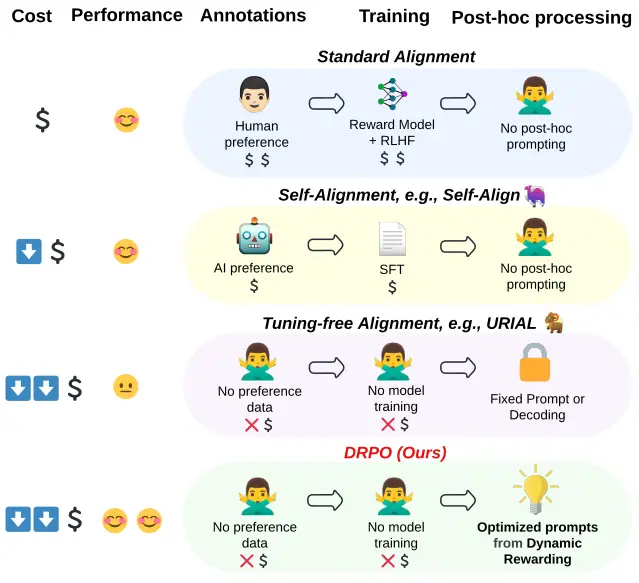
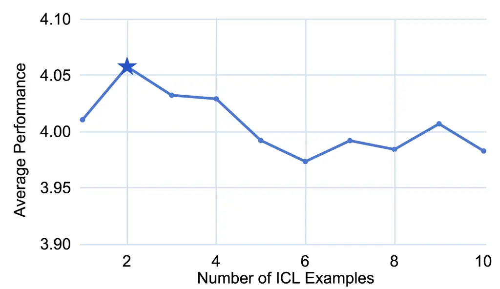
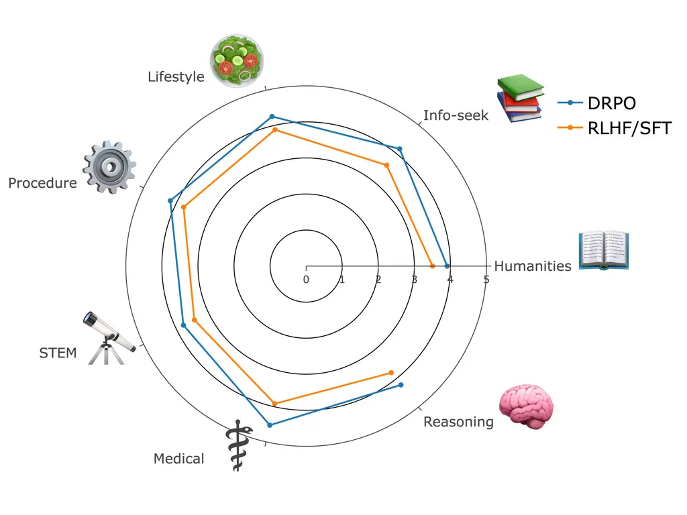
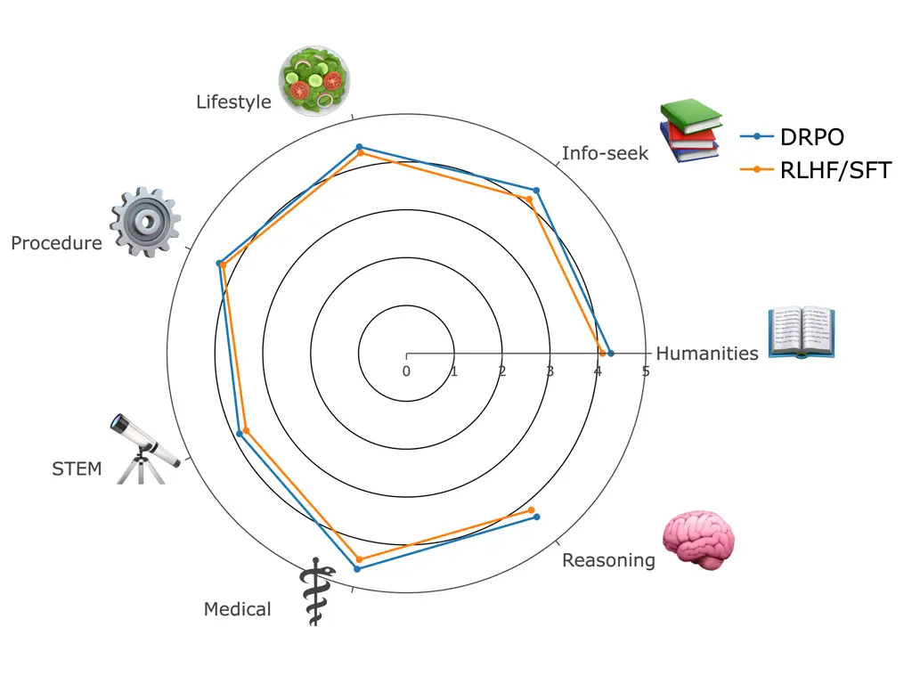
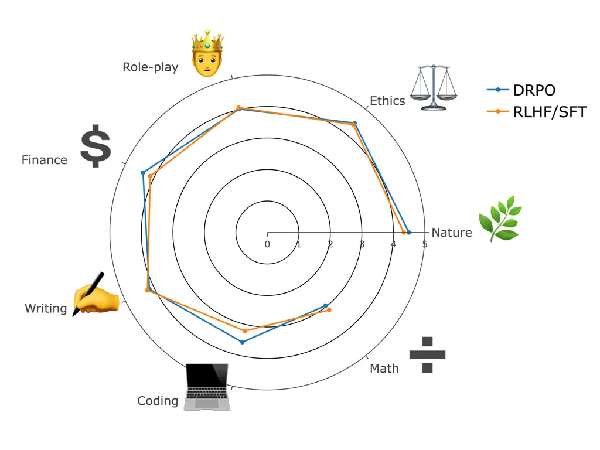
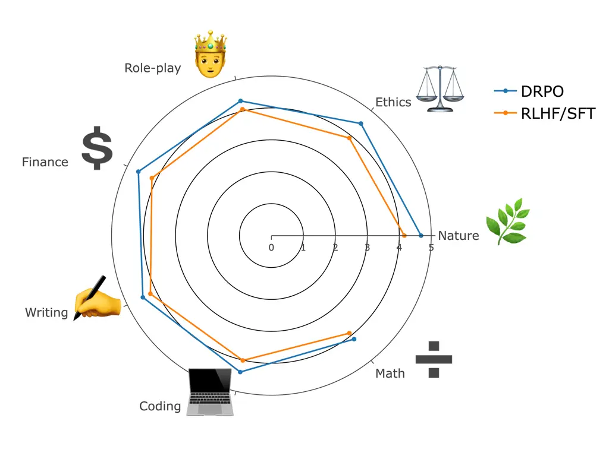

# Dynamic Rewarding with Prompt Optimization Enables Tuning-free Self-Alignment of Language Models

Somanshu Singla Zhen Wang Tianyang Liu ^(†)^(†)thanks: Equal
contribution Email: [ssingla@ucsd.edu](mailto:)    Abdullah Ashfaq
Zhiting Hu Eric P. Xing Email: [zhw085@ucsd.edu](mailto:)
Affiliation: UC San Diego MBZUAI CMU

###### Abstract

Aligning Large Language Models (LLMs) traditionally relies on costly
training and human preference annotations. Self-alignment seeks to
reduce these expenses by enabling models to align themselves. To further
lower costs and achieve alignment without any expensive tuning or
annotations, we introduce a new tuning-free approach for self-alignment,
Dynamic Rewarding with Prompt Optimization (DRPO). Our approach
leverages a search-based optimization framework that allows LLMs to
iteratively self-improve and craft the optimal alignment instructions,
all without additional training or human intervention. The core of DRPO
is a dynamic rewarding mechanism, which identifies and rectifies
model-specific alignment weaknesses, allowing LLMs to adapt efficiently
to diverse alignment challenges. Empirical evaluations on eight recent
LLMs, both open- and closed-sourced, demonstrate that DRPO significantly
enhances alignment performance, with base models outperforming their
SFT/RLHF-tuned counterparts. Moreover, the prompts automatically
optimized by DRPO surpass those curated by human experts, further
validating the effectiveness of our approach. Our findings highlight the
great potential of current LLMs to achieve adaptive self-alignment
through inference-time optimization, complementing tuning-based
alignment methods.¹¹ 1 Code available:
[https://github.com/Singla17/DRPO](https://github.com/Singla17/DRPO)

## 1 Introduction

Aligning Large Language Models (LLMs,  Brown et al. 2020; Chowdhery
et al. 2023; Touvron et al. 2023a; Achiam et al. 2023) with human
ethical standards and practical expectations is extremely crucial to
prevent unintended consequences and ensure AI’s positive contribution to
society. Traditional alignment methods, such as supervised fine-tuning
(SFT) and reinforcement learning from human feedback (RLHF) Bai et al.
(2022b); Ouyang et al. (2022), are resource-intensive and require
extensive human oversight, limiting their scalability and practicality.
As LLMs grow more complex and widely adopted, the demand for
cost-effective, annotation-efficient, and rapidly adaptable alignment
strategies becomes increasingly urgent.



Figure 1: Comparison of DRPO with other LLM alignment paradigms. DRPO
combines the benefits of self-alignment and tuning-free alignment,
enabling self-improvement and high cost-efficiency without requiring
human supervision or additional model training.

Self-alignment aims to improve LLM alignment by leveraging the models
themselves; for example, by replacing human feedback with
model-generated feedback Lee et al. (2023), synthesizing preference
data Kim et al. (2023); Sun et al. (2024), or self-critique Bai et al.
(2022b). Despite these advancements, such methods still demand
significant resources, including the costly and unstable RLHF tuning, as
well as some level of human supervision, such as carefully curated
alignment rules or in-context learning (ICL) prompts Sun et al. (2024).
On the other hand, as shown in Figure 1, a recent line of research
focuses on tuning-free alignment, which prioritizes extreme efficiency
without incurring any tuning cost. These approaches include techniques
like decoding-based alignment Li et al. (2023c); Wang et al. (2024b) or
ICL alignment Han (2023); Lin et al. (2024a); Zhao et al. (2024).
However, these tuning-free methods are often static (e.g., relying on
fixed prompts or reward functions) and thus lack the flexibility to
adapt and self-improve for better alignment.

To marry the strengths of both paradigms, in this paper, we propose
DRPO, Dynamic Rewarding with Prompt Optimization, a novel tuning-free
approach for LLM self-alignment. DRPO draws inspiration from two key
insights from recent alignment research. First, the superficial
alignment hypothesis Zhou et al. (2024) suggests that LLMs can be
effectively aligned through lightweight tuning or even simple
prompting Lin et al. (2024a); Zhao et al. (2024). Second, reward models
in RLHF often generalize poorly to out-of-distribution samples Burns
et al. (2023), whereas LLMs, known for their superior generalization
capabilities, can provide more effective rewards and feedback for
alignment purposes. Building on these insights, DRPO is constructed atop
a search-based prompt optimization (PO) framework Pryzant et al. (2023);
Hao et al. (2023); Wang et al. (2023), which enables LLMs to
self-correct and automatically craft detailed alignment instructions.
This steers model behavior more effectively, without relying on any use
of human preferences or model training.

The core novelty of DRPO lies in its dynamic rewarding mechanism,
integrated with the optimization framework. This mechanism allows
LLM-based rewards to be dynamically adjusted based on specific queries,
helping to identify and address the model’s alignment blind spots. For
example, if an LLM with outdated knowledge pretends to answer a question
requiring the latest news, its “knowledge limitation” reward will be
low, and the alignment prompt will be updated accordingly. We apply this
novel method to automatically craft both the system prompt and responses
in ICL examples, which have proven highly effective in improving
alignment.

We conducted comprehensive experiments on 8 recent LLMs using the
standard alignment benchmark, just-eval-instruct, composed of questions
from multiple alignment datasets. Our results show that DRPO can
effectively align both base and SFT/RLHF tuned models. Notably, DRPO
significantly enhances base models, enabling them to outperform their
SFT/RLHF-tuned counterparts. DRPO can further improve SFT/RLHF-tuned
models, highlighting its compatibility with other tuning-based alignment
techniques. Additionally, our automatically optimized prompts
substantially outperform those curated by human experts.

Figure 2: Comparison of DRPO with other alignment methods, including
RLHF and URIAL Lin et al. (2024a). DRPO consistently outperforms both
baselines across multiple LLMs. Note that we do not have access to
gpt-3.5-turbo base model; hence, both DRPO and URIAL are directly
applied to its RLHF-tuned version.

## 2 Related Work

Self-Alignment. Traditional alignment approaches rely heavily on
extensive human-annotated preference data and complex reward model
training through reinforcement learning, which poses significant
scalability and cost challenges Ouyang et al. (2022). Self-alignment
focuses on aligning LLMs themselves with model-generated feedback,
datasets, critique, etc., which are then used for fine-tuning or
training reward models Lee et al. (2023); Bai et al. (2022a); Cao et al.
(2024); Wang et al. (2024a); Guo et al. (2024). Notable examples include
synthesizing alignment training data with human-provided instructions
and ICL examples Wang et al. (2022); Kim et al. (2023); Sun et al.
(2024), augmented web documents Li et al. (2023a), or self-critique Bai
et al. (2022b); Madaan et al. (2024). However, most of these methods
still require an SFT/RLHF-tuning process to enhance alignment, along
with some degree of human annotations or supervision. In contrast, DRPO
shares similar self-alignment principles using self-critique error
feedback to gradually align the model, but it achieves this entirely
without any model tuning or human supervision.

Figure 3: Overall framework of Dynamic Rewarding with Prompt
Optimization (DRPO). The optimization problem is modeled as a Markov
Decision Process (MDP) and solved using beam search to optimize the
alignment prompt. Dynamic rewarding, a novel technique integrated into
this framework, allows flexible reward assignment to detect and address
alignment weaknesses in the current LLM, thereby enhancing the overall
optimization process.

Tuning-Free Alignment. A recent trend in alignment research is to align
LLMs without updating their parameters, typically as a post-training
process for LLMs. This has witnessed two major lines of work recently.
The first aligns models with carefully curated human annotations and ICL
examples Han (2023); Lin et al. (2024a); Zhao et al. (2024), while the
second involves decoding-based methods to guide token generation and
search with alignment rewards Li et al. (2023c); Khanov et al. (2024);
Huang et al. (2024). Although tuning-free, the first approach still
requires human curation and often underperforms compared to
SFT/RLHF-tuned counterparts. The second one, while effective, incurs
higher inference costs per query, making it computationally expensive.
It is worth mentioning that another recent promising direction is
cost-efficient alignment through representation engineering Zou et al.
(2023); Wu et al. (2024), which aims to steer LLM representation vectors
for alignment Li et al. (2024); Kong et al. (2024); Wang et al. (2024b).
However, these methods are not fully tuning-free and typically require
additional data or model training to identify alignment directions in
the embedding space. Nevertheless, DRPO requires no additional
annotations or model training, and also only needs a one-time
optimization per model to achieve better performance than SFT/RLHF-tuned
counterparts.

Prompt Optimization. Discovering optimal discrete prompts becomes far
more crucial nowadays. Modern prompts for LLMs can be generally divided
into two parts: in-context learning examples and detailed instructions.
The former is usually treated as a retrieval problem with various
schemas to select the influential examples Rubin et al. (2021); Dong
et al. (2022). Optimizing the latter has been heavily studied recently,
mostly formulated as a sampling or search problem. Generally, an initial
prompt (e.g., a base prompt, “You are a helpful assistant”) is given to
start an iterative process, where diverse prompt candidates are
generated per turn, and the best ones are kept for the next iteration.
Various sampling strategies are proposed to diversify the prompt
candidates, e.g., back translation Xu et al. (2022), evolutionary
operations Fernando et al. (2023), self-critique Wang et al. (2023).
Different search frameworks also have been studied, such as Monte Carlo
search Zhou et al. (2022), evolutionary algorithms Fernando et al.
(2023); Yang et al. (2023), beam search Pryzant et al. (2023), and Monte
Carlo tree search (MCTS) Wang et al. (2023). DRPO builds upon recent
search-based optimization methods but introduces novel techniques, such
as dynamic rewarding, to effectively address the alignment problem.

## 3 Methodology

In this section, we introduce our formulation formally and present DRPO
for solving the alignment problem by optimizing the alignment
instruction.

### 3.1 Problem Formulation

Given an LLM $`\mathcal{B}`$, an alignment instruction consists of two
parts: a system prompt $`\mathcal{P}`$ and a set of $`N`$ in-context
learning (ICL) examples $`\mathcal{I}`$. The system prompt
$`\mathcal{P}`$ serves as a prefix that provides high-level
instructions, sets the tone, and imposes constraints on the model’s
responses. Each ICL example $`\mathcal{I}_{i}`$ consists of a pair
$`(q_{i},d_{i})`$, where $`q_{i}`$ is an input query and $`d_{i}`$ is
the corresponding desired response, so we can represent
$`\mathcal{I}=\{(q_{1},d_{1}),(q_{2},d_{2}),\ldots,(q_{N},d_{N})\}`$.

Conditioning on the system prompt $`\mathcal{P}`$ and a selected subset
of $`K`$ ICL examples $`\mathcal{I}_{K}\subseteq\mathcal{I}`$, the
aligned model response $`y`$ to an input $`x`$ is generated as:

```math
y=\mathcal{B}(x\mid\mathcal{P},\mathcal{I}_{K})
```

DRPO aims to optimize both system prompt $`\mathcal{P}`$ and ICL
examples $`\mathcal{I}_{K}`$ to enhance alignment. This involves finding
the best possible $`\mathcal{P}^{*}`$ and $`\mathcal{I}_{K}^{*}`$ that
maximize the alignment of the model’s responses. This optimization
problem can be formulated as follows:

```math
(\mathcal{P}^{*},\mathcal{I}_{K}^{*})=\arg\max_{\mathcal{P},\mathcal{I}_{K}}\mathbb{E}_{x\sim\mathcal{D}_{x}}\left[\mathcal{B}(x\mid\mathcal{P},\mathcal{I}_{K})\right]
```

where $`\mathcal{D}_{x}`$ denotes the distribution of input queries, and
the expectation $`\mathbb{E}`$ represents the alignment performance for
responses based on specific metrics.

### 3.2 Dynamic Rewarding with Prompt Optimization (DRPO)

Given the distinct nature of the system prompt and ICL examples, we
propose to optimize them separately, resulting in a two-step
optimization approach. We first construct a universal set of ICL
examples and optimize their responses to obtain $`\mathcal{I}^{*}`$.
Next, we estimate a model-specific system prompt $`\mathcal{P}^{*}`$
based on the optimized universal set $`\mathcal{I}^{*}`$. Notably, we
leverage the LLM Reasoners²² 2
[https://github.com/maitrix-org/llm-reasoners](https://github.com/maitrix-org/llm-reasoners)
framework Hao et al. (2023); Hao et al. (2024) as the prompt
optimization (PO) framework. Specifically, LLM Reasoners incorporates a
base model $`\mathcal{B}`$, an optimizer $`\mathcal{O}`$, and an
evaluator $`\mathcal{E}`$. It operates as a search agent that
iteratively interacts with the model’s environment, using the optimizer
$`\mathcal{O}`$ to adjust the prompt $`\mathcal{P}`$ or ICL examples
$`\mathcal{I}`$ based on a reward function $`\mathcal{R}`$. For further
details, we refer readers to the original references. In the following,
we introduce the core component of DRPO.

#### 3.2.1 Dynamic Rewarding for Alignment

We formulate this optimization problem as a Markov Decision Process
(MDP). In this framework, the states $`s\in\mathcal{S}`$ represent our
optimization goal, which could be either a system prompt or an
in-context example. Actions $`a\in\mathcal{A}`$ are defined based on the
alignment feedback obtained during the evaluation of any given state.
The key motivation is to leverage the superior generalization
capabilities of LLMs to evaluate and analyze states, guiding state
transitions toward an optimal state. We employ different evaluation
techniques for system prompt and in-context example optimization, which
are detailed in subsequent sections. Efficient traversal of this state
space is crucial, and for this purpose, we adopt beam search due to its
effectiveness and low computational cost.

One of the key challenges in our optimization task is designing a reward
function capable of handling a problem as broad and generalized as
alignment. As illustrated in Figure 3, a single, unified reward function
is impractical due to the vast query space we aim to align with the base
LLM $`\mathcal{B}`$. Different queries emphasize different focal points,
meaning that certain evaluation criteria might be appropriate for some
queries but not for others. To overcome this, we introduce a dynamic
reward function $`\mathcal{R}`$, which can dynamically adapt to the
specific query being evaluated. Notably, our approach shares conceptual
similarities with a few recent alignment research, which also advocate
for adaptable and query-sensitive alignment strategies Bai et al.
(2022b); Sun et al. (2024). However, the key distinction lies in our
dynamic reward function’s ability to not only enable flexible evaluation
but also integrate seamlessly into a formally defined optimization
framework.

Specifically, we first predefined a set of reward criteria
$`\mathbb{R}`$, from which the model dynamically selects the most
relevant rewards, while also retaining the flexibility to propose new
ones when necessary. Formally, for a given query $`q`$, the dynamic
reward function $`\mathcal{R}`$ evaluates the model’s response
$`\sigma`$ based on a dynamically selected or proposed rewards
$`\mathbb{R}_{q}`$, where
$`\mathbb{R}_{q}\subseteq\mathbb{R}\cup\mathbb{R}^{*}`$ and
$`\mathbb{R}^{*}`$ represents newly proposed rewards. The reward
function is defined as:

```math
\mathcal{R}(\sigma\mid\mathbb{R}_{q})=\frac{1}{|\mathbb{R}_{q}|}\sum_{r\in\mathbb{R}_{q}}r(\sigma)
```

Here, $`\mathbb{R}_{q}`$ denotes relevant rewards tailored for the given
query $`q`$ and $`r(\sigma)`$ denotes the score of a specific reward
when evaluating any response $`\sigma`$.

This allows us to flexibly score and evaluate responses based on the
most relevant criteria for each specific query, ensuring that the
evaluation remains contextually appropriate and comprehensive.

#### 3.2.2 ICL Example Optimization

To optimize in-context learning examples, we start with a set of base
ICL examples
$`\mathcal{I}_{\text{base}}=\{(q_{1},b_{1}),(q_{2},b_{2}),\ldots,(q_{N},b_{N})\}`$,
where $`q_{i}`$ is a query and $`b_{i}`$ is a base response to the
query, $`N`$ is the total number of in-context examples. Our overall
goal is to find a universal set $`\mathcal{I}^{*}`$ that maximizes
alignment across various models.

We specifically optimize each ICL example $`(q_{i},b_{i})`$
individually. The initial state of the search tree for an ICL example is
defined as the base response to the query, i.e., $`s_{0}=b_{i}`$. At any
time $`t`$, the state of the search tree, $`s_{t}`$, is the response of
the example. This allows us to systematically monitor and evaluate the
response at any given time $`t`$. The state space $`\mathcal{S}`$
encompasses all possible responses to the query $`q_{i}`$.

To evaluate and improve the alignment, we use the dynamic reward
function $`\mathcal{R}`$. The relevant rewards $`\mathbb{R}_{q_{i}}`$
for the query $`q_{i}`$ are specifically selected or potentially
proposed new rewards. The reward function $`\mathcal{R}`$ and evaluator
$`\mathcal{E}`$ then evaluates the state $`s_{t}`$ based on these
rewards, providing a reward $`r_{t}`$ and alignment feedback $`a_{t}`$:

```math
\displaystyle r_{t}=\mathcal{R}(s_{t}\mid\mathbb{R}_{q_{i}})
```

```math
\displaystyle a_{t}=\mathcal{E}(s_{t}\mid\mathbb{R}_{q_{i}})
```

Note that, in practice, evaluation and reward generation are performed
simultaneously using one single prompt, so the evaluation can also be
considered dynamic. The transition function $`\mathcal{T}`$, implemented
by optimizer $`\mathcal{O}`$, then updates the state:

```math
s_{t+1}=\mathcal{T}(s_{t},a_{t})
```

The detailed pseudo-code for this optimization process is provided in
Algorithm 1 in Appendix C and the prompts used by our algorithm can be
found in Appendix E.

#### 3.2.3 System Prompt Optimization

The optimization process for the system prompt is similar to that of the
ICL example optimization. For the system prompt optimization, we use
$`K`$ optimized ICL examples
$`\mathcal{I}_{K}^{*}\subseteq\mathcal{I}^{*}`$, where the $`K`$ ICL
examples are chosen using similarity-based retrieval. We collect a set
of seed samples $`\mathcal{X}=\{x_{1},x_{2},\ldots,x_{N}\}`$, where
$`x_{i}`$ is a query that will be used to test the alignment of the base
model $`\mathcal{B}`$. The goal of this process is to find the optimal
prompt $`\mathcal{P}^{*}`$ (given that we already have access to
$`\mathcal{I}_{K}^{*}`$), such that alignment of LLM $`\mathcal{B}`$ is
maximized. This prompt is specific to the base model $`\mathcal{B}`$ and
will provide the model with actionable insights and guidance to improve
its alignment.

The optimization process begins by defining the initial state $`s_{0}`$
as the basic system prompt (e.g., “You are a helpful assistant.”). At
any time $`t`$, the state $`s_{t}`$ represents the current system
prompt, and the state space $`\mathcal{S}`$ includes all possible system
prompts for the given LLM $`\mathcal{B}`$.

For a given state $`s_{t}`$, we sample a query $`x_{t}`$ from the seed
samples $`\mathcal{X}`$. The relevant rewards $`\mathbb{R}_{x_{t}}`$ for
the query $`x_{t}`$ are specifically selected or potentially proposed
new rewards. The reward function $`\mathcal{R}`$ and the evaluator
$`\mathcal{E}`$ then evaluate the response generated by the model
$`\mathcal{B}`$ given the system prompt $`s_{t}`$ and the selected
in-context examples $`\mathcal{I}_{K}^{*}`$, providing a reward
$`r_{t}`$ and alignment feedback $`a_{t}`$:

```math
\displaystyle r_{t}=\mathcal{R}(\mathcal{B}(x_{t}\mid s_{t},\mathcal{I}_{K}^{*})\mid\mathbb{R}_{x_{t}})
```

```math
\displaystyle a_{t}=\mathcal{E}(\mathcal{B}(x_{t}\mid s_{t},\mathcal{I}_{K}^{*})\mid\mathbb{R}_{x_{t}})
```

The optimizer $`\mathcal{O}`$ as a transition function then updates the
state, $`s_{t+1}=\mathcal{T}(s_{t},a_{t})`$. The detailed pseudo-code
for this optimization process is provided in Algorithm 2 in Appendix C.

## 4 Experiments

### 4.1 Experimental Setup

|                              |        |       |         |       |         |      |        |      |
| ---------------------------- | ------ | ----- | ------- | ----- | ------- | ---- | ------ | ---- |
| \[Tuned\] Model              | Method | $`K`$ | Helpful | Clear | Factual | Deep | Engage | Avg. |
| \[✗\] Mistral 7b             | Base   | 0     | 2.20    | 2.51  | 2.29    | 1.69 | 1.80   | 2.10 |
| \[✗\] Mistral 7b             | URIAL  | 3     | 3.62    | 4.32  | 3.75    | 2.70 | 3.41   | 3.56 |
| \[✗\] Mistral 7b             | DRPO   | 2     | 4.23    | 4.56  | 3.97    | 3.68 | 3.84   | 4.06 |
| \[✓\] Mistral 7b (Instruct)  | Base   | 0     | 3.98    | 4.44  | 3.64    | 2.97 | 3.26   | 3.66 |
| \[✓\] Mistral 7b (Instruct)  | URIAL  | 3     | 3.94    | 4.51  | 3.69    | 2.99 | 3.75   | 3.78 |
| \[✓\] Mistral 7b (Instruct)  | DRPO   | 2     | 4.22    | 4.60  | 3.80    | 3.68 | 3.99   | 4.06 |
| \[✗\] Llama 2 70b^(q)        | Base   | 0     | 2.07    | 2.55  | 2.35    | 1.50 | 1.63   | 2.02 |
| \[✗\] Llama 2 70b^(q)        | URIAL  | 3     | 4.25    | 4.67  | 4.03    | 3.08 | 3.80   | 3.97 |
| \[✗\] Llama 2 70b^(q)        | DRPO   | 2     | 4.42    | 4.72  | 4.23    | 3.81 | 3.98   | 4.23 |
| \[✓\] Llama 2 70b^(q) (chat) | Base   | 0     | 4.36    | 4.71  | 3.95    | 3.56 | 3.76   | 4.07 |
| \[✓\] Llama 2 70b^(q) (chat) | URIAL  | 3     | 4.32    | 4.72  | 4.08    | 3.50 | 4.25   | 4.17 |
| \[✓\] Llama 2 70b^(q) (chat) | DRPO   | 2     | 4.46    | 4.75  | 4.10    | 4.11 | 4.37   | 4.36 |
| \[✗\] Llama 3 8b             | Base   | 0     | 1.82    | 2.27  | 2.20    | 1.38 | 1.48   | 1.83 |
| \[✗\] Llama 3 8b             | URIAL  | 3     | 3.94    | 4.51  | 3.69    | 2.99 | 3.75   | 3.78 |
| \[✗\] Llama 3 8b             | DRPO   | 2     | 4.02    | 4.40  | 3.84    | 3.50 | 3.65   | 3.88 |
| \[✓\] Llama 3 8b (Instruct)  | Base   | 0     | 4.43    | 4.72  | 3.98    | 3.45 | 3.76   | 4.07 |
| \[✓\] Llama 3 8b (Instruct)  | URIAL  | 3     | 4.48    | 4.81  | 4.19    | 3.55 | 4.27   | 4.26 |
| \[✓\] Llama 3 8b (Instruct)  | DRPO   | 2     | 4.54    | 4.81  | 4.16    | 4.08 | 4.40   | 4.40 |
| \[✓\] gpt-3.5-turbo          | Base   | 0     | 4.56    | 4.89  | 4.41    | 3.30 | 3.55   | 4.14 |
| \[✓\] gpt-3.5-turbo          | URIAL  | 3     | 4.30    | 4.77  | 4.41    | 3.44 | 4.11   | 4.21 |
| \[✓\] gpt-3.5-turbo          | DRPO   | 2     | 4.67    | 4.92  | 4.53    | 4.07 | 4.58   | 4.55 |
| \[✓\] gpt-4-0613             | Base   | 0     | 4.71    | 4.93  | 4.52    | 3.49 | 3.53   | 4.24 |

Table 1: Performance on just-eval-instruct benchmark. “Tuned” indicates
whether the model has been SFT/RLHF tuned. Models are evaluated across
multiple aspects: “Helpful” (Helpfulness), “Clear” (Clarity), “Factual”
(Factuality), “Deep” (Depth), and “Engage” (Engagement). The base method
indicates a basic alignment prompt. Our method consistently outperforms
baseline methods across multiple aspects and overall.

Evaluation Dataset. We use the standard alignment benchmark,
just-eval-instruct Lin et al. (2024a), which merges five popular
alignment datasets to provide a comprehensive and fine-grained
evaluation of LLM alignment. This benchmark consists of 1,000 examples:
the first 800 assess the models’ helpfulness, and the remaining 200
evaluate their harmlessness. The first 800 examples are evaluated based
on five fine-grained aspects: helpfulness, clarity, factuality, depth,
and engagement, while the remaining 200 are evaluated using the safety
aspect. We use GPT-4 Turbo (gpt-4-1106-preview), one of the latest GPT-4
models available during our experiments, to evaluate both types of
examples using the prompts specified in the original URIAL paper Lin
et al. (2024a). The scoring scale ranges from 1 to 5, indicating
“strongly disagree”, “disagree”, “neutral”, “agree”, and “strongly
agree”. Note that we employ a more recent version of GPT-4 compared to
URIAL, which enhances the strictness and accuracy of our evaluation
pipeline. Thus, we re-benchmark URIAL under our updated evaluation
setting for consistency across all results.

Seed Samples. When optimizing the system prompt with DRPO, we sample
from our seed dataset $`\mathcal{X}`$ to measure the alignment
performance of the system prompt at each time step. This seed dataset,
consisting of 180 examples, is built using data from AlpacaEval Li
et al. (2023b), LIMA Zhou et al. (2024), and HH-RLHF-redteam Ganguli
et al. (2022). More details about the construction of this dataset can
be found in Appendix A.

Models. We benchmark 6 open-source LLMs in our experiments: Mistral 7b
(v0.1), Mistral 7b (Instruct) Jiang et al. (2023), Llama 2 70$`b^{q}`$,
Llama 2 70$`b^{q}`$ (chat) (4-bit AWQ Lin et al. (2024b) quantized
models) Touvron et al. (2023b), Llama 3 8b, Llama 3 8b
(Instruct) AI@Meta (2024) and 2 closed-source models: OpenAI’s GPT-3.5
Turbo (gpt-3.5-turbo) and GPT-4 (gpt-4-0613). Models without the “chat”
or “instruct” tag are base models, i.e., not tuned by SFT/RLHF. For
evaluation, we use greedy decoding (temperature = 0) to ensure
reproducibility.

Baselines. We first apply DRPO to the base model, making the
SFT/RLHF-tuned counterparts without DRPO a natural baseline. For
instance, we compare Mistral 7B + DRPO and Mistral 7b (Instruct).
Additionally, we have two more baselines: (1) The base method, where a
basic prompt is applied without using ICL examples. (2) URIAL Lin et al.
(2024a), where we use the prompt and ICL examples proposed by authors.
We also provide extensive ablation baselines of our method, such as
changing the search algorithm from Beam search to Greedy Search or Monte
Carlo search and using “static rewarding” to understand the impact of
dynamic rewarding. Full details of these can be found in Appendix A.

Implementation details. We use GPT-4-turbo (gpt-4-0125-preview) as both
the optimizer $`\mathcal{O}`$, and evaluator $`\mathcal{E}`$ unless
specified otherwise. The initial set of in-context learning examples,
$`\mathcal{I}_{base}`$, contains 16 examples: 3 from URIAL Lin et al.
(2024a) and 13 generated using gpt-4-0125-preview. More details about
the design choice made for $`\mathcal{I}_{base}`$ can be found in
Appendix A. We employ sentence transformers Reimers and Gurevych (2019)
to retrieve K in-context learning examples from $`\mathcal{I}^{*}`$
given the query. We use $`D`$ as the beam depth, $`W`$ as the beam
width, and $`M`$ as the number of action samples per state (to grow the
tree for the next iteration). The exact hyper-parameters can be found in
Appendix A.

### 4.2 Results

Comparison with baselines. Table 1 presents the performance comparison
of DRPO with baselines. DRPO outperforms all baselines across both tuned
and un-tuned models. As shown in Figure 2 using DRPO on strong base
models such as Mistral 7b and LLama 2 70b^(q) can surpass even the
RLHF/SFT tuned models under base setting. It is noteworthy that DRPO
achieves superior performance compared to URIAL (Lin et al., 2024a),
despite using fewer in-context learning examples, highlighting the
quality of optimized alignment instruction by DRPO. Note that while
just-eval-instruct includes a safety metric, we are not reporting it
because, in our analysis, we found that the safety metric is saturated,
with all methods (RLHF/SFT, URIAL, and DRPO) achieving consistently high
scores. This saturation is a good sign, demonstrating that tuning-free
methods like DRPO can result in very safe models that adhere to human
values.

Categorized performance. Appendix B presents the performance of models
across various domains, e.g., “procedure”, “lifestyle”, “info-seek”,
“STEM”, etc. In this experiment, we apply DRPO to base models and
compare their performance across multiple human-relevant and
alignment-critical domains. DRPO demonstrates consistently strong
performance, surpassing RLHF/SFT-tuned models in most domains across all
baselines.

|                     |         |        |        |
| ------------------- | ------- | ------ | ------ |
| Model               | Mistral | Llama  | Base   |
|                     | Prompt  | Prompt | Prompt |
| Mistral 7b          | 4.06    | 4.03   | 4.04   |
| Llama 2 70$`b^{q}`$ | 4.19    | 4.23   | 4.17   |

Table 2: Effect of prompt transfer on base LLMs. The best performance is
achieved when using a prompt specifically optimized for the target base
LLM.

Prompt transfer. We also conduct experiments on prompt transfer, i.e.,
evaluating the performance of an alignment instruction optimized for one
LLM on a different LLM. Table 2 presents the results of transferring
various optimized prompts to Mistral 7b and Llama 2 70$`b^{q}`$. While
the best results are achieved with prompts specifically optimized for
the target model, transferring an optimized prompt can still lead to
significant alignment improvements. This is evident in the case of LLaMA
2 70B^(q), which benefits from the prompt optimized for Mistral 7B.

Ablation on system prompt and ICL examples. Table 3 shows the effect of
ablating system prompt and in-context learning examples from DRPO. Using
both system prompt and in-context learning examples gave the best
performance, underscoring the importance of both in alignment. It is
worth pointing out that performance degradation on the removal of
in-context learning examples was higher when compared to the removal of
the system prompt, hinting that in-context learning examples are
relatively important in alignment. Given this, our optimized in-context
learning examples are a valuable asset and will be released publicly to
facilitate further alignment research³³ 3
[https://github.com/Singla17/DRPO](https://github.com/Singla17/DRPO).

|                       |        |           |      |
| --------------------- | ------ | --------- | ---- |
| Model                 | System | ICL       | Avg. |
|                       | Prompt | ($`K=2`$) |      |
| Mistral 7b            | ✓      | ✓         | 4.06 |
| Mistral 7b (Instruct) | ✓      | ✓         | 4.06 |
| Llama 2 70$`b^{q}`$   | ✓      | ✓         | 4.23 |
| gpt-3.5-turbo         | ✓      | ✓         | 4.55 |
| Mistral 7b            | ✗      | ✓         | 4.04 |
| Mistral 7b (Instruct) | ✗      | ✓         | 4.04 |
| Llama 2 70$`b^{q}`$   | ✗      | ✓         | 4.17 |
| gpt-3.5-turbo         | ✗      | ✓         | 4.42 |
| Mistral 7b (Instruct) | ✓      | ✗         | 3.67 |
| Llama 2 70$`b^{q}`$   | ✓      | ✗         | 3.63 |
| gpt-3.5-turbo         | ✓      | ✗         | 4.34 |

Table 3: Ablation study on the impact of removing the optimized system
prompt and in-context learning (ICL) examples optimized using our
method. In the absence of the optimized system prompt, a basic system
prompt is provided. Our method consistently outperforms all ablation
variants across all models.

Ablation on search algorithms. Table 4 presents the effect of search
algorithms on prompt optimization. We have kept the state and action
definitions the same and have only changed the underlying search
algorithm. In this experiment, we ensured that MC and Beam sample the
same number of prompts, i.e., same cost, whereas greedy search has a
lower cost because the beam width is fixed at 1. More implementation
details can be found in Appendix A. DRPO with beam search gives the best
results, depicting the need for thoughtful search and efficient
optimization for optimal results.

|                       |        |      |
| --------------------- | ------ | ---- |
| Model                 | Search | Avg. |
| Mistral 7b (Instruct) | Beam   | 4.06 |
| Mistral 7b (Instruct) | MC     | 4.02 |
| Mistral 7b (Instruct) | Greedy | 4.02 |

Table 4: Ablation study on search methods. MC: Monte Carlo Search;
Greedy: greedy search; Beam: beam search. Our method outperforms all
other search algorithms tested in the ablation study.

|                       |         |         |      |
| --------------------- | ------- | ------- | ---- |
| Model                 | Dynamic | Dynamic | Avg. |
|                       | Reward  | Reward  |      |
|                       | Prompt  | ICL     |      |
| Mistral 7b (Instruct) | ✓       | ✓       | 4.06 |
| Mistral 7b (Instruct) | ✗       | ✓       | 4.02 |
| Mistral 7b (Instruct) | ✓       | ✗       | 3.86 |

Table 5: Ablation study on dynamic rewarding, examining its removal from
system prompt and ICL example optimization. Our method, utilizing
dynamic rewarding for both prompts and ICL examples, consistently
outperforms both ablation variants.

Ablation on dynamic rewarding. We performed ablations on the dynamic
rewarding mechanism. Table 5 depicts that DRPO, with its current setting
of using dynamic rewards for system prompt and ICL optimization, works
the best. The in-context examples and prompts without using Dynamic
rewarding are also optimized by ‘static rewarding’ for a fair
comparison, i.e., we ask the Optimizer to optimize all the rewards all
the time. More details can be found in Appendix A.

Effect of the number of in-context examples. Figure 4 visualizes the
effect of changing the number of in-context learning examples on
alignment performance. The choice of $`K=2`$ resulted in the best
overall performance for Mistral 7b, ensuring strong alignment at a lower
context length cost. Also, as observed in Figure 4, higher $`K`$ does
not necessarily improve performance, hinting that the quality of ICL
examples is more important. The importance of quality is also
highlighted in Table 1, where DRPO outperforms URIAL at a lower $`K`$.



Figure 4: Performance of Mistral 7b (Instruct) on varying the number of
ICL examples. Two examples give us the best performance with a lower
context length cost.

|                                                                                                                                                                                                                                         |
| --------------------------------------------------------------------------------------------------------------------------------------------------------------------------------------------------------------------------------------- |
| Optimized Alignment Prompt                                                                                                                                                                                                              |
| As a helpful and ethical assistant, your primary goal is to provide responses that are accurate, engaging, clear, and emotionally resonant across a wide range of queries.                                                              |
| - Strive to make complex topics understandable and emotionally engaging, communicating in a human-like and relatable manner. Organize your responses to enhance readability and emotional connection, avoiding overly technical jargon. |
| - Always acknowledge the limitations of your knowledge, especially when speculating about historical ’what-ifs’, future predictions, or interpreting emotions.                                                                          |
| - Aim for a balance between detailed, informative content and a conversational, engaging tone. Incorporate storytelling elements, examples, analogies, and direct questions to make information relatable.                              |
| - Avoid overwhelming the user with excessive information; structure your responses to be clear, well-organized, and mindful of the user’s cognitive load.                                                                               |

Table 6: Snippets from the system prompt optimized for gpt-3.5-turbo.
The optimized prompt clearly demonstrates improved alignment, addressing
potential weaknesses in the model.

Qualitative analysis of optimized prompts. We finally present
qualitative results to show DRPO’ ability to identify a model’s
alignment weaknesses and tailor system prompts to address them, as shown
in Table 6 for gpt-3.5-turbo. The color-coded text in the table
highlights specific weaknesses of gpt-3.5-turbo identified by DRPO,
along with actionable insights. Notably, it highlights knowledge
limitations of the model, tips to improve engagement and technical
verbiage. For a weaker model like Mistral 7b, DRPO identifies the
problem of repetitive tokens, which is absent in a strong model like
gpt-3.5-turbo. Complete optimized prompts for both models, along with
detailed annotations on the differences, can be found in Appendix D.

## 5 Conclusion

This paper introduced Dynamic Rewarding with Prompt Optimization (DRPO),
a tuning-free approach for self-aligning LLMs. DRPO integrates a novel
dynamic rewarding mechanism into a search-based prompt optimization
framework, enabling LLMs to self-improve model-specific alignment
weaknesses adaptively. Experiments on eight LLMs show that DRPO-enhanced
base models outperform SFT/RLHF-tuned counterparts, and its optimized
prompts surpass those by human experts. DRPO’s adaptability and
efficiency offer a promising path toward more personalized AI systems.

## Limitations

While DRPO demonstrates significant advancements in tuning-free
self-alignment of LLMs, there are a few potential limitations to
discuss.

Optimization cost. Tuning-free alignment does not come as a free lunch.
Ideally, optimizing the alignment prompt for each query would probably
be more effective, but its computational overhead is prohibitive. This
concern is similar to the decoding-based alignment, where
alignment-guided decoding needs to run per query. However, DRPO requires
only a one-time optimization for each LLM, allowing the optimized
alignment prompt to be stored in the LLM memory for future use,
significantly reducing the overhead. A detailed analysis of the cost of
DRPO can be found at A.5.

Computational overhead. Compared to SFT / RLHF-tuned models, the
increase of input context for the optimized and complex prompt in DRPO
induces a marginal computational overhead. With advancements in modern
LLMs, such as larger context windows, we believe this computational
overhead is manageable. Moreover, once an optimized prompt is available
with DRPO, prompt compression techniques can further reduce the prompt
length without sacrificing the performance, which future works can
explore.

Automatic rewarding. Another potential limitation we noticed is the
potential oversight of the internal rewarding process in DRPO, which is
fully automatic. For example, imprecise rewards might be assigned by
dynamic rewarding, leading to undesirable behaviors. We acknowledge this
potential issue and have manually reviewed the optimized prompt, finding
no severe issues associated with this automatic optimization process.
Future work should develop systematic methods to monitor and ensure the
accuracy of the reward assignments and the resulting model behaviors.

Self-correction ability of LLMs. The self-correction ability of LLMs may
also be a potential limitation. When optimizing the system prompt and
in-context examples, we rely on LLM-generated feedback, which may
occasionally be inaccurate. Upon analyzing feedback traces, we observed
that while some feedback was overly critical, it was predominantly
constructive. Importantly, the search process mitigates the impact of
such overly critical or incorrect feedback on the overall optimization
quality. Future work may explore additional guardrails to further ensure
the correctness and reliability of LLM-generated feedback throughout the
process.

Combination with fine-tuning. One may naturally wonder whether DRPO can
be used to synthesize alignment data and combined with fine-tuning
methods to further boost the alignment performance. The answer is yes;
however, as highlighted in the paper, one of DRPO’s unique advantages is
its adaptivity, allowing quick adaptation to a new set of reward or
user-specific requirements. We value such property and leave the
combination of DRPO with fine-tuning for future works.

Capacity assumptions of models. There are certain assumptions on the
models involved in DRPO. First of all, DRPO leverages a strong LLM,
specifically GPT-4, as the optimizer to maximize the performance of
dynamic rewarding and alignment feedback. Future research could explore
other optimizer models, including open-source options, to democratize
the application of DRPO. Additionally, DRPO imposes certain capacity
requirements on the base models. Given the complexity of our optimized
alignment prompt, smaller and less powerful LLMs, such as
LLaMA-7b Touvron et al. (2023a), may not experience dramatic
improvements through DRPO, although some enhancement is still possible.
Our assumption is that better pre-trained and instruction-following
models have greater potential to be augmented by DRPO. We leave such a
meaningful question to future research, studying the alignment potential
and threshold of LLMs.

Finally, future work may explore further enhancements to the dynamic
rewarding mechanism and broader applications of DRPO across different
domains and tasks.

## Acknowledgment

We thank the anonymous reviewers for their constructive comments and
suggestions. We are also grateful to Enze Ma for integrating DRPO into
LLM Reasoners and for the valuable discussions with members of MixLab.
This work was supported by the OpenAI Agentic AI Research Grant Program.
The views and conclusions expressed in this paper are those of the
authors and do not necessarily reflect the views of the funding
agencies.

## References

- Achiam et al. (2023) Josh Achiam, Steven Adler, Sandhini Agarwal, Lama
  Ahmad, Ilge Akkaya, Florencia Leoni Aleman, Diogo Almeida, Janko
  Altenschmidt, Sam Altman, Shyamal Anadkat, et al. 2023. Gpt-4
  technical report. _arXiv preprint arXiv:2303.08774_.
- AI@Meta (2024) AI@Meta. 2024. [Llama 3 model
  card](https://github.com/meta-llama/llama3/blob/main/MODEL_CARD.md).
- Bai et al. (2022a) Yuntao Bai, Andy Jones, Kamal Ndousse, Amanda
  Askell, Anna Chen, Nova DasSarma, Dawn Drain, Stanislav Fort, Deep
  Ganguli, Tom Henighan, et al. 2022a. Training a helpful and harmless
  assistant with reinforcement learning from human feedback. _arXiv
  preprint arXiv:2204.05862_.
- Bai et al. (2022b) Yuntao Bai, Saurav Kadavath, Sandipan Kundu, Amanda
  Askell, Jackson Kernion, Andy Jones, Anna Chen, Anna Goldie, Azalia
  Mirhoseini, Cameron McKinnon, et al. 2022b. Constitutional ai:
  Harmlessness from ai feedback. _arXiv preprint arXiv:2212.08073_.
- Brown et al. (2020) Tom Brown, Benjamin Mann, Nick Ryder, Melanie
  Subbiah, Jared D Kaplan, Prafulla Dhariwal, Arvind Neelakantan, Pranav
  Shyam, Girish Sastry, Amanda Askell, et al. 2020. Language models are
  few-shot learners. _Advances in neural information processing
  systems_, 33:1877–1901.
- Burns et al. (2023) Collin Burns, Pavel Izmailov, Jan Hendrik
  Kirchner, Bowen Baker, Leo Gao, Leopold Aschenbrenner, Yining Chen,
  Adrien Ecoffet, Manas Joglekar, Jan Leike, et al. 2023. Weak-to-strong
  generalization: Eliciting strong capabilities with weak supervision.
  _arXiv preprint arXiv:2312.09390_.
- Cao et al. (2024) Boxi Cao, Keming Lu, Xinyu Lu, Jiawei Chen, Mengjie
  Ren, Hao Xiang, Peilin Liu, Yaojie Lu, Ben He, Xianpei Han,
  et al. 2024. Towards scalable automated alignment of llms: A survey.
  _arXiv preprint arXiv:2406.01252_.
- Chowdhery et al. (2023) Aakanksha Chowdhery, Sharan Narang, Jacob
  Devlin, Maarten Bosma, Gaurav Mishra, Adam Roberts, Paul Barham,
  Hyung Won Chung, Charles Sutton, Sebastian Gehrmann, et al. 2023.
  Palm: Scaling language modeling with pathways. _Journal of Machine
  Learning Research_, 24(240):1–113.
- Dong et al. (2022) Qingxiu Dong, Lei Li, Damai Dai, Ce Zheng, Zhiyong
  Wu, Baobao Chang, Xu Sun, Jingjing Xu, and Zhifang Sui. 2022. A survey
  on in-context learning. _arXiv preprint arXiv:2301.00234_.
- Fernando et al. (2023) Chrisantha Fernando, Dylan Banarse, Henryk
  Michalewski, Simon Osindero, and Tim Rocktäschel. 2023. Promptbreeder:
  Self-referential self-improvement via prompt evolution. _arXiv
  preprint arXiv:2309.16797_.
- Ganguli et al. (2022) Deep Ganguli, Liane Lovitt, John Kernion, Amanda
  Askell, Yuntao Bai, Saurav Kadavath, Benjamin Mann, Ethan Perez,
  Nicholas Schiefer, Kamal Ndousse, Andy Jones, Sam Bowman, Anna Chen,
  Tom Conerly, Nova Dassarma, Dawn Drain, Nelson Elhage, Sheer El-Showk,
  Stanislav Fort, Zachary Dodds, Tom Henighan, Danny Hernandez, Tristan
  Hume, Josh Jacobson, Scott Johnston, Shauna Kravec, Catherine Olsson,
  Sam Ringer, Eli Tran-Johnson, Dario Amodei, Tom B. Brown, Nicholas
  Joseph, Sam McCandlish, Christopher Olah, Jared Kaplan, and Jack
  Clark. 2022. [Red teaming language models to reduce harms: Methods,
  scaling behaviors, and lessons
  learned](https://api.semanticscholar.org/CorpusID:252355458). _ArXiv_,
  abs/2209.07858.
- Guo et al. (2024) Hongyi Guo, Yuanshun Yao, Wei Shen, Jiaheng Wei,
  Xiaoying Zhang, Zhaoran Wang, and Yang Liu. 2024.
  Human-instruction-free llm self-alignment with limited samples. _arXiv
  preprint arXiv:2401.06785_.
- Han (2023) Xiaochuang Han. 2023. In-context alignment: Chat with
  vanilla language models before fine-tuning. _arXiv preprint
  arXiv:2308.04275_.
- Hao et al. (2024) Shibo Hao, Yi Gu, Haotian Luo, Tianyang Liu, Xiyan
  Shao, Xinyuan Wang, Shuhua Xie, Haodi Ma, Adithya Samavedhi, Qiyue
  Gao, Zhen Wang, and Zhiting Hu. 2024. [Llm reasoners: New evaluation,
  library, and analysis of step-by-step reasoning with large language
  models](https://arxiv.org/abs/2404.05221). _Preprint_,
  arXiv:2404.05221.
- Hao et al. (2023) Shibo Hao, Yi Gu, Haodi Ma, Joshua Hong, Zhen Wang,
  Daisy Wang, and Zhiting Hu. 2023. Reasoning with language model is
  planning with world model. In _Proceedings of the 2023 Conference on
  Empirical Methods in Natural Language Processing_, pages 8154–8173.
- Huang et al. (2024) James Y Huang, Sailik Sengupta, Daniele Bonadiman,
  Yi-an Lai, Arshit Gupta, Nikolaos Pappas, Saab Mansour, Katrin
  Kirchoff, and Dan Roth. 2024. Deal: Decoding-time alignment for large
  language models. _arXiv preprint arXiv:2402.06147_.
- Jiang et al. (2023) Albert Qiaochu Jiang, Alexandre Sablayrolles,
  Arthur Mensch, Chris Bamford, Devendra Singh Chaplot, Diego
  de Las Casas, Florian Bressand, Gianna Lengyel, Guillaume Lample,
  Lucile Saulnier, L’elio Renard Lavaud, Marie-Anne Lachaux, Pierre
  Stock, Teven Le Scao, Thibaut Lavril, Thomas Wang, Timothée Lacroix,
  and William El Sayed. 2023. [Mistral
  7b](https://api.semanticscholar.org/CorpusID:263830494). _ArXiv_,
  abs/2310.06825.
- Khanov et al. (2024) Maxim Khanov, Jirayu Burapacheep, and Yixuan
  Li. 2024. Args: Alignment as reward-guided search. _arXiv preprint
  arXiv:2402.01694_.
- Kim et al. (2023) Sungdong Kim, Sanghwan Bae, Jamin Shin, Soyoung
  Kang, Donghyun Kwak, Kang Min Yoo, and Minjoon Seo. 2023. Aligning
  large language models through synthetic feedback. _arXiv preprint
  arXiv:2305.13735_.
- Kong et al. (2024) Lingkai Kong, Haorui Wang, Wenhao Mu, Yuanqi Du,
  Yuchen Zhuang, Yifei Zhou, Yue Song, Rongzhi Zhang, Kai Wang, and Chao
  Zhang. 2024. Aligning large language models with representation
  editing: A control perspective. _arXiv preprint arXiv:2406.05954_.
- Lee et al. (2023) Harrison Lee, Samrat Phatale, Hassan Mansoor, Kellie
  Lu, Thomas Mesnard, Colton Bishop, Victor Carbune, and Abhinav
  Rastogi. 2023. Rlaif: Scaling reinforcement learning from human
  feedback with ai feedback. _arXiv preprint arXiv:2309.00267_.
- Li et al. (2024) Kenneth Li, Oam Patel, Fernanda Viégas, Hanspeter
  Pfister, and Martin Wattenberg. 2024. Inference-time intervention:
  Eliciting truthful answers from a language model. _Advances in Neural
  Information Processing Systems_, 36.
- Li et al. (2023a) Xian Li, Ping Yu, Chunting Zhou, Timo Schick, Luke
  Zettlemoyer, Omer Levy, Jason Weston, and Mike Lewis. 2023a.
  Self-alignment with instruction backtranslation. _arXiv preprint
  arXiv:2308.06259_.
- Li et al. (2023b) Xuechen Li, Tianyi Zhang, Yann Dubois, Rohan Taori,
  Ishaan Gulrajani, Carlos Guestrin, Percy Liang, and Tatsunori B.
  Hashimoto. 2023b. Alpacaeval: An automatic evaluator of
  instruction-following models.
  [https://github.com/tatsu-lab/alpaca_eval](https://github.com/tatsu-lab/alpaca_eval).
- Li et al. (2023c) Yuhui Li, Fangyun Wei, Jinjing Zhao, Chao Zhang, and
  Hongyang Zhang. 2023c. Rain: Your language models can align themselves
  without finetuning. _arXiv preprint arXiv:2309.07124_.
- Lin et al. (2024a) Bill Yuchen Lin, Abhilasha Ravichander, Ximing Lu,
  Nouha Dziri, Melanie Sclar, Khyathi Chandu, Chandra Bhagavatula, and
  Yejin Choi. 2024a. [The unlocking spell on base llms: Rethinking
  alignment via in-context learning](https://arxiv.org/abs/2312.01552).
  In _International Conference on Learning Representations_.
- Lin et al. (2024b) Ji Lin, Jiaming Tang, Haotian Tang, Shang Yang,
  Wei-Ming Chen, Wei-Chen Wang, Guangxuan Xiao, Xingyu Dang, Chuang Gan,
  and Song Han. 2024b. Awq: Activation-aware weight quantization for llm
  compression and acceleration. In _MLSys_.
- Madaan et al. (2024) Aman Madaan, Niket Tandon, Prakhar Gupta, Skyler
  Hallinan, Luyu Gao, Sarah Wiegreffe, Uri Alon, Nouha Dziri, Shrimai
  Prabhumoye, Yiming Yang, et al. 2024. Self-refine: Iterative
  refinement with self-feedback. _Advances in Neural Information
  Processing Systems_, 36.
- Ouyang et al. (2022) Long Ouyang, Jeff Wu, Xu Jiang, Diogo Almeida,
  Carroll L. Wainwright, Pamela Mishkin, Chong Zhang, Sandhini Agarwal,
  Katarina Slama, Alex Ray, John Schulman, Jacob Hilton, Fraser Kelton,
  Luke Miller, Maddie Simens, Amanda Askell, Peter Welinder, Paul
  Christiano, Jan Leike, and Ryan Lowe. 2022. [Training language models
  to follow instructions with human
  feedback](https://arxiv.org/abs/2203.02155). _Preprint_,
  arXiv:2203.02155.
- Pryzant et al. (2023) Reid Pryzant, Dan Iter, Jerry Li, Yin Tat Lee,
  Chenguang Zhu, and Michael Zeng. 2023. Automatic prompt optimization
  with" gradient descent" and beam search. _arXiv preprint
  arXiv:2305.03495_.
- Reimers and Gurevych (2019) Nils Reimers and Iryna Gurevych. 2019.
  [Sentence-bert: Sentence embeddings using siamese
  bert-networks](https://arxiv.org/abs/1908.10084). In _Proceedings of
  the 2019 Conference on Empirical Methods in Natural Language
  Processing_. Association for Computational Linguistics.
- Rubin et al. (2021) Ohad Rubin, Jonathan Herzig, and Jonathan
  Berant. 2021. Learning to retrieve prompts for in-context learning.
  _arXiv preprint arXiv:2112.08633_.
- Sun et al. (2024) Zhiqing Sun, Yikang Shen, Qinhong Zhou, Hongxin
  Zhang, Zhenfang Chen, David Cox, Yiming Yang, and Chuang Gan. 2024.
  Principle-driven self-alignment of language models from scratch with
  minimal human supervision. _Advances in Neural Information Processing
  Systems_, 36.
- Touvron et al. (2023a) Hugo Touvron, Thibaut Lavril, Gautier Izacard,
  Xavier Martinet, Marie-Anne Lachaux, Timothée Lacroix, Baptiste
  Rozière, Naman Goyal, Eric Hambro, Faisal Azhar, et al. 2023a. Llama:
  Open and efficient foundation language models. _arXiv preprint
  arXiv:2302.13971_.
- Touvron et al. (2023b) Hugo Touvron, Louis Martin, Kevin R. Stone,
  Peter Albert, Amjad Almahairi, Yasmine Babaei, Nikolay Bashlykov,
  Soumya Batra, Prajjwal Bhargava, Shruti Bhosale, Daniel M. Bikel,
  Lukas Blecher, Cristian Cantón Ferrer, Moya Chen, Guillem Cucurull,
  David Esiobu, Jude Fernandes, Jeremy Fu, Wenyin Fu, Brian Fuller,
  Cynthia Gao, Vedanuj Goswami, Naman Goyal, Anthony S. Hartshorn,
  Saghar Hosseini, Rui Hou, Hakan Inan, Marcin Kardas, Viktor Kerkez,
  Madian Khabsa, Isabel M. Kloumann, A. V. Korenev, Punit Singh Koura,
  Marie-Anne Lachaux, Thibaut Lavril, Jenya Lee, Diana Liskovich,
  Yinghai Lu, Yuning Mao, Xavier Martinet, Todor Mihaylov, Pushkar
  Mishra, Igor Molybog, Yixin Nie, Andrew Poulton, Jeremy Reizenstein,
  Rashi Rungta, Kalyan Saladi, Alan Schelten, Ruan Silva, Eric Michael
  Smith, R. Subramanian, Xia Tan, Binh Tang, Ross Taylor, Adina
  Williams, Jian Xiang Kuan, Puxin Xu, Zhengxu Yan, Iliyan Zarov, Yuchen
  Zhang, Angela Fan, Melanie Kambadur, Sharan Narang, Aurelien
  Rodriguez, Robert Stojnic, Sergey Edunov, and Thomas Scialom. 2023b.
  [Llama 2: Open foundation and fine-tuned chat
  models](https://api.semanticscholar.org/CorpusID:259950998). _ArXiv_,
  abs/2307.09288.
- Wang et al. (2024a) Haoyu Wang, Guozheng Ma, Ziqiao Meng, Zeyu Qin,
  Li Shen, Zhong Zhang, Bingzhe Wu, Liu Liu, Yatao Bian, Tingyang Xu,
  et al. 2024a. Step-on-feet tuning: Scaling self-alignment of llms via
  bootstrapping. _arXiv preprint arXiv:2402.07610_.
- Wang et al. (2024b) Pengyu Wang, Dong Zhang, Linyang Li, Chenkun Tan,
  Xinghao Wang, Ke Ren, Botian Jiang, and Xipeng Qiu. 2024b.
  Inferaligner: Inference-time alignment for harmlessness through
  cross-model guidance. _arXiv preprint arXiv:2401.11206_.
- Wang et al. (2023) Xinyuan Wang, Chenxi Li, Zhen Wang, Fan Bai,
  Haotian Luo, Jiayou Zhang, Nebojsa Jojic, Eric Xing, and Zhiting
  Hu. 2023. Promptagent: Strategic planning with language models enables
  expert-level prompt optimization. In _The Twelfth International
  Conference on Learning Representations_.
- Wang et al. (2022) Yizhong Wang, Yeganeh Kordi, Swaroop Mishra, Alisa
  Liu, Noah A Smith, Daniel Khashabi, and Hannaneh Hajishirzi. 2022.
  Self-instruct: Aligning language models with self-generated
  instructions. _arXiv preprint arXiv:2212.10560_.
- Wu et al. (2024) Zhengxuan Wu, Aryaman Arora, Zheng Wang, Atticus
  Geiger, Dan Jurafsky, Christopher D Manning, and Christopher
  Potts. 2024. Reft: Representation finetuning for language models.
  _arXiv preprint arXiv:2404.03592_.
- Xu et al. (2022) Hanwei Xu, Yujun Chen, Yulun Du, Nan Shao, Yanggang
  Wang, Haiyu Li, and Zhilin Yang. 2022. Gps: Genetic prompt search for
  efficient few-shot learning. _arXiv preprint arXiv:2210.17041_.
- Yang et al. (2023) Chengrun Yang, Xuezhi Wang, Yifeng Lu, Hanxiao Liu,
  Quoc V Le, Denny Zhou, and Xinyun Chen. 2023. Large language models as
  optimizers. _arXiv preprint arXiv:2309.03409_.
- Zhao et al. (2024) Hao Zhao, Maksym Andriushchenko, Francesco Croce,
  and Nicolas Flammarion. 2024. Is in-context learning sufficient for
  instruction following in llms? _arXiv preprint arXiv:2405.19874_.
- Zhou et al. (2024) Chunting Zhou, Pengfei Liu, Puxin Xu, Srinivasan
  Iyer, Jiao Sun, Yuning Mao, Xuezhe Ma, Avia Efrat, Ping Yu, Lili Yu,
  et al. 2024. Lima: Less is more for alignment. _Advances in Neural
  Information Processing Systems_, 36.
- Zhou et al. (2022) Yongchao Zhou, Andrei Ioan Muresanu, Ziwen Han,
  Keiran Paster, Silviu Pitis, Harris Chan, and Jimmy Ba. 2022. Large
  language models are human-level prompt engineers. _arXiv preprint
  arXiv:2211.01910_.
- Zou et al. (2023) Andy Zou, Long Phan, Sarah Chen, James Campbell,
  Phillip Guo, Richard Ren, Alexander Pan, Xuwang Yin, Mantas Mazeika,
  Ann-Kathrin Dombrowski, et al. 2023. Representation engineering: A
  top-down approach to ai transparency. _arXiv preprint
  arXiv:2310.01405_.

## Appendix A More Implementation Details

### A.1 Hyper-parameters for DRPO

|                            |       |       |       |
| -------------------------- | ----- | ----- | ----- |
| Experiment                 | $`W`$ | $`M`$ | $`D`$ |
| ICL optimization           | 1     | 1     | 5     |
| System Prompt optimization | 2     | 3     | 20    |

Table 7: All the hyper-parameters used by DRPO during ICL optimization
and system prompt optimization.

### A.2 Baselines

Monte Carlo Search: Monte Carlo search performs directionless 1-step
sampling multiple times. The sampling method was kept the same as DRPO;
we sampled 120 prompts in this method to keep the cost the same as DRPO
and ensure a fair comparison.

Greedy Search: Greedy search is the special case of beam search with
beam width $`W`$ fixed as 1, the sampling method, number of action
samples per state $`M`$ was kept the same as DRPO but still as the beam
width has decreased in this method the overall cost is lower.

Static Rewarding: In this method, we keep the search algorithm the same
as DRPO. Instead of choosing dynamic aspects, we always provide a fixed
set of aspects to the optimizer and evaluator. The fixed set of aspects
was chosen as helpfulness, clarity, factuality, depth, engagement, and
safety i.e. the evaluation aspects. This allowed the static rewarding
method to perform the best on evaluation metrics and establish a strong
baseline. Note that we keep the number of in-context learning examples
as 2 while evaluating this baseline.

### A.3 Seed Samples

Out of the 180 samples in the sampled dataset, $`47.8\%`$ of samples
comes from AlpacaEval, $`28.9\%`$ from LIMA, and the rest from
HH-RLHF-redteam. We ensure a fair evaluation by only sampling examples
that are not present in the evaluation dataset.

### A.4 Base ICL Examples

Examples in $`\mathcal{I}_{base}`$ are classified into two groups:
“unethical”, which teaches the model to handle malicious queries, and
“informative”, which teaches the model to present relevant information
in an acceptable format. $`\mathcal{I}_{base}`$, contains an equal
number of “unethical” queries and “informative” queries.

### A.5 Cost Analysis of DRPO

System Prompt Optimization. Our optimization process leverages a beam
search strategy, with the number of sampled prompts being determined by
the parameters $`W`$ (beam width), $`M`$ (number of action samples per
state), and $`D`$ (beam depth). Specifically, these parameters result
in:

1.  1.  $`W\times M\times D`$ API calls to the optimizer LLM $`\mathcal{O}`$
        for prompt sampling.
2.  2.  $`D`$ API calls to LLM for reward selection of seed samples.
3.  3.  $`W\times M\times D`$ calls to base LLM $`\mathcal{B}`$ for response
        generation corresponding to each of the sampled prompts.
4.  4.  $`W\times M\times D`$ API calls to the evaluator LLM $`\mathcal{E}`$
        for sampled prompt evaluation using seed samples.

Thus, the overall cost ($`C_{\text{system}}`$), including both API calls
and base LLM inferences, for system prompt optimization can be expressed
as:

```math
\displaystyle C_{\text{system}}= \displaystyle\underbrace{W\times M\times D}_{\text{prompt sampling}}+\underbrace{D}_{\text{reward selection}}+
```

```math
\displaystyle\underbrace{W\times M\times D}_{\text{response generation}}+\underbrace{W\times M\times D}_{\text{prompt evaluation}}
```

Notably, the reward selection cost is incurred only once, as these
results are cached and reused across all models. Moreover, the system
prompt optimization is also a one-time process for each model; once
optimized, the prompts can be reused without incurring additional costs.
This approach ensures that the incurred cost is limited and does not
scale with the number of subsequent uses.

ICL Optimization. Similar to System prompt optimization we can also use
beam search for ICL optimization. The cost for optimizing one ICL
example is as follows:

1.  1.  A single API call to LLM for reward selection of the example.
2.  2.  $`W\times M\times D`$ API calls to the evaluator LLM to evaluate the
        ICL example. (amounting to 5 given the hyperparameters)
3.  3.  $`W\times M\times D`$ API calls to the optimizer LLM, for optimizing
        the ICL example.

Thus, the total cost ($`C_{\text{ICL}}`$) for ICL optimization can be
expressed as:

```math
\displaystyle C_{\text{ICL}}=\quad \displaystyle(\underbrace{1}_{\text{reward selection}}+\underbrace{W\times M\times D}_{\text{evaluation}}+
```

```math
\displaystyle\underbrace{W\times M\times D}_{\text{eptimization}})\times N
```

where $`N`$ denotes the number of examples we want to optimize.

ICL examples are model-agnostic and can be reused across different
models, thus making the optimization cost a one-time expense per
example.

## Appendix B Categorized Performance

### B.1 Mistral 7b




Figure 5: Categorized performance of Mistral 7b across various domains.
Using DRPO we see a strong improvement in performance across all
domains. Notably, we can see that domains like Humanities, Reasoning,
STEM improves significantly. This highlights the fact that base models
can benefit a great deal from DRPO.

### B.2 Llama 2 70b





Figure 6: Categorized performance of Llama 2 70$`b^{q}`$ across various
domains. Using DRPO we see an improvement in performance across all
domains barring math where we see a small drop. The performance using
DRPO strongly improves domains such as Info-seek, Coding, and Finance.

### B.3 gpt-3.5-turbo




Figure 7: Categorized performance of gpt-3.5-turbo across various
domains. The results for gpt-3.5-turbo are promising because using DRPO,
the performance has improved across all domains.  
Note: DRPO method has been applied to RLHF-tuned gpt-3.5-turbo as we
don’t have access to the base model.

## Appendix C Optimization Algorithms

### C.1 ICL optimization

Input: $`\mathcal{I}_{base}`$, $`N`$, $`\mathcal{O}`$, $`\mathcal{E}`$,
$`\mathcal{R}`$, $`D`$, $`W`$, $`M`$, $`\mathcal{T}`$

Output: $`\mathcal{I}^{*}`$

Definitions

   $`\mathcal{I}_{base}`$: base ICL examples;

   $`N`$: number of ICL examples;

   $`\mathcal{O}`$: optimizer;

   $`\mathcal{E}`$: evaluator;

   $`\mathcal{R}`$: reward function;

   $`D`$: beam depth;

   $`W`$: beam width;

   $`M`$: number of action samples per state;

   $`\mathcal{T}:\mathcal{S}\times\mathcal{A}\rightarrow\mathcal{S}`$:
transition function

for _i $`=1`$ to $`N`$_ do

   $`(q_{i},b_{i})`$ $`=\mathcal{I}_{\text{base}}[i]`$;

   $`s_{0}=b_{i}`$ ; // Initialize state

   Initialize beam with $`s_{0}`$;

   for _t $`=1`$ to $`D`$_ do

      next_beam = \[\];

      for _j $`=1`$ to min(len(beam), $`W`$)_ do

         $`s_{{t-1}_{j}}`$ = beam\[j\];

         $`r_{{t-1}_{j}}=\mathcal{R}(s_{{t-1}_{j}}\mid\mathbb{R}_{q_{i}})`$;

         Repeat (sample) $`M`$ times:

            $`a_{{t-1}_{j}}=\mathcal{E}(s_{{t-1}_{j}}\mid\mathbb{R}_{q_{i}})`$;

            $`s_{t_{j}}=\mathcal{T}(s_{{t-1}_{j}},a_{{t-1}_{j}})`$;

            Add $`s_{t_{j}}`$ to next_beam;

      beam = top $`W`$ states from next_beam;

   $`s^{*}_{\mathcal{D}}`$ = final state of the top beam;

   $`\mathcal{I}^{*}[i]=(q_{i},s^{*}_{\mathcal{D}})`$;

return $`\mathcal{I}^{*}`$

Algorithm 1 ICL Optimization

### C.2 System Prompt Optimization

Input: $`\mathcal{I}^{*}`$, $`\mathcal{B}`$, $`\mathcal{O}`$,
$`\mathcal{E}`$, $`\mathcal{R}`$, $`\mathcal{X}`$. $`\mathcal{P}`$,
$`D`$, $`W`$, $`M`$, $`\mathcal{T}`$

Output: $`\mathcal{P}^{*}`$

Definitions

   $`\mathcal{I}^{*}`$: optimized ICL examples;

   $`\mathcal{B}`$: base LLM;

   $`\mathcal{O}`$: optimizer model;

   $`\mathcal{E}`$: evaluator model;

   $`\mathcal{R}`$: reward function;

   $`\mathcal{X}`$: seed dataset;

   $`\mathcal{P}`$: initial system prompt;

   $`D`$: beam depth;

   $`W`$: beam width;

   $`M`$: number of action samples per state;

   $`\mathcal{T}:\mathcal{S}\times\mathcal{A}\rightarrow\mathcal{S}`$:
transition function

$`s_{0}=\mathcal{P}`$ ; // Initialize state

Initialize beam with $`s_{0}`$;

for _t $`=1`$ to $`D`$_ do

   $`x_{t-1}=\mathcal{X}`$\[$`t-1`$\];

   $`\mathcal{I}_{K}^{*}`$ = $`K`$ examples most similar to $`x_{t-1}`$
from $`\mathcal{I}^{*}`$; // example selection

   next_beam = \[\];

   for _j $`=1`$ to min(len(beam), $`W`$)_ do

      $`s_{{t-1}_{j}}`$ = beam\[j\];

      $`r_{{t-1}_{j}}=\mathcal{R}(\mathcal{B}(x_{t-1}\mid s_{{t-1}_{j}},\mathcal{I}_{K}^{*})\mid\mathbb{R}_{x_{t-1}})`$;

      Repeat (sample) $`M`$ times:

         $`a_{{t-1}_{j}}=\mathcal{E}(\mathcal{B}(x_{t-1}\mid s_{{t-1}_{j}},\mathcal{I}_{K}^{*})\mid\mathbb{R}_{x_{t-1}})`$;

         $`s_{t_{j}}=\mathcal{T}(s_{{t-1}_{j}},a_{{t-1}_{j}})`$;

         Add $`s_{t_{j}}`$ to next_beam;

   beam = top $`W`$ states from next_beam;

$`s^{*}_{\mathcal{D}}`$ = final state of top beam;

$`\mathcal{P}^{*}=s^{*}_{\mathcal{D}}`$;

return $`\mathcal{P}^{*}`$

Algorithm 2 System Prompt Optimization

## Appendix D Optimized Prompt Case Study

|               |                                                                                                                                                                                                                                                                                                                                                                                                                                                                                                                                                                                                                                                                                                                                                                                                                                                                                                                                                                                                                                                                                                                                                                                                                                                                                                                                                                                                                                                                                                                                                                                                                                                                                                                                                                                                                                                                                                                                  |
| ------------- | -------------------------------------------------------------------------------------------------------------------------------------------------------------------------------------------------------------------------------------------------------------------------------------------------------------------------------------------------------------------------------------------------------------------------------------------------------------------------------------------------------------------------------------------------------------------------------------------------------------------------------------------------------------------------------------------------------------------------------------------------------------------------------------------------------------------------------------------------------------------------------------------------------------------------------------------------------------------------------------------------------------------------------------------------------------------------------------------------------------------------------------------------------------------------------------------------------------------------------------------------------------------------------------------------------------------------------------------------------------------------------------------------------------------------------------------------------------------------------------------------------------------------------------------------------------------------------------------------------------------------------------------------------------------------------------------------------------------------------------------------------------------------------------------------------------------------------------------------------------------------------------------------------------------------------- |
| Model         | Optimized Prompt                                                                                                                                                                                                                                                                                                                                                                                                                                                                                                                                                                                                                                                                                                                                                                                                                                                                                                                                                                                                                                                                                                                                                                                                                                                                                                                                                                                                                                                                                                                                                                                                                                                                                                                                                                                                                                                                                                                 |
| Mistral 7b    | As a helpful and ethical assistant, your mission is to provide responses that are not only accurate and safe but also deeply engaging, empathetic, and rich in content. Your role is to thoroughly understand the context of each query, offering insights that demonstrate a comprehensive grasp of the subject matter while being mindful of ethical considerations. Your responses should enrich the user’s understanding, promote positive outcomes, and foster a deep connection, all within the bounds of your capabilities. It’s crucial to directly address the user’s query, providing concise yet comprehensive information,and to be transparent about your limitations.Enhance the user experience by making your responses as engaging, creative, and human-like as possible. - You do not have access to the internet or real-time data, and you are unable to take physical actions. Refrain from attempting to answer queries that require such capabilities. - Avoid engaging with queries that could promote illegal activities, harm to others, or unethical behavior. Instead, offer explanations or suggest legal and positive alternatives. - Strive for creativity by using vivid language, incorporating storytelling elements, and providing relatable examples that resonate with the user. - Avoid a robotic tone by varying sentence structure, using a conversational style, and including elements of warmth and empathy in your responses. - Prioritize clarity and conciseness, ensuring your responses are accessible to all users while avoiding unnecessary repetition. - Encourage critical thinking by presenting multiple viewpoints or considerations, inviting users to explore the topic further. - Be transparent about the speculative nature of certain responses and your limitations, suggesting areas for further inquiry or related topics that might offer additional insights. |
| gpt-3.5-turbo | As a helpful and ethical assistant, your primary goal is to provide responses that are accurate, engaging, clear, and emotionally resonant across a wide range of queries. Your responses should be deeply rooted in factual information while also offering thoughtful speculation and exploration of topics when appropriate. It’s essential to delve into authorial intent, historical contexts, and cultural significance to add depth and foster critical thinking.Strive to make complex topics understandable and emotionally engaging, communicating in a human-like and relatable manner. Organize your responses to enhance readability and emotional connection, avoiding overly technical jargon. When faced with limitations or requests for harmful information, prioritize safety, legality, and ethical considerations. Always acknowledge the limitations of your knowledge, especially when speculating about historical ’what-ifs’, future predictions, or interpreting emotions. Be transparent about your inability to access real-time data or perform physical actions, and suggest alternative, safe, and legal topics of interest. Aim for a balance between detailed, informative content and a conversational, engaging tone. Incorporate storytelling elements, examples, analogies, and direct questions to make information relatable. Avoid overwhelming the user with excessive information; structure your responses to be clear, well-organized, and mindful of the user’s cognitive load.                                                                                                                                                                                                                                                                                                                                                                                                     |

Table 8: Comparison of the optimized prompts by DRPO for Mistral 7b and
gpt-3.5-turbo. DRPO customizes the prompt to identify and fix alignment
weaknesses specific to any model. (The semantics for color labels can be
found below.)

We highlight different aspects of the optimized prompts with colors,
including Limitations such as no access to real-time data, Guidance to
avoid repetition tailored for a small model like Mistral 7b, Guidance to
avoid jargon tailored for a large model like gpt-3.5-turbo, Ethical
guidance, General guidelines for an AI assistant, Tips to enhance
engagement of responses.

## Appendix E Meta Prompts

### E.1 Rewarding Prompt

In this section, we present the prompt used to compute the overall
reward. The reward prompt uses components like eval$`\_`$dict and reward
selection prompt. We first use the reward selection prompt as shown in
section E.1.2 to select the appropriate rewards, then an eval$`\_`$dict
with the format as shown in section E.1.1 is created for the selected
rewards. Finally, with the list of rewards and eval$`\_`$dict, we use
the reward prompt as shown below to compute dynamic rewards.

Please act as an impartial

judge and evaluate the quality

of the responses provided.

You will rate the quality

of the output based on

several selected aspects.

\## Query:

\[QUERY\]

\## Output:

\[OUTPUT\]

\## Evaluate

\### Aspects

Below is a list of

aspects for evaluating

the quality of the response:

\[ASPECT_LIST\]

These aspects are selected

for the following reasons:

\[ASPECT_REASON\]

\### Format

Given the query, please rate the quality of the output by scoring it
from 1 to 5 individually on \*\*each aspect\*\*.

- 1: strongly disagree

- 2: disagree

- 3: neutral

- 4: agree

- 5: strongly agree

Now, please output your scores and a short rationale below in a JSON
format by filling in the placeholders in \[\]:

‘‘‘

\[EVAL_DICT\]

‘‘‘

#### E.1.1 Eval Dict

{"Helpfulness": {

"rationale": "\[your thoughts on the helpfulness of the response\]",

"score": "\[your helpfulness score\]"

},

"Clarity": {

"rationale": "\[your thoughts on the clarity of the response\]",

"score": "\[your clarity score\]"

},

"Factuality": {

"rationale": "\[your thoughts on the factuality of the response\]",

"score": "\[your factuality score\]"

},

"Depth": {

"rationale": "\[your thoughts on the depth of the response\]",

"score": "\[your depth score\]"

},

...... for all chosen rewards

}

#### E.1.2 Reward selection Prompt

Please act as an impartial judge and select the most relevant aspects
for providing a high-quality response to the given query. Choose at
least 2 and at most 5 aspects from the list below, or propose new
aspects if you believe they are important for crafting the best possible
response.

\## Aspects

- Helpfulness: The response should directly address the user’s query and
  provide a relevant and practical solution or guidance.

- Clarity: The response should be well-structured and articulate, with
  ideas presented in a clear, understandable, and coherent manner.

- Factuality: Information provided must be accurate, truthful, and based
  on reliable sources, acknowledging any uncertainties where applicable.

- Depth: The response should offer an appropriate level of detail and
  thoroughness, providing a comprehensive understanding of the topic.

- Engagement: The conversation should be engaging, maintaining the
  user’s interest with a natural, conversational tone and possibly
  interactive elements.

- Conciseness: Information should be conveyed efficiently, avoiding
  unnecessary complexity or verbosity while maintaining completeness.

- Safety: Responses must adhere to ethical guidelines, promoting
  positive interactions and avoiding harmful, inappropriate, or sensitive
  content.

- Compliance: The response should be in line with the instructions
  provided in the query, ensuring user expectations are met unless there
  are ethical or safety concerns.

- Limitations: The response should recognize and acknowledge the AI
  system’s limitations, such as lacking up-to-date information, inability
  to perform searches or physical actions, or any other relevant
  constraints if applicable.

- Critical-Thinking: The response should question and analyze the
  information and assumptions presented in the user’s query critically,
  rather than accepting them at face value.

- Creativity: Responses should demonstrate originality and innovation,
  offering unique perspectives or solutions where appropriate.

- Interactivity: Where applicable, the AI should employ interactive
  elements like questions, prompts, or actionable suggestions to engage
  users actively in the conversation.

- Empathy: The AI should aim to recognize and appropriately respond to
  the user’s emotional state and context, fostering a supportive and
  understanding interaction.

- Sensitivity: Responses should be culturally aware and sensitive,
  avoiding assumptions and generalizations while respecting diversity.

\## Query:

\[QUERY\]

\## Aspect Selection

Given the query, please analyze its content, intent, and potential
challenges in providing a suitable response. Consider the following:

1. What is the main topic or subject of the query?

2. What is the user’s intent or goal in asking this question?

3. Are there any potential ambiguities, uncertainties, or missing/wrong
   information in the query?

4. What type of information or response format would best satisfy the
   user’s needs?

5. Are there any potential challenges or limitations in providing a
   comprehensive response?

Based on your analysis, select the most relevant aspects for providing a
high-quality response. Provide your reasoning for choosing these
aspects.

Output your analysis and aspect selection in the following JSON format:

‘‘‘

{

"query_analysis": {

"main_topic": "\[main topic or subject of the query\]",

"user_intent": "\[user’s intent or goal\]",

"ambiguities": "\[potential ambiguities, uncertainties, or missing
information\]",

"response_format": "\[type of information or response format needed\]",

"challenges": "\[potential challenges or limitations in providing a
response\]"

},

"aspects_selection": {

"reasoning": "\[your rationale for selecting the aspects based on the
query analysis\]",

"selected_aspects": \["aspect1", "aspect2", ...\]

}

}

‘‘‘

Note: The "selected_aspects" array should contain at least 2 and at most
5 aspects.

### E.2 State Transition Prompt

This section describes the prompt used to leverage an LLM as a
transition function. Note that in the prompt, we supply
‘\[CURRENT$`\_`$SYSTEM$`\_`$PROMPT\]’, i.e. the current state and the
alignment feedback ‘\[OUTPUT$`\_`$EVALUATION\] to generate the next
state.

I am designing a system prompt for a language model to generate
responses to user queries. The goal is to optimize the quality of the
responses across multiple aspects.

The current system prompt is:

\[CURRENT_SYSTEM_PROMPT\]

When using this prompt to answer the query below:

\[QUERY\]

The model generates the following output:

\[OUTPUT\]

Below are the evaluations of the output on multiple aspects:

\[OUTPUT_EVALUATION\]

There are a list of former system prompts including the current one, and
each of them is improved from the previous one:

\[FORMER_SYSTEM_PROMPTS\]

Based on all the information above, you need to design a new system
prompt following the general guidelines below:

1. Make sure the new system prompt is better than the current one.

2. Feel free to modify existing prompts, integrate freshly new
   instructions, or conceive a completely new one.

3. An evaluation score of 5 in an aspect indicates the best quality,
   while a score of 1 indicates the worst quality.

4. Try to make the system prompt balance out the quality across all
   aspects.

5. The prompt MUST be a general one suited for all kinds of queries, NOT
   specific to the current query.

While designing the system prompt make sure to structure it in a way
that it abides to the instructions below:

1. Write some general instructions/statements to the model about what it
   is supposed to do and it’s capabilities in the start.

2. Mention some limitations like no access to internet/real-time data,
   unable to take physical actions, avoiding answering malicious questions,
   etc. using bullet points.

3. Try to list the model capabilities in the bullet points i.e mention
   that it is better to refuse to answer things it is not capable of
   answering than giving an unrelated response.

4. Try to generate a prompt in a structure as follows:

General Instructions about being a helpful, ethical assistant that helps
the model to perform better in all the aspects of evaluation provided.

- Bullet Points containing important and specific instructions to keep
  in mind.

5. Try to make some bullet points giving instructions/tips to the model
   on how to make the responses more engaging and human-like, like some
   pitfalls to avoid sounding robot-like.

6. Try to make some specific tips from the outputs and their evaluation
   you see above, you can list things to follow or to avoid to make the
   response better suited as per the evaluation remarks.

7. Try to make the bullent points of the prompt you design to be
   informative while being succinct.

8. General Instructions you give at the beginning can be detailed or
   long and should try to cover as many aspects/issues as possible.

9. When adding bullet points to the system prompt, do NOT add more than
   2 bullet points at once.

10. When deleting bullet points, do not remove bullet points which are
    relevant to overall goal but irrelevant to current query, instead
    modify/merge those.

11. Do NOT make more than 8 bullet points, if necessary add/modify/merge
    bullet points.

Please output your new system prompt in the format below by filling in
the placeholders in \[\] in the following JSON format:

‘‘‘

{

"analysis": "\[carefully examine the evaluation scores and the current
system prompt to identify the areas of improvement\]",

"thought": "\[your thoughts about how you can improve the current system
prompt\]",

"new_system_prompt": "\[your new system prompt\]"

}

‘‘‘
