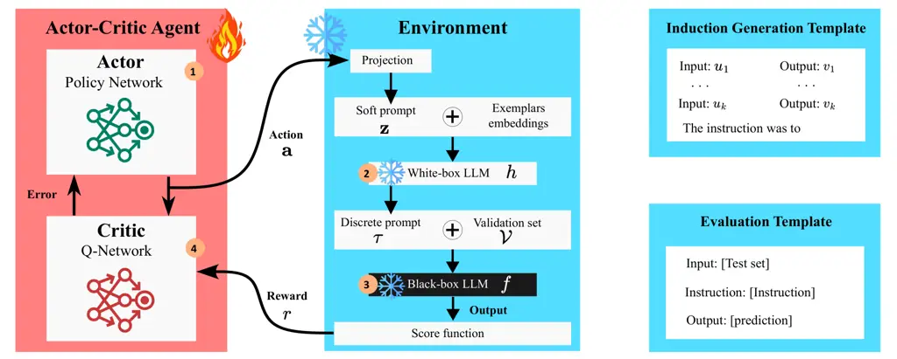
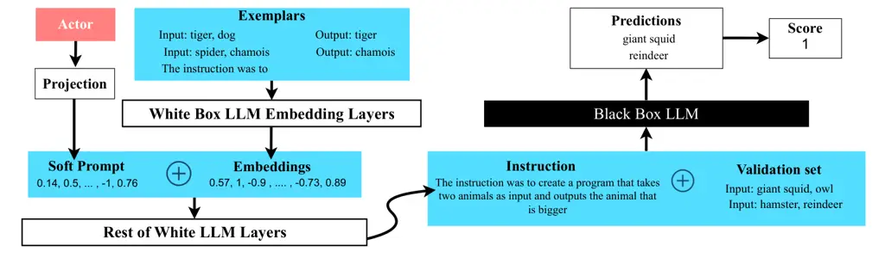

# ACING: Actor-Critic for Instruction Learning in Black-Box LLMs

Salma Kharrat    Fares Fourati Affiliation: KAUST
Affiliation: {salma.kharrat, fares.fourati}@kaust.edu.sa    Marco Canini

###### Abstract

The effectiveness of Large Language Models (LLMs) in solving tasks
depends significantly on the quality of their instructions, which often
require substantial human effort to craft. This underscores the need for
automated instruction optimization. However, optimizing instructions is
particularly challenging when working with black-box LLMs, where model
parameters and gradients are inaccessible. We introduce ACING, an
actor-critic reinforcement learning framework that formulates
instruction optimization as a stateless, continuous-action problem,
enabling exploration of infinite instruction spaces using only black-box
feedback. ACING automatically discovers prompts that outperform
human-written prompts in 76% of instruction-induction tasks, with gains
of up to 33 points and a 10-point median improvement over the best
automatic baseline in 33 tasks spanning instruction-induction,
summarization, and chain-of-thought reasoning. Extensive ablations
highlight its robustness and efficiency. An implementation of ACING is
available at
[https://github.com/salmakh1/ACING](https://github.com/salmakh1/ACING).

## 1 Introduction

Large Language Models (LLMs) have demonstrated impressive capabilities
across tasks like classification, summarization, and reasoning Cobbe
et al. (2021); Touvron et al. (2023); Zhao et al. (2024). A key driver
of this success is their ability to follow natural language
instructions, commonly known as prompts Chen et al. (2023a); Wei et al.
(2022); Liu et al. (2023). Yet crafting effective prompts remains
labor-intensive and brittle, particularly in black-box settings where
model internals are inaccessible.

A core challenge in prompt engineering lies in the extreme sensitivity
of LLMs to subtle linguistic variations. Even minor changes in phrasing
can lead to substantial performance shifts. As shown in Table 1, a minor
wording change yields a 12-point gain (using GPT-4o Hurst et al. (2024))
despite preserving semantics. Such prompt sensitivity is pervasive,
underscoring the need for robust, automated prompt optimization methods.

Recent work has explored automating prompt design to reduce human effort
Reynolds and McDonell (2021); Mishra et al. (2021). Soft prompting
techniques Li and Liang (2021); Lester et al. (2021) and heuristic-based
discrete search methods Zhou et al. (2023); Pryzant et al. (2023) have
shown promise, yet each faces key limitations in black-box settings.
Soft prompts require access to the model internals, limiting them to
white-box scenarios. Discrete search methods, in turn, often struggle to
explore vast and nuanced instruction spaces efficiently. More recent
hybrid methods combine white-box prompt generation with black-box
evaluation Chen et al. (2023b); Lin et al. (2024b), but typically rely
on finite candidate pools or rigid reward assumptions, constraining
their applicability.

To overcome these limitations, we introduce ACING, an actor-critic
reinforcement learning (RL) framework for automated instruction
optimization in black-box LLM settings. ACING formulates prompt
optimization as a stateless, continuous-action RL problem within a
continuum bandit environment. By learning a latent instruction space
through an off-policy actor-critic algorithm, ACING efficiently explores
infinite instruction candidates, using only black-box feedback for
evaluation. A frozen white-box model is used as a decoder to convert
latent vectors into discrete prompts, enabling both scalability and
linguistic richness. The generated instructions are not only
high-performing but also naturally interpretable, clear, and
semantically aligned with the tasks, making them suitable for practical
deployment. To effectively guide exploration under tight query budgets,
ACING leverages entropy-regularized policy optimization, encouraging
diversity in sampled prompts and improving the likelihood of discovering
high-performing instructions.

| Source | Instruction                                             | Score |
| ------ | ------------------------------------------------------- | ----- |
| Human  | Write a word that means the opposite of the input word. | 0.70  |
| ACING  | Take a word and change it to its opposite.              | 0.82  |

Table 1: Our prompt vs human on GPT-4o for antonym task.

Notably, to our knowledge, ACING is the first approach to apply
off-policy, continuous-action actor-critic reinforcement learning to
instruction learning in black-box LLMs, using lightweight actor and
critic neural networks (rather than LLMs), making the approach both
efficient and widely applicable.

We evaluate ACING against state-of-the-art techniques, including
Bayesian optimization, contextual bandits, and evolutionary strategies.
Empirical results across 33 diverse tasks—including instruction
induction, reasoning (including zero-shot Chain-of-Thought (CoT)),
semantics, syntax, phonetics, translation, summarization, and code
understanding—show that ACING outperforms both human-written prompts and
strong automated baselines. Notably, it surpasses human instructions in
76% of instruction induction tasks, achieving gains of up to 33 points
and a median improvement of 10 points over the best automatic baselines.

In summary, our contributions are threefold:

(1) An RL formulation of instruction learning: We propose a
continuous-action actor-critic RL approach for instruction optimization
in black-box LLMs, enabling scalable exploration of infinite instruction
spaces using entropy-regularized policies.

(2) Comprehensive validation. Across 33 diverse tasks, including
instruction induction, zero-shot CoT reasoning, and summarization, ACING
consistently outperforms both human-written and strong automated
instructions, achieving statistically significant gains.

(3) In-depth analysis and insights: Through extensive ablation studies,
we analyze the impact of latent dimensionality, exemplar configuration,
decoder architecture, and optimization budget, highlighting the
robustness of the ACING approach. Additionally, human evaluation and
automated readability analysis confirm the clarity and semantic
faithfulness of the generated instructions.



Figure 1: Pipeline of ACING. At each iteration, a soft prompt and task
exemplars are fed to the white-box model to generate an instruction.
This instruction queries the black-box LLM, whose outputs are scored.
The resulting score is returned to the agent as a reward, which is used
to update its networks and adjust its policy. Both LLMs remain frozen
throughout.

## 2 Problem Formulation

### 2.1 Problem: Prompt Optimization for Black-Box LLMs

We aim to improve the performance of a black-box LLM, denoted by $`f`$,
which can only be accessed through its API, while its internal
parameters remain unknown. Given a task represented by an (unknown)
distribution $`(x,y)\sim\mathcal{D}`$—where $`x`$ denotes possible
inputs and $`y`$ the corresponding correct outputs—our goal is to find
the optimal prompt $`\tau^{\star}`$ that maximizes the likelihood of
$`f`$ producing correct outputs for a given task. This is evaluated
using a scoring function $`q(\cdot,\cdot)\in[0,1]`$.

The black-box model $`f`$ processes an input formed by concatenating
($`\oplus`$) the prompt $`\tau`$ with the sentence $`x`$, producing a
predicted output $`\hat{y}=f(\tau\oplus x)`$. More formally, the
objective is to maximize the expected score of the LLM in solving the
task represented by the distribution $`\mathcal{D}`$, defined as:

```math
\max_{\tau}\quad\mathbb{E}_{(x,y)\sim\mathcal{D}}\left[q(y,f(\tau\oplus x))\right]. \tag{1}
```

We utilize a validation dataset
$`\mathcal{V}=\{(x_{j},y_{j})\}_{j=1}^{m}`$, where each pair consists of
an input sentence $`x_{j}`$ and its corresponding ground truth output
$`y_{j}`$. Our objective is to find the prompt that maximizes the
scoring function $`q(\cdot,\cdot)`$ across the validation dataset, where
$`q(\hat{y}_{j},y_{j})`$ measures the quality of the predicted output
$`\hat{y}_{j}`$ against the true output $`y_{j}`$. Thus, our objective
becomes finding the prompt $`\tau^{\star}`$ that maximizes the average
score over the validation set $`\mathcal{V}`$. The derived prompt
$`\tau^{\star}`$ is then evaluated on a separate test set
$`\mathcal{T}=\{(x^{\prime}_{j},y^{\prime}_{j})\}_{j=1}^{m^{\prime}}`$
to assess its generalization performance.

### 2.2 Reformulating Discrete Prompt Search as a Continuous Optimization Problem

Directly optimizing the prompt $`\tau`$ for the black-box LLM model
$`f`$ presents substantial challenges due to the discrete combinatorial
nature of token selection in $`\tau`$. To mitigate this challenge,
similar to prior approaches Chen et al. (2024); Lin et al. (2024b); Hu
et al. (2024) we employ a publicly available, open-source white-box
model, represented by $`h`$, and introduce a _soft prompt_ vector
$`\mathbf{z}\in\mathbb{R}^{d}`$, which is a continuous $`d`$-dimensional
vector representing the token embedding of a set of virtual tokens. The
white-box model $`h`$, which remains entirely frozen, with no training
or gradient updates, serves as a proxy mapping $`\mathbf{z}`$ into a
discrete prompt $`\tau`$ for the black-box LLM.

Given a dataset of exemplars,
$`\mathcal{E}=\{(u_{j},v_{j})\}_{j=1}^{k}`$, where each pair
$`(u_{j},v_{j})`$ defines input-output text sequences that exemplify a
downstream task and the vector $`\mathbf{z}`$, their concatenation is
input to the white-box model, generating the discrete prompt
$`\tau(\mathbf{z})=h(\mathbf{z},\mathcal{E})`$. This generated prompt
$`\tau(\mathbf{z})`$ is prepended to a test input $`x_{j}`$ from the
validation set $`\mathcal{V}`$, and the combined input is provided to
the black-box LLM $`f`$ to generate an output
$`\hat{y}_{j}=f(\tau(\mathbf{z})\oplus x_{j})`$. The output
$`\hat{y}_{j}`$ is then evaluated using the scoring function
$`q(\hat{y}_{j},y_{j})`$. By using a fixed set of exemplars
$`\mathcal{E}`$, the original discrete problem (Eq. (1)) of finding the
optimal prompt $`\tau`$ is effectively transformed into a continuous
optimization problem over the soft prompt vector $`\mathbf{z}`$, as
follows:

```math
\max_{\mathbf{z}\in\mathbb{R}^{d}}\quad\mathbb{E}_{(x,y)\sim\mathcal{D}}\left[q(y,f(\tau(\mathbf{z})\oplus x))\right]. \tag{2}
```

The soft prompt $`\mathbf{z}`$ is typically high-dimensional. Therefore,
we employ random projection techniques to reduce the input dimension as
done in prior works Chen et al. (2024); Lin et al. (2024b).
Specifically, we sample a matrix $`P\in\mathbb{R}^{d\times d^{\prime}}`$
with entries from $`\text{Uniform}(-1,1)`$, and optimize a
lower-dimensional vector $`\mathbf{a}\in[0,1]^{d^{\prime}}`$. The soft
prompt is then given by $`\mathbf{z}=P\mathbf{a}`$, transforming the
original problem into optimization over a compact and continuous space
as follows:

```math
\max_{\mathbf{a}\in\mathbb{R}^{d^{{}^{\prime}}}}\quad\mathbb{E}_{(x,y)\sim\mathcal{D}}\left[q(y,f(\tau(P\mathbf{a})\oplus x))\right]. \tag{3}
```

This optimization problem is central to our framework. The following
section elaborates on our approach to solving it. For clarity, we
summarize all symbols used in our actor-critic framework in Table 6.



Figure 2: Illustration of the prompt generation and testing inside the
environment using the _larger_animal_ dataset as an example.

## 3 Framework for Instruction Learning

We formulate the problem of prompt learning for black-box LLMs as a RL
problem, where the agent explores an infinite instruction space by
sampling continuous actions $`\mathbf{a}\in[0,1]^{d^{{}^{\prime}}}`$.
Each action corresponds to a latent prompt representation, which is
mapped—via a fixed projection matrix and a decoder—into a discrete
instruction. This instruction is then evaluated by the black-box LLM on
a validation set to produce a reward indicating task performance. The
stateless, stochastic setup places the problem in the continuum bandit
regime, unlike traditional discrete multi-armed bandits Slivkins (2019);
Lattimore and Szepesvári (2020).

### 3.1 Actor-Critic for Instruction Optimization

To efficiently learn in a high-dimensional and limited-feedback setting,
we propose a stateless, off-policy actor-critic framework inspired by
recent advances in continuous control Konda and Tsitsiklis (1999); Mnih
et al. (2016); Haarnoja et al. (2018); Haarnoja et al. (2019). Our
framework comprises lightweight networks: (1) a policy network (actor)
$`\pi(\cdot;\theta)`$, which outputs latent action vectors corresponding
to soft prompts, and (2) two critics to compute a value function
$`Q(\mathbf{a})=\min\{Q_{\mathbf{w_{1}}}(\mathbf{a}),Q_{\mathbf{w_{2}}}(\mathbf{a})\}`$,
which estimates the expected reward of a given action. Formally, the
policy $`\pi(\cdot;\theta)`$ is modeled as a Gaussian distribution with
a diagonal covariance matrix. The actor network outputs the mean and log
standard deviation for each action dimension, and actions are sampled
using the reparameterization trick. The critics,
$`Q_{\mathbf{w_{1}}}(.)`$ and $`Q_{\mathbf{w_{2}}}(.)`$, are trained to
minimize the mean squared error between predicted and observed rewards:

```math
\min_{\mathbf{w}}J_{Q}(\mathbf{w})\triangleq\mathbb{E}_{\mathbf{a}\sim\mathcal{D}}\left[\frac{1}{2}\left(Q_{\mathbf{w}}\left(\mathbf{a}\right)-r\left(\mathbf{a}\right)\right)^{2}\right], \tag{4}
```

which can be optimized with stochastic gradients

```math
\hat{\nabla}_{\mathbf{w}}J_{Q}(\mathbf{w})=\nabla_{\mathbf{w}}Q_{\mathbf{w}}\left(\mathbf{a}_{t}\right)\left(Q_{\mathbf{w}}\left(\mathbf{a}_{t}\right)-r\left(\mathbf{a}_{t}\right)\right). \tag{5}
```

Training alternates between actor and critic updates. Despite the lack
of state transitions, this architecture proves effective: the critic
generalizes reward signals in prompt space, stabilizes updates by
reducing reward variance, and enhances robustness via a twin-critic
setup to mitigate overestimation. Empirically, this actor-critic
formulation consistently outperforms no-critic baselines.

### 3.2 Enhancing Exploration via Entropy Regularization

In our setting, the agent operates under a fixed evaluation budget of
$`T`$ queries and must discover the best-performing instruction within
this limit. This corresponds to a pure exploration regime, where broad
coverage of the action space is essential. While random exploration may
seem sufficient, effective learning often requires balancing exploration
with exploitation of prior observations to guide the search toward
high-reward regions.

To encourage systematic exploration while leveraging past experience, we
adopt the maximum entropy reinforcement learning framework Ziebart
(2010); Haarnoja et al. (2018). This approach augments the expected
reward with a policy entropy term, promoting stochasticity in the
actor’s decisions. The objective becomes:

```math
\min_{\theta}J_{\pi}(\theta)\triangleq\mathbb{E}_{\mathbf{a}\sim\pi(.;\theta)}\left[\alpha\log\left(\pi\left(\mathbf{a};\theta\right)\right)-Q_{\mathbf{w}}\left(\mathbf{a})\right)\right], \tag{6}
```

where $`\alpha`$ is a temperature coefficient that governs the
exploration-exploitation trade-off. A higher $`\alpha`$ encourages
greater policy entropy, while a lower value biases the policy toward
exploitation.

This formulation simplifies the soft actor-critic objective Haarnoja
et al. (2018), omitting state-related components and long-horizon
returns, since our environment is stateless and rewards are immediate.
The entropy term,
$`-\mathbb{E}_{\mathbf{a}\sim\pi(\cdot;\theta)}[\log\pi(\mathbf{a})]`$,
incentivizes the actor to maintain a diverse action distribution,
thereby avoiding premature convergence to suboptimal prompts.

To avoid manual tuning of $`\alpha`$, we follow prior work Haarnoja
et al. (2019) and adapt it to match a target entropy
$`H_{\text{target}}`$, by minimizing:

```math
\min_{\alpha}\mathbf{J}_{\alpha}\triangleq-\mathbb{E}_{a\sim\pi(.)}\left[\alpha\cdot\left(\log\pi(\mathbf{a};\theta)+H_{\text{target}}\right)\right]. \tag{7}
```

We use stochastic gradient descent, specifically the Adam optimizer
Kingma and Ba (2017); Reddi et al. (2018), to jointly update the policy,
critic, and entropy temperature.

### 3.3 Putting it All Together

Fig. 1 illustrates our actor-critic framework and its interaction with
the environment. Fig. 2 zooms in on an example from the _larger_animal_
dataset.

Overview: In each iteration $`t\leq T`$, the actor-critic agent
generates a continuous vector “action” $`\mathbf{a}`$ (step 1). The
action is then projected into the appropriate space using a fixed matrix
$`P`$ to obtain $`\mathbf{z}`$. The environment then concatenates the
projected vector $`\mathbf{z}`$ with a set of exemplars’ embeddings from
$`\mathcal{E}`$ and feeds it into a white-box model $`h`$ (step 2). The
white-box model produces a discrete prompt, $`\tau`$, which is evaluated
using the validation dataset $`\mathcal{V}`$ based on the responses from
the black-box LLM $`f`$ (step 3). The black-box LLM’s prediction is
compared to true labels of the validation examples, and a score function
provides a reward, used to update both the critic and actor networks
accordingly.

Step {\scriptsize1}⃝. The actor outputs the mean and variance of a
distribution from which the action, a soft prompt vector $`\mathbf{a}`$
$`\in`$ $`\mathbb{R}^{d^{{}^{\prime}}}`$, is sampled. It also computes
the log probability, which is key for policy optimization, as shown in
Eq. (6).

Step {\scriptsize2}⃝. As shown in the left side of Fig. 2, the examples
describing the task from the set of exemplars $`\mathcal{E}`$, along
with additional text such as “The instruction was to,” are input into
the embedding layer of the white-box model to generate continuous
vectors (using the instruction generation template in Fig. 1 top right).
These continuous vectors are then concatenated with the soft prompt
$`\mathbf{z}`$, projected from the action $`\mathbf{a}`$. The white-box
model layers subsequently process the resulting concatenated vector to
produce the discrete prompt $`\tau`$, suitable for input into the
black-box LLM.

Step {\scriptsize3}⃝. As depicted in the right side of Fig. 2, for every
input $`x_{i}`$ in the validation set
$`\mathcal{V}=\{(x_{j},y_{j})\}_{j=1}^{m}`$, the generated prompt
$`\tau`$ is concatenated to the input sentence $`x_{i}`$ and fed to the
black-box LLM, which generates an output sentence
$`\hat{y}_{i}=f(\tau(\mathbf{z})\oplus x_{i})`$. The output of the
black-box LLM is fed into a scoring function $`q(\cdot,\cdot)`$, which
computes the score between the predicted output $`\hat{y}_{i}`$ and the
true label $`y_{i}`$. The overall score is calculated by averaging the
scores across all samples, representing the reward:
$`r=\frac{1}{m}\sum_{i=1}^{m}q(\hat{y}_{i},y_{i})`$, where $`m`$
represents the number of samples.

Step {\scriptsize4}⃝. The critic evaluates the actions taken by the actor
using the network $`Q_{\textbf{w}}`$, which estimates the expected
reward for a generated action $`\mathbf{a}`$ from the policy network
$`\pi`$. Based on the observed reward $`r(\mathbf{a})`$, the critic
updates its network using the loss function (Eq.(4)) and gradient
(Eq.(5)). The critic’s feedback helps the actor improve its policy by
maximizing the reward (Eq. (6)), ensuring a balance between exploration
and exploitation.

After $`T`$ iterations, the agent returns the best-performing prompt
$`\tau^{\star}`$, which is evaluated on the test set $`\mathcal{T}`$ in
the black-box LLM using the evaluation template shown in Fig. 1 (bottom
right).

|                   |                     |                                                                                                        |                                                                                                                       |             |             |
| ----------------- | ------------------- | ------------------------------------------------------------------------------------------------------ | --------------------------------------------------------------------------------------------------------------------- | ----------- | ----------- |
| Category          | Task                | Human Instruction                                                                                      | ACING Instruction (Ours)                                                                                              | Human       | ACING       |
| Spelling          | Second_word_letter  | Extract the second letter of the input word.                                                           | Input a word and output the letter that corresponds to the second letter in that word                                 | 0.96 (0.00) | 0.92 (0.00) |
| Syntax            | Negation            | Negate the input sentence.                                                                             | Flip the truth value of the statements in the input                                                                   | 0.81 (0.00) | 0.82 (0.00) |
| Lexical Semantics | Antonyms            | Write a word that means the opposite of the input word.                                                | Take a word and change it to its opposite                                                                             | 0.70 (0.00) | 0.83 (0.00) |
|                   | Synonyms            | Write a word with a similar meaning to the input word.                                                 | Input a word that is a synonym for the word that was output                                                           | 0.14 (0.01) | 0.13 (0.00) |
| Phonetics         | Rhymes              | Write a word that rhymes with the input word.                                                          | Input the word that the program thought I was inputting and then output the word that program thought I was inputting | 0.61 (0.01) | 1.00 (0.00) |
| Semantics         | Cause_and_effect    | Find which of the two given cause and effect sentences is the cause.                                   | Find the sentence that is the cause of the effect in the pair of sentences                                            | 0.97 (0.02) | 0.90 (0.02) |
| Style             | Informal_to_formal  | Rephrase the sentence in formal language.                                                              | Convert the input into output using the same word order and with the same meaning                                     | 0.63 (0.00) | 0.50 (0.00) |
| Multi- lingual    | Translation_en-de   | Translate the word into German.                                                                        | Provide a translation for each word in the English text into German                                                   | 0.81 (0.00) | 0.84 (0.00) |
|                   | Translation_en-es   | Translate the word into Spanish.                                                                       | Translate the words from English to Spanish, but I noticed that some of the translations are not accurate             | 0.89 (0.00) | 0.88 (0.00) |
|                   | Translation_en-fr   | Translate the word into French.                                                                        | Create a program that would take an English word as input and output its French equivalent                            | 0.86 (0.00) | 0.87 (0.00) |
| GLUE              | Sentiment           | Determine whether a movie review is positive or negative.                                              | Classify each input as positive or negative based on the assessment of the corresponding movie                        | 0.89 (0.01) | 0.91 (0.00) |
|                   | Sentence_similarity | Rate the semantic similarity of two input sentences on a scale of 0 - definitely not to 5 - perfectly. | Find a sentence pair that is probably not similar, and the output is 3 - probably                                     | 0.00 (0.00) | 0.21 (0.00) |
|                   |                     |                                                                                                        | median score                                                                                                          | 0.81        | 0.86        |
|                   |                     |                                                                                                        | \# best-performing tasks                                                                                              | 5           | 7           |
|                   |                     |                                                                                                        |                                                                                                                       |             |             |

Table 2: Tasks from the instruction-induction datasets where the human
and ACING test scores differed. For each task, we provide the
corresponding human instruction as proposed in Honovich et al. (2023)
and our best discovered instruction. We tested these instructions on the
test dataset and report the average score (with standard deviation) over
3 repetitions.

|                   |                          |             |             |              |             |             |
| ----------------- | ------------------------ | ----------- | ----------- | ------------ | ----------- | ----------- |
| Category          | Task                     | APE         | EvoPrompt   | InstructZero | INSTINCT    | ACING       |
| Spelling          | Letters_list             | 0.59 (0.02) | 0.97 (0.03) | 1.00 (0.00)  | 0.99 (0.01) | 1.00 (0.00) |
|                   | First_word_letter        | 0.00 (0.00) | 1.00 (0.00) | 1.00 (0.00)  | 1.00 (0.00) | 1.00 (0.00) |
|                   | Second_word_letter       | 0.00 (0.00) | 0.63 (0.17) | 0.35 (0.09)  | 0.39 (0.28) | 0.70 (0.15) |
| Morpho-Syntax     | Negation                 | 0.79 (0.00) | 0.84 (0.02) | 0.65 (0.10)  | 0.58 (0.22) | 0.71 (0.06) |
| Lexical Semantics | Synonyms                 | 0.14 (0.01) | 0.19 (0.07) | 0.22 (0.11)  | 0.19 (0.08) | 0.13 (0.02) |
|                   | Word_unscrambling        | 0.54 (0.00) | 0.44 (0.06) | 0.59 (0.06)  | 0.54 (0.02) | 0.50 (0.07) |
| Phonetics         | Rhymes                   | 0.59 (0.01) | 0.52 (0.05) | 0.99 (0.01)  | 0.36 (0.04) | 0.57 (0.31) |
| Numerical         | Sum                      | 0.87 (0.01) | 1.00 (0.00) | 1.00 (0.00)  | 0.70 (0.21) | 1.00 (0.00) |
|                   | Diff                     | 0.00 (0.00) | 0.99 (0.01) | 1.00 (0.00)  | 0.93 (0.09) | 1.00 (0.00) |
| Knowledge         | Larger_animal            | 0.72 (0.02) | 0.58 (0.06) | 0.63 (0.07)  | 0.81 (0.09) | 0.84 (0.07) |
| Cognitive Tasks   | Cause_and_effect         | 0.44 (0.09) | 0.48 (0.10) | 0.52 (0.09)  | 0.55 (0.11) | 0.69 (0.15) |
|                   | Common_concept           | 0.03 (0.02) | 0.17 (0.00) | 0.14 (0.04)  | 0.09 (0.04) | 0.19 (0.05) |
|                   | Object_counting          | 0.30 (0.02) | 0.50 (0.06) | 0.38 (0.06)  | 0.40 (0.12) | 0.41 (0.03) |
|                   | Odd_one_out              | 0.32 (0.02) | 0.64 (0.04) | 0.57 (0.02)  | 0.25 (0.18) | 0.64 (0.00) |
|                   | Orthography_starts_with  | 0.23 (0.01) | 0.47 (0.02) | 0.41 (0.09)  | 0.54 (0.06) | 0.60 (0.12) |
|                   | Taxonomy_animal          | 0.02 (0.02) | 0.38 (0.15) | 0.67 (0.14)  | 0.85 (0.06) | 0.71 (0.02) |
|                   | Auto_categorization      | 0.31 (0.01) | 0.20 (0.03) | 0.29 (0.02)  | 0.07 (0.07) | 0.29 (0.04) |
|                   | Word_sorting             | 0.58 (0.01) | 0.01 (0.00) | 0.64 (0.05)  | 0.23 (0.20) | 0.70 (0.03) |
| CLUE              | Sentence_similarity      | 0.00 (0.00) | 0.05 (0.00) | 0.10 (0.00)  | 0.00 (0.00) | 0.13 (0.07) |
| Translation       | Num_to_verbal            | 0.13 (0.02) | 1.00 (0.00) | 0.99 (0.01)  | 1.00 (0.00) | 0.99 (0.01) |
|                   | Translation_en-es        | 0.86 (0.01) | 0.76 (0.00) | 0.67 (0.24)  | 0.89 (0.00) | 0.87 (0.02) |
| Style             | Informal_to_formal       | 0.57 (0.01) | 0.50 (0.02) | 0.48 (0.02)  | 0.54 (0.09) | 0.44 (0.05) |
| Coding            | Auto_debugging           | 0.25 (0.00) | 0.25 (0.00) | 0.25 (0.00)  | 0.07 (0.07) | 0.25 (0.00) |
|                   | median score             | 0.31        | 0.50        | 0.59         | 0.54        | 0.69        |
|                   | \# best-performing tasks | 3           | 7           | 8            | 4           | 13          |

Table 3: Average test performance (with standard deviations) over 3
seeds comparing ACING to APE (Zhou et al., 2023), EvoPrompt (Guo et al.,
2024), InstructZero (Chen et al., 2024), and INSTINCT (Lin et al.,
2024b) on the 23 most challenging tasks (where at least one method has
score \< 0.7). Bottom rows show median scores and the number of
best-performing tasks.

## 4 Experiments

We focus on instruction learning for ChatGPT OpenAI (2023b), with
additional analysis on GPT-4 OpenAI (2023c) and GPT-4o Hurst et al.
(2024) as representative black-box LLMs. We conduct instruction
induction tasks using 30 datasets spanning several diverse categories
from Honovich et al. (2023); Chen et al. (2024), zero-shot CoT reasoning
datasets (GSM8K Cobbe et al. (2021), AQUARAT Ling et al. (2017)), and
summarization on SAMSum Gliwa et al. (2019).

In §4.1, we compare ACING’s best-learned instructions against
human-written prompts from Honovich et al. (2023). We also benchmark, in
§4.2, against four recent black-box instruction optimization methods:
APE Zhou et al. (2023), EvoPrompt Guo et al. (2024), InstructZero Chen
et al. (2024), and INSTINCT Lin et al. (2024b). Furthermore, we study
the interpretability and clarity of generated instructions (§4.3) and
conduct ablation studies (§4.4) to examine the impact of the different
design choices.

To ensure fairness and comparability with other automatic approaches, we
adopt a fixed evaluation budget of black-box queries $`T=165`$,¹¹ 1 See
Appendix F.3 for reward plots where ACING often peaks well before the
budget is exhausted. consistent with prior work. Moroever, ACING uses an
off-the-shelf, publicly available white-box decoder to map latent
vectors to prompts. Moreover, all learning and evaluation occur solely
through black-box interactions, which is consistent with other leading
methods (e.g., INSTINCT, InstructZero). To ensure fairness, we fix the
same decoder Vicuna-13B Chiang et al. (2023), as used in their analyses
across all methods, while in ablations we compare with WizardLM-13B Xu
et al. (2024).

The experimental setup isolates ACING’s core contribution, ensuring that
performance gains are not attributable to decoder selection or tuning.
Further details, including hyperparameters, are provided in Appendix B.

### 4.1 ACING vs. Humans

We compare instructions found by ACING against human-authored prompts
from Honovich et al. (2023) across a broad range of
instruction-induction tasks. Table 2 highlights only those tasks where
test performance differed between the two. The full set of tasks is
included in Appendix G.

Acing not only matches but often surpasses human-written
instructions—often by substantial margins. For instance, in the Antonyms
task, the human instruction (“Write a word that means the opposite of
the input word”) scores 0.70. ACING improves this to 0.82 with a more
direct and actionable phrasing: “Take a word and change it to its
opposite.” The formulation is simpler yet effective.

Consider the rhyming task, where the human instruction—“Write a word
that rhymes with the input word”—yields a score of 0.61. ACING
significantly improves performance, achieving a perfect score of 1.00
with an alternative phrasing. This highlights ACING’s ability to
discover high-performing instructions that align closely with the
underlying model behavior.

In the sentence similarity task, where the human instruction results in
a score of 0.00, ACING raises performance to 0.21. The highest-scoring
ACING instruction introduces a mild incline toward a mid-scale output
(“3 - probably”), but its phrasing remains semantically valid and
interpretable. A second-best instruction, unbiased, still improves upon
the human-written version by 0.14 points.

On average, Acing improves the median task score from 0.81 to 0.86 and
outperforms human-written instructions on 7 out of 12 tasks in this
subset—underscoring its potential as a practical and effective
alternative to manual prompt engineering. Further generated instructions
are in Appendix I. Furthermore, extended results with GPT-4o are
provided in Table 11 in Appendix E.

### 4.2 ACING vs. Other Optimization Methods

Instruction-induction datasets: In Table 3, we show tasks from Honovich
et al. (2023) where at least one method failed to achieve 70% score
(full results on all 30 tasks can be found in Appendix C). The table
shows the average test accuracy (along with the standard deviation) over
three independent runs, using three different seeds. For each seed, we
selected the best instruction achieved by each method and evaluated it
on the testing dataset. The results demonstrate that our method, ACING,
outperforms the others, achieving the highest accuracy in 13 out of the
remaining 23 tasks, compared to INSTINCT, InstructZERO, EvoPrompt, and
APE, which succeeded in 8 tasks or fewer. Additionally, ACING achieves
the highest median accuracy across tasks, with a value of 0.69, which is
approximately 10 percentage points higher than the best baseline. The
score types can be found in Table 8. Moreover, the best prompt achieved
for each task and the corresponding test scores, can be found in
Table 21 in Appendix C. Further analyses on GPT-4 can be found in the
Appendix. D.

CoT datasets. We evaluate our method on two zero-shot CoT reasoning
datasets: GSM8K Cobbe et al. (2021) and AQUA-RAT Ling et al. (2017).
Prior work Kojima et al. (2022) shows that simple CoT prompts can
enhance LLM performance. Using 100 steps (and other settings as above),
ACING achieves the best results on both, demonstrating strong CoT
reasoning capability.

Summarization dataset. We compare the performance of ACING with other
methods on summarization tasks using the SAMSum dataset Gliwa et al.
(2019). The results, presented in Table 4, show that ACING outperforms
the other methods across the three metrics considered: ROUGE-1, ROUGE-2,
and ROUGE-L Lin (2004).

Statistical significance test. We conduct a Wilcoxon signed-rank test
Wilcoxon (1992), a non-parametric test. The results confirm that ACING
significantly outperforms all baselines across tasks, with p = 0.0005
(APE), 0.0041 (INSTINCT), 0.0092 (EvoPrompt), and 0.0335 (InstructZero),
all below the standard 0.05 threshold, indicating that the observed
gains are statistically significant.

| Metric  | APE         | EvoPompt    | InstructZero | INSTINCT    | ACING       |
| ------- | ----------- | ----------- | ------------ | ----------- | ----------- |
| ROUGE-1 | 0.35 (0.01) | 0.35 (0.01) | 0.33 (0.00)  | 0.36 (0.01) | 0.37 (0.01) |
| ROUGE-2 | 0.12 (0.00) | 0.12 (0.00) | 0.11 (0.00)  | 0.14 (0.00) | 0.14 (0.00) |
| ROUGE-L | 0.25 (0.00) | 0.26 (0.00) | 0.24 (0.01)  | 0.27 (0.01) | 0.28 (0.01) |

Table 4: Average test performance (and standard deviations) for
summarization task using SAMSum dataset.

Results breakdown. To better understand ACING’s strengths, we grouped
the tasks into various categories. On cognitive tasks, requiring complex
reasoning, ACING demonstrates the clearest advantage. It ranks first on
5 out of 8 such tasks from Table 3, including Cause_and_effect (0.69,
+14%), Word_sorting (0.70, +6%), Odd_one_out (0.64, tied), and
Orthography_starts_with (0.60, +6%). As shown in Fig. 3 (ordered left to
right by median ranking), ACING achieves the best median rank and shows
a strong skew toward top rankings in this category. Furthermore, ACING
shows the best performance in the zero-shot CoT reasoning tasks
(Table 5). In symbolic manipulation, ACING again performs best,
achieving perfect scores on Letters_list and First_word_letter, and
leading on Second_word_letter (0.70 vs. 0.63). This highlights its
precision in low-level, structured tasks. ACING is competitive but not
dominant in tasks involving lexical semantics, world knowledge, and
translation—e.g., Informal_to_formal (0.44 vs. 0.57), and
Translation_en-es (0.87 vs. 0.89). Finally, it consistently outperforms
the other methods in summarization.

| Method                      | Dataset  | Best Zero-Shot Instruction                                 | Score |
| --------------------------- | -------- | ---------------------------------------------------------- | ----- |
| Kojima et al. (2022)        | GSM8K    | Let’s think step by step.                                  | 0.72  |
| INSTINCT Lin et al. (2024b) | GSM8K    | Let’s use our creativity to find the solution.             | 0.75  |
| ACING (Ours)                | GSM8K    | Let’s use our math skills to conquer this challenge.       | 0.76  |
| Kojima et al. (2022)        | AQUA-RAT | Let’s think step by step.                                  | 0.59  |
| INSTINCT Lin et al. (2024b) | AQUA-RAT | Let’s break it down.                                       | 0.59  |
| ACING (Ours)                | AQUA-RAT | Let’s use the power of substitution to solve this problem. | 0.63  |

Table 5: Best zero-shot instructions and corresponding scores for
different methods and datasets.

### 4.3 Instruction Clarity and Readability

To evaluate the interpretability and clarity of generated instructions,
we assess whether ACING-generated prompts are understandable and
task-aligned. We conduct a human evaluation with 26 participants who
rated the clarity and alignment of generated instructions from Table 2
on a 5-point Likert scale. The results show that participants found the
prompts generally clear, with a median score of 3.9/5 (see Appendix H
for the protocol and statistics). In parallel, we use standard
readability metrics to automatically assess the generated prompts. The
results show a median Flesch Reading Ease (FRE) of 70.8, Flesch-Kincaid
Grade Level (FKG) of 7.0, and Coleman-Liau Index (CLI) of 7.3. These
scores correspond to mid-grade readability (7th–8th grade), indicating
that the generated instructions are accessible to a broad user base.

### 4.4 Ablation Studies

We present detailed ablation studies on key design choices, summarize
some below, and provide full results and plots in Appendices F.1–F.7.

Use of critics. We compare our method (with two critics) to variants
with a single critic and to a baseline without a critic
(policy-gradient). As shown in Appendix F.1, the two-critic architecture
yields the highest accuracy, best stability, and top performance in
difficult settings (e.g., cognitive), confirming the value of
conservative estimation.

Budget efficiency. While ACING uses a fixed 165-query budget for fair
comparison with prior work, it often converges well before the budget is
exhausted. As illustrated in Appendix F.3, many tasks reach optimal
rewards within 60–80 queries, and some within 10–20, showing strong
sample efficiency under constrained settings.

White-box model. Using WizardLM-13B Xu et al. (2024) instead of Vicuna
improves median test accuracy by 8 points and increases the number of
best-performing tasks (Appendix F.7). This demonstrates that ACING can
benefit from stronger decoding models, although it remains effective
across architectures.

Action dimensionality. We test latent action sizes
$`d^{\prime}\in\{5,10,20,40,100\}`$. Results in Appendix F.5 show that
$`d^{\prime}=10`$ and $`d^{\prime}=20`$ perform consistently well, while
larger dimensions like $`d^{\prime}=40`$ yield improvements on specific
tasks.

Number of exemplars. Using a single exemplar performs surprisingly well
and matches the 5-exemplar setup on several tasks (e.g., phonetics and
summation). Still, five exemplars offer more consistent gains on complex
tasks (Section F.6).

Budget splitting. We explore dividing the query budget into an
exploration phase and a final re-ranking phase, where top prompts are
re-evaluated multiple times. This two-phase strategy improves median
test scores by 5 points and boosts the number of best-performing tasks
(Section F.4).

Figure 3: Ranking distributions across cognitive tasks for all
algorithms, ordered increasing by median rank.

## 5 Related Work

Early approaches such as AutoPrompt Shin et al. (2020), FluentPrompt Shi
et al. (2023), and soft prompt tuning Lester et al. (2021); Li and Liang
(2021); Zhong et al. (2021) rely on access to model gradients or
embeddings, limiting their applicability in black-box settings. Grey-box
methods such as BBT and BBTv2 Sun et al. (2022b); Sun et al. (2022a) and
CLIP-tuning Chai et al. (2022) relax these constraints by leveraging
token embeddings or logits, but are still incompatible with API-only
black-box models.

Several recent works frame instruction search as a discrete optimization
problem. RLPrompt Deng et al. (2022) and Tempera Zhang et al. (2023) use
RL to identify prompts, but assume access to token-level outputs or
confidence scores. Alternatively, sampling- and evolution-based
strategies such as APE Zhou et al. (2023), PromptBreeder Fernando et al.
(2024), EvoPrompt Guo et al. (2024), PromptWizard Agarwal et al. (2024),
and Auto Evol-Instruct Zeng et al. (2024) iteratively generate and
refine candidate prompts via LLM sampling or mutation. While effective
in some cases, these methods typically rely on large candidate pools or
expensive query budgets.

Zeroth-order optimization (e.g., AIO Qi et al. (2025), ZOPO Hu et al.
(2024)) estimates gradients without backpropagation, yet incurs high
computational cost and query complexity. InstructZero Chen et al. (2024)
and INSTINCT Lin et al. (2024b) apply Bayesian Optimization (BO) and
NeuralUCB Zhou et al. (2020) within a finite action space. In contrast,
StablePrompt Kwon et al. (2024) uses PPO to stabilize discrete prompt
learning, but fine-tune white-box LLMs. Our approach differs by
formulating prompt optimization as a continuous-action RL problem,
enabling more efficient exploration without gradient access or large
models.

Complementary strategies include exemplar selection Wu et al. (2024),
preference-based feedback Lin et al. (2024a), and best-arm
identification Shi et al. (2024). However, these typically rely on fixed
prompt pools or require human preference labels. ACING jointly addresses
both the generation and selection in a unified framework, yielding
high-performing prompts without pool constraints or external
supervision.

## 6 Conclusion

We present ACING, an actor-critic RL framework for prompt optimization
in black-box LLMs. By formulating the task as a continuous-action
problem, ACING enables exploration of an infinite space through an
entropy-regularized policy under strict query constraints. It
outperforms strong baselines and surpasses human-written instructions,
without any per-task tuning, demonstrating effectiveness, efficiency,
and practicality.

## 7 Limitations

While ACING achieves strong and consistent performance across diverse
tasks, we do not claim universal superiority on every individual task.
Given the stochastic and non-convex nature of prompt
optimization—particularly in black-box LLMs under tight query
budgets—strong prompts can occasionally arise even from random search or
other optimization approaches. However, ACING substantially improves the
chances of discovering such prompts through a principled exploration
strategy grounded in actor-critic learning.

Similar to previous prior works (Lin et al., 2024b; Chen et al., 2024;
Hu et al., 2024), our reliance on a white-box model introduces
variability, as model selection affects performance (Appendix F.7).
Addressing this limitation would require operating directly on black-box
LLMs, which poses challenges due to the large discrete action space.
Adapting RL methods for such spaces, as explored in Fourati et al.
(2024), and proposing hybrid approaches combining soft-prompt and
discrete optimization, represent promising directions for future
research.

Despite the strong performance achieved with a fixed hyperparameter
configuration across all tasks, we acknowledge that domain-specific
tuning might yield marginal gains, particularly in edge cases. That
said, our goal was to emphasize generality and simplicity without
introducing per-task overhead—an important factor for real-world
usability.

## 8 Ethical Considerations

ACING automates prompt optimization for LLMs, which can reduce manual
effort but may also amplify risks associated with bias, misuse, or
harmful content generation. We emphasize that ACING is a general
optimization framework and does not guarantee ethical outputs from the
underlying LLMs. It should be paired with appropriate content filters
and safety mechanisms when deployed in sensitive domains. Optimized
prompts could reinforce or amplify existing biases present in the base
LLMs. Future work should incorporate fairness-aware reward functions or
post-hoc bias mitigation.

Lastly, our experiments assume legal and ethical API usage, and we
caution against applying instruction optimization to restricted or
proprietary models without adherence to usage policies and terms of
service.

## References

- Agarwal et al. (2024) Eshaan Agarwal, Joykirat Singh, Vivek Dani,
  Raghav Magazine, Tanuja Ganu, and Akshay Nambi. 2024. Promptwizard:
  Task-aware prompt optimization framework. _arXiv preprint
  arXiv:2405.18369_.
- Chai et al. (2022) Yekun Chai, Shuohuan Wang, Yu Sun, Hao Tian, Hua
  Wu, and Haifeng Wang. 2022. [Clip-Tuning: Towards Derivative-free
  Prompt Learning with a Mixture of
  Rewards](https://aclanthology.org/2022.findings-emnlp.8). In _EMNLP_.
- Chen et al. (2023a) Jiuhai Chen, Lichang Chen, Heng Huang, and Tianyi
  Zhou. 2023a. [When do you need Chain-of-Thought Prompting for
  ChatGPT?](https://arxiv.org/abs/2304.03262) _Preprint_,
  arXiv:2304.03262.
- Chen et al. (2023b) Lichang Chen, Jiuhai Chen, Tom Goldstein, Heng
  Huang, and Tianyi Zhou. 2023b. Instructzero: Efficient instruction
  optimization for black-box large language models. _arXiv preprint
  arXiv:2306.03082_.
- Chen et al. (2024) Lichang Chen, Jiuhai Chen, Tom Goldstein, Heng
  Huang, and Tianyi Zhou. 2024. [InstructZero: Efficient Instruction
  Optimization for Black-Box Large Language
  Models](https://proceedings.mlr.press/v235/chen24e.html). In _ICML_.
- Chiang et al. (2023) Wei-Lin Chiang, Zhuohan Li, Zi Lin, Ying Sheng,
  Zhanghao Wu, Hao Zhang, Lianmin Zheng, Siyuan Zhuang, Yonghao Zhuang,
  Joseph E. Gonzalez, Ion Stoica, and Eric P. Xing. 2023. [Vicuna: An
  Open-Source Chatbot Impressing GPT-4 with 90%\* ChatGPT
  Quality](https://lmsys.org/blog/2023-03-30-vicuna/).
- Cobbe et al. (2021) Karl Cobbe, Vineet Kosaraju, Mohammad Bavarian,
  Mark Chen, Heewoo Jun, Lukasz Kaiser, Matthias Plappert, Jerry Tworek,
  Jacob Hilton, Reiichiro Nakano, and 1 others. 2021. Training verifiers
  to solve math word problems. _arXiv preprint arXiv:2110.14168_.
- Coleman and Liau (1975) Meri Coleman and Ta Lin Liau. 1975. A computer
  readability formula designed for machine scoring. _Journal of Applied
  Psychology_, 60(2):283.
- Deng et al. (2022) Mingkai Deng, Jianyu Wang, Cheng-Ping Hsieh, Yihan
  Wang, Han Guo, Tianmin Shu, Meng Song, Eric Xing, and Zhiting
  Hu. 2022. [RLPrompt: Optimizing Discrete Text Prompts with
  Reinforcement Learning](https://aclanthology.org/2022.emnlp-main.222).
  In _EMNLP_.
- Fernando et al. (2024) Chrisantha Fernando, Dylan Sunil Banarse,
  Henryk Michalewski, Simon Osindero, and Tim Rocktäschel. 2024.
  Promptbreeder: Self-referential self-improvement via prompt evolution.
  In _International Conference on Machine Learning_, pages 13481–13544.
  PMLR.
- Flesch (1948) Rudolph Flesch. 1948. A new readability yardstick.
  _Journal of applied psychology_, 32(3):221.
- Fourati et al. (2024) Fares Fourati, Vaneet Aggarwal, and Mohamed-Slim
  Alouini. 2024. [Stochastic Q-learning for Large Discrete Action
  Spaces](https://proceedings.mlr.press/v235/fourati24a.html). In
  _ICML_.
- Gliwa et al. (2019) Bogdan Gliwa, Iwona Mochol, Maciej Biesek, and
  Aleksander Wawer. 2019. [SAMSum Corpus: A Human-annotated Dialogue
  Dataset for Abstractive
  Summarization](https://aclanthology.org/D19-5409). In _Workshop on New
  Frontiers in Summarization_.
- Guo et al. (2024) Qingyan Guo, Rui Wang, Junliang Guo, Bei Li, Kaitao
  Song, Xu Tan, Guoqing Liu, Jiang Bian, and Yujiu Yang. 2024.
  [Connecting Large Language Models with Evolutionary Algorithms Yields
  Powerful Prompt
  Optimizers](https://openreview.net/forum?id=ZG3RaNIsO8). In _ICLR_.
- Haarnoja et al. (2018) Tuomas Haarnoja, Aurick Zhou, Pieter Abbeel,
  and Sergey Levine. 2018. [Soft Actor-Critic: Off-Policy Maximum
  Entropy Deep Reinforcement Learning with a Stochastic
  Actor](https://proceedings.mlr.press/v80/haarnoja18b.html). In _ICML_.
- Haarnoja et al. (2019) Tuomas Haarnoja, Aurick Zhou, Kristian
  Hartikainen, George Tucker, Sehoon Ha, Jie Tan, Vikash Kumar, Henry
  Zhu, Abhishek Gupta, Pieter Abbeel, and Sergey Levine. 2019. [Soft
  Actor-Critic Algorithms and
  Applications](https://arxiv.org/abs/1812.05905). _Preprint_,
  arXiv:1812.05905.
- Honovich et al. (2023) Or Honovich, Uri Shaham, Samuel R. Bowman, and
  Omer Levy. 2023. [Instruction Induction: From Few Examples to Natural
  Language Task
  Descriptions](https://aclanthology.org/2023.acl-long.108). In _ACL_.
- Hu et al. (2024) Wenyang Hu, Yao Shu, Zongmin Yu, Zhaoxuan Wu,
  Xiangqiang Lin, Zhongxiang Dai, See-Kiong Ng, and Bryan Kian Hsiang
  Low. 2024. Localized zeroth-order prompt optimization. _arXiv preprint
  arXiv:2403.02993_.
- Hurst et al. (2024) Aaron Hurst, Adam Lerer, Adam P Goucher, Adam
  Perelman, Aditya Ramesh, Aidan Clark, AJ Ostrow, Akila Welihinda, Alan
  Hayes, Alec Radford, and 1 others. 2024. Gpt-4o system card. _arXiv
  preprint arXiv:2410.21276_.
- Kincaid et al. (1975) J Peter Kincaid, Robert P Fishburne Jr,
  Richard L Rogers, and Brad S Chissom. 1975. Derivation of new
  readability formulas (automated readability index, fog count and
  flesch reading ease formula) for navy enlisted personnel.
- Kingma and Ba (2017) Diederik P. Kingma and Jimmy Ba. 2017. [Adam: A
  Method for Stochastic Optimization](https://arxiv.org/abs/1412.6980).
  _Preprint_, arXiv:1412.6980.
- Kojima et al. (2022) Takeshi Kojima, Shixiang Shane Gu, Machel Reid,
  Yutaka Matsuo, and Yusuke Iwasawa. 2022. Large language models are
  zero-shot reasoners. In _Proc. NeurIPS_, pages 22199–22213.
- Konda and Tsitsiklis (1999) Vijay Konda and John Tsitsiklis. 1999.
  Actor-critic algorithms. _Advances in neural information processing
  systems_, 12.
- Kwon et al. (2024) Minchan Kwon, Gaeun Kim, Jongsuk Kim, Haeil Lee,
  and Junmo Kim. 2024. Stableprompt: Automatic prompt tuning using
  reinforcement learning for large language models. _arXiv preprint
  arXiv:2410.07652_.
- Lattimore and Szepesvári (2020) Tor Lattimore and Csaba
  Szepesvári. 2020. [_Bandit
  Algorithms_](https://doi.org/10.1017/9781108571401). Cambridge
  University Press.
- Lester et al. (2021) Brian Lester, Rami Al-Rfou, and Noah
  Constant. 2021. [The Power of Scale for Parameter-Efficient Prompt
  Tuning](https://aclanthology.org/2021.emnlp-main.243). In _EMNLP_.
- Li and Liang (2021) Xiang Lisa Li and Percy Liang. 2021.
  [Prefix-Tuning: Optimizing Continuous Prompts for
  Generation](https://aclanthology.org/2021.acl-long.353). In
  _ACL-IJCNLP_.
- Lin (2004) Chin-Yew Lin. 2004. ROUGE: A package for automatic
  evaluation of summaries. In _Text summarization branches out_, pages
  74–81.
- Lin et al. (2024a) Xiaoqiang Lin, Zhongxiang Dai, Arun Verma,
  See-Kiong Ng, Patrick Jaillet, and Bryan Kian Hsiang Low. 2024a.
  Prompt optimization with human feedback. _arXiv preprint
  arXiv:2405.17346_.
- Lin et al. (2024b) Xiaoqiang Lin, Zhaoxuan Wu, Zhongxiang Dai, Wenyang
  Hu, Yao Shu, See-Kiong Ng, Patrick Jaillet, and Bryan Kian Hsiang Low.
  2024b. [Use Your INSTINCT: INSTruction optimization for LLMs usIng
  Neural bandits Coupled with
  Transformers](https://proceedings.mlr.press/v235/lin24r.html). In
  _ICML_.
- Ling et al. (2017) Wang Ling, Dani Yogatama, Chris Dyer, and Phil
  Blunsom. 2017. Program induction by rationale generation: Learning to
  solve and explain algebraic word problems. In _Proc. Annual Meeting of
  the ACL_, pages 158–167.
- Liu et al. (2023) Pengfei Liu, Weizhe Yuan, Jinlan Fu, Zhengbao Jiang,
  Hiroaki Hayashi, and Graham Neubig. 2023. [Pre-Train, Prompt, and
  Predict: A Systematic Survey of Prompting Methods in Natural Language
  Processing](https://doi.org/10.1145/3560815). _ACM Computing Surveys_,
  55(9).
- Mishra et al. (2021) Swaroop Mishra, Daniel Khashabi, Chitta Baral,
  Yejin Choi, and Hannaneh Hajishirzi. 2021. [Reframing Instructional
  Prompts to GPTk’s
  Language](https://aclanthology.org/2022.findings-acl.50). In _ACL_.
- Mnih et al. (2016) Volodymyr Mnih, Adria Puigdomenech Badia, Mehdi
  Mirza, Alex Graves, Timothy Lillicrap, Tim Harley, David Silver, and
  Koray Kavukcuoglu. 2016. [Asynchronous Methods for Deep Reinforcement
  Learning](https://proceedings.mlr.press/v48/mniha16.html). In _ICML_.
- OpenAI (2023a) OpenAI. 2023a. ChatGPT.
  [https://chat.openai.com](https://chat.openai.com).
- OpenAI (2023b) OpenAI. 2023b. [ChatGPT: A Conversational AI
  Model](https://openai.com/chatgpt).
- OpenAI (2023c) OpenAI. 2023c. [GPT-4 Technical
  Report](https://arxiv.org/abs/2303.08774). _Preprint_,
  arXiv:2303.08774.
- Pryzant et al. (2023) Reid Pryzant, Dan Iter, Jerry Li, Yin Tat Lee,
  Chenguang Zhu, and Michael Zeng. 2023. [Automatic Prompt Optimization
  with “Gradient Descent” and Beam
  Search](https://aclanthology.org/2023.emnlp-main.494). In _EMNLP_.
- Qi et al. (2025) Yunzhe Qi, Jinjin Tian, Ruirui Li, Tianci Liu,
  Tianxin Wei, Hui Liu, Xianfeng Tang, Monica Xiao Cheng, and Jingrui
  He. 2025. [Automatic task-aware instruction optimizer for black-box
  llms](https://openreview.net/forum?id=m0ddLnNvXS).
- Reddi et al. (2018) Sashank J Reddi, Satyen Kale, and Sanjiv
  Kumar. 2018. [On the Convergence of Adam and
  Beyond](https://openreview.net/forum?id=ryQu7f-RZ). In _ICLR_.
- Reynolds and McDonell (2021) Laria Reynolds and Kyle McDonell. 2021.
  [Prompt Programming for Large Language Models: Beyond the Few-Shot
  Paradigm](https://doi.org/10.1145/3411763.3451760). In _CHI EA_.
- Shi et al. (2024) Chengshuai Shi, Kun Yang, Jing Yang, and Cong
  Shen. 2024. [Best Arm Identification for Prompt Learning under a
  Limited Budget](https://openreview.net/forum?id=q4mtFqw8PR). In _ICLR
  2024 Workshop on Mathematical and Empirical Understanding of
  Foundation Models_.
- Shi et al. (2023) Weijia Shi, Xiaochuang Han, Hila Gonen, Ari
  Holtzman, Yulia Tsvetkov, and Luke Zettlemoyer. 2023. [Toward Human
  Readable Prompt Tuning: Kubrick’s The Shining is a good movie, and a
  good prompt too?](https://aclanthology.org/2023.findings-emnlp.733) In
  _EMNLP_.
- Shin et al. (2020) Taylor Shin, Yasaman Razeghi, Robert L Logan IV,
  Eric Wallace, and Sameer Singh. 2020. [AutoPrompt: Eliciting Knowledge
  from Language Models with Automatically Generated
  Prompts](https://aclanthology.org/2020.emnlp-main.346). In _EMNLP_.
- Slivkins (2019) Aleksandrs Slivkins. 2019. [Introduction to
  Multi-Armed Bandits](http://dx.doi.org/10.1561/2200000068).
  _Foundations and Trends® in Machine Learning_, 12(1-2).
- Sun et al. (2022a) Tianxiang Sun, Zhengfu He, Hong Qian, Xuanjing
  Huang, and Xipeng Qiu. 2022a. [BBTv2: Towards a Gradient-Free Future
  with Large Language
  Models](https://aclanthology.org/2022.emnlp-main.259). In _EMNLP_.
- Sun et al. (2022b) Tianxiang Sun, Yunfan Shao, Hong Qian, Xuanjing
  Huang, and Xipeng Qiu. 2022b. [Black-Box Tuning for
  Language-Model-as-a-Service](https://proceedings.mlr.press/v162/sun22e.html).
  In _ICML_.
- Touvron et al. (2023) Hugo Touvron, Thibaut Lavril, Gautier Izacard,
  Xavier Martinet, Marie-Anne Lachaux, Timothée Lacroix, Baptiste
  Rozière, Naman Goyal, Eric Hambro, Faisal Azhar, Aurelien Rodriguez,
  Armand Joulin, Edouard Grave, and Guillaume Lample. 2023. [LLaMA: Open
  and Efficient Foundation Language
  Models](https://arxiv.org/abs/2302.13971). _Preprint_,
  arXiv:2302.13971.
- Wei et al. (2022) Jason Wei, Xuezhi Wang, Dale Schuurmans, Maarten
  Bosma, brian ichter, Fei Xia, Ed Chi, Quoc V Le, and Denny Zhou. 2022.
  Chain-of-Thought Prompting Elicits Reasoning in Large Language Models.
  In _NeurIPS_.
- Wilcoxon (1992) Frank Wilcoxon. 1992. Individual comparisons by
  ranking methods. In _Breakthroughs in statistics: Methodology and
  distribution_, pages 196–202. Springer.
- Wu et al. (2024) Zhaoxuan Wu, Xiaoqiang Lin, Zhongxiang Dai, Wenyang
  Hu, Yao Shu, See-Kiong Ng, Patrick Jaillet, and Bryan Kian Hsiang
  Low. 2024. Prompt optimization with ease? efficient ordering-aware
  automated selection of exemplars. _arXiv preprint arXiv:2405.16122_.
- Xu et al. (2024) Can Xu, Qingfeng Sun, Kai Zheng, Xiubo Geng, Pu Zhao,
  Jiazhan Feng, Chongyang Tao, and Daxin Jiang. 2024. [WizardLM:
  Empowering Large Pre-Trained Language Models to Follow Complex
  Instructions](https://openreview.net/forum?id=CfXh93NDgH). In _ICLR_.
- Zeng et al. (2024) Weihao Zeng, Can Xu, Yingxiu Zhao, Jian-Guang Lou,
  and Weizhu Chen. 2024. Automatic instruction evolving for large
  language models. In _Proceedings of the 2024 Conference on Empirical
  Methods in Natural Language Processing_, pages 6998–7018.
- Zhang et al. (2023) Tianjun Zhang, Xuezhi Wang, Denny Zhou, Dale
  Schuurmans, and Joseph E Gonzalez. 2023. [TEMPERA: Test-Time Prompt
  Editing via Reinforcement
  Learning](https://openreview.net/forum?id=gSHyqBijPFO). In _ICLR_.
- Zhao et al. (2024) Wayne Xin Zhao, Kun Zhou, Junyi Li, Tianyi Tang,
  Xiaolei Wang, Yupeng Hou, Yingqian Min, Beichen Zhang, Junjie Zhang,
  Zican Dong, Yifan Du, Chen Yang, Yushuo Chen, Zhipeng Chen, Jinhao
  Jiang, Ruiyang Ren, Yifan Li, Xinyu Tang, Zikang Liu, and 3
  others. 2024. [A Survey of Large Language
  Models](https://arxiv.org/abs/2303.18223). _Preprint_,
  arXiv:2303.18223.
- Zhong et al. (2021) Zexuan Zhong, Dan Friedman, and Danqi Chen. 2021.
  [Factual Probing Is \[MASK\]: Learning vs. Learning to
  Recall](https://aclanthology.org/2021.naacl-main.398). In _NAACL_.
- Zhou et al. (2020) Dongruo Zhou, Lihong Li, and Quanquan Gu. 2020.
  [Neural Contextual Bandits with UCB-based
  Exploration](https://proceedings.mlr.press/v119/zhou20a.html). In
  _ICML_.
- Zhou et al. (2023) Yongchao Zhou, Andrei Ioan Muresanu, Ziwen Han,
  Keiran Paster, Silviu Pitis, Harris Chan, and Jimmy Ba. 2023. [Large
  Language Models are Human-Level Prompt
  Engineers](https://openreview.net/forum?id=92gvk82DE-). In _ICLR_.
- Ziebart (2010) Brian D Ziebart. 2010. [_Modeling Purposeful Adaptive
  Behavior with the Principle of Maximum Causal
  Entropy_](https://doi.org/10.1184/R1/6720692.v1). Ph.D. thesis,
  Carnegie Mellon University.

## Appendix A Table of Notations

For clarity, we summarize all symbols used in our actor-critic framework
in Table 6.

| Symbol                                  | Meaning                                                                           |
| --------------------------------------- | --------------------------------------------------------------------------------- |
| $`f`$                                   | Black-box LLM (only accessible via API)                                           |
| $`h`$                                   | White-box LLM (frozen, used as decoder)                                           |
| $`D`$                                   | Task distribution over input–output pairs $`(x,y)`$                               |
| $`V`$                                   | Validation set $`\{(x_{j},y_{j})\}_{j=1}^{m}`$                                    |
| $`T`$                                   | Test set $`\{(x^{\prime}_{j},y^{\prime}_{j})\}_{j=1}^{m^{\prime}}`$               |
| $`q(\cdot,\cdot)`$                      | Scoring function measuring output quality                                         |
| $`\tau`$                                | Discrete prompt                                                                   |
| $`\tau(z)`$                             | Prompt generated from soft prompt $`z`$                                           |
| $`\tau(Pa)`$                            | Prompt from projected action vector $`a`$                                         |
| $`\tau^{\star}`$                        | Optimal prompt                                                                    |
| $`z\in\mathbb{R}^{d}`$                  | Soft prompt vector (continuous)                                                   |
| $`a\in[0,1]^{d^{\prime}}`$              | Action (latent prompt representation)                                             |
| $`P\in\mathbb{R}^{d\times d^{\prime}}`$ | Random projection matrix                                                          |
| $`\pi(\cdot;\theta)`$                   | Policy network (actor) with parameters $`\theta`$                                 |
| $`Q_{w_{1}}(a),Q_{w_{2}}(a)`$           | Twin critic networks with parameters $`w_{1},w_{2}`$                              |
| $`Q(a)`$                                | Value estimate: $`Q(a)=\min\{Q_{w_{1}}(a),Q_{w_{2}}(a)\}`$                        |
| $`J_{Q}(w)`$                            | Critic loss: $`\mathbb{E}_{a\sim D}\left[\tfrac{1}{2}(Q_{w}(a)-r(a))^{2}\right]`$ |
| $`J_{\pi}(\theta)`$                     | Actor loss (entropy-regularized policy objective)                                 |
| $`r(a)`$                                | Reward obtained from the environment                                              |
| $`\alpha`$                              | Temperature coefficient for entropy regularization                                |
| $`H_{\text{target}}`$                   | Target entropy for adaptive $`\alpha`$                                            |

Table 6: Summary of notations used in the ACING actor-critic framework.

## Appendix B Experimental Details

### B.1 Hyperparameters

Across the diverse tasks, in the main paper, the same hyperparameters
were used, which shows that the algorithm generalizes well across the 30
tasks without specifically tuning hyperparameters in each task. A
summary of the key parameters can be found in the following Table.

| Hyperparameter                              | Choice                  |
| ------------------------------------------- | ----------------------- | --- | --- |
| White-box $`h`$                             | Vicuna-13B and WizardLM |
| Actor-network                               | $`(1-1024-256-10)`$     |
| Critic-network                              | $`(10-128-128-1)`$      |
| Budget $`T`$                                | 165                     |
| Intrinsic (action) dimension $`d^{\prime}`$ | 10                      |
| Number of soft tokens $`N_{z}`$             | 5                       |
| Soft prompt dimension $`d`$                 | 5120 \* $`N_{z}`$       |
| Number of exemplars $`                      | \mathcal{E}             | `$  | 5   |
| Number of tokens generated by Wb            | 64                      |

Table 7: Key hyperparameters and their values.

Furthermore, like previous works, we use their default (tuned)
hyperparameters for the results in the main paper, including the
intrinsic dimension $`d^{\prime}=10`$ and the number of soft tokens
$`N_{z}=5`$. For fairness, we refrain from fine-tuning these parameters
for our method and use the same values as in prior works. This ensures
that our ACING algorithm searches in the same space, $`[0,1]^{10}`$, and
uses the same total number of queries to the black-box LLM as APE,
InstructZero, and INSTINCT for a fair comparison. For each algorithm,
after identifying the best instruction using the validation set
$`\mathcal{V}`$, we evaluate the discovered instruction on a separate
test set $`\mathcal{T}`$ and report the test score.

### B.2 Actor-Critic Details

Across all the tasks, we used three fully-connected layers for both the
actor $`(1-1024-256-10)`$ and the critics $`(10-128-128-1)`$ networks,
with learning rates fixed at $`3\cdot 10^{-4}`$ for each. We learn the
entropy parameter $`\alpha`$ using a learning rate of
$`9\cdot 10^{-4}`$. We adopt two independently trained critics and take
the minimum of their outputs to mitigate overestimation bias. This
conservative approach helps regularize training and improves robustness,
particularly in tasks with noisy or sparse rewards. We further validate
this choice in our ablation studies with one critic, two critics, and
without critics.

### B.3 Metrics

Table 8 outlines the evaluation metrics used across various task types.
Depending on the nature of the task, we adopt different scoring schemes
to ensure fair and meaningful evaluation. For most classification and
generation tasks, we employ exact match (EM) scoring, which requires the
prediction to match the ground truth exactly, making it a stringent yet
interpretable metric.

### B.4 Licenses and Terms of Use for Artifacts

#### Black-box APIs.

We use the OpenAI API to access ChatGPT OpenAI (2023a), GPT-4 OpenAI
(2023c), and GPT-4o Hurst et al. (2024) for black-box evaluation. These
models are proprietary and accessed via paid API under OpenAI’s terms of
service. We do not redistribute or modify these models.

#### White-box Models.

Our framework uses Vicuna-13B Chiang et al. (2023) (and WizardLM Xu
et al. (2024) for ablations) as a frozen decoder to generate discrete
prompts. Both models are publicly available for research use under a
non-commercial license. We follow all usage restrictions and do not
modify or redistribute these models.

#### Datasets.

We use publicly available datasets including:

- •
  Instruction induction datasets from Honovich et al. (2023).
- •
  SAMSum (Gliwa et al., 2019) for summarization.
- •
  GSM8K (Cobbe et al., 2021) and AQUA-RAT (Ling et al., 2017) for
  reasoning.

All datasets are used under their original licenses and are cited
appropriately.

#### Our Code and Models.

We will publicly release our implementation, including the actor-critic
training framework and prompt optimization pipeline, under an
open-source license (MIT license) upon publication.

### B.5 Data Usage, Privacy, and Safety Considerations

All datasets for the studied tasks are publicly released and widely used
in NLP research. We used them under their respective licenses for
academic use, and we cite the original sources in all cases.

#### Privacy and Anonymization.

None of the datasets we used contain personally identifiable information
(PII) to the best of our knowledge. The datasets are either synthetic,
anonymized, or derived from public sources with appropriate
preprocessing. We did not augment or modify these datasets in ways that
would introduce identifying information.

#### Human Evaluation and Safety.

For our human evaluation of ACING-generated prompts, we used only
automatically generated instructions and task templates. Prior to
annotation, we reviewed the generated prompts and outputs to ensure that
they did not contain any offensive or inappropriate content. The tasks
involved abstract or anonymized content (e.g., generic input strings or
public task descriptions), and no human names, images, or personal data
were included.

#### Ethical Use.

We ensured that all experiments involving human subjects were conducted
ethically and responsibly. Participation in the annotation study was
fully voluntary. Annotators were informed about the nature and purpose
of the task and could withdraw at any time. The study was limited to
rating task-level clarity and alignment, involved no sensitive content,
and did not collect any personal or identifiable information. All
responses were anonymized, and only aggregate statistics were analyzed.
As the study posed no foreseeable risk to participants and did not
involve identifiable data, it did not require formal ethics review under
our institution’s guidelines.

### B.6 Artifact Documentation

#### Task Coverage.

We evaluate ACING on a diverse set of NLP tasks, categorized as follows:

- •
  Instruction Induction: A wide range of classification and
  transformation tasks drawn from Honovich et al. (2023), covering
  syntax, semantics, phonetics, word manipulation, and reasoning.
- •
  Reasoning: Zero-shot chain-of-thought reasoning tasks using GSM8K
  (Cobbe et al., 2021) and AQUA-RAT (Ling et al., 2017), which involve
  multi-step symbolic and arithmetic problem solving.
- •
  Summarization: Dialogue-based abstractive summarization using the
  SAMSum dataset (Gliwa et al., 2019).
- •
  Translation: Lexical-level English-to-German, English-to-Spanish, and
  English-to-French tasks to assess multilingual instruction learning.

#### Language Coverage.

Our experiments involve four languages: English (the primary language
for most tasks), and German, Spanish, and French in translation tasks.

#### Linguistic Phenomena.

The tasks cover a broad range of linguistic phenomena, including:

- •
  Morphosyntax: e.g., negation, word reordering.
- •
  Lexical Semantics: e.g., antonyms, synonyms, word similarity.
- •
  Discourse and Pragmatics: e.g., summarization, cause-effect reasoning.
- •
  Symbolic and Numerical Reasoning: e.g., math problem solving, program
  induction.

#### Demographics and Bias.

All datasets used are publicly available academic benchmarks. None were
collected or annotated by the authors. To the best of our knowledge,
these datasets do not contain personally identifiable information (PII)
or explicit demographic attributes. No demographic inference, fairness
evaluation, or bias analysis was performed, as our work focuses on
instruction optimization and not on social or identity-based NLP tasks.

#### Human Annotation.

We conducted a human evaluation study to assess the clarity and semantic
alignment of instructions generated by ACING. Annotators were presented
with anonymized task prompts and model-generated instructions, and asked
to rate clarity and alignment on a 5-point Likert scale. The annotation
involved 26 in-house participants, all of whom were informed of the task
goals and free to opt out at any time. No demographic data was
collected. All instructions shown were manually reviewed to ensure that
they contained no PII or offensive content. Collected responses were
fully anonymized, and no free-form sensitive text was stored. Results
are summarized in Section 4.3 and Appendix H. The full set of
instructions used in the study is from Table 2.

#### Artifact Availability.

We will release our full codebase under an open-source license (MIT
license) upon publication. This includes the reinforcement learning
framework, prompt decoding pipeline, and evaluation scripts. All
third-party datasets and models used are cited and publicly available
under their respective research licenses.

### B.7 Implementation and Compute Details

#### Model Sizes.

Our actor and critic networks are lightweight MLPs with three layers
each. The white-box decoder is Vicuna-13B, and the black-box models
queried include GPT-3.5 (ChatGPT), GPT-4, and GPT-4o, whose sizes are
not publicly disclosed.

#### Compute Infrastructure.

We use an internal SLURM cluster for running our experiments. The
experiments were done on an ASUS ESC N4A-E11 server. The node has 4 A100
GPUs, an AMD EPYC 7003 series 64 core @ 3.5GHz CPU and 512GB of RAM. We
used one A100, with 2 cores, and required at most 50GB of memory for the
experiments. All black-box LLM queries were performed via API.

#### Compute Budget.

Each ACING run used a fixed query budget of 165 black-box API calls.
Across 33 tasks and 3 random seeds, this corresponds to a total of
approximately 16,000 black-box LLM queries. Training time per task was
approximately 10–20 minutes on a single GPU.

| Task                                                                     | Score Type                                                                                   |
| ------------------------------------------------------------------------ | -------------------------------------------------------------------------------------------- |
| Common_concept, Informal_to_formal                                       | F1 score = $`(2\times\text{precision}\times\text{recall})/(\text{precision}+\text{recall})`$ |
| Orthography_starts_with, Taxonomy_animal                                 | Set match: prediction set must match ground truth set                                        |
| Synonyms                                                                 | In-list match: prediction is correct if it falls within the list of ground truth words       |
| All other datasets (e.g., Antonyms, Translation, Cause_and_effect, Diff) | EM score: 1 if exact match, 0 otherwise (letter-by-letter for words)                         |

Table 8: Scoring metrics for different tasks.

## Appendix C ACING vs. Other Optimization Methods

We compare our method against recent baselines on the 30
instruction-induction datasets. The results in Table 9 show the average
test accuracy (along with the standard deviation) over three independent
runs, using three different seeds. For each seed, we selected the best
instruction achieved by each method and evaluated it on the testing
dataset. The table demonstrates that our method, ACING, outperforms
others by achieving the highest accuracy in 14 out of 30 tasks, compared
to INSTINCT, InstructZERO, EvoPrompt, and APE which succeeded in 8 tasks
or less each. Additionally, ACING achieves the highest median accuracy
across tasks, with a value of 0.71, which is  22 percentage points
higher than APE. Table 21 shows the best prompt achieved for each task
and corresponding test scores.

|                   |                          |             |             |              |             |             |
| ----------------- | ------------------------ | ----------- | ----------- | ------------ | ----------- | ----------- |
| Category          | Task                     | APE         | EvoPrompt   | InstructZero | INSTINCT    | ACING       |
| Spelling          | Letters_list             | 0.59 (0.02) | 0.97 (0.03) | 1.00 (0.00)  | 0.99 (0.01) | 1.00 (0.00) |
|                   | First_word_letter        | 0.00 (0.00) | 1.00 (0.00) | 1.00 (0.00)  | 1.00 (0.00) | 1.00 (0.00) |
|                   | Second_word_letter       | 0.00 (0.00) | 0.63 (0.17) | 0.35 (0.09)  | 0.39 (0.28) | 0.70 (0.15) |
| Morpho-Syntax     | Singular_to_plural       | 1.00 (0.00) | 1.00 (0.00) | 0.99 (0.01)  | 0.95 (0.03) | 0.95 (0.03) |
|                   | Active_to_passive        | 1.00 (0.00) | 0.99 (0.00) | 0.98 (0.01)  | 1.00 (0.00) | 1.00 (0.00) |
|                   | Negation                 | 0.79 (0.00) | 0.84 (0.02) | 0.65 (0.10)  | 0.58 (0.22) | 0.71 (0.06) |
| Lexical Semantics | Antonyms                 | 0.79 (0.02) | 0.70 (0.01) | 0.76 (0.00)  | 0.84 (0.01) | 0.74 (0.01) |
|                   | Synonyms                 | 0.14 (0.01) | 0.19 (0.07) | 0.22 (0.11)  | 0.19 (0.08) | 0.13 (0.02) |
|                   | Word_unscrambling        | 0.54 (0.00) | 0.44 (0.06) | 0.59 (0.06)  | 0.54 (0.02) | 0.50 (0.07) |
| Phonetics         | Rhymes                   | 0.59 (0.01) | 0.52 (0.05) | 0.99 (0.01)  | 0.36 (0.04) | 0.57 (0.31) |
| Numerical         | Sum                      | 0.87 (0.01) | 1.00 (0.00) | 1.00 (0.00)  | 0.70 (0.21) | 1.00 (0.00) |
|                   | Diff                     | 0.00 (0.00) | 0.99 (0.01) | 1.00 (0.00)  | 0.93 (0.09) | 1.00 (0.00) |
| Knowledge         | Larger_animal            | 0.72 (0.02) | 0.58 (0.06) | 0.63 (0.07)  | 0.81 (0.09) | 0.84 (0.07) |
|                   | Periodic_elements        | 0.99 (0.01) | 0.92 (0.00) | 0.96 (0.03)  | 1.00 (0.00) | 0.98 (0.00) |
| Cognitive Tasks   | Cause_and_effect         | 0.44 (0.09) | 0.48 (0.10) | 0.52 (0.09)  | 0.55 (0.11) | 0.69 (0.15) |
|                   | Common_concept           | 0.03 (0.02) | 0.17 (0.00) | 0.14 (0.04)  | 0.09 (0.04) | 0.19 (0.05) |
|                   | Object_counting          | 0.30 (0.02) | 0.50 (0.06) | 0.38 (0.06)  | 0.40 (0.12) | 0.41 (0.03) |
|                   | Odd_one_out              | 0.32 (0.02) | 0.64 (0.04) | 0.57 (0.02)  | 0.25 (0.18) | 0.64 (0.00) |
|                   | Orthography_starts_with  | 0.23 (0.01) | 0.47 (0.02) | 0.41 (0.09)  | 0.54 (0.06) | 0.60 (0.12) |
|                   | Taxonomy_animal          | 0.02 (0.02) | 0.38 (0.15) | 0.67 (0.14)  | 0.85 (0.06) | 0.71 (0.02) |
|                   | Auto_categorization      | 0.31 (0.01) | 0.20 (0.03) | 0.29 (0.02)  | 0.07 (0.07) | 0.29 (0.04) |
|                   | Word_sorting             | 0.58 (0.01) | 0.01 (0.00) | 0.64 (0.05)  | 0.23 (0.20) | 0.70 (0.03) |
| CLUE              | Sentence_similarity      | 0.00 (0.00) | 0.05 (0.00) | 0.10 (0.00)  | 0.00 (0.00) | 0.13 (0.07) |
|                   | Sentiment                | 0.90 (0.00) | 0.63 (0.17) | 0.88 (0.03)  | 0.88 (0.02) | 0.89 (0.01) |
| Translation       | Num_to_verbal            | 0.13 (0.02) | 1.00 (0.00) | 0.99 (0.01)  | 1.00 (0.00) | 0.99 (0.01) |
|                   | Translation_en-de        | 0.83 (0.01) | 0.80 (0.02) | 0.82 (0.01)  | 0.77 (0.02) | 0.82 (0.01) |
|                   | Translation_en-es        | 0.86 (0.01) | 0.76 (0.00) | 0.67 (0.24)  | 0.89 (0.00) | 0.87 (0.02) |
|                   | Translation_en-fr        | 0.88 (0.01) | 0.86 (0.00) | 0.77 (0.06)  | 0.85 (0.02) | 0.83 (0.01) |
| Style             | Informal_to_formal       | 0.57 (0.01) | 0.50 (0.02) | 0.48 (0.02)  | 0.54 (0.09) | 0.44 (0.05) |
| Coding            | Auto_debugging           | 0.25 (0.00) | 0.25 (0.00) | 0.25 (0.00)  | 0.07 (0.07) | 0.25 (0.00) |
|                   | median score             | 0.49        | 0.63        | 0.66         | 0.64        | 0.71        |
|                   | \# best-performing tasks | 8           | 8           | 8            | 7           | 14          |

Table 9: Average test performance (and standard deviations) across 3
random seeds comparing ACING versus APE (Zhou et al., 2023),
EvoPrompt (Guo et al., 2024), InstructZero (Chen et al., 2024), and
INSTINCT Lin et al. (2024b). The bottom rows report the median score and
total number of best-performing tasks for each method.

## Appendix D ACING vs InstructZero on GPT-4

We extend our experiments to include GPT-4 as the black-box LLM and
Vicuna as the white-box model. Given the high cost associated with
querying GPT-4, we restrict our comparison to InstructZero, the
strongest baseline after ACING based on prior results with GPT-3.5
(Table 9). To ensure a fair and cost-efficient comparison, both methods
are allocated an equal budget of 100 API calls. Additionally, we focus
this analysis on the most challenging subset—cognitive tasks—to
concentrate the evaluation on settings where prompt optimization is most
demanding.

Table 10 presents the results of this experiment. Consistent with our
earlier findings (Table 9), ACING continues to excel in cognitive tasks,
solving 6 out of 8 tasks compared to only 3 solved by InstructZero, and
achieving a 13-point higher median score. These results further
highlight ACING’s robustness and effectiveness under tighter budgets and
more difficult evaluation scenarios.

|                          |                          |              |             |
| ------------------------ | ------------------------ | ------------ | ----------- |
| Category                 | Task                     | InstructZero | ACING       |
| Cognitive Tasks on GPT-4 | Cause_and_effect         | 0.43 (0.10)  | 0.53 (0.10) |
|                          | Common_concept           | 0.27 (0.00)  | 0.04 (0.01) |
|                          | Object_counting          | 0.54 (0.03)  | 0.62 (0.03) |
|                          | Odd_one_out              | 0.77 (0.01)  | 0.77 (0.01) |
|                          | Orthography_starts_with  | 0.40 (0.12)  | 0.60 (0.03) |
|                          | Taxonomy_animal          | 0.97 (0.02)  | 0.98 (0.00) |
|                          | Auto_categorization      | 0.35 (0.01)  | 0.31 (0.02) |
|                          | Word_sorting             | 0.72 (0.03)  | 0.74 (0.01) |
|                          | median score             | 0.48         | 0.61        |
|                          | \# best-performing tasks | 3            | 6           |

Table 10: Average test performance (with standard deviations) across 3
random seeds comparing ACING and InstructZero Chen et al. (2024) on 8
cognitively demanding tasks using GPT-4 (black-box) and Vicuna
(white-box), under a budget of 100 calls. The bottom rows report the
median score and the total number of tasks where each method achieves
the highest performance.

## Appendix E Extended Results on GPT-4o

We extend a subset of our evaluation to include results on GPT-4o Hurst
et al. (2024), as shown in Table 11. These results are based on 3
repetitions, and we report the average accuracy along with standard
deviation in parentheses. We observe that ACING continues to perform
competitively, often outperforming human-written instructions on tasks
such as Antonyms, Rhyme, and Sentence Similarity.

|                     |             |             |
| ------------------- | ----------- | ----------- |
| Task with GPT-4o    | Human       | ACING       |
| Antonyms            | 0.73 (0.01) | 0.80 (0.01) |
| Rhyme               | 0.61 (0.01) | 0.80 (0.15) |
| Sentence Similarity | 0.00 (0.02) | 0.15 (0.00) |
| Informal to Formal  | 0.58 (0.00) | 0.48 (0.02) |
| Synonyms            | 0.14 (0.00) | 0.20 (0.05) |
| Cause and Effect    | 0.92 (0.03) | 0.85 (0.13) |

Table 11: Comparison of human-written (from Table 19 vs. ACING-generated
instructions on a subset of tasks evaluated using GPT-4o Hurst et al.
(2024). Results are averaged over 3 repetitions; standard deviations are
shown in parentheses.

## Appendix F Ablation Studies

We perform ablation studies to understand the role of key design choices
in ACING’s performance. These include critic usage, action
dimensionality, exemplar count, budget allocation, and white-box model
selection.

### F.1 On the use of Critics

To empirically assess the contribution of the critic(s), we evaluate
three variants of our method:

- •
  ACING (two critics): Full method using dual critics.
- •
  ACING (one critic): Ablation using a single critic.
- •
  Policy Gradient (no critic): Baseline using pure policy gradients
  without any critic.

We report results averaged across 30 diverse tasks (3 trials per task).
Due to space constraints, we summarize performance using per-category
averages and global statistics.

Summary: In Table 12, ACING achieves a slightly higher median score
(0.71 vs. 0.70) and clearly dominates in terms of robustness,
outperforming policy gradient on 21 of 33 tasks. This suggests that the
critic plays a crucial role in stabilizing learning and guiding
exploration, especially in noisy or sparse reward settings (e.g.,
Rhymes, Auto_categorization, Word_sorting).

Table 13 further underscores the benefit of using two critics: while
both ACING variants reach the same median score (0.71), the two-critic
version leads on more tasks (22 vs. 16) and shows stronger performance
on several cognitively demanding or unstable tasks (e.g.,
Cause_and_effect, Sentence_similarity, Taxonomy_animal). This highlights
the importance of ensemble value estimation in improving reliability
across diverse tasks.

|                   |                          |             |                             |
| ----------------- | ------------------------ | ----------- | --------------------------- |
| Category          | Task                     | ACING       | Policy Gradient (no critic) |
| Spelling          | Letters_list             | 1.00 (0.00) | 0.93 (0.05)                 |
|                   | First_word_letter        | 1.00 (0.00) | 1.00 (0.00)                 |
|                   | Second_word_letter       | 0.70 (0.15) | 0.55 (0.30)                 |
| Morpho-Syntax     | Singular_to_plural       | 0.95 (0.03) | 1.00 (0.00)                 |
|                   | Active_to_passive        | 1.00 (0.00) | 1.00 (0.00)                 |
|                   | Negation                 | 0.71 (0.06) | 0.71 (0.00)                 |
| Lexical Semantics | Antonyms                 | 0.74 (0.01) | 0.69 (0.15)                 |
|                   | Synonyms                 | 0.13 (0.02) | 0.19 (0.10)                 |
|                   | Word_unscrambling        | 0.50 (0.07) | 0.54 (0.02)                 |
| Phonetics         | Rhymes                   | 0.57 (0.31) | 0.36 (0.14)                 |
| Numerical         | Sum                      | 1.00 (0.00) | 0.98 (0.03)                 |
|                   | Diff                     | 1.00 (0.00) | 0.93 (0.05)                 |
| Knowledge         | Larger_animal            | 0.84 (0.07) | 0.68 (0.18)                 |
|                   | Periodic_elements        | 0.98 (0.00) | 0.93 (0.04)                 |
| Cognitive Tasks   | Cause_and_effect         | 0.69 (0.15) | 0.71 (0.19)                 |
|                   | Common_concept           | 0.19 (0.05) | 0.12 (0.02)                 |
|                   | Object_counting          | 0.41 (0.03) | 0.44 (0.08)                 |
|                   | Odd_one_out              | 0.64 (0.00) | 0.53 (0.08)                 |
|                   | Orthography_starts_with  | 0.60 (0.12) | 0.52 (0.14)                 |
|                   | Taxonomy_animal          | 0.71 (0.02) | 0.77 (0.10)                 |
|                   | Auto_categorization      | 0.29 (0.04) | 0.17 (0.12)                 |
|                   | Word_sorting             | 0.70 (0.03) | 0.23 (0.30)                 |
| CLUE              | Sentence_similarity      | 0.13 (0.07) | 0.00 (0.00)                 |
|                   | Sentiment                | 0.89 (0.01) | 0.89 (0.00)                 |
| Translation       | Num_to_verbal            | 0.99 (0.01) | 1.00 (0.00)                 |
|                   | Translation_en-de        | 0.82 (0.01) | 0.80 (0.00)                 |
|                   | Translation_en-es        | 0.87 (0.02) | 0.87 (0.01)                 |
|                   | Translation_en-fr        | 0.83 (0.01) | 0.87 (0.00)                 |
| Style             | Informal_to_formal       | 0.44 (0.05) | 0.50 (0.03)                 |
| Coding            | Auto_debugging           | 0.25 (0.00) | 0.25 (0.00)                 |
|                   | median score             | 0.71        | 0.70                        |
|                   | \# best-performing tasks | 21          | 14                          |

Table 12: Performance comparison between ACING and Reinforce different
task categories.

|                   |                          |                     |                    |
| ----------------- | ------------------------ | ------------------- | ------------------ |
| Category          | Task                     | ACING (two critics) | ACING (one critic) |
| Spelling          | Letters_list             | 1.00 (0.00)         | 1.00 (0.00)        |
|                   | First_word_letter        | 1.00 (0.00)         | 1.00 (0.00)        |
|                   | Second_word_letter       | 0.70 (0.15)         | 0.58 (0.31)        |
| Morpho-Syntax     | Singular_to_plural       | 0.95 (0.03)         | 0.99 (0.00)        |
|                   | Active_to_passive        | 1.00 (0.00)         | 1.00 (0.00)        |
|                   | Negation                 | 0.71 (0.06)         | 0.78 (0.01)        |
| Lexical Semantics | Antonyms                 | 0.74 (0.01)         | 0.72 (0.05)        |
|                   | Synonyms                 | 0.13 (0.02)         | 0.13 (0.00)        |
|                   | Word_unscrambling        | 0.50 (0.07)         | 0.52 (0.04)        |
| Phonetics         | Rhymes                   | 0.57 (0.31)         | 0.63 (0.23)        |
| Numerical         | Sum                      | 1.00 (0.00)         | 0.98 (0.01)        |
|                   | Diff                     | 1.00 (0.00)         | 0.99 (0.02)        |
| Knowledge         | Larger_animal            | 0.84 (0.07)         | 0.80 (0.12)        |
|                   | Periodic_elements        | 0.98 (0.00)         | 0.97 (0.02)        |
| Cognitive Tasks   | Cause_and_effect         | 0.69 (0.15)         | 0.56 (0.00)        |
|                   | Common_concept           | 0.19 (0.05)         | 0.16 (0.09)        |
|                   | Object_counting          | 0.41 (0.03)         | 0.44 (0.09)        |
|                   | Odd_one_out              | 0.64 (0.00)         | 0.59 (0.05)        |
|                   | Orthography_starts_with  | 0.60 (0.12)         | 0.63 (0.12)        |
|                   | Taxonomy_animal          | 0.71 (0.02)         | 0.59 (0.40)        |
|                   | Auto_categorization      | 0.29 (0.04)         | 0.29 (0.06)        |
|                   | Word_sorting             | 0.70 (0.03)         | 0.70 (0.01)        |
| CLUE              | Sentence_similarity      | 0.13 (0.07)         | 0.05 (0.05)        |
|                   | Sentiment                | 0.89 (0.01)         | 0.88 (0.02)        |
| Translation       | Num_to_verbal            | 0.99 (0.01)         | 1.00 (0.00)        |
|                   | Translation_en-de        | 0.82 (0.01)         | 0.81 (0.01)        |
|                   | Translation_en-es        | 0.87 (0.02)         | 0.87 (0.02)        |
|                   | Translation_en-fr        | 0.83 (0.01)         | 0.82 (0.02)        |
| Style             | Informal_to_formal       | 0.44 (0.05)         | 0.49 (0.05)        |
| Coding            | Auto_debugging           | 0.25 (0.00)         | 0.25 (0.00)        |
|                   | median score             | 0.71                | 0.71               |
|                   | \# best-performing tasks | 22                  | 16                 |

Table 13: Performance comparison between ACING, and ACING_one_critic
across different task categories.

### F.2 On Direct Parameterization of the Actor

To assess the impact of using a feed-forward network (FFN) versus direct
parameterization for the actor, we compare the following two variants:

- •
  ACING: Our standard approach, where the actor is parameterized using a
  feed-forward neural network that receives a constant one-dimensional
  input (set to 1).
- •
  ACING (direct parameterization): A variant using the same critics, but
  with the actor represented directly by learnable mean and variance
  vectors, completely removing the FFN.

We report results averaged across 30 diverse tasks (3 trials per task),
summarizing performance by task category and global statistics.

Summary: As shown in Table 14, the FFN-based ACING achieves a
substantially higher median score (0.69 vs. 0.44) and outperforms the
direct parameterization variant on many more tasks (19 vs. 8). While
direct parameterization occasionally matches or surpasses FFN
performance on simpler tasks (e.g., Negation, Antonyms, Num_to_verbal,
Informal_to_formal), it generally struggles on tasks requiring more
compositional or fine-grained control (e.g., Word_sorting, Odd_one_out,
Auto_categorization).

|                   |                          |             |                 |
| ----------------- | ------------------------ | ----------- | --------------- |
| Category          | Task                     | ACING       | ACING (w/o FFN) |
| Spelling          | Letters_list             | 1.00 (0.00) | 0.99 (0.00)     |
|                   | First_word_letter        | 1.00 (0.00) | 0.97 (0.03)     |
|                   | Second_word_letter       | 0.70 (0.15) | 0.21 (0.51)     |
|                   | Negation                 | 0.71 (0.06) | 0.81 (0.03)     |
| Lexical Semantics | Antonyms                 | 0.74 (0.01) | 0.75 (0.06)     |
|                   | Synonyms                 | 0.13 (0.02) | 0.25 (0.09)     |
|                   | Word_unscrambling        | 0.50 (0.07) | 0.41 (0.06)     |
| Phonetics         | Rhymes                   | 0.57 (0.31) | 0.38 (0.14)     |
| Numerical         | Sum                      | 1.00 (0.00) | 0.79 (0.15)     |
|                   | Diff                     | 1.00 (0.00) | 0.86 (0.12)     |
| Knowledge         | Larger_animal            | 0.84 (0.07) | 0.76 (0.05)     |
| Cognitive Tasks   | Cause_and_effect         | 0.69 (0.15) | 0.53 (0.07)     |
|                   | Common_concept           | 0.19 (0.05) | 0.11 (0.01)     |
|                   | Object_counting          | 0.41 (0.03) | 0.33 (0.08)     |
|                   | Odd_one_out              | 0.64 (0.00) | 0.37 (0.20)     |
|                   | Orthography_starts_with  | 0.60 (0.12) | 0.39 (0.17)     |
|                   | Taxonomy_animal          | 0.71 (0.02) | 0.67 (0.06)     |
|                   | Auto_categorization      | 0.29 (0.04) | 0.11 (0.15)     |
|                   | Word_sorting             | 0.70 (0.03) | 0.19 (0.26)     |
| CLUE              | Sentence_similarity      | 0.13 (0.07) | 0.00 (0.00)     |
| Translation       | Num_to_verbal            | 0.99 (0.01) | 1.00 (0.00)     |
|                   | Translation_en-es        | 0.87 (0.02) | 0.87 (0.01)     |
| Style             | Informal_to_formal       | 0.44 (0.05) | 0.48 (0.03)     |
| Coding            | Auto_debugging           | 0.25 (0.00) | 0.25 (0.00)     |
|                   | median score             | 0.69        | 0.44            |
|                   | \# best-performing tasks | 19          | 7               |

Table 14: Performance comparison between ACING and a variant using the
same critics but with direct parameterization of the actor (learnable
mean and variance vectors) instead of a feed-forward network.

### F.3 ACING Rewards over the (Calls) Steps

In the main paper, we report the final test score after a fixed budget
of 165 black-box LLM calls. In this section, we provide reward plots for
the ACING approach, showing the best-achieved reward within the
conducted calls. As shown in various plots in Figure 4, the ACING
approach found the optimal prompt (achieving a reward of 1) within just
a few black-box calls. Some tasks required fewer than 10 API calls to
find the optimal instruction, such as for ‘active to passive’ and
‘letters list’, and fewer than 20 for tasks like ‘translation’ and
‘diff’. It can be seen that the vast majority of tasks achieved their
best reward value within the first 60 to 80 calls, demonstrating that
ACING can even be used for much more constrained budgets. The choice of
165 calls was mainly based on previous work Lin et al. (2024b); Chen
et al. (2024), avoiding any potential advantage that could come from
optimizing this number.

|     |     |     |
| --- | --- | --- |
|     |     |     |
|     |     |     |
|     |     |     |
|     |     |     |
|     |     |     |
|     |     |     |

Figure 4: Reward plots for running ACING on various selected tasks,
showing the highest achieved reward on the y-axis until each API call
(step), with the x-axis representing the number of API calls.

### F.4 ACING with Budget Splitting

Due to the stochastic nature of the black-box LLM, the same instruction
may yield different rewards when evaluated by the LLM. To address this,
we add a mechanism for more robust decision-making. The budget $`T`$ is
split into two parts: an exploration phase where steps 1 to 4 are
repeated, and an exploitation phase where the best $`p`$ prompts are
evaluated multiple times, $`k`$ times each, using the black-box LLM. The
exploration phase uses $`T-p\cdot k`$ API calls, with the remaining
calls used for exploitation. Finally, the prompt with the highest
average reward across repetitions is used at test time. In Table 15, we
demonstrate that ACING, with an exploration budget of $`T=150`$ and the
remaining 15 calls allocated to uniform exploration of the top $`p=5`$
prompts (evaluated $`k=3`$ times each), achieves improved median scores
across tasks and higher test accuracy on 13 tasks compared to previous
work. Furthermore, it acheives a higher median score compared to ACING
without splitting.

|                   |                          |             |             |              |             |                    |              |
| ----------------- | ------------------------ | ----------- | ----------- | ------------ | ----------- | ------------------ | ------------ |
| Category          | Task                     | APE         | EvoPrompt   | InstructZero | INSTINCT    | ACING₁₅₀₊₁₅        | ACING₁₆₅     |
|                   |                          |             |             |              |             | (budget splitting) | (main paper) |
| Spelling          | Letters_list             | 0.59 (0.02) | 0.97 (0.03) | 1.00 (0.00)  | 0.99 (0.01) | 1.00 (0.00)        | 1.00 (0.00)  |
|                   | First_word_letter        | 0.00 (0.00) | 1.00 (0.00) | 1.00 (0.00)  | 1.00 (0.00) | 1.00 (0.00)        | 1.00 (0.00)  |
|                   | Second_word_letter       | 0.00 (0.00) | 0.63 (0.17) | 0.35 (0.09)  | 0.39 (0.28) | 0.40 (0.17)        | 0.70 (0.15)  |
| Morpho-Syntax     | Singular_to_plural       | 1.00 (0.00) | 1.00 (0.00) | 0.99 (0.01)  | 0.95 (0.03) | 0.99 (0.01)        | 0.95 (0.03)  |
|                   | Active_to_passive        | 1.00 (0.00) | 0.99 (0.00) | 0.98 (0.01)  | 1.00 (0.00) | 1.00 (0.00)        | 1.00 (0.00)  |
|                   | Negation                 | 0.79 (0.00) | 0.84 (0.02) | 0.65 (0.10)  | 0.58 (0.22) | 0.82 (0.00)        | 0.71 (0.06)  |
| Lexical Semantics | Antonyms                 | 0.79 (0.02) | 0.70 (0.01) | 0.76 (0.00)  | 0.84 (0.01) | 0.76 (0.06)        | 0.74 (0.01)  |
|                   | Synonyms                 | 0.14 (0.01) | 0.19 (0.07) | 0.22 (0.11)  | 0.19 (0.08) | 0.12 (0.02)        | 0.13 (0.02)  |
|                   | Word_unscrambling        | 0.54 (0.00) | 0.44 (0.06) | 0.59 (0.06)  | 0.54 (0.02) | 0.59 (0.05)        | 0.50 (0.07)  |
| Phonetics         | Rhymes                   | 0.59 (0.01) | 0.52 (0.05) | 0.99 (0.01)  | 0.36 (0.04) | 0.60 (0.38)        | 0.57 (0.31)  |
| Numerical         | Sum                      | 0.87 (0.01) | 1.00 (0.00) | 1.00 (0.00)  | 0.70 (0.21) | 0.98 (0.01)        | 1.00 (0.00)  |
|                   | Diff                     | 0.00 (0.00) | 0.99 (0.01) | 1.00 (0.00)  | 0.93 (0.09) | 0.97 (0.04)        | 1.00 (0.00)  |
| Knowledge         | Larger_animal            | 0.72 (0.02) | 0.58 (0.06) | 0.63 (0.07)  | 0.81 (0.09) | 0.86 (0.06)        | 0.84 (0.07)  |
|                   | Periodic_elements        | 0.99 (0.01) | 0.92 (0.00) | 0.96 (0.03)  | 1.00 (0.00) | 0.98 (0.03)        | 0.98 (0.00)  |
| Cognitive Tasks   | Cause_and_effect         | 0.44 (0.09) | 0.48 (0.10) | 0.52 (0.09)  | 0.55 (0.11) | 0.76 (0.18)        | 0.69 (0.15)  |
|                   | Common_concept           | 0.03 (0.02) | 0.17 (0.00) | 0.14 (0.04)  | 0.09 (0.04) | 0.10 (0.01)        | 0.19 (0.05)  |
|                   | Object_counting          | 0.30 (0.02) | 0.50 (0.06) | 0.38 (0.06)  | 0.40 (0.12) | 0.48 (0.11)        | 0.41 (0.03)  |
|                   | Odd_one_out              | 0.32 (0.02) | 0.64 (0.04) | 0.57 (0.02)  | 0.25 (0.18) | 0.59 (0.05)        | 0.64 (0.00)  |
|                   | Orthography_starts_with  | 0.23 (0.01) | 0.47 (0.02) | 0.41 (0.09)  | 0.54 (0.06) | 0.54 (0.15)        | 0.60 (0.12)  |
|                   | Taxonomy_animal          | 0.02 (0.02) | 0.38 (0.06) | 0.67 (0.14)  | 0.85 (0.06) | 0.53 (0.34)        | 0.71 (0.02)  |
|                   | Auto_categorization      | 0.31 (0.01) | 0.20 (0.03) | 0.29 (0.02)  | 0.07 (0.07) | 0.27 (0.06)        | 0.29 (0.04)  |
|                   | Word_sorting             | 0.58 (0.01) | 0.01 (0.00) | 0.64 (0.05)  | 0.23 (0.20) | 0.72 (0.02)        | 0.70 (0.03)  |
| CLUE              | Sentence_similarity      | 0.00 (0.00) | 0.05 (0.00) | 0.10 (0.00)  | 0.00 (0.00) | 0.13 (0.08)        | 0.13 (0.07)  |
|                   | Sentiment                | 0.90 (0.00) | 0.63 (0.17) | 0.88 (0.03)  | 0.88 (0.02) | 0.88 (0.03)        | 0.89 (0.01)  |
| Translation       | Num_to_verbal            | 0.13 (0.02) | 1.00 (0.00) | 0.99 (0.01)  | 1.00 (0.00) | 1.00 (0.00)        | 0.99 (0.01)  |
|                   | Translation_en-de        | 0.83 (0.01) | 0.80 (0.02) | 0.82 (0.01)  | 0.77 (0.02) | 0.82 (0.01)        | 0.82 (0.01)  |
|                   | Translation_en-es        | 0.86 (0.01) | 0.76 (0.00) | 0.67 (0.24)  | 0.89 (0.00) | 0.86 (0.02)        | 0.87 (0.02)  |
|                   | Translation_en-fr        | 0.88 (0.01) | 0.86 (0.00) | 0.77 (0.06)  | 0.85 (0.02) | 0.85 (0.02)        | 0.83 (0.01)  |
| Style             | Informal_to_formal       | 0.57 (0.01) | 0.50 (0.02) | 0.48 (0.02)  | 0.54 (0.09) | 0.44 (0.05)        | 0.44 (0.05)  |
| Coding            | Auto_debugging           | 0.25 (0.00) | 0.25 (0.00) | 0.25 (0.00)  | 0.07 (0.07) | 0.29 (0.07)        | 0.25 (0.00)  |
|                   | median score             | 0.49        | 0.63        | 0.66         | 0.64        | 0.76               | 0.71         |
|                   | \# best-performing tasks | 7           | 7           | 7            | 8           | 13                 | 13           |

Table 15: Average test performance (and standard deviations) across 3
random seeds comparing ACING versus APE, InstructZero, EvoPrompt, and
INSTINCT. The bottom rows report the median score and total number of
best-performing tasks for each method.

### F.5 ACING with Different Intrinsic (Action) Dimensions

In the main paper, we present results using actions with a dimension of
$`d^{\prime}=10`$, following the setup of prior work. To evaluate the
performance of ACING across different dimensionalities, we conducted
experiments with $`d^{\prime}\in\{5,10,20,40\}`$, keeping other
parameters fixed, for a budget of $`165`$. We report the test results
over different tasks and dimensionalities for a fixed seed. The results,
shown in Table 16, indicate that while the smallest dimension,
$`d^{\prime}=5`$, recovered the best scores for some tasks, it generally
has the lowest performance across most tasks. Furthermore, both
$`d^{\prime}=10`$ and $`d^{\prime}=20`$ yield similar performance in
terms of the number of best-performing tasks (9-10 tasks), indicating
low sensitivity to this parameter. For the much larger dimension,
$`d^{\prime}=40`$, the method achieved the highest number of
best-performing tasks (15 tasks), demonstrating improved performance
with increased dimensionality. Further increasing the dimensionality to
$`d^{\prime}=100`$ can still yield high results, outperforming
$`d^{\prime}\in{5,10,20}`$. However, while it remarkably outperformed
$`d^{\prime}=40`$ in some tasks, such as the second word letter task,
synonyms, and antonyms, it only achieved 14 best-performing tasks
overall, indicating similar but slightly lower performance than
$`d^{\prime}=40`$.

|                   |                          |                       |                        |                        |                        |                         |
| ----------------- | ------------------------ | --------------------- | ---------------------- | ---------------------- | ---------------------- | ----------------------- |
| Category          | Task                     | $`d^{{}^{\prime}}=5`$ | $`d^{{}^{\prime}}=10`$ | $`d^{{}^{\prime}}=20`$ | $`d^{{}^{\prime}}=40`$ | $`d^{{}^{\prime}}=100`$ |
|                   |                          |                       | (main paper)           |                        |                        |                         |
| Spelling          | Letters_list             | 1.00                  | 1.00                   | 0.98                   | 1.00                   | 1.00                    |
|                   | First_word_letter        | 1.00                  | 1.00                   | 0.97                   | 1.00                   | 1.00                    |
|                   | Second_word_letter       | 0.23                  | 0.91                   | 0.30                   | 0.29                   | 0.92                    |
| Morpho-Syntax     | Singular_to_plural       | 0.99                  | 0.99                   | 1.00                   | 1.00                   | 1.00                    |
|                   | Active_to_passive        | 1.00                  | 1.00                   | 1.00                   | 1.00                   | 1.00                    |
|                   | Negation                 | 0.82                  | 0.80                   | 0.84                   | 0.81                   | 0.70                    |
| Lexical Semantics | Antonyms                 | 0.73                  | 0.76                   | 0.76                   | 0.82                   | 0.84                    |
|                   | Synonyms                 | 0.12                  | 0.13                   | 0.14                   | 0.14                   | 0.34                    |
|                   | Word_unscrambling        | 0.53                  | 0.54                   | 0.49                   | 0.55                   | 0.43                    |
| Phonetics         | Rhymes                   | 0.95                  | 0.36                   | 0.94                   | 1.00                   | 1.00                    |
| Numerical         | Sum                      | 0.99                  | 1.00                   | 1.00                   | 0.99                   | 1.00                    |
|                   | Diff                     | 0.89                  | 1.00                   | 1.00                   | 1.00                   | 1.00                    |
| Knowledge         | Larger_animal            | 0.79                  | 0.94                   | 0.93                   | 0.65                   | 0.68                    |
|                   | Periodic_elements        | 1.00                  | 0.98                   | 0.94                   | 0.98                   | 0.98                    |
| Cognitive Tasks   | Cause_and_effect         | 0.64                  | 0.52                   | 0.92                   | 0.56                   | 0.56                    |
|                   | Common_concept           | 0.12                  | 0.23                   | 0.11                   | 0.12                   | 0.02                    |
|                   | Object_counting          | 0.51                  | 0.39                   | 0.48                   | 0.59                   | 0.44                    |
|                   | Odd_one_out              | 0.60                  | 0.64                   | 0.64                   | 0.68                   | 0.26                    |
|                   | Orthography_starts_with  | 0.11                  | 0.65                   | 0.59                   | 0.61                   | 0.71                    |
|                   | Taxonomy_animal          | 0.79                  | 0.68                   | 0.59                   | 0.85                   | 0.97                    |
|                   | Auto_categorization      | 0.30                  | 0.28                   | 0.13                   | 0.33                   | 0.32                    |
|                   | Word_sorting             | 0.55                  | 0.69                   | 0.74                   | 0.69                   | 0.48                    |
| CLUE              | Sentence_similarity      | 0.00                  | 0.21                   | 0.00                   | 0.14                   | 0.07                    |
|                   | Sentiment                | 0.91                  | 0.88                   | 0.86                   | 0.91                   | 0.80                    |
| Translation       | Num_to_verbal            | 0.99                  | 1.00                   | 1.00                   | 1.00                   | 1.00                    |
|                   | Translation_en-de        | 0.83                  | 0.81                   | 0.81                   | 0.80                   | 0.81                    |
|                   | Translation_en-es        | 0.89                  | 0.90                   | 0.91                   | 0.91                   | 0.86                    |
|                   | Translation_en-fr        | 0.84                  | 0.84                   | 0.86                   | 0.88                   | 0.73                    |
| Style             | Informal_to_formal       | 0.54                  | 0.40                   | 0.51                   | 0.49                   | 0.50                    |
| Coding            | Auto_debugging           | 0.25                  | 0.25                   | 0.25                   | 0.25                   | 0.25                    |
|                   | \# best-performing tasks | 8                     | 10                     | 10                     | 15                     | 14                      |

Table 16: Average ACING test performance for a fixed random seed (0)
with different soft prompt dimensions $`d^{{}^{\prime}}`$. The bottom
row report the total number of best-performing tasks.

### F.6 ACING with Different Number of Exemplars

In this section, we test ACING with a single exemplar, in contrast to
the main results in the paper, which use five exemplars for ACING and
all other benchmarks. For these experiments, we fix all hyperparameters
as in the main paper and run tests with a budget of $`165`$.
Intuitively, providing more exemplars to the language model should
facilitate prompt learning, so five exemplars are expected to yield
better prompts than a single exemplar. Our experiments, summarized in
Table 17, support this intuition. The results show that using five
exemplars leads to higher test scores, as reflected in a greater number
of best-performing tasks and an increase in median test scores across
tasks. However, it is notable that performance did not decrease
drastically with only one exemplar, suggesting that a single exemplar is
sufficient to achieve decent results. In fact, across several tasks and
categories (e.g., phonetics, summation, morpho-syntax, and translation),
a single exemplar achieves the same performance of using five exemplars,
and even outperforms the use of five exemplars in certain tasks.
Nevertheless, using a single exemplar resulted in lower performance
mainly in more cognitively challenging tasks, which is understandable,
as more complex tasks are likely to benefit from additional exemplars.

|                   |                          |             |              |
| ----------------- | ------------------------ | ----------- | ------------ | ----- | --------- | ----------- | ----- |
| Category          | Task                     | ACING ($`   | \mathcal{E}  | =1`$) | ACING ($` | \mathcal{E} | =5`$) |
|                   |                          |             | (main paper) |
| Spelling          | Letters_list             | 1.00 (0.00) | 1.00 (0.00)  |
|                   | First_word_letter        | 0.99 (0.01) | 1.00 (0.00)  |
|                   | Second_word_letter       | 0.19 (0.09) | 0.70 (0.15)  |
| Morpho-Syntax     | Singular_to_plural       | 1.00 (0.00) | 0.95 (0.03)  |
|                   | Active_to_passive        | 1.00 (0.00) | 1.00 (0.00)  |
|                   | Negation                 | 0.76 (0.08) | 0.71 (0.06)  |
| Lexical Semantics | Antonyms                 | 0.78 (0.05) | 0.74 (0.01)  |
|                   | Synonyms                 | 0.09 (0.03) | 0.13 (0.02)  |
|                   | Word_unscrambling        | 0.41 (0.09) | 0.50 (0.07)  |
| Phonetics         | Rhymes                   | 0.89 (0.08) | 0.57 (0.31)  |
| Numerical         | Sum                      | 0.99 (0.01) | 1.00 (0.00)  |
|                   | Diff                     | 0.99 (0.01) | 1.00 (0.00)  |
| Knowledge         | Larger_animal            | 0.63 (0.17) | 0.84 (0.07)  |
|                   | Periodic_elements        | 0.91 (0.08) | 0.98 (0.00)  |
| Cognitive Tasks   | Cause_and_effect         | 0.51 (0.08) | 0.69 (0.15)  |
|                   | Common_concept           | 0.16 (0.11) | 0.19 (0.05)  |
|                   | Object_counting          | 0.26 (0.06) | 0.41 (0.03)  |
|                   | Odd_one_out              | 0.64 (0.02) | 0.64 (0.00)  |
|                   | Orthography_starts_with  | 0.06 (0.05) | 0.60 (0.12)  |
|                   | Taxonomy_animal          | 0.63 (0.06) | 0.71 (0.02)  |
|                   | Auto_categorization      | 0.01 (0.01) | 0.29 (0.04)  |
|                   | Word_sorting             | 0.70 (0.02) | 0.70 (0.03)  |
| CLUE              | Sentence_similarity      | 0.07 (0.05) | 0.13 (0.07)  |
|                   | Sentiment                | 0.70 (0.12) | 0.89 (0.01)  |
| Translation       | Num_to_verbal            | 1.00 (0.00) | 0.99 (0.01)  |
|                   | Translation_en-de        | 0.72 (0.11) | 0.82 (0.01)  |
|                   | Translation_en-es        | 0.88 (0.00) | 0.87 (0.02)  |
|                   | Translation_en-fr        | 0.16 (0.04) | 0.83 (0.01)  |
| Style             | Informal_to_formal       | 0.42 (0.05) | 0.44 (0.05)  |
| Coding            | Auto_debugging           | 0.25 (0.00) | 0.25 (0.00)  |
|                   | median score             | 0.67        | 0.71         |
|                   | \# best-performing tasks | 11          | 24           |

Table 17: Average ACING test performance (and standard deviations)
across 3 random seeds comparing 1 exemplar versus 5 exemplars. The
bottom rows report the median score and total number of best-performing
tasks.

### F.7 ACING with Different White-box models

In this section, we evaluate the impact of the choice of white-box model
on the ACING method. Specifically, we applied ACING for instruction
learning with a GPT-3.5-turbo as the black-box LLM (as in the main
paper), but using different white-box models. In the main paper, we
reported ACING with Vicuna-$`13\text{B-v}1.3`$; in Table 18, we further
test it with WizardLM-$`13\text{B-v}1.2`$. As shown in the table,
changing the white-box model results in slight variations in
performance. WizardLM achieved a higher median test score across all
tasks and excelled in a greater number of top-performing tasks.

|                   |                          |                |                  |
| ----------------- | ------------------------ | -------------- | ---------------- |
| Category          | Task                     | ACING (Vicuna) | ACING (WizardLM) |
|                   |                          | (main paper)   |                  |
| Spelling          | Letters_list             | 1.00 (0.00)    | 1.00 (0.00)      |
|                   | First_word_letter        | 1.00 (0.00)    | 1.00 (0.00)      |
|                   | Second_word_letter       | 0.70 (0.15)    | 0.36 (0.18)      |
| Morpho-Syntax     | Singular_to_plural       | 0.95 (0.03)    | 0.99 (0.00)      |
|                   | Active_to_passive        | 1.00 (0.00)    | 1.00 (0.00)      |
|                   | Negation                 | 0.71 (0.06)    | 0.83 (0.00)      |
| Lexical Semantics | Antonyms                 | 0.74 (0.01)    | 0.81 (0.02)      |
|                   | Synonyms                 | 0.13 (0.02)    | 0.12 (0.03)      |
|                   | Word_unscrambling        | 0.50 (0.07)    | 0.57 (0.05)      |
| Phonetics         | Rhymes                   | 0.57 (0.31)    | 0.97 (0.04)      |
| Numerical         | Sum                      | 1.00 (0.00)    | 1.00 (0.00)      |
|                   | Diff                     | 1.00 (0.00)    | 1.00 (0.00)      |
| Knowledge         | Larger_animal            | 0.84 (0.07)    | 0.94 (0.01)      |
|                   | Periodic_elements        | 0.98 (0.00)    | 0.97 (0.02)      |
| Cognitive Tasks   | Cause_and_effect         | 0.69 (0.15)    | 0.76 (0.20)      |
|                   | Common_concept           | 0.19 (0.05)    | 0.21 (0.05)      |
|                   | Object_counting          | 0.41 (0.03)    | 0.46 (0.07)      |
|                   | Odd_one_out              | 0.64 (0.00)    | 0.56 (0.11)      |
|                   | Orthography_starts_with  | 0.60 (0.12)    | 0.62 (0.03)      |
|                   | Taxonomy_animal          | 0.71 (0.02)    | 0.60 (0.32)      |
|                   | Auto_categorization      | 0.29 (0.04)    | 0.35 (0.03)      |
|                   | Word_sorting             | 0.70 (0.03)    | 0.61 (0.02)      |
| CLUE              | Sentence_similarity      | 0.13 (0.07)    | 0.22 (0.04)      |
|                   | Sentiment                | 0.89 (0.01)    | 0.90 (0.02)      |
| Translation       | Num_to_verbal            | 0.99 (0.01)    | 1.00 (0.00)      |
|                   | Translation_en-de        | 0.82 (0.01)    | 0.81 (0.01)      |
|                   | Translation_en-es        | 0.87 (0.02)    | 0.61 (0.38)      |
|                   | Translation_en-fr        | 0.83 (0.01)    | 0.83 (0.05)      |
| Style             | Informal_to_formal       | 0.44 (0.05)    | 0.32 (0.19)      |
| Coding            | Auto_debugging           | 0.25 (0.00)    | 0.38 (0.10)      |
|                   | median score             | 0.71           | 0.79             |
|                   | \# best-performing tasks | 15             | 21               |

Table 18: Average ACING test performance (and standard deviations)
across 3 random seeds using Vicuna and WizardLM as white-box models. The
bottom rows report the median score and total number of best-performing
tasks.

## Appendix G Demonstrations with Human Instructions

To contextualize the performance of ACING, we compare its best-learned
instructions against human-written instructions curated by Honovich
et al. (2023). Table 19 presents a representative subset of tasks,
categorized by linguistic and semantic attributes, along with
input–output demonstrations, human instructions, and corresponding
performance scores. While human instructions often perform strongly,
ACING matches or exceeds them in the majority of cases, particularly on
tasks like Antonyms, Rhymes, and Sentence Similarity, where learned
instructions yield notable improvements. The comparison underscores
ACING’s capacity not only to automate instruction crafting but also to
outperform carefully designed human-written prompts across diverse task
types. Summary statistics at the bottom of the table show that ACING
achieves a higher average and median score, and wins on a greater number
of tasks overall.

|                   |                     |                                                                                                                 |                                                                                                        |             |             |
| ----------------- | ------------------- | --------------------------------------------------------------------------------------------------------------- | ------------------------------------------------------------------------------------------------------ | ----------- | ----------- |
| Category          | Task                | Demonstration                                                                                                   | Human Instruction Honovich et al. (2023)                                                               | Human Score | Our Score   |
| Spelling          | First_word_letter   | cat $`\rightarrow`$ c                                                                                           | Extract the first letter of the input word.                                                            | 1.00 (0.00) | 1.00 (0.00) |
|                   | Second_word_letter  | cat $`\rightarrow`$ a                                                                                           | Extract the second letter of the input word.                                                           | 0.96 (0.00) | 0.92 (0.00) |
|                   | Letters_list        | cat $`\rightarrow`$ c a t                                                                                       | Break the input word into letters, separated by spaces.                                                | 1.00 (0.00) | 1.00 (0.00) |
| Morpho- syntax    | Singular_to_plural  | cat $`\rightarrow`$ cats                                                                                        | Convert the input word to its plural form.                                                             | 1.00 (0.00) | 1.00 (0.00) |
|                   | Active_to_passive   | The artist introduced the scientist. $`\rightarrow`$ The scientist was introduced by the artist.                | Write the input sentence in passive form.                                                              | 1.00 (0.00) | 1.00 (0.00) |
| Syntax            | Negation            | Time is finite $`\rightarrow`$ Time is not finite.                                                              | Negate the input sentence.                                                                             | 0.81 (0.00) | 0.82 (0.00) |
| Lexical Semantics | Antonyms            | won $`\rightarrow`$ lost                                                                                        | Write a word that means the opposite of the input word.                                                | 0.70 (0.00) | 0.83 (0.00) |
|                   | Synonyms            | alleged $`\rightarrow`$ supposed                                                                                | Write a word with a similar meaning to the input word.                                                 | 0.14 (0.01) | 0.13 (0.00) |
| Phonetics         | Rhymes              | sing $`\rightarrow`$ ring                                                                                       | Write a word that rhymes with the input word.                                                          | 0.61 (0.01) | 1.00 (0.00) |
| Knowledge         | Larger_animal       | koala, snail $`\rightarrow`$ koala                                                                              | Write the larger of the two given animals.                                                             | 0.94 (0.00) | 0.94 (0.00) |
| Semantics         | Cause_and_effect    | Sentence 1: The soda went flat. Sentence 2: The bottle was left open. $`\rightarrow`$ The bottle was left open. | Find which of the two given cause and effect sentences is the cause.                                   | 0.97 (0.02) | 0.90 (0.02) |
|                   | Common_concept      | guitars, pendulums, neutrinos $`\rightarrow`$ involve oscillations.                                             | Find a common characteristic for the given objects.                                                    | 0.11 (0.01) | 0.11 (0.00) |
| Style             | Informal_to_formal  | Please call once you get there $`\rightarrow`$ Please call upon your arrival.                                   | Rephrase the sentence in formal language.                                                              | 0.63 (0.00) | 0.50 (0.00) |
| Numerical         | Sum                 | 22 10 $`\rightarrow`$ 32                                                                                        | Sum the two given numbers.                                                                             | 1.00 (0.00) | 1.00 (0.00) |
|                   | Diff                | 32 22 $`\rightarrow`$ 10                                                                                        | Subtract the second number from the first.                                                             | 1.00 (0.00) | 1.00 (0.00) |
|                   | Num_to_Verbal       | 26 $`\rightarrow`$ twenty-six                                                                                   | Write the number in English words.                                                                     | 1.00 (0.00) | 1.00 (0.00) |
| Multi- lingual    | Translation_en-de   | game $`\rightarrow`$ Spiel                                                                                      | Translate the word into German.                                                                        | 0.81 (0.00) | 0.84 (0.00) |
|                   | Translation_en-es   | game $`\rightarrow`$ juego                                                                                      | Translate the word into Spanish.                                                                       | 0.89 (0.00) | 0.88 (0.00) |
|                   | Translation_en-fr   | game $`\rightarrow`$ jeu                                                                                        | Translate the word into French.                                                                        | 0.86 (0.00) | 0.87 (0.00) |
| GLUE              | Sentiment           | The film is small in scope, yet perfectly formed. $`\rightarrow`$ positive                                      | Determine whether a movie review is positive or negative.                                              | 0.89 (0.01) | 0.91 (0.00) |
|                   | Sentence_similarity | Sentence 1: A man is smoking. Sentence 2: A man is skating. $`\rightarrow`$ 0 - definitely not                  | Rate the semantic similarity of two input sentences on a scale of 0 - definitely not to 5 - perfectly. | 0.00 (0.00) | 0.21 (0.00) |
|                   |                     |                                                                                                                 | median score                                                                                           | 0.89        | 0.91        |
|                   |                     |                                                                                                                 | average score                                                                                          | 0.78        | 0.80        |
|                   |                     |                                                                                                                 | \# best-performing tasks                                                                               | 14          | 16          |
|                   |                     |                                                                                                                 |                                                                                                        |             |             |

Table 19: Classified tasks into categories from the
instruction-induction datasets. For each task, we provide a
corresponding demonstration, with $`\rightarrow`$ separating the input
from the output, along with its respective human instruction as proposed
in Honovich et al. (2023). We tested these instructions, report their
test scores (mean over 3 runs, standard deviation in parentheses), and
compare them to our best test scores using ACING with Vicuna-13B as the
white-box model.

## Appendix H Assessing Instruction Clarity: Human and Readability Analyses

To assess the interpretability and accessibility of the instructions
generated by ACING, we conduct both a human evaluation and an automated
readability analysis.

### H.1 Human Evaluation

We conducted a human annotation study across all instruction-induction
tasks reported in Table 2.

A total of 26 participants (none of whom are paper co-authors)
volunteered to independently rate the clarity, coherence, and task
faithfulness of instructions produced by ACING using a 5-point Likert
scale. The following question was used to guide ratings:

> Does the instruction clearly describe what is happening in the
> demonstration? Could a language model complete the task correctly by
> following this instruction alone?

Each instruction was presented alongside:

- •
  The task name and category
- •
  An input–output demonstration pair
- •
  The corresponding ACING-generated instruction

#### Results.

The results of the human evaluation are summarized below:

- •
  Maximum score: 4.92
- •
  Third quartile (Q3): 4.50
- •
  Median (Q2): 3.90
- •
  First quartile (Q1): 2.83
- •
  Mean score: 3.66 (SD = 1.02)

These results indicate that the majority of instructions are perceived
as clear and well-aligned with the task by human annotators.

### H.2 Automated Readability Analysis

To complement the human study, we applied three established readability
formulas to quantify the linguistic accessibility of the 30 generated
instructions in Table 21:

- •
  Flesch Reading Ease (FRE) Flesch (1948): Scores range from 0 to 100,
  with higher scores indicating greater ease of reading.
- •
  Flesch-Kincaid Grade Level (FKG) Kincaid et al. (1975): Maps
  readability to U.S. school grade levels, with lower scores indicating
  simpler text.
- •
  Coleman-Liau Index (CLI) Coleman and Liau (1975): A character-based
  grade-level readability metric.

#### Findings.

Readability scores across instructions show the following trends:

- •
  Most instructions fall within the FRE range of 60–95, with a median
  70.8, indicating that they are accessible to a general audience.
- •
  FKG scores mostly range between 3 and 9, with a median 7.0, consistent
  with middle school to early high school reading levels.
- •
  CLI scores mostly range between 2–10, with a median of 7.3. This
  aligns with the FKG analysis, indicating that instructions are
  generally suitable for readers with middle school to early high school
  reading levels.

Overall, these results confirm that ACING generates instructions that
are not only effective—according to human judgment—but also accessible,
as measured by standardized readability metrics. The full set of
readability scores is included in Table 20.

| Instruction                                                                                                                                                                                                               | FRE $`\uparrow`$ | FKG $`\downarrow`$ | CLI $`\downarrow`$ |
| ------------------------------------------------------------------------------------------------------------------------------------------------------------------------------------------------------------------------- | ---------------- | ------------------ | ------------------ |
| Change the input to match the output, but the output is already in the passive voice                                                                                                                                      | 74.3             | 6.9                | 7.00               |
| Take a word and change it to its opposite                                                                                                                                                                                 | 94.3             | 2.3                | 2.18               |
| Match the input to the output, and the answer is:\$Input\$: Nature Nanotechnology, Annual Review of Biochemistry, and The Lancet Neurology \$Output\$: top journals \$Input\$: Jeans, Tops, and Suits \$Output\$: Apparel | 15.6             | 18.5               | 14.53              |
| Input the code into a Python interpreter and observe the output                                                                                                                                                           | 49.5             | 9.1                | 9.45               |
| Find the sentence that is the cause of the effect in the pair of sentences                                                                                                                                                | 84.5             | 5.2                | 5.43               |
| Make a connection between the input and output, but the connection is not clear                                                                                                                                           | 65.7             | 7.6                | 9.01               |
| Find the difference between the two numbers                                                                                                                                                                               | 66.8             | 5.7                | 10.63              |
| Create a function that takes a string as input and returns the first letter of the first word in the string                                                                                                               | 80.8             | 7.2                | 6.82               |
| Convert the input into output using the same word order and with the same meaning                                                                                                                                         | 67.5             | 7.6                | 8.13               |
| Create a program that takes two animals as input and outputs the animal that is bigger                                                                                                                                    | 58.4             | 9.1                | 8.09               |
| Input the word “year” and the output was “y e a r”                                                                                                                                                                        | 96.0             | 2.9                | -1.35              |
| Flip the truth value of the statements in the input                                                                                                                                                                       | 86.7             | 3.7                | 5.60               |
| Convert numbers to words                                                                                                                                                                                                  | 75.9             | 3.7                | 7.25               |
| Provide a number that represents how many items are in the input                                                                                                                                                          | 60.7             | 7.8                | 7.35               |
| Find the word that does not belong in each group based on the given words                                                                                                                                                 | 95.7             | 3.6                | 5.04               |
| Find a word in the text that starts with the letter provided and to output that word                                                                                                                                      | 85.1             | 5.6                | 5.66               |
| Find the name of the element based on its atomic number                                                                                                                                                                   | 72.6             | 5.9                | 5.24               |
| Input the word that the program thought I was inputting and then output the word that program thought I was inputting                                                                                                     | 76.7             | 7.8                | 9.58               |
| Input a word and output the letter that corresponds to the second letter in that word                                                                                                                                     | 69.0             | 7.6                | 7.72               |
| Find a sentence pair that is probably not similar, and the output is 3 - probably                                                                                                                                         | 61.9             | 8.4                | 6.97               |
| Classify each input as positive or negative based on the assessment of the corresponding movie                                                                                                                            | 33.7             | 12.3               | 13.16              |
| Add the suffix -s to the end of the word to make it plural                                                                                                                                                                | 95.9             | 3.4                | 0.31               |
| Find the sum of the two numbers                                                                                                                                                                                           | 103.0            | 0.6                | 0.69               |
| Input a word that is a synonym for the word that was output                                                                                                                                                               | 83.0             | 4.9                | 2.89               |
| Make the AI generate a sequence of animals based on the input provided                                                                                                                                                    | 57.0             | 8.5                | 7.80               |
| Provide a translation for each word in the English text into German                                                                                                                                                       | 67.8             | 6.8                | 8.80               |
| Translate the words from English to Spanish, but I noticed that some of the translations are not accurate                                                                                                                 | 66.4             | 8.5                | 10.59              |
| Create a program that would take an English word as input and output its French equivalent                                                                                                                                | 63.7             | 8.4                | 9.54               |
| Output the words in alphabetical order, but the output is not in alphabetical order                                                                                                                                       | 35.5             | 11.8               | 10.67              |
| Convert the input to a word that is a common English word                                                                                                                                                                 | 81.9             | 4.8                | 3.97               |
| Median                                                                                                                                                                                                                    | 70.8             | 7.0                | 7.3                |

Table 20: Readability analysis of the best instructions generated by
ACING, measured using Flesch Reading Ease (FRE) Flesch (1948),
Flesch-Kincaid Grade Level (FKG) Kincaid et al. (1975), and Coleman-Liau
Index (CLI) Coleman and Liau (1975). Higher FRE and lower FKG/CLI
indicate easier-to-understand instructions.

## Appendix I Our Best Learned Instructions

In this section, we present the best-learned instructions discovered by
ACING for each of the 30 instruction induction tasks. These instructions
were generated using Vicuna-13B as the white-box model and optimized to
maximize performance on the corresponding black-box evaluation. Table 21
showcases the resulting instructions alongside their test scores, which
reflect the accuracy or task-specific metric obtained on held-out
examples. The diversity and clarity of the instructions demonstrate
ACING’s ability to synthesize task-relevant, semantically grounded
prompts that elicit strong responses from black-box LLMs. Notably,
several tasks achieve perfect scores, while others expose task-specific
challenges (e.g., common_concept and synonyms), highlighting the varying
difficulty across the instruction spectrum.

| Task                    | Best instruction                                                                                                                                                                                                          | Test Score |
| ----------------------- | ------------------------------------------------------------------------------------------------------------------------------------------------------------------------------------------------------------------------- | ---------- |
| active_to_passive       | Change the input to match the output, but the output is already in the passive voice                                                                                                                                      | 1.00       |
| antonyms                | Take a word and change it to its opposite                                                                                                                                                                                 | 0.82       |
| auto_categorization     | Match the input to the output, and the answer is:$`Input`$: Nature Nanotechnology, Annual Review of Biochemistry, and The Lancet Neurology $`Output`$: top journals $`Input`$: Jeans, Tops, and Suits $`Output`$: Apparel | 0.34       |
| auto_debugging          | Input the code into a Python interpreter and observe the output                                                                                                                                                           | 0.375      |
| cause_and_effect        | Find the sentence that is the cause of the effect in the pair of sentences                                                                                                                                                | 0.92       |
| common_concept          | Make a connection between the input and output, but the connection is not clear                                                                                                                                           | 0.11       |
| diff                    | Find the difference between the two numbers                                                                                                                                                                               | 1.00       |
| first_word_letter       | Create a function that takes a string as input and returns the first letter of the first word in the string                                                                                                               | 1.00       |
| informal_to_formal      | Convert the input into output using the same word order and with the same meaning                                                                                                                                         | 0.50       |
| larger_animal           | Create a program that takes two animals as input and outputs the animal that is bigger                                                                                                                                    | 0.94       |
| letters_list            | Input the word "year" and the output was "y e a r"                                                                                                                                                                        | 1.00       |
| negation                | Flip the truth value of the statements in the input                                                                                                                                                                       | 0.82       |
| num_to_verbal           | Convert numbers to words                                                                                                                                                                                                  | 1.00       |
| object_counting         | Provide a number that represents how many items are in the input                                                                                                                                                          | 0.55       |
| odd_one_out             | Find the word that does not belong in each group based on the given words                                                                                                                                                 | 0.64       |
| orthography_starts_with | Find a word in the text that starts with the letter provided and to output that word                                                                                                                                      | 0.71       |
| periodic_elements       | Find the name of the element based on its atomic number                                                                                                                                                                   | 1.00       |
| rhymes                  | Input the word that the program thought I was inputting and then output the word that program thought I was inputting                                                                                                     | 1.00       |
| second_word_letter      | Input a word and output the letter that corresponds to the second letter in that word                                                                                                                                     | 0.91       |
| sentence_similarity     | Find a sentence pair that is probably not similar, and the output is 3 - probably                                                                                                                                         | 0.21       |
| sentiment               | Classify each input as positive or negative based on the assessment of the corresponding movie                                                                                                                            | 0.90       |
| singular_to_plural      | Add the suffix -s to the end of the word to make it plural                                                                                                                                                                | 1.00       |
| sum                     | Find the sum of the two numbers                                                                                                                                                                                           | 1.00       |
| synonyms                | Input a word that is a synonym for the word that was output                                                                                                                                                               | 0.13       |
| taxonomy_animal         | Make the AI generate a sequence of animals based on the input provided                                                                                                                                                    | 0.75       |
| translation_en-de       | Provide a translation for each word in the English text into German                                                                                                                                                       | 0.84       |
| translation_en-es       | Translate the words from English to Spanish, but I noticed that some of the translations are not accurate                                                                                                                 | 0.88       |
| translation_en-fr       | Create a program that would take an English word as input and output its French equivalent                                                                                                                                | 0.87       |
| word_sorting            | Output the words in alphabetical order, but the output is not in alphabetical order                                                                                                                                       | 0.73       |
| word_unscrambling       | Convert the input to a word that is a common English word                                                                                                                                                                 | 0.63       |

Table 21: The best instruction discovered by ACING for all the 30
instruction-induction tasks using with Vicuna-13B as the white-box
model.

## Appendix J Use of AI Assistance.

We used AI assistants (e.g., ChatGPT) in a limited and supporting role
during the preparation of this paper. Specifically, we used AI tools to
assist with editing text for clarity and code debugging. All core ideas,
algorithms, experiments, results, analyses, and technical writing were
fully developed and executed by the authors. No AI system contributed to
scientific decisions, modeling choices, or interpretation of findings.
