# GRL-Prompt: Towards Knowledge Graph based Prompt Optimization via Reinforcement Learning

Yuze Liu Affiliation: Ant Group, Shanghai, China    Tingjie Liu
Affiliation: Guangdong Laboratory of Artificial Intelligence (SZ),
Shenzhen, China    Tiehua Zhang    Youhua Xia    Jinze Wang
Affiliation: Computing and Engineering Technologies, Swinburne
University of Technology, Melbourne, Australia    Zhishu Shen
Affiliation: School of Computer Science and Artificial Intelligence,
Wuhan University of Technology, Wuhan, China    Jiong Jin and Fei
Richard Yu Affiliation: Computing and Engineering Technologies,
Swinburne University of Technology, Melbourne, Australia
Affiliation: College of Computer Science and Software Engineering,
Shenzhen University, Shenzhen, China Affiliation: School of Computer
Science and Technology, Tongji University, Shanghai, China

###### Abstract

Large language models (LLMs) have demonstrated impressive success in a
wide range of natural language processing (NLP) tasks due to their
extensive general knowledge of the world. Recent works discovered that
the performance of LLMs is heavily dependent on the input prompt.
However, prompt engineering is usually done manually in a
trial-and-error fashion, which can be labor-intensive and challenging in
order to find the optimal prompts. To address these problems and unleash
the utmost potential of LLMs, we propose a novel LLMs-agnostic framework
for prompt optimization, namely GRL-Prompt, which aims to automatically
construct optimal prompts via reinforcement learning (RL) in an
end-to-end manner. To provide structured action/state representation for
optimizing prompts, we construct a knowledge graph (KG) that better
encodes the correlation between the user query and candidate in-context
examples. Furthermore, a policy network is formulated to generate the
optimal action by selecting a set of in-context examples in a rewardable
order to construct the prompt. Additionally, the embedding-based reward
shaping is utilized to stabilize the RL training process. The
experimental results show that GRL-Prompt outperforms recent
state-of-the-art methods, achieving an average increase of 0.10 in
ROUGE-1, 0.07 in ROUGE-2, 0.07 in ROUGE-L, and 0.05 in BLEU.
^(†)^(†)footnotetext: ^(∗) Corresponding authors.

## 1 Introduction

With ongoing advancements in large language models (LLMs), such as
GPT-3 Brown et al. (2020) and LLaMA Hugo et al. (2023), optimizing
query-guided prompts, especially in the realm of in-context learning
(ICL), has been crucial in unlocking the full potential of LLMs, leading
to significant improvements across various downstream natural language
processing (NLP) tasks. Liu et al. (2021). In the standard paradigm of
ICL, a small collection of examples, each of which comprises small piece
of contextual texts in natural language, is generally prepared to
construct the prompt. This prompt effectively empowers LLMs to excel in
tasks such as natural language understanding Ye et al. (2023) and the
logic reasoning Lu et al. (2023). In contrast to many previous studies
that concentrate on fine-tuning a large number of trainable parameters
in the model for various downstream tasks Wei et al. (2022a), in-context
learning (ICL) enables LLMs to achieve competitive performance without
relying on gradient-based training, thus avoiding over-reliance on
computational resources such as GPUs. An imperative issue in in-context
learning is how to select the most suitable examples to construct
prompts that effectively improve the LLM’s performance across various
tasks Xu et al. (2024).

Previous research has addressed this challenge primarily through
heuristic handcrafting, random selection, and retrieval-based selection
methods. The heuristic handcrafting approach involves manually creating
examples for a particular task, which can be both labor-intensive and
time-consuming Wei et al. (2022b). Some studies have randomly select
in-context examples from the training dataset to offer additional
contextual information, with the goal of directing LLMs toward the
desired responses Brown et al. (2020). Unfortunately, the randomness of
the selection strategy introduces uncertainty and noise into the prompt,
leading to a degradation in the performance of the LLMs. Retrieval-based
selection attempts to tackle this issue by obtaining semantically
similar examples using static methods such as K-nearest neighbors Nie
et al. (2022). However, this method fails to thoroughly explore the
prompt space, leading to limited effectiveness in complex tasks. It has
been pointed out in recent studies that retrieval-based selection
methods face the challenge of overlooking the permutations of in-context
examples, which can lead to a degradation in the performance of LLMs  Lu
et al. (2022); Xu et al. (2024).

To alleviate this challenge, we propose a novel LLMs-agnostic framework
for prompt optimization, namely GRL-Prompt, which aims to automatically
construct optimal prompts via reinforcement learning (RL) in an
end-to-end manner. Our GRL-Prompt framework comprises two key
components: 1) a knowledge graph built from the user instruction and
candidate in-context examples, utilizing a heterogeneous graph neural
network to encode the structured embedding representations of the graph;
and 2) a policy network that includes a pairwise edge classifier and an
in-context matching network, generating an optimal sequence of
in-context examples to create the most effective prompts based on the
constructed knowledge graph. The knowledge graph and the policy network
are updated collaboratively in an end-to-end manner. Our contributions
can be summarized as follows:

- •
  We propose a novel LLMs-agnostic framework GRL-Prompt for prompt
  optimization. The knowledge graph is initially constructed to
  effectively capture the correlation between the user instruction and
  candidate in-context examples through heterogeneous graph learning.
  The designated policy network allows the GRL-Prompt to function as an
  agent that interacts iteratively with the LLMs.
- •
  We formulate a policy network that incorporates a pairwise edge
  classifier (PEC) and an in-context matching network (ICMN) to
  dynamically learn the policy for generating an order-sensitive
  sequence of in-context samples. PEC is designed to classify the order
  of examples, while ICMN aims to select the relevant examples to
  construct the optimal prompt based on the structured representation of
  a constructed knowledge graph. Moreover, we design the embedding-based
  reward shaping to stabilize the RL training process.
- •
  We conduct extensive experiments on two distinct datasets,
  demonstrating that GRL-Prompt outperforms state-of-the-art baselines
  in in-context learning. Furthermore, we have made our source code
  publicly available to contribute further to advancements in this field
  (find the source code as supplementary materials).

## 2 Related Work

In recent years, LLMs have achieved remarkable progress in the field of
NLP Lewis et al. (2019); Raffel et al. (2020). Notably, GPT-3 Brown
et al. (2020) has demonstrated exceptional capabilities in few-shot
ICL Dong et al. (2022), where it learns tasks with only a few examples
as demonstrations, without requiring any gradient updates Liu et al.
(2021); Min et al. (2022).

To further unleash the potential of LLMs without updating the large
amount of parameters in the model, a series of studies have focused on
developing prompt optimization techniques to guide models toward
generating more accurate and relevant outputs with high-quality input
prompts. Wei et al. (2022b) investigated how LLMs handle few-shot
prompting for reasoning tasks using prompts consisting of triples—input,
chain of thought, and output—and examined chain-of-thought prompting as
a straightforward and widely applicable technique for improving
reasoning in these models. Following that, Wang et al. (2023) proposed a
chain-of-knowledge prompting approach that decomposes reasoning chains
generated by LLMs into several evidence triples and explanatory hints,
thereby enhancing the reasoning capabilities. Li et al. (2024b)
developed a tabular prompting method called TableIE, which reframes the
relational triple extraction task as a table generation problem and has
demonstrated promising results in ICL. These methods have demonstrated
how prompt optimization enhances the logical reasoning and content
generation capabilities of LLMs.

Despite these impressive successes, the aforementioned works still face
challenges when tackling tasks that require deep and complex
reasoning Xu et al. (2024). Knowledge Graphs (KGs) Chen et al. (2020)
serve as an ideal foundation for prompt optimization by providing
structured knowledge representation. KGs encapsulate domain knowledge
through entities and relationships, providing LLMs with rich contextual
information and reasoning pathways. However, relying on knowledge graphs
alone for prompt construction still has its limitations, as knowledge
graph-based prompts often overlook the context-dependence of natural
language, resulting in degraded performance on complex tasks. Therefore,
it is essential to optimize knowledge graph-based prompts through
interactive feedback from LLMs Li et al. (2024c).

To address these challenges, several studies have started to explore
reinforcement learning for prompt optimization. Deng et al. (2023)
proposes RLPROMPT, a discrete prompt optimization approach with RL. This
method formulates a parameter-efficient policy network that generates
the optimized discrete prompt by training with the designated reward
function. Qi et al. (2023) introduces PILLOW, a prompt-matching
framework enhanced by RL. This framework utilizes a matching network to
select prompts from a user-defined pool, concatenates them with user
instructions as input, and performs inference with LLMs to improve the
efficiency of instruction fine-tuning. Similiarly, PROMPTPG employs a
RL-based policy gradient to learn how to select in-context examples from
a limited amount of training data and then dynamically constructs the
corresponding prompt Lu et al. (2023).

Relation to Existing ICL methods Compared to the random selection in the
ICL paradigm Brown et al. (2020); Wei et al. (2022b), GRL-Prompt updates
the policy network iteratively to generate an optimal sequence of
in-context examples for prompt optimization. ICL-kNN Nie et al. (2022),
on the other hand, uses a static clustering method (k-nearest neighbor)
to select in-context examples, which also lacks the dynamic learning on
the policy network. This method thus fails to thoroughly explore the
prompt space, leading to limited effectiveness in complex tasks. Another
issue is that the order of the in-context samples introduces variation
in the performance of LLMs. GRL-Prompt can dynamically learn the policy
for generating an order-sensitive sequence of in-context samples because
its policy network has two key components: a PEC and an ICMN. In
contrast, PromptPG Lu et al. (2023) and Pillow Qi et al. (2023) only
select a fixed-length set of in-context samples. Moreover, the
constructed knowledge graph, which encodes the correlation between the
user query and the candidate examples, provides a structured
representation for GRL-Prompt to optimize prompts.

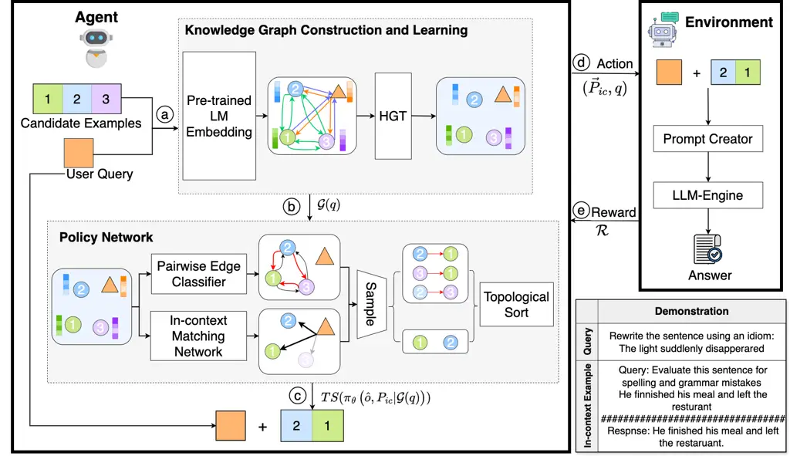

Figure 1: An overview of GRL-Prompt. The circle and triangle represent
the candidate nodes and the query node, respectively. The green arrow
lines denote candidate-to-candidate edges, the orange arrow lines
indicate query-to-candidate edges, and the blue arrow lines represent
candidate-to-query edges in the knowledge graph.

## 3 Preliminary and Problem Definition

In this section, we first introduce the relevant definitions and then
formulate the key problems associated with prompt optimization.

Knowledge Graph A knowledge graph is defined as
$`\mathcal{G}=(\mathcal{V},\mathcal{E},\mathcal{R})`$, with nodes
$`v_{i}\in\mathcal{V}`$ and directed edges
$`(v_{i},r_{ij},v_{j})\in\mathcal{E}`$, where $`r_{ij}\in\mathcal{R}`$
is the relation type of the edge between $`v_{i}`$ and $`v_{j}`$.

Reinforcement Learning The RL is formulated as a Markov Decision Process
(MDP), which is a sequential decision-making mathematical model in which
actions affect the current short-term rewards, subsequent states, and
future rewards Sutton and Barto (2018). The MDP is defined as the tuple
$`\{\mathcal{S},\mathcal{A},\mathcal{T},\mathcal{R},\gamma\}`$, where
$`s\in\mathcal{S}`$ and $`a\in\mathcal{A}`$ denote state and action,
respectively.
$`\mathcal{T}:\mathcal{S}\times\mathcal{A}\rightarrow p(\mathcal{S})`$
is identified by the states transition. $`p(\cdot)`$ denotes the
distribution of the states. $`\mathcal{R}`$ is the reward function, with
$`\gamma\in[0,1]`$ as the discount factor.

In-context Learning ICL is a paradigm that facilitates language models
to learn tasks using only a few in-context examples presented in the
form of natural language Brown et al. (2020). Formally, the sequence of
in-context examples is denoted as
$`\vec{\emph{P}}_{ic}=[p_{ic}^{1},...,p_{ic}^{K}]`$, where $`K`$ is the
number of in-context examples provided to construct the prompt.

Prompt Optimization Problem Given a user query text $`q\in\emph{Q}`$ and
a set of candidate examples $`\emph{P}_{cand}`$, we aim to learn a
prompt optimization strategy
$`f_{opt}(q,\emph{P}_{cand})\rightarrow\emph{P}_{ic}`$. Each candidate
example $`p_{cand}\in\emph{P}_{c}`$ is a triple of
$`(query,context,response)`$, where $`query`$ denotes the user query,
$`context`$ represents the extra information provided by the users
(optional), and $`response`$ is the expected answer. The generated
sequence of in-context examples provided for LLMs can be used for a
variety of downstream NLP tasks.

## 4 Methodology

In this section, we introduce GRL-Prompt, an LLMs-agnostic framework for
prompt optimization via RL. As illustrated in Figure 1, a knowledge
graph is constructed using candidate examples and a user query, from
which a heterogeneous graph neural network is employed to encode their
correlations into high-dimensional embedding representations for the
downstream component. The policy network in the agent learns to find the
optimal sequence of in-context examples from the constructed knowledge
graph, aiming to maximizing the prediction rewards for the user query
when interacting with LLM environment. Additionally, an embedding-based
reward shaping is utilized to stabilize the RL training process.

### 4.1 Knowledge Graph for Prompt Construction

The correlations between in-context examples and the user query
influence the performance of LLMs in the ICL paradigm Nie et al. (2022).
GRL-Prompt explores the application of KG to better encode the
correlations between candidate examples and the user query, facilitating
prompt construction. The user query and candidate examples are provided
to the KG construction and learning module, as indicated by

in Figure 1.

#### 4.1.1 Knowledge Graph Construction

Since there is no concept of nodes in the set of candidate examples
$`\emph{P}_{c}`$ and the user query $`q`$, we treat each candidate
example $`p_{c}^{i}\in\emph{P}_{cand},i\in[1,...,N]`$ as a candidate
node $`v_{c}^{i}`$ and the user query $`q`$ as query node $`v_{q}`$. The
candidate node $`v_{c}^{i}`$ and the query node $`v_{q}`$ are
represented as a circle and a triangle in Figure 1, respectively. The
number of the candidate examples is $`N`$. The node set
$`\mathcal{V}=\{v_{c}^{i}\}_{i=1}^{N}\cup v_{q}`$ in the knowledge graph
$`\mathcal{G}(q)`$ consists of two types of nodes: candidate node
$`v_{c}`$ and query node $`v_{q}`$. We utilize a pre-trained language
model, such as BERT Lu et al. (2023) and RoBERTa Ghosal et al. (2021),
to generate the initial node embeddings in the knowledge graph, which is
defined as:

```math
\emph{X}^{0}=PreLM(\mathcal{V}) \tag{1}
```

Here, we use the values from the final layer of the pre-trained language
model as the initial node embeddings
$`\emph{X}^{0}\in\mathcal{R}^{(N+1)\times d}`$.

We construct three types of edges: candidate-to-candidate edges,
query-to-candidate edges and candidate-to-query edges, which are based
on the constituent nodes to encode different relations. Each candidate
node $`v_{c}^{i}\in\mathcal{V}`$ is connected to all other candidate
nodes $`v_{c}^{j}(j\neq i`$) with relation $`r_{cc}`$. The directed
candidate-to-candidate edge is denoted as
$`(v_{c}^{i},r_{cc},v_{c}^{j})`$, represented by the green arrow lines
in Figure 1. Our formulation results in bidirectional edges between each
pair of candidate nodes, i.e. both $`(v_{c}^{i},r_{cc},v_{c}^{j})`$ and
$`(v_{c}^{j},r_{cc},v_{c}^{i})\in\mathcal{E}`$. The query-to-candidate
edge is constituted by the query node $`v_{q}`$ and the candidate node
$`v_{c}`$, which is denoted as $`(v_{q},r_{qc},v_{c})`$. Meanwhile, each
candidate node $`v_{c}^{i}\in\mathcal{V}`$ is bidirectionally connected
to the query node $`v_{q}`$, leading to the candidate-to-query edges
$`(v_{c}^{i},r_{cq},v_{q})`$ and query-to-candidate edges
$`(v_{q},r_{qc},v_{c}^{i})`$, respectively. These two types of edges are
represented by the blue arrow lines and the orange arrow lines,
respectively.

#### 4.1.2 Knowledge Graph Learning

To capture the complex interactions between the candidate examples and
the user query in the constructed knowledge graph, we utilize a
two-layer Heterogeneous Graph Transformer (HGT) Hu et al. (2020) to
perform knowledge graph learning. The details of HGT can be found
Appendix A.1.

### 4.2 RL-based Prompt Optimization

Recent works have unveiled the high sensitivity of LLMs to prompts Li
et al. (2024a); Bach et al. (2022). Recent research has shown that the
performance of LLMs with in-context learning can be highly unstable
across different selections of in-context examples and permutations of
those examples Liu et al. (2021); Lu et al. (2022). Apart from that,
finding the optimal prompt for various LLMs in different tasks is
usually done manually in a trial-and-error fashion, which can be
labor-intensive and challenging. To alleviate this issue, we design a
policy network that utilizes the structural correlations in the
constructed knowledge graph, as indicated by

in Figure 1, to optimize prompts within the RL paradigm, avoiding
brute-force searching or manually designed heuristics.

#### 4.2.1 Policy Network

We design a policy network
$`\pi_{\theta}\left(\hat{o},\emph{P}_{ic}|\mathcal{G}(q)\right)`$ that
incorporates a PEC to predict the relative order of any two candidate
examples, utilizing the structural representation of the candidate nodes
within the knowledge graph. Furthermore, an ICMN in policy network
assesses the probability of each candidate example being selected as an
in-context example within the constructed knowledge graph.

PEC uses the node embedding in the constructed knowledge graph to
classify the order between two corresponding candidate examples. For
instance, taking $`p_{c}^{i}`$ and $`p_{c}^{j}`$ as two candidate
examples, where $`i\neq j`$, and their corresponding nodes in the
constructed knowledge graph $`\mathcal{G}`$ are $`v_{c}^{i}`$ and
$`v_{c}^{j}`$, respectively. In this formulation, PEC considers the
bidirectional edges between $`v_{c}^{i}`$ and $`v_{c}^{j}`$ in
$`\mathcal{E}`$ of $`\mathcal{G}(q)`$ — $`(v_{c}^{i},r_{ij},v_{c}^{j})`$
and $`(v_{c}^{j},r_{ji},v_{c}^{i})`$. The classification objective is
then to compare the pair scores of two edges that are reversed in
direction, which is denoted as:

```math
f_{pec}(v_{c}^{i},v_{c}^{j})=\max(\left[ps(v_{c}^{i},v_{c}^{j}),ps(v_{c}^{j},v_{c}^{i})\right])\vskip-5.69054pt \tag{2}
```

If $`ps(v_{c}^{i},v_{c}^{j})>ps(v_{c}^{j},v_{c}^{i})`$, then we predict
candidate example $`p_{c}^{i}`$ appears earlier than $`p_{c}^{j}`$
$`(p_{c}^{i}\rightarrow p_{c}^{j})`$, or vice versa
$`(p_{c}^{j}\rightarrow p_{c}^{i})`$. Naturally, the pair score function
$`ps(\cdot,\cdot)`$ must be sensitive to the order of its inputs, and
the output represents the probability of the order between two candidate
examples. We define the $`ps`$ function as follows:

```math
ps(v_{c}^{i},v_{c}^{j})\!=\!\frac{e^{\sin\!{(\emph{X}(v_{c}^{i})-\emph{X}(v_{c}^{j}))}\cdot\emph{w}}}{e^{\sin\!{(\emph{X}(v_{c}^{i})-\emph{X}(v_{c}^{j}))}\cdot\emph{w}}+\!e^{\sin\!{(\emph{X}(v_{c}^{j})-\emph{X}(v_{c}^{i}))}\cdot\emph{w}}} \tag{3}
```

where $`\emph{w}\in\mathcal{R}^{d}`$ is the learnable parameter of the
function.

|       |          |              |              |              |              |              |              |              |              |
| ----- | -------- | ------------ | ------------ | ------------ | ------------ | ------------ | ------------ | ------------ | ------------ |
|       |          | Alpaca       |              |              |              | Dolly        |              |              |              |
| Model | Method   | ROUGE-1      | ROUGE-2      | ROUGE-L      | BLEU         | ROUGE-1      | ROUGE-2      | ROUGE-L      | BLEU         |
|       | Random-1 | 0.36         | 0.17         | 0.29         | 0.11         | 0.31         | 0.13         | 0.22         | 0.05         |
|       | Random-2 | 0.35         | 0.17         | 0.27         | 0.10         | 0.35         | 0.15         | 0.25         | 0.07         |
|       | PromptPG | 0.38         | 0.18         | 0.30         | 0.11         | 0.42         | 0.21         | 0.32         | 0.11         |
|       | CoT      | 0.18         | 0.07         | 0.13         | 0.03         | 0.18         | 0.06         | 0.12         | 0.02         |
|       | Pillow   | 0.40         | 0.19         | 0.32         | 0.13         | 0.41         | 0.20         | 0.31         | 0.11         |
|       | UDR      | 0.42         | 0.20         | 0.33         | 0.13         | 0.41         | 0.21         | 0.31         | 0.11         |
| GPT-4 | Ours     | 0.44 (+0.02) | 0.23 (+0.03) | 0.34 (+0.01) | 0.15 (+0.02) | 0.43 (+0.01) | 0.21 (+0.00) | 0.32 (+0.00) | 0.11 (+0.00) |
|       | Random-1 | 0.41         | 0.20         | 0.32         | 0.13         | 0.38         | 0.18         | 0.30         | 0.10         |
|       | Random-2 | 0.44         | 0.22         | 0.35         | 0.15         | 0.38         | 0.17         | 0.29         | 0.10         |
|       | PromptPG | 0.46         | 0.23         | 0.37         | 0.16         | 0.45         | 0.24         | 0.35         | 0.14         |
|       | CoT      | 0.35         | 0.16         | 0.27         | 0.09         | 0.33         | 0.14         | 0.24         | 0.07         |
|       | Pillow   | 0.47         | 0.23         | 0.38         | 0.16         | 0.43         | 0.23         | 0.35         | 0.13         |
|       | UDR      | 0.46         | 0.23         | 0.37         | 0.16         | 0.43         | 0.24         | 0.35         | 0.13         |
| GPT-3 | Ours     | 0.50 (+0.03) | 0.27 (+0.04) | 0.39 (+0.01) | 0.19 (+0.03) | 0.47 (+0.02) | 0.26 (+0.02) | 0.37 (+0.02) | 0.15 (+0.01) |
|       | Random-1 | 0.32         | 0.14         | 0.25         | 0.09         | 0.21         | 0.08         | 0.16         | 0.04         |
|       | Random-2 | 0.30         | 0.14         | 0.23         | 0.08         | 0.26         | 0.09         | 0.18         | 0.04         |
|       | PromptPG | 0.31         | 0.14         | 0.23         | 0.08         | 0.38         | 0.19         | 0.30         | 0.10         |
|       | CoT      | 0.16         | 0.07         | 0.12         | 0.03         | 0.16         | 0.06         | 0.12         | 0.02         |
|       | Pillow   | 0.33         | 0.16         | 0.27         | 0.11         | 0.36         | 0.19         | 0.28         | 0.10         |
|       | UDR      | 0.41         | 0.20         | 0.33         | 0.13         | 0.39         | 0.19         | 0.30         | 0.11         |
| LLaMA | Ours     | 0.45 (+0.04) | 0.23 (+0.03) | 0.35 (+0.02) | 0.15 (+0.02) | 0.41 (+0.02) | 0.21 (+0.02) | 0.31 (+0.01) | 0.12 (+0.01) |

Table 1: Results on GRL-Prompt on Alpaca and Dolly. The score
differences that indicate better performance than the best baselines are
marked with red color. Underlining indicates the value that achieves the
best performance among all baselines

ICMN calculates probability of selecting each candidate examples
$`p_{c}^{i}\in P_{cand}`$ for the set of in-context samples $`P_{ic}`$
based on the node embedding of the knowledge graph. For each candidate
examples $`p_{c}^{i}`$, the corresponding node in the knowledge graph is
$`v_{c}^{i}`$, and the user query $`q`$ corresponds to the query node
$`v_{q}`$. The calculation process of the selecting probability is
defined as follows:

```math
f_{icmn}(v_{q},\!v_{c}^{i})\!=\!sigmoid(\frac{\emph{X}(\!v_{q}\!)\!\cdot\!\emph{W}_{m}\!\cdot\!\emph{X}^{T}\!(v_{c}^{i})\!}{\sqrt{d}}) \tag{4}
```

$`\emph{W}_{m}\in\mathcal{R}^{d\times d}`$ denotes the learnable matrix,
and $`sigmoid`$ function maps the similarity between the candidate
example and the user query into probability space. $`\sqrt{d}`$ acts as
a scaling factor.

The policy network obtains the probability distribution for the
generation of the sequence of in-context examples from the candidate
examples set $`P_{cand}`$ via the component of ICMN and PEC, which is
denoted as:

```math
p(\pi)\!=\!(\!\!\!\prod_{i\in[1,N]\atop i<j}\!\!\!\!f_{pec}(v_{c}^{i},v_{c}^{j}))\!\!\times\!\!(\!\!\!\prod_{i\in[1,N]}\!\!\!\!f_{icmn}(v_{q},\!v_{c}^{i}))\!\!\vskip-8.53581pt \tag{5}
```

where $`N`$ is the number of the set of candidate examples. Finally,
given a user query $`q`$, the sequence of in-context examples is
generated from the set of candidate examples according to the policy
network

```math
\vec{\emph{P}}_{ic}\sim TS(\pi_{\theta}\left(\hat{o},\emph{P}_{ic}|\mathcal{G}(q)\right)),\vec{\emph{P}}_{ic}\in\mathcal{F}(\emph{P}_{cand}) \tag{6}
```

where $`\mathcal{F}(\cdot)`$ is the operator that constructs a set of
all possible order-sensitive subsets from a given set. The total number
of possible order-sensitive subsets from a set with $`n`$ elements is
$`\sum_{i=1}^{n}\frac{n!}{(n-i)!}`$ Velleman and Call (1995). We use
$`\mathcal{F}(\emph{P}_{cand})`$ to denote the state space in the RL in
our formulation. $`TS(\cdot)`$ represents the topological sorting
method Bommasani and Cardie (2020), which is used to obtain the final
ordered sequence from the all the pairwise edges orders $`\hat{o}`$. If
the PEC predicts that the order between the candidate example
$`p_{c}^{i}`$ and $`p_{c}^{j}`$ is $`(p_{c}^{i}\rightarrow p_{c}^{j})`$,
$`TS(\cdot)`$ ensures $`p_{c}^{i}`$ comes before $`p_{c}^{j}`$ in the
final ordering. We sample the set of in-context examples
$`\emph{P}_{ic}`$ and pairwise orders $`\hat{o}`$ associated with the
in-context examples from the policy network, and the sequence of
in-context examples $`\vec{\emph{P}}_{ic}`$ is generated by
$`TS(\cdot)`$.

#### 4.2.2 Reward Design

Since we test GRL-Prompt on general text-to-text generation tasks, the
reward is designed based on the evaluation of the responses from the
LLMs using the in-context examples that we predict. The variation in the
responses from black-box LLMs poses challenges to the training
efficiency and convergence rate of the RL training process. To address
these issues, we develop embedding-based reward shaping to smooth the
reward function and stabilize the RL training, which can be expressed
as:

```math
\mathcal{R}(a,\hat{a})=\lambda\mathcal{R}_{m}(a,\hat{a})+(1-\lambda)\mathcal{R}_{e}(a,\hat{a}) \tag{7}
```

$`\mathcal{R}_{m}`$ represents fuzzy textual similarity, and
$`\mathcal{R}_{e}`$ denotes the cosine embedding similarity based on
sentence representations. $`a`$ represent the expected output. The
generated response of LLMs denotes $`\hat{a}`$, which uses the predicted
sequence of in-context examples $`\vec{\emph{P}}_{ic}`$ and the given
user query $`q`$ to construct the prompt. $`\lambda`$ is the
hyperparameter for adjusting the weight of two components in the reward
function.

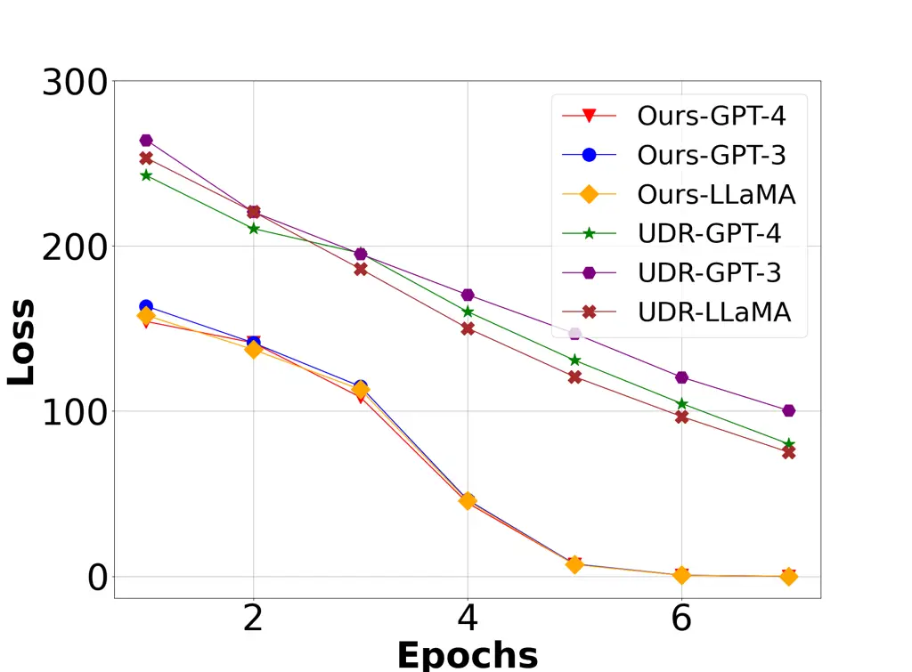

(a) Training loss on Alpaca.

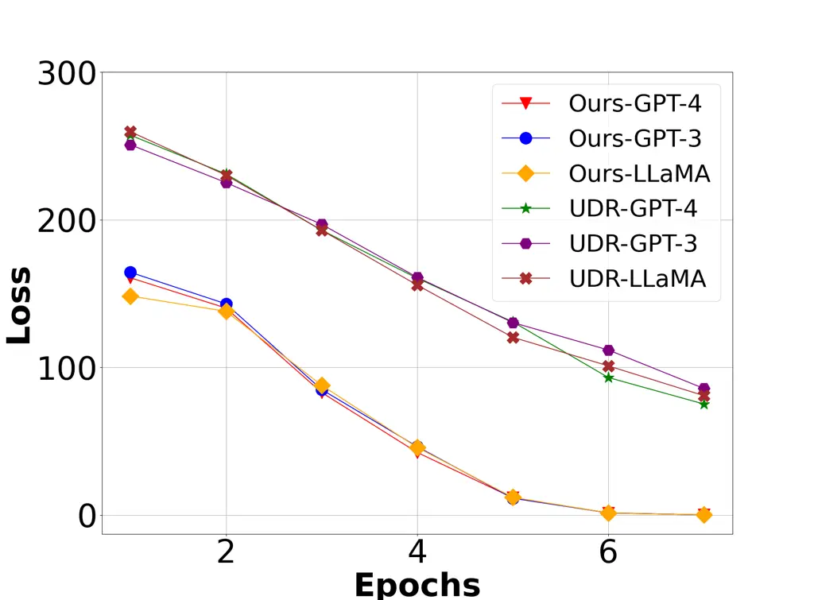

(b) Training loss on Dolly.

Figure 2: Results of training loss on different datasets.

#### 4.2.3 Training Process

Given the set of training user query
$`\emph{Q}_{tr}=\{q^{i}\}_{i=1}^{M}`$ and their corresponding the
expected responses $`\{a^{1},...,a^{M}\}`$, our goal is to maximize the
expected reward of the generated response using the policy network
$`\mathbb{E}_{\vec{\emph{P}}_{ic}^{i}\sim\pi_{\theta}(\hat{o}^{i},\emph{P}_{ic}^{i}|\mathcal{G}(q^{i}))}[\mathcal{R}(a^{i},\hat{a}^{i})]`$.
We optimize the reward with respect to the parameters of the policy
network using the policy gradient algorithm Williams (1992), which is
defined as follows:

```math
\begin{split}&\nabla\mathbb{E}_{\vec{\emph{P}}_{ic}^{i}\sim\pi_{\theta}(\hat{o}^{i},\emph{P}_{ic}^{i}|\mathcal{G}(q^{i}))}[\mathcal{R}(a^{i},\hat{a}^{i})]\\
&\!=\!\mathbb{E}_{\vec{\emph{P}}_{ic}^{i}\sim\pi_{\theta}(\hat{o}^{i}\!,\emph{P}_{ic}^{i}|\mathcal{G}(q^{i})\!)\!}\!\nabla\!_{\theta}\!\log(\!\pi_{\theta}(\hat{o}^{i},\!\emph{P}_{ic}^{i}|\mathcal{G}(q^{i})))\mathcal{R}(\!a^{i},\!\hat{a}^{i}\!)\\
&\!\approx\!\!\frac{1}{m}\!\!\sum^{m}_{i=1}\!\nabla\!_{\theta}\!\log(\pi_{\theta}\!(\hat{o}^{i}\!,\!\emph{P}_{ic}^{i}|\mathcal{G}(q^{i})))\mathcal{R}(\!a^{i}\!,\!\hat{a}^{i}\!),\vec{\emph{P}}_{ic}^{i}\!\sim\!TS(\!\pi_{\theta}\!)\!\\[-11.38109pt]
\end{split}\vskip-14.22636pt \tag{8}
```

Here, $`m`$ denotes the size of each batch from our training set of user
query $`\emph{Q}_{tr}`$. The learnable parameters in the knowledge graph
and the policy network are updated iteratively as GRL-Prompt acts as an
agent interacting with the LLMs, which is demonstrated in Figure 1. We
uses the generated sequence of in-context examples and the user query to
construct the final prompt when interacting with LLMs. The demonstration
of the prompt format used in the prompt creator is shown in
Appendix A.2, while the exemplary demonstration of user query and the
in-context example can be found in Figure 1. Intuitively, if the
response of LLMs is correct, we update the policy network to increase
the probability of generating the same sequence of the in-context
samples. Conversely, we update the policy network to reduce the
probability of generating that sequence.

## 5 Experiment

### 5.1 Experimental Setup

#### 5.1.1 Dataset

We evaluate our approach on two public datasets. The following datasets
are chosen because they encompass a variety of text-to-text generation
tasks and contain repetitive QA patterns.

Alpaca Taori et al. (2023) dataset consists of 52,000
instruction-response pairs generated by OpenAI’s text-davinci-003 model.
These instructions are expanded from existing open-source instruction
datasets, covering a wide range of tasks from simple question-answering
to complex reasoning and programming issues, thus providing strong
cross-scenario adaptability.

Dolly Conover et al. (2023) contains 15,000 human-annotated
instruction-following records across tasks like brainstorming,
classification, closed question-answering, text generation, and
summarization. Annotators were instructed to avoid using online data,
except Wikipedia for certain categories, and to refrain from using
generative AI in crafting instructions or responses, ensuring the
dataset’s quality and authenticity.

#### 5.1.2 Baselines and Configurations

We compare GRL-Prompt with three baselines: (a) Random selection: We
randomly selected one example and two additional examples from the
training set as the baselines in our experiments. (b) PromptPG Lu et al.
(2023), which utilizes policy gradient to learn to select in-context
examples from a small amount of training data and then constructs the
corresponding prompt for the test example. (c) CoT prompting Wei et al.
(2022b), which is a widely validated approach of in-context learning.
(d) Pillow Qi et al. (2023), which designs a matching network to select
in-context examples and follows a reinforcement learning process to
update its parameters. (e) UDR Li et al. (2023), which proposes a
bi-encoder architecture to represent candidate in-context examples and
designs a ranking training algorithm to retrieve these examples.  
We randomly selected 1,800 data items: 200 for RL training, 800 for
validation, and 800 for testing. Experiments for both the baselines and
our GRL-Prompt were repeated three times, and the average metric is
reported in Table 1. We implemented the experiments on a single NVIDIA
A100 GPU for model training and evaluation.

#### 5.1.3 Evaluation Metric

ROUGE is widely adopted to evaluate the informational completeness and
coverage of generated texts by calculating the recall of generated text
to reference text. We use ROUGE-1, ROUGE-2 Lin (2004), and ROUGE-L Lin
and Och (2004) as the evaluation metrics in this experiment to measure
the quality of the generated text at different granularities. BLEU, on
the other hand, measures the accuracy of the generated text by comparing
the similarity between the generated text and the reference text Shang
et al. (2021). It places greater emphasis on precision matching than
ROUGE.

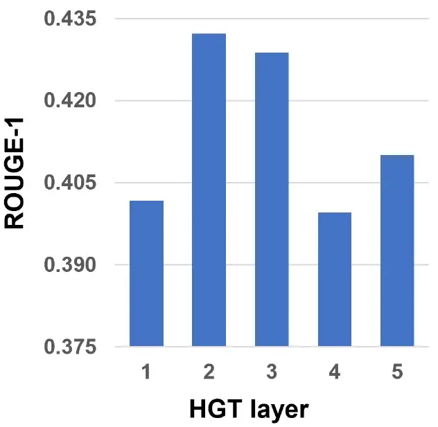

(a) ROUGE-1.

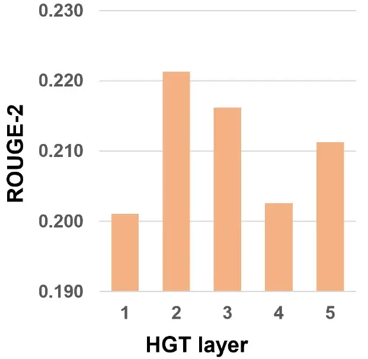

(b) ROUGE-2.

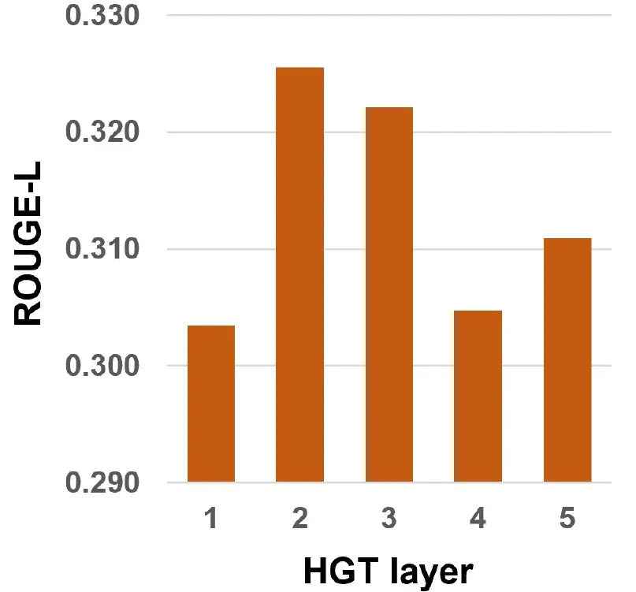

(c) ROUGE-L.

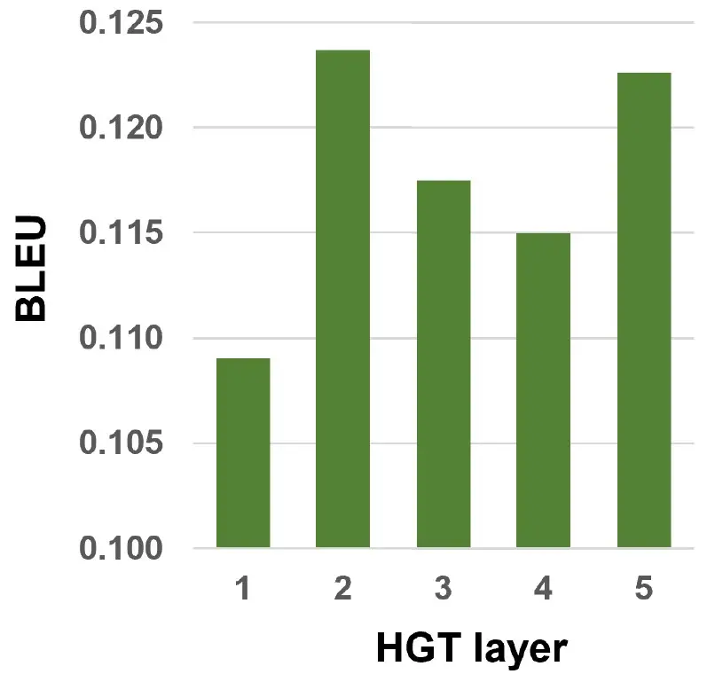

(d) BLEU.

Figure 3: Sensitivity analysis on HGT layer.

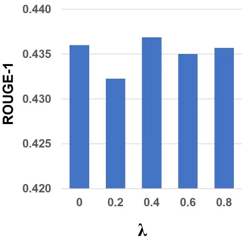

(a) ROUGE-1.

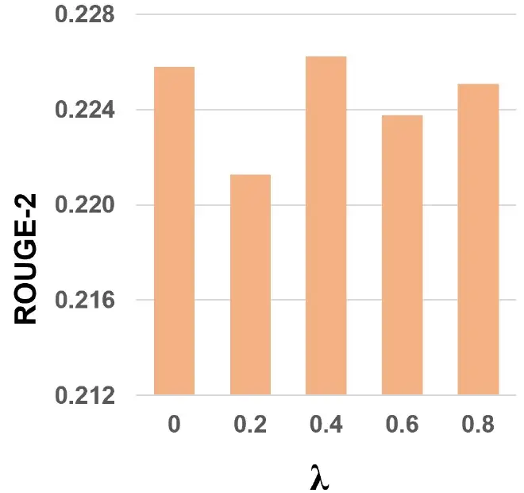

(b) ROUGE-2.

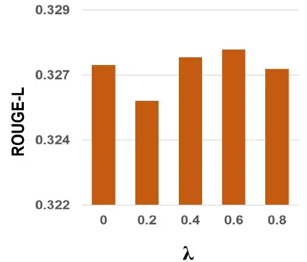

(c) ROUGE-L.

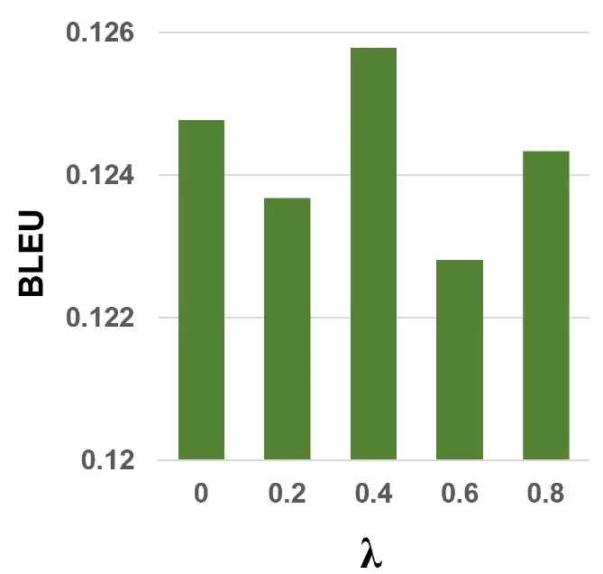

(d) BLEU.

Figure 4: Sensitivity analysis on $`\lambda`$.

### 5.2 Performance Analysis

As shown in Table 1, GRL-Prompt can enhance the in-context learning
performance on both public datasets regarding Rouge and BLEU metrics
compared with the above baselines. Our method outperforms all baseline
methods across two datasets, showing an average improvement of 0.10 on
ROUGE-1, 0.07 on ROUGE-2, 0.07 on ROUGE-L, and 0.05 on BLEU. It
indicates that GRL-Prompt learns the order-sensitive policy from the
constructed knowledge graph to generate the optimal sequence of
in-context examples for prompt optimization, effectively reducing the
uncertainty and noise introduced by the random selection and permutation
of the in-context examples. It is worth noting that CoT prompting
performs worse than random selection because the examples of CoT are
manually designed for the specific task.  
As shown in Figures 2(a) and 2(b), we compare the trend of training loss
with UDR, the baseline that performed the best on nearly all metrics.
Models trained with the GRL-Prompt method (i.e., Ours-GPT-4, Ours-GPT-3,
and Ours-LLaMA) demonstrate a significant reduction in loss, while
converging faster in later epochs, reflecting strong learning
performance and stability. In contrast, UDR method (i.e., UDR-GPT-4,
UDR-GPT-3, and UDR-LLaMA) start with lower loss values, and the rate of
decrease diminishes as training progresses, with fluctuations and
consistently higher final loss values. Moreover, we conduct extensive
experiments to compare the trend of training loss with all baselines,
which can be found in Appendix A.3. The fast convergence rate and lower
loss observed with the GRL-Prompt method are primarily attributed to the
designated embedding-based reward, which effectively incorporates
feedback from LLMs during the prompt optimization phase. Additionally,
the detailed case study can be found in Appendix A.4.

|         |                          |                          |                          |                          |
| ------- | ------------------------ | ------------------------ | ------------------------ | ------------------------ |
| Method  | ROUGE-1                  | ROUGE-2                  | ROUGE-L                  | BLEU                     |
| Ours    | 0.44                     | 0.23                     | 0.34                     | 0.15                     |
| -w/o KG | 0.38($`\downarrow`$0.06) | 0.18($`\downarrow`$0.05) | 0.30($`\downarrow`$0.04) | 0.12($`\downarrow`$0.03) |
| -w/o RF | 0.37($`\downarrow`$0.07) | 0.16($`\downarrow`$0.07) | 0.28($`\downarrow`$0.06) | 0.10($`\downarrow`$0.05) |

Table 2: Performances of GRL-Prompt in ablation study on Alpaca dataset
using GPT-4

### 5.3 Ablation Study

To validate the effectiveness of different components in GRL-Prompt, we
design two variants of GRL-Prompt and compare the performance of these
variants with GRL-Prompt in this section. The results of comparison are
shown in Table 2. GRL-Prompt w/o knowledge graph (KG) excludes the
processes of KG construction and learning, and directly represents the
user query and the candidate examples using the embedding from a
pre-trained language model. The results show that GRL-Prompt outperforms
over GRL-Prompt w/o KG by margins of 0.03-0.06 on four different
evaluation metrics, indicating the correlation of the user query and the
candidate examples encoded by KG enhances the performance of GRL-Prompt.
GRL-Prompt w/o reward feedback (RF) replaces the RL-based prompt
optimization with k-NN method for selecting the in-context examples,
setting the number of examples to form the prompt at 2 Nie et al.
(2022). The variant results in drops of 0.05 to 0.07 across four
evaluation metrics, inferring the necessity of reward feedback for
prompt optimization. Additionally, the overall experimental results on
two datasets using three LLMs can be found in Appendix A.5.

### 5.4 Sensitivity Analysis

We study the impact of key parameters in GRL-Prompt, including the HGT
layer and the $`\lambda`$ in the reward on Dolly dataset, the results
are illustrated in Figure 3 and 4, respectively.

1.  1.  Impact of the total number of layer in the HGT: As shown in
        Figure 3, increasing the number of layers generally enhances our
        model’s performance, while start dropping after a certain point. It
        is observed that our model achieves the best performance when the
        layer is set to be 2. Intuitively, continuously increasing the
        number of layers introduces the over-smoothing problem in graph
        learning, resulting in an unexpected decline in performance.
2.  2.  Impact of $`\lambda`$ in the reward: As observed in Figure 4, the
        performance of the model achieves the best when $`\lambda=0.4`$,
        showing an optimal trade-off point between the fuzzy textual
        similarity and the cosine embedding similarity in most cases. It
        also indicates that over-reliance on fuzzy textual similarity
        $`\mathcal{R}_{m}`$ aggravates the performance of GRL-Prompt.
        However, using the embedding-based reward that incorporates two
        components of rewards can help improve the performance of
        GRL-Prompt.

## 6 Conclusion

In this paper, we propose a LLMs-agnostic prompt optimization framework
called GRL-Prompt. This framework first constructs a knowledge graph
from the user instruction and the candidate examples, learning with HGT
to better encode their correlation. Afterwards, the policy network is
designed to find the optimal sequence of in-context examples by
incorporating the PEC and ICMN to classify the order of examples and
select the relevant ones. We also conduct comprehensive experiments on
two widely-used public datasets and compare the proposed GRL-Prompt with
four baseline methods. The results and analysis reveal that the proposed
framework achieves state-of-the-art performance across different LLMs in
the in-context learning paradigm.

## References

- Bach et al. (2022) Stephen H. Bach, Victor Sanh, Zheng-Xin Yong,
  Albert Webson, Colin Raffel, Nihal V. Nayak, Abheesht Sharma, Taewoon
  Kim, M Saiful Bari, Thibault Fevry, Zaid Alyafeai, Manan Dey, Andrea
  Santilli, Zhiqing Sun, Srulik Ben-David, Canwen Xu, Gunjan Chhablani,
  Han Wang, Jason Alan Fries, Maged S. Al-shaibani, Shanya Sharma,
  Urmish Thakker, Khalid Almubarak, Xiangru Tang, Dragomir Radev, Mike
  Tian-Jian Jiang, and Alexander M. Rush. 2022. [Promptsource: An
  integrated development environment and repository for natural language
  prompts](https://arxiv.org/abs/2202.01279). _Preprint_,
  arXiv:2202.01279.
- Bommasani and Cardie (2020) Rishi Bommasani and Claire Cardie. 2020.
  Intrinsic evaluation of summarization datasets. In _Proc. of the
  International Conference on Empirical Methods in Natural Language
  Processing_, pages 8075–8096.
- Brown et al. (2020) Tom Brown, Benjamin Mann, Nick Ryder, Melanie
  Subbiah, Jared D Kaplan, Prafulla Dhariwal, Arvind Neelakantan, Pranav
  Shyam, Girish Sastry, Amanda Askell, et al. 2020. Language models are
  few-shot learners. In _Proc. of the International Conference on Neural
  Information Processing Systems_, pages 1877–1901.
- Chen et al. (2020) Xiaojun Chen et al. 2020. A review: Knowledge
  reasoning over knowledge graph. _Expert Systems with Applications_,
  141:112948.
- Conover et al. (2023) Mike Conover, Matt Hayes, Ankit Mathur, Jianwei
  Xie, Jun Wan, Sam Shah, Ali Ghodsi, Patrick Wendell, Matei Zaharia,
  and Reynold Xin. 2023. Free dolly: Introducing the world’s first truly
  open instruction-tuned llm. _Company Blog of Databricks_.
- Deng et al. (2023) Mingkai Deng, Jianyu Wang, Cheng-Ping Hsieh, Yihan
  Wang, Han Guo, Tianmin Shu, Meng Song, Eric P Xing, and Zhiting
  Hu. 2023. Rlprompt: Optimizing discrete text prompts with
  reinforcement learning. In _Proc. of the Conference on Empirical
  Methods in Natural Language Processing_, pages 3369–3391.
- Dong et al. (2022) Qingxiu Dong, Lei Li, Damai Dai, Ce Zheng, Zhiyong
  Wu, Baobao Chang, Xu Sun, Jingjing Xu, and Zhifang Sui. 2022. A survey
  on in-context learning. _arXiv preprint arXiv:2301.00234_.
- Ghosal et al. (2021) Deepanway Ghosal, Navonil Majumder, Rada
  Mihalcea, and Soujanya Poria. 2021. Stack: Sentence ordering with
  temporal commonsense knowledge. In _Proc. of the International
  Conference on Empirical Methods in Natural Language Processing_, pages
  8676–8686.
- Hu et al. (2020) Ziniu Hu, Yuxiao Dong, Kuansan Wang, and Yizhou
  Sun. 2020. Heterogeneous graph transformer. In _Proc. of the Web
  Conference_, pages 2704–2710.
- Hugo et al. (2023) Touvron Hugo, Lavril Thibaut, Izacard Gautier,
  Martinet Xavier, Lachaux Marie-Anne, Lacroix Timothée, Rozière
  Baptiste, Goyal Naman, Hambro Eric, Azhar Faisal, Rodriguez Aurelien,
  Joulin Armand, Grave Edouard, and Lample Guillaume. 2023. Llama: Open
  and efficient foundation language models. _arXiv preprint
  arXiv:2302.13971_.
- Lewis et al. (2019) Mike Lewis, Yinhan Liu, Naman Goyal, Marjan
  Ghazvininejad, Abdelrahman Mohamed, Omer Levy, Ves Stoyanov, and Luke
  Zettlemoyer. 2019. Bart: Denoising sequence-to-sequence pre-training
  for natural language generation, translation, and comprehension.
  _arXiv preprint arXiv:1910.13461_.
- Li et al. (2024a) Chengzhengxu Li, Xiaoming Liu, Yichen Wang, Duyi Li,
  Yu Lan, and Chao Shen. 2024a. Dialogue for prompting: a
  policy-gradient-based discrete prompt generation for few-shot
  learning. In _Proc. of the AAAI Conference on Artificial
  Intelligence_, pages 18481–18489.
- Li et al. (2024b) Guozheng Li, Wenjun Ke, Peng Wang, Zijie Xu, Ke Ji,
  Jiajun Liu, Ziyu Shang, and Qiqing Luo. 2024b. Unlocking instructive
  in-context learning with tabular prompting for relational triple
  extraction. In _Proc. of International Conference on Computational
  Linguistics_, pages 17131–17143.
- Li et al. (2023) Xiaonan Li, Kai Lv, Hang Yan, Tianyang Lin, Wei Zhu,
  Yuan Ni, Guotong Xie, Xiaoling Wang, and Xipeng Qiu. 2023. Unified
  demonstration retriever for in-context learning. In _Proc. of the
  Annual Meeting of the Association for Computational Linguistics_,
  pages 4644–4668.
- Li et al. (2024c) Yihao Li, Ru Zhang, Jianyi Liu, and Gongshen Liu.
  2024c. An enhanced prompt-based llm reasoning scheme via knowledge
  graph-integrated collaboration. _arXiv preprint arXiv:2402.04978_.
- Lin (2004) Chin-Yew Lin. 2004. Rouge: A package for automatic
  evaluation of summaries. In _Proc. of the International Conference on
  Association for Computational Linguistics_, pages 74–81.
- Lin and Och (2004) Chin-Yew Lin and Franz Josef Och. 2004. Automatic
  evaluation of machine translation quality using longest common
  subsequence and skip-bigram statistics. In _Proc. of the Annual
  Meeting of the Association for Computational Linguistics_, pages
  605–612.
- Liu et al. (2021) Jiachang Liu, Dinghan Shen, Yizhe Zhang, Bill Dolan,
  Lawrence Carin, and Weizhu Chen. 2021. What makes good in-context
  examples for gpt-$`3`$? _arXiv preprint arXiv:2101.06804_.
- Lu et al. (2023) Pan Lu, Liang Qiu, Kai-Wei Chang, Ying Nian Wu,
  Song-Chun Zhu, Tanmay Rajpurohit, Peter Clark, and Ashwin
  Kalyan. 2023. Dynamic prompt learning via policy gradient for
  semi-structured mathematical reasoning. pages 1–26.
- Lu et al. (2022) Yao Lu, Max Bartolo, Alastair Moore, Sebastian
  Riedel, and Pontus Stenetorp. 2022. Fantastically ordered prompts and
  where to find them: Overcoming few-shot prompt order sensitivity. In
  _Proc. of the Annual Meeting of the Association for Computational
  Linguistics_, pages 8086–8098.
- Min et al. (2022) Sewon Min, Xinxi Lyu, Ari Holtzman, Mikel Artetxe,
  Mike Lewis, Hannaneh Hajishirzi, and Luke Zettlemoyer. 2022.
  Rethinking the role of demonstrations: What makes in-context learning
  work? _arXiv preprint arXiv:2202.12837_.
- Nie et al. (2022) Feng Nie, Meixi Chen, Zhirui Zhang, and
  Xu Cheng. 2022. Improving few-shot performance of language models via
  nearest neighbor calibration. _arXiv preprint arXiv:2212.02216_.
- Qi et al. (2023) Zhenting Qi, Xiaoyu Tan, Shaojie Shi, Chao Qu,
  Yinghui Xu, and Yuan Qi. 2023. Pillow: Enhancing efficient instruction
  fine-tuning via prompt matching. In _Proc. of the Conference on
  Empirical Methods in Natural Language Processing_, pages 471–482.
- Raffel et al. (2020) Colin Raffel, Noam Shazeer, Adam Roberts,
  Katherine Lee, Sharan Narang, Michael Matena, Yanqi Zhou, Wei Li, and
  Peter J Liu. 2020. Exploring the limits of transfer learning with a
  unified text-to-text transformer. _Journal of machine learning
  research_, 21(140):1–67.
- Shang et al. (2021) Xindi Shang, Zehuan Yuan, Anran Wang, and Changhu
  Wang. 2021. Multimodal video summarization via time-aware
  transformers. In _Proc. of the International Conference on
  Multimedia_, pages 1756–1765.
- Sutton and Barto (2018) Richard S Sutton and Andrew G Barto. 2018.
  _Reinforcement learning: An introduction_. MIT press.
- Taori et al. (2023) Rohan Taori, Ishaan Gulrajani, Tianyi Zhang, Yann
  Dubois, Xuechen Li, Carlos Guestrin, Percy Liang, and Tatsunori B
  Hashimoto. 2023. Stanford alpaca: An instruction-following llama
  model.
- Velleman and Call (1995) Daniel J Velleman and Gregory S Call. 1995.
  Permutations and combination locks. _Mathematics Magazine_,
  68(4):243–253.
- Wang et al. (2023) Jianing Wang, Qiushi Sun, Xiang Li, and Ming
  Gao. 2023. Boosting language models reasoning with chain-of-knowledge
  prompting. _arXiv preprint arXiv:2306.06427_.
- Wei et al. (2022a) Jason Wei, Maarten Bosma, Vincent Y Zhao, Kelvin
  Guu, Adams Wei Yu, Brian Lester, Nan Du, Andrew M Dai, and Quoc V Le.
  2022a. Finetuned language models are zero-shot learners. In _Proc. of
  the International Conference on Learning Representations_, pages 1–46.
- Wei et al. (2022b) Jason Wei, Xuezhi Wang, Dale Schuurmans, Maarten
  Bosma, Fei Xia, Ed Chi, Quoc V Le, Denny Zhou, et al. 2022b.
  Chain-of-thought prompting elicits reasoning in large language models.
  In _Proc. of the International Conference on Neural Information
  Processing Systems_, pages 24824–24837.
- Williams (1992) Ronald J Williams. 1992. Simple statistical
  gradient-following algorithms for connectionist reinforcement
  learning. _Machine learning_, 8:229–256.
- Xu et al. (2024) Xin Xu, Yue Liu, Panupong Pasupat, Mehran Kazemi,
  et al. 2024. In-context learning with retrieved demonstrations for
  language models: A survey. _arXiv preprint arXiv:2401.11624_.
- Ye et al. (2023) Jiacheng Ye, Zhiyong Wu, Jiangtao Feng, Tao Yu, and
  Lingpeng Kong. 2023. Compositional exemplars for in-context learning.
  In _Proc. of the International Conference on Machine Learning_, pages
  39818–39833.

## Appendix A Appendix

|       |         |                           |                           |                           |                           |                           |                           |                           |                           |
| ----- | ------- | ------------------------- | ------------------------- | ------------------------- | ------------------------- | ------------------------- | ------------------------- | ------------------------- | ------------------------- |
| Model | Method  | Alpaca                    |                           |                           |                           | Dolly                     |                           |                           |                           |
|       |         | Rouge-1                   | Rouge-2                   | Rouge-L                   | BLEU                      | Rouge-1                   | Rouge-2                   | Rouge-L                   | BLEU                      |
| GPT-4 | Ours    | 0.44                      | 0.23                      | 0.34                      | 0.15                      | 0.43                      | 0.21                      | 0.32                      | 0.11                      |
|       | -w/o KG | 0.38($`\downarrow 0.06`$) | 0.18($`\downarrow 0.05`$) | 0.30($`\downarrow 0.04`$) | 0.12($`\downarrow 0.03`$) | 0.41($`\downarrow 0.02`$) | 0.20($`\downarrow 0.01`$) | 0.31($`\downarrow 0.01`$) | 0.08($`\downarrow 0.03`$) |
|       | -w/o RF | 0.37($`\downarrow 0.07`$) | 0.16($`\downarrow 0.07`$) | 0.28($`\downarrow 0.06`$) | 0.10($`\downarrow 0.05`$) | 0.37($`\downarrow 0.06`$) | 0.17($`\downarrow 0.04`$) | 0.27($`\downarrow 0.05`$) | 0.08($`\downarrow 0.03`$) |
| GPT-3 | Ours    | 0.50                      | 0.27                      | 0.39                      | 0.19                      | 0.47                      | 0.26                      | 0.37                      | 0.15                      |
|       | -w/o KG | 0.46($`\downarrow 0.04`$) | 0.23($`\downarrow 0.04`$) | 0.37($`\downarrow 0.02`$) | 0.16($`\downarrow 0.03`$) | 0.44($`\downarrow 0.03`$) | 0.24($`\downarrow 0.02`$) | 0.35($`\downarrow 0.02`$) | 0.14($`\downarrow 0.01`$) |
|       | -w/o RF | 0.41($`\downarrow 0.09`$) | 0.19($`\downarrow 0.08`$) | 0.32($`\downarrow 0.07`$) | 0.12($`\downarrow 0.07`$) | 0.40($`\downarrow 0.07`$) | 0.20($`\downarrow 0.06`$) | 0.32($`\downarrow 0.05`$) | 0.11($`\downarrow 0.04`$) |
| LLaMA | Ours    | 0.45                      | 0.23                      | 0.35                      | 0.15                      | 0.41                      | 0.21                      | 0.31                      | 0.12                      |
|       | -w/o KG | 0.35($`\downarrow 0.10`$) | 0.14($`\downarrow 0.09`$) | 0.26($`\downarrow 0.09`$) | 0.08($`\downarrow 0.07`$) | 0.39($`\downarrow 0.02`$) | 0.18($`\downarrow 0.03`$) | 0.30($`\downarrow 0.01`$) | 0.11($`\downarrow 0.01`$) |
|       | -w/o RF | 0.32($`\downarrow 0.13`$) | 0.12($`\downarrow 0.11`$) | 0.24($`\downarrow 0.11`$) | 0.07($`\downarrow 0.08`$) | 0.36($`\downarrow 0.05`$) | 0.15($`\downarrow 0.06`$) | 0.28($`\downarrow 0.05`$) | 0.09($`\downarrow 0.02`$) |

Table 1: Performances of GRL-Prompt in supplementary ablation study.

### A.1 The Details of Heterogeneous Graph Transformer (HGT)

The HGT can model heterogeneous relations in our knowledge graph using a
multi-head attention mechanism. It calculates the multi-head attention
between a given node and its neighbor nodes with different relations,
and then uses the normalized attention as the weight for the neighbor
nodes to update the embedding of the given node. Taking the node
$`v_{i}`$ as an example, the embedding learning process can be
formulated as:

```math
\hskip-11.38109pt\begin{split}&\emph{Q}^{h}\left(v_{j}\right)=\emph{X}^{l-1}\left(v_{j}\right)\cdot Q\text{-}Lin^{h}_{\phi(v_{j})}\\
&\emph{K}^{h}\left(v_{i}\right)=\emph{X}^{l-1}\left(v_{i}\right)\cdot K\text{-}Lin^{h}_{\phi(v_{i})}\\
&att^{h}\!\!\left(v_{i}\!,\!r_{ij}\!,\!v_{j}\!\right)\!\!=\!\!(\!\emph{Q}^{h}\left(v_{j}\right)\!\cdot\!\Theta^{att}_{r_{ij}}\!\cdot\!\emph{K}^{h}\!\left(v_{i}\right)\!^{T}\!)\!\cdot\!\frac{\mu_{\langle\phi(\!v_{i}\!),r_{ij},\phi(\!v_{j}\!)\rangle}}{\sqrt{d}}\end{split} \tag{1}
```

We use $`l\in[1,...,L]`$ to denote the $`l`$-th HGT layer and $`L`$ is
the total number of layers. Given a target node $`v_{j}`$, and all its
neighbors $`v_{i}\in\mathcal{N}(v_{j})`$, we first project the target
node into the $`h`$-th query vector $`\emph{Q}^{h}\left(v_{j}\right)`$
with a type-specific linear transformation matrix
$`Q\text{-}Lin^{h}\in\mathcal{R}^{d\times\frac{d}{H}}`$, where $`H`$ is
the number of attention heads. $`\phi(\cdot)`$ is the type mapping
function. We also project the neighbor node $`v_{i}`$ into the $`h`$-th
key vector $`\emph{K}^{h}\left(v_{i}\right)`$ on the same dimension.
Next, we apply a relation-specific weight matrix
$`\Theta^{att}_{r_{ij}}\in\mathcal{R}^{\frac{d}{H}\times\frac{d}{H}}`$
to obtain the $`h`$-th attention head
$`att^{h}\left(v_{i},r_{ij},v_{j}\right)`$ and $`\sqrt{d}`$ acts a
scaling factor. Moreover, since not all the relations contribute equally
to the target nodes, a learnable vector $`\mu`$ associated with the
relation triplet $`\langle\phi(v_{i}),r_{ij},\phi(v_{j})\rangle`$ acts
as a scaling factor for this triplet relationship. Finally, the weight
of the neighbor node $`w^{h}\left(v_{i}\right)`$ is calculated by
softmax normalization. The attentive aggregation of different heads
across neighbor nodes with various relations for updating node embedding
of $`v_{j}`$ is defined as:

```math
\begin{split}\emph{X}^{l}(v_{j})\!=\!\frac{1}{|\mathcal{N}(v_{j})|}\!\sum_{v_{i}\in\mathcal{N}(v_{j})}\!\!\!\!MLP(\!\!\!\!\concat_{h\in\left[1,H\right]}\!\!\!\!w^{h}(v_{i})\!\cdot\!\emph{K}^{h}\left(v_{i}\right))\end{split} \tag{2}
```

where $`\concat`$ represents concatenation. We first aggregate all
embedding of neighbor nodes, and then concatenate all $`H`$ heads. After
that, the node embedding of $`v_{j}`$ is updated by a shallow
multi-layer perceptron (MLP).

### A.2 Prompt Template

The prompt template is designed to interact with different LLMs using
the proposed GRL-Prompt. Figure 1 demonstrates the designated prompt
template format. Notably, the sequence of the in-context examples
$`\vec{\emph{P}}_{ic}=[p_{ic}^{1},...,p_{ic}^{K}]`$ in the prompt
template is generated by GRL-Prompt, and the user query $`q`$ is derived
from the test data. In Figure 1, the placeholders (marked as red) denote
the in-context examples and the user query.

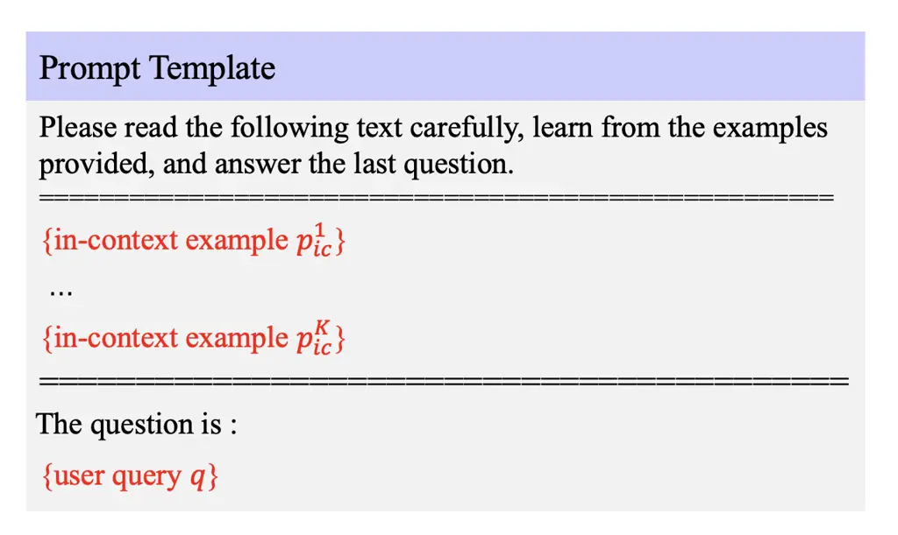

Figure 1: The demonstration of the prompt template

### A.3 Supplementary Comparison of The Training Loss Trend with Baselines.

We conduct extensive experiments to compare the trend of training loss
with all baselines, as illustrated in the Figure 2. The fast convergence
rate and lower loss observed with the GRL-Prompt method are primarily
attributed to the designated embedding-based reward, which effectively
incorporates feedback from LLMs during the prompt optimization phase.

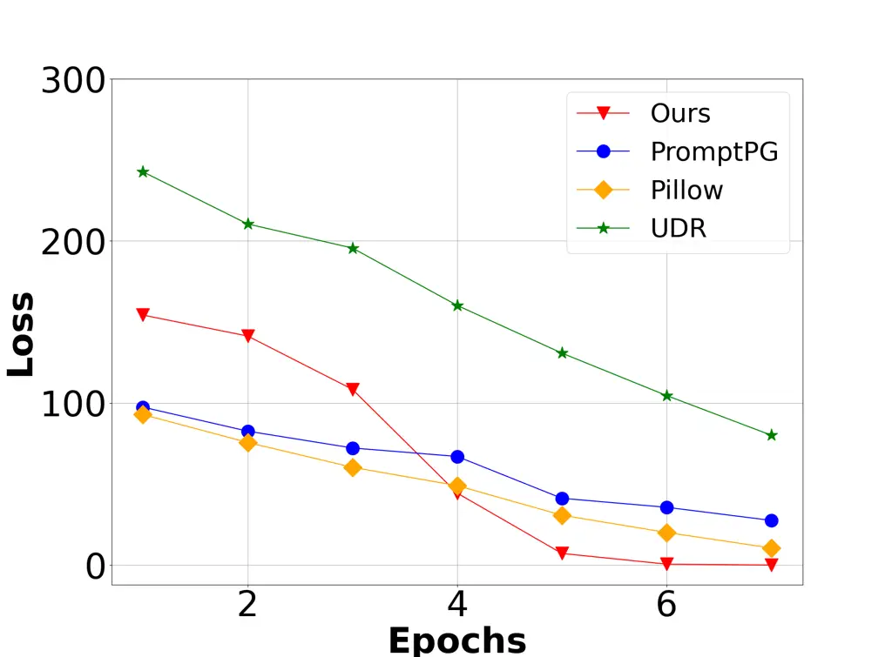

(a) GPT-4 on Alpaca

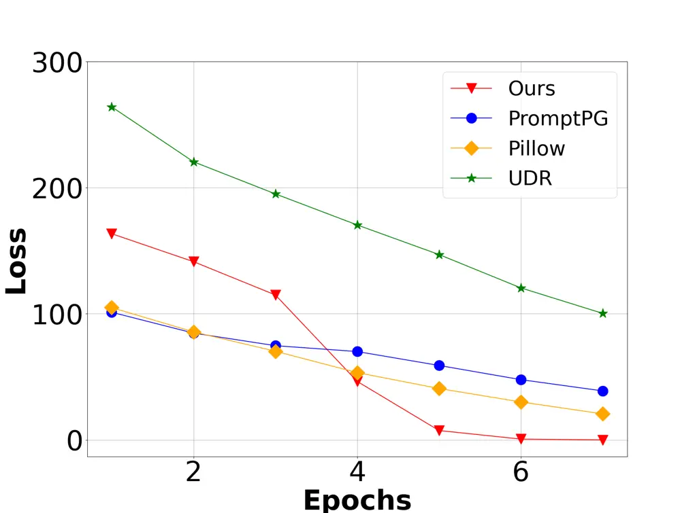

(b) GPT-3 on Alpaca

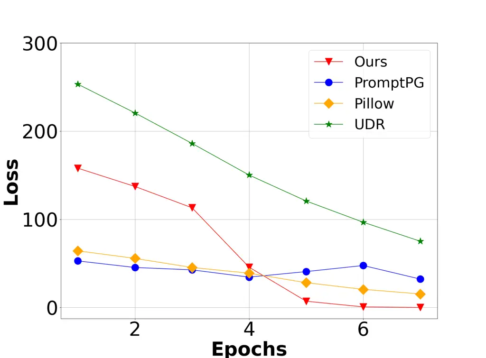

(c) LLaMA on Alpaca

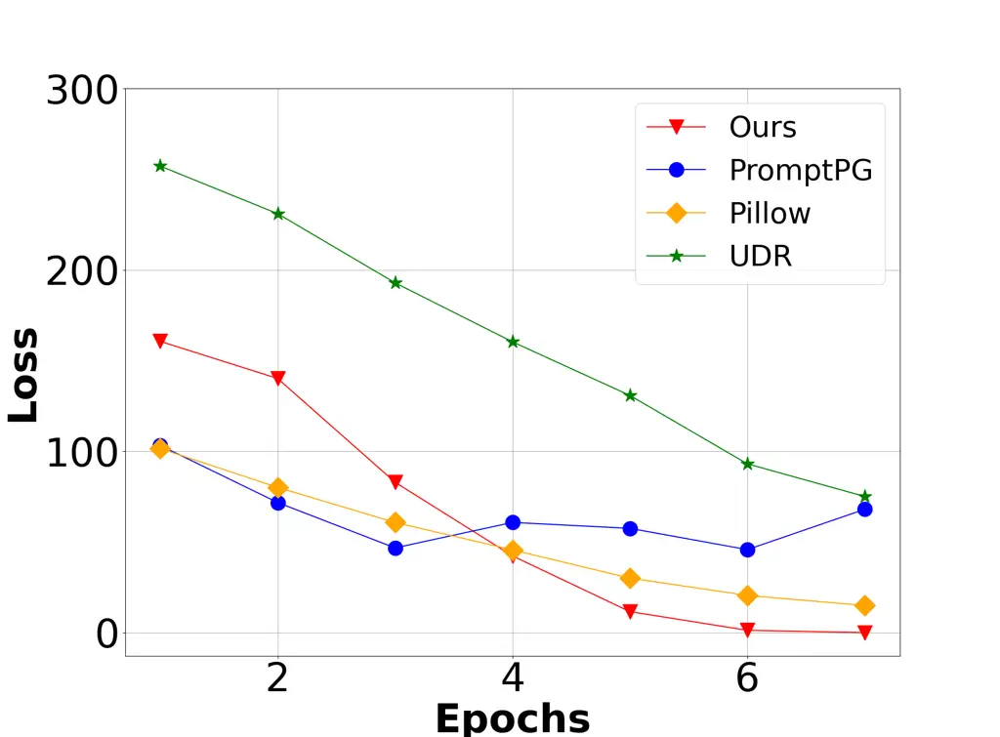

(d) GPT-4 on Dolly

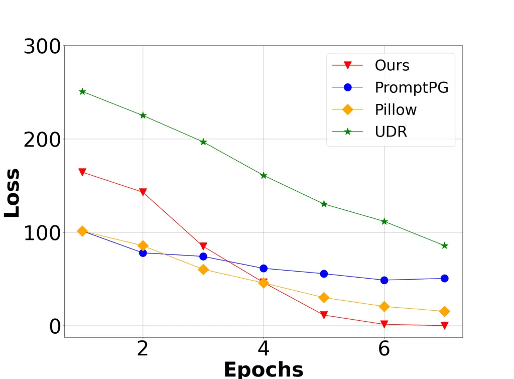

(e) GPT-3 on Dolly

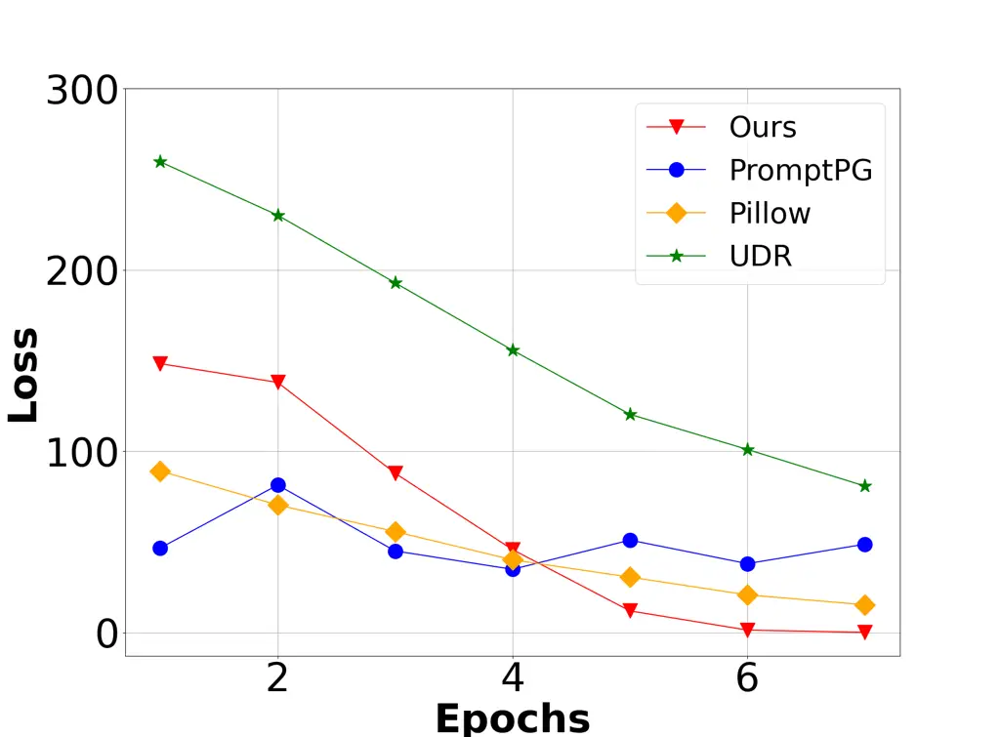

(f) LLaMA on Dolly

Figure 2: The trend of training loss across different LLMs on two
datasets.

### A.4 Case Study

Figures 3 to 8 show the comparative case study of GRL-Prompt and other
baseline methods, i.e., Random-1, Random-2, CoT, and PromptPG, Pillow,
UDR respectively. It is evident that prompts optimized with GRL-Prompt
result in more reasonable responses from LLMs compared to other baseline
methods. For example, in Figure 3, the generated prompt from GRL-Prompt
(marked in blue) provides more instructive guidance for LLMs. Random-1,
on the other hand, clearly gives an oversimplified prompt, leading to an
undesired response from the LLMs. Similar results can also be found in
Random-2, CoT, and PromptPG, Pillow, UDR (from Figures 4 to 8).

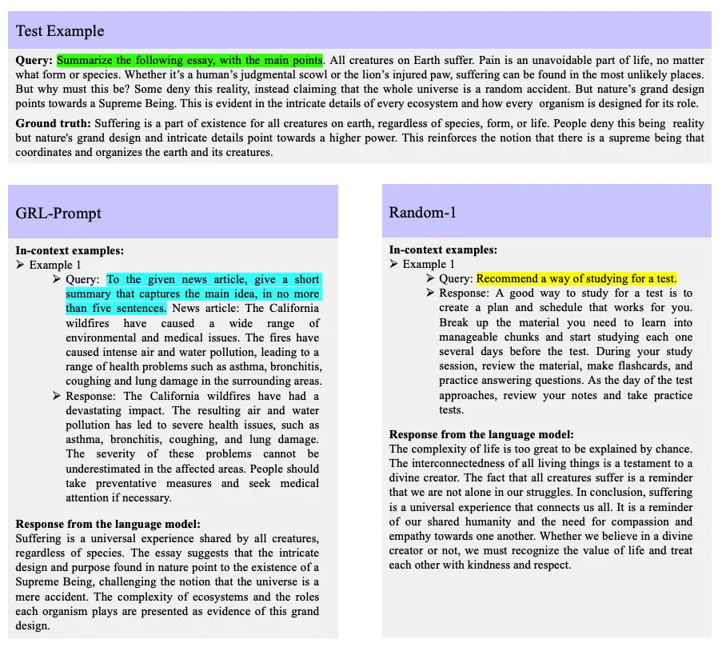

Figure 3: Comparative case study of GRL-Prompt and Random-1. The text
highlighted in green indicates the keywords from the test example. In
contrast, the text marked in blue represents the keywords in the
in-context examples selected by GRL-Prompt, while the text highlighted
in yellow corresponds to the keywords from the in-context examples
chosen by Random-1.

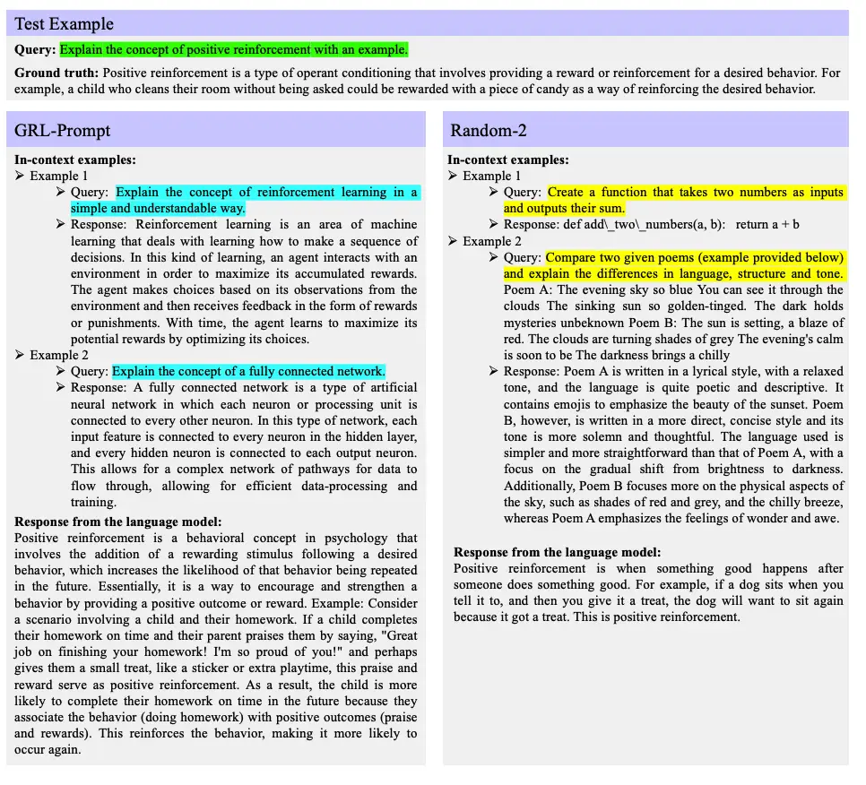

Figure 4: Comparative case study of GRL-Prompt and Random-2. The text
highlighted in green indicates the keywords from the test example. In
contrast, the text marked in blue represents the keywords in the
in-context examples selected by GRL-Prompt, while the text highlighted
in yellow corresponds to the keywords from the in-context examples
chosen by Random-2.

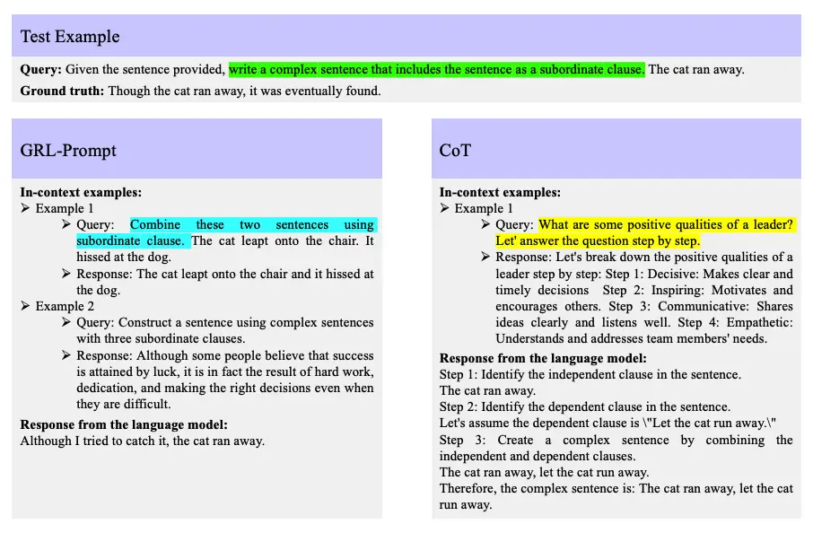

Figure 5: Comparative case study of GRL-Prompt and CoT. The text
highlighted in green indicates the keywords from the test example. In
contrast, the text marked in blue represents the keywords in the
in-context examples selected by GRL-Prompt, while the text highlighted
in yellow corresponds to the keywords from the in-context examples
chosen by CoT.

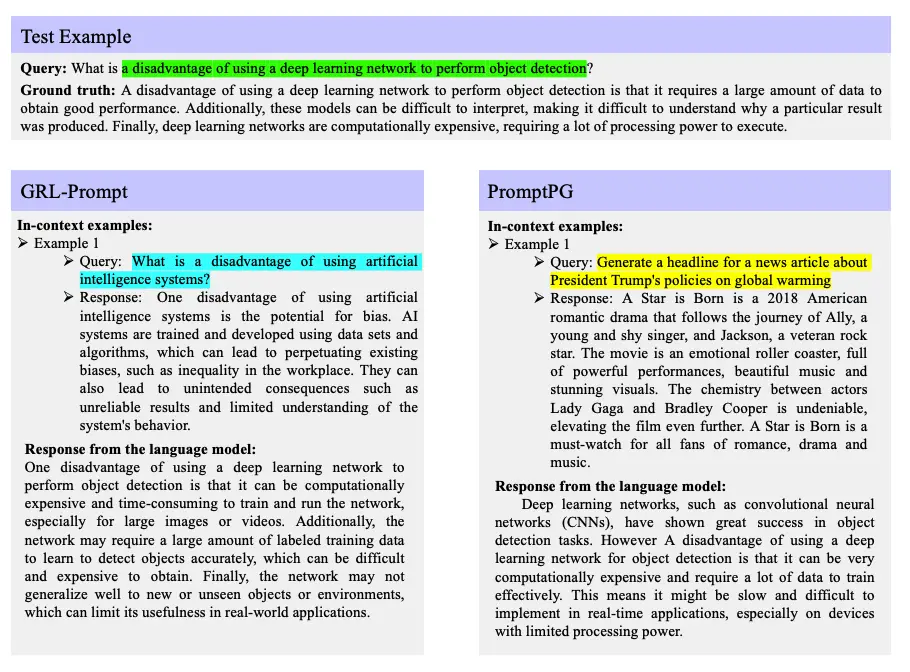

Figure 6: Comparative case study of GRL-Prompt and PromptPG. The text
highlighted in green indicates the keywords from the test example. In
contrast, the text marked in blue represents the keywords in the
in-context examples selected by GRL-Prompt, while the text highlighted
in yellow corresponds to the keywords from the in-context examples
chosen by PromptPG.

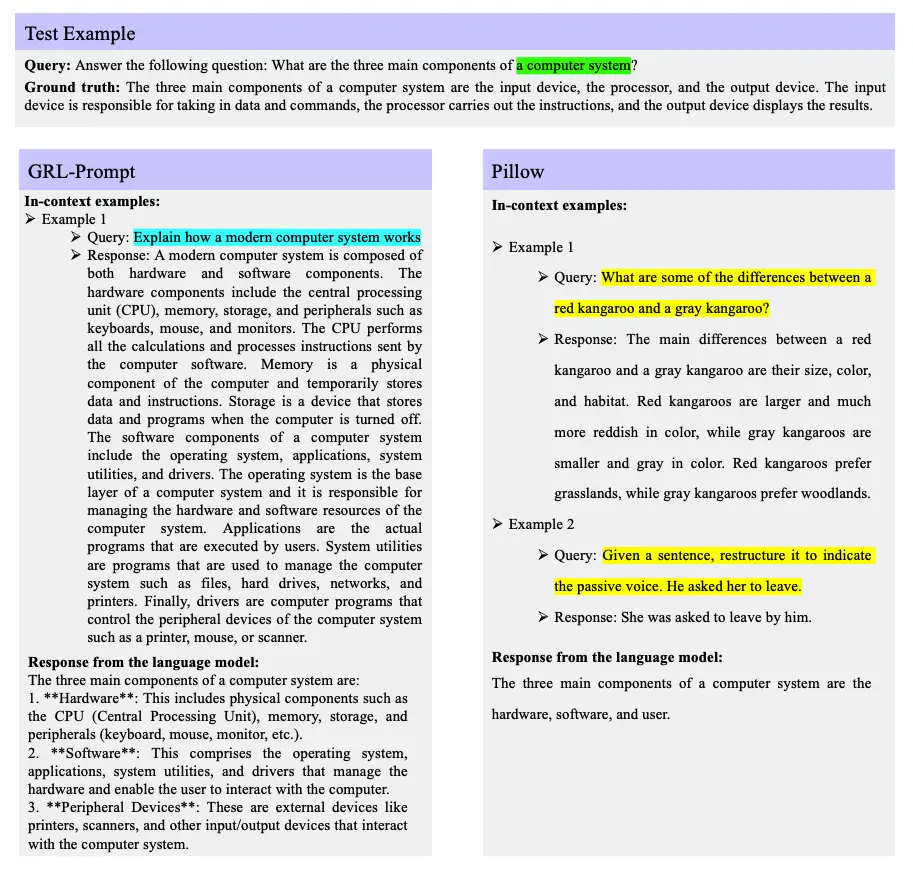

Figure 7: Comparative case study of GRL-Prompt and Pillow. The text
highlighted in green indicates the keywords from the test example. In
contrast, the text marked in blue represents the keywords in the
in-context examples selected by GRL-Prompt, while the text highlighted
in yellow corresponds to the keywords from the in-context examples
chosen by Pillow.

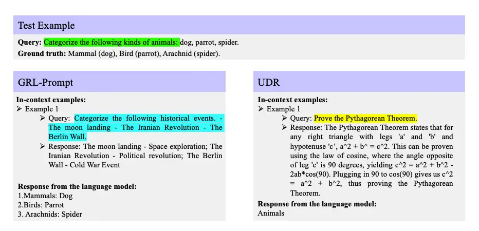

Figure 8: Comparative case study of GRL-Prompt and UDR. The text
highlighted in green indicates the keywords from the test example. In
contrast, the text marked in blue represents the keywords in the
in-context examples selected by GRL-Prompt, while the text highlighted
in yellow corresponds to the keywords from the in-context examples
chosen by UDR.

### A.5 Supplementary Ablation Study

To further validate the effectiveness of different components in
GRL-Prompt, we compare the two variants of GRL-Prompt with GRL-Prompt
across different LLMs on two datasets. The overall results of the
comparison are shown in Table 1. The results show that GRL-Prompt
outperforms both GRL-Prompt w/o KG and GRL-Prompt w/o RF across all
different LLMs on two datasets, demonstrating an average improvement of
0.04 and 0.07, respectively. It highlights the significant contributions
of two components in GRL-Prompt that enhance the performance of LLMs.

### A.6 Limitations

The reward design in GRL-Prompt is based on automatic evaluation scores,
which may not be sufficient for providing human feedback to the RL
agent. Such scores focus on the contextual discrepancy between the
generated and expected responses, which may not align with the results
of human evaluations. In the future, we plan to integrate human feedback
into the GRL-Prompt framework and investigate whether incorporating
context-aware results and feedback can help enhance LLMs performance on
different tasks.
