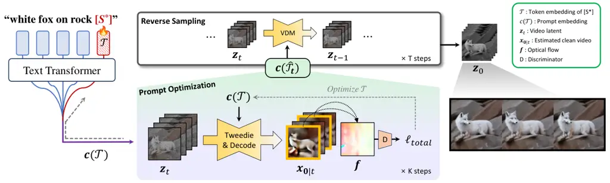
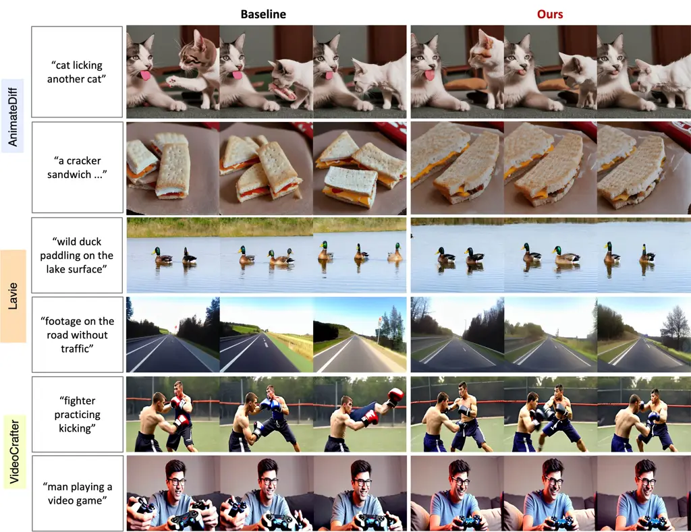
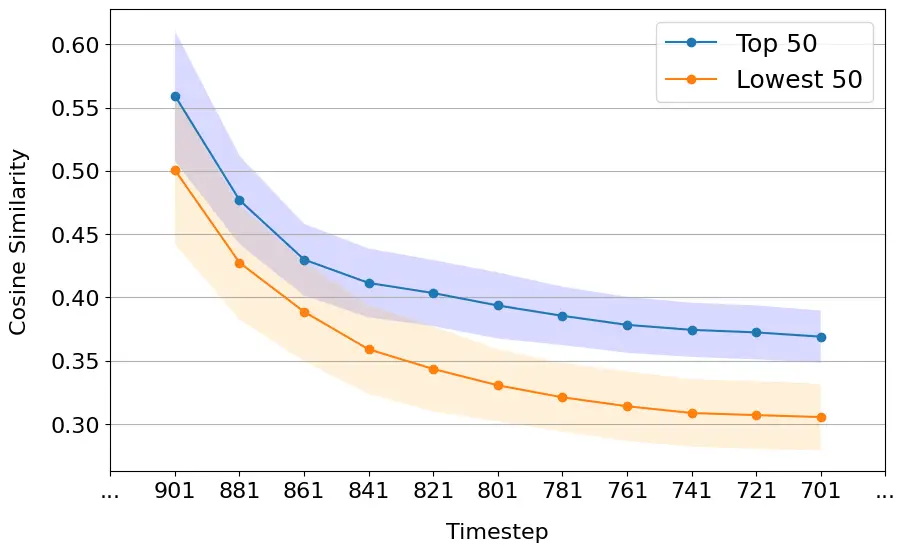
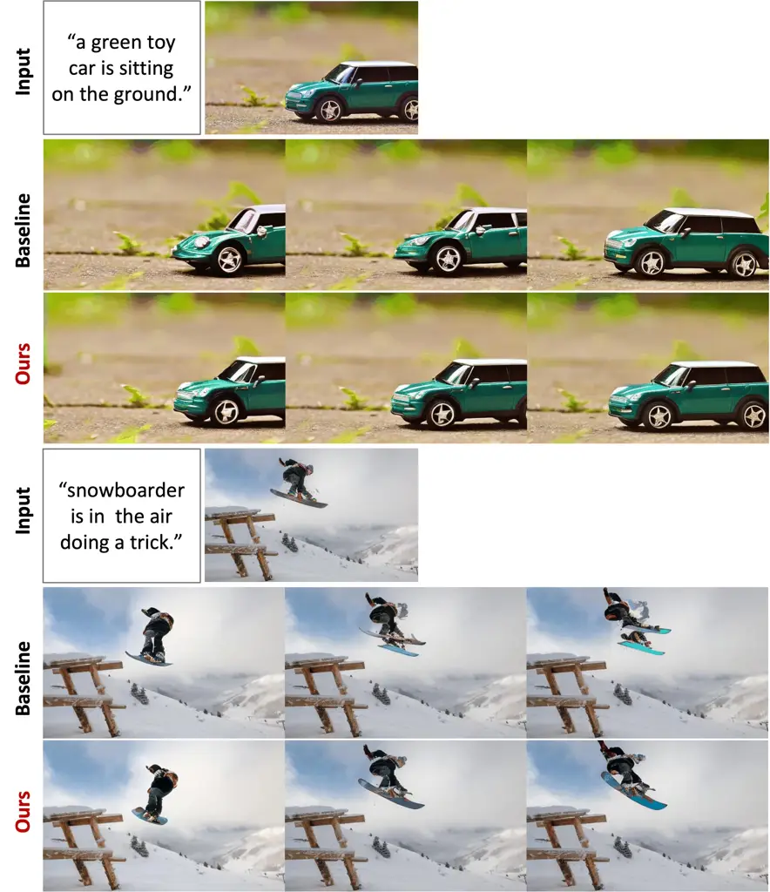
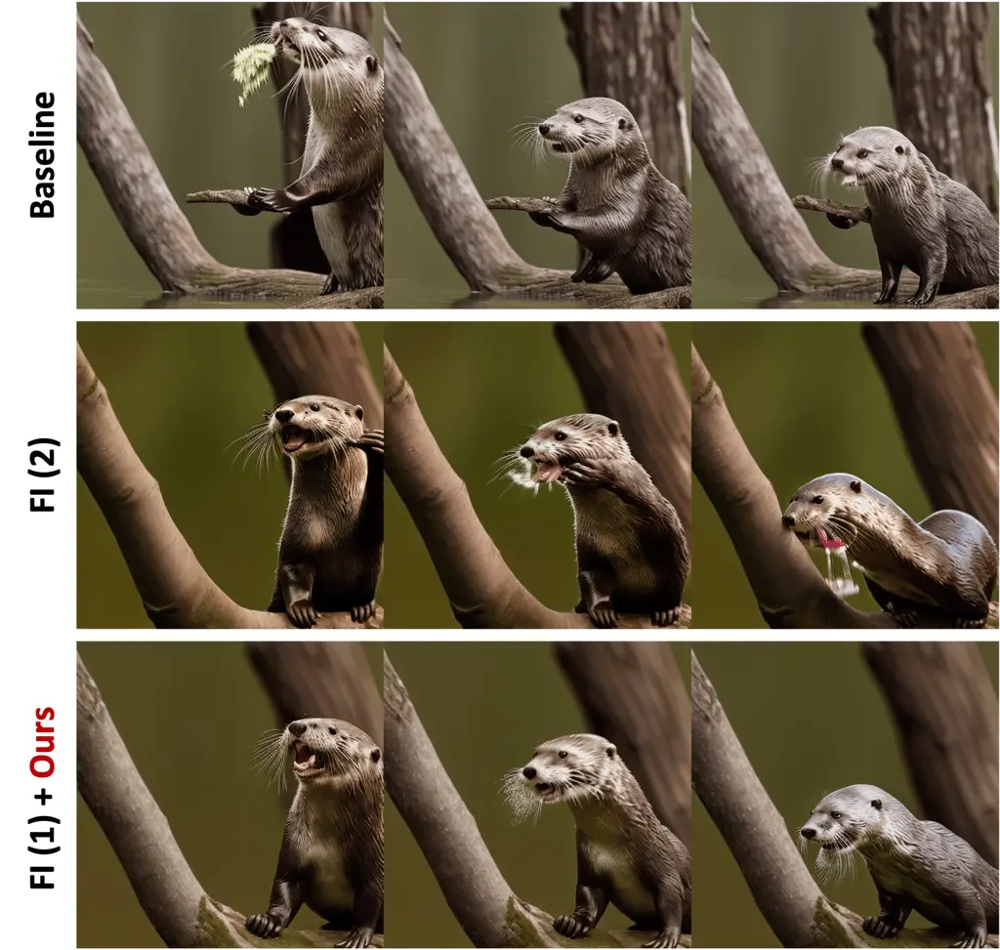
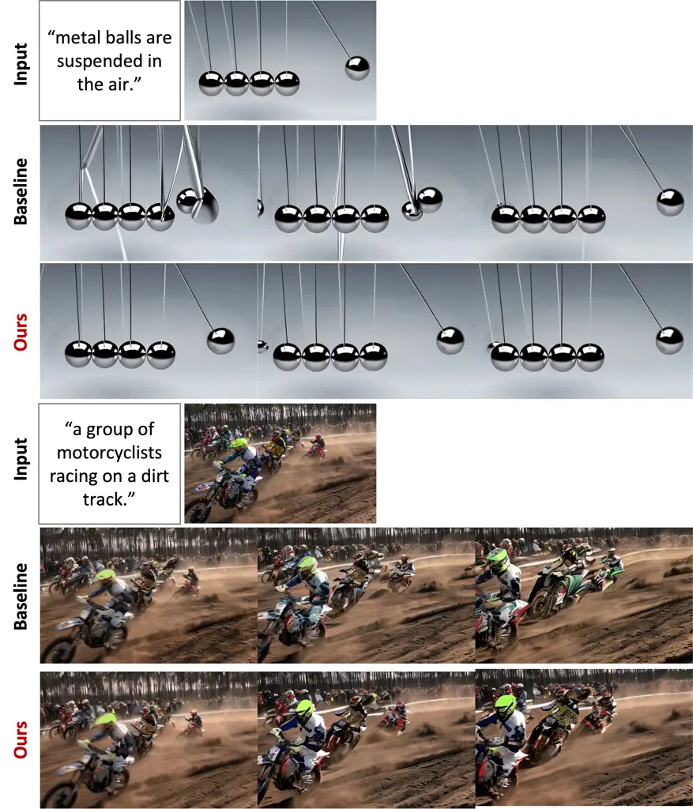
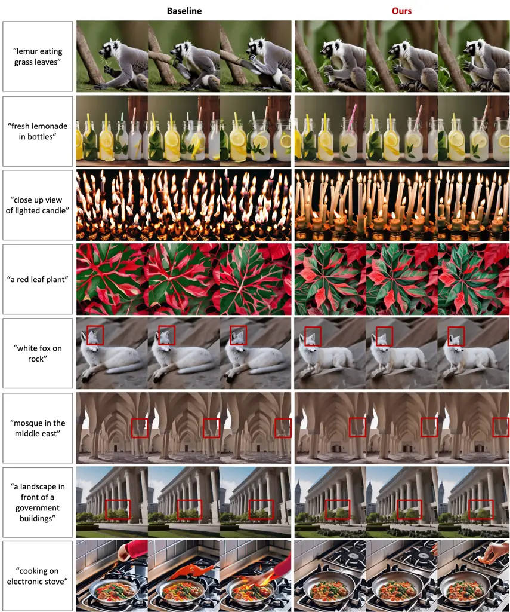
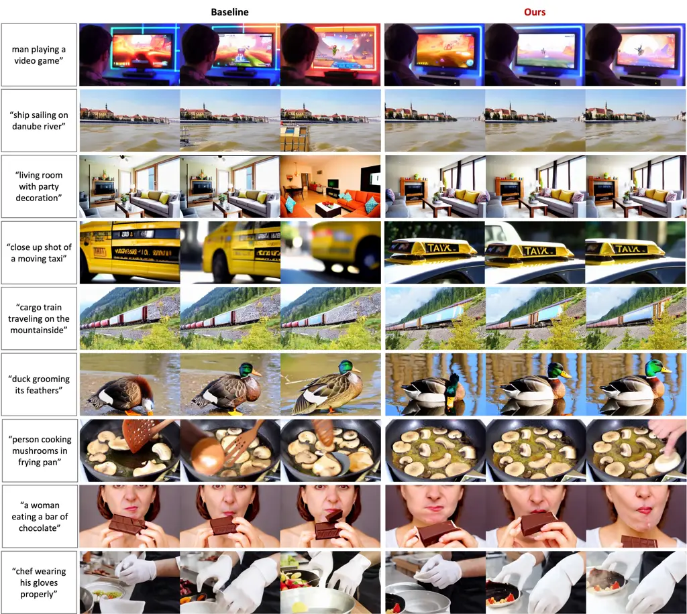
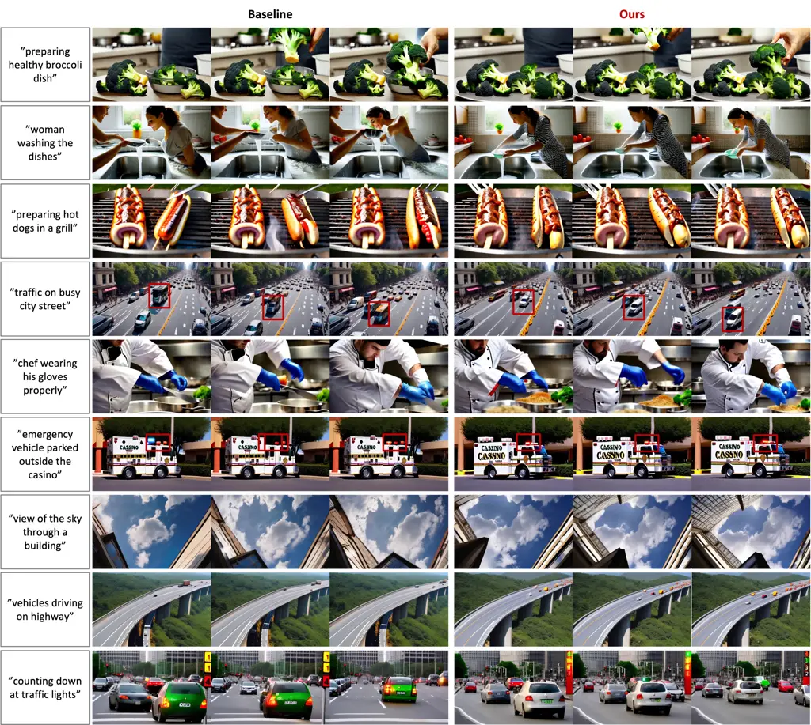

# Optical-Flow Guided Prompt Optimization for Coherent Video Generation

Hyelin Nam    Jaemin Kim    Dohun Lee    Jong Chul Ye    Kim Jaechul
Graduate School of AI    KAIST    EverEx^(\*): Equal
Contributionhyelin.nam.028@gmail.com, {kjm981995, leedh7,
jong.ye}@kaist.ac.kr

###### Abstract

While text-to-video diffusion models have made significant strides, many
still face challenges in generating videos with temporal consistency.
Within diffusion frameworks, guidance techniques have proven effective
in enhancing output quality during inference; however, applying these
methods to video diffusion models introduces additional complexity of
handling computations across entire sequences.To address this, we
propose a novel framework called MotionPrompt that guides the video
generation process via optical flow. Specifically, we train a
discriminator to distinguish optical flow between random pairs of frames
from real videos and generated ones. Given that prompts can influence
the entire video, we optimize learnable token embeddings during reverse
sampling steps by using gradients from a trained discriminator applied
to random frame pairs. This approach allows our method to generate
visually coherent video sequences that closely reflect natural motion
dynamics, without compromising the fidelity of the generated content. We
demonstrate the effectiveness of our approach across various models.
Project Page:
[https://motionprompt.github.io/](https://motionprompt.github.io/)

|      |      |      |      |
| ---- | ---- | ---- | ---- |
| Base | Ours | Base | Ours |

|                                                                                                                                           |                                                                                                                                           |                                                                                                                                           |                                                                                                                                           |
| ----------------------------------------------------------------------------------------------------------------------------------------- | ----------------------------------------------------------------------------------------------------------------------------------------- | ----------------------------------------------------------------------------------------------------------------------------------------- | ----------------------------------------------------------------------------------------------------------------------------------------- |
|                                                                                                                                           |                                                                                                                                           |                                                                                                                                           |                                                                                                                                           |

|                                    |                                  |
| ---------------------------------- | -------------------------------- |
| "Close up video of japanese food." | "Person dancing in a dark room." |

|      |      |      |      |
| ---- | ---- | ---- | ---- |
| Base | Ours | Base | Ours |

|                                                                                                                                           |                                                                                                                                           |                                                                                                                                           |                                                                                                                                           |
| ----------------------------------------------------------------------------------------------------------------------------------------- | ----------------------------------------------------------------------------------------------------------------------------------------- | ----------------------------------------------------------------------------------------------------------------------------------------- | ----------------------------------------------------------------------------------------------------------------------------------------- |
|                                                                                                                                           |                                                                                                                                           |                                                                                                                                           |                                                                                                                                           |

|                                             |                            |
| ------------------------------------------- | -------------------------- |
| "Time lapse video of a farm during sunset." | "Video of a train tracks." |

Figure 1: MotionPrompt enhances temporal consistency and motion
smoothness in text-to-video diffusion models by combining optical flow
guidance with prompt optimization. It can be combined with a range of
text-to-video diffusion models to produce visually coherent video
sequences that closely align with intended motion while preserving
content fidelity. Best viewed with Acrobat Reader. Click each image to
play the video clip.

## 1 Introduction

Recently, diffusion models have become the de-facto standard for image
generation. In particular, text-to-image (T2I) diffusion models \[8,
29\] have gained significant attention due to their ability to enable
users control over the generation process via text prompts. Building on
these advancements, research has now progressed toward text-to-video
(T2V) diffusion models \[4, 14, 36\] that generate videos which are both
visually engaging and contextually coherent. Despite these advances,
achieving temporally consistent videos remains a challenge in many T2V
models. Although recent work has attempted to address this, many
proposed methods rely on fine-tuning \[11\] or introduce unnecessary
interventions that can potentially adversely impact \[5, 21\].

In diffusion frameworks, guidance is a commonly used technique to obtain
samples aligned with specific objectives during inference. For example,
in diffusion inverse solvers (DIS) \[6, 33, 20\], the guidance is
usually given in the form of the likelihood function from the data
consistency terms. However, a key technical issue in diffusion model
guidance is that intermediate samples are corrupted by the additive
Gaussian noise from the forward diffusion processes, making the
computation of the likelihood term computationally prohibitive \[6\]. To
address this issue, diffusion posterior sampling (DPS) \[6\]
approximates the likelihood function around the posterior mean, computed
using Tweedie’s formula \[10\]. Another way to applying guidance is
fine-tuning of the underlying diffusion models. For example, in
DiffusionCLIP \[19\], the diffusion model for reverse sampling is
fine-tuned using a directional CLIP guidance to generate images that
align with a target text prompt.

However, applying these well-established techniques to video diffusion
models (VDM) poses significant technical challenges. Unlike image
generation, VDMs require the modeling of dependencies of across frames.
For instance, if DPS is applied to VDMs, backpropagation must occur
across all frames, making the process not only computationally expensive
but also prone to instability. Applying fine-tuning of a VDM is even
more challenging due to the model’s large size. As a result, there
remains a lack of a reliable, computationally efficient guidance
mechanism that ensures temporal coherence across frames-a crucial factor
in generating realistic videos.

Recently, semantic-preserving prompt optimization method has been
proposed for generating minority images \[35\]. This approach integrates
learnable tokens into a given prompt P and updates their embeddings
on-the-fly during inference based on specific optimization criteria.
While the original motivation of this work was different from reducing
computational burden, we found that this on-the-fly prompt optimization
concept aligns well with VDM guidance as a novel and computationally
efficient guidance method, as the text prompt can influence all frames
simultaneously.

Specifically, our new method, MotionPrompt, is designed to enhance
temporal consistency in video generation while preserving the semantics
through inference-time prompt optimization. By leveraging the global
influence of the text prompt, MotionPrompt reduces the computational
demands of entire sequence guidance, enabling indirect control over the
latent video representation through gradients computed from only a
subset of frames. Specifically, we append a placeholder string S to the
prompt P similar to \[35\], which serves as a marker for the learnable
tokens. This approach preserves desired attributes across the video
sequence and maintain the semantic meaning of the original prompt.

To further enhance temporal coherence in generated videos while
preserving semantic integrity, our method incorporates a discriminator
that uses optical flow to evaluate temporal consistency and guide prompt
optimization. Specifically, we first train a discriminator to
distinguish optical flow between random pairs of frames from real and
generated videos. During sampling, a subset of generated frames is
evaluated by the discriminator to assess the realism of their relative
motion, as measured by optical flow. This process enables MotionPrompt
to refine generated frames, achieving more natural and realistic motion
patterns. In summary, our contributions are as follows:

- •
  We propose MotionPrompt-a novel video guidance method that uses
  on-the-fly semantic prompt optimization to enhance temporal
  consistency and motion coherence in generated videos, without
  requiring diffusion models retraining or gradient calculations for
  every frame.
- •
  By utilizing an optical flow-based discriminator to guide prompt
  optimization, we enforce temporal consistency in generated videos,
  enabling smoother, more realistic motion by aligning flows with
  real-world patterns while minimizing impact on samples already close
  to real videos.

## 2 Related Works

Latent Video Diffusion Models. Latent video diffusion models \[15, 17,
41, 2\] have gained attraction for their ability to efficiently generate
videos by operating within a compressed latent space, thereby reducing
the computational cost and memory demands associated with
high-resolution video generation. Building on this approach,
VideoCrafter \[3, 4\], AnimatedDiff \[14\] and Lavie \[36\] extended
latent diffusion to handle text-to-video generation to produce
contextually relevant and controllable video outputs. While these
advancements have significantly improved video generation, ensuring
temporal consistency remains challenging. FreeInit \[39\] alleviates
this problem by refining the initial noise to ensure low-frequency
information. While temporal consistency is increased, the process of
iteratively obtaining clean videos is computationally expensive and can
result in a loss of detail. UniCtrl \[5\] and VideoGuide \[21\] address
this issue by introducing attention injection and leveraging different
pre-trained video diffusion models, respectively. However, these
approaches can sometimes negatively impact performance: UniCtrl’s
injection mechanism struggles with handle color changes, while
VideoGuide depends on the performance of the additional pre-trained
model. Nevertheless, these methods are orthogonal to ours, as we
optimize the prompt, and can be combined to further enhance video
generation quality.



Figure 2: Overall pipeline of MotionPrompt. MotionPrompt enhances
temporal consistency in text-to-video diffusion models by combining
prompt optimization with an optical flow-based discriminator. Leveraging
gradients from a subset of frames and aligning optical flow with
real-world motion patterns, MotionPrompt efficiently generates videos
with smooth, realistic motion and strong contextual coherence.

Video Synthesis with Optical Flow. Optical flow is a vector field that
captures pixel-level motion patterns between two images. It has long
been used to extract and control motion in visual data \[31, 30, 12\].
In the context of video synthesis, optical flow is particularly useful
for guiding the generation of coherent and smooth motion. In
image-to-video generation, several methods bypass the challenge of
directly producing videos with natural motion by first generating
optical flow and then using it as a basis for video synthesis \[23, 26,
25\]. Similarly in video inpainting, optical flow completion models are
used prior to full video inpainting to produce natural and temporally
consistent videos \[13, 22\]. FlowVid \[24\] trained a video diffusion
models (VDM) that leverages optical flow as a temporal cue to achieve
consistent video-to-video synthesis. Inspired by these, we hypothesize
that improving the optical flow of the generated video would directly
enhance its temporal consistency and motion smoothness in T2V generation
with VDMs. Unlike previous approaches that use a separate optical flow
generation module or reference optical flow, we employ a discriminator
trained to assess the realism of the input optical flow and to guide
sampling towards more realistic optical flow.

Prompt Optimization. Prompting is an effective inference-time technique
for enhancing pre-trained model performance on specific subtasks by
guiding model responses with carefully crafted inputs. Widely used in
modern language and vision-language models \[37, 43, 42\], this concept
has also been extended to text-to-image diffusion models, proving
effective across diverse tasks such as image editing \[38, 27\],
minority sampling \[35\], and inverse problem solving \[7\]. However,
these works mainly focus on image domain, and prompt optimization
remains under-explored in the context of video generation. To the best
of our knowledge, this is the first work to apply on-the-fly prompt
tuning to VDMs.

## 3 Main Contribution: MotionPrompt

### 3.1 Conditional Video Diffusion Model

Latent video diffusion models encode $`N`$-frame clean video,
$`\{{\bm{x}}^{(i)}\}_{i=1}^{N}\in{\mathbb{R}}^{N\times C\times H\times W}`$,
to $`\{{\bm{z}}_{0}^{(i)}\}_{i=1}^{N}`$ using an encoder
$`\mathcal{E}`$, where $`C,H`$ and $`W`$ represent channel, height and
width of the video, respectively. Unless otherwise noted, we simply
denote $`{\bm{z}}_{0}`$ as $`\{{\bm{z}}_{0}^{(i)}\}_{i=1}^{N}`$ for
convenience and $`{\bm{z}}_{0}\sim p_{0}({\bm{z}})`$.

The diffusion model aims to estimate the noise in the noised latent
$`{\bm{z}}_{t}`$ from the forward diffusion process \[8\]

```math
q({\bm{z}}_{t}|{\bm{z}}_{0})=\mathcal{N}({\bm{z}}_{t};\sqrt{1-\bar{\alpha}_{t}}\,{\bm{z}}_{0},\bar{\alpha}_{t}\mathbf{I}), \tag{1}
```

where $`\bar{\alpha}_{t}`$ is the noise scheduling coefficient at
timestep $`t`$. In the text-to-video diffusion model, the text condition
is provided as an additional input. Given a prompt P, the text embedding
$`\mathbf{c}`$ is obtained through the text encoder
$`\mathcal{E}_{\text{text}}`$, i.e.,
$`\mathbf{c}=\mathcal{E}_{\text{text}}(\textit{P})`$. Then, the training
objective is to minimize

```math
\mathbb{E}_{\mathbf{z}_{0},\bm{\epsilon},t,\mathbf{c}}\left[\|\bm{\epsilon}-\bm{\epsilon}_{\theta}(\mathbf{z}_{t},t,\mathbf{c})\|^{2}\right], \tag{2}
```

where $`\bm{\epsilon}\sim\mathcal{N}(0,\mathbf{I})`$, and
$`\bm{\epsilon}_{\theta}(\mathbf{z}_{t},t,\mathbf{c})`$ denotes the
diffusion model parameterized by $`\theta`$ with the text condition
$`\mathbf{c}`$ and the noisy latent $`\mathbf{z}_{t}`$ at $`t`$. Once
the diffusion model is trained, reverse diffusion sampling is performed.
For example, in DDIM \[32\], the reverse diffusion follows:

```math
\displaystyle{\bm{z}}_{t-1} \displaystyle=\sqrt{\bar{\alpha}_{t-1}}\hat{{\bm{z}}}_{t}+\sqrt{1-\bar{\alpha}_{t-1}}\bm{\epsilon}_{\theta}({\bm{z}}_{t},t,{\bm{c}}) \tag{3}
```

```math
\displaystyle\hat{{\bm{z}}}_{t} \displaystyle=\frac{1}{\sqrt{\bar{\alpha}_{t}}}\left({\bm{z}}_{t}-\sqrt{1-\bar{\alpha}_{t}}\bm{\epsilon}_{\theta}({\bm{z}}_{t},t,{\bm{c}})\right), \tag{4}
```

where $`\hat{{\bm{z}}}_{t}`$ denotes the denoised sample at $`t`$, is
obtained from Tweedie’s formula \[10\]. To enhance the impact of the
text condition, we applied classifier-free guidance (CFG) \[16\] to all
$`\bm{\epsilon}`$ predictions. The modified prediction is given by:

```math
\bm{\epsilon}^{w}_{\theta}(\mathbf{z}_{t},t,\mathbf{c})=\bm{\epsilon}_{\theta}(\mathbf{z}_{t},t,\emptyset)+w\left[\bm{\epsilon}_{\theta}(\mathbf{z}_{t},t,\mathbf{c})-\bm{\epsilon}_{\theta}(\mathbf{z}_{t},t,\emptyset)\right], \tag{5}
```

where $`w`$ denotes the guidance scale and $`\emptyset`$ represents the
null text prompt. Thus, unless specified otherwise,
$`\bm{\epsilon}_{\theta}(\cdot)`$ denotes terms with CFG applied.

So far, we have discussed text conditioned diffusion sampling. Moving
beyond this, to navigate the sampling process in a way that minimizes a
general loss function $`\ell({\bm{z}})`$, it is essential to find the
solution on the correct clean manifold:

```math
\displaystyle\min_{{\bm{z}}\in{\mathcal{M}}}\ell({\bm{z}}) \tag{6}
```

where $`{\mathcal{M}}`$ represents the clean data manifold sampled from
the unconditional distribution $`p_{0}({\bm{z}})`$. In DPS \[6\], this
is achieved by enforcing the updated estimate from the noisy sample
$`{\bm{x}}_{t}\in{\mathcal{M}}_{t}`$ to be constrained to stay on the
same noisy manifold $`{\mathcal{M}}_{t}`$.

```math
\displaystyle{\bm{z}}_{t-1} \displaystyle=\sqrt{\bar{\alpha}_{t-1}}\left({\bm{z}}_{t}-\gamma_{t}\nabla_{{\bm{z}}_{t}}\ell(\hat{\bm{z}}_{t})\right)+\sqrt{1-\bar{\alpha}_{t-1}}\bm{\epsilon}_{\theta}({\bm{z}}_{t},t,{\bm{c}}), \tag{7}
```

where $`\gamma_{t}>0`$ denotes the step size.

### 3.2 Prompt Optimization for Video Guidance

While direct guidance of the latent representation using (7) has proven
effective in image generation, calculating
$`\nabla_{{\bm{z}}_{t}}\ell(\hat{\bm{z}}_{t})`$ in the video domain
poses significant challenges. Specifically, calculating the gradient of
all frames is computationally expensive. Providing guidance for only
selected frames may reduce memory usage, but this can disrupt
frame-to-frame consistency, resulting in inconsistencies in appearance,
motion, and coherence throughout the video.

To address this, we employ the prompt optimization method and extend it
to capitalize the text prompt’s influence across the entire video. This
approach enables indirect control of the latent video representation by
using gradients derived from only a subset of frames, rather than
necessitating gradients for every frame. Specifically, instead of using
(6) for the latent, we introduce an inference-time optimization problem
with respect to the text embedding $`{\bm{c}}`$:

```math
\displaystyle\hat{\bm{c}}_{t}=\arg\min_{{\bm{c}}}\ell({\bm{z}}_{t},{\bm{c}}) \tag{8}
```

One of the most important advantages of this approach is that it enables
the use of a simple reverse diffusion process:

```math
\displaystyle{\bm{z}}_{t-1} \displaystyle=\sqrt{\bar{\alpha}_{t-1}}\hat{{\bm{z}}}_{t}(\hat{\bm{c}}_{t})+\sqrt{1-\bar{\alpha}_{t-1}}\bm{\epsilon}_{\theta}({\bm{z}}_{t},t,\hat{\bm{c}}_{t}) \tag{9}
```

```math
\displaystyle\hat{{\bm{z}}}_{t}(\hat{\bm{c}}_{t}) \displaystyle=\left({\bm{z}}_{t}-\sqrt{1-\alpha_{t}}\bm{\epsilon}_{\theta}({\bm{z}}_{t},t,\hat{\bm{c}}_{t})\right)/{\sqrt{\bar{\alpha}_{t}}} \tag{10}
```

Furthermore, to preserve the semantic meaning of the original prompt,
rather than optimizing the entire text embedding $`{\bm{c}}`$, we follow
the approach introduced in  Um and Ye \[35\], attaching learnable token
embeddings to the end of the prompt and optimizing only these
embeddings. Specifically, we first add new text tokens
$`\textit{S}=\{S_{i}\}_{i=1}^{n}`$ to the tokenizer vocabulary and
initialize their embeddings with words that can help improve video
quality. In this work, we use the word ‘authentic’ and similar terms. We
then append these learnable tokens to the end of the given text prompt
(e.g., "White fox on the rock." $`\rightarrow`$ "White fox on the rock
$`S_{1}`$ … $`S_{n}`$."). We denote this modified prompt as
$`\textit{P}+\textit{S}`$. This leads to the following modified
optimization problem:

```math
\displaystyle\hat{\bm{c}}_{t}:={\bm{c}}(\hat{\mathcal{T}}_{t}), \displaystyle\quad\hat{\mathcal{T}}_{t}=\argmin_{{\mathcal{T}}}\ell({\bm{z}}_{t},{\bm{c}}({\mathcal{T}})), \tag{11}
```

where $`{\mathcal{T}}`$ denotes the embeddings of tokens S, and
$`{\bm{c}}({\mathcal{T}}):=\mathcal{E}_{\text{text}}(\textit{P}+\textit{S})`$.
This optimization occurs at each timestep $`t`$ within the defined
range, causing $`{\mathcal{T}}`$ to evolve over time and, consequently,
making $`{\bm{c}}({\mathcal{T}})`$ vary with each timestep. By
preserving the other token embeddings in the original text prompt, we
ensure that essential text information is retained without loss and
ensure the diffusion sampling trajectory on the correct manifold. After
the specified range, we revert to the original prompt P to maintain the
overall appearance and structure of the initial video.

### 3.3 Defining Loss Function from Optical Flow

In this section, we introduce the objective function $`\ell({\bm{z}})`$
to ensure the temporal coherence in the generated video. The total
objective function is formulated as follows:

```math
\displaystyle\ell_{\text{total}}({\bm{z}}_{t},{\mathcal{T}}):= \displaystyle\,\lambda_{1}\ell_{\text{disc}}({\bm{z}}_{t},{\bm{c}}({\mathcal{T}}))+\lambda_{2}\ell_{\text{TV}}({\bm{z}}_{t},{\bm{c}}({\mathcal{T}}))
```

```math
\displaystyle+\lambda_{3}||{\mathcal{T}}-{\mathcal{T}}_{0}||_{2}^{2},
```

where $`\lambda_{1}`$, $`\lambda_{2}`$ and $`\lambda_{3}`$ are
regularization parameters. The $`l_{2}`$ loss term in
$`\ell_{\text{total}}`$ is to ensure that the optimized token embedding
is not far from the original token embedding space. The other two loss
terms $`\ell_{\text{disc}}`$ and $`\ell_{\text{TV}}`$ will be explained
in detail soon. See Algorithms for the pseudo-code of the generation
processes with our prompt optimization.

1:
$`{\bm{\epsilon}}_{\theta},\textit{P},\textit{T},{\mathcal{E}}_{text},{\mathcal{D}},\text{TimeCond}(t)T`$

2: $`{\bm{z}}_{T}\sim{\mathcal{N}}(0,{\mathbf{I}})`$

3: for $`t=T`$ to $`1`$ do

4:   if $`\text{TimeCond}(t)`$ then

5:
   $`{\bm{c}}\leftarrow{\color[rgb]{0.5,0,1}OptEmb}({\bm{z}}_{t},{\bm{\epsilon}}_{\theta},\textit{P}+\textit{S},{\mathcal{E}}_{text})`$

6:   else

7:    $`{\bm{c}}\leftarrow{\mathcal{E}}_{text}(\textit{P})`$

8:   end if

9:   $`{\bm{\epsilon}}_{t}\leftarrow`$ CFG from (5)

10:
  $`{\bm{z}}_{t}\leftarrow\text{Reverse sampling from \eqref{eq:reverse_sampling}}`$

11: end for

12: return $`{\mathcal{D}}({\bm{z}}_{0})`$

Algorithm 1 MotionPrompt

1: function
OptEmb($`{\bm{z}}_{t},{\bm{\epsilon}}_{\theta},\textit{P}+\textit{S},{\mathcal{E}}_{text}`$)

2:   for $`k=1`$ to $`K`$ do

3:
   $`{\bm{c}}({\mathcal{T}})\leftarrow{\mathcal{E}}_{text}(\textit{P}+\textit{S})`$

4:    $`{\bm{\epsilon}}_{t}({\bm{c}}({\mathcal{T}}))\leftarrow`$ CFG
from (5)

5:    $`\hat{{\bm{z}}}_{t}({\bm{c}}({\mathcal{T}}))\leftarrow`$
Tweedie’s formula from (4)

6:    Select & Decode frames:
$`\hat{{\bm{x}}}^{1}_{t}({\bm{c}}({\mathcal{T}}))`$,
$`\hat{{\bm{x}}}^{2}_{t}({\bm{c}}({\mathcal{T}}))`$

7:
   $`\mathbf{f}\leftarrow OF(\hat{{\bm{x}}}^{1}_{t}({\bm{c}}({\mathcal{T}})),\hat{{\bm{x}}}^{2}_{t}({\bm{c}}({\mathcal{T}})))`$

8:
   $`\ell_{total}\leftarrow\lambda_{1}\ell_{disc}(\mathbf{f})+\lambda_{2}\ell_{TV}(\mathbf{f})`$

9:         $`+\lambda_{3}||\mathcal{T}-\mathcal{T}_{0}||_{2}^{2}`$

10:
   $`{\mathcal{T}}\leftarrow{\mathcal{T}}-\eta\nabla_{{\mathcal{T}}}{\mathcal{L}}_{total}`$

11:   end for

12:
  $`\hat{{\bm{c}}}\leftarrow{\mathcal{E}}_{text}(\textit{P}+\textit{S})`$

13:   return $`\hat{\bm{c}}`$

14: end function

Algorithm 2 Prompt Optimization

Optical flow discriminator loss. The main idea of MotionPrompt is to
utilize the realistic optical flow to guide the diffusion model to
generate temporally coherent video. Unfortunately, the primary challenge
of utilizing optical flow in generation tasks lies in the inherent lack
of paired supervised optical flow data. To address this, we aim to guide
the sampling process toward aligning the optical flow of the generated
video with that of real videos.

Specifically, we employ a discriminator trained to distinguish between
optical flow derived from generated videos and that from real ones. Note
that by optimizing the prompt rather than the latent representation
directly, we can design the optical flow discriminator to take a single
flow as input, rather than requiring flow from entire video sequences.
Specifically, given an optical flow model $`OF({\bm{x}})`$ that
estimates the optical flow between two frames, the discriminator
$`\phi_{d}(\cdot):{\mathbb{R}}^{2\times H\times W}\rightarrow[0,1]`$ is
trained to minimize

```math
\min_{\theta}-\mathbb{E}_{\mathbf{f}_{r},\mathbf{f}_{f}}\left[\log\phi_{\theta}(\mathbf{f}_{r})+\log(1-\phi_{\theta}(\mathbf{f}_{f}))\right], \tag{12}
```

where
$`{\mathbf{f}}_{r}:=OF({\bm{x}}_{r}),{\mathbf{f}}_{f}:=OF({\bm{x}}_{f})`$
are optical flows calculated between two selected frames from real and
generated (fake) videos, $`{\bm{x}}_{r}`$ and $`{\bm{x}}_{f}`$,
respectively. For further training details, please refer to the
implementation section (Subsec. 4.1) and supplementary material.

Once the discriminator is trained, we use it to guide the video samples
toward more realistic and temporally consistent outputs. Since the
discriminator operates in the clean video frames, we use the denoised
video obtained via Tweedie’s formula, defined as
$`\hat{\bm{x}}_{t}({\bm{c}}({\mathcal{T}})):={\mathcal{D}}(\hat{{\bm{z}}}_{t}({\bm{c}}_{t}({\mathcal{T}})))`$
using (10). Then, we select a subset of frames and decode it. Let’s
assume we choose two frames, denoted as
$`\hat{{\bm{x}}}^{1}_{t}({\bm{c}}({\mathcal{T}}))`$ and
$`\hat{{\bm{x}}}^{2}_{t}({\bm{c}}({\mathcal{T}}))`$. While we
exemplified with two frames, it is also possible to calculate the
optical flow across more frames and use the mean of their individual
losses as the total loss. Subsequently, we compute the optical flow
between two frames
$`{\mathbf{f}}(\hat{{\bm{x}}}_{t}({\bm{c}}({\mathcal{T}}))):=OF(\hat{{\bm{x}}}^{1}_{t}({\bm{c}}({\mathcal{T}})),\hat{{\bm{x}}}^{2}_{t}({\bm{c}}({\mathcal{T}})))`$,
and feed it into the trained discriminator. The sampling process is then
adjusted to steer the output toward samples that the discriminator
classifies as real:

```math
\ell_{\text{disc}}({\bm{z}}_{t},{\bm{c}}({\mathcal{T}})):=\log(1-\phi_{\theta^{*}}({\mathbf{f}}(\hat{{\bm{x}}}_{t}({\bm{c}}({\mathcal{T}})))). \tag{13}
```

where $`\theta^{*}`$ denotes the optimized discriminator weight.

TV loss for optical flow. Additionally, to ensure that the optical flow
adheres to the assumption of a smooth field, we incorporate total
variation (TV) loss as an additional regularization term. For
simplicity, in the following equation, we will denote
$`{\mathbf{f}}(\hat{{\bm{x}}}_{t}({\bm{c}}({\mathcal{T}})))`$ as
$`\mathbf{f}`$. This TV loss is then defined as

```math
\ell_{TV}({\bm{z}}_{t},{\bm{c}}(\mathcal{T})):=\sum_{i=1}^{H}\sum_{j=1}^{W}\left(|\mathbf{f}_{i,j}-\mathbf{f}_{i+1,j}|+|\mathbf{f}_{i,j}-\mathbf{f}_{i,j+1}|\right), \tag{14}
```

where $`\mathbf{f}_{i,j}`$ is the value at the position ($`i,j`$) of
$`\mathbf{f}`$.

## 4 Experiments

### 4.1 Implementation Details

#### Baselines.

To evaluate our method across different frameworks, we test it with
open-source text-to-video diffusion models, including Lavie \[36\],
AnimateDiff \[14\], and Videocrafter2 \[4\]. For AnimateDiff, we use the
RealisticVision pre-trained model¹¹ 1
[https://civitai.com/models/4201?modelVersionId=29460](https://civitai.com/models/4201?modelVersionId=29460).
We generate videos using a DDIM sampler with 50 steps and 800 prompts
from VBench \[18\], ensuring both the baselines and our method use the
same seed.



Figure 3: Qualitative comparison against three baselines. Additional
results are provided in the supplementary material.

Discriminator training. For discriminator training, we sample videos
from each model using the same set of 800 prompts. We highlight that the
discriminator is trained on the optical flow of complete, clean videos,
whereas during inference, it processes the optical flow of denoised
estimates. This distinction ensures that, even with the same prompts,
the discriminator encounters unseen data. We fine-tune a pre-trained
Vision Transformer (ViT) \[9\] as an image encoder, adding a projection
layer to adapt two-channel optical flow for ViT and using a 3-layer MLP
as the classifier. This setup achieved rapid convergence in under 20
epochs. Optical flow was extracted with RAFT \[34\] from real videos
selected from the DAVIS \[28\] and WebVid \[1\], as well as from
generated videos. Finally, we train and deploy a separate discriminator
for each video model. All training and experiments were conducted on a
single 40GB NVIDIA A100 GPU.

### 4.2 Results

|                      |                                    |                                       |                                    |                                  |                               |                                    |
| -------------------- | ---------------------------------- | ------------------------------------- | ---------------------------------- | -------------------------------- | ----------------------------- | ---------------------------------- |
|                      | Temporal Quality                   |                                       |                                    |                                  |                               | Text Alignment                     |
| Method               | Subject Consistency ($`\uparrow`$) | Background Consistency ($`\uparrow`$) | Temporal Flickering ($`\uparrow`$) | Motion Smoothness ($`\uparrow`$) | Dynamic Degree ($`\uparrow`$) | Overall Consistency ($`\uparrow`$) |
| Lavie \[36\]         | $`0.9599`$                         | $`0.9739`$                            | $`0.9487`$                         | $`0.9690`$                       | 0.5150                        | 0.2506                             |
| Lavie + Ours         | 0.9646                             | 0.9781                                | 0.9625                             | 0.9765                           | $`0.3963`$                    | $`0.2415`$                         |
| AnimateDiff \[14\]   | $`0.9488`$                         | $`0.9755`$                            | $`0.9228`$                         | $`0.9578`$                       | 0.4700                        | 0.2532                             |
| AnimateDiff + Ours   | 0.9528                             | 0.9763                                | 0.9258                             | 0.9599                           | $`0.4125`$                    | $`0.2529`$                         |
| VideoCrafter2 \[4\]  | $`0.9736`$                         | $`0.9559`$                            | $`0.9559`$                         | 0.9750                           | 0.4088                        | 0.2498                             |
| VideoCrafter2 + Ours | 0.9745                             | 0.9774                                | 0.9588                             | $`0.9759`$                       | $`0.3938`$                    | $`0.2451`$                         |

Table 1: Quantitative evaluation of text-to-video generation. Bold:
Best.

#### Qualitative comparisons.

We provide visual comparisons of our method against three baselines in
Fig. 3. The baselines struggle with maintaining temporal consistency,
often failing to preserve the appearance or quantity of objects, and
sometimes resulting in objects that suddenly appear or disappear. In
contrast, the proposed framework effectively suppresses appearance
changes and sudden shifts in video generation. Additionally, our method
maintains a consistent color tone across all frames and accurately
captures the scene attributes and details intended by the original
prompts.

#### Quantitative comparisons.

For quantitative comparison, we evaluate five key metrics from
VBench \[18\]—subject consistency, background consistency, temporal
flickering, motion smoothness, and dynamic degree—to assess improvements
in consistency and motion. We also measure overall consistency to
confirm that prompt optimization maintains fidelity to the text prompt.
Tab. 1 shows that our method improves object consistency, reduces
temporal flickering, and enhances motion smoothness with minimal impact
on text alignment. We are aware that there may exist a trade-off between
consistency and motion dynamics in the proposed method. However,
visualization results demonstrate that our method balances dynamics and
coherence effectively. See supplementary materials for more details.

#### User study.

Additionally, we conduct an A/B user study. We showed videos generated
by the baseline and our method for the same prompts, asking participants
to choose the one with better temporal quality.

|               |      |      |      |
| ------------- | ---- | ---- | ---- |
| Baseline      | Win  | Tie  | Lose |
| AnimateDiff   | 66.5 | 17.8 | 15.7 |
| Lavie         | 55.1 | 21.1 | 23.8 |
| VideoCrafter2 | 53.0 | 17.7 | 29.3 |

Table 2: User study results.

Among 100 participants evaluating a total of 90 videos (30 videos per
model), our method was preferred overall (Tab. 2).

## 5 Additional Experiments

We performed additional analysis to analyze the design components of the
proposed approach and to support the effectiveness of our method,
focusing on the AnimateDiff \[36\].

### 5.1 Ablation Study

#### Analysis of each loss component.

In  Tab. 3, we examine how key hyperparameters affect our framework’s
performance. First, we validate the effectiveness and robustness of our
loss components. ($`\lambda_{1}`$) A comparison between rows (a) and (c)
reveals that incorporating $`\ell_{disc}`$ further improves the results.
($`\lambda_{2}`$) To investigate the role of $`\lambda_{2}`$, we
gradually increased its value. As shown in rows (b)–(d), a higher weight
results in smoother motion but comes at the cost of performance in other
metrics. Based on this observation, we selected a moderate weight to
balance the trade-off. ($`\lambda_{3}`$) This loss was introduced after
identifying a degradation in video quality, which we hypothesized was
due to the optimized embedding deviating from the text space the
diffusion model was trained on. Comparing rows (c) and (e) supports this
hypothesis, as certain metrics show a decline. While performance varies
with different hyperparameter choices, all configurations consistently
outperform the baseline, demonstrating that our method remains robust
and is not overly sensitive to hyperparameter selection.

#### Analysis of hyperparameters.

We also explored the optimal number of iterations per optimization step
and the most effective stage within the 50-step sampling process. For
iteration count, a single iteration was insufficient, while 7 iterations
smoothed motion but reduced dynamic degree and overall consistency, as
well as increasing computation time. An effective balance was achieved
with 3 iterations. Similarly, starting optimization early improved
motion smoothness but reduced consistency, while delaying it too late
weakened its impact. Based on these findings, we established an optimal
range for applying optimization. Except for the hyperparameters being
compared, all other settings use the optimal hyperparameters listed in
the supplementary materials.

|                                                     |                                    |                                  |                               |                                    |
| --------------------------------------------------- | ---------------------------------- | -------------------------------- | ----------------------------- | ---------------------------------- |
| Loss Weight                                         |                                    |                                  |                               |                                    |
| $`\lambda_{1}`$ / $`\lambda_{2}`$ / $`\lambda_{3}`$ | Subject Consistency ($`\uparrow`$) | Motion Smoothness ($`\uparrow`$) | Dynamic Degree ($`\uparrow`$) | Overall Consistency ($`\uparrow`$) |
| \(a\) 0.0 / 5.0 / 10.0                              | 0.9504                             | 0.9643                           | 0.4365                        | 0.2528                             |
| \(b\) 1.0 / 0.0 / 10.0                              | 0.9522                             | 0.9648                           | 0.4232                        | 0.2522                             |
| (c) 1.0 / 5.0 / 10.0                                | 0.9528                             | 0.9599                           | 0.4125                        | 0.2529                             |
| \(d\) 1.0 / 10.0 / 10.0                             | 0.9514                             | 0.9658                           | 0.4072                        | 0.2525                             |
| \(e\) 1.0 / 5.0 / 0.0                               | 0.9505                             | 0.9650                           | 0.4232                        | 0.2517                             |

|                         |                                  |                               |                                    |
| ----------------------- | -------------------------------- | ----------------------------- | ---------------------------------- |
| Optimization Iterations |                                  |                               |                                    |
| iter                    | Motion Smoothness ($`\uparrow`$) | Dynamic Degree ($`\uparrow`$) | Overall Consistency ($`\uparrow`$) |
| 1                       | 0.9593                           | 0.4550                        | 0.2527                             |
| 3                       | 0.9599                           | 0.4125                        | 0.2529                             |
| 7                       | 0.9614                           | 0.3950                        | 0.2505                             |

|                    |                                  |                               |                                    |
| ------------------ | -------------------------------- | ----------------------------- | ---------------------------------- |
| Optimization Range |                                  |                               |                                    |
| timestep           | Motion Smoothness ($`\uparrow`$) | Dynamic Degree ($`\uparrow`$) | Overall Consistency ($`\uparrow`$) |
| $`t<15`$           | 0.9601                           | 0.3600                        | 0.2502                             |
| $`3<t<15`$         | 0.9599                           | 0.4125                        | 0.2529                             |
| $`7<t<15`$         | 0.9581                           | 0.4173                        | 0.2530                             |

Table 3: VBench metrics by hyperparameter. $`t=0`$ represents the inital
noise. The highlighted row shows the final hyperparameter configuration,
yielding well-balanced results. Bold: Best, Underline: Second Best.



Figure 4: Cosine similarity between learnable and initial token
embeddings. The cosine similarity decreases over time $`t`$, with more
variation in embeddings observed for videos that initially exhibit lower
subject consistency.

### 5.2 Discriminator Generalization

We primarily use a discriminator trained on paired data, where the model
generating fake data matches the one used during inference. To assess
the discriminator’s training impact and generalization, we also perform
cross-dataset inference using a discriminator trained on a different
dataset. Tab. 4 presents the results of this evaluation. Surprisingly,
we observe a general improvement in performance when using a
discriminator trained on different data (i.e., videos generated by Lavie
and VideoCrafter2). We conjecture that this is because the baseline
performance of Lavie and VideoCrafter2 is higher compared to
AnimateDiff, making it more challenging for the discriminator to
differentiate these videos from real ones. This likely resulted in
stricter training, which may have contributed to the improved
performance observed during inference. These findings suggest the
potential for further performance enhancements through improved
discriminator training strategies.

|                            |              |        |        |
| -------------------------- | ------------ | ------ | ------ |
| Source Model for Fake Data | AD (Defualt) | Lavie  | VC2    |
| Subject Consistency        | 0.9528       | 0.9625 | 0.9535 |
| Background Consistency     | 0.9763       | 0.9753 | 0.9764 |
| Temporal Flickering        | 0.9258       | 0.9490 | 0.9283 |
| Motion Smoothness          | 0.9599       | 0.9691 | 0.9617 |
| Dynamic Degree             | 0.4125       | 0.4088 | 0.4100 |
| Overall Consistency        | 0.2529       | 0.2473 | 0.2509 |

Table 4: Quantitative results obtained using a discriminator trained on
a different dataset. AD and VC2 denote AnimateDiff and VideoCrafter 2,
respectively.

### 5.3 Token Variations

To demonstrate that the improvement in temporal consistency is not
simply due to the addition of prompt, we measure the cosine similarity
between the initial token embedding $`\mathcal{T}`$ and the optimized
embedding at each timestep $`t`$. As shown in Fig. 4, the cosine
similarity decreases with sampling step and the rate of change gradually
converging. Additionally, we compare the average cosine similarity using
the top 50 videos and lowest 50 videos based on the subject consistency
scores. We observe that videos with higher consistency exhibited less
token variation, indicating that our method performs less optimization
on videos which the discriminator judges to be closer to real video,
thereby preserving their original characteristics.



Figure 5: Comparison of video results generated by the vanilla
DynamiCrafter model and our method.

### 5.4 Extensions: Image-to-Video Diffusion Model

To further verify our framework’s capabilities, we extended it to an
image-to-video (I2V) diffusion model, DynamiCrafter \[40\], which also
uses text prompts as input. Although the vanilla model produced
relatively consistent videos due to the reference image, issues arose
with differences in appearance details and artifacts around objects.
When combined with our method during sampling, these issues were
significantly mitigated (Fig. 5).

## 6 Conclusion

In this work, we introduced MotionPrompt, addressing the fundamental
challenge in text-to-video models: generating temporally consistent and
natural motion. Specifically, we leveraged optical flow, specifically
using a discriminator trained to distinguish between optical flow from
real videos and that from generated (i.e., fake) videos. By
incorporating text optimization, our approach effectively addressed
inefficiencies in guiding video models. Qualitative and quantitative
experiments demonstrated the effectiveness of our proposed method.

#### Limitations.

While our approach improves baseline model results, it requires slightly
more generation time. However, optimization is applied to only 10 to 15
steps, keeping costs low relative to performance gains. Additionally,
since our objective function is not grounded in physics, improvements
may not always produce physically plausible outcomes. We anticipate that
as foundational models capable of assessing physical plausibility using
representations extracted from video—such as optical flow or point
correspondence—advance, this limitation can be mitigated.

## Acknowledgement

We appreciate the fruitful discussions with Soobin Um. This work was
supported by the National Research Foundation of Korea (NRF) under
Grants RS-2024-00336454 and RS-2023-00262527, and by the Institute for
Information & Communications Technology Planning & Evaluation (IITP)
grant funded by the Korea government (MSIT) (RS-2019-II190075,
Artificial Intelligence Graduate School Program, KAIST).

## References

- \[1\] Max Bain, Arsha Nagrani, Gül Varol, and Andrew Zisserman. Frozen
  in time: A joint video and image encoder for end-to-end retrieval. In
  _Proceedings of the IEEE/CVF international conference on computer
  vision_, pages 1728–1738, 2021.
- \[2\] Andreas Blattmann, Robin Rombach, Huan Ling, Tim Dockhorn,
  Seung Wook Kim, Sanja Fidler, and Karsten Kreis. Align your latents:
  High-resolution video synthesis with latent diffusion models. In
  _Proceedings of the IEEE/CVF conference on computer vision and pattern
  recognition_, pages 22563–22575, 2023.
- \[3\] Haoxin Chen, Menghan Xia, Yingqing He, Yong Zhang, Xiaodong Cun,
  Shaoshu Yang, Jinbo Xing, Yaofang Liu, Qifeng Chen, Xintao Wang, Chao
  Weng, and Ying Shan. Videocrafter1: Open diffusion models for
  high-quality video generation, 2023.
- \[4\] Haoxin Chen, Yong Zhang, Xiaodong Cun, Menghan Xia, Xintao Wang,
  Chao Weng, and Ying Shan. Videocrafter2: Overcoming data limitations
  for high-quality video diffusion models, 2024a.
- \[5\] Xuweiyi Chen, Tian Xia, and Sihan Xu. Unictrl: Improving the
  spatiotemporal consistency of text-to-video diffusion models via
  training-free unified attention control. _arXiv preprint
  arXiv:2403.02332_, 2024b.
- \[6\] Hyungjin Chung, Jeongsol Kim, Michael Thompson Mccann,
  Marc Louis Klasky, and Jong Chul Ye. Diffusion posterior sampling for
  general noisy inverse problems. In _International Conference on
  Learning Representations_, 2023.
- \[7\] Hyungjin Chung, Jong Chul Ye, Peyman Milanfar, and Mauricio
  Delbracio. Prompt-tuning latent diffusion models for inverse problems.
  In _ICML_. OpenReview.net, 2024.
- \[8\] Prafulla Dhariwal and Alexander Quinn Nichol. Diffusion models
  beat GANs on image synthesis. In _Advances in Neural Information
  Processing Systems_, 2021.
- \[9\] Alexey Dosovitskiy, Lucas Beyer, Alexander Kolesnikov, Dirk
  Weissenborn, Xiaohua Zhai, Thomas Unterthiner, Mostafa Dehghani,
  Matthias Minderer, Georg Heigold, Sylvain Gelly, Jakob Uszkoreit, and
  Neil Houlsby. An image is worth 16x16 words: Transformers for image
  recognition at scale. In _International Conference on Learning
  Representations_, 2021.
- \[10\] Bradley Efron. Tweedie’s formula and selection bias. _Journal
  of the American Statistical Association_, 106(496):1602–1614, 2011.
- \[11\] Songwei Ge, Seungjun Nah, Guilin Liu, Tyler Poon, Andrew Tao,
  Bryan Catanzaro, David Jacobs, Jia-Bin Huang, Ming-Yu Liu, and Yogesh
  Balaji. Preserve your own correlation: A noise prior for video
  diffusion models. In _Proceedings of the IEEE/CVF International
  Conference on Computer Vision_, pages 22930–22941, 2023.
- \[12\] Daniel Geng and Andrew Owens. Motion guidance: Diffusion-based
  image editing with differentiable motion estimators. In _The Twelfth
  International Conference on Learning Representations_, 2024.
- \[13\] Bohai Gu, Yongsheng Yu, Heng Fan, and Libo Zhang. Flow-guided
  diffusion for video inpainting. _arXiv preprint
  arXiv:1903.04480_, 2023.
- \[14\] Yuwei Guo, Ceyuan Yang, Anyi Rao, Zhengyang Liang, Yaohui Wang,
  Yu Qiao, Maneesh Agrawala, Dahua Lin, and Bo Dai. Animatediff: Animate
  your personalized text-to-image diffusion models without specific
  tuning. _International Conference on Learning Representations_, 2024.
- \[15\] Yingqing He, Tianyu Yang, Yong Zhang, Ying Shan, and Qifeng
  Chen. Latent video diffusion models for high-fidelity long video
  generation. _arXiv preprint arXiv:2211.13221_, 2022.
- \[16\] Jonathan Ho and Tim Salimans. Classifier-free diffusion
  guidance. In _NeurIPS 2021 Workshop on Deep Generative Models and
  Downstream Applications_, 2021.
- \[17\] Wenyi Hong, Ming Ding, Wendi Zheng, Xinghan Liu, and Jie Tang.
  Cogvideo: Large-scale pretraining for text-to-video generation via
  transformers. In _The Eleventh International Conference on Learning
  Representations_, 2023.
- \[18\] Ziqi Huang, Yinan He, Jiashuo Yu, Fan Zhang, Chenyang Si,
  Yuming Jiang, Yuanhan Zhang, Tianxing Wu, Qingyang Jin, Nattapol
  Chanpaisit, Yaohui Wang, Xinyuan Chen, Limin Wang, Dahua Lin, Yu Qiao,
  and Ziwei Liu. VBench: Comprehensive benchmark suite for video
  generative models. In _Proceedings of the IEEE/CVF Conference on
  Computer Vision and Pattern Recognition_, 2024.
- \[19\] Gwanghyun Kim, Taesung Kwon, and Jong Chul Ye. Diffusionclip:
  Text-guided diffusion models for robust image manipulation. In
  _Proceedings of the IEEE/CVF Conference on Computer Vision and Pattern
  Recognition_, pages 2426–2435, 2022.
- \[20\] Jeongsol Kim, Geon Yeong Park, and Jong Chul Ye. Dreamsampler:
  Unifying diffusion sampling and score distillation for image
  manipulation. _arXiv preprint arXiv:2403.11415_, 2024.
- \[21\] Dohun Lee, Bryan S Kim, Geon Yeong Park, and Jong Chul Ye.
  Videoguide: Improving video diffusion models without training through
  a teacher’s guide, 2024.
- \[22\] Minhyeok Lee, Suhwan Cho, Chajin Shin, Jungho Lee, Sunghun
  Yang, and Sangyoun Lee. Video Diffusion Models are Strong Video
  Inpainter. _arXiv preprint arXiv:1903.04480_, 2024.
- \[23\] Yijun Li, Chen Fang, Jimei Yang, Zhaowen Wang, Xin Lu, and
  Ming-Hsuan Yang. Flow-grounded spatial-temporal video prediction from
  still images. In _European Conference on Computer Vision_, 2018.
- \[24\] Feng Liang, Bichen Wu, Jialiang Wang, Licheng Yu, Kunpeng Li,
  Yinan Zhao, Ishan Misra, Jia-Bin Huang, Peizhao Zhang, Peter Vajda,
  and Diana Marculescu. FlowVid: Taming imperfect optical flows for
  consistent video-to-video synthesis. In _Proceedings of the IEEE/CVF
  Conference on Computer Vision and Pattern Recognition_, 2024.
- \[25\] Haomiao Ni, Changhao Shi, Kai Li, Sharon X Huang, and
  Martin Renqiang Min. Conditional image-to-video generation with latent
  flow diffusion models. In _Proceedings of the IEEE/CVF Conference on
  Computer Vision and Pattern Recognition_, pages 18444–18455, 2023.
- \[26\] Junting Pan, Chengyu Wang, Xu Jia, Jing Shao, Lu Sheng, Junjie
  Yan, and Xiaogang Wang. Video generation from single semantic label
  map. _arXiv preprint arXiv:1903.04480_, 2019.
- \[27\] Geon Yeong Park, Jeongsol Kim, Beomsu Kim, Sang Wan Lee, and
  Jong Chul Ye. Energy-based cross attention for bayesian context update
  in text-to-image diffusion models. _Advances in Neural Information
  Processing Systems_, 36, 2024.
- \[28\] Jordi Pont-Tuset, Federico Perazzi, Sergi Caelles, Pablo
  Arbeláez, Alex Sorkine-Hornung, and Luc Van Gool. The 2017 davis
  challenge on video object segmentation. _arXiv preprint
  arXiv:1704.00675_, 2017.
- \[29\] Robin Rombach, Andreas Blattmann, Dominik Lorenz, Patrick
  Esser, and Björn Ommer. High-resolution image synthesis with latent
  diffusion models. In _Proceedings of the IEEE/CVF Conference on
  Computer Vision and Pattern Recognition_, pages 10684–10695, 2022.
- \[30\] Aliaksandr Siarohin, Stéphane Lathuilière, Sergey Tulyakov,
  Elisa Ricci, and Nicu Sebe. Animating arbitrary objects via deep
  motion transfer. In _The IEEE Conference on Computer Vision and
  Pattern Recognition (CVPR)_, 2019a.
- \[31\] Aliaksandr Siarohin, Stéphane Lathuilière, Sergey Tulyakov,
  Elisa Ricci, and Nicu Sebe. First order motion model for image
  animation. In _Conference on Neural Information Processing Systems
  (NeurIPS)_, 2019b.
- \[32\] Jiaming Song, Chenlin Meng, and Stefano Ermon. Denoising
  diffusion implicit models. _arXiv preprint arXiv:2010.02502_, 2020.
- \[33\] Jiaming Song, Arash Vahdat, Morteza Mardani, and Jan Kautz.
  Pseudoinverse-guided diffusion models for inverse problems. In
  _International Conference on Learning Representations_, 2023.
- \[34\] Zachary Teed and Jia Deng. Raft: Recurrent all-pairs field
  transforms for optical flow. In _Computer Vision–ECCV 2020: 16th
  European Conference, Glasgow, UK, August 23–28, 2020, Proceedings,
  Part II 16_, pages 402–419. Springer, 2020.
- \[35\] Soobin Um and Jong Chul Ye. Minorityprompt: Text to minority
  image generation via prompt optimization. _arXiv preprint
  arXiv:2410.07838_, 2024.
- \[36\] Yaohui Wang, Xinyuan Chen, Xin Ma, Shangchen Zhou, Ziqi Huang,
  Yi Wang, Ceyuan Yang, Yinan He, Jiashuo Yu, Peiqing Yang, et al.
  Lavie: High-quality video generation with cascaded latent diffusion
  models. _arXiv preprint arXiv:2309.15103_, 2023.
- \[37\] Jason Wei, Xuezhi Wang, Dale Schuurmans, Maarten Bosma, brian
  ichter, Fei Xia, Ed H. Chi, Quoc V Le, and Denny Zhou. Chain of
  thought prompting elicits reasoning in large language models. In
  _Advances in Neural Information Processing Systems_, 2022.
- \[38\] Yuxin Wen, Neel Jain, John Kirchenbauer, Micah Goldblum, Jonas
  Geiping, and Tom Goldstein. Hard prompts made easy: Gradient-based
  discrete optimization for prompt tuning and discovery. In
  _Thirty-seventh Conference on Neural Information Processing
  Systems_, 2023.
- \[39\] Tianxing Wu, Chenyang Si, Yuming Jiang, Ziqi Huang, and Ziwei
  Liu. Freeinit: Bridging initialization gap in video diffusion models.
  In _European Conference on Computer Vision (ECCV)_, 2024.
- \[40\] Jinbo Xing, Menghan Xia, Yong Zhang, Haoxin Chen, Wangbo Yu,
  Hanyuan Liu, Gongye Liu, Xintao Wang, Ying Shan, and Tien-Tsin Wong.
  Dynamicrafter: Animating open-domain images with video diffusion
  priors. In _European Conference on Computer Vision_, pages 399–417.
  Springer, 2025.
- \[41\] Zhuoyi Yang, Jiayan Teng, Wendi Zheng, Ming Ding, Shiyu Huang,
  Jiazheng Xu, Yuanming Yang, Wenyi Hong, Xiaohan Zhang, Guanyu Feng,
  et al. Cogvideox: Text-to-video diffusion models with an expert
  transformer. _arXiv preprint arXiv:2408.06072_, 2024.
- \[42\] Kaiyang Zhou, Jingkang Yang, Chen Change Loy, and Ziwei Liu.
  Conditional prompt learning for vision-language models. In _IEEE/CVF
  Conference on Computer Vision and Pattern Recognition (CVPR)_, 2022a.
- \[43\] Kaiyang Zhou, Jingkang Yang, Chen Change Loy, and Ziwei Liu.
  Learning to prompt for vision-language models. _International Journal
  of Computer Vision (IJCV)_, 2022b.

Supplementary Material

The supplementary sections are organized as follows. Suppl Sec. A delves
into the details on our training, inference configurations and
evaluation setups. Suppl Sec. B presents additional experimental
analyses. Finally, Suppl Sec. C provides further results obtained from
our framework.

## A Implementation and Evaluation Details

### A.1 Training Details of the Discriminator

The discriminator was trained to distinguish between real and generated
optical flow representations, aiming to enhance temporal consistency in
video generation. For training, we use a batch size of 32 and the SGD
optimizer with a learning rate of 0.0005 and a momentum of 0.9. The
training process spans approximately 20 epochs, with the model
parameters from the epoch achieving the best validation loss being
selected.

### A.2 Hyperparameters for Evaluation

Tab. 5 lists the hyperparameters used for our quantitative evaluation.
The ‘# of frames’ denotes the number of video frames decoded into pixels
and used for optical flow calculation. Specifically, if the value is 6,
this indicates that 3 sets of adjacent frames were sampled, resulting in
3 optical flows being used to compute the corresponding loss.

|                  |              |              |               |
| ---------------- | ------------ | ------------ | ------------- |
|                  | Lavie        | AnimateDiff  | VideoCrafter2 |
| \# of tokens     | 1            | 1            | 1             |
| $`K`$ (opt iter) | 3            | 3            | 3             |
| opt range        | 5\<$`t`$\<15 | 3\<$`t`$\<15 | 3\<$`t`$\<20  |
| \# of frames     | 6            | 2            | 6             |
| $`\lambda_{1}`$  | 1.0          | 1.0          | 1.0           |
| $`\lambda_{2}`$  | 1.0          | 5.0          | 5.0           |
| $`\lambda_{3}`$  | 10.0         | 10.0         | 3.0           |
| $`\eta`$ (lr)    | 0.0005       | 0.005        | 0.001         |

Table 5: Evaluation hyperparameters used for each model.

### A.3 User study

We conduct an A/B user study on Prolific, where 100 participants
compared total 90 pairs of videos. Each participant was asked to choose
the video they found more natural and smooth in motion by asking “Choose
the more natural and smoothly moving video.”. The answer options were:
A, B, or Both.



Figure 6: Qualitative comparison between the baseline, FreeInit, and
FreeInit combined with our method. When FreeInit is used repeatedly,
videos tend to lose detail and exhibit saturation issues. In contrast,
combining our method with a single application of FreeInit mitigates
these problems while improving temporal quality.

## B Additional Analysis

|                        |                                    |                                       |                                    |                                  |                               |                                    |
| ---------------------- | ---------------------------------- | ------------------------------------- | ---------------------------------- | -------------------------------- | ----------------------------- | ---------------------------------- |
|                        | Temporal Quality                   |                                       |                                    |                                  |                               | Text Alignment                     |
| Method                 | Subject Consistency ($`\uparrow`$) | Background Consistency ($`\uparrow`$) | Temporal Flickering ($`\uparrow`$) | Motion Smoothness ($`\uparrow`$) | Dynamic Degree ($`\uparrow`$) | Overall Consistency ($`\uparrow`$) |
| Baseline               | 0.9488                             | 0.9755                                | 0.9228                             | 0.9578                           | 0.4700                        | 0.2532                             |
| Baseline+ Ours         | 0.9528                             | 0.9763                                | 0.9258                             | 0.9599                           | 0.4125                        | 0.2529                             |
| Increased Tokens (3)   | 0.9530                             | 0.9760                                | 0.9259                             | 0.9605                           | 0.3938                        | $`0.2498`$                         |
| Tokens Placed at Front | 0.9507                             | 0.9730                                | 0.9244                             | 0.9615                           | 0.3730                        | 0.2423                             |
| Init with ‘the’        | 0.9509                             | 0.9760                                | 0.9263                             | 0.9599                           | 0.4438                        | 0.2527                             |

Table 6: Ablation results comparing the baseline, default setting,
increased token count (3 tokens), tokens placed at the front, and tokens
initialized with the word ‘the’. Evaluation metrics are reported for
subject consistency, background consistency, temporal flickering, motion
smoothness, dynamic degree, and overall consistency.

In this section, we present additional analyses to evaluate the
generalization capability and performance of our approach across various
scenarios. The experiments primarily focus on AnimateDiff \[14\].

### B.1 Ablation on Token Optimization

Here, we conduct an ablation study to investigate the impact of various
configurations related to token optimization on the overall performance
(Tab. 6). Except for the factors being examined, all other settings were
kept consistent with the values in Tab. 5.

#### The number of tokens

First, we examine whether increasing the number of tokens enhances the
optimization effect. Specifically, we added three additional tokens
initialized as "authentic", "real" and "clear". Although this increased
the factors that could potentially improve temporal quality, leading to
an improvement in some temporal quality metrics, it also resulted in a
decline in dynamic degree and overall consistency. Consequently, we
determined that the benefits were not significant enough and chose to
use a single token as the default setting.

#### The placement of tokens

In addition, we investigate the effect of the learnable token’s
placement. Instead of appending the learnable token to the end of the
given prompt, we placed it at the front of the prompt to evaluate its
impact. Similar to the observations in  Um and Ye \[35\], we also find
that appending the token to the end of the given prompt is more
effective. This aligns with the general practice of structuring
sentences where content-related information is stated first, followed by
descriptive elements like adjectives.

#### Robustness to Initialization Words

In main paper, we demonstrate that the cosine similarity with the
initialization token starts sufficiently low and gradually decreases
over time, indicating that the improvement is not merely a result of
adding tokens. To further support this, we initialize the token with a
seemingly unrelated word, ‘the’, and assess its impact on video
generation quality. While the performance improvement was smaller
compared to our final configuration, it still outperformed the baseline.
This further reinforces the effectiveness and robustness of our method.



Figure 7: Additional results of DynamicCrafter \[40\].

### B.2 Synergies with the Existing Method

|                        |              |        |        |
| ---------------------- | ------------ | ------ | ------ |
|                        | FI(1) + Ours | FI(2)  | FI(4)  |
| Subject Consistency    | 0.9669       | 0.9662 | 0.9711 |
| Background Consistency | 0.9834       | 0.9828 | 0.9854 |
| Temporal Flickering    | 0.9579       | 0.9571 | 0.9672 |
| Motion Smoothness      | 0.9776       | 0.9771 | 0.9823 |
| Dynamic Degree         | 0.2850       | 0.2988 | 0.2600 |
| Overall Consistency    | 0.2469       | 0.2463 | 0.2424 |
| Image Quality          | 0.6768       | 0.6756 | 0.6435 |

Table 7: Quantitative results of FreeInit and FreeInit combined with our
method. FI denotes FreeInit, and the number in parentheses indicates the
number of noise initialization steps performed. Bold: Best, Underline:
Second Best.

We demonstrate how our approach can be combined with orthogonal methods
to achieve enhanced performance. For instance, while FreeInit  \[39\]
focuses on initializing noise, our method emphasizes guidance through
prompt optimization. These complementary mechanisms allow the two
approaches to work synergistically. In this section, we present the
results obtained by using both methods together, highlighting their
combined potential.

While FreeInit significantly improves temporal quality, it does so at
the expense of overall video quality. Specifically, Tab. 7 demonstrates
that increasing the number of initialization steps leads to a sharp
decline in metrics related to video generation quality, such as Overall
Consistency and Image Quality. Fig. 6 further reveal that, compared to
the baseline, the videos generated with FreeInit often lose
high-frequency details and exhibit noticeable saturation. However, by
applying our method after a single noise initialization step, we
observed an improvement in temporal quality while relatively minimizing
the compromise in video quality, compared to the FreeInit approach where
noise initialization is applied multiple times.

### B.3 Computational Cost

|             |            |                |
| ----------- | ---------- | -------------- |
| Model       | GPU Memory | Computing Time |
| AnimateDiff | 11.38 GiB  | 18.94 s/video  |
| +Ours       | 35.60 GiB  | 50.94 s/video  |

Figure 8: Computational cost.

We compute GPU memory usage and computing time, averaging over 100
generations.

## C Additional Results

In this section, we provide additional result images to further
demonstrate the performance and effectiveness of our approach across
different models. First, we present additional results for
DynamiCrafter \[40\], an image-to-video model that takes prompts as
input (Fig. 7). Furthermore, we provide results for AnimateDiff \[14\],
Lavie \[36\], and VideoCrafter2 \[4\].

We observe that our method enhances temporal quality without
significantly altering the generated content across these three models.
Notably, in Lavie \[36\], the last frame often deviates significantly
from the preceding frames (see rows 3, 6, and 9 in Fig. 10). Our
approach effectively mitigates this issue to a large extent.



Figure 9: Additional results of AnimateDiff \[14\].



Figure 10: Additional results of Lavie \[36\].



Figure 11: Additional results of VideoCrafter2 \[4\].
