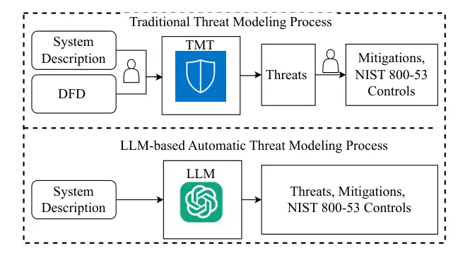
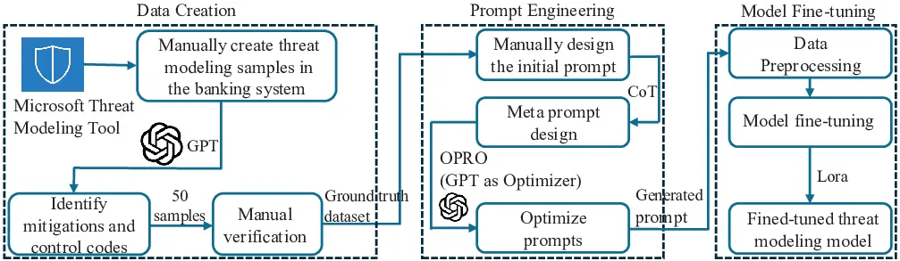
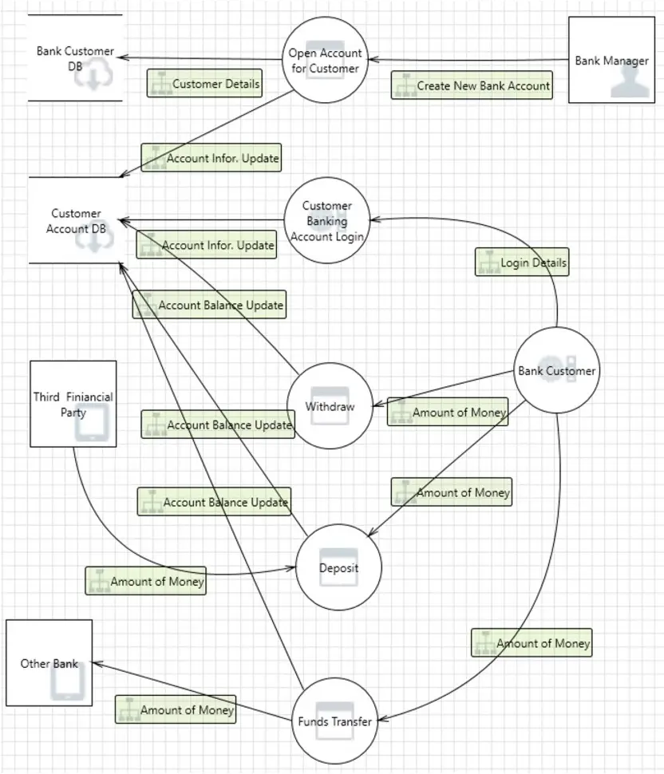
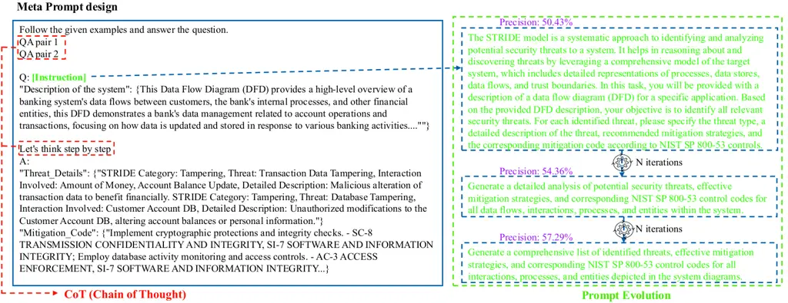

# ThreatModeling-LLM: Automating Threat Modeling using Large Language Models for Banking System

Tingmin Wu^(1§), Shuiqiao Yang^(1§), Shigang Liu¹, David Nguyen¹, Seung
Jang¹ and Alsharif Abuadbba¹ Affiliation: ¹ CSIRO’s Data61

###### Abstract

Threat modeling is a crucial component of cybersecurity, particularly
for industries such as banking, where the security of financial data is
paramount. Traditional threat modeling approaches require expert
intervention and manual effort, often leading to inefficiencies and
human error. The advent of Large Language Models (LLMs) offers a
promising avenue for automating these processes, enhancing both
efficiency and efficacy. However, this transition is not straightforward
due to three main challenges: (1) the lack of publicly available,
domain-specific datasets, (2) the need for tailored models to handle
complex banking system architectures, and (3) the requirement for
real-time, adaptive mitigation strategies that align with compliance
standards like NIST 800-53.

In this paper, we introduce ThreatModeling-LLM, a novel and adaptable
framework that automates threat modeling for banking systems using LLMs.
ThreatModeling-LLM operates in three stages: 1) dataset creation, 2)
prompt engineering and 3) model fine-tuning. We first generate a
benchmark dataset using Microsoft Threat Modeling Tool (TMT). Then, we
apply Chain of Thought (CoT) and Optimization by PROmpting (OPRO) on the
pre-trained LLMs to optimize the initial prompt. Lastly, we fine-tune
the LLM using Low-Rank Adaptation (LoRA) based on the benchmark dataset
and the optimized prompt to improve the threat identification and
mitigation generation capabilities of pre-trained LLMs. The experimental
results demonstrate that our proposed scheme substantial improvements
over the pre-trained LLMs, significantly enhancing the model’s ability
to identify threats and suggest mitigations. For example, the accuracy
of identifying mitigation codes improves from 0.36 to 0.69 on
Llama-3.1-8B-Instruct (short for Llama-3.1-8B). The results illustrate
that the combination of prompt engineering and fine-tuning techniques is
highly effective for automated threat modeling, making
ThreatModeling-LLM a robust and flexible solution for real-world
applications in banking and beyond.

###### Index Terms: 

Large language model, threat modeling, prompt engineering, fine-tuning

^(§)^(§)footnotetext: Equal contribution

## I Introduction



Fig. 1: Comparison of Traditional method and LLM-based method. The
traditional method (top) requires manual creation of Data Flow Diagrams
(DFDs). After threats are identified, additional manual effort is needed
to map them to mitigations and code. In contrast, the LLM-based process
(bottom) streamlines the workflow by using system descriptions as input
to automatically generate threats, corresponding mitigations, and the
NIST 800-53 controls.

Threat modeling is a critical cybersecurity process that identifies
potential threats and suggests mitigations for system designs using
frameworks like Microsoft’s STRIDE \[1\]. It plays a vital role in
proactively addressing vulnerabilities and preventing security breaches,
which can lead to significant financial and reputational damages \[2\].
For instance, threat modeling can block intrusion attempts and prevent
hijacking of privileged accounts, significantly reducing risks in
critical systems \[3\]. However, the traditional approach is
labor-intensive, requiring manual efforts for Data Flow Diagram (DFD)
creation, threat identification, and mapping to mitigations, which makes
it inefficient and prone to human error. Figure 1 shows the traditional
process relies heavily on tools like the Microsoft Threat Modeling Tool
(TMT), which demands extensive manual input at each stage. This is
particularly challenging in dynamic sectors like banking, where the
rapid evolution of online services and increasing sophistication of
threats have intensified the need for more efficient, automated threat
modeling solutions \[4\]. Traditional methods struggle to keep up with
the complexity of confidentiality, integrity, and privacy requirements
in banking systems, underscoring the urgency for automation.

Large Language Models (LLMs) such as GPT-3 \[5\] and Llama-3 \[6\] offer
promising potential to transform the threat modeling landscape.
Traditional methods, such as pytm \[7\], do not provide direct mappings
to NIST 800-53 standards, which are critical for compliance and
comprehensive security analyses. LLMs can process textual descriptions
of system designs, automatically identifying threats and suggesting
corresponding mitigations. This shift not only accelerates the process
but also enhances accuracy by reducing manual intervention. For
instance, commonly utilized industry tools like STRIDEGPT \[8\] and
Cyber Sentinel \[9\] show the trade-offs between automation and
precision; STRIDEGPT, while automating threat identification, produces
unstable results. Cyber Sentinel, despite its adaptability to new
threats, offers limited mitigation strategies. These examples underscore
a prevalent trade-off between specializes capabilities and comprehensive
functionality across these tools. While pre-trained LLMs, have
demonstrated impressive results in various NLP tasks, directly applying
them to threat modeling in banking systems is insufficient. Pre-trained
LLMs lack domain-specific knowledge and struggle to understand complex
banking architectures, resulting in inconsistent threat identification
and mitigation suggestions. Moreover, they are not specifically designed
to generate mitigation codes aligned with compliance standards like NIST
800-53, which is essential for banking security. These drawbacks
highlight that without additional adaptation, LLMs fall short of meeting
the precision, compliance, and context-specific needs of threat modeling
in the banking sector. However, the adaptation of LLM for threat
modeling is non-trivial and poses several challenges:

Challenge 1: Lack of publicly available datasets. A significant
challenge in threat modeling analysis is the lack of publicly available
datasets, especially for complex systems like banking. Traditionally,
researchers and security experts generally manually assess potential
threats within DFDs, a process that is not only labor-intensive but also
prone to human error. To transition towards a data-driven approach for
automatically identifying threats in banking system-based DFDs,
real-world datasets are essential. These datasets provide crucial
information about threats and mitigations in practical scenarios,
serving as the foundation for building and training automated tools that
can efficiently detect and address security vulnerabilities. However,
the creeation of a real-world dataset for automatic threat modeling
remains a challenging problem in the field.

Challenge 2: Tailored LLMs for banking systems. While LLMs have achieved
remarkable success in fields like natural language processing, software
security, and network security, applying them to threat analysis in
banking systems is an underexplored area. The unique structure and
operational complexity of banking systems require specialized threat
models that can understand the specific vulnerabilities in financial
transactions, user authentication, and data flow between systems. This
gap hinders the efficient identification and modeling of threats unique
to banking infrastructures. Developing an efficient and effective
LLM-based system for bank system-based threat analysis poses an
important and creative research question that remains unsolved.

Challenge 3: Lacking an automatic mitigation strategies: Once threats
are identified, the next critical step is developing effective,
real-time mitigation to safeguard the system. However, this is a complex
task due to the dynamic and evolving nature of threats within financial
systems. Developing novel mitigation strategies requires deep expertise
in both banking operations and security protocols, as well as
sophisticated algorithms that can adapt to changing threats. Automating
this process is particularly challenging because it demands solutions
that can respond to threats in real-time while maintaining system
efficiency and compliance with stringent banking regulations. Therefore,
creating an automatic mitigation strategy remains a challenge that still
needs to be addressed to ensure continuous improvement in system
security and the protection of sensitive financial data.

To address the first challenge, we created the first benchmark dataset
in the community by designing various types of banking systems. For each
system, we used the TMT to draw the DFDs based on the application design
documents. The TMT-generated threats and human-annotated mitigation
strategies using the NIST 800-53 served as the ground truth for
fine-tuning the LLMs, ensuring that the dataset accurately reflected
real-world security scenarios. For the second and third challenges, we
propose combining prompt engineering and fine-tuning methods to create a
customized LLM model, ThreatModeling-LLM, specifically for identifying
banking system threats and mitigations. Prompt Engineering. We explore
different prompt templates to find the optimal structure for the LLM to
produce accurate threat and mitigation outputs. Chain-of-Thought
(CoT) \[10\] is used to make the model explicitly reason through
intermediate steps, and OPRO (Optimization by PROmpting) \[11\] is
applied to refine the prompts iteratively. These techniques help improve
the quality of generated responses when identifying threats and
suggesting mitigations.

|                                        |                                              |                      |                                       |                                                      |
| -------------------------------------- | -------------------------------------------- | -------------------- | ------------------------------------- | ---------------------------------------------------- |
| Study                                  | Approach                                     | Domain Type          | Strengths                             | Limitations / Gaps                                   |
| Tong and Ban \[12\]                    | STRIDE + Threat Tree Analysis                | Banking              | Enhanced threat analysis efficiency   | Lacks automation; high manual effort                 |
| Chattopadhyay and Sripada \[13\]       | Threat Modeling Framework for Mobile Banking | Banking              | Comprehensive threat detection        | Lacks specific mitigations                           |
| Möckel and Abdallah \[14, 15\]         | Threat Modeling in SDL for E-Banking         | Banking              | Early-stage threat identification     | High manual effort                                   |
| Hassan et al. \[16\]                   | IoT Security Risks in Banking                | Banking              | Proposes blockchain-based measures    | No automated threat modeling mechanism               |
| Aijaz et al. \[17\]                    | TMA for Healthcare-IT Systems                | Healthcare           | Improved threat identification        | No real-time mitigation; lacks NIST compliance       |
| Beozzo \[18\]                          | Agile Threat Modeling                        | Corporate/Agile      | Scalable, governance-focused approach | Not adapted to banking-specific needs                |
| Abuabed et al. \[19\]                  | Cybersecurity Framework for Automobiles      | Automotive           | Integrates STRIDE and CVSS            | Struggles with evolving banking threats              |
| Ananthapadmanabhan and Achuthan \[20\] | Threat Intelligence for Cloud Systems        | Cloud/IT             | Effective attacker behavior capture   | No fine-tuning for domain-specific detection         |
| Rose et al. \[21\]                     | ThreMA (Ontology-Based)                      | Public Sector        | Automated threat identification       | Static framework; limited banking adaptation         |
| Schaad and Reski \[22\]                | OVVL Framework                               | Software Development | Early-stage threat modeling           | Lacks domain-specific focus and compliance alignment |

TABLE I: Summary of Related Works in Threat Modeling.

Model Fine-Tuning. Based on the generated prompt, we fine-tune a base
LLM (such as Llama-3.1-8B) using our created dataset to empower the LLMs
with the abilities to generate more accurate threats and mitigations
based on the text input. The fine-tuning process involves Low-Rank
Adaptation (LoRA) \[23\], which allows efficient adaptation of the model
to domain-specific tasks like threat identification in banking systems.
The fine-tuning data includes DFD descriptions, identified threats,
mitigations, and their respective NIST 800-53 control codes. Fine-tuning
enables the model to grasp the unique vulnerabilities and mitigations
needed in financial systems.

Our experiments show that combining prompt engineering and fine-tuning
outperforms using the either technique alone. ThreatModeling-LLM
demonstrates significant improvements in the accuracy of threat
identification and mitigation generation, providing a more effective and
automated threat modeling process tailored for the banking sector. Our
key contributions are as follows:

- •
  We introduce the innovative ThreatModeling-LLM framework, specifically
  designed to automate threat modeling for banking systems. This
  framework is uniquely tailored to address the complexities of the
  banking domain, combining advanced prompt engineering with fine-tuning
  techniques to to enhance the capability of pre-trained LLMs.
  Specifically we optimize the prompt by CoT and OPRO. We then
  fine-tuning the model with our specialized dataset using the optimized
  prompt. These techniques encourage the model to explicitly reason
  through intermediate steps and iteratively refine its responses,
  leading to more accurate and detailed identification of threats and
  generation of mitigation strategies aligned with NIST 800-53 control
  codes.
- •
  To overcome the scarcity of publicly available datasets for banking
  threat modeling, we have meticulously designed a specialized training
  dataset that features 50 different banking system applications and use
  cases. This involved creating various types of banking system
  scenarios and using the TMT to draw DFDs based on application design
  documents. The TMT-generated threats and human-annotated mitigation
  strategies serve as ground truth, ensuring the dataset reflects
  real-world security concerns. This dataset is essential for
  effectively fine-tuning the LLM to understand and identify
  banking-specific threats and mitigation.
- •
  We demonstrate that combining fine-tuning with advanced prompt
  engineering techniques significantly improves the LLM’s performance in
  threat modeling tasks. Specifically, for the Llama-3.1-8B model, the
  synergy of prompt engineering and fine-tuning increased accuracy from
  0.36 to 0.69, precision from 0.49 to 0.73, recall from 0.36 to 0.73,
  and text similarity from 0.944 to 0.9792. This marked improvement
  underscores the effectiveness of our methods in sharpening the model’s
  ability to accurately identify threats and mitigations, making it a
  potent tool for cybersecurity in the banking sector.

## II Related Work

Automated threat modeling has evolved through both traditional and
AI-based approaches, aiming to enhance cybersecurity across various
domains. In this section, we review notable works in threat modeling for
banking systems and other domains, identifying gaps that motivate the
development of ThreatModeling-LLM.

ThreatModeling for Banking Systems: Tong and Ban \[12\] combined STRIDE
with threat tree analysis to improve threat analysis efficiency in
online banking. This hybrid approach provided deeper insights into
security risks but lacked automation, making it labor-intensive.
Chattopadhyay and Sripada \[13\] reviewed major threats to mobile
banking, offering a comprehensive framework for detection and
mitigation, yet the proposed solution was limited to identifying broad
categories without generating specific mitigations. Möckel and
Abdallah \[14, 15\] emphasized integrating security into the software
development lifecycle (SDL) for e-banking, advocating early-stage threat
modeling using tools like Microsoft SDL. Despite highlighting the
importance of threat modeling in design, the manual nature of their
approach still required significant human input. Hassan et al. \[16\]
focused on IoT’s impact on banking, proposing blockchain-based measures
for IoT security risks, but lacked an automated threat modeling
mechanism that aligns with compliance standards like NIST 800-53.

Threat Modeling for Other Domains: Several studies have explored
automated threat modeling beyond banking system. Aijaz et al. \[17\]
introduced Threat Modeling and Analysis (TMA) for healthcare-IT,
focusing on system vulnerabilities and attacker behavior. Although TMA
improved threat identification, it did not offer real-time, adaptive
mitigation strategies. Beozzo \[18\] proposed a novel approach for Agile
corporate environments, addressing scalability and governance but not
covering domain-specific needs like banking compliance.

Abuabed et al. \[19\] tailored a cybersecurity analysis framework for
modern automobiles, integrating STRIDE, Attack Tree Analysis, and CVSS.
However, their method struggled with the complexity of identifying
threats across evolving banking infrastructures. Ananthapadmanabhan and
Achuthan \[20\] integrated threat modeling with threat intelligence in
cloud systems using Splunk, but this approach lacked fine-tuning for
domain-specific threat detection. Rose et al. \[21\] introduced ThreMA,
an ontology-driven threat modeling tool, while Schaad and Reski \[22\]
proposed OVVL for early-stage threat identification. Both studies
advanced automation but were limited by static frameworks that did not
adapt to specific banking architectures.

Summary and Identified Gaps: Table I summarizes key related works, their
strengths, and limitations. While existing approaches contribute to
various aspects of threat modeling, they often lack automation,
domain-specific adaptation, or compliance with standards like NIST
800-53. These gaps highlight the need for a more flexible and adaptable
approach, motivating the development of ThreatModeling-LLM.

## III Preliminaries, Problem Definition and Motivation

### III-A Preliminaries

| Threat                 | Desired Property  | Threat Definition                                                                     |
| ---------------------- | ----------------- | ------------------------------------------------------------------------------------- |
| Spoofing               | Authenticity      | Pretending to be something or someone other than yourself                             |
| Tampering              | Integrity         | Modifying something on disk, network, memory, or elsewhere                            |
| Repudiation            | Non-repudiability | Claiming that you didn’t do something or were not responsible; can be honest or false |
| Information Disclosure | Confidentiality   | Someone obtaining information they are not authorized to access                       |
| Denial of Service      | Availability      | Exhausting resources needed to provide service                                        |
| Elevation of Privilege | Authorization     | Allowing someone to do something they are not authorized to do                        |

TABLE II: Description of STRIDE Framework Threats and Desired
Properties. Source:
[https://en.wikipedia.org/wiki/STRIDE_model](https://en.wikipedia.org/wiki/STRIDE_model)

Microsoft STRIDE \[24\] is a framework used for threat modeling in
software security. As shown in Table II, it stands for Spoofing,
Tampering, Repudiation, Information Disclosure, Denial of Service, and
Elevation of Privilege, representing the various categories of security
threats that need to be addressed. When using Microsoft STRIDE for
threat modeling analysis, the process begins with the identification and
categorization of potential security threats to a system. Each category
corresponds to a specific kind of threat. For example, ‘Spoofing’
involves an unauthorized user impersonating another to gain access to a
system, while ‘Tampering’ refers to the unauthorized modification of
data.

By applying the STRIDE framework, security analysts systematically
explore each threat category in relation to the target system. They
assess the system’s architecture to identify where and how these threats
could potentially be realized. This involves examining data flows,
authentication mechanisms, network interfaces, and other relevant
aspects of the system. Once threats are identified, they are documented,
and the system’s vulnerabilities that could be exploited by these
threats are pinpointed.

The final phase of the Stride methodology involves proposing and
prioritizing mitigations for identified threats. This may include
implementing secure coding practices, enhancing authentication
protocols, applying encryption, or introducing intrusion detection
systems. Stride not only helps in recognizing potential threats but also
plays a crucial role in the design phase by guiding developers to
integrate security measures early in the development process, thus
reinforcing the system’s defense against malicious attacks and reducing
the risk of security breaches.

| Model             | Strength                              | Weakness                                                           |
| ----------------- | ------------------------------------- | ------------------------------------------------------------------ |
| pytm              | Integration with Python codebases     | Lacks direct NIST 800-53 mapping                                   |
| STRIDEGPT         | Applies STRIDE in an automated manner | No consistent categorization, unstable results                     |
| Cyber Sentinel    | High adaptability to new threats      | Limited mitigation capabilities                                    |
| Raw LLM (ChatGPT) | Broad contextual knowledge            | Inconsistent mitigation suggestions, lacks deep technical mappings |

TABLE III: Existing Automated Threat Modeling Explanations.

NIST Cybersecurity Framework is developed by National Institute of
Standards and Technology (NIST) to provide high-level cybersecurity
outcomes for different sizes of business. The framework has five
functions to organize the cybersecurity activities, including Identify,
Protect, Detect, Respond and Recover. Identify represents understanding
cybersecurity risks of the relevant organization, then Protect develops
effective security protective process to maintain the running of
important services. Detect refers to the discovery of the cybersecurity
events, and Respond takes actions to the incident. Lastly, Recover
supports the recovery to the service and minimize the impact of the
cybersecurity incidents. NIST 800-53¹¹ 1 Source:
https://csrc.nist.gov/pubs/sp/800/53/r5/upd1/final complements the
framework by offering a detailed catalog of security and privacy
controls. While the framework outlines the “what” of cybersecurity (the
essential functions), NIST 800-53 provides the “how” by specifying
technical and organizational safeguards. These controls can be mapped to
the framework’s functions, making NIST 800-53 an operational tool to
achieve the cybersecurity outcomes outlined in the framework. The
controls are categorized into 20 families, such as AC (Access Control)
and IR (Incident Response), tailored to enhance security across various
organizational environments.

### III-B Problem Definition

In this section, we formally define the research problem. As shown in
Figure 1, traditional threat modeling techniques, such as those based on
Microsoft’s STRIDE framework, rely heavily on manual analysis, which is
time-consuming and prone to human error. Furthermore, the process of
identifying appropriate mitigation strategies and ensuring compliance
with standards like NIST 800-53 is complex and resource-intensive. In
this work, we aim to automate the threat modeling process for banking
systems by leveraging LLMs as illustrated in Figure 1. Given a textual
description of a banking system design, such as an ATM system, the goal
is to automatically identify potential security threats based on the
STRIDE framework and generate the mitigation strategies based on NIST
800-53.

Let $`X`$ represent the designing document of a banking system. This
input $`X`$ is a sequence of words (tokens), where:

```math
X=[x_{1},x_{2},\dots,x_{n}]
```

where $`x_{i}`$ represents the $`i`$-th token in the text, and $`n`$ is
the total number of tokens in the input description. The goal is to
transform this input into two outputs:

- •
  Threats Identification: $`T`$
- •
  Mitigation Strategy: $`M`$

#### Threats Identification

Let $`T=\{t_{1},t_{2},\dots,t_{k}\}`$ represent the set of identified
threats, where $`t_{i}`$ corresponds to the $`i`$-th threat. Each threat
$`t_{i}`$ is a function of the input description $`X`$ and is defined
based on the STRIDE framework categories (Spoofing, Tampering,
Repudiation, Information Disclosure, Denial of Service, Elevation of
Privilege):

```math
t_{i}=f_{\text{STRIDE}}(X),\quad\forall t_{i}\in\{S,T,R,I,D,E\}
```

where $`S,T,R,I,D,E`$ represent the STRIDE categories. The function
$`f_{\text{STRIDE}}`$ maps the input $`X`$ to one or more threat
categories based on the analysis of the data flow diagram (DFD).

#### Mitigation Strategy

Let $`M=\{m_{1},m_{2},\dots,m_{k}\}`$ represent the set of mitigation
strategies, where $`m_{i}`$ corresponds to the $`i`$-th mitigation
strategy associated with threat $`t_{i}`$. Each mitigation strategy
$`m_{i}`$ is a function of both the identified threat $`t_{i}`$ and the
control codes defined by the NIST 800-53 standard. The mitigation
strategy $`m_{i}`$ is given by:

```math
m_{i}=g_{\text{NIST}}(t_{i}),\quad\forall m_{i}\in\{NIST\ 800-53\ \text{Control Codes}\}
```

where $`g_{\text{NIST}}`$ maps the identified threat $`t_{i}`$ to the
corresponding NIST 800-53 mitigation control code.

#### Objective

The system’s objective is to generate the set of pairs
$`\{(t_{i},m_{i})\}_{i=1}^{k}`$ from the input description $`X`$ using
the fine-tuned LLM model $`h`$, where each pair $`(t_{i},m_{i})`$
corresponds to an identified threat and its respective mitigation
strategy based on the STRIDE framework and NIST 800-53 control codes.

The overall transformation can be formalized as:

```math
\{(t_{i},m_{i})\}_{i=1}^{k}=h(X)
```

where $`h(X)`$ is the function representing the LLM-based process that
identifies the threats $`t_{i}`$ and generates the corresponding
mitigations $`m_{i}`$ based on NIST 800-53 standard.



Fig. 2: System Overview of ThreatModeling-LLM: (i) Data Creation:
Utilizes the Microsoft Threat Modeling Tool to manually generate threat
modeling samples, comprising 50 samples verified manually to construct a
ground truth dataset. (ii) Prompt Engineering: Involves manually
designing the initial prompt for a Large Language Model (LLM), followed
by optimizing these prompts to enhance model responses. (iii) Model
Fine-tuning: This phase includes the fine-tuning of the threat modeling
model using the LLM to improve its accuracy and reliability in threat
detection, and mitigation generation (i.e., NIST 800-53 control codes).

### III-C Motivation

To investigate the state-of-the-art, we examined four notable automated
threat modeling tools, encompassing both industry-standard and emergent
GPT-based technologies. These tools are Cyber Sentinel (CS) \[9\],
pytm \[7\], STRIDEGPT (SG) \[8\], and Raw LLM (RL) (using
ChatGPT) \[25\] stand out for their unique capabilities. Cyber Sentinel
is renowned for its adaptability to new threats, providing proactive
security measures. pytm, specifically designed for Python applications,
integrates threat modeling directly into the development process,
facilitating seamless security assessments. STRIDEGPT leverages the
STRIDE methodology through automation to efficiently pinpoint potential
threats. Lastly, Raw LLM (ChatGPT) offers broad contextual knowledge,
making it a versatile tool for general threat analysis.

We summarize the strengths and weaknesses of the tools in Table III. The
limitations of the four automated threat modeling tools, Cyber Sentinel,
pytm, STRIDEGPT, and Raw LLM (ChatGPT), highlight the challenges in
balancing strengths with functional shortcomings within the realm of
cybersecurity modeling. Cyber Sentinel, while highly adaptable to new
threats, suffers from limited capabilities in offering specific
mitigation strategies, which restricts its utility in proactive threat
management. pytm, despite its seamless integration with Python
environments, does not provide direct mappings to NIST 800-53 standards,
which are critical for compliance and comprehensive security analyses.
STRIDEGPT, which leverages the STRIDE methodology to automate threat
identification, struggles with consistent categorization and produces
unstable results, undermining its reliability. Lastly, Raw LLM (ChatGPT)
offers expansive contextual knowledge but falls short in providing
consistent, technically precise mitigation suggestions and lacks the
capability to deeply map technical controls, which are essential for
detailed threat remediation and control implementation. These
limitations underscore a prevalent trade-off between specializes
capabilities and comprehensive functionality across these tools,
signaling the need for further refinement and development to enhance
their applicability and effectiveness in diverse security scenarios.

## IV The Proposed ThreatModeling-LLM

### IV-A Overview

The comprehensive system overview is depicted in Figure 2. Our system
consists of three core components that streamline threat modeling. The
first component, Data Creation, utilizes the Microsoft Threat Modeling
Tool (TMT) to manually generate samples for threat modeling, with 50
samples manually verified to establish a ground truth dataset. The
second component, Prompt Engineering, involves the manual design of
initial prompt for an LLM, which are then optimized to improve the
model’s response effectiveness. The final component, Model Fine-tuning,
focuses on refining the threat modeling model through precise LLM
fine-tuning, ensuring high accuracy and reliability in the bank
applications.

### IV-B Dataset Creation and Verification

To study automatic threat modeling using LLM in banking systems, one
needs to prepare a well-organized dataset. However, as far as we know,
there is no publicly available dataset. Therefore, we need to prepare
the dataset, the dataset should meet the following requirements: 1) it
should reflect real-world scenarios; 2) it should be generated using a
publicly available and widely used tool in the security community; 3) it
should include threats, mitigation, and the related control code.

In light of these requirements, this work first uses the TMT to generate
different DFDs for banking systems. TMT is a core part of the Security
Development Lifecycle, enabling users to create data flow diagrams and
identify potential threats early. Designed for non-security experts, it
simplifies threat modeling by providing standard visual notations and
guidance, helping to mitigate security risks in software development. We
use the Windows System. The windows operating system is Microsoft
Windows Server 2019 Standard with 8GB RAM. Then, we use TMT to identify
the related threats. After that, we employ LLM (i.e. GPT) to
automatically identify the mitigations, and also manually check all the
mitigation with local banking experts in DFD analysis. It is worth
noting that, in the processes of mitigation generation and the map of
mitigation to the NIST 800-53 control code generation, we have been
working closely with our collaborator from the local bank, and the
security expert, along with our security expert, has manually checked
all the mitigations to ensure there is no noise. After this, we also
employ LLM to map all the mitigations to the NIST 800-53 control codes,
as our collaborator requires these codes to address all possible
threats. We also want to point out that human experts have been involved
in this process to ensure the quality of the mapping and that no noise
is introduced. Figure 3 shows the processes for the dataset generation
process.

Fig. 3: Dataset Creation Framework.

Specifically, for the first step, we work closely with our local bank
collaborator in preparing the DFD. For example, for the ATM DFD, we
first identify all the External entities including customer client;
processes such as Manage Bank Customer Information, Bank Customer
Information Management, Account Information Update and so on; data
stores such as Bank Customer Database and transaction record; data flows
including Transaction Request, Confirmation, Cash Out & Receipts and so
on; the relationship between the element such as Customers interact with
the Manage Bank Customer Information process, which accesses the Bank
Customer Database, Customers initiate a Transaction Request, which is
handled by the Bank Customer Information Management process. Based on
this information, we use TMT to draw the DFD in both the default setting
and the managed setting as well. For the managed setting, the parameters
are: the condition ‘Running as’ will be changed from ‘no’ to ‘network
service’, the ‘Isolation level’ will be changed from ‘no’ to
‘AppContainer’, the ‘Accepts Input From’ will be changed from ‘no’ to
‘Kernel, System, or Local Admin’ and so on, we will make all the setting
publicly available along with our dataset. For more information please
refer to [anonymous](https://anonymous). Figure 4 provides an example of
a DFD which is a Bank Account DFD. One can see, it includes: 1) External
Entities such as bank customer, third financial party, other bank etc.; 2) Data Store such as customer account DB; 3) Processes such as open
account for customer, customer banking account login etc.

Once the DFD is ready, we will use TMT to produce the possible threats
and save then into files. Afterward, we need to prepare mitigations
based on the identified threats. To achieve this, we employ LLMs (e.g.,
GPT) to automatically identify the mitigations. To ensure the generated
mitigations are practical and applicable to real-world scenarios, we
manually verify them with local banking experts in DFD analysis. For
example, when facing a data tampering threats, there can be different
mitigations such as SC-7 or SC-8. Actually, both SC-7 and SC-8 are
critical for protecting the communications and system interfaces from
potential threats such as unauthorized access, and data tampering, they
are controls related to system and communications protection. In this
case, we will manually check whether the system need a Boundary
Protection (SC-7) or Transmission Confidentiality and Integrity (SC-8).
The final version of the mitigations, after manual review, will be used
for the next step.

For the third step, we use GPT-3.5 to map the mitigation to the NIST
800-53 control code. As a result, the prediction will include the
threats, mitigations, and corresponding control codes. For example, if
the identified threat category is Spoofing, the threat might be: ‘An
attacker could impersonate a bank customer or IoT device to gain
unauthorized access to the system. Spoofing can occur at the Web Service
or IoT Device level.’ The mitigations could be: ‘Implement strong
authentication mechanisms, such as multi-factor authentication (MFA) for
bank customers and secure authentication for IoT devices (e.g.,
certificates)’ and ‘Use secure communication channels (e.g., TLS/SSL) to
prevent identity spoofing.’ The related NIST 800-53 control codes would
be ‘IA-2: Identification and Authentication (Organizational Users)’ and
‘SC-12: Cryptographic Key Establishment and Management.

All in all, by following these steps, we created 50 DFD samples. For
each sample, we will prepare a file that includes the description of the
DFD, the threats, the mitigation, and the mapping of NIST 800-53 control
codes. These samples will be used for fine-tuning the LLM (based on 40
samples) and evaluating the LLM models (based on 10 samples).

### IV-C Prompt Engineering

Prompt engineering represents a critical aspect of leveraging language
models effectively, acting as the interface between human intentions and
machine understanding. Prompt engineering involves crafting inputs that
guide AI models, particularly LLMs, to generate desired outputs with
higher precision and relevance. This discipline has become increasingly
significant with the rise of more sophisticated AI models that are
capable of understanding and generating human-like text.

Traditional prompt engineering has evolved from simple iterative
refinements to adopting more systematic approaches. One prominent method
within this evolution is the CoT prompting \[10\]. This technique
involves instructing the model to verbalize its intermediate reasoning
steps or cognitive processes as it approaches a solution. By simulating
a more transparent thought process, CoT helps align the model’s
responses more accurately with complex problem-solving tasks,
significantly improving the output’s clarity and correctness.

Recent prompt engineering has focuses more on dynamic generation of new
prompts. Another innovative technique is OPRO (Optimization by
PROmpting) \[11\], which focuses on the dynamic refinement of prompts in
response to evolving dialogue contexts and the model’s prior outputs.
This adaptability is especially valuable in interactive settings where
user queries can progressively modify the scope or specificity of the
discussion, necessitating correspondingly nuanced adjustments from the
AI. OPRO enables the model to respond effectively to such shifts,
maintaining relevance and depth in its answers.



Fig. 4: A light example of the Generated DFD.

In this context, we introduce a novel prompt engineering approach
tailored for cybersecurity threat modeling. Our method identifies
potential threats, suggests mitigations, and references applicable
security controls, such as those specified in NIST 800-53. Integrating
the strengths of CoT and OPRO, our technique establishes a robust
framework for threat modeling. By using CoT, we instruct LLMs to
methodically outline their reasoning, simulating an expert’s analytical
process in identifying and evaluating security threats. This clear
reasoning is essential for validating AI-generated insights and ensures
that each step is both logical and justifiable. The explicit
articulation of thought processes not only deepens the model’s
analytical capabilities but also enhances the reliability and
traceability of its outputs, thereby enhancing domain knowledge
application.

Alongside CoT, we employ OPRO to dynamically adjust these prompts
according to the ongoing context of the threat modeling session. This
integration allows our method to adaptively respond to new information
or changes in focus, ensuring that the model’s analysis remains
comprehensive and pertinent throughout the interaction. By merging these
strategies, our approach guides LLMs to generate detailed, actionable
threat models that not only identify potential risks but also recommend
suitable mitigations aligned with NIST 800-53 control codes. This
sophisticated prompting strategy significantly boosts the AI’s capacity
to emulate expert-level cybersecurity analysis and aligns its outputs
with industry standards, providing a formidable tool for organizations
aiming to enhance their security measures.

### IV-D LLM Fine-tuning

Fine-tuning is a crucial step in adapting pre-trained language models to
specific tasks, enhancing their accuracy and effectiveness in
specialized domains. In the context of cybersecurity, particularly for
threat identification from Data Flow Diagrams (DFDs), fine-tuning
enables the model to better understand domain-specific language patterns
and structures associated with potential vulnerabilities. We employ
Low-Rank Adaptation (LoRA) \[23\] as the primary technique for
fine-tuning, which is both efficient and effective for
resource-constrained environments.

#### IV-D1 Low-Rank Adaptation (LoRA) for Fine-tuning

LoRA is a parameter-efficient fine-tuning method that adapts large
pre-trained models by injecting learnable low-rank matrices into the
original model’s weights. This approach significantly reduces the number
of trainable parameters, making fine-tuning more computationally
feasible while maintaining model performance.

Let $`\mathbf{W}\in\mathbb{R}^{d\times k}`$ be the weight matrix of the
pre-trained model, where $`d`$ is the input dimension and $`k`$ is the
output dimension. In LoRA, the update to $`\mathbf{W}`$ is represented
as the product of two low-rank matrices:

```math
\Delta\mathbf{W}=\mathbf{A}\mathbf{B}
```

where $`\mathbf{A}\in\mathbb{R}^{d\times r}`$ and
$`\mathbf{B}\in\mathbb{R}^{r\times k}`$, with $`r\ll\min(d,k)`$ being
the rank of the decomposition. This decomposition allows the original
weight matrix to be updated as:

```math
\mathbf{W}_{\text{new}}=\mathbf{W}+\alpha\cdot\Delta\mathbf{W}
```

where $`\alpha`$ is a scaling factor to control the magnitude of the
adaptation, and $`\Delta\mathbf{W}`$ is the low-rank update applied to
the original weight matrix $`\mathbf{W}`$.

Principles of LoRA Fine-tuning The core principles of the LoRA
fine-tuning method include:

- •
  Parameter Efficiency: By training only the low-rank matrices
  $`\mathbf{A}`$ and $`\mathbf{B}`$, LoRA significantly reduces the
  number of trainable parameters. The total number of trainable
  parameters becomes $`d\times r+r\times k`$, where $`r\ll\min(d,k)`$,
  making it highly efficient compared to traditional fine-tuning
  methods.
- •
  Computational Efficiency: Since only the low-rank matrices
  $`\mathbf{A}`$ and $`\mathbf{B}`$ are optimized during training, the
  computational and memory requirements are substantially lower than
  those of standard fine-tuning methods. This makes LoRA suitable for
  environments with limited computational resources, such as edge
  devices or lower-end GPUs.
- •
  Maintaining Performance: Despite its reduced parameter count, LoRA
  maintains or even enhances the model’s performance. The low-rank
  updates effectively capture domain-specific features without
  compromising the model’s generalization capability.
- •
  Adaptability to Domain-specific Tasks: LoRA allows for efficient
  adaptation of pre-trained models to specialized tasks by focusing on
  learning task-specific information encoded within the low-rank
  matrices. In the context of threat modeling from DFDs, LoRA helps the
  model recognize patterns and relationships specific to cybersecurity.

The LoRA-based fine-tuning approach thus provides a robust framework for
adapting pre-trained models to domain-specific tasks in a
resource-efficient manner, making it well-suited for applications like
automated threat modeling.

## V Experimental Setting

### V-A Data Preparation

For this study, we manually created 50 sample related to the banking
system domain, each representing a different application. Each sample
simulates a unique banking system architecture, covering various aspects
of threat modeling to ensure diversity and robustness in the training
data. For each sample, it contains two fields:

- •
  Application Description: Each sample contains a textual description of
  the application system, outlining its components, data flow, and
  overall architecture.
- •
  Ground Truth Threats and Mitigations: Each application description
  includes manually verified threats and mitigations, which serve as
  ground truth labels for training and evaluation.

### V-B Fine-tuning Configuration

The fine-tuning process leverages LoRA to enhance the model’s
performance in the banking threat modeling domain. Key parameters for
LoRA include:

- •
  Rank (r): 32, specifying the rank of the low-rank decomposition,
  balancing between parameter efficiency and model adaptation.
- •
  Scaling Factor (lora_alpha): 64, controlling the adaptation strength
  of the model.
- •
  Target Modules: Includes projections such as “q_proj”, “k_proj”,
  “v_proj”, and “o_proj”, which are specific to Llama models.
- •
  Dropout Rate: 0.1, applied to prevent overfitting during the
  adaptation process.

### V-C Training Configuration

The model training was conducted using the Transformers library with the
following major hyperparameters:

- •
  Batch Size: 4 per device, with gradient accumulation steps set to 4,
  effectively increasing the batch size during training.
- •
  Optimizer: “paged_adamw_32bit”, chosen for memory efficiency and
  faster convergence.
- •
  Learning Rate: 1e-4, set for stable learning and effective adaptation.
- •
  Number of Epochs: 30, allowing sufficient training for the model to
  adapt to the threat modeling domain.
- •
  Evaluation Strategy: Evaluations are performed at regular intervals
  (every 20% of training steps), ensuring consistent monitoring of the
  model’s performance.



Fig. 5: The process of prompt design, combing CoT and Prompt Evolution
based on OPRP.

### V-D Initial Prompt

For prompt engineering, we use the following initial prompt as a start
point for instructing the LLMs.


### V-E Prompt Configuration

The prompt engineering process includes two steps: CoT (Chain of
Thoughts) and prompt evolution as shown in Figure 5. For CoT, we
incorporate “few-shot” learning by utilizing two examples to guide
prompt design and optimization, and “zero shot” by employing a
step-by-step reasoning method to address specific threats within the
banking system.

The prompt evolution is implemented based on OPRO, with the following
configurations:

Scorer:

- •
  Model type: “gpt-3.5-turbo”
- •
  Max output tokens: 1024. A higher token limit allows for comprehensive
  responses that can fully evaluate the effectiveness and completeness
  of the prompts.
- •
  temperature: 0.0. The model will produce the most likely output, which
  is beneficial for consistent scoring and easier comparative analysis.
- •
  Num Decodes: 1. Since the focus is on reliability and predictability
  for scoring, only one decode is needed to evaluate each input without
  introducing variability.
- •
  Batch size: 1. Maintain simplicity and control over the experiment.
  Each prompt is processed individually, reducing complexity in handling
  outputs.
- •
  Num Servers: 1. Simplify the infrastructure requirements and ensures
  that the environmental factors affecting model performance are
  consistent across all tests.

Optimizer:

- •
  Model type: “gpt-3.5-turbo”
- •
  Max output tokens: 512. A lower token count encourages the model to
  focus on conciseness and creativity within a shorter output, which
  might lead to more diverse and inventive prompt generation.
- •
  temperature: 1.0. Increase randomness and variability in responses.
  This setting is optimal for generating creative and diverse prompts.
- •
  Batch size: 1. Like the scorer, maintaining a batch size of 1 ensures
  that each generated prompt is evaluated individually, allowing for
  precise adjustments and optimizations based on singular output
  analysis.
- •
  num_servers: 1. Consistency in computational environment between
  scoring and optimizing, reducing any potential bias or variability
  introduced by different server setups.

Other settings:

- •
  Instruction position: “Q_begin” (the instruction is added before the
  original question.)

### V-F Evaluation Metrics

To evaluate the performance of the proposed prompt engineering and the
fine-tuned methods to identify the threats and proper mitigation control
codes, we adopted semantic similarity analysis using BERT and set-based
evaluation of mitigation control codes using precision, recall, and
accuracy.

BERT Similarity Score: We used the BERT model to compute the cosine
similarity between the embeddings of the LLM-generated
threats/mitigation strategies and the ground truth annotations. This
allows us to capture not only exact matches but also paraphrased or
contextually similar descriptions.

The similarity score for each generated output is calculated as:

```math
\text{Similarity Score}=\cos(\text{BERT}(G_{\text{truth}}),\text{BERT}(G_{\text{generated}}))
```

where $`G_{\text{truth}}`$ is the ground truth description, and
$`G_{\text{generated}}`$ is the LLM-generated output.

Higher similarity scores indicate better alignment with the ground
truth.

#### V-F1 Mitigation Control Code Evaluation

To evaluate the accuracy of the mitigation control codes generated by
the LLM, we treated this as a set-matching problem, comparing the sets
of control codes from the generated output to the ground truth. We
employed the following metrics to assess performance:

Precision: Precision measures the proportion of correctly generated
control codes out of all codes predicted by the LLM. It is calculated
as:

```math
\text{Precision}=\frac{|C_{\text{generated}}\cap C_{\text{truth}}|}{|C_{\text{generated}}|}
```

where $`C_{\text{generated}}`$ represents the set of control codes
generated by the LLM, and $`C_{\text{truth}}`$ represents the set of
ground truth control codes.

Recall: Recall measures the proportion of the correct control codes
identified out of all the ground truth codes. It is calculated as:

```math
\text{Recall}=\frac{|C_{\text{generated}}\cap C_{\text{truth}}|}{|C_{\text{truth}}|}
```

Accuracy: Accuracy evaluates the overall correctness of the generated
control codes, comparing the total number of correctly generated codes
to the total number of codes present in both the generated set and the
ground truth set. It is calculated as:

```math
\text{Accuracy}=\frac{|C_{\text{generated}}\cap C_{\text{truth}}|}{|C_{\text{generated}}\cup C_{\text{truth}}|}
```

The $`C_{\text{generated}}`$ and $`C_{\text{truth}}`$ denote the
mitigation codes generated by LLM and the ground truth mitigation codes.

## VI Evaluation

In this study, we aim to address the following research questions:

RQ1: How does the performance of CoT+OPRO compare to the Initial Prompt,
CoT, and OPRO?

RQ2: How does fine-tuning improve the performance of LLMs compared to
their base models?

RQ3: How does the performance of our developed system,
ThreatModeling-LLM, compare to existing methodologies? What are the
effects of integrating prompt engineering with fine-tuning within our
ThreatModeling-LLM framework?

In the following sections, we answer the research questions and present
our empirical findings.

## RQ1: How does the performance of CoT+OPRO compare to the Initial Prompt, CoT, and OPRO?

Figure 5 highlights two crucial components in our meta prompt design
process: CoT and Prompt Evolution based on OPRO. These elements play a
central role in refining prompt design to enhance threat identification
and mitigation precision within a banking data flow diagram scenario.
Starting with CoT, it employs a step-by-step reasoning method to address
specific threats within the banking system, such as data tampering and
unauthorized modifications. This zero-shot approach enables targeted
solutions directly linked to identified risks, ensuring that each threat
is systematically addressed with appropriate security controls. In
addition, CoT incorporates “few-shot” learning by utilizing specific
examples to guide prompt design and optimization. This technique
leverages two example QA pairs, representing distinct scenarios or
questions related to potential security vulnerabilities, to refine the
analysis and understanding of security threats in banking data flow
diagrams.

The Prompt Evolution segment captures how iterative refinements based on
OPRO significantly enhance output precision. Initial analysis precision
is at 0.5, reflecting the early stage of addressing security
vulnerabilities. Continuous iterations refine threat models, improve
description clarity, and optimize mitigation strategies, progressively
increasing precision. This process culminates in a final precision of
0.57, demonstrating a systematic approach to maximizing the
effectiveness of prompt design for identifying and mitigating potential
security threats in the banking context.

Figure 6 presents a comparative analysis of four prompt engineering
techniques: Initial Prompt, CoT, OPRO, and the combined CoT+OPRO
approach. Evaluated across four metrics (Accuracy, Precision, Recall,
and Text Similarity), the results, based on GPT-3.5-turbo, reveal that
integrating CoT with OPRO achieves the highest performance across all
metrics, particularly excelling in Precision and Text Similarity.

The Initial Prompt method, serving as a baseline, shows limited
effectiveness, with relatively lower scores in Accuracy (0.17),
Precision (0.35), and Recall (0.27). CoT improves upon this baseline by
significantly increasing both Accuracy and Recall, demonstrating that
explicit reasoning steps contribute to better threat identification.
CoT’s Precision also surpasses the baseline, highlighting its capability
to generate more relevant and precise outputs. OPRO, when applied
independently, achieves moderate improvements, especially in Precision,
but does not match CoT’s overall performance.

Fig. 6: Comparative performance analysis of four prompt engineering
techniques (Initial Prompt, CoT, OPRO, and the combined CoT+OPRO),
across Accuracy, Precision, Recall, and Text Similarity metrics based on
GPT-3.5-turbo.

The combination of CoT and OPRO demonstrates a synergistic effect,
achieving the highest scores in all metrics, with Precision and Recall
almost achieving 0.6, and Text Similarity exceeding 0.95. This combined
approach enables the model to reason through intermediate steps (CoT)
while dynamically refining prompts (OPRO), producing more accurate and
contextually relevant outputs. These results indicate that CoT+OPRO not
only enhances overall performance but also addresses the limitations of
each individual method, making it a robust strategy for improving prompt
engineering in automated threat modeling tasks. The output of prompt
engineering process will lead to a new prompt as shown below:


We began the prompt engineering process with an initial prompt shown in
section V-D that was detailed and descriptive, aiming to guide the model
through a comprehensive analysis of threats based on a given Data Flow
Diagram (DFD). This prompt provided explicit instructions for
identifying security threats, specifying their types, and recommending
mitigation strategies along with corresponding NIST SP 800-53 controls.
Through iterative refinement, the prompt was optimized to a more compact
version that retains essential information while enhancing clarity and
efficiency. The optimized prompt focuses on generating a comprehensive
analysis of threats, mitigation strategies, and relevant NIST SP 800-53
controls for identified risks. This evolution in prompt design reflects
a balance between thorough guidance and streamlined communication,
improving the model’s response precision.

(a) Llama-3.1-8B

(b) GPT-3.5-turbo

Fig. 7: Comparison of Precision, Recall, Accuracy, and Text Similarity
scores for Llama-3.1-8B and GPT-3.5-turbo: base models versus fine-tuned
models. The results indicate significant performance improvements across
all metrics with fine-tuning.


## RQ2: How does fine-tuning improve the performance of LLMs compared to their base models?

Figure 7 presents a comparative analysis of the performance between base
and fine-tuned models for Llama-3.1-8B (7(a)) and GPT-3.5-turbo (7(b)).
The evaluation covers four key metrics: Accuracy, Precision, Recall, and
Text Similarity. The results demonstrate that fine-tuning significantly
enhances model performance across all metrics, with the most substantial
improvements observed in Precision and Recall.

The base models exhibit moderate performance, with Accuracy and Recall
generally lower than 0.3. Fine-tuning, however, substantially boosts
these metrics. For instance, the fine-tuned version of Llama-3.1-8B
achieves an Accuracy score above 0.6 and a Recall score nearing 0.5,
indicating better identification of relevant threats and generation of
mitigation strategies. Similarly, GPT-3.5-turbo, while having moderate
base performance, shows significant improvements after fine-tuning,
particularly in Precision, which increases from approximately 0.4 to
0.6. This demonstrates the model’s enhanced ability to generate more
relevant outputs and reduce false positives.

Moreover, the results consistently reveal improvements in Text
Similarity, with fine-tuned models generating outputs that align more
closely with ground truth annotations. Fine-tuned Llama-3.1-8B achieves
nearly perfect Text Similarity, highlighting the effectiveness of
fine-tuning in adapting language models for domain-specific tasks like
automated threat modeling.

It is important to note that, due to limited GPU resources, larger
open-source models, such as Llama-3.1-70B, were not fine-tuned in this
study. The computational demands of fine-tuning these larger models
exceeded available resources. As a result, the analysis was focused on
the smaller, more feasible models, demonstrating that even with resource
constraints, fine-tuning smaller models like Llama-3.1-8B and
GPT-3.5-turbo can yield significant performance gains.


## RQ3: How does the performance of our developed system, ThreatModeling-LLM, compare to existing methodologies? What are the effects of integrating prompt engineering with fine-tuning within our ThreatModeling-LLM framework?

Fig. 8: Performance comparison of GPT-based threat modelling tools and
our method (ThreatModeling-LLM). This figure presents comparative
results across our method and three baseline tools: STRIDEGPT (SG),
ChatGPT as a raw LLM (RL), and Cyber Sentinel (CS). The metrics
evaluated include text similarity (based on Bert) and effectiveness in
mapping to NIST control codes, measured in terms of accuracy, precision,
and recall.

We firstly compared the performance of ThreatModeling-LLM (applied on
the pre-trained Llama3.1-8B) to the three baselines models which used
emergent GPT-based technologies, as detailed in Section III-C. These
tools are Cyber Sentinel (CS) \[9\], STRIDEGPT (SG) \[8\], and Raw LLM
(RL) (using ChatGPT) \[25\] stand out for their unique capabilities.
Figure 8 illustrates the comparative analysis between ThreatModeling-LLM
and the traditional baselines. We excluded pytm for comparison as it
cannot generate NIST 800-53 control codes, hence there are no results
according to our performance metrics. SG, in particular, showed no
results on the first metric of mapping NIST 800-53 control codes due to
its inability to generate these codes. The results reveal significant
limitations across all tools, SG, RL, and CS, in their capability to
accurately map NIST 800-53 control codes and produce textually aligned
threats and mitigations. For instance, all tools showed a notable gap in
precision, scoring below 0.6, and struggled with a recall below 0.30.
The text similarity results further highlight a gap in all tools’
ability to produce text outputs that closely match the semantic and
syntactic requirements of the control codes and ground truth. In stark
contrast, ThreatModeling-LLM outperformed these metrics significantly,
achieving precision and recall rates exceeding 0.70, illustrating its
superior capability in aligning with NIST 800-53 compliance standards
and delivering more accurate and reliable threat modeling outcomes.

(a) Llama-3.1-8B

(b) GPT-3.5-turbo

Fig. 9: Impact of combining prompt engineering with fine-tuning on the
performance of LLMs (Llama-3.1-8B and GPT-3.5-turbo) in threat modeling
tasks. Llama-3.1-8B shows a dramatic improvement across all metrics,
particularly in Accuracy, Precision, and Recall, when prompt engineering
is combined with fine-tuning.

We further investigate the effects of integrating prompt engineering
with fine-tuning within our ThreatModeling-LLM framework. Figure 9
compares the performance of Llama-3.1-8B (9(a)) and GPT-3.5-turbo (9(b))
across four metrics—Accuracy, Precision, Recall, and Text
Similarity—under different conditions: fine-tuned models, models with
prompt engineering, and models applied with ThreatModeling-LLM. The
results clearly show that the combination of prompt engineering and
fine-tuning achieves the highest performance across all metrics, with
Llama-3.1-8B exhibiting the most substantial improvement.

For Llama-3.1-8B, fine-tuning alone achieves an accuracy of 0.36,
precision of 0.49, recall of 0.36, and text similarity of 0.944. Prompt
engineering alone results in modest improvements, pushing accuracy to
0.4001, precision to 0.4773, and recall to 0.6162. However, when applied
with the ThreatModeling-LLM, Llama-3.1-8B shows a dramatic boost,
achieving an accuracy of 0.69, precision of 0.73, recall of 0.73, and
text similarity of 0.9792. This substantial increase across all metrics
highlights how prompt engineering complements the model’s fine-tuned
understanding, enabling more precise and comprehensive identification of
threats and mitigations.

For GPT-3.5-turbo, fine-tuning alone yields an accuracy of 0.23,
precision of 0.63, recall of 0.23, and text similarity of 0.908. Prompt
engineering without fine-tuning produces higher scores, reaching 0.4019
in accuracy, 0.5421 in precision, 0.5251 in recall, and 0.9449 in text
similarity. The combination of prompt engineering and fine-tuning
achieves further gains, with an accuracy of 0.50, precision of 0.72,
recall of 0.50, and text similarity of 0.9710. While the improvements
are notable, they are more moderate compared to Llama-3.1-8B, suggesting
that the combined approach has a stronger impact on Llama-3.1-8B’s
performance.

Overall, these results confirm that integrating prompt engineering with
fine-tuning maximizes model performance, particularly for Llama-3.1-8B.
The combined strategy not only enhances accuracy and recall but also
significantly improves precision and text similarity, leading to outputs
that are more relevant and contextually aligned with ground truth
annotations. This demonstrates the effectiveness of using both methods
together to improve automated threat modeling.


## VII Discussion

ThreatModeling-LLM effectively automates threat modeling across various
pre-trained LLMs, demonstrating adaptability and improved compliance
with NIST 800-53 controls. Fine-tuning models like GPT-3.5 and Llama-3.1
enhances their accuracy in threat identification and mitigation, while
techniques like CoT prompting and OPRO optimization further boost
performance. Although the current focus is on banking systems, future
research could extend this approach to sectors like healthcare and IoT.
Addressing challenges such as generalization across domains and
optimizing resource efficiency for larger models remains crucial for
broader application.

This study mainly focuses on LLM-based automatic threat modeling using
50 samples. However, it is worth noting that our dataset is unique, as
it was carefully collected in collaboration with a local bank. The data
is not only rare but has been thoroughly verified and is crucial for
research in this area. Expert verification and GPT augmentation have
been used to enhance the dataset’s representativeness. Our threat
modeling for banking systems is different from other sectors, like the
stock market. The stock market deals with time-series data that changes
constantly, while our data reflects real scenarios banks face. Since
banks use a limited number of software applications, our dataset already
covers most of the key situations they encounter. In the future, we plan
to expand this approach to other sectors, such as the stock market,
where we can apply it to large-scale data and solve real-world problems.

Banking Sector Focus: The study primarily addresses banking-related
threats, limiting its current applicability. Future work will test
generalizability to other sectors without compromising domain-specific
precision.

Implications: 1) Cross-Domain Potential: While initially designed for
banking, ThreatModeling-LLM is adaptable to various sectors through
dataset customization and model retraining, making it a versatile
cybersecurity tool. 2) Reduced Human Effort: The approach automates
threat modeling, minimizing human intervention, reducing errors, and
accelerating response times, making it scalable and resource-efficient
for complex systems.

## VIII Conclusion

The role of Large Language Models in cybersecurity, particularly in
automating tasks like threat modeling, has demonstrated significant
potential but remains underexplored. Our research illustrates that with
proper prompt engineering and fine-tuning, LLMs can effectively automate
threat modeling for banking systems, resulting in substantial
improvements in both threat identification accuracy and the quality of
mitigation strategies. By integrating techniques such as Chain of
Thought and Optimization by PROmpting alongside fine-tuning, our
proposed system ThreatModeling-LLM achieves superior performance in
detecting and addressing security vulnerabilities. The results also
emphasize that smaller, fine-tuned models like Llama-3.1-8B, when
combined with prompt engineering, can dramatically enhance performance,
even outperforming models like GPT-3.5-turbo in key metrics. This makes
them a resource-efficient solution that does not compromise accuracy,
making Llama-3.1-8B particularly promising for real-world applications
where computational resources are limited.

## Acknowledgement

The work has been supported by the Cyber Security Research Centre
Limited whose activities are partially funded by the Australian
Government’s Cooperative Research Centres Programme.

## References

- \[1\] W. Xiong, E. Legrand, O. Åberg, and R. Lagerström, “Cyber
  security threat modeling based on the mitre enterprise att&ck matrix,”
  _Software and Systems Modeling_, vol. 21, no. 1, pp. 157–177, 2022.
- \[2\] A. Ibrahim, D. Thiruvady, J.-G. Schneider, and M. Abdelrazek,
  “The challenges of leveraging threat intelligence to stop data
  breaches,” _Frontiers in Computer Science_, vol. 2, p. 36, 2020.
- \[3\] R. Stevens, D. Votipka, E. M. Redmiles, C. Ahern, P. Sweeney,
  and M. L. Mazurek, “The battle for new york: A case study of applied
  digital threat modeling at the enterprise level,” in _27th USENIX
  Security Symposium (USENIX Security 18)_, 2018, pp. 621–637.
- \[4\] E. Crothers, N. Japkowicz, and H. L. Viktor, “Machine-generated
  text: A comprehensive survey of threat models and detection methods,”
  _IEEE Access_, 2023.
- \[5\] T. B. Brown, “Language models are few-shot learners,” _arXiv
  preprint arXiv:2005.14165_, 2020.
- \[6\] A. Dubey, A. Jauhri, A. Pandey, A. Kadian, A. Al-Dahle,
  A. Letman, A. Mathur, A. Schelten, A. Yang, A. Fan _et al._, “The
  llama 3 herd of models,” _arXiv preprint arXiv:2407.21783_, 2024.
- \[7\] O. Foundation, “pytm: A pythonic framework for threat modeling,”
  OWASP Project, 2024. \[Online\]. Available:
  [https://owasp.org/www-project-pytm/](https://owasp.org/www-project-pytm/)
- \[8\] M. Adams and K. Shibata, “Stride gpt: An ai-powered threat
  modeling tool,” GitHub repository, 2024. \[Online\]. Available:
  [https://github.com/mrwadams/stride-gpt](https://github.com/mrwadams/stride-gpt)
- \[9\] M. Kaheh, D. K. Kholgh, and P. Kostakos, “Cyber sentinel:
  Exploring conversational agents in streamlining security tasks with
  gpt-4,” _arXiv preprint arXiv:2309.16422_, 2023.
- \[10\] J. Wei, X. Wang, D. Schuurmans, M. Bosma, F. Xia, E. Chi, Q. V.
  Le, D. Zhou _et al._, “Chain-of-thought prompting elicits reasoning in
  large language models,” _Advances in neural information processing
  systems_, vol. 35, pp. 24 824–24 837, 2022.
- \[11\] C. Yang, X. Wang, Y. Lu, H. Liu, Q. V. Le, D. Zhou, and
  X. Chen, “Large language models as optimizers,” in _The Twelfth
  International Conference on Learning Representations_, 2024.
  \[Online\]. Available:
  [https://openreview.net/forum?id=Bb4VGOWELI](https://openreview.net/forum?id=Bb4VGOWELI)
- \[12\] T. Xin and B. Xiaofang, “Online banking security analysis based
  on stride threat model,” _International Journal of Security and Its
  Applications_, vol. 8, no. 2, pp. 271–282, 2014.
- \[13\] A. Chattopadhyay and D. Sripada, “Security analysis and threat
  modelling of mobile banking applications,” in _2023 14th International
  Conference on Computing Communication and Networking Technologies
  (ICCCNT)_. IEEE, 2023, pp. 1–6.
- \[14\] C. Möckel and A. E. Abdallah, “Threat modeling approaches and
  tools for securing architectural designs of an e-banking application,”
  in _2010 Sixth International Conference on Information Assurance and
  Security_. IEEE, 2010, pp. 149–154.
- \[15\] C. MÖckel and A. E. Abdallah, “Understanding the value and
  potential of threat modeling for application security design: An
  e-banking case study,” _Journal of Information Assurance and
  Security_, vol. 6, no. 4, 2011.
- \[16\] N. A. A. Bakar, M. A. Hassan, and N. H. Hassan, “Iot in
  banking: The trends, threats, and solution,” _Open International
  Journal of Informatics_, vol. 9, no. 1, pp. 65–77, 2021.
- \[17\] M. Aijaz, M. Nazir, and M. N. A. Mohammad, “Threat modeling and
  assessment methods in the healthcare-it system: A critical review and
  systematic evaluation,” _SN Computer Science_, vol. 4, no. 6, p.
  714, 2023.
- \[18\] E. Beozzo and A. Hakkala, “A modern approach for threat
  modelling in agile environments: redesigning the process in a saas
  company,” 2023.
- \[19\] Z. Abuabed, A. Alsadeh, and A. Taweel, “Stride threat
  model-based framework for assessing the vulnerabilities of modern
  vehicles,” _Computers & Security_, vol. 133, p. 103391, 2023.
- \[20\] A. Ananthapadmanabhan and K. Achuthan, “Threat modeling and
  threat intelligence system for cloud using splunk,” in _2022 10th
  International Symposium on Digital Forensics and Security
  (ISDFS)_. IEEE, 2022, pp. 1–6.
- \[21\] F. De Rosa, N. Maunero, P. Prinetto, F. Talentino, and
  M. Trussoni, “Threma: Ontology-based automated threat modeling for ict
  infrastructures,” _IEEE Access_, vol. 10, pp. 116 514–116 526, 2022.
- \[22\] A. S. T. Reski, ““open weakness and vulnerability
  modeler”(ovvl): An updated approach to threat modeling,” 2019.
- \[23\] E. J. Hu, Y. Shen, P. Wallis, Z. Allen-Zhu, Y. Li, S. Wang,
  L. Wang, and W. Chen, “Lora: Low-rank adaptation of large language
  models,” _arXiv preprint arXiv:2106.09685_, 2021.
- \[24\] N. Shevchenko, T. A. Chick, P. O’Riordan, T. P. Scanlon, and
  C. Woody, “Threat modeling: a summary of available methods,” _Software
  Engineering Institute— Carnegie Mellon University_, 2018.
- \[25\] OpenAI, “Chatgpt: Language model for conversational responses,”
  Software, 2022. \[Online\]. Available:
  [https://www.openai.com/chatgpt](https://www.openai.com/chatgpt)
