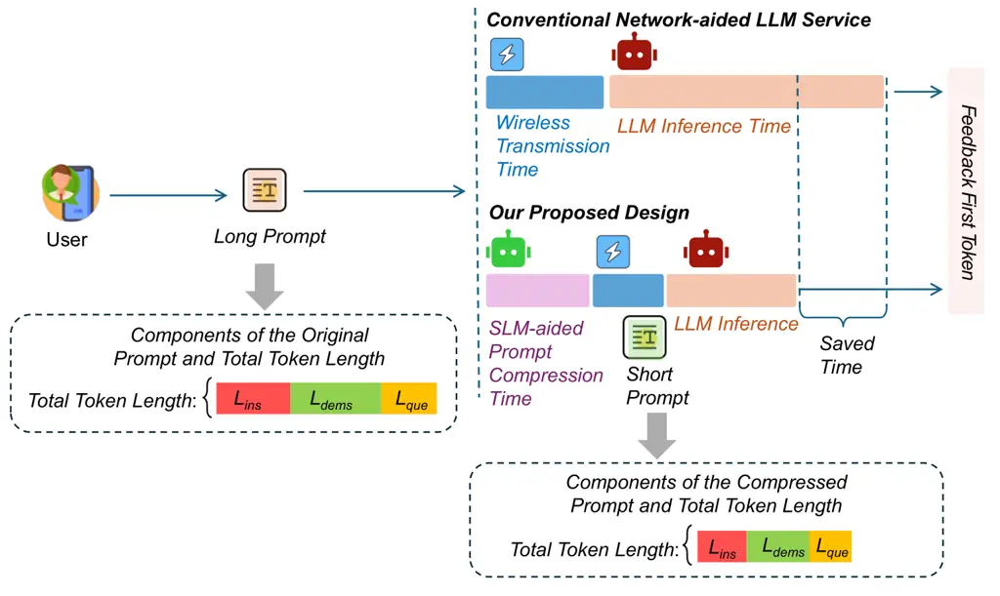
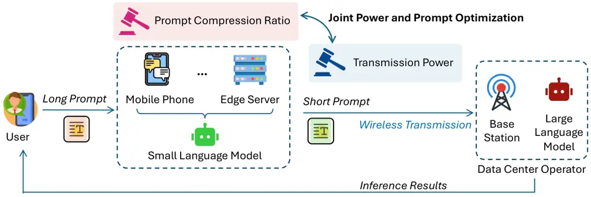
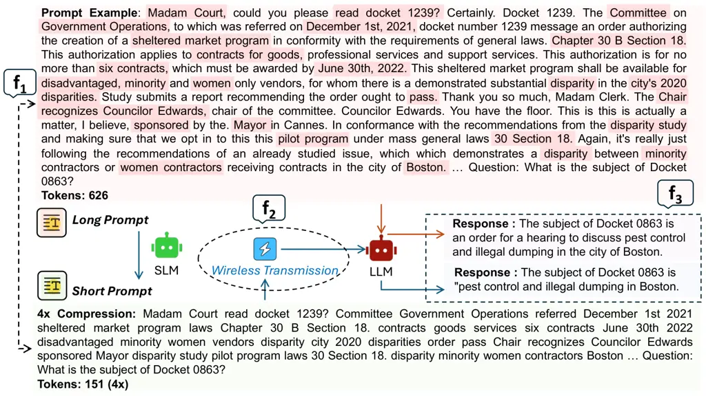

# JPPO: Joint Power and Prompt Optimization for Accelerated Large Language Model Services

PubID: pubid: This conference paper was accepted by ICC 2025.

Feiran You Affiliation: Department of Electrical and Electronic
Engineering, University of Hong Kong, Hong Kong SAR, China    Hongyang
Du Affiliation: Department of Electrical and Electronic Engineering,
University of Hong Kong, Hong Kong SAR, China    Kaibin Huang
Affiliation: Department of Electrical and Electronic Engineering,
University of Hong Kong, Hong Kong SAR, China    _Fellow, IEEE_   
Abbas Jamalipour Affiliation: School of Electrical and Computer
Engineering, University of Sydney, Sydney, AustraliaEmails:
fryou@eee.hku.hk, duhy@eee.hku.hk, huangkb@eee.hku.hk,
a.jamalipour@ieee.org    _Fellow, IEEE_

###### Abstract

Large Language Models (LLMs) have demonstrated remarkable capabilities
in various tasks, leading to their increasing deployment in wireless
networks for a wide variety of user services. However, the growing
longer prompt setting highlights the crucial issue of computational
resource demands and huge communication load. To address this challenge,
we propose Joint Power and Prompt Optimization (JPPO), a framework that
combines Small Language Model (SLM)-based prompt compression with
wireless power allocation optimization. By deploying SLM at user devices
for prompt compression and employing Deep Reinforcement Learning for
joint optimization of compression ratio and transmission power, JPPO
effectively balances service quality with resource efficiency.
Experimental results demonstrate that our framework achieves high
service fidelity and low bit error rates while optimizing power usage in
wireless LLM services. The system reduces response time by about
$`17\%`$, with the improvement varying based on the length of the
original prompt.

###### Index Terms: 

Large language models, prompt engineering, power allocation, joint
optimization

## I Introduction

Large Language Models (LLMs) have revolutionized natural language
processing, demonstrating unprecedented capabilities across various
tasks \[1\]. As these models increasingly drive intelligent IoT devices
and edge computing applications, their deployment over wireless networks
to provide services to end-users has become a critical scenario \[2\].
However, this integration faces significant challenges from the
computational demands of LLMs and the inherent constraints of wireless
communication systems \[3\].

A key issue lies in the growing length of prompts used to elicit
advanced reasoning from LLMs \[4\], particularly with the advent of
techniques like Chain-of-Thought (CoT) prompting \[5\] and In-Context
Learning (ICL) \[6\]. While these methods substantially enhance LLM
performance, they often necessitate prompts that can extend to tens of
thousands of tokens \[7\]. This trend creates a fundamental trade-off:
On the one hand, longer, more sophisticated prompts unlock the full
potential of LLMs; on the other, they impose severe burdens on
communication bandwidth and computing resources in wireless settings.
Moreover, the transmission of these extensive prompts consumes
significant network resources and introduces considerable latency,
potentially undermining the real-time responsiveness crucial for many
applications \[8\]. Consequently, the efficient deployment of LLMs in
wireless networks demands innovative solutions that can balance prompt
inputs and resource efficiency requirements \[9\].



Fig. 1: Time consumption comparison of first token generation between
conventional network-aided LLM inference service architecture and our
design under long user prompts.

Prior research has tried to address these challenges from different
angles. The authors in \[10\] introduced LLMLingua, a coarse-to-fine
prompt compression method that demonstrates significant potential for
compressing LLM prompts while preserving their semantic integrity.
LLMLingua utilizes a small language model for compression, which can be
aligned with the target LLM through instruction tuning. While this
approach shows promise for reducing communication overhead, it does not
fully account for the challenges posed by wireless transmission. The
work in \[11\] proposes LLM-Slice, a system that creates dedicated
network slices for LLM services to improve wireless resource management
and reduce response delays. Although LLM-Slice advances wireless network
architecture for LLM services, it focuses solely on communication
resource allocation without considering prompt optimization for
individual user requirements. Addressing these issues requires solving
two key questions:

- •
  Q1) How to achieve adjustable prompt compression without significantly
  degrading LLM inference performance and service quality?
- •
  Q2) How to jointly design wireless resource allocation, particularly
  transmission power, to meet the latency and power consumption
  constraints of network-aided LLM services while maintaining high
  service quality?

For Q1, natural language processing methods offer potential solutions
for prompt compression. However, traditional NLP compression techniques
like text summarization or keyword extraction often fail to capture the
complex reasoning patterns and task-specific requirements embedded in
LLM prompts, leading to degraded inference performance. Alternative
AI-based approaches, such as large autoencoder models or specialized
compression networks, require substantial computational resources and
introduce additional inference latency at user terminals, making them
impractical for resource-constrained wireless scenarios. Small language
models (SLMs), which can be easily deployed at user terminals, offer a
promising solution through their semantic understanding capability to
compress LLM prompts while preserving task-critical information. SLM has
been adapted as an effective way to employ transformers for edge
applications in \[12\]. Building upon this insight and addressing the
Q2, we propose Joint Power and Prompt Optimization (JPPO), a framework
that combines SLM-based prompt compression with wireless power
allocation optimization, as illustrated in Fig. 1. JPPO captures the
trade-off between compression ratio and wireless resource consumption,
adapting to both channel conditions and prompt content. This integrated
approach enables efficient wireless LLM services while maintaining
response quality through intelligent prompt optimization. The
contributions of this paper are summarized as

- •
  We employ a small, aligned language model as a prompt compressor. This
  approach preserves useful information while significantly reducing
  prompt size. The SLM efficiently captures essential meaning without
  requiring training at the transmitter.
- •
  We formulate an optimization problem for our JPPO framework. This
  problem balances compression quality, wireless transmission
  performance, and LLM inference efficiency. The objective function is
  the quality of service (QoS), considering energy limitation and
  end-to-end latency, with compression ratio and transmission power as
  key decision variables.
- •
  To solve the complex JPPO optimization problem, we employ a Deep
  Reinforcement Learning (DRL) approach. The DRL agent learns to make
  optimal decisions on compression and transmission strategies,
  effectively reducing communication overhead and accelerating LLM
  inference services in latency-constrained and variable channel
  scenarios.

## II System Model

In this section, we present the system model of wireless network-aided
LLM inference services, the SLM-based prompt compression method, and the
wireless transmission model with power consumption and delay
constraints.



Fig. 2: System model of wireless network-aided LLM services and overview
of our proposed JPPO, where user-generated long prompts are first
compressed through SLM-based edge computing, then transmitted with
optimized power allocation via wireless networks to LLM server, and
finally inference results are returned to users.

### II-A Wireless Network-aided LLM Services

We consider a heterogeneous wireless network where a Data Center
Operator (DCO) provides LLM inference services to $`N`$ users with
diverse task requirements, e.g., prompts. As illustrated in Fig. 2, our
proposed framework consists of three key components: an SLM agent
deployed at user devices or edge servers for prompt compression, a JPPO
scheme for reliable wireless transmission, and a target LLM for
inference service. On the user side, the SLM agent leverages its
semantic understanding capability to compress prompts while preserving
task-critical information. The compressed prompts are then transmitted
through wireless channels with jointly optimized power allocation, and
finally processed by the target LLM for inference. This framework
adaptively adjusts both compression ratios and transmission power based
on channel conditions and prompt characteristics to achieve high LLM
service quality.

### II-B Prompt Compression

To efficiently reduce prompt sizes while preserving semantic integrity,
we adopt a coarse-to-fine compression approach in SLMs. Our compression
method is designed to achieve two primary objectives:

- •
  Preserve critical information in the prompt while ensuring the
  recoverability of the original semantic meaning.
- •
  Enable flexible compression ratios that can be dynamically adjusted
  together with communication resources.

Let us formally define the prompt structure and compression process.
Consider an original prompt x that consists of three components:

```math
{\textit{{x}}}=\left({\textit{{x}}}_{\text{ins}},{\textit{{x}}}_{\text{dems}},{\textit{{x}}}_{\text{que}}\right), \tag{1}
```

where $`{\textit{{x}}}_{\text{ins}}`$ represents the instruction
component, $`{\textit{{x}}}_{\text{dems}}`$ denotes the demonstrations
or examples, and $`{\textit{{x}}}_{\text{que}}`$ contains the specific
question or task. As depicted in Fig. 1, the token length of each
component is denoted by $`\mathcal{L}_{\text{ins}}`$,
$`\mathcal{L}_{\text{dems}}`$, and $`\mathcal{L}_{\text{que}}`$
respectively. The total token length $`\mathcal{L}_{x}`$ of the original
prompt is given by:

```math
\mathcal{L}_{x}=\mathcal{L}_{\text{ins}}+\mathcal{L}_{\text{dems}}+\mathcal{L}_{\text{que}}. \tag{2}
```

Our SLM-based compression mechanism generates a compressed prompt
$`\hat{\textit{{x}}}`$ with length $`\mathcal{L}_{\hat{x}}`$. The
compression ratio $`\kappa`$ is defined as:

```math
\kappa=\frac{\mathcal{L}_{\hat{x}}}{\mathcal{L}_{x}},\quad\kappa\in[0,1] \tag{3}
```

where $`\kappa=1`$ indicates no compression and smaller values of
$`\kappa`$ represent higher compression rates.

We use a comprehensive fidelity metric $`\mathbf{f}`$ capturing three
essential aspects of semantic preservation during information
transmission \[13\] to evaluate the quality of prompt compression. The
fidelity metric is composed of three key components:

- •
  Representation accuracy ($`\mathbf{f_{1}}`$), which measures how
  accurately the compressed prompt preserves the semantic meaning of the
  original prompt and maintains semantic integrity. $`\mathbf{f_{1}}`$
  is measured by the similarity metric based on the comparison between
  the representations of the original prompt and the compressed prompt.
- •
  Transmission completeness ($`\mathbf{f_{2}}`$), which evaluates the
  integrity of information preservation during the compression process.
  $`\mathbf{f_{2}}`$ is calculated as the token retained in the
  compressed prompt compared to the original prompt, considering the
  transmission channel’s Bit Error Rate (BER).
- •
  Understanding accuracy ($`\mathbf{f_{3}}`$), which quantifies how well
  the receiver (target LLM) can interpret the compressed prompt
  correctly. $`\mathbf{f_{3}}`$ is given by the similarity metric to
  evaluate the proximity of the response to the compressed prompt
  received and the predefined response to the original prompt.

The overall fidelity metric $`\mathbf{f}`$ can be defined as a weighted
sum of these components:

```math
\mathbf{f}=\alpha_{1}\mathbf{f_{1}}+\alpha_{2}\mathbf{f_{2}}+\alpha_{3}\mathbf{f_{3}}, \tag{4}
```

where $`\alpha_{1}`$, $`\alpha_{2}`$, and $`\alpha_{3}`$ are weight
factors determining the relative importance of each fidelity component.
These weights can be adjusted based on application requirements and QoS
priorities.

### II-C Energy Consumption

For one user, the total energy consumption $`E`$ in the one-shot LLM
service request process consists of two components: encoding energy
$`E_{e}`$ and transmission energy $`E_{t}`$. This can be expressed as:

```math
E\left(\kappa,P_{T}\right)=E_{e}\left(\kappa\right)+E_{t}\left(\kappa,P_{T}\right). \tag{5}
```

The encoding energy consumption $`E_{e}`$, which represents the energy
used by the SLM encoder for prompt compression, is calculated as \[14\]

```math
E_{e}=t_{\text{e}}^{{\rm SLM}}\left(\kappa\right)n_{\text{gpu}}^{{\rm SLM}}P_{\text{gpu}}^{{\rm SLM}}+t_{\text{e}}^{{\rm LLM}}\left(\kappa\right)n_{\text{gpu}}^{{\rm LLM}}P_{\text{gpu}}^{{\rm LLM}}, \tag{6}
```

where $`t_{\text{e}}^{{\rm SLM}}`$ represents the GPU execution time in
SLM, $`n_{\text{gpu}}`$ denotes the number of GPUs utilized, and
$`P_{\text{gpu}}`$ is the thermal design power per GPU, and superscript
$`{\rm LLM}`$ denotes the corresponding parameters for the LLM.

The transmission energy consumption $`E_{t}`$ is

```math
E_{t}=t_{\text{t}}\left(\kappa\right)P_{\text{T}}=\frac{s\left(\kappa\right)}{R}P_{\text{T}}, \tag{7}
```

where $`s`$ represents the bit length of the compressed prompt
$`\hat{\textit{{x}}}`$ with compression ratio $`\kappa`$,
$`P_{\text{T}}`$ is the transmit power, $`R`$ is the transmission rate
that can be expressed as

```math
R=W\log_{2}\left(1+\gamma\right)=W\log_{2}\left(1+\frac{P_{\text{T}}gd^{-\alpha}}{\sigma^{2}}\right). \tag{8}
```

Here, $`W`$ is the bandwidth of the offloading link between the user and
DCO, $`\gamma`$ is the Signal-to-Noise-Ratio (SNR), $`P_{T}`$ denotes
the transmission power, $`g`$ is the Rayleigh fading coefficient
(exponentially distributed with unit mean), $`d`$ represents the
distance between user and DCO, $`\alpha`$ is the path-loss exponent,
$`\sigma^{2}`$ represents the Gaussian noise term in the Additive White
Gaussian Noise (AWGN) channel.

### II-D Service Delay

The total time consumption $`T`$ comprises three components: encoding
delay in SLM and LLM, and transmission delay, expressed as:

```math
T\left(\kappa,P_{T}\right)=t_{\text{e}}^{{\rm SLM}}\left(\kappa\right)+t_{\text{e}}^{{\rm LLM}}\left(\kappa\right)+t_{\text{t}}\left(\kappa,P_{T}\right). \tag{9}
```

## III Joint Power and Prompt Optimizatiom

This section introduces the JPPO for wireless network-aided LLM
services. After formulating the problem, we propose a Double Deep
Q-Network (DQN) method \[15\] to address the joint optimization problem.

### III-A Problem Formulation

For our JPPO framework, we formulate an optimization problem that
balances three key aspects: prompt compression quality, wireless
transmission efficiency, and LLM service performance. The objective is
to maximize the overall fidelity while satisfying power and latency
constraints in the wireless network-aided LLM service system.
Specifically, the joint optimization problem can be formulated as

```math
\displaystyle\mathop{\max}\limits_{\{\kappa,P_{T}\}} \displaystyle\ \mathbf{f}\left(\kappa,\eta\left(P_{T}\right)\right), \tag{10}
```

```math
\displaystyle~E\left(\kappa,P_{T}\right)\leq E_{\text{th}},
```

```math
\displaystyle~P_{\text{T}}\leq P_{\text{th}},
```

```math
\displaystyle~T\leq T_{\text{th}},
```

```math
\displaystyle~\mathbf{f}>\mathbf{f}_{\text{th}},
```

where $`\eta`$ is the BER that is affected by the wireless environment
and the transmit power, $`P_{\text{th}}`$ is the maximum allowable power
consumption, $`T_{\text{th}}`$ represents the maximum tolerable
end-to-end latency, $`\mathbf{f}_{\text{th}}`$ defines the minimum
required fidelity. The constraints are designed to ensure practical
system operation. Constraint (a) is the energy constraint that
represents the total energy budget limitation at the edge device side,
introducing a critical trade-off: while higher transmission power
$`P_{T}`$ can lead to lower BER $`\eta`$ and thus improved wireless
transmission fidelity $`\mathbf{f_{2}}`$ to enhance the overall fidelity
$`\mathbf{f}`$, the energy constraint forces a higher compression ratio
$`\kappa`$ to reduce both the SLM/LLM inference energy cost and wireless
transmission energy consumption; however, an excessively high
compression ratio can result in significant information loss from the
original prompt, potentially degrading both the semantic preservation
fidelity $`\mathbf{f_{1}}`$ and LLM service quality fidelity
$`\mathbf{f_{3}}`$. Constraint (b) ensures the power consumption remains
within the device’s power budget, Constraint (c) guarantees that the
total service latency meets real-time requirements, Constraint (d)
maintains the quality of service by enforcing a minimum threshold on
fidelity. This optimization framework allows us to find the optimal
balance between compression ratio and transmission power while
maintaining high-quality LLM service delivery.

### III-B Double DQN Solution

To solve the complex JPPO optimization problem, we deploy a centralized
Double DQN method to find optimal prompt compression and transmission
strategies for $`N`$ users, as shown in Algorithm 1. The key elements of
the proposed Double DQN design are

- •
  _Environment:_ The environment of the Double DQN algorithm in the
  proposed framework is the communication environment with $`N`$ users.
- •
  _State:_ The state information includes the current fidelity of the
  transmitted message, SNR, and BER. The state information of
  $`n_{\rm th}`$ user is captured in a 3-dimensional vector:
  $`\left[\mathbf{f}_{n}(\eta_{n}),\gamma_{n},\right]`$.
- •
  _Action:_ The actions include selecting compression and power levels.
  The action space is denoted as
  $`\mathcal{A}=\{\mathcal{A}_{1},\cdots,\mathcal{A}_{N}\}`$, where
  $`\mathcal{A}_{n}`$ is the action of user $`n`$ and consists of a
  tuple with discrete values of compression ratio and transmission power
  level. The compression ratio level is discrete values range from $`0`$
  to $`4`$. The transmission power level is discrete values ranging from
  $`0`$ to $`9`$, which affects BER.
- •
  _Reward:_ The reward of user $`n`$ is $`\mathcal{R}_{n}`$, and in each
  episode, the agent accumulates rewards based on the actions. The
  reward function maximizes fidelity while minimizing penalties related
  to BER and power usage.

The key design of the Double DQN is to decouple action selection from
evaluation and address the over-estimation issue by using two separate
networks:Current Q-network, which predicts Q-values based on the current
state, and Target Q-network, which calculates target Q-values during
updates and evaluates the Q-value of the best next action selected by
the current Q-network, making the learning process of the Double DQN
more stable.

0:  Initialize the action space
$`\mathcal{A}=\{\mathcal{A}_{1},\cdots,\mathcal{A}_{N}\}`$ and target
privacy $`(\epsilon,\delta)`$.

0:  Reward.

1:  *Initialization:* $`s_{0}`$.

2:  for each episode $`k\in\{1,...,K\}`$ do

3:   Explore actions and obtain initial states.

4:   for each step in the episode do

5:    Take action $`a_{t}`$ according to current policy.

6:    Receive reward $`r_{t}`$ and observe the next state $`s_{t+1}`$.

7:    if $`s^{\prime}`$ is the final state then

8:     $`y=\mathcal{R}^{\prime}`$.

9:    else

10:
    $`y=\mathcal{R}^{\prime}+[\alpha r_{t+1}+\gamma\max_{a}Q(s_{t+1},a)-Q(s_{t},a_{t})]`$.

11:    end if

12:    Sample a mini-batch of experiences from memory

13:    for each experience $`(s,a,r,s^{\prime})`$ in the batch: do

14:     Calculate target Q-values according to (13)

15:     Compute the loss according to (12)

16:     Perform gradient descent to minimize loss:

17:     Update $`\epsilon`$:
$`\epsilon=\max\left(\epsilon*\epsilon_{\text{decay}},\epsilon_{\min}\right)`$

18:     Update the target Q-network every few episodes.

19:     Accumulate total reward and update state:

20:     $`\text{total reward}+=r`$, $`s=s^{\prime}`$

21:    end for

22:   end for

23:  end for

24:  Update the policy parameter.

25:  Terminate the training when the policy converges or after a
predefined number of iterations.

Algorithm 1 Double DQN Algorithm

The update steps of DQN are:

```math
\begin{split}&Q(s_{t},a_{t})\leftarrow Q(s_{t},a_{t})+[\alpha r_{t+1}\\
&+\mu\max_{a}Q(s_{t+1},a)-Q(s_{t},a_{t})],\end{split} \tag{11}
```

where $`Q(s_{t},a_{t})`$ is the estimated Q-value updated by the Bellman
equation for taking action $`a_{t}`$ in state $`s_{t}`$. $`\alpha`$ is
the learning rate. $`r_{t+1}`$ is the reward received after taking
action $`a_{t}`$ in state $`s_{t}`$ and transitioning to state
$`s_{t+1}`$. $`\mu`$ is the discount factor. $`\max_{a}Q(s_{t+1},a)`$ is
the maximum estimated Q-value for all possible actions in state
$`s_{t+1}`$.

In DQN, the loss function is the mean squared error (MSE) between the
predicted Q-values and the target Q-values:

```math
L_{i}(\theta_{i})=\left[r_{t+1}+\mu\max_{a^{\prime}}Q_{\text{target}}(s_{t+1},a^{\prime};\theta_{i}^{*})-Q(s_{t},a_{t};\theta_{i})\right]^{2}, \tag{12}
```

where $`L_{i}(\theta_{i})`$ is the loss for the $`i`$-th iteration with
parameter $`\theta_{i}`$. $`r_{t+1}`$ and $`s_{t+1}`$ are the reward and
next state observed after taking action $`a_{t}`$ in state $`s_{t}`$.
$`Q_{\text{target}}(s_{t+1},a^{\prime};\theta_{i}^{*})`$ is the target
Q-value estimated by the target network with parameters
$`\theta_{i}^{*}`$. $`Q(s_{t},a_{t};\theta_{i})`$ is the predicted
Q-value by the current Q-network with parameters $`\theta_{i}`$.

The update steps of the Double DQN can be expressed as

```math
y=r+\mu\cdot Q_{\text{target}}\left(s^{\prime},\arg\max_{a^{\prime}}Q(s^{\prime},a^{\prime};\theta);\theta^{-}\right), \tag{13}
```

where $`Q(s,a;\theta)`$ is the estimated Q-value from the current
Q-network with parameter $`\theta`$ and
$`Q_{\text{target}}(s^{\prime},a^{\prime};\theta^{-})`$ is the Q-value
from the target network with parameter $`\theta^{-}`$.

## IV Numerical Results

We design a customized environment with variable fidelity, SNR, and BER
to simulate the wireless network-aided LLM service framework. The
centralized DQN agent manages the environment, which involves selecting
compression and power levels. Its goal is to balance fidelity, minimize
errors, and optimize power usage. We employ the LLMLingua platform,
utilizing the SLM model with GPT-Neo 125M to do prompt compression and
use GPT-J 6B to generate the response \[16\]. The simulations are
carried out on MeetingBank-transcript
dataset \[hu2023meetingbankbenchmarkdatasetmeeting\]. The parameter
settings are listed in Table. 1.

| Parameter                                          | Value                        |
| -------------------------------------------------- | ---------------------------- |
| Learning rate                                      | $`10^{-3}`$                  |
| $`\alpha_{1}`$, $`\alpha_{2}`$, and $`\alpha_{3}`$ | $`0.4`$, $`0.3`$ and $`0.3`$ |
| Total test runs range                              | $`[1,10]`$                   |
| Episodes per test run                              | $`10,000`$                   |

TABLE I: Simulation parameter configuration



Fig. 3: The example illustrates wireless network-aided LLM services with
SLM-based prompt compression, with a 4x compression ratio. The
highlighted parts represent key information from the original prompt.
Additionally, we show the corresponding steps of measuring the three
sub-performance metrics ($`\mathbf{f_{1}}`$, $`\mathbf{f_{2}}`$ and
$`\mathbf{f_{3}}`$) of the fidelity metric $`\mathbf{f}`$ throughout the
process.

Fig. 3 shows one example of prompt compression with a 4x compression
ratio. We can observe that the length of the original prompt’s text has
been significantly reduced by the SLM. Furthermore, even with the
significant reduction in prompt length, the accuracy of the responses
from the LLM has not been compromised, indicating the effectiveness of
the proposed SLM-based design.

Fig. 4: The convergence performance of reward for the proposed Double
DQN algorithm.

Fig. 4 shows the number of episodes and the reward convergence of the
proposed Double DQN method when running $`10,000`$ episodes. We can
observe from the figure that as training episodes progress, the reward
increases over episodes with exploration and then stabilizes within the
range of $`700`$ to $`800`$. Using the optimal policy from our trained
DRL model, we conducted end-to-end inference experiments. Specifically,
for a short original prompt of $`44`$ tokens, the total response time
was reduced from $`56.1`$ seconds to $`46.9`$ seconds. When testing with
a longer prompt of $`388`$ tokens, the total response time decreased
from $`85.3`$ seconds to $`71.2`$ seconds. Further evaluation across our
test dataset showed that the overall performance improvement fluctuates
around $`17\%`$.

Fig. 5: The training performance of the proposed Double DQN algorithm.
Figs. 5(a), 5(b), and 5(c) show the fidelity performance, the BER, and
the power consumption, respectively.

Fig. 5 shows the proposed algorithm’s performance over training
episodes. Fig. 5(a) plots the average fidelity over episodes. Fidelity
measures the accuracy between the model’s output and the reference
before and after compression. The closer the fidelity value is to $`1`$,
the more accurate it is after prompt compression, indicating that the
compressed prompt retains most of the original information. We can
observe that the fidelity increases with episode growth and maintains a
range around $`0.9`$. This indicates that the proposed design is
achieving high levels of accuracy after prompt compression. Fig. 5(b)
plots the average BER over episodes and shows a decreasing trend across
the episodes. The closer the BER is to $`0`$, the higher the accuracy
that is achieved for the communication system. Even in our simulated
harsh environment without error correction coding, It is shown that BER
drops to a low level as episodes increase and remains below 0.2,
demonstrating the system’s effectiveness in minimizing transmission
errors. Fig. 5(c) plots the average power consumption over episodes. We
can see that the power usage is well-regulated, staying within a range
of $`4`$ $`{\rm W}`$ to $`5`$ $`{\rm W}`$. This controlled power
consumption is particularly noteworthy given the inherent trade-offs:
higher compression ratios can allow more transmit power for reliable
transmission, while lower power may compromise transmission quality. The
results in Fig. 5 demonstrate that our proposed algorithm effectively
balances multiple objectives - maintaining high fidelity and low BER
while keeping energy consumption within acceptable limits.

## V Conclusion

We proposed a novel power and prompt optimization framework for wireless
network-aided accelerated LLM services. The proposed mechanism achieves
effective performance in high service fidelity and relatively low BER,
and the power consumption is maintained in constraint. Experimental
evaluation shows that the proposed algorithm achieves stable
convergence, indicating its potential for future practical deployment in
LLM service systems.

## References

- \[1\] B. Min, H. Ross, E. Sulem, A. P. B. Veyseh, T. H. Nguyen,
  O. Sainz, E. Agirre, I. Heintz, and D. Roth, “Recent advances in
  natural language processing via large pre-trained language models: A
  survey,” _ACM Computing Surveys_, vol. 56, no. 2, pp. 1–40, 2023.
- \[2\] O. Friha, M. Amine Ferrag, B. Kantarci, B. Cakmak, A. Ozgun, and
  N. Ghoualmi-Zine, “LLM-based edge intelligence: A comprehensive survey
  on architectures, applications, security and trustworthiness,” _IEEE
  Open Journal of the Communications Society_, vol. 5, pp.
  5799–5856, 2024.
- \[3\] F. Jiang, Y. Peng, L. Dong, K. Wang, K. Yang, C. Pan, D. Niyato,
  and O. A. Dobre, “Large language model enhanced multi-agent systems
  for 6G communications,” _IEEE Wireless Communications_, 2024.
- \[4\] B. Xiao, B. Kantarci, J. Kang, D. Niyato, and M. Guizani,
  “Efficient prompting for LLM-based generative internet of things,”
  _IEEE Internet of Things Journal_, pp. 1–1, 2024.
- \[5\] J. Wei, X. Wang, D. Schuurmans, M. Bosma, F. Xia, E. Chi, Q. V.
  Le, D. Zhou _et al._, “Chain-of-thought prompting elicits reasoning in
  large language models,” _Adv. Neural Inf. Process. Syst._, vol. 35,
  pp. 24 824–24 837, 2022.
- \[6\] T. Li, G. Zhang, Q. D. Do, X. Yue, and W. Chen, “Long-context
  LLMs struggle with long in-context learning,” _arXiv preprint
  arXiv:2404.02060_, 2024.
- \[7\] F. Xue, Y. Fu, W. Zhou, Z. Zheng, and Y. You, “To repeat or not
  to repeat: Insights from scaling LLM under token-crisis,” _Adv. Neural
  Inf. Process. Syst._, vol. 36, 2024.
- \[8\] M. Xu, H. Du, D. Niyato, J. Kang, Z. Xiong, S. Mao, Z. Han,
  A. Jamalipour, D. I. Kim, X. Shen _et al._, “Unleashing the power of
  edge-cloud generative ai in mobile networks: A survey of aigc
  services,” _IEEE Communications Surveys & Tutorials_, 2024.
- \[9\] O. Friha, M. A. Ferrag, B. Kantarci, B. Cakmak, A. Ozgun, and
  N. Ghoualmi-Zine, “LLM-based edge intelligence: A comprehensive survey
  on architectures, applications, security and trustworthiness,” _IEEE
  Open Journal of the Communications Society_, 2024.
- \[10\] H. Jiang, Q. Wu, C.-Y. Lin, Y. Yang, and L. Qiu, “LLMLingua:
  Compressing prompts for accelerated inference of large language
  models,” _arXiv preprint arXiv:2310.05736_, 2023.
- \[11\] B. Liu, J. Tong, and J. Zhang, “LLM-Slice: Dedicated wireless
  network slicing for large language models,” in _Proc. ACM Conf.
  Embedded Netw. Sensor Syst._, 2024, pp. 853–854.
- \[12\] M. Scherer, L. Macan, V. J. B. Jung, P. Wiese, L. Bompani,
  A. Burrello, F. Conti, and L. Benini, “Deeploy: Enabling
  energy-efficient deployment of small language models on heterogeneous
  microcontrollers,” _IEEE Transactions on Computer-Aided Design of
  Integrated Circuits and Systems_, vol. 43, no. 11, pp.
  4009–4020, 2024.
- \[13\] P. A. Stavrou and M. Kountouris, “The role of fidelity in
  goal-oriented semantic communication: A rate distortion approach,”
  _IEEE Transactions on Communications_, vol. 71, no. 7, pp.
  3918–3931, 2023.
- \[14\] A. Faiz, S. Kaneda, R. Wang, R. Osi, P. Sharma, F. Chen, and
  L. Jiang, “LLMCarbon: Modeling the end-to-end carbon footprint of
  large language models,” in *prof. Int. Conf. Learn.
  Represent.* ICLR, 2024.
- \[15\] H. Van Hasselt, A. Guez, and D. Silver, “Deep reinforcement
  learning with double q-learning,” in _Proceedings of the AAAI
  conference on artificial intelligence_, vol. 30, no. 1, 2016.
- \[16\] D. Rothman, _Transformers for Natural Language Processing:
  Build, train, and fine-tune deep neural network architectures for NLP
  with Python, Hugging Face, and OpenAI’s GPT-3, ChatGPT, and
  GPT-4_. Packt Publishing Ltd, 2022.
