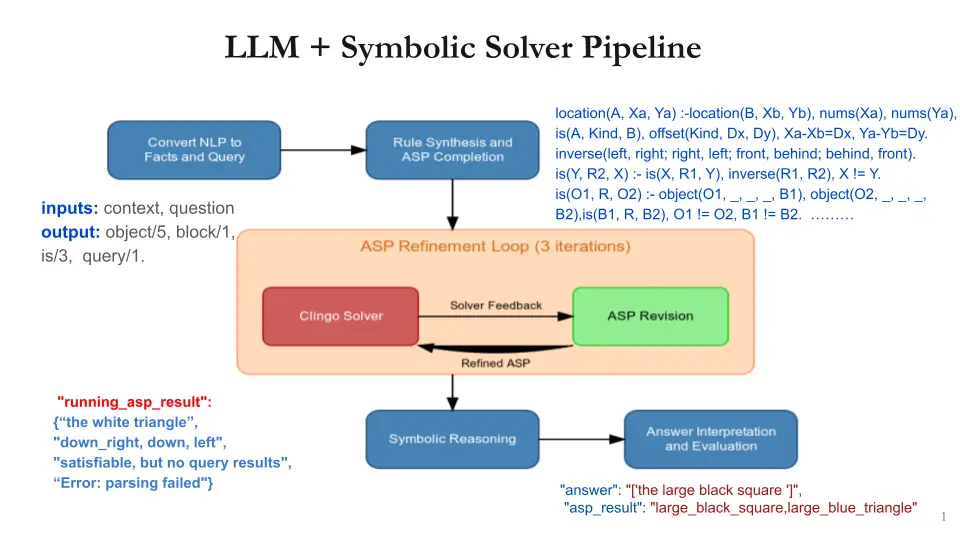
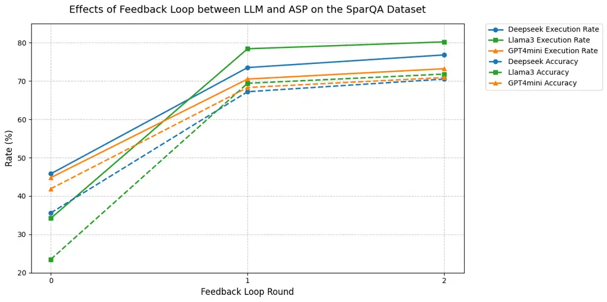

# Dspy-based Neural-Symbolic Pipeline to Enhance Spatial Reasoning in LLMs

Rong Wang ^(†)^(†)thanks: Correspondence to R. W.,
[Email:rongw.de@gmail.com](Email:rongw.de@gmail.com)    Kun Sun
Affiliation: Tübingen, Germany    Jonas Kuhn Affiliation: The Institute
of Natural Language Processing, Stuttgart University, Stuttgart, Germany

###### Abstract

Large Language Models (LLMs) have demonstrated remarkable capabilities
across various tasks, yet they often struggle with spatial reasoning.
This paper presents a novel neural-symbolic framework that enhances
LLMs’ spatial reasoning abilities through iterative feedback between
LLMs and Answer Set Programming (ASP). We evaluate our approach on two
benchmark datasets: StepGame and SparQA, implementing three distinct
strategies: (1) direct prompting baseline, (2) Facts+Rules prompting,
and (3) DSPy-based LLM+ASP pipeline with iterative refinement. Our
experimental results demonstrate that the LLM+ASP pipeline significantly
outperforms baseline methods, achieving an average 82% accuracy on
StepGame and 69% on SparQA, marking improvements of 40-50% and 8-15%
respectively over direct prompting. The success stems from three key
innovations: (1) effective separation of semantic parsing and logical
reasoning through a modular pipeline, (2) iterative feedback mechanism
between LLMs and ASP solvers that improves program executability rate,
and (3) robust error handling that addresses parsing, grounding, and
solving failures. Additionally, we propose Facts+Rules as a lightweight
alternative that achieves comparable performance on complex SparQA
dataset, while reducing computational overhead.Our analysis across
different LLM architectures (Deepseek, Llama3-70B, GPT-4.0 mini)
demonstrates the framework’s generalizability and provides insights into
the trade-offs between implementation complexity and reasoning
capability, contributing to the development of more interpretable and
reliable AI systems.

## 1 Introduction

Large Language Models (LLMs) are known for their impressive performance
across a range of tasks, demonstrating certain commonsense reasoning
abilities. However, since LLMs are trained to predict subsequent words
in a sequence, they seem to lack sufficient grounding to excel at tasks
requiring spatial, physical, and embodied reasoning. Spatial reasoning,
the ability to understand and manipulate relationships between objects
in two- and three-dimensional spaces, represents a crucial component of
artificial intelligence systems, enabling practical applications in
robotics, navigation, and physical task planning. Recent studies (Bang
et al.,, 2023; Cohn,, 2023) highlighted the limitations of models like
ChatGPT in deductive logical reasoning, spatial reasoning, and
non-textual semantic reasoning, underlining the need for further
improvements in spatial reasoning.

Efforts to improve logical reasoning capability have focused on advanced
prompting techniques. However, these methods have demonstrated notable
limitations, particularly on challenging datasets like StepGame (Shi et
al.,, 2022) and SparQA (Mirzaee and Kordjamshidi,, 2022), which often
require multi-step planning and complex natural language understanding.
In these scenarios, LLMs often struggle with maintaining coherence,
frequently hallucinating or losing sight of the original objectives,
resulting in inaccurate and unreliable outputs. More recent work
demonstrates that augmenting large language models (LLMs) with external
tools for arithmetic, navigation, and knowledge lookups improves
performance (Fang et al.,, 2024). Notably, neural-symbolic approaches,
where LLMs extract facts while external symbolic solvers handle
reasoning, show significant promise in enhancing logical inferenceg)
(Yang et al., 2023a, ). Nevertheless, existing neural-symbolic methods
face limitations in generalization, scalability, and comprehensive
evaluation. (Yu et al, 2021) Neural-symbolic systems have been applied
successfully in visual question answering and robotics (Yang et al.,
2023a, ).These approaches often fail to fully harness LLMs’ potential,
particularly by omitting feedback loops between multiple LLMs and
symbolic modules, limiting performance gains.

To overcome these challenges, this paper proposes a novel
neural-symbolic framework that systematically integrates symbolic
reasoning components with LLMs. Our approach leverages strategic
prompting, feedback loops, and Answer Set Programming (ASP)-based
verification, creating a robust pipeline that improves spatial reasoning
across different LLM architectures. We evaluate this framework on two
benchmark datasets, By integrating feedback loops and verification
module, our methodology demonstrates strong generalizability when
tackling complex spatial reasoning tasks, showing significant
performance gains, with average accuracy improvements of 40% on StepGame
and 20% on SparQA. These outcomes underscore the effectiveness of
neural-symbolic integration in enhancing spatial reasoning and emphasize
the importance of task-specific implementation strategies.

To address these limitations, we propose a pipeline that effectively
enhances LLMs’ spatial reasoning capabilities. Our approach combines
strategic prompting with symbolic reasoning to create a robust framework
that significantly improves performance of spatial reasoning across
different LLM architectures. Specifically, building on these insights,
we propose a novel neural-symbolic pipeline that integrates LLMs with
ASP, aimed at enhancing the LLMs’ capabilities of spatial reasoning in
SparQA and StepGame datasets. We investigate the potential benefits of
integrating symbolic reasoning components into LLMs to further boost
their spatial reasoning capabilities. Within the broader field of
neural-symbolic AI, the combination of LLMs as parsers with ASP solvers
has emerged as a particularly effective approach for complex reasoning
tasks. Additionally, the present study is one of the pioneering projects
which uses DSPy (Khattab et al.,, 2023) to pipeline and program LLM.

In the broader field of neural-symbolic AI, combining large language
models (LLMs) with symbolic reasoning systems like Prolog has proven
successful for tackling complex reasoning tasks (Hamilton et al.,, 2022;
Besold et al.,, 2021).Our study advances this field by demonstrating how
incorporating symbolic reasoning modules can enhance LLMs’ spatial
reasoning capabilities. Specifically, we introduce a modular pipeline
using DSPy, enabling seamless interaction between LLMs and symbolic
system solvers. Our pipeline not only improves spatial reasoning but
also shows promise in broader domains requiring structured logic,
thereby contributing to both the theoretical foundations and practical
applications of neural-symbolic integration.

## 2 Preliminaries

### 2.1 Prompting LLMs for spatial reasoning

Research on spatial reasoning spans both visual and textual domains,
each with its own challenges. In Visual Spatial Reasoning (VSR), even
advanced models like CLIP (Radford et al., 2021) face limitations in
comprehending complex spatial relationships. In the textual domain,
spatial reasoning is further complicated by linguistic ambiguity.

Prompting strategies have played a pivotal role in improving LLMs’
reasoning capabilities. Approaches such as chain of thought (CoT) (Wei
et al.,, 2022; Chu et al.,, 2023), few-shot prompting (Schick and
Schütze,, 2021), and least-to-most prompting (Zhou et al.,, 2022) enable
LLMs to tackle complex problems by breaking them down into logical
steps. Self-consistency methods (Wang et al.,, 2022), further refine
reasoning by aggregating multiple solutions to improve accuracy. Recent
techniques like like tree of thoughts, visualization of thought (Wang et
al.,, 2023), and program-aided language models (Gao et al.,, 2022)
provide structured, interpretable reasoning pathways.

These prompting strategies demonstrate the potential for LLMs to handle
spatial reasoning, but they also highlight the need for more robust
methods to address limitations in multi-hop inference and natural
language ambiguity. Our approach integrates prompting strategies with
symbolic reasoning to enhance LLMs’ spatial reasoning capabilities more
comprehensively.

### 2.2 Effective Neural-Symbolic Integration

Despite the success of deep learning, its limitations in reasoning,
generalization and interpretability have spurred interest in hybrid
approaches (Garcez and Lamb,, 2023; Hamilton et al.,, 2022).
Neural-symbolic integration aims to combine the strengths of neural
networks (pattern recognition and uncertainty handling) with symbolic
systems (logical reasoning and knowledge representation). Based on how
neural and symbolic components interact and complement each other,
research(Wan et al.,, 2024) has identified key integration patterns:
enhancing symbolic systems with neural capabilities
(Symbolic\[Neural\]), combining neural learning with symbolic inference
(Neural\|Symbolic), compiling symbolic rules into neural structures
(Neural:Symbolic $`\rightarrow`$ Neural), integrating logic rules
through embeddings (Neural $`\otimes`$ Symbolic), and augmenting neural
systems with symbolic reasoning (Neural\[Symbolic\]). These patterns can
be grouped into practical architectures, including sequential,
iterative, and embedded approaches, as well as LLM-based tool
integration (Weber et al.,, 2019; Riegel et al.,, 2020; Parisi et al.,,
2022).

The emergence of LLMs has introduced new possibilities for
neural-symbolic integration. Modern approaches leverage LLMs as powerful
semantic parsers and natural language interfaces, while delegating the
reasoning task to external off-the-shelf symbolic reasoners or solvers.
The integration typically follows a two-step process: first, the LLM
translates natural language queries into formal logical representations
(e.g., Prolog predicates or ASP rules), then the logical solver performs
structured reasoning to derive answers. However, this approach faces
significant challenges in ensuring accurate and consistent mapping
between natural language and logical forms. LLMs are not trained on
logical programming language and they tend to generate logically
inconsistent or syntactically incorrect programs, and the in-executable
logical program will lead to the collpase of the whole neural symbolic
system. For some complex and realistic dataset, the parsing succesful
rate can be as low as 17% (Feng et al.,, 2024). To addrress this,
researchers (Pan et al.,, 2023) have proposed self-refinement modules to
refine the parsing results based on the solver’s erroneous messageses;
however, the improvement of accuracy is not obvious with only 5% after 3
iterations, highlighting the need for a more efficient architecture to
enable sophisticated and robust feedback loop between LLMs and symbolic
solvers.

This study leverages Dspy framework to construct a novel neural-symbolic
pipeline that integrates LLMs with Answer Set Programming (ASP) in an
iterative manner. Through its modular architecture and systematic
optimization approach, DSPy can address many of the limitations faced by
previous neural-symbolic integration attempts. By defining clear
input-output signatures for each module in the pipeline, the framework
ensures that the generated ASP code maintains consistent structure and
enable the error feedback verification modules working in concert.
Dspy’s optimization compiler iteratively refines both the prompting
strategies and weights used in each stage, ensuring consistent
performance improvement, enabling more robust and adaptable
neural-symbolic systems.

### 2.3 Answer Set Programming

Answer Set Programming (ASP) is a declarative programming paradigm that
leverages predicate logic and stable model semantics to address complex
combinational search tasks. Unlike procedural programming, which
specifies step-by-step computations, ASP allows users to define
solutions through logical relationships, enabling the solver to
autonomously determine how to satisfy these conditions (Brewka et al.,,
2011). ASP is case-sensitive, utilizing uppercase letters for variables
and lowercase letters for constants, including atoms and predicates. The
underscore character “\_” serves as a “don’t care” variable that can be
instantiated by any value. However, using placeholders in rule heads
without corresponding definitions can lead to unsafe variable errors due
to ambiguity during grounding.

ASP is closely related to Prolog, having evolved from it and sharing
foundational concepts. Both languages utilize logical rules and facts
for knowledge representation. However, while Prolog emphasizes
procedural query evaluation, ASP focuses on generating answer sets
—collections of ground atoms that satisfy the program’s rules. This
distinction allows ASP to handle nonmonotonic reasoning more
effectively, accommodating multiple stable models for a single program,
which is less common in Prolog.

The paradigm’s expressive power derives from four fundamental
components, each serving distinct roles in knowledge representation and
reasoning:

Facts: Basic units of knowledge represented as unconditional logical
atoms p(t1, …, tn), where p is a predicate symbol and t1, …, tn are
terms. In spatial reasoning, facts typically represent object
properties, locations, and basic spatial relationships.

Rules: Logical implications of the form “Head :- Body”, where the Head
is an atom and the Body consists of literals. Rules enable inference,
allowing new knowledge to be derived from existing facts.

Constraints: Special rules expressed as “:- Body” that eliminate answer
sets violating specific conditions, thus serving as integrity checks
within the knowledge base.

Queries: Goal-directed statements that extract information from the
knowledge base, implemented as special predicates whose extensions yield
the requested data.

In spatial reasoning contexts, ASP provides a robust framework for
representing both static and dynamic spatial relationships through
foundational predicates such as block/1 for defining spatial regions,
object/5 for specifying object properties (identifier, size, color,
shape, location), is/3 for expressing spatial relationships, and
location/3 for precise coordinate definitions. This combination of
predicates with ASP’s logical foundations enables sophisticated
reasoning about spatial configurations and relationships.

## 3 Methods

### 3.1 Datasets

StepGame(Shi et al.,, 2022)

StepGame is a dataset designed for robust multi-hop spatial reasoning
using a grid-based system, featuring eight directional spatial
relations: top (north), down (south), left (west), right (east),
top-left (north-west), top-right (north-east), down-left (south-west),
and down-right (south-east). Each relation is defined by specific angles
and distances for detailed visual representation, and it includes an
“overlap” relation for scenarios where objects share the same location.
The dataset supports reasoning hops from 1 to 10 across 10 subsets, each
containing 10,000 samples corresponding to a single reasoning hop.
However, the single Finding Relation question type may not fully capture
the complexities of real-world spatial reasoning, as research indicates
that large language models (LLMs) often struggle more with constructing
object-linking chains from shuffled relations than with the spatial
reasoning tasks themselves. Additionally, prior studies have identified
template errors within StepGame that may skew model performance
evaluations due to inadequate quality control during crowdsourcing,
leading to inaccuracies in relationship mappings that can misrepresent
an LLM’s spatial reasoning abilities.

SpartQA/SparTUN(Mirzaee and Kordjamshidi,, 2022)

SpartQA is built upon the NLVR (Natural Language for Visual Reasoning)
images, featuring synthetically generated scenes depicting various
spatial arrangements. Typically, each scenario consists of three blocks
arranged either vertically or horizontally, with each block containing
around four objects characterized by attributes like size, color, and
shape. Besides, the dataset incorporates a wider range of spatial
relationships, including 3D spatial reasoning, topological relations and
distance relations. For FR questions, the candidate choices include
\[’left’, ’right’, ’above’, ’below’, ’near to’, ’far from’, ’touching’,
’DK’\], but there are more synonym relation names involved in the
context and question.

SparQA differs significantly from StepGame in its complexity and scope.
Its language structure is 2.5 times longer, featuring three blocks with
approximately four objects each. The dataset handles multiple question
types including Yes/No, FR, CO, and FB, with questions often involving
complex relationships between multiple objects. For example, “What is
the relation between the blue circle touching the top edge of block B
and the small square?” Except Yes/No questions, FR, CO and FB questions
often have more than one answer. SparQA incorporates 3D spatial
reasoning, topological relations, and distance relations, with options
like left, above, and near to.

A distinctive feature of SparQA is its focus on quantifier-based
reasoning, with questions that test higher-level logic through universal
(“all”) and exclusive (“only”) statements. For example, one third
questions process queries like “Are all of the squares in B?” and “Which
block has only small black things inside?” These questions require
comprehensive evaluation of object sets and their properties rather than
simple relational comparisons.

By utilizing these diverse datasets and question types, we aim to assess
the spatial reasoning capabilities of LLMs across various complexity
levels and spatial relation types.

### 3.2 LLM + ASP pipeline with DSPy

Recent studies have demonstrated LLMs’ effectiveness as semantic
parsers, often surpassing traditional parsing tools. While Geibinger,
(2023) and Eiter et al., (2022) showed promising results integrating
LLMs with ASP, challenges remain. Ishay et al., (2023) found LLMs could
generate complex ASP programs but often with errors, while Yang et al.,
2023a () achieved 90% accuracy on StepGame using GPT-3 and ASP, their
method’s scalability remains uncertain.



Figure 1: LLM +ASP Pipeline

Inspired by Pan et al., (2023)’s LOGIC-LM framework and integration
neural-symbolic strategies, we propose a novel neural-symbolic pipeline
employing ASP using DSPy that treats the LLM as an agent capable of
feedback and iteration. DSPy is a Python framework that uses a
declarative and self-improving approach to simplify working with LLMs
(Khattab et al.,, 2023). It automates the optimization of prompts and
model tuning, enhancing reliability and scalability in AI applications.
By defining tasks and metrics rather than manual prompts, DSPy
streamlines the development of various NLP tasks and complex AI systems.
The framework of this pipeline is shown in Fig.2.

The pipeline consists of four main stages: a) Facts Generation Stage:
LLM converts natural language descriptions into symbolic formulations
and formal queries. b) ASP Refining Stage: LLM iteratively refines the
ASP representation over three iterations, adding rules, checking
consistency, and incorporating feedback from error messages. c) Symbolic
Reasoning Stage: The refined ASP undergoes inference using the Clingo
solver, ensuring accurate and explainable reasoning by combining LLM
capabilities with logical inference. d) Result Interpretation and
Evaluation: This stage involves mapping the Clingo solver’s outputs to
candidate answers. For certain question types, like Yes/No and
Finding-Block questions, the solver’s output can directly serve as the
correct answer. However, for Finding Relations and Choose Object
questions, additional processing is necessary to filter relevant
solutions. Outputs from the ASP solver are evaluated against a synonym
dictionary to determine the accuracy.

Overall, this pipeline requires multiple interactions with LLMs during
ASP generation and refinement. We employ the DSPy framework to manage
these complex workflows (e.g., interfacing with Llama3 60B DeepSeek and
GPT 4.0 mini models via their APIs). DSPy’s modular features enhance
memory retention between modules, enabling adjustments and optimizations
while maintaining workflow integrity.

Additionally, DSPy optimizes LLM prompts and weights, reducing the need
for manual prompt engineering and ensuring consistent performance across
datasets. Its optimization compiler iteratively generates and refines
prompts, enhancing task performance. To support transparency and
debugging, outputs from all modules are logged, capturing errors and
providing insights for prompt engineering and system optimization,
facilitating continuous improvement of the system and enhancing the
integration of neural and symbolic components. In this way, this
integrated neural-symbolic pipeline could greatly facilitate spatial
reasoning in LLMs.

To evaluate the effectiveness of our approaches in spatial reasoning
comprehensively, we selected three representative LLMs with diverse
architectures and capabilities: DeepSeek, Llama3, and GPT4.0 Mini. These
LLMs were chosen to ensure a comprehensive assessment across different
types of language representations, ranging from lightweight and
specialized models like DeepSeek to more advanced general-purpose
systems like GPT4.0 Mini. Llama3, known for its balance between
performance and computational efficiency, provides an intermediate
perspective. By testing our methods on these distinct models, we want to
demonstrate the adaptability and robustness of our approach across a
variety of LLM architectures and reasoning capacities.

Given the task nature of multiple choices, we primarily employed exact
match metrics for single-choice questions and partial match metrics for
multiple-choice questions, aligning with the specific requirements of
spatial reasoning tasks. To ensure accurate evaluation, we implemented
custom post-processing to normalize responses and developed specialized
metrics to handle both exact and partial matches between model outputs
and ground truth.

### 3.3 Baselines

Direct prompting

As the most straightforward approach, it involves presenting the task to
the LLM without additional guidance. The typical form is “ Given the
question, please answer: While simple, this method is believed not to
elicit the model’s full potential, particularly in complex reasoning
tasks”. This straightforward approach involves presenting the task to
the LLM without additional guidance. The basic structure consists of a
simple template: “Given the context and question, please answer the
question by choosing from the choices”. While minimal, this method
serves as a crucial baseline for model evaluation as it reflects the
model’s fundamental ability to handle spatial tasks without any
reasoning scaffolds. Despite its simplicity, this approach can achieve
competitive results, particularly with well-trained models that have
developed robust internal reasoning mechanisms.

Facts + Rule prompting

We explore an alternative approach that retains the benefits of
structured knowledge representation while minimizing the complexity of
formal logical programming. This method embeds logical rules directly
into natural language prompts, testing LLMs’ ability to reason within
structured frameworks. Using the DSPy framework, this approach functions
as a rule-based chain-of-thought (CoT) prompting strategy executed in
two stages.

This approach aligns with the core principle of neural-symbolic AI:
converting raw data into structured, symbolic representations for
reasoning. By using predicates with precise argument structures, LLMs
create consistent intermediate knowledge representations that facilitate
question answering. This streamlined process maintains the advantages of
formal reasoning while reducing computational complexity and
implementation overhead.

In the LLM+ASP pipeline, generating a single ASP program requires
multiple LLM calls due to the iterative refinement process, creating
substantial computational overhead even with a modest three-iteration
limit. To mitigate this, our alternative approach replaces formal ASP
code generation with direct application of logical rules within natural
language. The process begins by instructing LLMs to convert natural
language inputs into structured facts using predefined predicates, a
step retained from the LLM+ASP pipeline. Instead of formal logic
programs, LLMs then apply relevant logical rules—such as inverse,
symmetric, and transitive relations for the SparQA dataset, or
offset-based chain-linking rules for StepGame—to derive answers through
natural language reasoning.

By prompting LLMs to explicitly apply specific rules for different
scenarios, this approach avoids dependence on external solvers.
Consequently, it is termed “Facts+Rules.” This method offers a more
straightforward and reliable path to spatial reasoning compared to
generating and executing formal logic programs.

## 4 Experiment Results and Discussion

In this section, we present the results of three methods: Direct
Prompting Baseline, Facts + Rules Prompting, and Iterative LLM+ASP, on
two benchmark datasets: StepGame and SparQA. We analyze their
performance, computational complexity, and suitability for different
types of spatial reasoning tasks. Additionally, we conduct an ablation
study to assess the impact of iterative feedback loops in the LLM+ASP
approach.

### 4.1 StepGame

#### 4.1.1 Implementation

Another important aspect of the StepGame dataset is its reasoning hops
range from 1 to 10 hops, distributed across 10 subsets. Specifically,
each subset consists of 10,000 samples, each corresponding to a single
reasoning hop. We sampled 300 instances for each reasoning hop 1 to 10,
$`k\in\{1,\ldots,10\}`$ , ensuring comprehensive evaluation across
complexity levels. To standardize the task, we prompt LLMs to convert
language descriptions into is3 and query2 facts using nine predefined
spatial relations (e.g., left, right, top-right). Additional guidelines
ensure accurate relation mapping, distinguishing between clockwise
directions and cardinal references. This systematic approach maintains
consistency and aids the models in handling spatial reasoning
effectively.

Our pipeline integrates a customized knowledge module adapted from Yang
et al., 2023b (). This module employs coordinate-based reasoning rules,
treating the second queried object as the reference point (0,0). By
applying cardinal offsets, the module calculates the relative positions
of connected objects, determining their spatial relationships
iteratively. This method refines the models’ intermediate inferences,
enhancing accuracy in multi-hop tasks.

[TABLE]

Table 1: Three Methods on StepGame (Accuracy %)

#### 4.1.2 Results

As shown in Table 1, the DSPy pipeline consistently outperforms baseline
methods (Direct prompting and Facts+Rules) across all reasoning depths
for Deepseek, Llama3, and GPT-4.0 mini models. This demonstrates the
effectiveness of integrating linguistic processing with logical
reasoning. For examples, at reasoning hop k=5, Deepseek’s accuracy jumps
from 33.3% (Direct) to 88.5% (+55.2%) using DSPy. Llama3 improves from
28.2% to 77.9% (+49.7%), and GPT-4.0 mini increases from 29.9% to 87.1%
(+57.2%). These gains highlight the power of neural-symbolic feedback.

Accuracy declines as reasoning depth increases, reflecting task
complexity. For example, at k=10, Direct prompting achieves only 16.8%
(Deepseek), 14.2% (Llama3), and 13.5% (GPT-4.0 mini), while DSPy
maintains significantly higher performance: 79.8%, 65.7%, and 68.9%,
respectively.

Adding Facts+Rules boosts the overall accuracy to 44.9%, 47.0%, and
47.6%, though it remains limited by sequential dependencies. In
contrast, DSPy achieves the highest overall accuracy: 87.7% (Deepseek),
75.6% (Llama3), and 80.8% (GPT-4.0 mini). It is obvious that the DSPy
pipeline’s iterative approach consistently enhances accuracy,
particularly for deeper reasoning tasks, validating the benefits of
combining symbolic reasoning with neural methods.

#### 4.1.3 Analysis

Due to the controlled complexity and simple language structure, StepGame
provides an ideal testbed for evaluating neural-symbolic integration for
reasoning, allowing us to isolate the effects of multi-hop reasoning
depth from linguistic complexity. There are no co-reference or named
entity recognition issues since each agent is clearly defined (eg., “A”,
“B”, “C”, “D”), and there is only one question type, querying the
relation between two agents.

The success of LLM + ASP can be attributed to several key factors. The
simplified predicate structure, utilizing only is/3 and query/2
predicates, provides a clear bridge between natural language and logical
forms. This simplification, com- bined with our well-designed knowledge
module, enables efficient handling of spatial relationships while
maintaining robust error detection capabilities.

Interestingly, the LLM+ASP method functions as a dataset quality
checker. Aligning with Yang et al., 2023b (), we identify labeling
errors in 10% of the instances. Ambiguities in crowdsourced data
accumulate with reasoning depth, revealing issues when models output
multiple answers. This highlights the potential of neural-symbolic
approaches not only for reasoning but also for improving dataset
integrity.

### 4.2 SparQA

In order to evaluate the generalizability of our LLM+ASP approach
against the more challenging benchmark SparQA, which focuses on complex
natural language queries involving spatial relationships and requires
precise fact extraction and reasoning over intricate descriptions. We
aims to understand both the capabilities and limitations of
neural-symbolic integration when confronted with realistic spatial
reasoning tasks that more closely approximate real-world complexity.

#### 4.2.1 Implementation

A representative test set of 220 examples, with 55 samples from each
question type, was constructed to balance computational constraints and
ensure comprehensive coverage. We also deliberately include challenging
quantifier questions to assess the system’s capabilities.

We adopted the same pipeline as StepGame to SparQA: (1) Converting
Natural Language Context and Question to ASP Facts; (2) Adding Rules and
Refining ASP Program; (3) Symbolic Reasoning; (4) Result Mapping and
Evaluation. The first module prompted LLMs to identify blocks, objects,
and relation facts using three predicates: block/1, object/5, and is/3,
constraining the specific relation sets to minimize grounding errors.
Rule refinement incorporates predefined inverse, transitive, and
symmetric rules for spatial relations, enabling reasoning across
multi-block environments. These rules were manually designed and
updated, enhancing the system’s capability to handle complex spatial
queries that go beyond simple 2D reasoning tasks. The specific code and
samples are seen in Appendix.

Key challenges in the implementation include parsing context-level
descriptions for coreference resolution, representing implicit spatial
relationships to avoid grounding errors, and managing object references
with varying complexity (object/5). Additionally, query generation is
difficult due to diverse question structures and complex quantification
requirements. Despite careful prompt engineering, LLMs still struggle
with generating queries that are different from the provided examples in
the prompts. To overcome the challenge, we try to provide question
type-wise query examples, quantification encoding query exampels to
guide LLMs to write error free query.

#### 4.2.2 Results

|                   |      |      |      |      |         |
| ----------------- | ---- | ---- | ---- | ---- | ------- |
| Model & Method    | FR   | FB   | YN   | CO   | Overall |
| Deepseek          |      |      |      |      |         |
| Direct (Baseline) | 38.2 | 74.5 | 78.2 | 48.2 | 59.8    |
| Facts+Rules       | 47.3 | 80.6 | 80.9 | 56.6 | 66.4    |
| DSPy Pipeline     | 58.9 | 85.4 | 81.8 | 42.8 | 67.2    |
| Llama3            |      |      |      |      |         |
| Direct (Baseline) | 26.9 | 65.7 | 72.5 | 55.8 | 55.2    |
| Facts+Rules       | 46.8 | 70.2 | 81.4 | 57.1 | 63.9    |
| DSPy Pipeline     | 53.1 | 83.3 | 80.5 | 60.8 | 69.4    |
| GPT4.0 mini       |      |      |      |      |         |
| Direct (Baseline) | 45.4 | 60.9 | 58.2 | 57.6 | 55.5    |
| Facts+Rules       | 54.3 | 68.2 | 50.4 | 61.5 | 58.6    |
| DSPy Pipeline     | 65.3 | 80.5 | 64.8 | 72.7 | 70.3    |

Table 2: Performance Comparison Across Methods on SparQA (Accuracy %)

As shown in Table 2, the neural-symbolic LLM+ASP pipeline showed mixed
results across different models and question types. Finding Relation
(FR) questions demonstrated significant improvement with accuracy
increasing by approximately 20% across all models (from 26.9% to 53.1%
on Llama3, 38.2% to 58.9% on Deepseek, and 45.4% to 65.3% on GPT 4.0).
Finding Block (FB) questions benefited from structured block/5 predicate
representation, showing substantial gains particularly in GPT 4.0 (from
60.9% to 80.5%). Choose Object (CO) questions showed varied results,
with GPT-4.0 achieving a notable 15% improvement while other models
showed minimal changes. Interestingly, Yes/No (YN) questions does not
benefit too much from complexity of neural-symbolic methods, only
showing a slight improvement overr with direct prompting across all
models.

SparQA include a lot quantifier reasoning question, almost one third
questions include “all, only, any”. For examples,“Which block has only
squares inside?”. “What block has all of the black objects inside of
it?”, “Are all of the triangles to the left of the black circle?”,
Besides that, it also envolves a set, namely, using one attribute to
represent the whole set of objects. Thanks to the object/5 atoms, we use
use object(\_,\_,black,\_,\_) in the query to match all the objects with
all the black objects. Quantification typically challenges the pure
neural approach. I If an LLM were to rely solely on natural language
inference, it would need to exhaustively examine all objects with the
black color. In contrast, converting the questions into logical
expressions using the universal conditional (:) is relatively
straightforward. As long as the logical expression is correctly encoded,
the reasoning process becomes swift and accurate.

For example, “What block has all the black objects inside of it?” will
be represented as:

```ltx_verbatim
query(Block):-
block(Block), not object(_, _, black, _, OtherBlock):
block(OtherBlock), OtherBlock != Block.
```

As shown in the table, the Facts+Rules method achieves competitive and
similar performance with the LLM+ASP approach while significantly
outperforming direct prompting (more than 5% improvement). While LLM+ASP
achieves marginally higher accuracy in some cases, Facts+Rules offers
advantages in implementation simplicity and reduced computational
overhead. The improvement over baseline might be attributed to two
factors: more consistent entity naming conventions in natural language
prompts, and explicit instructions to follow the spatial logical rules.

#### 4.2.3 Analysis

The error analysis revealed four primary categories of issues in the
neural-symbolic system: parsing errors (31%), grounding errors (23%),
satisfiable but no result issues (28%), and wrong answers (18%). Parsing
errors, the most frequent issue, stemmed from syntax-related problems in
ASP code generation, including unqualified relation specifications and
improper predicate formatting. Grounding errors emerged from
inconsistencies between variable naming and knowledge base content,
while satisfiability issues arose when the provided facts and rules were
insufficient for query resolution, particularly in cases involving
implicit spatial relationships that the system failed to capture
explicitly in the ASP code.

Each model exhibited distinct error patterns that impacted their
performance differently. Deepseek demonstrated strength in handling
complex spatial relationships but frequently generated syntax errors
(42% of its errors) and struggled with consistent comment handling in
ASP code. GPT-4.0 mini showed promising initial code generation
capabilities but consistently encountered issues with argument ordering
in block/5 predicates, leading to fact-query inconsistencies. Meanwhile,
Llama3 maintained consistent predicate formatting but showed higher
rates of “satifiable but no result” failures, particularly in cases
involving complex spatial relationship chains and nested relationships.
To address these challenges, the system would benefit from
model-specific optimization strategies with tailored prompting
approaches and custom validation rules, alongside an enhanced knowledge
representation system capable of better handling implicit relationships
and ambiguous spatial descriptions.

### 4.3 Impact of Feedback Loop in the DSPy-based Pipeline

While language models demonstrate remarkable capabilities in semantic
parsing task, their ability to generate executable logical programs
remains challenging. Previous research points out that the direct
translation from natural language to logical rules often results in low
success rates, even below random baseline performance.(Feng et al.,, 2024) This observation reinforces the importance of neural-symbolic
integration especially the feedback loop between the two components, so
that LLMs can benefit from symbolic solvers output, as shown in (Yang et
al., 2023b, ).

To systematically analyze the effectiveness of our iterative feedback
mechanism, we examine three primary error types in ASP solver execution:
parsing errors (syntax errors, undefined predicates), grounding failures
(infinite grounding scenarios, memory constraints), and solving stage
failures (over-constrained conditions, inconsistent rules).
Additionally, even successfully executed programs might produce
solutions that don’t align with ground truth labels due to semantic gaps
between natural language specifications and logical encodings. Our
feedback mechanism addresses these challenges through carefully designed
prompts that instruct LLMs on error patterns and their respective fixes.
It is hypothesized that the iterative feedback loop would reduce parsing
errors and grounding failures.



Figure 2: Effects of Feedback Loop between LLM and ASP on the SparQA
Dataset

In the SparQA dataset, which features complex spatial reasoning tasks,
our iterative feedback loop demonstrated substantial improvements across
all models. As shown in Figure 2, the mechanism shows substantial
improvements across all models: Deepseek’s execution rate increased from
45.8% to 76.8%, Llama3 from 34.2% to 80.2%, and GPT4mini from 44.8% to
73.2% over two feedback rounds. Similarly, accuracy rates saw
significant gains: Deepseek improved from 35.6% to 70.5%, Llama3 from
23.5% to 71.8%, and GPT4mini from 41.9% to 70.9%.

These results demonstrate that the feedback loop between LLMs and ASP
solvers effectively addresses the inherent challenges in natural
language to logic translation. The most substantial improvements occur
in the first feedback round, with continued but diminishing gains in the
second round. While additional feedback rounds might yield further
improvements, we limited our experiment to three rounds due to
computational costs. These findings demonstrate that the feedback loop
significantly enhances both program executability and solution accuracy,
establishing the effectiveness of our neural-symbolic integration
approach.

## 5 Conclusion

This paper presents a neural-symbolic integration approach that
significantly enhances LLMs’ spatial reasoning capabilities. Our
experimental results demonstrate that iterative feedback between LLMs
and ASP solvers effectively improves both program executability and
accuracy. The pipeline achieves an average 82% accuracy on StepGame and
69% on SparQA, marking substantial improvements over traditional
approaches. For instance, our experiments demonstrate significant
improvements over the baseline prompting methods, with accuracy
increases of 40-50% on StepGame dataset and 8-15% on the more complex
SparQA dataset.

The success of neural symbolic integration stems from three key factors:
(1) the effective separation of semantic parsing and logical reasoning,
enabling precise control over each component; (2) the well-defined
spatial relationships in a 2D environment, allowing for unambiguous
predicate representation; and (3) the efficient handling of multi-hop
reasoning chains through explicit logical rules.

We explored a simplified neural-symbolic approach, Facts+Rules, as an
alternative to complex logical programming. This method showed modest
improvements of 15-30% over baseline prompting on both datasets and even
a comparable perforamce as LLM+ASP pipleine on SparQA. This performance
comparison reveals an important trade-off in neural-symbolic
integration: LLM+ASP offers superior accuracy at the cost of
implementation complexity and computational overhead, while Facts+Rules
provides a more lightweight solution with reduced performance on
structured tasks. These findings suggest that effective neural-symbolic
integration can be achieved through different approaches, each offering
distinct advantages in the balance between computational efficiency and
reasoning capability.

The key contributions of our work include: (1) a systematic approach to
boost spatial reasoning through neural-symbolic integration, (2) a
cohesive pipeline that combines the strengths of LLMs and symbolic
reasoning, and (3) robust knowledge representation techniques that
generalize across different spatial reasoning tasks. Our iterative
feedback mechanism particularly demonstrates the value of combining
LLMs’ natural language understanding with ASP’s precise logical
inference capabilities.

However, several limitations remain. The performance gap and the
variable implementation complexity between StepGame (92%) and SparQA
(65%) highlights the challenge of domain sensitivity in neural-symbolic
systems. The pipeline struggles particularly with complex queries
involving quantifiers and implicit spatial relationships. This study
tackles the challenge by careful prompt engineering and providing more
examples. Additionally, the conversion from natural language to logical
programs remains error-prone, with execution rates varying significantly
across different question types. Future work could finetune LLM on
specialized logical program dataset and design more sophisticated
feedback mechanisms and improved integration between neural and symbolic
components.

This work establishes a foundation for enhancing LLMs’ reasoning
capabilities through neural-symbolic integration, driving forward the
quest for more intelligent, interpretable, and efficient systems. In
essence, the neural-symbolic approach treats LLMs as agents within a
carefully orchestrated system. This perspective shifts the focus from
improving individual LLM performance to optimizing the interplay between
different components of the system. Future work should explore
optimizing interactions between multiple models and reasoning
components, involving more sophisticated orchestration techniques,
improved integration of probabilistic reasoning with symbolic solvers,
and employing the strengths of different LLMs at various stages of
neural-symbolic systems.

## References

- Bang et al., (2023) Bang, Y., Cahyawijaya, S., Lee, N., Dai, W., Su,
  D., Wilie, B., Lovenia, H., Ji, Z., Yu, T., Chung, W., and others
  (2023). A multitask, multilingual, multimodal evaluation of ChatGPT on
  reasoning, hallucination, and interactivity. In Proceedings of the
  13th international joint conference on natural language processing and
  the 3rd conference of the asia-pacific chapter of the association for
  computational linguistics (volume 1: Long papers), pages 675–718.
- Besold et al., (2021) Besold, T. R., d’Avila Garcez, A., Bader, S.,
  Bowman, H., Domingos, P., Hitzler, P., Kühnberger, K.-U., Lamb, L. C.,
  Lima, P. M. V., de Penning, L., and others (2021). Neural-symbolic
  learning and reasoning: A survey and interpretation 1. In
  Neuro-symbolic artificial intelligence: The state of the art, pages
  1–51. IOS press.
- Brewka et al., (2011) Brewka, G., Eiter, T., and Truszczyński, M.
  (2011). Answer set programming at a glance. Communications of the ACM,
  54(12):92–103.
- Chu et al., (2023) Chu, Z., Chen, J., Chen, Q., Yu, W., He, T., Wang,
  H., Peng, W., Liu, M., Qin, B., and Liu, T. (2023). A survey of chain
  of thought reasoning: Advances, frontiers and future. ArXiv,
  abs/2309.15402.
- Cohn, (2023) Cohn, A. G. (2023). An evaluation of ChatGPT-4’s
  qualitative spatial reasoning capabilities in RCC-8. arXiv preprint
  arXiv:2309.15577.
- Eiter et al., (2022) Eiter, T., Higuera, N., Oetsch, J., and Pritz, M.
  (2022). A neuro-symbolic ASP pipeline for visual question answering.
  Theory and Practice of Logic Programming, 22(5):739–754. Publisher:
  Cambridge University Press.
- Fang et al., (2024) Fang, M., Deng, S., Zhang, Y., Shi, Z., Chen, L.,
  Pechenizkiy, M., and Wang, J. (2024). Large language models are
  neurosymbolic reasoners. In Proceedings of the AAAI conference on
  artificial intelligence, volume 38, pages 17985–17993. Number: 16.
- Feng et al., (2024) Feng, J., Xu, R., Hao, J., Sharma, H., Shen, Y.,
  Zhao, D., and Chen, W. (2024). Language models can be deductive
  solvers. In Findings of the Association for Computational Linguistics:
  NAACL 2024, pages 4026–4042.
- Gao et al., (2022) Gao, L., Madaan, A., Zhou, S., Alon, U., Liu, P.,
  Yang, Y., Callan, J., and Neubig, G. (2022). PAL: Program-aided
  language models. ArXiv, abs/2211.10435.
- Garcez and Lamb, (2023) Garcez, A. d. and Lamb, L. C. (2023).
  Neurosymbolic AI: The 3 rd wave. Artificial Intelligence Review,
  56(11):12387–12406. Publisher: Springer.
- Geibinger, (2023) Geibinger, T. (2023). Explainable answer-set
  programming. arXiv preprint arXiv:2308.15901.
- Hamilton et al., (2022) Hamilton, K., Nayak, A., Božić, B., and
  Longo, L. (2022). Is neuro-symbolic ai meeting its promises in natural
  language processing? a structured review. Semantic Web,
  (Preprint):1–42. Publisher: IOS Press.
- Ishay et al., (2023) Ishay, A., Yang, Z., and Lee, J. (2023).
  Leveraging large language models to generate answer set programs.
  arXiv preprint arXiv:2307.07699.
- Khattab et al., (2023) Khattab, O., Singhvi, A., Maheshwari, P.,
  Zhang, Z., Santhanam, K., Vardhamanan, S., Haq, S., Sharma, A.,
  Joshi, T. T., Moazam, H., and others (2023). Dspy: Compiling
  declarative language model calls into self-improving pipelines. arXiv
  preprint arXiv:2310.03714.
- Mirzaee and Kordjamshidi, (2022) Mirzaee, R. and Kordjamshidi, P.
  (2022). Transfer learning with synthetic corpora for spatial role
  labeling and reasoning. arXiv preprint arXiv:2210.16952.
- Pan et al., (2023) Pan, L., Albalak, A., Wang, X., and Wang, W. Y.
  (2023). Logic-lm: Empowering large language models with symbolic
  solvers for faithful logical reasoning. arXiv preprint
  arXiv:2305.12295.
- Parisi et al., (2022) Parisi, A., Zhao, Y., and Fiedel, N. (2022).
  Talm: Tool augmented language models. arXiv preprint arXiv:2205.12255.
- Riegel et al., (2020) Riegel, R., Gray, A., Luus, F., Khan, N.,
  Makondo, N., Akhalwaya, I. Y., Qian, H., Fagin, R., Barahona, F.,
  Sharma, U., and others (2020). Logical neural networks. arXiv preprint
  arXiv:2006.13155.
- Schick and Schütze, (2021) Schick, T. and Schütze, H. (2021). True
  few-shot learning with prompts—a real-world perspective. Transactions
  of the Association for Computational Linguistics, 10:716–731.
- Shi et al., (2022) Shi, Z., Zhang, Q., and Lipani, A. (2022).
  Stepgame: A new benchmark for robust multi-hop spatial reasoning in
  texts. In Proceedings of the AAAI conference on artificial
  intelligence, volume 36, pages 11321–11329. Number: 10.
- Wan et al., (2024) Wan, Z., Liu, C.-K., Yang, H., Li, C., You, H., Fu,
  Y., Wan, C., Krishna, T., Lin, Y., and Raychowdhury, A. (2024).
  Towards Cognitive AI Systems: a Survey and Prospective on
  Neuro-Symbolic AI. arXiv:2401.01040 \[cs\].
- Wang et al., (2023) Wang, J., Liu, Z., Zhao, L., Wu, Z., Ma, C., Yu,
  S., Dai, H., Yang, Q., Liu, Y.-H., Zhang, S., Shi, E., Pan, Y., Zhang,
  T., Zhu, D., Li, X., Jiang, X., Ge, B., Yuan, Y., Shen, D., Liu, T.,
  and Zhang, S. (2023). Review of large vision models and visual prompt
  engineering. ArXiv, abs/2307.00855.
- Wang et al., (2022) Wang, X., Wei, J., Schuurmans, D., Le, Q., Chi,
  E., and Zhou, D. (2022). Self-consistency improves chain of thought
  reasoning in language models. ArXiv, abs/2203.11171.
- Weber et al., (2019) Weber, L., Minervini, P., Münchmeyer, J., Leser,
  U., and Rocktäschel, T. (2019). Nlprolog: Reasoning with weak
  unification for question answering in natural language. arXiv preprint
  arXiv:1906.06187.
- Wei et al., (2022) Wei, J., Wang, X., Schuurmans, D., Bosma, M., Chi,
  E., Xia, F., Le, Q., and Zhou, D. (2022). Chain of thought prompting
  elicits reasoning in large language models. ArXiv, abs/2201.11903.
- (26) Yang, Z., Ishay, A., and Lee, J. (2023a). Coupling large language
  models with logic programming for robust and general reasoning from
  text. arXiv preprint arXiv:2307.07696.
- (27) Yang, Z., Ishay, A., and Lee, J. (2023b). Neurasp: Embracing
  neural networks into answer set programming. arXiv preprint
  arXiv:2307.07700.
- Zhou et al., (2022) Zhou, D., Scharli, N., Hou, L., Wei, J., Scales,
  N., Wang, X., Schuurmans, D., Bousquet, O., Le, Q., and Chi, E.
  (2022). Least-to-most prompting enables complex reasoning in large
  language models. ArXiv, abs/2205.10625.
