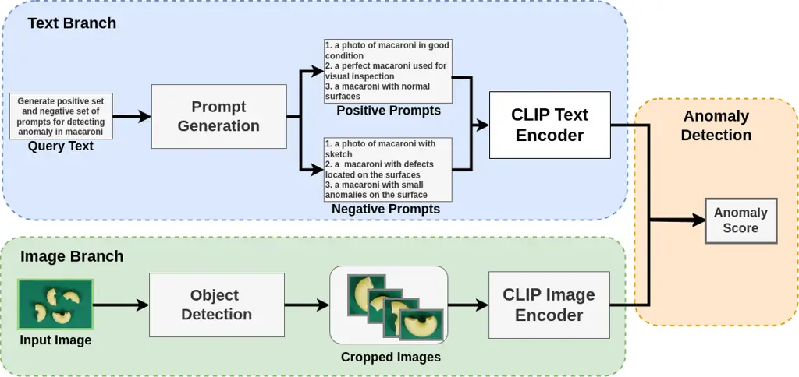

# Automatic Prompt Generation and Grounding Object Detection for Zero-Shot Image Anomaly Detection

\authorblockN Tsun-Hin Cheung\authorrefmark1, Ka-Chun
Fung\authorrefmark1\authorrefmark2, Songjiang
Lai\authorrefmark1\authorrefmark2, Kwan-Ho Lin\authorrefmark1, Vincent
Ng\authorrefmark1, and Kin-Man Lam\authorrefmark1\authorrefmark2
\authorblockA \authorrefmark1 Centre for Advances in Reliability and
Safety, New Territories, Hong Kong \authorblockA \authorrefmark2
Department of Electrical and Electronic Engineering, The Hong Kong
Polytechnic University, Kowloon, Hong Kong

###### Abstract

Identifying defects and anomalies in industrial products is a critical
quality control task. Traditional manual inspection methods are slow,
subjective, and error-prone. In this work, we propose a novel zero-shot
training-free approach for automated industrial image anomaly detection
using a multimodal machine learning pipeline, consisting of three
foundation models. Our method first uses a large language model, i.e.,
GPT-3. generate text prompts describing the expected appearances of
normal and abnormal products. We then use a grounding object detection
model, called Grounding DINO, to locate the product in the image.
Finally, we compare the cropped product image patches to the generated
prompts using a zero-shot image-text matching model, called CLIP, to
identify any anomalies. Our experiments on two datasets of industrial
product images, namely MVTec-AD and VisA, demonstrate the effectiveness
of this method, achieving high accuracy in detecting various types of
defects and anomalies without the need for model training. Our proposed
model enables efficient, scalable, and objective quality control in
industrial manufacturing settings.

###### keywords

Image Anomaly Detection, Prompt Generation, Object Localization,
Multimodal Model

## 1 Introduction

Ensuring product quality is a major challenge in industrial
manufacturing. Identifying defects, flaws, and anomalies in produced
goods is crucial to maintaining high standards and avoiding costly
recalls or customer dissatisfaction. Traditionally, this quality control
process has relied on manual visual inspection by trained human experts.
However, this approach is inherently slow, subjective, and prone to
human error \[1\].

Advancements in computer vision and machine learning have enabled the
development of automated industrial inspection systems \[2\]. These
systems can rapidly analyze images of products, detect defects, and
classify anomalies in an objective and scalable manner. A key challenge
in this domain is capturing the wide variability in the appearance of
normal, defect-free products. Conventional approaches using supervised
learning often require large, labeled datasets containing both normal
and anomalous examples, which can be expensive and time-consuming to
collect \[3\].

Recent approaches, such as CLIP \[4\] and WinCLIP \[5\], have achieved
promising performance in zero-shot image anomaly detection. However,
these CLIP-based methods utilize a set of fixed templates to generate
the text prompts of normal and abnormal products, which require human
experts and the generated text prompts are not class-specific. This
results in limited performance in industrial image anomaly detection
because defects are mostly object-specific. Moreover, WinCLIP \[5\]
applies the sliding windows method to obtain multi-scale features.
However, these methods often ignore the different sizes of industrial
products.

| Methods       | Text Prompt Generation | Image Region Partition         |
| ------------- | ---------------------- | ------------------------------ |
| CLIP \[4\]    | Template-generated     | Entire image                   |
| WinCLIP \[5\] | Template-generated     | Entire image + sliding windows |
| Ours          | LLM-generated          | Entire image + object detector |

Table 1: Comparison of textual prompt generation and image feature
extraction of our proposed method to other CLIP-Based image anomaly
detection methods.

To address these two challenges, we propose a novel multimodal approach
for industrial image anomaly detection that can address these
limitations, as shown in Table I. Our method leverages large language
models to automatically generate text descriptions of the expected
appearance of the product. These prompts are then used in conjunction
with an object detection model and a zero-shot image-text matching model
to identify any deviations from the normal state. This approach enables
efficient, accurate, and salable quality control without the need for
extensive labeled training data. The illustration of our multimodal
pipeline is shown in Fig. 1.



Figure 1: Illustration of the prompt generation and object
localisation-enhanced CLIP for zero-shot anomaly detection.

Our contributions are summarized as follows:

- •
  We propose to use a language model, such as GPT-3 \[6\], to generate
  object-specific prompts for describing normal and anomaly industrial
  images, instead of relying on a set of prompts generated by fixed
  templates.
- •
  We propose to use grounding DINO \[7\] to locate the objects in
  images, effectively suppressing the background noise and addressing
  multi-resolution challenges in zero-shot image anomaly detection.
- •
  Finally, we incorporate the two modules with pretrained CLIP \[4\] to
  perform image anomaly detection, outperforming the vanilla-CLIP and
  the current state-of-the-art (SOTA) baseline, i.e., WinCLIP \[5\], in
  zero-shot settings.

## 2 Related Work

### 2.1 Image Anomaly Detection

Automated image anomaly detection has been a long-standing challenge in
computer vision, with applications in various domains such as industrial
quality control, medical imaging, and security surveillance. Traditional
approaches have often relied on hand-crafted feature extraction and
unsupervised anomaly detection techniques, such as one-class support
vector machines (OC-SVM) and isolation forests \[8\]. Recently, deep
learning-based methods have shown promise in addressing the limitations
of conventional anomaly detection algorithms. These approaches typically
utilize convolutional neural networks (CNNs) or Transformer models to
learn representations of normal data and identify deviations from this
learned distribution \[9\]. However, a key challenge with these
supervised methods is the requirement of labeled anomaly data, which can
be costly and time-consuming to obtain in real-world scenarios.

CLIP (Contrastive Language-Image Pretraining) \[4\] is a deep learning
model that is pretrained on a large-scale dataset of image-text pairs,
enabling it to learn a joint representation of visual and textual data.
This learned representation can then be leveraged for zero-shot image
anomaly detection, where the model is not explicitly trained on
anomalous samples but rather learns to identify deviations from the
normal data distribution based on its general understanding of the
visual world. WinCLIP \[5\] extends the CLIP approach by using a sliding
window mechanism instead of analyzing the whole image. In this method,
the model is trained to learn a joint representation between image
patches and associated textual descriptions. During inference, the model
evaluates the aggregated patches and identifies anomalies based on the
discrepancy between the visual representation and the normal data
distribution.

In this paper, we also consider the use of CLIP to generate anomaly
scores for product images. However, our focus is on improving the
quality of text prompts using large language models and enhancing the
accurate localisation of products in a CLIP-based pipeline.

### 2.2 Prompt Generation with Large Language Models

The use of large language models, such as GPT-3 \[6\] and LLaMA \[10\],
has revolutionized the field of natural language processing, enabling
numerous applications, including text generation, question answering,
and sentiment analysis \[5, 6\].

More recently, researchers have explored the potential of leveraging
these powerful language models for tasks beyond pure text processing,
such as multimodal learning \[11\] and AI agent reasoning \[12\]. Our
application is slightly different from the language models used for
automatic prompt generation \[13\] in multimodal modeling, where the
language model is tasked with producing and enhancing the human written
prompts. These language-guided prompts have proven effective in a
variety of computer vision tasks, including image classification and
object detection \[14\]. However, the application of prompt generation
techniques to industrial image anomaly detection has not been
extensively explored and presents a promising area for further research.

### 2.3 Grounding Object Detection

Object detection is a fundamental computer vision task that involves
localizing and classifying objects within an image. Traditional object
detection methods, such as Fast R-CNN \[15\] and YOLO \[16\], have
relied on supervised learning approaches that require a large amount of
annotated training data. Recent advancements in unsupervised and
weakly-supervised object detection have aimed to reduce the need for
extensive manual labeling. These include techniques that leverage
saliency maps, image-level annotations, or self-supervised learning
approaches to learn object representations \[17\].

Grounding object detection, also known as text-guided object detection,
aims to address the limitations of traditional object detection by
leveraging natural language descriptions to guide the detection process
\[18\]. One pioneering work in this area is Referring Expression
Comprehension (REC) \[19\], which focuses on localizing an object in an
image based on a natural language description. REC models learn to align
visual and textual representations to identify the referred object.
Building upon REC, Grounded CLIP \[20\] and GroundingDINO \[7\] extend
the grounding concept to generic object detection tasks. These methods
utilize the joint representation learning of CLIP \[4\] to associate
textual and visual information, enabling zero-shot or few-shot object
detection without requiring extensive object-level annotations. In our
work, we utilize the zero-shot capability of GroundingDINO to accurately
locate the objects, which are then used for anomaly detection.

## 3 Methodology

Our proposed method leverages recent advancements in large language
models, object detection, and zero-shot image-text matching to develop
an efficient and scalable quality control system. The proposed method
consists of three foundation models. The core idea is to first generate
textual prompts describing the expected appearance of the product using
language models, i.e., GPT-3 \[6\]. Then we use a grounding object
detection model, namely Grounding DINO \[7\] to locate the objects in
the input image, and finally compare the located product images to the
generated prompts to compute anomaly scores using pretrained CLIP \[4\].

This multimodal approach allows us to combine the strengths of different
deep learning techniques to address the challenges of industrial image
anomaly detection. The language model-based prompt generation captures
the rich domain knowledge required to define the expected product
characteristics, while the object detection and image-text matching
components enable robust and accurate anomaly identification.

### 3.1 Prompt Generation

In the text branch, the first step in our method is to generate two sets
of textual prompts that describe the expected appearance of the ”normal”
and ”anomaly” product. We utilize the pre-trained GPT-3 large language
to generate these prompts.

For the text prompts, we provide the language model with relevant
information about the product, including its category. The inputs to the
language models to generate the ”normal” prompt and ”anomaly” prompts
are denoted as $`x_{\text{normal}}`$ and $`x_{\text{anomaly}}`$,
respectively. The model then generates two sets of prompts that describe
the desired appearance of the product, one for the normal class, and
another for the anomaly class, as shown in Equations (1) and (2).

```math
\mathbf{P}_{\text{normal}}=\text{GPT3}(x_{\text{normal}}), \tag{1}
```

```math
\mathbf{P}_{\text{anomaly}}=\text{GPT3}(x_{\text{anomaly}}), \tag{2}
```

where, $`\mathbf{P}_{\text{normal}}`$ and
$`\mathbf{P}_{\text{anomaly}}`$ are two sets of text prompts that
describe normal and anomaly products, respectively.

### 3.2 Object Localization

The next step in our pipeline is to locate the product in the input
image. We utilize an object detection model, Grounding DINO to identify
the bounding boxes of the products within the image. This step ensures
that subsequent anomaly detection is performed on the relevant regions
of the image, rather than the entire frame solely.

To locate the product of interest within the input image, we leverage
the Grounding DINO object detection model \[7\]. GroundingDINO is a
powerful Transformer-based system that can precisely identify the
bounding box coordinates of an object given only its class name as
input. We feed the input image $`I`$ and the class label $`c`$ of the
product into the GroundingDINO model, which then outputs the bounding
box coordinates $`b=[x,y,w,h]`$ that specify the location of the product
within the image. This allows us to extract the relevant image patches
that contain the product for further analysis. Specifically, we crop the
original image $`I`$ based on the bounding box coordinates to obtain the
cropped product image $`\mathbf{I}_{\text{product}}`$:

```math
\mathbf{I}_{\text{object}}=\mathbf{I}[y:y+h,x:x+w] \tag{3}
```

As multiple bounding boxes can be located in the image, we repeat the
above steps to obtain multiple image patches that contains the objects.

### 3.3 Zero-Shot Anomaly Detection

The final step of our method is to detect any anomalies or defects in
the cropped product image. We employ a zero-shot image-text matching
model, i.e., CLIP \[4\], to compare the cropped image to the textual
prompts generated in the first step.

The image-text matching model is trained to learn a joint embedding
space between images and their corresponding textual descriptions. This
allows the model to assess the similarity between the input image and
the generated prompts, detecting any significant discrepancies that may
indicate the presence of an anomaly.

To detect anomalies in product images, we leverage the powerful
CLIP,which encodes both text and image data into a shared embedding
space, allowing us to compute meaningful similarities between text
prompts and image content.

First, we compute the two text embeddings using CLIP - a ”normal” prompt
that describes the expected appearance of the product, and an ”anomaly”
prompt that describes potential defects or anomalies we want to detect.
The two embedding vectors are denoted as $`\mathbf{t}_{\text{normal}}`$
and $`\mathbf{t}_{\text{anomaly}}`$, for ”normal” and ”anomaly” prompts
respectively.

To compute the image embedding, for each cropped product image
$`\mathbf{I}_{\text{object}}`$, we use the pretrained CLIP to obtain the
average embedding vector of the object patches, denoted as
$`\mathbf{e}_{\text{object}}`$. We also obtain the image embedding of
the whole image as the global feature, denoted as
$`\mathbf{e}_{\text{image}}`$. Then, the fused feature
$`\mathbf{e}_{\text{fused}}`$ is obtained by averaging the global
feature $`\mathbf{e}_{\text{image}}`$ and the local features
$`\mathbf{e}_{\text{object}}`$.

Following the extraction of the CLIP embeddings for both normal and
anomaly prompts, the next step involves determining the anomaly score
for each product image. The anomaly score quantifies the deviation of an
image from the expected norm, facilitating the identification of
potential anomalies. The anomaly score (s) is defined as the following:

```math
\text{s}=\frac{\mathbf{e}_{\text{fused}}\cdot\mathbf{t}_{\text{anomaly}}}{\mathbf{e}_{\text{fused}}\cdot\mathbf{t}_{\text{anomaly}}+\mathbf{e}_{\text{fused}}\cdot\mathbf{t}_{\text{normal}}} \tag{4}
```

In summary, our anomaly detection method exploits the semantic
understanding capabilities of the CLIP model by associating textual
prompts with image embeddings, thereby being enable to detect anomalies
in product images based on predefined normal and anomaly criteria.

## 4 Experiments

### 4.1 Experimental Details

We evaluate our proposed method on two industrial product image
datasets:

MVTec-AD dataset \[21\]: The MVTec-AD dataset is a widely used benchmark
for industrial image anomaly detection. It contains more than 5,000
high-resolution images of 15 different industrial product categories,
anootated with various types of anomalies and defects.

VisA dataset \[22\]: The VisA dataset is another industrial product
image dataset, containing more than 10,000 images of 20 different
product categories. This dataset includes a diverse set of anomalies and
defects commonly found in industrial manufacturing environments.

To quantify the performance of our proposed method, we employed two
widely used evaluation metrics: Area Under the Receiver Operating
Characteristic (AUROC) and Area Under the Precision-Recall Curve (AUPR).
AUROC provides a comprehensive measure of the trade-off between the true
positive rate and the false positive rate, capturing the overall
classification performance. AUPR is a useful metric for evaluating the
performance of anomaly detection models, as it takes into account the
balance between precision and recall.

### 4.2 Comparison to State-of-the-Art Methods

|                          |       |       |
| ------------------------ | ----- | ----- |
| Methods                  | AUROC | AUPR  |
| SPADE \[23\] (1-shot)    | 0.810 | 0.906 |
| PaDiM \[24\] (1-shot)    | 0.766 | 0.881 |
| PathCore \[25\] (1-shot) | 0.834 | 0.922 |
| WinCLIP \[5\] (0-shot)   | 0.918 | 0.965 |
| Ours                     | 0.932 | 0.966 |

Table 2: Comparison of zero-shot image anomaly detection on the MVTec-AD
dataset.

|                          |       |       |
| ------------------------ | ----- | ----- |
| Methods                  | AUROC | AUPR  |
| SPADE \[23\] (1-shot)    | 0.795 | 0.820 |
| PaDiM \[24\] (1-shot)    | 0.628 | 0.683 |
| PathCore \[25\] (1-shot) | 0.799 | 0.828 |
| WinCLIP \[5\] (0-shot)   | 0.781 | 0.812 |
| Ours                     | 0.829 | 0.857 |

Table 3: Comparison of zero-shot image anomaly detection on the VisA
dataset.

Table II shows the comparison of our method with several
state-of-the-art zero-shot and few-shot image anomaly detection methods
on the MVTEC-AD dataset. Our method achieves an AUROC score of 93.2% and
an AUPR score of 96.6%, outperforming the previous best zero-shot
method, WinCLIP \[5\], by a significant margin of over 1 percentage
point in both metrics.

The strong performance of our approach on MVTEC-AD demonstrates the
effectiveness of our multimodal pipeline in capturing the rich domain
knowledge required to accurately define the expected product
characteristics and localize anomalies in a zero-shot setting. The
language model-based prompt generation, coupled with robust object
detection and zero-shot image-text matching components, allows our
system to handle a wide variety of defect types, including surface
defects, structural anomalies, and missing parts.

Table III presents the results on the VISA dataset, which is another
challenging industrial anomaly detection benchmark. Our method achieves
an AUROC score of 82.9% and an AUPR score of 85.7%, outperforming the
current state-of-the-art zero-shot and few-shot methods by a notable
margin.

The VISA dataset consists of a diverse set of industrial products,
including electronics, automotive parts, and consumer goods, which
require a more generalized method for anomaly detection. Our multimodal
method is able to adapt to a wider range of product types and defect
categories demonstrates its flexibility and robustness. The language
model-based prompt generation, combined with the object detection and
zero-shot image-text matching, allows our system to effectively capture
the unique characteristics of each product and accurately identify
anomalies across the diverse VISA dataset.

### 4.3 Ablation Studies

Table IV shows the results of the ablation studies on the MVTEC-AD
dataset. We consider two variants of our method: one without the prompt
generation component (Ours w/o prompt generation) and another without
the object detection component (Ours w/o object detection).

The results demonstrate the importance of both the prompt generation and
object detection components in our multimodal pipeline. When removing
the object detection, the AUROC and AUPR scores drop by over 1
percentage point, indicating that the language model-based prompt
generation is crucial for capturing the rich domain knowledge required
for accurate anomaly detection.

| Methods                    | AUROC | AUPR  |
| -------------------------- | ----- | ----- |
| Ours w/o prompt generation | 0.905 | 0.951 |
| Ours w/o object detection  | 0.913 | 0.953 |
| Ours                       | 0.932 | 0.966 |

Table 4: Ablation Study on the MVTec-AD dataset.

| Methods                    | AUROC | AUPR  |
| -------------------------- | ----- | ----- |
| Ours w/o prompt generation | 0.815 | 0.848 |
| Ours w/o object detection  | 0.792 | 0.821 |
| Ours                       | 0.829 | 0.857 |

Table 5: Ablation Study on the VisA Dataset.

Similarly, excluding the prompt generation component leads to a
significant performance degradation, with the AUROC and AUPR scores
decreasing by more than 2 percentage points. This highlights the
importance of object-level features in localizing anomalies in
industrial products.

The full multimodal method combines the prompt generation, object
detection, and zero-shot image-text matching, achieving the best
performance on the MVTEC-AD dataset, with an AUROC of 93.2% and an AUPR
of 96.6%.

The ablation study results on the VISA dataset are presented in Table V.
Similar to the MVTEC-AD analysis, we observe a substantial drop in
performance when removing either the prompt generation or the object
detection components.

Without the prompt generation, the AUROC and AUPR scores decrease by
more than 1 percentage point, demonstrating the value of the language
model-based domain knowledge in adapting to the diverse range of
products and defect types in the VISA dataset.

The impact of the object detection component is even more pronounced,
with the AUROC and AUPR scores dropping by over 3 percentage points when
this module is removed. This underscores the critical role of the
object-level features in accurately identifying anomalies in the complex
VISA dataset. The full multimodal method, combining all the key
components, achieves the best performance on the VISA dataset, with an
AUROC of 82.9% and an AUPR of 85.7%.

The results of the ablation studies on both datasets highlight the
complementary nature of the prompt generation, object detection, and
zero-shot image-text matching components in our multimodal method. Each
module contributes significantly to the overall performance, and the
synergistic integration of these elements is crucial for achieving
state-of-the-art zero-shot industrial image anomaly detection
capabilities.

## 5 Conclusion

In this work, we have proposed a comprehensive approach for industrial
anomaly detection that leverages advancements in image anomaly
detection, automatic prompt generation, and grounded object
localization. By integrating these state-of-the-art techniques, we have
developed a robust and versatile method capable of identifying and
localizing defects or irregularities in industrial settings.

Our method first employs a deep learning-based anomaly detection model
to identify deviations from the learned distribution of normal product
samples. This is followed by the use of a large language model to
automatically generate descriptive prompts that capture the salient
features of the detected anomalies. Finally, we incorporate object
detection to localize the regions of interest, providing valuable
information for targeted analysis and root cause investigation.

The experimental results on a diverse dataset of industrial products
have demonstrated the effectiveness of our method, achieving high
accuracy in anomaly detection and precise localization of the detected
issues. Furthermore, the language-guided prompts have shown potential
for improved interpretability and explainability, which are crucial for
industrial applications where the ability to understand and communicate
the nature of detected anomalies is of paramount importance.

Moving forward, we aim to further explore the synergies between these
technologies, investigating novel architectures and optimization
techniques that can enhance the overall performance and robustness of
the method. Additionally, we plan to extend the capabilities of our
method to handle a wider range of industrial scenarios and explore
integration with real-time monitoring and decision-making systems.

Overall, this work demonstrates the promising future of industrial
anomaly detection, where the combination of advanced computer vision,
natural language processing, and object localization can revolutionize
the way we identify and address quality issues in industrial
manufacturing and production processes.

## References

- \[1\] Han Sun, Yunkang Cao and Olga Fink “CUT: A Controllable,
  Universal, and Training-Free Visual Anomaly Generation Framework” In
  _arXiv preprint arXiv:2406.01078_, 2024
- \[2\] Monowar Hridoy, Mohammad Rahman and Saadman Sakib “A framework
  for industrial inspection system using deep learning” In _Annals of
  Data Science_ 11.2 Springer, 2024, pp. 445–478
- \[3\] Alireza Saberironaghi, Jing Ren and Moustafa El-Gindy “Defect
  detection methods for industrial products using deep learning
  techniques: A review” In _Algorithms_ 16.2 MDPI, 2023, pp. 95
- \[4\] Alec Radford et al. “Learning transferable visual models from
  natural language supervision” In _International conference on machine
  learning_, 2021, pp. 8748–8763 PMLR
- \[5\] Jongheon Jeong et al. “Winclip: Zero-/few-shot anomaly
  classification and segmentation” In _Proceedings of the IEEE/CVF
  Conference on Computer Vision and Pattern Recognition_, 2023, pp.
  19606–19616
- \[6\] Tom Brown et al. “Language models are few-shot learners” In
  _Advances in neural information processing systems_ 33, 2020, pp.
  1877–1901
- \[7\] Shilong Liu et al. “Grounding dino: Marrying dino with grounded
  pre-training for open-set object detection” In _arXiv preprint
  arXiv:2303.05499_, 2023
- \[8\] Sachin Goyal et al. “DROCC: Deep robust one-class
  classification” In _International conference on machine learning_,
  2020, pp. 3711–3721 PMLR
- \[9\] Adnan Khan, Zeeshan Ahmad, Johari Abdullah and Farhan Ahmad “A
  spectrogram image-based network anomaly detection system using deep
  convolutional neural network” In _IEEE access_ 9 IEEE, 2021, pp.
  87079–87093
- \[10\] Hugo Touvron et al. “Llama: Open and efficient foundation
  language models” In _arXiv preprint arXiv:2302.13971_, 2023
- \[11\] Haotian Liu, Chunyuan Li, Qingyang Wu and Yong Lee “Visual
  instruction tuning” In _Advances in neural information processing
  systems_ 36, 2024
- \[12\] Yongliang Shen et al. “Hugginggpt: Solving ai tasks with
  chatgpt and its friends in hugging face” In _Advances in Neural
  Information Processing Systems_ 36, 2024
- \[13\] Albert Lu et al. “Bounding the capabilities of large language
  models in open text generation with prompt constraints” In _arXiv
  preprint arXiv:2302.09185_, 2023
- \[14\] Weizhen He et al. “Unsupervised prompt tuning for text-driven
  object detection” In _Proceedings of the IEEE/CVF International
  Conference on Computer Vision_, 2023, pp. 2651–2661
- \[15\] Ross Girshick “Fast r-cnn” In _Proceedings of the IEEE
  international conference on computer vision_, 2015, pp. 1440–1448
- \[16\] Joseph Redmon, Santosh Divvala, Ross Girshick and Ali Farhadi
  “You only look once: Unified, real-time object detection” In
  _Proceedings of the IEEE conference on computer vision and pattern
  recognition_, 2016, pp. 779–788
- \[17\] Dingwen Zhang, Junwei Han, Gong Cheng and Ming-Hsuan Yang
  “Weakly supervised object localization and detection: A survey” In
  _IEEE transactions on pattern analysis and machine intelligence_ 44.9
  IEEE, 2021, pp. 5866–5885
- \[18\] Arka Sadhu, Kan Chen and Ram Nevatia “Zero-shot grounding of
  objects from natural language queries” In _Proceedings of the IEEE/CVF
  International Conference on Computer Vision_, 2019, pp. 4694–4703
- \[19\] S KAZEMZADE, V Ordonez and M MATTENV “Referring to objects in
  photographs of natural scenes” In _Empirical Methods in Natural
  Language Processing_ 28, 2014, pp. 787–789
- \[20\] Linhui Xiao et al. “CLIP-VG: Self-paced Curriculum Adapting of
  CLIP for Visual Grounding” In _IEEE Transactions on Multimedia_ IEEE,
  2023
- \[21\] Paul Bergmann, Michael Fauser, David Sattlegger and Carsten
  Steger “MVTec AD–A comprehensive real-world dataset for unsupervised
  anomaly detection” In _Proceedings of the IEEE/CVF conference on
  computer vision and pattern recognition_, 2019, pp. 9592–9600
- \[22\] Yang Zou et al. “Spot-the-difference self-supervised
  pre-training for anomaly detection and segmentation” In _European
  Conference on Computer Vision_, 2022, pp. 392–408 Springer
- \[23\] Niv Cohen and Yedid Hoshen “Sub-image anomaly detection with
  deep pyramid correspondences” In _arXiv preprint arXiv:2005.02357_,
  2020
- \[24\] Thomas Defard, Aleksandr Setkov, Angelique Loesch and Romaric
  Audigier “Padim: a patch distribution modeling framework for anomaly
  detection and localization” In _International Conference on Pattern
  Recognition_, 2021, pp. 475–489 Springer
- \[25\] Karsten Roth et al. “Towards total recall in industrial anomaly
  detection” In _Proceedings of the IEEE/CVF conference on computer
  vision and pattern recognition_, 2022, pp. 14318–14328
