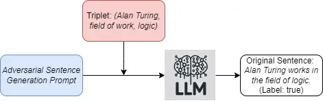
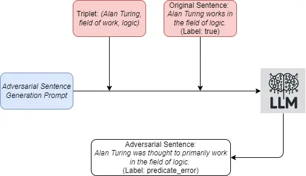
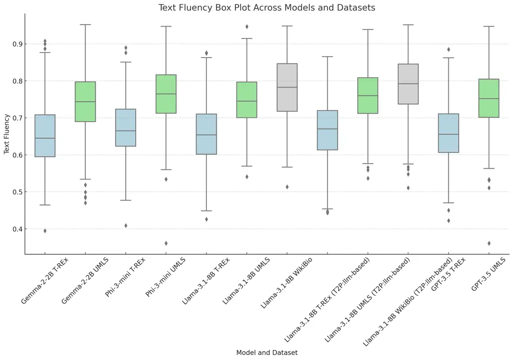
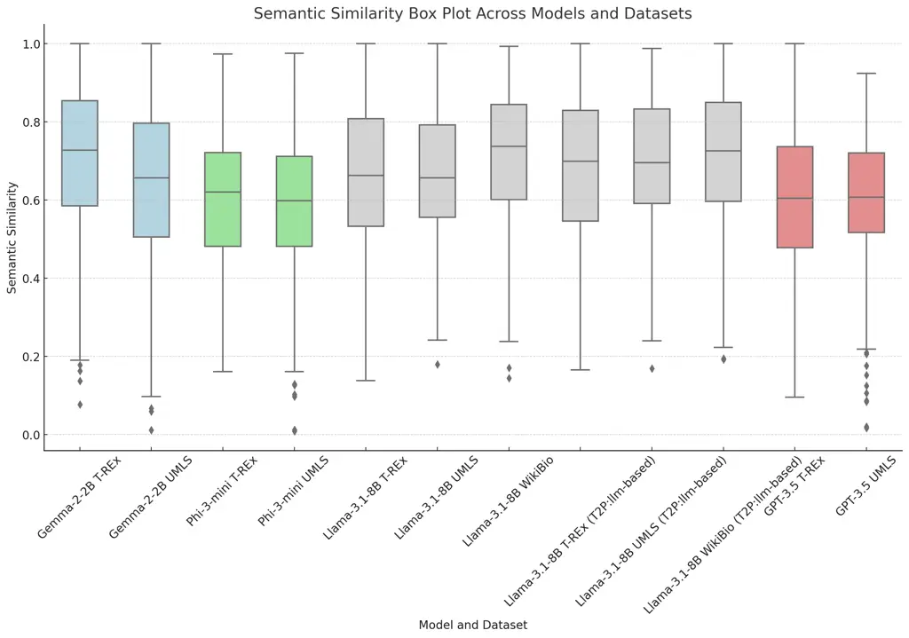

# SelfPrompt: Autonomously Evaluating LLM Robustness via Domain-Constrained Knowledge Guidelines and Refined Adversarial Prompts

Aihua Pei Affiliation: Waseda University Email: <aika@fuji.waseda.jp>   
Zehua Yang Affiliation: Waseda University
Email: <yangzehua@akane.waseda.jp>    Shunan Zhu Affiliation: Waseda
University Email: <shunan-zhu@ruri.waseda.jp>    Ruoxi Cheng
Affiliation: Southeast University Email: <213200761@seu.edu.cn>    Ju
Jia Affiliation: Southeast University Email: <jiaju@seu.edu.cn>

###### Abstract

Traditional methods for evaluating the robustness of large language
models (LLMs) often rely on standardized benchmarks, which can escalate
costs and limit evaluations across varied domains. This paper introduces
a novel framework designed to autonomously evaluate the robustness of
LLMs by incorporating refined adversarial prompts and domain-constrained
knowledge guidelines in the form of knowledge graphs. Our method
systematically generates descriptive sentences from domain-constrained
knowledge graph triplets to formulate adversarial prompts, enhancing the
relevance and challenge of the evaluation. These prompts, generated by
the LLM itself and tailored to evaluate its own robustness, undergo a
rigorous filtering and refinement process, ensuring that only those with
high textual fluency and semantic fidelity are used. This
self-evaluation mechanism allows the LLM to evaluate its robustness
without the need for external benchmarks. We assess the effectiveness of
our framework through extensive testing on both proprietary models like
ChatGPT OpenAI (2024) and open-source models such as Llama-3.1 Touvron
et al. (2024), Phi-3 Research (2024), and Mistral Mistral and
contributors (2024). Results confirm that our approach not only reduces
dependency on conventional data but also provides a targeted and
efficient means of evaluating LLM robustness in constrained domains.

## 1 Introduction

Large language models (LLMs) have garnered significant attention due to
their exceptional performance across various natural language processing
(NLP) tasks. However, as these models are widely applied in critical
domains, they also face the risk of adversarial attacks triggered by
prompts. Adversarial attacks aim to mislead models into making incorrect
judgments through carefully designed prompts, potentially causing severe
damage to users. Therefore, it is necessary to assess the robustness of
models against adversarial attacks using robustness evaluations.

Existing adversarial robustness evaluation frameworks for large language
models (LLMs), like AdvGLUE Wang et al. (2021) and PromptAttack Xu
et al. (2023), use specialized benchmark datasets that require extensive
manual annotation. This not only limits their applicability but also
increases operational costs. Moreover, when LLMs are used in constrained
domains such as medicine or biology, the mismatch between generic
benchmark datasets and the constrained context can lead to inaccurate
robustness evaluations. These limitations decrease practicality of the
frameworks and complicate the robustness evaluation of LLMs.

This paper proposes an adversarial attack framework (SelfPrompt) that
requires the evaluated LLMs themselves to utilize domain-constrained
knowledge guidelines to generate and poison prompts from knowledge graph
triplets, thereby assessing their robustness. The generation of
adversarial prompts is meticulously refined to optimize quality and
evaluation effectiveness, while ensuring that the quality of adversarial
prompts generated by different large language models is relatively
consistent. We apply this framework to generate prompts from both
general and constrained domain knowledge graphs, evaluating the
resilience of multiple LLMs under adversarial attack conditions.
Specifically, our contributions include:

- •
  This paper introduces a framework that allows large language models
  (LLMs) to autonomously evaluate their robustness in constrained
  domains by generating adversarial prompts from domain-specific
  knowledge graph triplets. This method enhances the practical relevance
  of robustness evaluations by tailoring the prompts to the specific
  operational domains of the LLMs.
- •
  To ensure stable quality of adversarial prompts across various large
  models and maintain comparability in their robustness evaluations, we
  employ a filter. This filter assesses the text fluency and semantic
  fidelity of the prompts, allowing us to refine and exclude those that
  do not meet our quality criteria.
- •
  We confirm that the robustness of large language models is influenced
  by the domain of knowledge corresponding to the prompts. The
  robustness of the same large language model measured on general or
  constrained domain knowledge graphs is not similar. While models with
  larger parameters in the same series tend to exhibit stronger
  robustness in general domains, this is not necessarily the case in
  constrained domains. Therefore, it is crucial to consider the
  differences in knowledge domains when evaluating robustness of LLMs.

## 2 Related Works

### 2.1 Robustness Evaluation of LLMs

Large language models (LLMs), such as the ChatGPT family and the Llama
family, have attracted much attention for their excellent performance in
a variety of natural language processing tasks Touvron et al. (2023);
Brown et al. (2020). However, as these models are widely used in
critical domains applications, evaluating their robustness has also
become a hot research topic. There are four main streams of work Li
et al. (2023); Ailem et al. (2024); Zhuo et al. (2023) on robustness
research: robustness under distribution shift Yang et al. (2023),
robustness to adversarial attacks Wang et al. (2023b); Zhu et al.
(2023), robustness to prompt formats and instruction templates Mizrahi
et al. (2023); Voronov et al. (2024); Weber et al. (2023) and robustness
to dataset bias Gururangan et al. (2018); Niven and Kao (2019); Le Bras
et al. (2020). Our work focus on evaluating robustness to adversarial
attacks of LLMs.

Adversarial attacks aim to mislead the model to make wrong judgments
through well-designed inputs, while adversarial robustness evaluation
attempts to determine and enhance robustness of the model to these
attacks. Current robustness evaluation frameworks for LLMs are mainly
based on specially constructed benchmark datasets (e.g., the GLUE
dataset Wang et al. (2018) and ANLI dataset Nie et al. (2020)) for
evaluating natural language comprehension capabilities of LLMs Goel
et al. (2021).

AdvGLUE Wang et al. (2021) and AdvGLUE++ Wang et al. (2023a) are two
frameworks specifically designed to evaluate the adversarial robustness
of language models. These frameworks challenge the ability to make
judgments under complex and subtle semantic changes by providing a
series of adversarial samples of models. AdvGLUE++ is a further
extension of AdvGLUE that introduces more adversarial samples,
especially for new emerging LLMs such as the Alpaca and Vicuna families
Taori et al. (2023); Chiang et al. (2023).PromptAttack enhance the
attack power by ensembling adversarial examples at different
perturbation levels Xu et al. (2023). These evaluation frameworks
exhibit a common feature: testing and improving the robustness of the
model by constructing inputs that may cause the model to misjudge. These
inputs include both subtle textual modifications and complex semantic
transformations, aiming to comprehensively evaluate robustness of the
model to various challenges that may be encountered in real-world
applications.

### 2.2 Adversarial Prompt Generation from Knowledge Graphs

In evaluating robustness of LLMs, we need to know whether they have such
knowledge and whether they can accurately express their knowledge.
Knowledge graphs can help us generate adversarial attack prompt with
different diversities and complexities. Knowledge graph (KG) is a graph
structure for representing knowledge, where nodes represent entities or
concepts and edges represent relationships between these entities or
concepts.

Some works use different methods to utilize triplet from knowledge
graphs generating questions Seyler et al. (2017); Kumar et al. (2019);
Chen et al. (2023). Some works utilize the ability of LLMs to generate
questions from KGs Guo et al. (2022); Axelsson and Skantze (2023).
Recent works Luo et al. (2023); Luo et al. (2024) also discussed on
evaluating factual knowledge of LLMs with the diverse and well-coverage
questions generated from KGs and how KGs can be used to induce bias in
LLMs.

### 2.3 Few-Shot Strategy

As the popularity of machine learning models, especially large language
models (LLMs), continues to grow, the few-shot learning strategy has
also garnered significant attention Logan IV et al. (2021); Meng et al.
(2024). Few-shot learning involves training models with a limited number
of samples to perform well on various tasks, minimizing the need for
large annotated datasets. This approach is particularly valuable in
situations where obtaining extensive labeled data is challenging or
costly. By leveraging pre-trained models, few-shot learning allows LLMs
to generalize effectively from just a few examples, making it a powerful
tool for tasks like text classification, translation, and summarization.

The few-shot learning strategy is designed to enhance model performance
in data-scarce environments, which is crucial for applying LLMs to
specialized domains where data is often limited. The core of this
strategy lies in its ability to utilize prior knowledge embedded in
pre-trained models, enabling them to adapt to new tasks quickly and
efficiently with minimal data. This adaptability helps uncover the
potential of LLMs in diverse applications while maintaining robustness
and relevance in domain-specific contexts.

## 3 Methodology

In this section, we first illustrate a robustness self-evaluation
framework for large language models based on domain-constrained
knowledge guidelines, utilizing adversarial prompt attacks, which we
call SelfPrompt. Then, we employ a filter module to ensure the text
fluency and semantic fidelity of the adversarial prompts generated by
SelfPrompt. Finally, we introduce the metrics for evaluating the
robustness of LLMs. All the prompt templates mentioned in this section
can be found in the Appendix C.

### 3.1 Framework of SelfPrompt

Initially, we process the triplets of the knowledge graph to assign them
distinct labels. Subsequently, we transform these triplets into original
prompts. Finally, these original prompts are converted into adversarial
prompts. Next, we provide a detailed description of each step in this
process.

Labeling Knowledge Graph Triples. We let
$`\mathcal{D}=\left\{(s_{i},p_{i},o_{i})\right\}_{i=1}^{N}`$ be the
domain-constrained knowledge graph dataset. For each triplet
$`t=(s,p,o)\in\mathcal{D}`$, $`s`$ refers to the subject of this
triplet, while $`p`$ and $`o`$ refer to the predicate and object of the
triplet, respectively. For example, for the triple
$`(\textit{Alan Turing},\textit{field of work},\textit{logic})`$, it has
the subject (Alan Turing), the predicate (field of work), and the object
(logic). This triple means that Alan Turing works in the field of logic.

Considering the structural characteristics of the triples, each triple
is labeled with one of the following three labels: true, entity_error,
and predicate_error. By default, all triples extracted from the
knowledge graph are initially labeled as true. For each triplet
$`t=(s,p,o)\in\mathcal{D}`$, its label $`l`$ is randomly assigned to one
of the three labels with equal probability, generating incorrect
subject, predicate, and object, denoted as $`s^{\prime}`$,
$`p^{\prime}`$, and $`o^{\prime}`$, respectively. The modified triple
$`t^{\prime}`$ is:

```math
\displaystyle t^{\prime}=\begin{cases}(s,p,o),&l=\textit{true}\\
(s,p^{\prime},o),&l=\textit{predicate\textunderscore error}\\
(s^{\prime},p,o)\text{ or }(s,p,o^{\prime}),&l=\textit{entity\textunderscore error}\end{cases} \tag{1}
```

For example, for the original triple labeled as true,
$`(\textit{Alan Turing},\textit{field of work},\textit{logic})`$; if it
is to be labeled as predicate*error, it can be modified to
$`(\textit{Alan Turing},\textit{position played on team},\textit{logic})`$,
which means Alan Turing plays in the logic position; the modified
predicate is used to describe the position or specialism of a player on
a team. If it is to be labeled as entity_error, the original triple can
be modified to
$`(\textit{Richard Wagner},\textit{field of work},\textit{logic})`$ or
$`(\textit{Alan Turing},\textit{field of work},\textit{Opera})`$. The
labeled knowledge graph dataset is
$`\mathcal{D^{\prime}}=\left\{(t^{\prime}*{i},l*{i})\right\}*{i=1}^{N}`$

Generating Original Prompts. LLMs are more suitable for handling
continuous prompt text rather than structured triplets. For converting
triplets into prompts, we offer two strategies: Template-based and
LLM-based. The template-based strategy uses templates built into the
predicates of the triplets to generate original prompts by replacing
these placeholders with specific names. For example, for the triplet
$`(\textit{Alan Turing},\textit{field of work},\textit{logic})`$, the
template built into the predicate field of work is "\[X\] works in the
field of \[Y\]." By replacing \[X\] with Alan Turing and \[Y\] with
logic, the sentence "Alan Turing works in the field of logic" is
generated. The LLM-based strategy involves feeding triplets to the LLM
whose robustness is being evaluated, which then generates descriptive
sentences based on these elements. Figure 1 shows the structure of this
strategy.



Figure 1: LLM-Based Strategy Example

The sentences generated by the two strategies are filled into the
corresponding positions of the prompt templates to create original
prompts, requiring the LLM to classify these sentences according to the
three labels described in this subsection.

Constructing Adversarial Prompts. Adversarial prompts maintain the same
main structure as the original prompts and require the LLM, whose
robustness is being evaluated, to modify the sentences generated from
the triplets to create adversarial sentences. These adversarial
sentences should retain the same semantics as the original sentences but
lead the LLM to misclassify them. Adversarial prompts are generated by
replacing the corresponding parts in the original prompts with
adversarial sentences. In the prompt template (Adversarial Sentences
Generation Prompt) for this step, we provide both the triplets and the
sentences generated from them according to the procedure described in
this subsection.



Figure 2: Adversarial Sentence Generation

To generate adversarial sentences, we offer an optional few-shot
approach that enhances the LLM’s ability to produce adversarial
sentences by providing example samples that demonstrate the
transformation of original sentences into adversarial sentences.

### 3.2 Filter Module

In the SelfPrompt framework described in section 3.1, we use the LLM
being evaluated for robustness to generate both original prompts and
adversarial prompts. The quality of adversarial prompts generated by
different LLMs varies, posing challenges for the cross-comparison of
robustness evaluation results across different LLMs. To address this
issue, we designed a filter module to eliminate adversarial sentences
that do not meet the criteria for text fluency or semantic fidelity.
This ensures that the adversarial prompts generated by different LLMs
are of comparable quality, thereby enhancing the reliability and
comparability of the robustness evaluation results.For an original
sentence $`s_{\text{ori}}`$ and its corresponding adversarial sentence
$`s_{\text{adv}}`$, the text fluency of $`s_{\text{adv}}`$ is
$`tf(s_{\text{adv}})`$, the semantic fidelty of $`s_{\text{adv}}`$
relative to $`s_{\text{ori}}`$ is $`sf(s_{\text{adv}},s_{\text{ori}})`$.
Assume that the filtering thresholds for text fluency and semantic
fidelity are $`\tau_{\text{t}}`$ and $`\tau_{\text{s}}`$ respectively,
the formula for the filter module is as follows:

```math
\displaystyle\text{f}(s_{\text{adv}},s_{\text{ori}})=(\text{tf}(s_{\text{adv}})>\tau_{\text{t}})\land(\text{sf}(s_{\text{adv}},s_{\text{ori}})>\tau_{\text{s}}) \tag{2}
```

The function $`\text{tf}(s)`$ calculates the text fluency of a sentence
$`s`$ by computing the perplexity of a language model’s output for
$`s`$. The perplexity is defined as:

```math
\displaystyle P(s)=e^{\text{Loss}(s)} \tag{3}
```

where $`\text{Loss}(s)`$ is the negative log-likelihood loss of
predicting the tokens in $`s`$ Goodfellow et al. (2016). To manage the
typically large values of perplexity, a logarithmic transformation is
applied:

```math
\displaystyle LogP(s)=\log(P(s)+e-1) \tag{4}
```

The text fluency score is computed as:

```math
\displaystyle\text{tf}(s)=\frac{e^{-k/LogP(s)}-1}{e^{-k}-1} \tag{5}
```

where $`k>0`$; in this experiment, $`k`$ is set to 5.

The function $`\text{sf}(s_{\text{adv}},s_{\text{ori}})`$ computes the
semantic fidelity between $`s_{\text{adv}}`$ and $`s_{\text{ori}}`$ by
first calculating the cosine similarity between their embedding vectors
$`\textbf{v}_{\text{adv}}`$ and $`\textbf{v}_{\text{ori}}`$, where:

```math
\displaystyle\textbf{v}_{\text{adv}}=\text{get\_embedding}(s_{\text{adv}}) \tag{6}
```

```math
\displaystyle\textbf{v}_{\text{ori}}=\text{get\_embedding}(s_{\text{ori}}) \tag{7}
```

The cosine similarity Manning et al. (2008) is given by:

```math
\displaystyle\text{cos\_sim}(\textbf{v}_{\text{adv}},\textbf{v}_{\text{ori}})=\frac{\textbf{v}_{\text{adv}}\cdot\textbf{v}_{\text{ori}}}{\|\textbf{v}_{\text{adv}}\|\|\textbf{v}_{\text{ori}}\|} \tag{8}
```

It then scales the cosine similarity to the range \[0, 1\] using the
formula:

```math
\displaystyle\text{sf}(s_{\text{adv}},s_{\text{ori}})=\frac{e^{t\cdot\text{cos\_sim}(\textbf{v}_{\text{adv}},\textbf{v}_{\text{ori}})}-e^{-t}}{e^{t}-e^{-t}} \tag{9}
```

where $`t>0`$. In this experiment, $`t`$ is set to 5.

### 3.3 Metrics for Robustness Evaluation

From a knowledge graph triplet dataset
$`\mathcal{D}=\left\{(s_{i},p_{i},o_{i})\right\}_{i=1}^{N}`$, we
generate an original prompt set $`\mathcal{O}`$ and a corresponding
adversarial prompt set $`\mathcal{A}`$ of size $`M`$ (where
$`0<M\leq N`$, and all elements in set $`\mathcal{A}`$ must pass the
filter module test described in section 3.2). Let the accuracy of the
LLM on the classification task for set $`\mathcal{O}`$ be
$`\text{ACC}_{\mathcal{O}}`$ and for set $`\mathcal{A}`$ be
$`\text{ACC}_{\mathcal{A}}`$(both $`\text{ACC}_{\mathcal{O}}`$ and
$`\text{ACC}_{\mathcal{A}}`$ range from 0 to 1). The robustness metric
$`R(\text{ACC}_{\mathcal{A}},\text{ACC}_{\mathcal{O}})`$ evaluates a
model’s ability to handle adversarial prompts. It is defined as:

```math
R(\text{ACC}_{\mathcal{A}},\text{ACC}_{\mathcal{O}})=\sin\left(\frac{\pi}{2}\cdot\text{ACC}_{\mathcal{A}}\cdot\left(1-\frac{\text{ACC}_{\mathcal{O}}^{j}}{j}\right)\right) \tag{10}
```

where $`\text{ACC}_{\mathcal{A}}`$ is positively correlated with
robustness since a higher $`\text{ACC}_{\mathcal{A}}`$ reflects better
resistance to adversarial attacks. Conversely,
$`\text{ACC}_{\mathcal{O}}`$ is negatively correlated with robustness
because, in most cases,
$`\text{ACC}_{\mathcal{A}}<\text{ACC}_{\mathcal{O}}`$. When
$`\text{ACC}_{\mathcal{A}}`$ is the same, a lower
$`\text{ACC}_{\mathcal{O}}`$ indicates that the LLM is less influenced
by adversarial attacks, leading to a higher robustness score. In this
experiment, the value of $`j`$ is set to 1.7, where $`j\geq 1`$.

## 4 Experiments

In this section, we demonstrate that our proposed SelfPrompt framework
can perform adversarial attacks on large language models such as ChatGPT
OpenAI (2024) and Phi-3 Research (2024), and enable self-evaluation of
their robustness based on the results. Additionally, we conduct
extensive evaluation experiments on each module within the SelfPrompt
framework.

### 4.1 Arrangements

In this subsection, we present the basic arrangements of the
experiments, including the datasets used, the large language models
employed, and settings of the filter module.

Datasets. We utilize three knowledge graphs (KGs) to generate factual
questions: T-REx Elsahar et al. (2018), which serves as a general-domain
KG, and WikiBio Sung et al. (2021) and ULMS Bodenreider (2004), which
are focused on constrained domains in biology and medicine,
respectively. Each predicate in these KGs is paired with a dedicated
template, which facilitates template-based original prompt generation
within the SelfPrompt framework. For more details about the datasets and
their predefined templates, please refer to appendix.

Large Language Models. Our experiments leverage a range of large
language models across several series: GPT-4o OpenAI (2024) (including
GPT-4o and GPT-4o-mini), Gemma2 Gemma Team (2024) (with 2B and 9B
parameter versions), Phi-3 Research (2024) (comprising Phi-3-mini with
3.8B parameters and Phi-3-small with 7B parameters), Llama-3.1 Touvron
et al. (2024) (8B parameters), and Mistral Mistral and contributors
(2024) (7B parameters). Variants with different parameter scales within
the same model series are employed to examine whether the SelfPrompt
framework’s evaluation results align with the expectation that "larger
models exhibit greater robustness under comparable conditions,
particularly when evaluated on general domain datasets", thereby
validating the soundness of the evaluation metrics. Meanwhile, models
with similar parameter sizes from different series are used to
facilitate cross-series comparisons of robustness.

Filter Module Setting. To determine the appropriate values for the two
thresholds, $`\tau_{t}`$ and $`\tau_{s}`$, in the filter module, we use
a small sample (500 samples per round) generated by various LLMs and
different knowledge graph datasets to produce the sentences required for
adversarial prompts. We then measure their text fluency and semantic
fidelity. The corresponding box plots of the data are presented below.



Figure 3: Box Plot of Text Fluency



Figure 4: Box Plot of Semantic Fidelity

In Figure 3 and Figure 4, T2P indicates which strategy was used for
generating the original prompts. Unless otherwise specified, the
template-based strategy is generally applied. As shown in the figures,
text fluency is significantly affected by different constrained domains,
while semantic fidelity is more influenced by different LLMs; these two
metrics are suitable as filtering criteria in the fidelity module. To
select high-quality adversarial prompts, we set $`\tau_{t}=0.69`$ and
$`\tau_{s}=0.60`$.

| Dataset | Generation Strategy | FS  | Gemma2-2B | Gemma2-9B | Phi-3-mini | Phi-3-small |
| ------- | ------------------- | --- | --------- | --------- | ---------- | ----------- |
| T-REx   | template_based      | No  | 0.620     | 0.631     | 0.607      | 0.639       |
| T-REx   | template_based      | Yes | 0.610     | 0.641     | 0.639      | 0.642       |
| T-REx   | llm_based           | No  | 0.595     | 0.605     | 0.590      | 0.647       |
| T-REx   | llm_based           | Yes | 0.602     | 0.633     | 0.584      | 0.644       |
| UMLS    | template_based      | No  | 0.524     | 0.490     | 0.502      | 0.568       |
| UMLS    | template_based      | Yes | 0.500     | 0.529     | 0.533      | 0.542       |
| UMLS    | llm_based           | No  | 0.510     | 0.459     | 0.512      | 0.507       |
| UMLS    | llm_based           | Yes | 0.541     | 0.490     | 0.510      | 0.496       |
| WikiBio | template_based      | No  | 0.506     | 0.555     | 0.502      | 0.537       |
| WikiBio | template_based      | Yes | 0.513     | 0.485     | 0.548      | 0.505       |
| WikiBio | llm_based           | No  | 0.536     | 0.503     | 0.466      | 0.554       |
| WikiBio | llm_based           | Yes | 0.508     | 0.501     | 0.525      | 0.499       |

Table 1: Robustness evaluation results for some models: Gemma2-2B,
Gemma2-9B Gemma Team (2024), Phi-3-mini, and Phi-3-small Research
(2024). Bold indicates higher value. The FS column indicates whether the
few-shot strategy is used.

### 4.2 Robustness Evaluation

Table 1, Table 2, and Table 3 present the robustness evaluation results
for selected large models, the accuracy of the LLM on the classification
task for set $`\mathcal{O}`$ ($`\text{ACC}_{\mathcal{O}}`$), and for set
$`\mathcal{A}`$ ($`\text{ACC}_{\mathcal{A}}`$), respectively. The test
data for the remaining models (including Mistral-7B, Llama-3.1-8B,
ChatGPT-4o, and ChatGPT-4o-mini) can be found in the Appendix B.

As shown in Table 1, when tested on knowledge graph datasets in the
general domain, the performance of large language models aligns with the
prediction that "within the same series, larger models exhibit greater
robustness." This observation validates the effectiveness of our metrics
for evaluating model robustness. However, on datasets in constrained
domains, the results are not always consistent with this trend. For
Phi-3 models, the prediction that larger models are more robust
generally holds; even in cases where smaller models show greater
robustness, the difference is marginal. In contrast, for the Gemma2
series, smaller models achieve better robustness evaluation results. By
comparing Table 2 and Table 3, it can be seen that the larger models in
the Gemma2 series experience a more significant drop in accuracy when
facing adversarial attacks (e.g., for the UMLS dataset, the accuracy
drops of the Gemma2-2B and Gemma2-9B models are 0.026 and 0.049,
respectively; for the WikiBio dataset, the drops are 0.036 and 0.047,
respectively). Thus, the smaller models in the Gemma2 series are less
affected by adversarial attacks and therefore demonstrate greater
robustness. This could be attributed to the smaller models’ limited
understanding of specialized domain texts, making them relatively less
susceptible to adversarial statements. These findings underscore the
necessity of evaluating the robustness of large models in
domain-constrained scenarios.

| Dataset | Generation Strategy | FS  | Gemma2-2B | Gemma2-9B | Phi-3-mini | Phi-3-small |
| ------- | ------------------- | --- | --------- | --------- | ---------- | ----------- |
| T-REx   | template_based      | No  | 0.568     | 0.622     | 0.560      | 0.579       |
| T-REx   | template_based      | Yes | 0.558     | 0.609     | 0.527      | 0.590       |
| T-REx   | llm_based           | No  | 0.561     | 0.646     | 0.553      | 0.612       |
| T-REx   | llm_based           | Yes | 0.551     | 0.654     | 0.514      | 0.636       |
| UMLS    | template_based      | No  | 0.429     | 0.453     | 0.381      | 0.486       |
| UMLS    | template_based      | Yes | 0.454     | 0.450     | 0.407      | 0.503       |
| UMLS    | llm_based           | No  | 0.413     | 0.416     | 0.424      | 0.398       |
| UMLS    | llm_based           | Yes | 0.423     | 0.404     | 0.401      | 0.424       |
| WikiBio | template_based      | No  | 0.462     | 0.430     | 0.516      | 0.459       |
| WikiBio | template_based      | Yes | 0.439     | 0.427     | 0.514      | 0.434       |
| WikiBio | llm_based           | No  | 0.422     | 0.468     | 0.444      | 0.441       |
| WikiBio | llm_based           | Yes | 0.436     | 0.472     | 0.466      | 0.406       |

Table 2: $`\text{ACC}_{\mathcal{O}}`$ for some models: Gemma2-2B,
Gemma2-9B Gemma Team (2024), Phi-3-mini, and Phi-3-small Research
(2024). Bold indicates higher value. The FS column indicates whether the
few-shot strategy is used.

| Dataset | Generation Strategy | FS  | Gemma2-2B | Gemma2-9B | Phi-3-mini | Phi-3-small |
| ------- | ------------------- | --- | --------- | --------- | ---------- | ----------- |
| T-REx   | template_based      | No  | 0.549     | 0.589     | 0.532      | 0.575       |
| T-REx   | template_based      | Yes | 0.534     | 0.593     | 0.550      | 0.584       |
| T-REx   | llm_based           | No  | 0.520     | 0.574     | 0.512      | 0.602       |
| T-REx   | llm_based           | Yes | 0.523     | 0.611     | 0.490      | 0.612       |
| UMLS    | template_based      | No  | 0.408     | 0.385     | 0.378      | 0.465       |
| UMLS    | template_based      | Yes | 0.394     | 0.418     | 0.410      | 0.446       |
| UMLS    | llm_based           | No  | 0.392     | 0.350     | 0.396      | 0.386       |
| UMLS    | llm_based           | Yes | 0.421     | 0.373     | 0.389      | 0.383       |
| WikiBio | template_based      | No  | 0.401     | 0.436     | 0.414      | 0.428       |
| WikiBio | template_based      | Yes | 0.401     | 0.374     | 0.456      | 0.393       |
| WikiBio | llm_based           | No  | 0.417     | 0.400     | 0.362      | 0.438       |
| WikiBio | llm_based           | Yes | 0.396     | 0.400     | 0.419      | 0.381       |

Table 3: $`\text{ACC}_{\mathcal{A}}`$ for some models: Gemma2-2B,
Gemma2-9B Gemma Team (2024), Phi-3-mini, and Phi-3-small Research
(2024). Bold indicates higher value. The FS column indicates whether the
few-shot strategy is used.

### 4.3 Experimental Analysis of SelfPrompt

The robustness evaluation of large language models (LLMs) reveals
distinct effects based on the strategies used for generating original
prompts (Template-based vs. LLM-based) and whether the few-shot approach
is applied in constructing adversarial prompts. Tables 1, 2, and 3
highlight these differences within the same model series.

For generating original prompts, the impact of template-based and
LLM-based strategies differs between models in the same series. In the
Gemma2 series, the robustness scores for Gemma2-2B and Gemma2-9B under
the template-based strategy without few-shot on the T-REx dataset are
0.662 and 0.679, respectively. This suggests that the larger model,
Gemma2-9B, benefits slightly from more structured input. However, when
using the LLM-based strategy, which introduces more variability, the
robustness score for Gemma2-9B on the UMLS dataset drops to 0.530,
closer to Gemma2-2B’s 0.534. This convergence suggests that more diverse
prompts challenge the larger model’s robustness. Table 2 shows a similar
trend in accuracy $`\text{ACC}_{\mathcal{O}}`$, where Gemma2-2B and
Gemma2-9B show reduced differences when moving from template-based to
LLM-based prompts, highlighting the impact of input variability. In the
Phi-3 series, a similar pattern is observed. Under the template-based
strategy on the WikiBio dataset, Phi-3-mini and Phi-3-small achieve
robustness scores of 0.534 and 0.566, respectively, indicating a benefit
for the larger model. However, under the LLM-based strategy,
Phi-3-mini’s robustness score drops more significantly than
Phi-3-small’s (from 0.648 to 0.619 and from 0.695 to 0.694,
respectively, on the T-REx dataset), demonstrating that
smaller-parameter large language models are relatively weaker than
larger-parameter models in generating and understanding natural
sentences.

Regarding constructing adversarial prompts, the few-shot Approach
significantly affects robustness within model series, as seen in Tables
1 and 3. For the Gemma2 series on the UMLS dataset, Gemma2-9B’s
robustness drops from 0.529 without few-shot to 0.490 with few-shot,
revealing increased vulnerability under adversarial conditions. In
contrast, Gemma2-2B shows a smaller drop (from 0.500 to 0.512),
indicating less sensitivity to adversarial prompts. In the Phi-3 series,
on the WikiBio dataset, Phi-3-mini’s accuracy
$`\text{ACC}_{\mathcal{A}}`$ drops significantly from 0.612 to 0.521
when few-shot is applied, compared to a smaller decrease for
Phi-3-small. This highlights the effectiveness of few-shot in generating
more challenging adversarial prompts that test model robustness.

In summary, the choice of strategy for generating original prompts and
constructing adversarial prompts significantly influences the robustness
evaluation of LLMs. Template-based strategies offer a controlled
environment that favors larger models, while LLM-based strategies and
the few-shot approach introduce more variability and difficulty,
providing a more comprehensive robustness assessment within the same
model series.

## 5 Conclusion

This paper introduces SelfPrompt, a framework for autonomously
evaluating the robustness of large language models (LLMs) using
domain-constrained knowledge guidelines and refined adversarial prompts.
Our experiments confirm that the proposed method provides a reliable and
effective evaluation of LLM robustness across various domains,
demonstrating that larger models generally show greater robustness in
general settings, while results may vary in domain-specific scenarios.
Future work could explore expanding this framework to cover more diverse
knowledge graphs and adaptive prompt generation techniques.

## Limitations

The limitations of our work includes:

- •
  Types of problems for evaluating LLM robustness. In the SelfPrompt
  framework, we require the LLM to perform classification tasks to
  evaluate the robustness of large language models; in future research,
  we plan to enrich the types of problems by including types such as
  short answer questions and true/false questions, to conduct a more
  comprehensive evaluation of the LLM of robustness.
- •
  The SelfPrompt framework relies on existing knowledge graphs. When
  suitable knowledge graphs are lacking in a specific domain,
  constructing such knowledge graphs for that domain increases the usage
  cost of this framework. In future experiments, we plan to attempt
  constructing a small number of triplets directly without relying on
  knowledge graphs, for robustness evaluation purposes.
- •
  Lack of further comparative experiments. It is due to the unique
  design of the robustness evaluation metrics introduced in this paper,
  which limits the ability to compare with existing robustness
  evaluation frameworks. In future experiments, we plan to conduct
  further comparative tests once similar frameworks become available.

## References

- Ailem et al. (2024) Melissa Ailem, Katerina Marazopoulou, Charlotte
  Siska, and James Bono. 2024. Examining the robustness of llm
  evaluation to the distributional assumptions of benchmarks. _arXiv
  preprint arXiv:2404.16966_.
- Axelsson and Skantze (2023) Agnes Axelsson and Gabriel Skantze. 2023.
  Using large language models for zero-shot natural language generation
  from knowledge graphs. _arXiv preprint arXiv:2307.07312_.
- Bodenreider (2004) Olivier Bodenreider. 2004. The unified medical
  language system (umls): integrating biomedical terminology. _Nucleic
  acids research_, 32(suppl_1):D267–D270.
- Brown et al. (2020) Tom Brown, Benjamin Mann, Nick Ryder, Melanie
  Subbiah, Jared D Kaplan, Prafulla Dhariwal, Arvind Neelakantan, Pranav
  Shyam, Girish Sastry, Amanda Askell, et al. 2020. Language models are
  few-shot learners. _Advances in neural information processing
  systems_, 33:1877–1901.
- Chen et al. (2023) Yu Chen, Lingfei Wu, and Mohammed J Zaki. 2023.
  Toward subgraph-guided knowledge graph question generation with graph
  neural networks. _IEEE Transactions on Neural Networks and Learning
  Systems_.
- Chiang et al. (2023) Wei-Lin Chiang, Zhuohan Li, Zi Lin, Ying Sheng,
  Zhanghao Wu, Hao Zhang, Lianmin Zheng, Siyuan Zhuang, Yonghao Zhuang,
  Joseph E. Gonzalez, Ion Stoica, and Eric P. Xing. 2023. [Vicuna: An
  open-source chatbot impressing gpt-4 with 90%\* chatgpt
  quality](https://lmsys.org/blog/2023-03-30-vicuna/).
- Elsahar et al. (2018) Hady Elsahar, Pavlos Vougiouklis, Arslen Remaci,
  Christophe Gravier, Jonathon Hare, Frederique Laforest, and Elena
  Simperl. 2018. T-rex: A large scale alignment of natural language with
  knowledge base triples. In _Proceedings of the Eleventh International
  Conference on Language Resources and Evaluation (LREC 2018)_.
- Gemma Team (2024) Google DeepMind Gemma Team. 2024. [Gemma 2:
  Improving open language models at a practical
  size](https://arxiv.org/abs/2408.00118). _arXiv preprint
  arXiv:2408.00118_.
- Goel et al. (2021) Karan Goel, Nazneen Rajani, Jesse Vig, Samson Tan,
  Jason Wu, Stephan Zheng, Caiming Xiong, Mohit Bansal, and Christopher
  Ré. 2021. Robustness gym: Unifying the nlp evaluation landscape.
  _arXiv preprint arXiv:2101.04840_.
- Goodfellow et al. (2016) Ian Goodfellow, Yoshua Bengio, and Aaron
  Courville. 2016. [_Deep Learning_](http://www.deeplearningbook.org).
  MIT Press.
- Guo et al. (2022) Shasha Guo, Jing Zhang, Yanling Wang, Qianyi Zhang,
  Cuiping Li, and Hong Chen. 2022. Dsm: Question generation over
  knowledge base via modeling diverse subgraphs with meta-learner. In
  _Proceedings of the 2022 Conference on Empirical Methods in Natural
  Language Processing_, pages 4194–4207.
- Gururangan et al. (2018) Suchin Gururangan, Swabha Swayamdipta, Omer
  Levy, Roy Schwartz, Samuel Bowman, and Noah A Smith. 2018. Annotation
  artifacts in natural language inference data. In _Proceedings of the
  2018 Conference of the North American Chapter of the Association for
  Computational Linguistics: Human Language Technologies, Volume 2
  (Short Papers)_, pages 107–112.
- Kumar et al. (2019) Vishwajeet Kumar, Yuncheng Hua, Ganesh
  Ramakrishnan, Guilin Qi, Lianli Gao, and Yuan-Fang Li. 2019.
  Difficulty-controllable multi-hop question generation from knowledge
  graphs. In _The Semantic Web–ISWC 2019: 18th International Semantic
  Web Conference, Auckland, New Zealand, October 26–30, 2019,
  Proceedings, Part I 18_, pages 382–398. Springer.
- Le Bras et al. (2020) Ronan Le Bras, Swabha Swayamdipta, Chandra
  Bhagavatula, Rowan Zellers, Matthew Peters, Ashish Sabharwal, and
  Yejin Choi. 2020. Adversarial filters of dataset biases. In
  _International conference on machine learning_, pages 1078–1088. Pmlr.
- Li et al. (2023) Xinzhe Li, Ming Liu, Shang Gao, and Wray
  Buntine. 2023. A survey on out-of-distribution evaluation of neural
  nlp models. _arXiv preprint arXiv:2306.15261_.
- Logan IV et al. (2021) Robert L Logan IV, Ivana Balažević, Eric
  Wallace, Fabio Petroni, Sameer Singh, and Sebastian Riedel. 2021.
  Cutting down on prompts and parameters: Simple few-shot learning with
  language models. _arXiv preprint arXiv:2106.13353_.
- Luo et al. (2024) Chu Fei Luo, Ahmad Ghawanmeh, Xiaodan Zhu, and
  Faiza Khan Khattak. 2024. Biaskg: Adversarial knowledge graphs to
  induce bias in large language models. _arXiv preprint
  arXiv:2405.04756_.
- Luo et al. (2023) Linhao Luo, Thuy-Trang Vu, Dinh Phung, and
  Gholamreza Haffari. 2023. Systematic assessment of factual knowledge
  in large language models. _arXiv preprint arXiv:2310.11638_.
- Manning et al. (2008) Christopher D. Manning, Prabhakar Raghavan, and
  Hinrich Schütze. 2008. _Introduction to Information Retrieval_.
  Cambridge University Press, New York, NY, USA.
- Meng et al. (2024) Lingzhuang Meng, Mingwen Shao, Fan Wang, Yuanjian
  Qiao, and Zhaofei Xu. 2024. Advancing few-shot black-box attack with
  alternating training. _IEEE Transactions on Reliability_.
- Mistral and contributors (2024) Team Mistral and contributors. 2024.
  [Mistral: A multi-purpose language model for comprehensive text
  understanding](https://arxiv.org/abs/2406.09876). _arXiv preprint
  arXiv:2406.09876_. Accessed: 2024-09-14.
- Mizrahi et al. (2023) Moran Mizrahi, Guy Kaplan, Dan Malkin, Rotem
  Dror, Dafna Shahaf, and Gabriel Stanovsky. 2023. State of what art? a
  call for multi-prompt llm evaluation. _arXiv preprint
  arXiv:2401.00595_.
- Nie et al. (2020) Yixin Nie, Adina Williams, Emily Dinan, Mohit
  Bansal, Jason Weston, and Douwe Kiela. 2020. Adversarial nli: A new
  benchmark for natural language understanding. In _Proceedings of the
  58th Annual Meeting of the Association for Computational Linguistics_,
  pages 4885–4901.
- Niven and Kao (2019) Timothy Niven and Hung-Yu Kao. 2019. Probing
  neural network comprehension of natural language arguments. In
  _Proceedings of the 57th Annual Meeting of the Association for
  Computational Linguistics_, pages 4658–4664.
- OpenAI (2024) OpenAI. 2024. [Chatgpt: A large language model by
  openai](https://www.openai.com/). Accessed: 2024-09-14.
- Research (2024) Microsoft Research. 2024. [Phi-3: Advanced
  instruction-following language
  model](https://www.microsoft.com/research/project/phi-3/). Accessed:
  2024-09-14.
- Seyler et al. (2017) Dominic Seyler, Mohamed Yahya, and Klaus
  Berberich. 2017. Knowledge questions from knowledge graphs. In
  _Proceedings of the ACM SIGIR international conference on theory of
  information retrieval_, pages 11–18.
- Sung et al. (2021) Mujeen Sung, Jinhyuk Lee, Sean Yi, Minji Jeon,
  Sungdong Kim, and Jaewoo Kang. 2021. Can language models be biomedical
  knowledge bases? _arXiv preprint arXiv:2109.07154_.
- Taori et al. (2023) Rohan Taori, Ishaan Gulrajani, Tianyi Zhang, Yann
  Dubois, Xuechen Li, Carlos Guestrin, Percy Liang, and Tatsunori B
  Hashimoto. 2023. Alpaca: A strong, replicable instruction-following
  model. _Stanford Center for Research on Foundation Models.
  https://crfm. stanford. edu/2023/03/13/alpaca. html_, 3(6):7.
- Touvron et al. (2023) Hugo Touvron, Thibaut Lavril, Gautier Izacard,
  Xavier Martinet, Marie-Anne Lachaux, Timothée Lacroix, Baptiste
  Rozière, Naman Goyal, Eric Hambro, Faisal Azhar, et al. 2023. Llama:
  Open and efficient foundation language models. _arXiv preprint
  arXiv:2302.13971_.
- Touvron et al. (2024) Hugo Touvron, Thibaut Lavril, Gautier Izacard,
  et al. 2024. [Llama-3.1: Efficient and scalable foundation language
  models](https://arxiv.org/abs/2404.12345). _arXiv preprint
  arXiv:2404.12345_. Accessed: 2024-09-14.
- Voronov et al. (2024) Anton Voronov, Lena Wolf, and Max
  Ryabinin. 2024. Mind your format: Towards consistent evaluation of
  in-context learning improvements. _arXiv preprint arXiv:2401.06766_.
- Wang et al. (2018) Alex Wang, Amanpreet Singh, Julian Michael, Felix
  Hill, Omer Levy, and Samuel R Bowman. 2018. Glue: A multi-task
  benchmark and analysis platform for natural language understanding.
  _arXiv preprint arXiv:1804.07461_.
- Wang et al. (2023a) Boxin Wang, Weixin Chen, Hengzhi Pei, Chulin Xie,
  Mintong Kang, Chenhui Zhang, Chejian Xu, Zidi Xiong, Ritik Dutta,
  Rylan Schaeffer, et al. 2023a. Decodingtrust: A comprehensive
  assessment of trustworthiness in gpt models. _arXiv preprint
  arXiv:2306.11698_.
- Wang et al. (2021) Boxin Wang, Chejian Xu, Shuohang Wang, Zhe Gan,
  Yu Cheng, Jianfeng Gao, Ahmed Hassan Awadallah, and Bo Li. 2021.
  Adversarial glue: A multi-task benchmark for robustness evaluation of
  language models. _arXiv preprint arXiv:2111.02840_.
- Wang et al. (2023b) Jindong Wang, Xixu Hu, Wenxin Hou, Hao Chen,
  Runkai Zheng, Yidong Wang, Linyi Yang, Haojun Huang, Wei Ye, Xiubo
  Geng, et al. 2023b. On the robustness of chatgpt: An adversarial and
  out-of-distribution perspective. _arXiv preprint arXiv:2302.12095_.
- Weber et al. (2023) Lucas Weber, Elia Bruni, and Dieuwke Hupkes. 2023.
  Mind the instructions: a holistic evaluation of consistency and
  interactions in prompt-based learning. _arXiv preprint
  arXiv:2310.13486_.
- Xu et al. (2023) Xilie Xu, Keyi Kong, Ning Liu, Lizhen Cui, Di Wang,
  Jingfeng Zhang, and Mohan Kankanhalli. 2023. An llm can fool itself: A
  prompt-based adversarial attack. _arXiv preprint arXiv:2310.13345_.
- Yang et al. (2023) Linyi Yang, Shuibai Zhang, Libo Qin, Yafu Li,
  Yidong Wang, Hanmeng Liu, Jindong Wang, Xing Xie, and Yue Zhang. 2023.
  Glue-x: Evaluating natural language understanding models from an
  out-of-distribution generalization perspective. In _Findings of the
  Association for Computational Linguistics: ACL 2023_, pages
  12731–12750.
- Zhu et al. (2023) Kaijie Zhu, Jindong Wang, Jiaheng Zhou, Zichen Wang,
  Hao Chen, Yidong Wang, Linyi Yang, Wei Ye, Yue Zhang, Neil Zhenqiang
  Gong, et al. 2023. Promptbench: Towards evaluating the robustness of
  large language models on adversarial prompts. _arXiv preprint
  arXiv:2306.04528_.
- Zhuo et al. (2023) Terry Yue Zhuo, Zhuang Li, Yujin Huang, Fatemeh
  Shiri, Weiqing Wang, Gholamreza Haffari, and Yuan-Fang Li. 2023. On
  robustness of prompt-based semantic parsing with large pre-trained
  language model: An empirical study on codex. In _Proceedings of the
  17th Conference of the European Chapter of the Association for
  Computational Linguistics_, pages 1090–1102.

## Appendix A Experimentation Details

### A.1 Dataset

In this experiment, we divide the knowledge graph dataset into two
categories based on the domain of knowledge represented by the knowledge
graphs, including the general domain knowledge graphs and the
constrained domain knowledge graphs. The general domain knowledge graph
datasets is T-REx; the constrained domain knowledge graph datasets
include UMLS and WikiBio.

- •
  T-REx. Elsahar et al. (2018) Originating from Wikipedia, this is a
  general domain knowledge graph that records a large number of triplets
  belonging to various fields.
- •
  UMLS. Bodenreider (2004) This is a constrained-domain knowledge graph
  in the medical field, constructed by experts in the domain, and it
  contains information about various medical concepts and their
  relationships.
- •
  WikiBio. Sung et al. (2021) This dataset is constructed by extracting
  biological instances from Wikidata and is a constrained-domain
  knowledge graph in the field of biology.

### A.2 Loss Function and Cosine Similarity Used in Filter Module

Loss Function. The loss function is a mathematical function that
measures the difference between the predicted outputs of a model and the
actual outputs (ground truth). The Cross-Entropy Loss is commonly used
in the context of language models. It is defined as:

```math
\text{Loss}(s)=-\sum_{i=1}^{N}\log P(x_{i}\,|\,x_{<i}) \tag{11}
```

where $`x_{i}`$ is the $`i`$-th token in a sequence, and
$`P(x_{i}\,|\,x_{<i})`$ is the conditional probability of the token
given all previous tokens Goodfellow et al. (2016).

Cosine Similarity. Cosine similarity is a metric used to measure how
similar two vectors are, irrespective of their magnitude. It is often
used in natural language processing for comparing the similarity between
text embeddings. The cosine similarity between vectors $`A`$ and $`B`$
is defined as:

```math
\text{Cosine Similarity}(A,B)=\frac{A\cdot B}{\|A\|\|B\|} \tag{12}
```

where $`A\cdot B`$ is the dot product of vectors $`A`$ and $`B`$, and
$`\|A\|`$ and $`\|B\|`$ are the magnitudes (norms) of vectors $`A`$ and
$`B`$. This metric ranges from $`-1`$ to $`1`$, where $`1`$ indicates
that the vectors are identical, $`0`$ means they are orthogonal
(dissimilar), and $`-1`$ means they are diametrically opposed. Manning
et al. (2008).

### A.3 Implementations

Large Language Model. We utilize several models from the ChatGPT family
OpenAI (2024), including GPT-4o and GPT-4o-mini. The large language
models were accessed via paid APIs to complete relevant robustness
evaluation tasks. We also used several open-source models, including
Gemma2 Gemma Team (2024) (with 2B and 9B parameter versions), Phi-3
Research (2024) (comprising Phi-3-mini with 3.8B parameters and
Phi-3-small with 7B parameters), Llama-3.1 Touvron et al. (2024) (8B
parameters), and Mistral Mistral and contributors (2024) (7B
parameters). These open-source models were run locally with FP16
precision on a single RTX-4090 GPU.

Prompt Generation and Response Processing. We set the ratio of the three
labels "true," "entity_error," and "predicate_error" for the generated
prompts to 1:1:1. To extract the classification results from responses
of the LLM for the classification task, we employed string matching. If
a response matches one of the aforementioned three labels and the label
is the correct one, classification of the LLM is deemed correct;
otherwise, it is considered incorrect. For each large model on each
knowledge graph dataset, we generated 1,000 adversarial prompts for
experiments under each specific condition of the original prompt
generation strategy and the few-shot strategy.

## Appendix B Partial Experimental Results

This subsection presents partial experimental results. It includes the
values of $`\text{ACC}_{\mathcal{O}}`$ and $`\text{ACC}_{\mathcal{A}}`$,
as well as robustness evaluation results for adversarial attacks on
Llama-3.1, Mistral, ChatGPT-4o, and ChatGPT-4o-mini. The detailed
results are presented in Tables 4, 5, and 6. As shown in the tables,
Llama-3.1 exhibits poor robustness, significantly lagging behind the
Mistral model of the same parameter size. Additionally, GPT-4o-mini
demonstrates better robustness than GPT-4o, which could be attributed to
its later release and the subsequent improvements in robustness.

| Dataset | Generation Strategy | FS  | Llama-3.1 | Mistral | ChatGPT-4o-mini | ChatGPT-4o |
| ------- | ------------------- | --- | --------- | ------- | --------------- | ---------- |
| T-REx   | template_based      | No  | 0.404     | 0.589   | 0.661           | 0.496      |
| T-REx   | template_based      | Yes | 0.418     | 0.585   | 0.660           | 0.568      |
| T-REx   | llm_based           | No  | 0.417     | 0.496   | 0.633           | 0.508      |
| T-REx   | llm_based           | Yes | 0.474     | 0.507   | 0.646           | 0.516      |
| UMLS    | template_based      | No  | 0.437     | 0.523   | 0.565           | 0.535      |
| UMLS    | template_based      | Yes | 0.465     | 0.564   | 0.530           | 0.492      |
| UMLS    | llm_based           | No  | 0.510     | 0.466   | 0.542           | 0.509      |
| UMLS    | llm_based           | Yes | 0.541     | 0.490   | 0.566           | 0.496      |
| WikiBio | template_based      | No  | 0.475     | 0.532   | 0.587           | 0.494      |
| WikiBio | template_based      | Yes | 0.483     | 0.548   | 0.573           | 0.512      |
| WikiBio | llm_based           | No  | 0.513     | 0.486   | 0.621           | 0.501      |
| WikiBio | llm_based           | Yes | 0.495     | 0.487   | 0.637           | 0.509      |

Table 4: Robustness Evaluation Results for Some Models: Llama-3.1
Touvron et al. (2024), Mistral Mistral and contributors (2024),
ChatGPT-4o-mini, and ChatGPT-4o OpenAI (2024). The FS column indicates
whether the Few-shot Strategy is used.

| Dataset | Generation Strategy | FS  | Llama-3.1 | Mistral | ChatGPT-4o-mini | ChatGPT-4o |
| ------- | ------------------- | --- | --------- | ------- | --------------- | ---------- |
| T-REx   | template_based      | No  | 0.302     | 0.503   | 0.603           | 0.583      |
| T-REx   | template_based      | Yes | 0.306     | 0.521   | 0.621           | 0.631      |
| T-REx   | llm_based           | No  | 0.316     | 0.528   | 0.591           | 0.606      |
| T-REx   | llm_based           | Yes | 0.338     | 0.562   | 0.596           | 0.648      |
| UMLS    | template_based      | No  | 0.321     | 0.442   | 0.502           | 0.491      |
| UMLS    | template_based      | Yes | 0.325     | 0.470   | 0.514           | 0.489      |
| UMLS    | llm_based           | No  | 0.333     | 0.453   | 0.474           | 0.462      |
| UMLS    | llm_based           | Yes | 0.344     | 0.466   | 0.483           | 0.501      |
| WikiBio | template_based      | No  | 0.315     | 0.433   | 0.475           | 0.444      |
| WikiBio | template_based      | Yes | 0.307     | 0.441   | 0.493           | 0.462      |
| WikiBio | llm_based           | No  | 0.299     | 0.472   | 0.508           | 0.491      |
| WikiBio | llm_based           | Yes | 0.289     | 0.483   | 0.495           | 0.478      |

Table 5: $`\text{ACC}_{\mathcal{O}}`$ for Some Models: Llama-3.1 Touvron
et al. (2024), Mistral Mistral and contributors (2024), ChatGPT-4o-mini,
and ChatGPT-4o OpenAI (2024). The FS column indicates whether the
Few-shot Strategy is used.

| Dataset | Generation Strategy | FS  | Llama-3.1 | Mistral | ChatGPT-4o-mini | ChatGPT-4o |
| ------- | ------------------- | --- | --------- | ------- | --------------- | ---------- |
| T-REx   | template_based      | No  | 0.287     | 0.491   | 0.612           | 0.432      |
| T-REx   | template_based      | Yes | 0.298     | 0.490   | 0.621           | 0.526      |
| T-REx   | llm_based           | No  | 0.299     | 0.412   | 0.575           | 0.453      |
| T-REx   | llm_based           | Yes | 0.347     | 0.434   | 0.592           | 0.480      |
| UMLS    | template_based      | No  | 0.315     | 0.411   | 0.467           | 0.436      |
| UMLS    | template_based      | Yes | 0.346     | 0.416   | 0.476           | 0.431      |
| UMLS    | llm_based           | No  | 0.324     | 0.424   | 0.482           | 0.441      |
| UMLS    | llm_based           | Yes | 0.321     | 0.438   | 0.495           | 0.459      |
| WikiBio | template_based      | No  | 0.299     | 0.414   | 0.523           | 0.482      |
| WikiBio | template_based      | Yes | 0.310     | 0.428   | 0.506           | 0.499      |
| WikiBio | llm_based           | No  | 0.312     | 0.439   | 0.536           | 0.501      |
| WikiBio | llm_based           | Yes | 0.321     | 0.417   | 0.518           | 0.486      |

Table 6: $`\text{ACC}_{\mathcal{A}}`$ for Some Models: Llama-3.1 Touvron
et al. (2024), Mistral Mistral and contributors (2024), ChatGPT-4o-mini,
and ChatGPT-4o OpenAI (2024). The FS column indicates whether the
Few-shot Strategy is used.

## Appendix C Prompt Templates

In this section, we introduce the prompt templates used in the
SelfPrompt framework. These prompt templates include: the
Triplets-to-Prompts Template for generating original prompts when
selecting the LLM-based strategy; the Adversarial Prompts Generation
Template for constructing adversarial prompts; the Examples-Generation
Template for generating prompt examples required when using the few-shot
strategy; and the (Non-)Adversarial Prompt Template for generating
prompts and requiring LLMs to classify the label of the sentence in the
prompts.

### C.1 Triplets-to-Prompts Template

This template is responsible for transforming a triplet formatted as
$`t=(s,p,o)\in\mathcal{D}`$, where $`s`$ denotes the subject of the
triplet, and $`p`$ and $`o`$ refer to the predicate and object of the
triplet, respectively. The template converts this triplet into a
naturally described sentence, where the positions marked in red in the
template need to be replaced with the content of the triplets.


### C.2 Adversarial Prompts Generation Template

This template is designed to transform original prompts into adversarial
prompts. It requires the provision of a sentence from the original
prompt that describes the corresponding triplet, along with its
constituent components. When employing a few-shot strategy, this
template also necessitates the inclusion of corresponding examples.


### C.3 Examples-Generation Template

This template is responsible for generating example prompt words
required when employing the few-shot strategy. In practice, the same
template as described in Sections C.1 and C.2 is utilized, thus it is
not reiterated here.

### C.4 (Non-)Adversarial Prompt Template

This template is designed to generate prompts that require a Large
Language Model (LLM) to make judgments about the labels of sentences
within it. Within the template, a simple example is used to aid the LLM
in understanding the meanings of the three labels.


