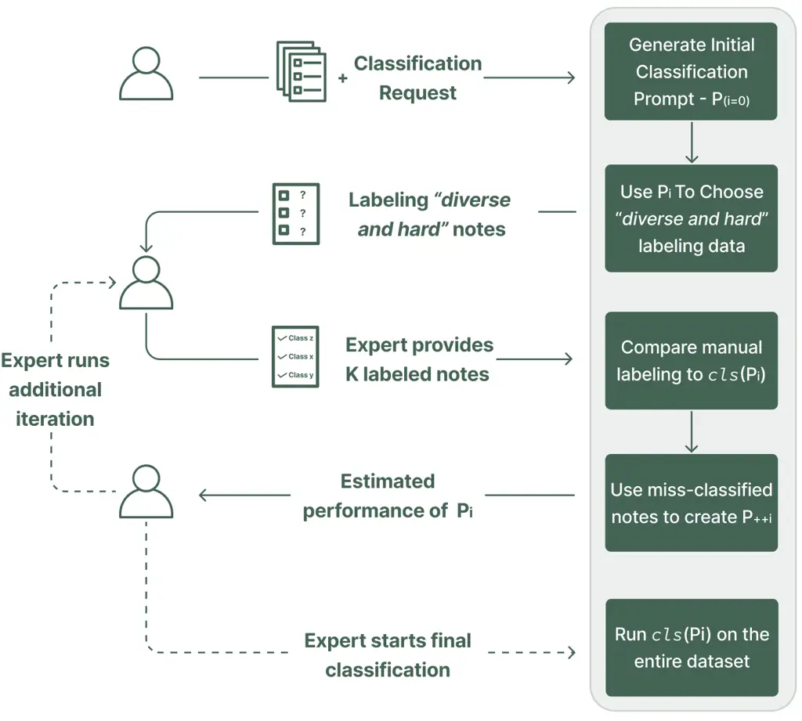
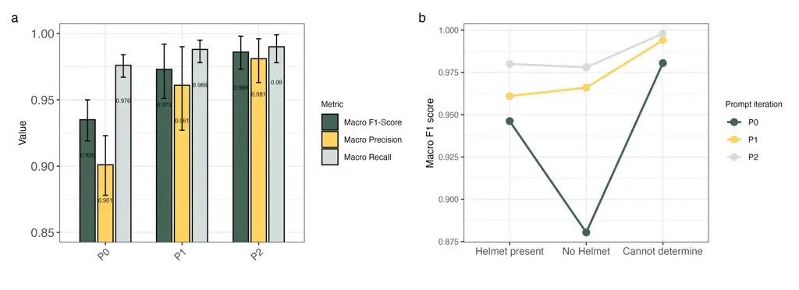
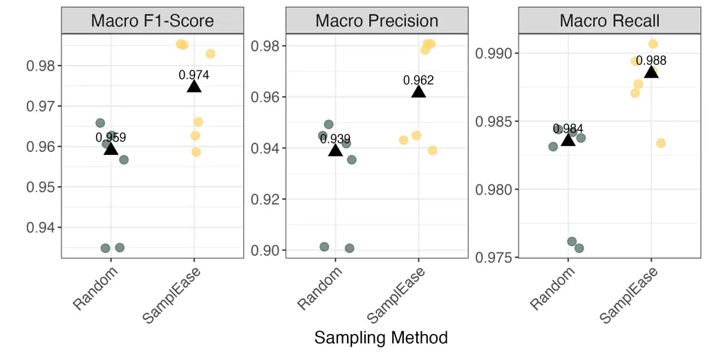

# Keeping Experts in the Loop: Expert-Guided Optimization for Clinical Data Classification using Large Language Models

Nader Karayanni    Aya Awwad    Chieh-Lien Hsiao    Surish P Shanmugam

###### Abstract

Since the emergence of Large Language Models (LLMs), the challenge of
effectively leveraging their potential in healthcare has taken center
stage. A critical barrier to using LLMs for extracting insights from
unstructured clinical notes lies in the prompt engineering process.
Despite its pivotal role in determining task performance, a clear
framework for prompt optimization remains absent. Current methods to
address this gap take either a manual prompt refinement approach, where
domain experts collaborate with prompt engineers to create an optimal
prompt, which is time-intensive and difficult to scale, or through
employing automatic prompt optimizing approaches, where the value of the
input of domain experts is not fully realized. To address this, we
propose StructEase, a novel framework that bridges the gap between
automation and the input of human expertise in prompt engineering. A
core innovation of the framework is SamplEase, an iterative sampling
algorithm that identifies high-value cases where expert feedback drives
significant performance improvements. This approach minimizes expert
intervention, to effectively enhance classification outcomes.

This targeted approach reduces labeling redundancy, mitigates human
error, and enhances classification outcomes. We evaluated the
performance of StructEase using a dataset of de-identified clinical
narratives from the US National Electronic Injury Surveillance System
(NEISS), demonstrating significant gains in classification performance
compared to current methods. Our findings underscore the value of expert
integration in LLM workflows, achieving notable improvements in F1 score
while maintaining minimal expert effort. By combining transparency,
flexibility, and scalability, StructEase sets the foundation for a
framework to integrate expert input into LLM workflows in healthcare and
beyond.

¹Columbia University ²Harvard Medical School

nader.karayanni@columbia.edu, Aya_awwad@hms.harvard.edu,

ch3689@columbia.edu, surishpshanmugam@hms.harvard.edu

## Introduction

With the advent of large language models (LLMs), the landscape of
healthcare delivery is evolving as these technologies find novel
applications across the field (Systems 2024; Landi 2024). Prompt
engineering has emerged as an important element to harness the full
potential of LLMs, where minor changes in the natural language inputs
can impact the output’s quality and relevance (Meskó 2023). Among the
various applications, the classification of unstructured clinical
narrative notes from electronic medical records (EMRs) is particularly
relevant for researchers, healthcare administrators, and policymakers
(Wang et al. 2018). Medical records are rich with clinical data that are
not always fully captured by structured fields like International
Classification of Diseases (ICD) codes, making the ability to navigate
and classify unstructured free text essential.

The challenge lies in extracting this information effectively. Previous
studies have shown that generating task-specific prompts typically
requires the combined efforts of prompt engineers, who have a deep
understanding of LLMs and best prompting practices, and domain experts,
who are well-versed in the task-specific intricacies (Zhang et al. 2024;
Huang et al. 2024; Guevara et al. 2024; Burford et al. 2024; Jethani
et al. 2023). This ensures creating an ideal prompt where elements such
as task description, domain-specific details, and benchmarks are
incorporated to drive the prompt quality and performance. However,
refining prompts often involves an iterative, manual exploration process
that is tedious, costly and requires technical expertise (Pryzant et al.
2023). Moreover, the absence of a systematic framework to guide this
process increases inefficiencies and limits the wider adoption of these
methods (Ding et al. 2021).

To address these challenges, new methods are being developed to improve
and automate prompt engineering. Beyond single-prompt techniques such as
zero-shot and few-shot learning, meta-prompting approaches are gaining
traction (Ruksha 2024; Cleary 2024). In essence, those approaches
generate, refine, and optimize LLM prompts for a given task. Techniques
such as evolutionary algorithm (e.g., Monte Carlo search, Gibbs
sampling) and textual gradient-based optimization are some of the
underlying methods to achieve this automation (Zhang et al. 2024;
Yuksekgonul et al. 2024). While effective, these approaches limit user
involvement in prompt optimization.

Of interest is the work introduced by PromptAgent (Wang et al. 2023),
which addresses the challenge of generating expert-level prompts.
PromptAgent employs Monte Carlo Tree Search (MCTS) to navigate the
prompt space strategically, mimicking human experts to achieve nuanced
and high-quality prompts. While PromptAgent effectively highlights the
limitations of prior methods and advances automated prompt engineering,
it relies on an exhaustive exploration of the expert prompt space. It
introduces practical constraints, where the process can take hours to
iterate through the search space—inherently lacking domain-specific
knowledge and feedback during runtime. Similarly, DSPy (Khattab et al.
2022; Khattab et al. 2024), provides a programmatic framework for
managing LLM interactions and refining prompts, abstracting the
challenges of prompt engineering from programmers, and automatically
generating the task-specific prompts with the best practices of prompt
engineering.

The strive to automate the prompt engineering process is understandable,
given the tedious nature of the task. However, the cost of excluding the
expert from the loop can be significant. Recent work in material science
highlights the critical role of human expertise in understanding
AI-generated results, emphasizing that while AI systems excel at
computation and automation, human expertise provides the vision and
contextual understanding necessary to make the results meaningful
(Toner-Rodgers 2024).

Building on this understanding, we introduce StructEase, an innovative
framework that bridges the gap between full automation and expert
involvement in prompt engineering. Designed to classify large sets of
unstructured clinical notes using LLMs, StructEase keeps domain experts
at the center of the workflow, ensuring iterative refinement of
classification prompts through expert-guided corrections. Unlike fully
automated approaches, StructEase strategically integrates expert
feedback into the prompt generation process, while addressing key
challenges such as class imbalances and redundant sampling. Our novel
approach ensures that expert feedback effectively distills domain
knowledge into the system while requiring minimal effort from the
expert. Our research shows that leveraging an expert in the loop
outperforms the fully automated approaches and provides a novel approach
to do so effectively.

## Methods

### Proposed Framework

We propose StructEase, a novel framework that integrates domain experts
into the AI workflow to enable the classification of large sets of
unstructured clinical notes using LLMs. The framework is designed to
efficiently distill domain expertise into classification prompts, which
are iteratively refined to improve the performance and relevance of LLM
outputs. An overview of the framework is illustrated in Figure 1.



Figure 1: The proposed framework of StructEase

#### Classification Prompt Generation

At the core of StructEase is a classification prompt’s generation and
iterative refinement. This prompt is generated and refined to fulfill
the clinical note classification request. The prompts are designed using
Chain-of-Thought (CoT) reasoning to enhance the effectiveness of
classification tasks. StructEase starts by creating an initial
classification prompt $`P_{0}`$ and continuously improves it after each
labeling iteration. The prompt is improved by refining the
classification instructions and incorporating Few-Shot (FS) examples
from expert-labeled data. We annotate the prompt generation methods as
follows:

```math
P_{0}=GenerateInitialPrompt(Classes,Request,Dataset)
```

```math
P_{i}=UpdatePrompt(P_{i-1},Few\_Shots)
```

Few*Shots are the notes that the prompt $`P*{i-1}`$ classified
incorrectly compared to the expert labels. The above methods use an LLM
call to generate the new prompt.

#### Choosing Data for Expert Review

A critical challenge in designing StructEase is selecting data samples
that maximize the value of expert-labeled data. This is particularly
difficult in scenarios with class imbalances, where it is essential to
ensure that the reviewed data samples adequately represent all classes.
Another challenge arises from the possibility of a large proportion of
relatively simple samples in the dataset, which may not contribute
meaningfully to improving the model’s classification performance.
Furthermore, it is crucial to avoid redundant expert reviews across
labeling iterations to ensure that each iteration yields unique and
valuable insights that enhance the classification capabilities of the
LLM. To address these challenges, we propose SamplEase, A novel
algorithm, detailed in Algorithm 1.

Input: Dataset $`D`$, Classification_Classes Classes,
Classification_Request Request  
Output: Labeled dataset labeled_data

1:  $`\textit{labeled\_data}\leftarrow\emptyset`$, $`i\leftarrow 0`$

2:
 $`P_{i}\leftarrow\textsc{GenerateInitialPrompt}(\textit{Classes},\textit{Request},\textit{D})`$

3:  while the expert opts to continue labeling do

4:
  $`S\leftarrow\textsc{RandomSample}(D\setminus\textit{labeled\_data},10\%)`$

5:   $`C\leftarrow\textsc{Classify}(S,P_{i})`$

6:   $`conf\leftarrow\textsc{ComputeConfidence}(C)`$

7:   for each class $`c\in\textit{Classes}`$ do

8:    $`S_{c}\leftarrow\textsc{SelectLowestConfidence}(C,conf,c,10)`$

9:   end for

10:
  $`\textit{samples\_to\_label}\leftarrow\bigcup_{c\in\textit{Classes}}S_{c}`$

11:   Query the expert to label samples_to_label

12:
  $`\textit{labeled\_data}\leftarrow\textit{labeled\_data}\cup\textit{samples\_to\_label}`$

13:
  $`\textit{few\_shots}\leftarrow\textsc{Mismatched}(P_{i},\textit{samples\_to\_label})`$

14:   $`i\leftarrow i+1`$

15:
  $`P_{i}\leftarrow\textsc{UpdatePrompt}(P_{i},\textit{few\_shots})`$

16:  end while

17:  Return classification of $`D`$ using $`P_{i}`$

Algorithm 1 SamplEase

ComputeConfidence calculates the confidence of the LLM for classifying
each clinical note separately as follows:

```math
\text{Confidence}=\exp\left(\frac{1}{n}\sum_{i=1}^{n}\log P_{i}\right) \tag{1}
```

Where:

- •
  $`n`$ is the number of tokens in the completion.
- •
  $`\log P_{i}`$ is the log probability of the $`i`$-th token.
- •
  $`\exp(x)`$ is the exponential function, $`e^{x}`$.

Through this iterative process, StructEase continuously incorporates
expert insights to improve the classification prompt. At any stage, the
expert can deploy the most recent prompt, applied across the entire
dataset to classify the clinical notes. By abstracting the technical
complexities, StructEase is designed to enhance classification accuracy
and to ensure advanced AI capabilities are accessible to domain
specialists with minimal technical training.

#### Framework Implementation

We developed StructEase in Python and it is available as an open-source
project on GitHub¹¹ 1 https://github.com/karayanni/StructurEase/. The
implementation includes a web-based application that provides a
user-friendly interface, enabling users to upload datasets, define
classification requests, and engage in the iterative labeling process.
To meet real-world needs, the implementation incorporates two key steps.
First, the classification process using $`P_{i}`$ is parallelized across
clinical notes to minimize latency during labeling iterations. This
parallelization significantly reduces the time required for both
iterative refinements and the final dataset classification. Furthermore,
the end-to-end framework is containerized using Docker (Merkel 2014), to
encourage adoption and future research and collaboration.

### Data and Task Definition

The data for this study was sourced from the 2023 US Consumer Product
Safety Commission’s National Electronic Injury Surveillance System
(NEISS). This system operates on a nationally representative, stratified
probability sample from 96 hospitals across the US and its territories,
each equipped with at least six beds and an emergency department (ER).
NEISS provides publicly accessible, de-identified data that do not
require institutional review board approval or informed consent for use,
in compliance with the HIPAA Privacy Rule. We filtered for
micromobility-related visits based on NEISS product codes. The final
dataset included 17,888 different clinical narratives (U.S. Consumer
Product Safety Commission 2024; Burford et al. 2024).

In Our study, we use the ”gpt-4o-mini-2024-07-18” model accessible via
the OpenAI API (OpenAI 2024). To ensure reproducibility and consistency,
we configured the language model with a temperature setting of 0 and a
top-p value of 1. This setup ensures that the model consistently selects
the most probable token during text generation. As a use case, the
specific task was to extract helmet usage status from unstructured
clinical narratives of ER visits. The goal was to classify each note
into one of three classes: helmet, no helmet, and cannot determine
helmet status. To evaluate our framework, 2,000 clinical narratives were
randomly selected and independently reviewed by two expert physicians.
Any disagreements between the reviewers were resolved through discussion
until a 100% inter-rater agreement was reached. It is important to note
that the manually labeled dataset created for this study is proprietary
and has not been published online, addressing any potential concerns
regarding data leakage to the LLM before this study.

### Evaluation Experiments

We conducted a series of experiments to evaluate our framework under
various conditions:



Figure 2: Aggregated performance metrics across iterative prompt
refinements ($`P_{0}`$, $`P_{1}`$, $`P_{2}`$). (a) Overall macro-level
metrics (Macro F1-Score, Macro Precision, and Macro Recall), showing
consistent improvements with each iteration of the prompt. Error bars
indicate 95% confidence intervals. (b) Per-class performance analysis of
Macro F1-Score for the ”Helmet present,” ”No Helmet,” and ”Not
mentioned” categories. Iterative refinements yielded performance
improvements, particularly for the ”No Helmet” class, which had the
lowest initial performance at $`P_{0}`$.

1.  1.  Iterative Prompt Refinement: We evaluated the performance of
        StructEase by running the framework six times independently,
        generating the prompts $`P_{0}`$, $`P_{1}`$, and $`P_{2}`$ in each
        run. Starting with the baseline prompt $`P_{0}`$, the framework
        iteratively refined the prompts through expert feedback to produce
        $`P_{1}`$ and $`P_{2}`$. The experiment aimed to assess how
        iterative prompt refinement improves classification performance
        across runs.
2.  2.  Comparing SamplEase vs. Random Sampling: To evaluate the sampling
        approach used in StructEase, we compared SamplEase with a baseline
        random sampling method. Six independent runs were conducted for each
        sampling strategy using a single prompt iteration ($`P_{1}`$). This
        experiment aimed to explicitly assess the novel proposed sampling
        algorithm in improving the performance of the framework compared to
        random sampling.
3.  3.  Comparison with Baselines: We compared the performance of StructEase
        against four baseline methods designed for similar classification
        tasks: (1) Human prompt: human-provided instructions for direct
        classification task. (2) DSPy Chain of Thought (CoT) classifier: A
        DSPy classifier that incorporates step-by-step reasoning to improve
        interpretability and accuracy. (3) DSPy optimized: A version of the
        DSPy CoT classifier that requires labeled data. (Khattab et al.
        2022; Khattab et al. 2024). This method utilizes the provided
        labeled data to create a CoT classification prompt and then
        fine-tunes the LLM to minimize the loss for the classification task.
        Although this approach involves fine-tuning—unlike the other
        methods—we included it to assess how effective our approach can be
        when focusing solely on prompt optimization. We ran this version
        with 30 randomly labeled samples to benchmark its performance.
4.  4.  Bias evaluation: To examine potential biases in model performance,
        we evaluated the framework across key demographic groups.
        Specifically, we compared the model’s performance across genders
        (males vs. females) and across self-reported racial categories:
        White, Black/African American, Asian, Other, or Not Specified.

Unless otherwise mentioned, all our experiments are conducted with the
SamplEase default parameter, specified in Algorithm 1.

### Performance Metrics and Statistical Analysis

#### Overall and Per-Class Evaluation

The framework was evaluated using 2,000 expert-labeled notes (ground
truth), excluding the training data used to refine the prompt.
Performance was assessed using macro-level classification metrics
(macro-precision, macro-recall, and macro-F1 score) and per-class
metrics (precision, recall, and F1 score). These metrics were defined as
follows:

- •
  Precision = TP / (TP + FP)
- •
  Recall = TP / (TP + FN)
- •
  F1 = (2 $`\cdot`$ Precision $`\cdot`$ Recall) / (Precision + Recall)  
  (Abbreviations: TP = true positives, FP = false positives, FN = false
  negatives)

The framework was evaluated across six independent runs to account for
variability in the model outputs. Macro-level metrics were computed by
averaging the class-specific metrics, while per-class metrics were
calculated separately for each class.

To quantify uncertainty, 95% confidence intervals (CI) were derived
using bootstrap resampling (n=1000). For macro-level metrics, resampling
was performed within each run, and the resulting bootstrap distributions
were aggregated across the six runs to compute final CIs.

For per-class metrics, stratified bootstrap resampling was applied to
preserve class proportions within each resampled dataset. Metrics for
each class were recalculated for every bootstrap iteration, and results
were aggregated across runs. Final point estimates and 95% confidence
intervals were reported for both overall and per-class metrics.

#### Statistical Analysis

To compare Macro F1-Score between prompt iterations (P₀ vs. P₂), we
calculated the mean difference and its 95% confidence interval using the
bootstrap distributions. Statistical significance was determined by
whether the confidence interval excluded zero. A permutation test
further validated the difference by generating a null distribution of
shuffled samples. For the sampling experiments, the medians of the
performance metrics across the runs were calculated. Differences in
these medians between the sampling methods were compared using the
Mann–Whitney U test, a non-parametric test for comparing medians between
two independent groups. A two-sided significance threshold of
$`P\leq 0.05`$ was used. All statistical analyses and visualization were
conducted using R software (version 4.4.1).

## Results

### Iterative Prompt Refinement

Figure 2 presents the aggregated results of the iterative prompt
refinement process. The iterative refinement of prompts
($`P_{0}\to P_{1}\to P_{2}`$) resulted in consistent improvements in
overall (Figure 2a) and per-class performance metrics (Figure 2b). F1
score increased from 0.935 (95% CI: 0.919–0.951) with the baseline
prompt ($`P_{0}`$) to 0.973 (95% CI: 0.951–0.992) after the first
refinement ($`P_{1}`$) and reached 0.986 (95% CI: 0.972–0.997) after the
second refinement ($`P_{2}`$). The increase in F1 score and precision
between ($`P_{0}\to P_{2}`$) was statistically significant with
$`P<0.001`$. Similar trends were observed for precision (0.901 (95% CI:
0.879-0.923) at $`P_{0}`$ to 0.981 (95% CI:0.963-0.996) at $`P_{2}`$)
and recall (0.976 (95% CI: 0.967-0.984) at $`P_{0}`$ to 0.990 (95% CI:
0.979-0.999) at $`P_{2}`$).

Per-class analysis of F1 scores (Figure 2b) shows significant
improvements across all categories, particularly for the ”No Helmet”
class, where initial performance ($`P_{0}`$) was the lowest at 0.88 (95%
CI: 0.85, 0.91), but increased markedly to 0.98 (95% CI: 0.95-1) at
$`P_{2}`$), this $`\Delta 10\%`$ improvement was statistically
significant $`(P<0.001`$).

### Comparing SamplEase vs. Random Sampling

Figure 3 presents the performance comparison between smart and random
sampling strategies across six independent runs. Smart sampling
demonstrated consistent improvements in performance metrics compared to
random sampling. For the F1 score, smart sampling achieved a higher
median value (0.974) compared to random sampling (0.959), with a
statistically significant difference ($`P=0.044`$). Similarly, recall
showed a significant improvement, with smart sampling yielding a median
value of 0.988 compared to 0.984 for random sampling ($`P=0.023`$). The
improvement in precision (0.962 for smart sampling vs. 0.939 for random
sampling) did not reach statistical significance ($`P=0.077`$).



Figure 3: Comparison of performance metrics between smart sampling and
random sampling strategies. Each point represents a performance metric
(Macro F1-Score, Macro Precision, Macro Recall) from six independent
runs for each sampling method. Triangles indicate the median performance
for each metric within the sampling method.

### Comparison with Baselines

|                     | Macro F1-Score | Macro Precision | Macro Recall | Accuracy |
| ------------------- | -------------- | --------------- | ------------ | -------- |
| Human prompt        | 0.735          | 0.753           | 0.865        | 0.730    |
| DSPy CoT classifier | 0.962          | 0.953           | 0.972        | 0.981    |
| DSPy Optimized      | 0.980          | 0.982           | 0.978        | 0.991    |
| P₁                  | 0.973          | 0.961           | 0.988        | 0.988    |
| P₂                  | 0.986          | 0.981           | 0.990        | 0.995    |

Table 1: Performance comparison of different approaches across Macro
F1-Score, Macro Precision, Macro Recall, and Accuracy. Bold values
indicate the highest performance in each metric. Abbreviations: CoT,
chain of thought; P₁, first prompt iteration of StructEase; P₂, second
prompt iteration of StructEase.

The results in Table 1 demonstrate that StructEase mostly outperformed
other baseline methods across the evaluated metrics. The second prompt
iteration P₂ achieved the highest performance, with a F1-Score of 0.986,
precision of 0.981, recall of 0.990, and accuracy of 0.995.

Among the baselines, DSPy Optimized showed strong performance, with
F1-Score of 0.980 and an accuracy of 0.991. However, StructEase
surpassed these results, particularly in recall and F1-Score,
highlighting the advantage of iterative prompt refinement. By contrast,
the human prompt achieved the lowest overall performance, with a
F1-Score of 0.735 and accuracy of 0.730.

### Bias Evaluation

The bias evaluation experiment demonstrated that the framework performed
consistently across different demographic groups, with minimal expected
variation in classification metrics between genders and among
self-reported racial categories. When comparing performance across
genders (male vs. female), the results indicated no substantial
disparities in macro-level metrics or per-class evaluations. Similarly,
when examining performance across racial categories (White,
Black/African American, Asian, Other, Not Specified), the framework
maintained equitable classification outcomes across all groups.

## Conclusion and Future Work

Effective prompt engineering for leveraging LLMs in healthcare-related
tasks is pivotal, yet current research falls short in bridging
automation with domain expertise. This gap arises from the absence of
established frameworks and the challenge of integrating human expertise
strategically rather than mimicking it entirely.

To address this gap, we present StructEase, a novel framework that
empowers domain experts to perform a classification of clinical notes
without needing prior expertise in LLMs. By leveraging an iterative
process of minimal yet impactful expert input, StructEase demonstrates
how strategic integration of domain expertise can significantly enhance
system performance.

StructEase achieves substantial improvements in using LLMs for both
overall and per-class classification performance. A critical challenge
our framework addresses is identifying data samples where expert input
yields the greatest performance gains. To this end, we introduce
SamplEase, a novel algorithm for iterative sampling that consistently
outperforms random sampling. Our results demonstrate significant gains
in F1 score and recall respectively, underscoring SamplEase’s efficiency
in leveraging expert input.

By focusing the expert attention to a select sample of the data,
StructEase reduces labeling errors stemming from fatigue or ambiguity in
simpler, repetitive tasks. Even with well-defined rules and training,
labeling variability is common. Our framework mitigates these challenges
by selecting high-value data for expert review, ensuring consistent
improvement with each iteration (Wong, Paritosh, and Bollacker 2022).

In our work, we optimized the classification performance solely by
refining the prompt $`P_{i}`$. Other methods to further improve
classification quality exist, such as dynamically fine-tuning the LLM—as
demonstrated by the DSPy Optimized method in our baseline comparisons.
Exploring such additional techniques to enhance StructEase remains an
exciting avenue for future research. Our evaluation shows that
integrating expert input through SamplEase outperforms the more
sophisticated LLM optimization methods that utilizes random labeled
samples for their refinement, highlighting the value of our approach in
SamplEase. The performance advantage is expected to improve even further
with the integration of additional refinement techniques.

A key challenge in designing StructEase is minimizing expert effort
while ensuring continuous improvement. To achieve this, SamplEase limits
the labeling workload per iteration to a manageable
$`10\times|Classes|`$. The framework also offers users flexibility by
allowing them to determine the number of iterations required to refine
$`P_{i}`$, accommodating diverse accuracy requirements. Transparency is
another core strength of our framework. At every stage, users see how
their input shapes the prompts, fostering trust and bridging the gap
between domain expertise and LLM workflows. Over time, this transparency
could empower users to better understand LLMs and critically evaluate
their outputs. This represents an interesting direction for future
research, particularly in evaluating how such collaborative frameworks
can empower domain experts to critically assess LLM outputs, with
significant implications for the design of human-AI
collaborations (Jabbour et al. 2023).

Even though the classification task we presented did not explicitly
explore non written information, we examined the performance across
gender and different racial groups. There was no evidence of disparities
in the overall or per-class performance within those groups. This
consistency likely reflects the nature of the classification task.
However, as LLMs are applied to different tasks, examining the fairness
of the model is warranted (Duan 2024).

StructEase was initially designed and evaluated for the specific task of
dynamically classifying unstructured clinical notes. However, its
methodology—integrating expert feedback iteratively—can be generalized
across a variety of tasks and LLM workflows. By maintaining a consistent
focus on efficiently incorporating expert input, StructEase can be
adapted to other downstream tasks requiring similar expert-in-the-loop
interactions, further broadening its applicability.

When deployed in real-world scenarios involving identifiable clinical
data, privacy, and regulatory compliance become critical considerations.
To ensure HIPAA compliance, it is essential to utilize LLMs that meet
stringent security and privacy standards. Additionally, the framework
must be designed to restrict data access and iterative processes
exclusively to authorized users, safeguarding sensitive information
throughout the workflow. Addressing these challenges, including adapting
StructEase to operate within secure, locally hosted, or private LLM
environments, will be a key focus of future research and development.

## References

- Burford et al. (2024) Burford, K. G.; Itzkowitz, N. G.; Ortega, A. G.;
  Teitler, J. O.; and Rundle, A. G. 2024. Use of generative AI to
  identify helmet status among patients with micromobility-related
  injuries from unstructured clinical notes. _JAMA Network Open_, 7(8):
  e2425981–e2425981.
- Cleary (2024) Cleary, D. 2024. A Complete Guide to Meta-Prompting.
  Accessed: 2024-11-28.
- Ding et al. (2021) Ding, N.; Hu, S.; Zhao, W.; Chen, Y.; Liu, Z.;
  Zheng, H.-T.; and Sun, M. 2021. Openprompt: An open-source framework
  for prompt-learning. _arXiv preprint arXiv:2111.01998_.
- Duan (2024) Duan, Y. 2024. The Large Language Model (LLM) Bias
  Evaluation (Age Bias). _DIKWP Research Group International Standard
  Evaluation. DOI_, 10.
- Guevara et al. (2024) Guevara, M.; Chen, S.; Thomas, S.; Chaunzwa,
  T. L.; Franco, I.; Kann, B. H.; Moningi, S.; Qian, J. M.; Goldstein,
  M.; Harper, S.; et al. 2024. Large language models to identify social
  determinants of health in electronic health records. _NPJ digital
  medicine_, 7(1): 6.
- Huang et al. (2024) Huang, J.; Yang, D. M.; Rong, R.; Nezafati, K.;
  Treager, C.; Chi, Z.; Wang, S.; Cheng, X.; Guo, Y.; Klesse, L. J.;
  et al. 2024. A critical assessment of using ChatGPT for extracting
  structured data from clinical notes. _npj Digital Medicine_,
  7(1): 106.
- Jabbour et al. (2023) Jabbour, S.; Fouhey, D.; Shepard, S.; Valley,
  T. S.; Kazerooni, E. A.; Banovic, N.; Wiens, J.; and Sjoding,
  M. W. 2023. Measuring the impact of AI in the diagnosis of
  hospitalized patients: a randomized clinical vignette survey study.
  _Jama_, 330(23): 2275–2284.
- Jethani et al. (2023) Jethani, N.; Jones, S.; Genes, N.; Major, V. J.;
  Jaffe, I. S.; Cardillo, A. B.; Heilenbach, N.; Ali, N. F.; Bonanni,
  L. J.; Clayburn, A. J.; et al. 2023. Evaluating ChatGPT in information
  extraction: a case study of extracting cognitive exam dates and
  scores.
- Khattab et al. (2022) Khattab, O.; Santhanam, K.; Li, X. L.; Hall, D.;
  Liang, P.; Potts, C.; and Zaharia, M. 2022.
  Demonstrate-Search-Predict: Composing Retrieval and Language Models
  for Knowledge-Intensive NLP. _arXiv preprint arXiv:2212.14024_.
- Khattab et al. (2024) Khattab, O.; Singhvi, A.; Maheshwari, P.; Zhang,
  Z.; Santhanam, K.; Vardhamanan, S.; Haq, S.; Sharma, A.; Joshi, T. T.;
  Moazam, H.; Miller, H.; Zaharia, M.; and Potts, C. 2024. DSPy:
  Compiling Declarative Language Model Calls into Self-Improving
  Pipelines.
- Landi (2024) Landi, H. 2024. Microsoft’s Nuance integrates OpenAI’s
  GPT-4 into voice-enabled medical scribe software. Accessed:
  2024-11-29.
- Merkel (2014) Merkel, D. 2014. Docker: lightweight linux containers
  for consistent development and deployment. _Linux journal_,
  2014(239): 2.
- Meskó (2023) Meskó, B. 2023. Prompt engineering as an important
  emerging skill for medical professionals: tutorial. _Journal of
  medical Internet research_, 25: e50638.
- OpenAI (2024) OpenAI. 2024. GPT-4o-Mini Documentation.
  https://platform.openai.com/docs/models. Accessed: 2024-11-28.
- Pryzant et al. (2023) Pryzant, R.; Iter, D.; Li, J.; Lee, Y. T.; Zhu,
  C.; and Zeng, M. 2023. Automatic prompt optimization with” gradient
  descent” and beam search. _arXiv preprint arXiv:2305.03495_.
- Ruksha (2024) Ruksha, K. 2024. Prompt Engineering: Classification of
  Techniques and Prompt Tuning.
  https://medium.com/the-modern-scientist/prompt-engineering-classification-of-techniques-and-prompt-tuning-6d4247b9b64c.
- Systems (2024) Systems, E. 2024. Epic and Microsoft Bring GPT-4 to
  EHRs. Accessed: 2024-11-29.
- Toner-Rodgers (2024) Toner-Rodgers, A. 2024. Artificial Intelligence,
  Scientific Discovery, and Product Innovation.
- U.S. Consumer Product Safety Commission (2024) U.S. Consumer Product
  Safety Commission. 2024. NEISS Injury Data. Accessed: November
  29, 2024.
- Wang et al. (2023) Wang, X.; Li, C.; Wang, Z.; Bai, F.; Luo, H.;
  Zhang, J.; Jojic, N.; Xing, E. P.; and Hu, Z. 2023. PromptAgent:
  Strategic Planning with Language Models Enables Expert-level Prompt
  Optimization. _arXiv preprint arXiv:2310.16427_.
- Wang et al. (2018) Wang, Y.; Wang, L.; Rastegar-Mojarad, M.; Moon, S.;
  Shen, F.; Afzal, N.; Liu, S.; Zeng, Y.; Mehrabi, S.; Sohn, S.;
  et al. 2018. Clinical information extraction applications: a
  literature review. _Journal of biomedical informatics_, 77: 34–49.
- Wong, Paritosh, and Bollacker (2022) Wong, K.; Paritosh, P.; and
  Bollacker, K. 2022. Are ground truth labels reproducible? An empirical
  study. In _Proceedings of ML Evaluation Standards Workshop at ICLR_,
  25–29.
- Yuksekgonul et al. (2024) Yuksekgonul, M.; Bianchi, F.; Boen, J.; Liu,
  S.; Huang, Z.; Guestrin, C.; and Zou, J. 2024. TextGrad: Automatic”
  Differentiation” via Text. _arXiv preprint arXiv:2406.07496_.
- Zhang et al. (2024) Zhang, H.; Jethani, N.; Jones, S.; Genes, N.;
  Major, V. J.; Jaffe, I. S.; Cardillo, A. B.; Heilenbach, N.; Ali,
  N. F.; Bonanni, L. J.; et al. 2024. Evaluating large language models
  in extracting cognitive exam dates and scores. _medRxiv_, 2023–07.
