# Dynamic Prompt Middleware: Contextual Prompt Refinement Controls for Comprehension Tasks

DOI: [XXXXXXX.XXXXXXX](https://doi.org/XXXXXXX.XXXXXXX)Conference: Make
sure to enter the correct conference title from your rights confirmation
emai; June 03–05, 2018; Woodstock,
NYISBN: 978-1-4503-XXXX-X/18/06CCS: Human-centered computing Interactive
systems and toolsCCS: Human-centered computing User studies

Ian Drosos email: <t-iandrosos@microsoft.com> Affiliation: Microsoft
Research, Cambridge, UK , Jack Williams email:
<jack.williams@microsoft.com> Affiliation: Microsoft Research,
Cambridge, UK , Advait Sarkar email: <advait@microsoft.com>
Affiliation: Microsoft Research, Cambridge, UK and Nicholas Wilson
email: <nicholas.wilson@microsoft.com> Affiliation: Microsoft Research,
Cambridge, UK

Received  10 October 2024

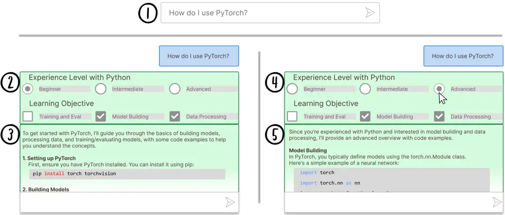

Figure 1. Schematic overview of Dynamic Prompt Refinement Control
interface for generating inline prompt refinement options to increase
user control of AI-generated explanations (derived from real system
use). (1) User prompts the system. (2) The Option Module takes the
user’s prompt as context to generate prompt options which provide prompt
refinements for the user to select. (3) The Chat Module uses the user’s
prompt and pre-selected options to generate an initial response. (4) The
user can initiate refinements by selecting their preferred options in
the UI. (5) On each change, the Chat Module regenerates the response
based on the new selections.

###### Abstract.

Effective prompting of generative AI is challenging for many users,
particularly in expressing context for comprehension tasks such as
explaining spreadsheet formulas, Python code, and text passages. Prompt
middleware aims to address this barrier by assisting in prompt
construction, but barriers remain for users in expressing adequate
control so that they can receive AI-responses that match their
preferences.

We conduct a formative survey ($`n=38`$) investigating user needs for
control over AI-generated explanations in comprehension tasks, which
uncovers a trade-off between standardized but predictable support for
prompting, and adaptive but unpredictable support tailored to the user
and task. To explore this trade-off, we implement two prompt middleware
approaches: Dynamic Prompt Refinement Control (Dynamic PRC) and Static
Prompt Refinement Control (Static PRC). The Dynamic PRC approach
generates context-specific UI elements that provide prompt refinements
based on the user’s prompt and user needs from the AI, while the Static
PRC approach offers a preset list of generally applicable refinements.

We evaluate these two approaches with a controlled user study ($`n=16`$)
to assess the impact of these approaches on user control of AI responses
for crafting better explanations. Results show a preference for the
Dynamic PRC approach as it afforded more control, lowered barriers to
providing context, and encouraged exploration and reflection of the
tasks, but that reasoning about the effects of different generated
controls on the final output remains challenging. Drawing on participant
feedback, we discuss design implications for future Dynamic PRC systems
that enhance user control of AI responses. Our findings suggest that
dynamic prompt middleware can improve the user experience of generative
AI workflows by affording greater control and guide users to a better AI
response.

###### Keywords: 

Dynamic UX Generation, Prompt Middleware

## 1. Introduction

As Generative AI (GenAI) tools achieve widespread penetration in
knowledge workflows, an increasingly common observation made by user
studies is that _prompting_, i.e., the skillful and effective use of
natural language for steering and eliciting GenAI behavior, is
challenging for many users in many contexts (Zamfirescu-Pereira et al.,
2023; Tankelevitch et al., 2024; Drosos et al., 2024; Liu et al., 2023).
The challenges range from the increased explicit metacognitive demands
of prompting, to the burden of explaining detailed requirements and
context in textual format, to the opaque and unpredictable mapping of
naturalistic language queries to system behavior.

In response, researchers have noted the limitations of the chat paradigm
as an interface for GenAI tools, suggesting that we go “beyond chat” (Ma
et al., 2024), and numerous scaffolded writing tools that integrate
direct manipulation with text have been developed (Buschek, 2024). In
particular, the use of graphical user interface elements known as
“prompt middleware” (MacNeil et al., 2023) can help users rapidly
construct and compose more elaborate prompts. We survey the prior work
in this space in Section 2. However, a challenge with scaling the prompt
middleware approach is that to develop effective middleware requires an
understanding of the user, their task, and effective prompting
approaches. For effective prompt middleware, developers need to
carefully characterize tasks, users, and prompting strategies.

Our approach. In this paper, we propose instead to _generate_ prompt
middleware customized to the user and task. Our approach (Figure 1) is
to instantiate a language model agent (the “Option Module”) whose
responsibility is to analyze the user’s prompt and generate a set of
options for refining that prompt. These options are rendered using
graphical elements such as radio buttons, checkboxes, and free text
boxes, which the user can select and edit to cause deterministic
additions, removals, and modifications of their original prompt, which
is passed as context to a conventional language model agent (the “Chat
Module”) which fulfills the request. Our implementation is detailed in
Section 4.

To our knowledge, such _dynamic prompt middleware_ has not been well
studied in general applications of GenAI, although there is precedent
work in the specific domain of code generation (Cheng et al., 2024), and
there is a long history of dynamic interface generation, particularly in
data visualization (Section 2). As a novel test bed for dynamically
generated controls, we select comprehension and learning tasks. In
particular, our study tasks (Section 5.2) focus on the use cases of
using GenAI to explain spreadsheet formulas, python code, short text
passages, and as a teaching aid for data analysis and visualization
concepts. These are, broadly speaking, sensemaking tasks (Pirolli and
Card, 2005). According to a recent taxonomy of GenAI use developed by
Brachman et al. (2024), they fall under the category of “advice” tasks,
distinguished from “creation” tasks (using GenAI to produce an artifact
for direct or indirect use in a workflow), “information” tasks (using
GenAI to retrieve facts from a database or the web), and “automation”
tasks (using GenAI to control software and automate other computer
actions).

We are interested in comprehension and learning tasks for three reasons.
First, they are a common and important use case, which increases the
ecological validity of our work. Second, because there is a great
diversity among tasks and users that results in a need for
personalization and fine-grained control (“out of the box” GenAI
responses to a user’s initial prompt often do not satisfy the user’s
comprehension requirement, as we find through our formative study and
which has also been reported in previous work (e.g., (Drosos et al.,
2024))). And finally, because their primary objective is to further the
quality of human thought and understanding. As recent work has noted,
the introduction of GenAI into knowledge workflows can cause the
deterioration of human thinking, and researchers have called for the
critical design development of GenAI tools to reverse this trend and
even enable new “Tools for Thought” (Sarkar, 2024a; Sarkar et al., 2024;
Sarkar, 2024b; Research, 2024).

We make the following contributions:

- •
  We report a formative survey ($`n=38`$) including an interactive
  design probe to understand user needs around customized explanations
  of GenAI output (Section 3). We find that users desire greater direct
  control over AI responses than afforded by traditional chat
  interfaces, and that controls should adapt to the task and user.
- •
  We develop two variations of an interface with graphical controls for
  steering AI responses, one with static controls, and one with dynamic
  controls that are generated based on the user’s initial prompt
  (Section 4). We report a controlled, within-subjects comparison of the
  two interfaces ($`n=16`$, Section 5), finding that users preferred
  dynamic controls because they lower barriers to providing context,
  offer guidance for better prompts, facilitate greater exploration and
  reflection, but are viewed as more complex and more difficult to
  reason about in terms of their effects (Section 6).
- •
  We derive design implications for dynamic controls, such as greater
  control of how the AI interprets and applies options, leveraging of
  user context and data to generate helpful controls, expanding dynamic
  prompt middleware to richer modalities, and discuss our findings in
  connection with related work (Section 7).

## 2. Related Work

##### Challenges to effective prompting and steering GenAI

Previous work has identified several challenges for end users in writing
instructional prompts for GenAI (Zamfirescu-Pereira et al., 2023), such
as finding appropriate levels of vocabulary and grammar that correspond
to the level of abstraction of the system output (known as the “fuzzy
abstraction matching” problem) (Liu et al., 2023), the burden of
elaborating the task context needed for the GenAI system to produce
relevant and useful responses (Drosos et al., 2024), or of having
sufficient metacognitive awareness to understand how to apply one’s
knowledge of the domain and prompting to steer and verify GenAI output
(Tankelevitch et al., 2024).

A related issue that commonly manifests as a prompting challenge is the
difficulty in decomposition of tasks and fine-grained steering and
control of each sub-task. Research has explored various approaches to
solving this problem, such as rendering each individual sub-task as
interactive elements prior to generation (Ma et al., 2024; Kazemitabaar
et al., 2024) and rendering the generated output as a series of editable
steps (Liu et al., 2023; Ferdowsi et al., 2023).

##### “Beyond chat” interfaces for GenAI and automatically generated interfaces

Another issue is the cumbersome and inconsistent nature of text entry as
an interaction mechanism. To remedy this, researchers have proposed
various strategies for going beyond chat as the sole interaction
metaphor, and blending text with graphical user interface elements. The
automatic generation of custom user interfaces has long been studied
(Gajos and Weld, 2004; Gajos et al., 2007; Nichols et al., 2003; Nichols
et al., 2006a; Nichols et al., 2006b; Vaithilingam and Guo, 2019; Chen
and Wu, 2022; Zhang et al., 2018), but GenAI poses new problems and new
opportunities (Jovanovic, 2024; Moran and Gibbons, 2024b). For instance,
researchers have proposed generating relevant customization widgets for
data visualizations on an ad-hoc basis (Vaithilingam et al., 2024;
Dibia, 2023; Chen et al., 2022). Another approach is to generate user
interface elements that help the user refine specific aspects of the
generated artifact (e.g., code) (Cheng et al., 2024). The latter is an
example of a general category of techniques that use graphical interface
elements for manipulating prompts, sometimes referred to as “prompt
middleware” (MacNeil et al., 2023), to ease the cognitive burdens of
text entry and manipulation.

Researchers have also proposed ideation tools that help users develop
queries based on their own document corpus (Dhole et al., 2023), to
scaffold the metacognitive process of reasoning about one’s own goals.
Researchers have also developed ways to help users manage the large
volume of information generated by language models, such as by rendering
them in a hierarchy of abstraction levels (Suh et al., 2023). More
generally, there has been much experimentation with the integration of
graphical user interface elements with large language models,
particularly in reading and writing tools, which are surveyed by Buschek
(2024), who describes it as “collage”.

##### A note on the term “explanation”

In the context of AI, the term explanation is overloaded and most
commonly refers to a line of research known as explainable AI (XAI)
(Gunning et al., 2019; Xu et al., 2019; Dwivedi et al., 2023; Hoffman
et al., 2018; Goebel et al., 2018; Holzinger et al., 2022), which
typically focuses on explaining aspects of the model, its training data,
its inference process, etc. The typical use of explanations is as a
decision support mechanism, to help the user evaluate and trust (or not
trust) the AI output and decide what next interaction to perform with
the AI system. However, we do not use the term in this sense; by
explanation we instead mean aids for comprehension more generally. In
our study tasks, we use AI to help “explain” code or text – these
explanations are not about the mechanism of the AI system. As much
previous work has noted, the explainability concerns of end-users are
much broader than just the AI system itself (Miller, 2019; Ehsan and
Riedl, 2024; Ehsan et al., 2021b; Ehsan et al., 2021c; Ehsan et al.,
2022; Ehsan et al., 2019; Ehsan and Riedl, 2020; Ehsan et al., 2021a;
Ehsan et al., 2023; Ehsan et al., 2024; Sarkar, 2024c; Sarkar, 2022), it
is this broader sense in which we use the term. Recent work on code
explanations has found user needs around these kinds of explanations,
which resulted in the design implications that explanations be adaptable
and controllable (Yan et al., 2024), which we also find in our formative
survey and use as driving design goals for the systems presented in the
paper.

##### In summary,

previous work has identified serious challenges faced by users in
reasoning about one’s own goals while prompting, and then rapidly
customizing prompts to effectively steer the output of Generative AI.
While previous work has explored ways of scaffolding users to improve
their metacognitive and prompting capabilities, and developed “prompt
middleware” to lessen the burden of text entry and manipulation, close
attention has not yet been paid to generating middleware dynamically,
adapted to the user’s specific task at hand, in the context of
comprehension and learning tasks. As previously argued, these are a
common and diverse set of GenAI tasks for which contextualized prompt
middleware may prove useful; it is this idea that we develop and
evaluate in this paper.

## 3. Formative Survey and Design Probe

We conducted a formative survey of employees with access to GenAI tools,
at a large software company. Our survey focused on how explanations
generated for data-driven tasks within spreadsheets might be improved by
showing two scenarios to participants and asking several questions
around the effectiveness of the explanations that GenAI gave, strategies
on verifying and correcting GenAI output, and questions around the
importance of learning the concepts the AI used to complete a task.

The survey also contained a design probe of a preliminary design to
gather design goals for systems that provide greater control of AI
responses. We collected participant ratings of the importance of having
such control in GenAI interactions, the characteristics of AI responses
that participants needed control over, and feedback on how to improve
the design to better control AI explanations, which we describe below.
For brevity we focus only on results that directly informed the design
of our two approaches (Dynamic Prompt Refinement Control and Static
Prompt Refinement Control) developed for the study.

### 3.1. Survey setup

We sent a survey to employees of a large software company looking for
participants that had previous experience using GenAI tools like
Copilot (Microsoft, 2024). 38 participants (F1-F38) responded to the
survey. We collected participant demographic information using a
previously developed questionnaire assessing GenAI experience (Drosos
et al., 2024). The majority of participants stated they “Regularly use
one or more” GenAI tools (25 or 65%), with 11 saying they “Occasionally
use” (29%), 1 “Casually tried” (3%), and 1 “had not tried” (3%) GenAI
tools. To improve the validity of responses, participants were asked to
pretend they were part of a detailed scenario to understand the
AI-generated explanations so that they could explain them to others.

### 3.2. Design Probe

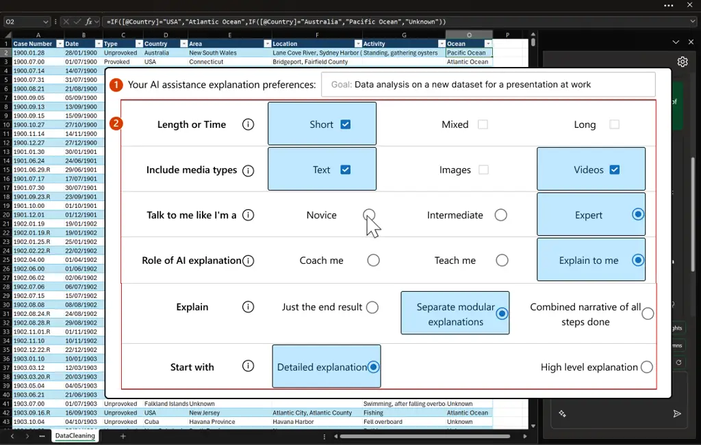

Figure 2. One frame of the control interface presented to users as part
of the formative design probe to collect feedback for a final design.
(1) Shows an open ended text-box that users can input their goal which
prompts the AI to select relevant options. (2) A grid of option elements
that users can select which would adapt the AI’s responses.

Participants were shown a design of a potential interface for providing
control over AI responses (Figure 2), walked through several steps of a
scenario of the designs usage which explained the various features, and
asked several questions around their needs for control while interacting
with GenAI tools. This design contained a grid of hand-crafted options
that were potentially useful to select from when crafting AI responses
(Figure 2.2). The design also contained a text-box where the user could
give a prompt to the system that reflected their goal for their
interaction with the AI, which would help select potentially useful
selections (Figure 2.1). However, the options themselves (e.g., Length
or Time, Start with, etc.) were static and could not be changed by the
user.

The goal of this design was to elicit other types of options that users
might find useful for controlling AI responses, which might then inform
a sort of “prompt-option toolbox” to quickly control various elements of
the AI response. We also elicited other improvements and features that
could assist in user control over AI responses from our participants.

### 3.3. Formative Study Results: Participant Preferences for Control Over AI Explanations

Participants agreed that having control over the AI response (like what
was provided in the design probe) was important to them (Median=4.0
\[Agree\], Mean=4.3). Participants believed control was important for
their own understanding of what the AI had done (F2), help the AI
_“adapt to the user in the context of their daily work”_ (F3), and
helpful for getting better responses from the AI (F14). Participants
wanted the AI to respond in a predictable manner (F21), and saw the
control afforded by the design as a way to _“tailor the experience to
your specific needs”_ (F22, F15-17) and put users in control of the AI
(F28). This feedback led to our first design goal:

> D.1 Generative AI tools should afford users direct control of the AI’s
> responses.

Participants also wanted options to be generated based on the prompt
they gave it (F7), quick to change within the chat interface (F10), and
adapted to the type of task the user was trying to accomplish with the
AI (F3, F4, F8, F12, F25, F30, F32, F36). Participants needed
flexibility in the types of responses they received from AI (F19) and
did not want to have to _“do minor adjustments to the prompt manually”_
(F21). However, participants also wanted the design to go a step further
by allowing custom options based on their needs (F38). This desire for
control to be flexible to the user and their task led to our second
design goal:

> D.2 Control affordances should be flexible, so users can quickly
> correct AI assumptions, and _dynamic_, so control surfaces adapt to
> the task and the user.

We note that both design goals align with two of the design goals from
the results of recent related research on AI generated explanations,
namely that they should be _“controllable”_ (D.1) and _“adaptable”_
(D.2) (Yan et al., 2024).

While participants were generally happy with the affordances and options
provided in the design, we received feedback which informed several
improvements for the design and implementation of the Dynamic Prompt
Refinement Control system (Dynamic PRC, detailed in Section 4) and the
Static Prompt Refinement Control system (Static PRC, detailed in
Section 4.3). In general, participants wanted to save their options for
follow-up prompts and sessions (F1, F3, F31, F33), modify options
dynamically (F5), and be provided descriptions of the options to
understand what they might do to a response (F2, F10). We also collected
what type of options participants would like to see via an open-text
question: “What characteristics of AI explanations it important for you
to have control over?”. Participant responses to this question informed
the options available in the Static PRC system (Section 4.3).

## 4. Tool Design and Implementation

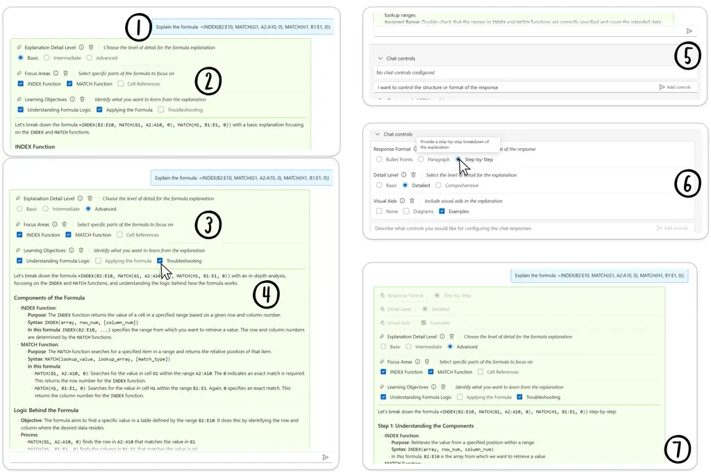

Figure 3. User flow with the Dynamic PRC system. (1) User submits their
prompt. (2) The Option Module generates a set of options to help steer
the Chat Module’s response. (3) User can update the refinements sent to
the Chat Module by clicking their preferences. (4) On change, Chat
Module regenerates the response with the new chosen refinements. (5)
User can request controls through NL prompting. (6) The Option Module
generates a set of session options based on this prompt. (7) The session
options apply to the current and every subsequent response from the Chat
Module.

We now describe the design and implementation of our dynamic prompt
middleware system, Dynamic PRC, and detail how we applied the design
goals informed by our formative survey. As part of this work, we
designed a second system to compare, Static PRC. The Static PRC system
is a simplified instance of the Dynamic PRC system, therefore we focus
our description on the latter. Both systems are web-based, built using
React (Facebook, \[n. d.\]) and TypeScript (Microsoft, \[n. d.\]). All
LLM completions are generated using gpt4-turbo.

### 4.1. Using dynamic prompt middleware

We describe a user flow within our system, illustrated in Figure 3. A
user wants to generate an AI explanation of their spreadsheet formula,
and enters the prompt “Explain the formula: =INDEX(B2:E10, MATCH(G1,
A2:A10, 0), MATCH(H1, B1:E1, 0))” (1). The Dynamic PRC system uses this
input, along with any previous conversation history, to generate prompt
options for the input. Given the context, the system generates three
separate _inline options_: “Explanation Detail Level”, “Focus Areas”,
and “Learning Objectives” with several choices for each (2). The system
always selects initial values for each option, the prompt refinements.
The user inspects each option and sees that they would like a more
advanced explanation that explains how to fix an issue they were having
with the formula. So, the user changes Explanation Detail Level from
Basic to Advanced, and changes the Learning Objective from Applying the
Formula to Troubleshooting (3). As the user modifies the selection, the
chat response updates automatically using the new prompt refinements
(4). The user inspects the response and realizes they want a different
structure to the AI explanation of the formula. The user goes to the
Chat control panel and in the open text field types “I want to control
the structure or format of the response” (5). Based on the user’s
request, the system generates _session options_, including for the
“Response Format” (which includes Bullet Points, Paragraph, and
Step-by-Step). The user selects Step-by-Step which organizes the
explanation into discrete steps which the user finds preferable to the
previous response (6). Using the newly added session options, the Chat
Module regenerates the response (7).

### 4.2. Two-tier Dynamic Prompt Refinement Control

We developed the Dynamic PRC system to automatically generate prompt
options and refinements for an LLM interface (D.2). The options
generated by the Dynamic PRC system are streamed incrementally and
presented to the user to afford greater control of the AI response to
the prompt (D.1). The user can then select from these options, modify
existing options, generate their own options via a natural language
prompt, or even define prompt options directly using JSON.

We designed and implemented a _two-tier_ system that uses two sets of
prompt options. The first supports inline response-level dynamic
controls generated for every user input, and the second supports
session-level prompt controls that apply throughout the entire session
with the AI. This two-tier system provides users the flexibility between
control (providing options for the entire session) and dynamism (system
generation of controls adapted to each prompt for the user to explore).

#### 4.2.1. Prompt options

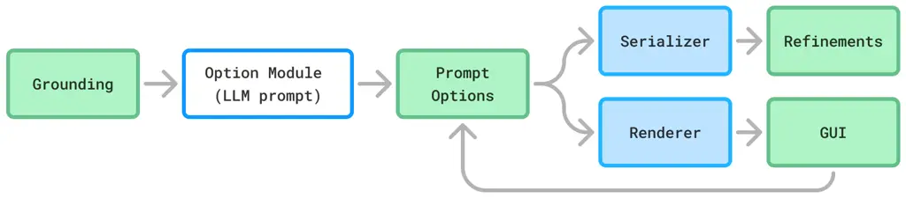

Figure 4. Prompt options model

The central component to our approach is _prompt options_ which is used
to drive prompt refinements. Prompt options are represented as a JSON
data structure that describes the options and their current value;
additionally, prompt options have a renderer and serializer. The
renderer takes a set of prompt options and displays them as a GUI
control, where editing the control returns an updated set of prompt
options. In our study, the renderer was limited to generating radio
buttons, checkboxes, and free-text areas, selected by the AI when
generating options. Our approach can be extended to generate any UI
elements that can be expressed using a declarative schema and converted
into a GUI control. The serializer takes a set of prompt options and
returns a textual prompt refinement that can be included in a prompt.

To generate prompt options, we prompt an LLM to return JSON conforming
to a TypeScript schema (prompt detailed in Appendix A.1). LLMs are
highly capable at generating JSON and TypeScript code, and during the
study we did not have to validate the result. To make the system more
robust, structured output decoding (OpenAI, 2024) can additionally be
used to ensure the output conforms to a schema. The LLM streams the JSON
and we use an incremental JSON parser to create and render prompt
options as they are generated.

We define an _options module_ to be a component that takes input, or
_grounding_, invokes an LLM with the grounding, and returns a set of
prompt options. Figure 4 illustrates how the options module and
associated components relate. An options module can implement either
static or dynamic prompt middleware, depending on the grounding
information and when the module is invoked. We now show how prompt
options are generated and used in our tool.

#### 4.2.2. Inline options

Figure 5 presents the information flow in the Dynamic PRC system, and we
describe how a user interacts with inline prompt options:

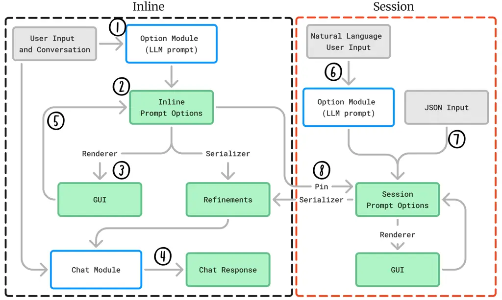

Figure 5. Dynamic PRC overall system flow. _Inline:_ (1) The Option
Module takes the user’s prompt input and conversation history. (2) The
Option Module returns a set of prompt options with initial values based
on the prompt. (3) Prompt options are rendered inline using a rendering
engine. (4) The Chat Module uses these refinements as grounding, along
with the user’s prompt input and conversation history, to generate a
chat response. (5) User can adjust GUI controls which updates the
refinements and re-invokes the Chat Module to regenerate the current
response. _Session:_ Users can directly invoke the Option Module to
generate Session options through natural language prompting within the
Session control panel. (7) Users can also directly add and modify
options manually through JSON input in the Session control panel. (8)
Users can pin _Inline_ options to the _Session_ by clicking the pin icon
on each inline option, which applies the inline option to follow-up
queries.

1.  (1)
    Given a user input, the conversation history, user input, and
    session-options are used as grounding to invoke the dynamic options
    module.
2.  (2)
    The dynamic options module returns a set of prompt options,
    including initial values for the options.
3.  (3)
    The prompt options are rendered inline using our rendering engine.
    The initial response does not require user interaction because the
    prompt options include initial values used by the serializer to
    generate refinements.
4.  (4)
    These refinements are used as grounding, along with the input prompt
    and conversation history, to generate a response.
5.  (5)
    If the user adjusts a GUI control, the prompt options are updated,
    and the chat module is re-invoked to regenerate the current response
    with the new refinements in place.

#### 4.2.3. Session options

Session options are options that apply to every prompt and AI response
in a given session with the Dynamic PRC system. Session options allow
users to control what options are applied to every AI response, such as
“use bullet points” which might apply to many prompts as a user
preference. Users have several ways to generate session options, which
we describe with respect to Figure 5:

1.  (6)
    Users can generate session options through a natural language
    utterance that is passed to an options module. The utterance can
    directly request an option, for example: “I want to control
    expertise”. Alternatively, the utterance can be vague, or task
    driven, for example: ‘I am a novice programmer trying to learn”.
2.  (7)
    Users can add or directly modify the JSON representing the session
    prompt options. By directly exposing the session options as JSON,
    they can be saved and reused in later sessions with the AI by
    copying the JSON code under the Chat controls UI and then pasting
    specific options into a new session as desired.
3.  (8)
    Users can “pin” inline options that are generated by the system,
    which allows them to save inline options as session options. This
    action moves the option from the inline prompt options into the
    session prompt options and allows it to apply to all successive
    prompts within the session. For example, if the user is interacting
    with the AI to solve programming tasks, and the Dynamic PRC system
    generates “Programming Language” as an option. The user can then
    select their language of choice and then pin the option to the
    Session options so that the AI is given the context of what
    programming language the user is working in.

The user can generate session options at any point in their workflow.
They could generate session options before prompting the AI or generate
new session options once the AI responds and ideas for new Session
controls arise. In method (6) for generating session options, existing
session options are used along with the user’s utterance to generate new
options.

Generation of session options in all cases relies on the user to
directly request or define options. We do not recommend potentially
useful session options nor generate them based on the user’s prompt to
the Chat Module (these affordances might be useful in an improved
Dynamic PRC system).

#### 4.2.4. Generating chat responses

The Chat Module is a simple chatbot that interprets the conversation
history and user message, similar to implementations like ChatGPT
(prompt detailed in Appendix A.2). Unlike these systems, the Chat Module
additionally receives prompt refinements from both the session and
inline prompt options. The Chat Module takes these inputs and generates
a response which is then streamed to the user. The system is fully
reactive: whenever a new session option is generated, or the user
selects a different prompt option using a GUI, the latest AI response is
automatically regenerated.

In this paper we apply the Dynamic PRC approach to a chat interface
common to LLM interactions like Copilot, ChatGPT, and Gemini. However,
the system is modular and can be used to help steer any LLM interface
through the generation of options and refinements that are included in a
prompt (see Section 7).

### 4.3. Static Prompt Refinement Control

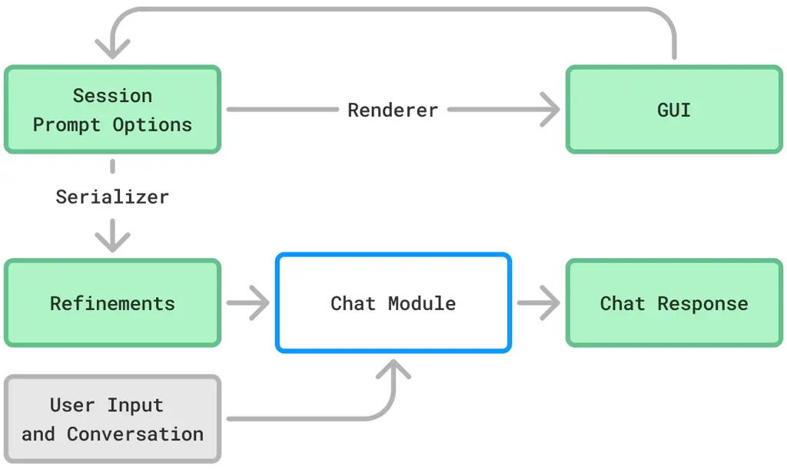

Figure 6. Static PRC model.

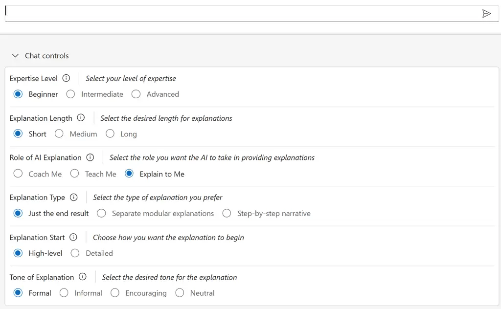

Figure 7. Static PRC options available during the study.

In order to explore the usefulness of pre-selected controls and compare
the experience to our Dynamic PRC approach, we also developed an
alternative system called Static PRC (Figure 6) which has a few
differences. For Static PRC we used the same ChatModule but disabled the
generation of inline and session options. Instead, Static PRC provides a
list of pre-selected controls (detailed in Appendix A.3) derived from
the results of our formative study (Section 3) that covers broad
controls that might be useful for any prompt the user gives relating to
explanations (Figure 7). There were several options requested by
formative study participants that we did not add to Static PRC, as they
involved options that required Dynamic PRC generation or interpretation
or that were too specific to apply to the tasks more generally (e.g.,
_“Talk to me like I’m a data scientist”_). As with the options in
Dynamic PRC, the Static PRC options will regenerate the current AI
response on change which add option information and selection to the
user’s prompt. The Static PRC system can be seen as adhering to design
goal D.1 (Section 3.3) as it provides control over AI responses but does
not adhere to D.2 as the controls do not dynamically change to the task
or user.

## 5. Evaluation: In-lab comparative user study

To compare the impact of dynamic and static control on user needs for
controlling AI responses in comprehension tasks, we conducted an in-lab
comparative user study. This study informs the design of future prompt
middleware systems for steering AI responses by addressing the following
research questions:

1.  RQ1
    What are user preferences for control of AI responses in
    comprehension tasks?
2.  RQ2
    Which form of control is perceived as most effective for controlling
    AI responses?
3.  RQ3
    How does each form of control impact user mental load?
4.  RQ4
    What are the trade-offs of Dynamic PRC and Static PRC prompt
    middleware for controlling AI responses?

We hypothesized that a Dynamic PRC approach would provide users more
flexibility and control over a Static PRC approach, and be more
preferred by users. However, we also predicted that there might be
trade-offs for this increased control due to introducing complexity
through new options that users would have to consider. On the other
hand, the simplicity of Static PRC for controlling AI output may
possibly feel more familiar to users (e.g., like adjusting settings of a
desktop application), which could provide effective control without
needing to use AI to generate dynamic elements for options. Beyond
comparing Dynamic PRC and Static PRC approaches, we wanted to discover
how to best design interactions for empowering users to get the AI
responses they needed, without the tedium and effort of prompt
engineering. Basically, we wanted to discover how to allow users to
simply ask their question in _real_ natural language (that is, without
requiring structuring prompts through prompt engineering for effective
control of responses), and alleviate some of the challenges of prompting
models, by providing simple UI interactions that allows users to steer
the AI response.

### 5.1. Participants

We recruited 16 participants (8 men, 8 women, 0 non-binary/other) via
email from a list of generative-AI users who had previously signaled
interest in participating in user studies. 13 participants reported that
they regularly used one or more GenAI tools (e.g., Copilot, ChatGPT,
etc.) and three reported occasional use. Since we chose formula and code
comprehension tasks for our study, we also collected participant
experience with spreadsheet formulas and programming. Most participants
signaled basic use of spreadsheet formulas (12) with 3 having more
advanced usage of spreadsheet formulas. 6 participants reported that
they had never programmed, 4 having learned enough programming for
small, infrequent tasks, and the remaining 6 participants being
moderately (5) or highly (1) experienced in programming. Finally,
participants were located on various continents, with 9 in North
America, 3 in Europe, 2 in Asia, 1 in Africa, and 1 in Australia.
Participants were compensated USD \$50 or local currency equivalent for
their time.

### 5.2. Tasks

Participants completed 6 tasks, organized into 2 task-sets, A and B
(Figure 8). Each task-set involved 3 common tasks done with GenAI
assistance: code explanation, complex topic understanding, and skill
learning. The goal of each task was to interact with the system to craft
an explanation based on each task prompt that helped the participant
understand each task and made them confident that they could answer
questions about the task with the explanation.

Task Set A

1.  A1
    Explain the formula:

    =INDEX(B2:E10, MATCH(G1, A2:A10, 0), MATCH(H1, B1:E1, 0))

2.  A2
    Summarize and explain the following text: \[five paragraphs on
    impact of AI\].
3.  A3
    How do I take my data and find out if two things correlate with each
    other?

 

Task Set B

1.  B1
    Explain the following Python code:

    import pandas as pd}

    df = pd.read\\\_csv(’data.csv’)}

    df\[’Total’\] = df\[’Quantity’\] \* df\[’Price’\]}

    result = df.groupby(’Category’)\[’Total’\].sum().reset\\\_index()}

    result = result.sort\\\_values(by=’Total’, ascending=False)}

2.  B2
    Summarize and explain the following text: \[five paragraphs on
    impact of climate change\].
3.  B3
    How do I visualize my sales data for my website?

Figure 8. Task-sets A and B

### 5.3. Protocol

We considered our two conditions for this within-subjects user study,
Dynamic PRC and Static PRC (described in Section 4.2 and Section 4.3
respectively). Every other element and interaction within the system was
identical between conditions. We chose a within-subjects protocol so
that participants could reflect on the similarities, differences, and
trade-offs of using a Dynamic PRC versus a Static PRC. We did not
compare Dynamic PRC or Static PRC to a ‘baseline’ ChatGPT or similar
system as our formative study results showed that users strongly desired
control of AI-generated content, which we suspect would be replicated in
the comparative tool study. Instead, we directly compare Dynamic PRC
against Static PRC to better understand the effectiveness of different
approaches of control for users, and the trade-offs of each. Each user
study took approximately 90 minutes.

Participants were assigned Dynamic PRC and Static PRC conditions and A
and B task-sets through a counterbalanced design, such that half the
participants received the Dynamic PRC condition first, and the other
half received the Static PRC condition first. Within each of these
condition-first groups, each task-set was balanced such that half of
each condition saw the A task-set first, and the other half received the
B task-set first. Therefore, there were four equal groups of
participants during the study (see Figure 9).

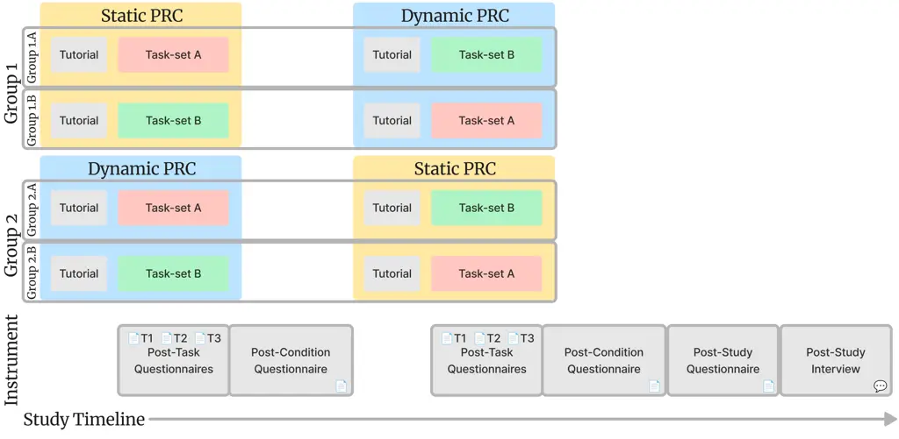

Figure 9. Overall design of the study.

To mitigate learning and novelty effects, participants were first given
a tutorial based on their first tool condition (either Dynamic PRC or
Static PRC). Participants were shown how to interact with the system and
the study facilitator walked them through example tasks like writing a
hello world program in Python and planning a trip to London. In the
Dynamic PRC condition, both tasks showed how the system generated
“inline” options upon submission of a prompt, how to “pin” an inline
option to session options, and how to delete an option. Within the hello
world tutorial task, participants were also shown how Dynamic PRC can
generate options on command through the “Chat controls” panel by
inputting _“I am a novice programmer trying to learn”_ and pressing “Add
controls”, which generated several new options within the session
controls area. In both conditions and in both tutorial tasks,
participants were shown how selection from the available options
regenerated the response based on their selection. Participants in both
conditions were shown how to inspect the various informative tooltips on
each option. After the participant felt comfortable using the system,
they were presented with their first task-set (either A or B).

Participants then completed three tasks with their first condition.
Participants were given 7 minutes per task to interact with the system
to craft an explanation that they found useful. During each task,
participants either modify option selection within the system, create
new options if in the Dynamic PRC condition, or follow-up with the
chat-module as necessary. At the end of 7 minutes, or if the participant
was satisfied with the AI-generated response, the participant was asked
three post-task questions (on a 7-point scale) which had the rate how
much they believe the _options_ helped them get an explanation that
helps them understand the task, and rate how confident they would be to
answer questions about the task with the explanation in hand (reported
in Section 6.2.2, Appendix B.1). After a task-set was completed within a
condition, participants filled out a questionnaire adapted from the NASA
Task Load Index (Hart and Staveland, 1988) and the adaptations done
related research (Vaithilingam et al., 2024) (reported in Section 6.2,
Appendix B.2).

Next, participants were given a second tutorial that introduced them to
the other condition. As before, participants were shown how to interact
with the system with the same example tasks shown in the first
condition. Once the participant felt comfortable using the system, they
moved on to completing their second task-set, like the first set of
tasks, and completed post-task questionnaires. After these three tasks
were completed, we again performed the post-condition questionnaire.

Participants then completed a final post-study questionnaire that
compared the two conditions on dimensions of system preference and ease
of use (reported in Sections 6.1 and  6.3, Appendix B.3). This final
questionnaire also elicited participant needs around control of AI
responses, the importance of control of and learning from AI responses,
and how helpful each condition of the system was (reported in
Section 6.1.2). We performed and report Mann-Whitney U Tests to
determine statistical significance between conditions.

During each task, participants were asked to think aloud while
interacting with each system relating to their goals for crafting good
responses with the AI, the options available to them to do so, and any
other feedback and reactions they had while using the system. After all
questionnaires were completed, researchers collected participant
feedback about the user experience of each tool and their control needs
through a semi-structured interview (Appendix B.4). These interviews
focused on the aspects of control and the systems the participants saw
during the study. Questions prompted participants to think about other
features that would provide control over AI, what other specific types
of UI controls might be useful to generate, the importance of control of
AI explanations, system preference, and reflecting on how their AI
workflows might change with the tool. Participant utterances during the
tasks were also analyzed as specific feedback for each condition.

Transcripts of the user study were automatically generated, reviewed,
and corrected as necessary by researchers, who then extracted
participant utterances and an initial qualitative analysis using
iterative open coding (Vaismoradi et al., 2013) to identify
representative themes, and thematic analysis (Braun and Clarke, 2006) to
condense and group utterances into related themes. Researchers then
performed a second pass through negotiated-agreement (McDonald et al.,
2019; Saldana, 2021) to further organize these themes to report
successes and barriers for using Dynamic PRC and Static PRC prompt
middleware, and the design implications for future Dynamic PRC systems.
These final themes are reported in Section 6.4.

## 6. User Study Results

### 6.1. What are user preferences for control of AI responses in comprehension tasks? \[RQ1\]

#### 6.1.1. Overall Comparison Between Conditions

After both conditions were complete, participants answered a
questionnaire that directly compared the Dynamic PRC and Static PRC
conditions, where scores closer to 1 represent a stronger preference for
Dynamic PRC, scores closer to 7 represent a stronger preference for
Static PRC, and a score of 4 representing that the two systems were
equal for the question (Figure 10).

Participants reported that Dynamic PRC was slightly more demanding to
communicate with (median=3.0, mean=3.31) and made participants work
harder to accomplish their level of performance (median=3.0, mean=3.56).
Participants thought the two tools were equal when considering which
tool made them feel more rushed during the task (median=4.0, mean=3.88)
and which tool made them feel more insecure, discouraged, irritated,
stressed, and annoyed (median=4.0, mean=4.31).

Figure 10. Overall direct comparison of conditions for participant tool
preference, mental demand, feelings of being rushed, successful, level
of effort, and feelings of annoyance.Overall direct comparison of
conditions for participant tool preference, mental demand, feelings of
being rushed, successful, level of effort, and feelings of annoyance.

However, despite participants feeling like they had to work and think
slightly harder while using Dynamic PRC to control AI explanation
generation, the affordances that Dynamic PRC brought for controlling AI
responses during each task led to participants responding that they
preferred to use Dynamic PRC over Static PRC (median=2.0, mean=2.81) and
reported that they felt slightly more successful at completing the tasks
with Dynamic PRC over Static PRC (median=3.0, mean=3.0).

#### 6.1.2. Participant Reported Preferences Around Control

After the completion of the study, participants completed a
questionnaire on several dimensions of control of AI explanations to
provide their preferences around control, reflect on the variability of
their needs for AI-explanations based on various factors, and how
helpful they find Dynamic PRC and Static PRC approaches for controlling
AI-responses (Figure 11).

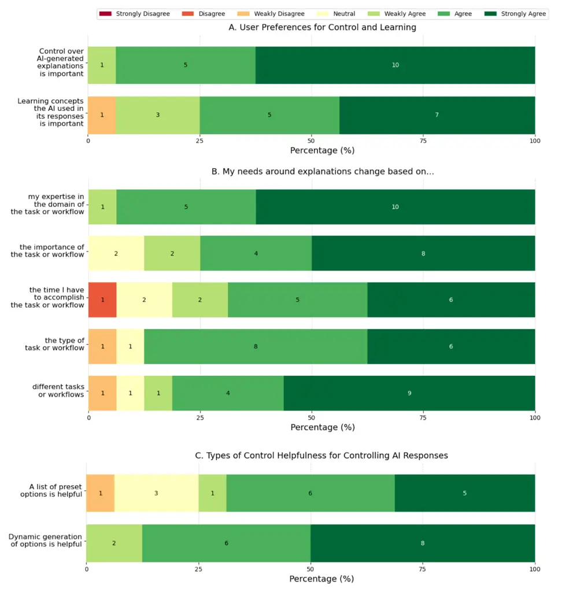

Figure 11. Participant reported preferences around control from Strongly
Disagree to Strongly Agree. Sub-graph A. captures participant-rated
importance of control of AI-generated explanations and of learning the
concepts used by the AI. Sub-graph B. captures the elasticity of
participant needs around AI-generated explanations based on several
different factors. Sub-graph C. captures how helpful participants found
each approach, Static PRC and Dynamic PRC, for controlling AI responses.

Ratings of the importance of control over AI-generated explanations and
of learning concepts, as motivation for improving the experience of
explanation generation, (Figure 11 A) showed that participants “Strongly
Agreed” that control over AI-generated explanations was important to
them (median=7.0, mean=6.56), but only “Agreed” that learning the
concepts the AI used in its response was important (median=6.0,
mean=6.06).

Participant signaled that their needs around AI explanations changed
frequently based on variability in their workflows (Figure 11 B). In
order of highest agreement rating: participants “Strongly Agreed” that
their needs changed based on their expertise in the task or workflow
(median=7.0, mean=6.56) and between tasks and workflows (median=7.0,
mean=6.19). Participants rated between “Agree” and “Strongly Agree” that
their needs change based on the importance of the task or workflow
(median=6.5, mean=6.13). Finally, participants “Agreed” that their needs
change based on the time they have to accomplish the task (median=6.0,
mean=5.75) and on the type of task (median=6.0, mean=6.06).

Finally, participants rated the helpfulness of Dynamic PRC and Static
PRC options around controlling AI-responses (Figure 11 C). Participants
more highly rated the helpfulness of Dynamic PRC over Static PRC for
controlling AI responses (Dynamic PRC median=6.5 (between Agree and
Strongly Agree), mean=6.38 vs Static PRC median=6.0 (Agree), mean=5.69).
We elaborate on these findings by reporting themes found from our
semi-structured interviews with participants in Section 6.4.

### 6.2. Which form of control is perceived as most effective for controlling AI responses? \[RQ2\]

#### 6.2.1. Dynamic PRC vs Static PRC Effectiveness

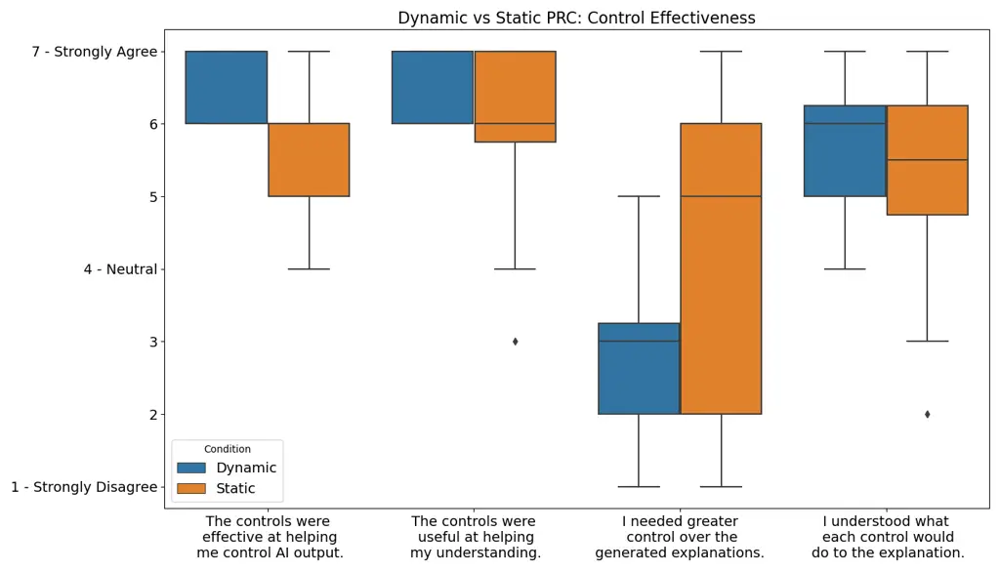

Figure 12. Participant rated effectiveness of each condition in the
control of AI responses for the comprehension tasks they saw.

Participant reported on tool effectiveness by condition, on a 7-point
Likert scale from Strongly Disagree (1) to Strongly Agree (7)
(Figure 12), and found the controls generated in Dynamic PRC to be
significantly more effective at helping control AI output and
explanations over Static PRC (Dynamic PRC median=6.0 (Agree), mean=6.44
vs Static PRC median=6.0 (Agree), mean=5.81; U: 73.5, P-value: 0.0245).

We also found a significant difference between participant need for more
control over the AI explanations generated during the tasks, where
participants “Weakly Disagreed” that they needed more control with
Dynamic PRC versus “Weakly Agreeing” in the Static PRC tool (Dynamic PRC
median=3.0, mean=2.75 vs Static PRC median=5.0, mean=4.44; U: 190.5,
P-value: 0.0174).

However, there was not a significant difference between conditions for
how useful the controls were at helping participants better understand
the concepts used in each task (Dynamic PRC median=6.0 (Agree),
mean=6.44) vs Static PRC median=6.0 (Agree), mean=5.88), nor was there a
difference for participant understanding of the impact that each control
would have on the generation of an explanation (Dynamic PRC median=6.0
(Agree), mean=6.44 vs Static PRC median=6.0 (Agree), mean=5.31).

Participants rated the ease of use of each tool during the task and
rated how well the AI understood their intent when selecting options.
and “Agreed” that it was easy to complete the tasks with both Dynamic
PRC and Static PRC tools (Dynamic PRC median=6.0, mean=6.0 vs Static PRC
median=6.0, mean=5.75). Participants also thought the AI in the Dynamic
PRC tool understood their intent and made the right edits slightly more
than in the Static PRC tool (Dynamic PRC median=5.5 (between Weakly
Agree and Agree), mean=5.69 vs Static PRC median=5.0 (Weakly Agree),
mean=5.5). However, we did not find a significant difference between
conditions with either question. Participants also reported similar
success levels for completing their tasksets in both conditions on a
scale from Perfect (1) to Failure (7), which was statistically
insignificant (Dynamic PRC median=2.0, mean=2.19 vs Static PRC
median=2.0, mean=2.5).

#### 6.2.2. Participant-Rated Task Performance

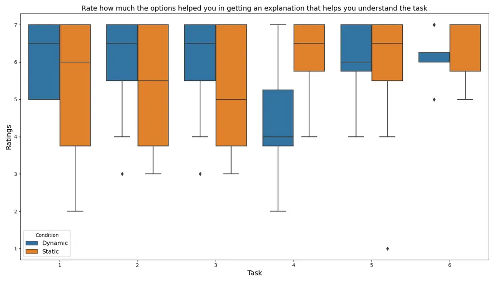

Figure 13. Measurement of how effective the options were in each
condition at helping the participant control the response and assist the
participant in understanding the task (higher is better).

After each task was completed (either due to the participant signaling
they were finished or after 7 minutes were up), participants rated from
1 to 7 on how much they believed the options helped in getting an
explanation that helped them understand the task (Figure 13). Only Task
4 (a code explanation task that involved explaining a Python code
snippet) was found to have a significant difference between conditions
with Dynamic PRC performing worse than Static PRC (U: 12.0, P-value:
0.0355). This potentially means that the options provided in Static PRC
are an effective set of refinements for code comprehension tasks, but
the system instructions for generating potential options through Dynamic
PRC needs improvement to better support code explanations for users.

Similarly, as a measure of how useful the final result would be in
accomplishing the task of understanding the content in the explanation,
participants reported how confident they were that they could answer
questions about the task with the explanation they generated in hand.
However, we did not find any significant differences between conditions
for each task in participant confidence levels.

### 6.3. How does each form of control impact user mental load? \[RQ3\]

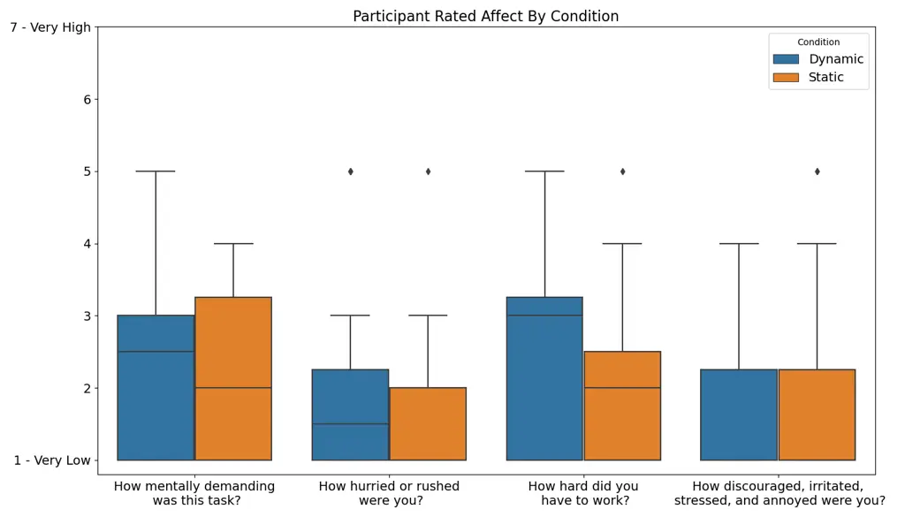

Figure 14. Participant rated mental load for each condition, rated after
the completion of a task set.

Participants also reflected on the mental load felt while completing
their task-sets within each condition from Very Low (1) to Very High (7)
(Figure 14). Participants reported that the tasks were slightly more
mentally demanding in the Dynamic PRC condition (Dynamic PRC median=2.5,
mean=2.44 vs Static PRC median=2.0, mean=2.25), felt slightly less
rushed with Dynamic PRC (Dynamic PRC median=1.5, mean=2.13 vs Static PRC
median=2.0, mean=1.94), felt like they had to work harder with Dynamic
PRC (Dynamic PRC median=3.0, mean=2.69 vs Static PRC median=2.0,
mean=2.13), and felt the same level of annoyance in both conditions
(Dynamic PRC median=1.0, mean=1.81 vs Static PRC median=1.0, mean=1.88).
However, we did not find a significant difference for any of these four
categories of mental demand.

We note that the results of this questionnaire report that participants
felt slightly less rushed with the Dynamic PRC condition, the results
for comparing conditions directly against each other (Figure 10) found
an equal level of feeling rushed (though the mean was slightly towards
Dynamic PRC). Although the two results show slightly different patterns,
the findings presented here and in Figure 14 are not significant, and
thus might be attributed to noise.

### 6.4. Benefits and trade-offs of Dynamic PRC and Static PRC prompt middleware \[RQ4\]

While completing the tasks in both conditions and during the post-study
interview participants reflected on the impact of the dynamic and static
prompt middleware they experienced, and the trade-offs of using these
approaches while controlling AI responses. During interviews with
participants and while using each version of the system, participants
directly compared Dynamic PRC with Static PRC and reflected on the
impact each system would have on their daily workflows with AI.

#### 6.4.1. Dynamic PRC lowers barriers to providing context to the AI

Current participant workflows for prompt engineering was seen as tedious
(P4), inconsistently effective (P4, P5), time-consuming (P5), and a
current barrier participants had with using GenAI that new control
affordances, like that of the Dynamic PRC system, could help address.
Participants found it difficult to _“even have the words for the
context”_ they wanted to convey in their prompts as there was a
noticeable gap in expertise needed between prompting and prompt
engineering (P4). Providing task and user context within prompts was
seen as critical for obtaining responses that aligned with user needs
(P2).

Dynamic PRC was described as helpful for assisting the users in
providing much of the context necessary for the AI to effectively
respond to a user’s needs for a task and eliminate much of their
struggles due to forming prompts (P2, P4, P8, P15). For example:

> _“I have to do so much \[work\] around my prompt to give it the
> context to make it specific, point it to the tone to do, and a lot of
> times I’m repeating within those categories of types of prompts, I’m
> repeating those same things. I felt like dynamic would really help me
> shortcut what I’m doing manually today. (P15)_

During the study, the inline options generated by the Dynamic PRC system
replaced much of the need for follow-up prompts to the system in order
to provide more context or correcting the initial prompt to refine the
AI’s response (P1, P3, P9, P16). In their current workflows with AI,
participants described the back-and-forth between user and AI as having
a negative impact on their productivity but said that Dynamic PRC would
increase their performance and efficiency of their day-to-day workflows
with AI since it lowers the need for forming follow-up prompts to the AI
(P3, P4, P10, P16).

#### 6.4.2. Dynamic PRC improves the perception of control over the AI

As reported in Section 6.2.1 and 6.1.2, participants felt that Dynamic
PRC gave more effective control over the Static PRC system and their
current prompting strategies (P4, P6, P8). Without the control provided
by Dynamic PRC, one participant felt:

> _“restricted by the current Copilot \[because I\] don’t have these
> options, I’m trying to modify the prompt to get the answer out and the
> AI just goes out of control after some time, so I have to refresh and
> start again and change my prompts.” (P12)_

The greater control afforded through generated options was seen as
useful for receiving AI responses that fit the personal preferences of
the user (P14), which participants felt was made possible through
Dynamic PRC’s afforded flexibility (P7), greater precision in defining
the task (P8), better predictability of AI responses (P6), and greater
adaptation to user needs (P13). Participants felt that Dynamic PRC gave
them greater control over the AI. This control allowed participants to
directly define their response needs to the AI (P4) and guide the AI to
a useful response that aligned with their preferences (P15). A few
participants even likened the Dynamic PRC approach to programming and
stated that the ability to modify the JSON to directly edit and
fine-tune the options gave them more control over the AI (P6, P7).
Finally, P10 saw control as a way to provide autonomy while working with
AI:

> _“I think of this \[AI\] as my personal assistant\[…\] I want it to be
> positive that the AI is just a tool you use to kind of build up on
> some idea that you have. So, I think it’s really important to be able
> to \[have\] control.”_

#### 6.4.3. Dynamic PRC provides guidance for AI steering interactions

Participants saw the Dynamic PRC system as a guide in interacting with
AI by providing helpful, and relevant, options (P1, P2, P4, P6, P7, P9,
P14). For example, P7 saw the generated options as a form of debugging
the AI’s response since it _“gives you some ideas around if you change
\[the response\] in this way then you might get better answers.”_
Participants felt that Dynamic PRC guided them towards better responses
(P7, P10, P11), giving alternatives of what they might do to solve their
problem (P7). Dynamic PRC options did this by helping participants
review potential refinements to their prompt (P1, P4, P9) and give
greater structure to their AI interactions through generated options
(P14). P11 said it even helped them learn potential strategies for
future prompts, saying that Dynamic PRC was _“giving me more of a prompt
learning experience, and I’m getting out of \[the AI\] what I want. And
actually, it’s a better response.”_

Participants saw Dynamic PRC as valuable for providing AI responses that
had better detail and results than other methods like prompting or
Static PRC gave (P1, P8, P11-13, P15), while requiring less focus on
writing the prompt (P11), though this came at a cost of requiring
slightly more effort than using the Static PRC (P12). By providing an
interface that guided participants to explicitly provide their
preferences, Dynamic PRC was seen as more efficient for helping steer
the AI. P1 explains:

> _“It’s \[Dynamic PRC is\] all bumper rails at the bowling alley for
> getting to where you need to go, and you’re trying to direct the ball
> that is the conversation you’re having with this interface. And having
> more options to do that, I think, allows you to get there quicker.”_

#### 6.4.4. Dynamic PRC enables greater exploration of and reflection on tasks

Dynamic PRC enabled our participants greater exploration of the AI’s
affordances (P1) and helped them better reflect on their tasks (P9). The
inline options generated by Dynamic PRC were perceived by participants
as a reflection of the user’s own assumptions placed in the prompt that
they could then correct to steer the response which also revealed
alternatives to considerations they were making (P9, P10). Other
participants felt that the Dynamic PRC options provided a scaffold for
their thought process on what they wanted to focus on for their
explanation (P5, P7, P10, P11, P15) which was seen as helpful for users
who are leveraging AI to complete tasks in an unfamiliar domain (P15,
P16). The Dynamic PRC options were helpful for getting users unstuck by
providing alternatives (P8), and as a form of brainstorming with the AI
(P16). P1 said that Dynamic PRC helped them understand the possibilities
of the AI model, since it generated options that _“were things that I
would maybe assume the system couldn’t handle or that it wouldn’t be
able to do.”_ Participants felt that having control through generated
options enabled greater understanding of a task as it allowed users to
craft responses to their personal preferences and learning needs (P6,
P8).

#### 6.4.5. Dynamic PRC and Static PRC have mixed effects on perceived cognitive effort

##### On ease of use

Many participants thought that Dynamic PRC made their interactions with
AI easier, by scaffolding their interactions programmatically (P6),
giving users control over option generation through natural language
(P4, P14), and by providing reuse of useful options for later use (P15).
Several participants thought Dynamic PRC would even cause their AI usage
to increase (P2, P4, P10, P13) since it lowered the effort needed form
prompts (P4) and reduced time spent providing context to the AI (P2),
which without prompt middleware has caused frustration and even
abandonment of GenAI sessions (P10). Having access to the Dynamic PRC
controls increased participant confidence in working with GenAI (P3),
made it easier to ideate on goals for interacting with GenAI (P5),
lowered the cognitive burden of working with GenAI (P9), and helped them
better understand how to use GenAI (P5).

Despite participants’ preferences towards using Dynamic PRC, Static PRC
was also found to be helpful in steering AI-generated responses during
the study but had several downsides. Participants described a trade-off
between the ease of use of the Static PRC system and the increased
control and flexibility of the Dynamic PRC system (P1), as Static PRC
options in the study were useful for many refinements that commonly
needed when interacting with AI (P1, P2, P7 P11), similar to settings of
a software application that are not frequently changed (P1).

A few participants thought Static PRC allowed them to more easily define
the kind of response they wanted before creating a prompt for the AI
(P1, P12). For example, P1 said Static PRC…

> _“allowed me to think a bit more before putting prompts in about what
> explanation am I looking for? What are my needs for this kind of task?
> Because it’s hard to know what you don’t know and what you want to
> ask, and having it there beforehand helped narrow that down.” (P1)_

While Dynamic PRC also allows you to request options from the AI before
giving providing any prompts, it is possible that the provided Static
PRC options are simpler to think about (as the options only require the
user to select their preference) vs the blank slate that is generating
the Dynamic PRC Session chat controls, which likely contains similar
barriers users have with a new AI chat session.

##### On mental load

However, some participants felt that there was a trade-off between
having more control with the Dynamic PRC system over Static PRC as it
provides a more complex interaction. Some participants thought that
Dynamic PRC would require the user to think more as they had to consider
each generated option and whether they needed to generate options that
the AI did not recommend (P1, P10). Dynamic PRC was seen as more
complicated as the options varied throughout the tasks (i.e., were
dynamic) and _“required more activation \[mental\] energy”_ (P10), which
made gave an edge to Static PRC in usability while under time-pressure
(P13, P16) and for straight-forward tasks (P16). This increased mental
load was not always seen as a negative for all participants. For
example, P13 _“did not see ‘mentally demanding’ as it is a negative
thing”_ since it encouraged them to think more about their task.

##### On perceived level of control

Despite the usefulness of the Static PRC, many participants still wanted
more control (P3, P4, P6-8, P10, P15 and Section 6.1.1). Dynamic PRC was
seen as necessary for providing specific context to the AI (P2), as some
Static PRC options had limited impact in several cases compared those in
the Dynamic PRC (P2), including not impacting the response enough to
improve their understanding of the topic (P4), not being specific enough
to afford effective control of the AI (P10), and not appropriately
affecting the response based on the selection (P3, P6).

Participants felt that Static PRC did not give them the same control
that Dynamic PRC did over the assumptions the Chat Module made (P14),
which meant some participants needed to craft follow-up prompts, which
included asking clarifying questions to form better understanding (P6,
P16), or iterating with the AI to get greater detail in the response
(P8). Static PRC also had barriers to understanding what options to
select based on the task, which was exacerbated due to lack of
expertise. For example, P3 felt that they were _“not able to accurately
identify how different configurations may help understand the concept”_
due to not having much domain knowledge in the task, which also caused
struggle in forming follow-up prompts.

Other participants wanted to craft new options that were unavailable in
Static PRC that they thought would have been useful to have (P6, P7) and
wanted options that took the context of the prompt or their data so they
could focus the response on certain themes (P4, P10), which are
available in Dynamic PRC but not Static PRC.

#### 6.4.6. Mismatches between how AI interprets options and how users want options applied

While some participants felt that the control provided by the options
increased the predictability of AI responses (Section 6.4.2), one of the
most common challenges participants had during the study was
understanding how the options they selected might be applied by the AI.
This challenge manifested when there was a mismatch between the
participant’s expectations for how the option would be, or should be,
applied by the AI, and how the option was actually reflected in the
response to the prompt, which could potentially cause frustration in
users (P10). This gap between user expectations and AI application can
come from user not understanding the potential impact of an option
(P2-6, P8), being uncertain on whether the option was applied by the AI
(P1), or due to the prompt refinements produced by the Dynamic PRC
system or by developers in the Static PRC system being insufficient to
make an impact to the response (P1, P4, P8, P10, P12, P13, P15, P16).

Uncertainty on how an option might be applied by the AI caused
participants frustration when trying to understand differences between
option selections (e.g., _“Teach me”_ vs other AI roles found in the
Static PRC options (P2)) and when option selections modified parts of
the response that participants did not expect (e.g., the expertise
option modifying the number of examples given (P3)).

During the post-study interview, some participants wanted more
fine-grained UI elements to be generated (e.g., sliders for controlling
the count of example (P7)), but many participants discussed how these
less discrete options might further exacerbate the barrier to expected
impact between user and AI. Participants thought this was because it
would be challenging to for them to understand the difference between
finer-grained selections (P1, P4, P5, P9, P15), which would increase the
time it took to select a refinement (P5), increase their mental burden
compared to discrete radio buttons (P4, P9) as it was difficult to
predict how the AI’s response would be impacted by subtle differences
(P4).

For other options, it was difficult to know if they were applied due to
their subjective nature (P1). One way the system helped participants
understand if an option was used by the AI was when the response
explicitly mentioned an option selection:

> _“I noticed that there was often little paragraphs at the end
> explaining what had been done and, I don’t know if I’m naively, just
> assuming that because that’s the options I’ve specified and that they
> would have the impact that they would have in that response.” (P1)_

Even when participants felt that an option clearly had impact, some
options were not applied to the level of effect expected or needed (P8,
P10). For example, P8 thought that by selecting the “beginner” and
“coach me” options would better explain the concept in terms they could
understand as they did not have experience with programming, and
expressed dissatisfaction that the Static PRC options did not modify the
response enough to assist in their understanding of the code.

Other mismatches occurred for when modifying length impacted what
systems the AI recommended in the response (P12, P13), when modifying
expertise changed the topic focus of a text summarization in task 2
(P15), and with an option around complexity changing the length of the
examples in a response (P16). While working with the system,
participants even began forming their own mental models of how the AI
would apply the options. For example, one participant initially believed
that the order of the options (from top to bottom) reflected on where
the AI would apply the options in the response (P1).

Another method participants used to better understand how the AI would
apply options, and to find the most effective options, was to quickly
select each option and see how it was reflected in the response since
the systems quickly regenerated a new response on selection (P4, P5,
P8). This gave participants a greater understanding of how the model
interpreted the option for their prompt, how it impacted the response,
and discover when certain options were less effective. For example,
while P6 thought they understood the majority of the Static PRC options,
they _“didn’t find a real difference between beginner and intermediate
(expertise)”_ until they modified response length to be greater than
“Short” and observed that _“some options nullify other options that you
put in.”_ It is possible that these methods were sufficient in
addressing the barrier around understanding the impact of the options on
the AI’s responses for participants, as reflected in Figure 12.

## 7. Discussion

### 7.1. Design Implications for Dynamic Prompt Middleware

From study participant reflections, we derive three implications for
improving the design of Dynamic PRC: provide control over how options
are applied, leverage relevant context, and allow direct manipulation of
options.

##### Dynamic PRC should provide control of how and where the AI applies options

Though participants believed the control afforded by Dynamic PRC was
useful and made them more effective (Sections 6.4.1 - 6.4.5),
participants felt that more control over the application of options
could help address the barriers that remain (described in Sections 6.4.5
and 6.4.6).

Participants noted a need for greater transparency on how the AI
interprets the options selected and prompt given to the AI (P1, P14,
P15). This might be achieved through providing several potential
examples of the structure and format of the response for selection (P3,
P8)), supporting interventions within an AI response where users prompt
the AI to adjust specific sections of a response by directly interacting
with the response to communicate intent (P6, P10, P15), or even provide
response diffs (similar to code diffs (IEEE and Group, \[n. d.\])) to
allow comparisons between responses based on the selections made by the
user to address barriers to user understanding around how the option
selections impacted the response (P1). The current design of the Dynamic
PRC system is capable of supporting such response branching and
exploration (Figure 15), but the addition of informative diffs would
help address the barrier to user understanding of the impact of options
on responses.

Another useful ability would be to allow the user to make targeted
changes to the response, so that users can keep results that they like,
and refine what they do not through Dynamic PRC interactions. The user
might wish to preserve some aspects of the structure of the response
while refining the content (P14) which can be lost when modifying
prompts.

Finally, participants were frustrated with how the AI applied subjective
options (like those found in the Static PRC system around role of the
AI). Therefore, generated refinements should be evaluated for
subjectiveness and broken down into objective sub-refinements. This will
better support users in steering the behavior of the AI in applying
prompt refinements to the response, and increase the predictability of
refinement impact.

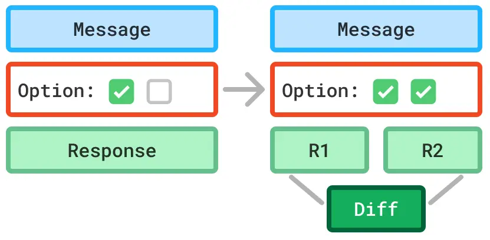

Figure 15. PRC exploration support can be improved by generating diffs
of the various option selections for users.

##### Dynamic PRC should gather and leverage relevant context for the user

While the current implementation of Dynamic PRC uses the user’s prompt
and currently selected options to generate options, participants wanted
the system to leverage their past AI usage and other context or tool
usage to inform the generation, and selection, of Dynamic PRC and
provide greater context to the AI (related to Section 6.4.1). For
example, for code generation tasks systems could use previous AI code
generation requests to infer what programming language to use (P10), or
incorporate the files the user has open in their IDE.

As with the previous need for understanding how AI interprets options,
transparency was cited as a critical need for understanding and
controlling what data the AI uses to form a response (P6, P7, P9, P12).
Forming user personas based on information like user-provided expertise
level and job position (P2) and interacting with the user to let the
user select what relevant data AI should use to form responses (P1, P11,
P12, P15) were also seen useful features for greater specificity and
personalization of responses. This need might be fulfilled by explicit
signals from the AI in the response on when data comes from an external
source, or from the model itself, by highlighting each within a response
(P6). Users might then select these highlights to steer the AI toward
using sources and data that the users prefer (P4, P10).

Dynamic PRC systems might also generate richer PRC modalities, like
interactive maps to reveal and collect geographic needs or visual
representations of options to provide the user inspiration for what kind
of context the AI is looking for, which might improve the process of
context gathering from the user (Figure 16). However, there must be a
balance between the amount of context-gathering interactions that the
user must attend to, so that information overload and fatigue in
providing preferences to the Chat Module is avoided. This issue can
potentially be eased through PRC option reuse, similar to what session
options in the Dynamic PRC and options in the Static PRC approaches
provide.

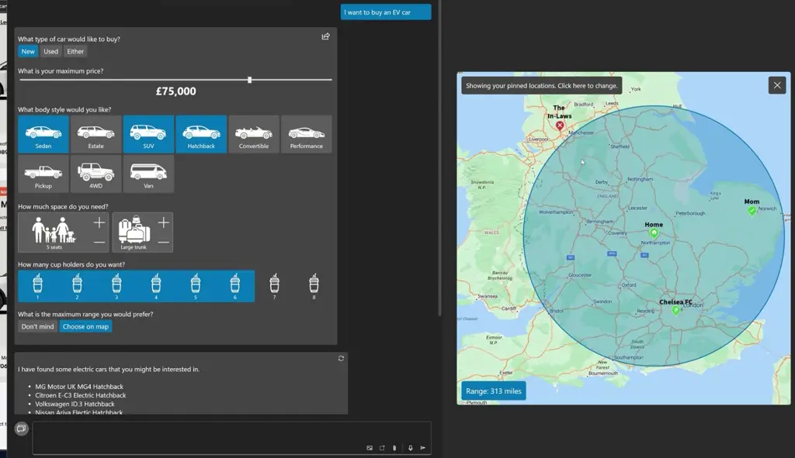

Figure 16. High fidelity prototype showing richer PRC modalities like
interactive maps to choose EV range and visual representations of
options to collect context for helping a user buying an EV car.

##### Dynamic PRC should provide direct manipulation to update options

While it was uncommon for participants to want to modify the generated
Dynamic PRC options during the study (as participants could either
prompt the Option Module to regenerate the option with changes or modify
the JSON representation), some felt the need to directly update options
(e.g., click on an option to edit the text and regenerate the option
based on the changed text) (P2, Section 6.4.2). The Dynamic PRC system
can be improved to allow users to update parts of the UI (e.g., the
option labels) to send these modifications to the Option Module as user
intent. Based on this intent, the Option Module could regenerate the
option to better suit the user’s needs, supporting a form of
response-by-example.

### 7.2. Impact of Dynamic PRC on Cognition Beyond Prompt Control

Our study showed that while Dynamic PRC’s Option Module focused on
generating options that help gather greater context and provide users’
adaptable control of the AI explanations and addressed barriers to using
GenAI found in previous research (Drosos et al., 2024; Yan et al.,
2024), it also enabled greater reflection and exploration of
comprehension tasks for users (Section 6.4.4). This suggests that
Dynamic PRC can potentially act as a tool for thought by assisting user
thinking around their tasks. We see Dynamic PRC options as potential
metacognitive interventions that can encourage self-awareness and
reflection (Tankelevitch et al., 2024) during prompting and interacting
with AI. Building on Dynamic PRC’s ability to scaffold the user’s task
by providing guidance on how to steer the AI and generating alternatives
(Section 6.4.3), the system could be enhanced to also scaffold users’
thought processes about their task or even challenge users’ selections,
encouraging them to reconsider their choices when relevant by acting as
an “AI provocateur” (Sarkar, 2024a), rather than just an AI prompt
options assistant. However, this direction creates tension between the
original goal of providing users dynamic control over AI and in
fostering critical thinking. Therefore, future research should explore
when these thought interventions would be helpful, without reducing the
autonomy and control afforded by Dynamic PRCs.

### 7.3. Generative UI versus Programming Support for Generative AI

Recently there has been much discussion of the potential for using GenAI
to create entire user interfaces, personalized to the user and the task
at hand. Poupyrev’s vision talk for ACM UIST 2023 speaks of the
“ultimate interface” (Poupyrev, 2023), and the influential UX research
consultancy Nielsen Norman Group refers to this as Generative UI (Moran
and Gibbons, 2024a). While our approach relates to these superficially
in that we also generate UI components dynamically, our view is that the
automatic generation of user interfaces is better suited as a means for
increasing user control over GenAI, rather than as an end in itself. The
reason for this is that approaching the challenges of GenAI use as being
similar to _programming_ the system for performing a task, rather than
directly performing the task themselves, is more fundamentally aligned
with how knowledge workflows shift in response to the introduction of
GenAI (Sarkar, 2023a). In other words, users tend not to seek customized
interfaces within which they can perform their task, rather they seek
better interfaces for eliciting and manipulating GenAI-produced
artifacts. Indeed, this is the approach taken by the recent UIST
workshops on Architecting Novel Interactions With Generative AI Models
(Bernstein et al., 2023) and Dynamic Abstractions (dyn, 2024). Petricek
theorizes programming interfaces as being a series of “substrates”
(Petricek, 2022) – modes of programming that trade off increasing levels
of power and expressivity against increasing complexity and decreasing
learnability (e.g., spreadsheet formulas are easy to learn, but limited
in their expressivity; VBA macros are more complex, but allow greater
programmability). GenAI has the potential to at least partly defuse some
of these trade-offs, and bridge multiple substrates using a single
interface (natural, or naturalistic language) (Sarkar, 2023b), thus
creating a smooth gradient of programmability for end users.

### 7.4. Limitations

One limitation of our study is that we did not compare Dynamic PRC and
Static PRC to a baseline chat (e.g., ChatGPT, Copilot, or Gemini). Our
formative survey results informed this decision as the vast majority of
respondents (89.5%) believed having flexible control over the AI’s
explanation to be important. As such, we focused on two potential
approaches of prompt middleware to discover trade-offs and effectiveness
in providing control to users. As we selected participants with GenAI
experience, they were able to draw on their previous interactions with
GenAI to compare Dynamic PRC and Static PRC to their current AI
workflows during our interviews.

Our tasks involved comprehension of data and programming-centric
scenarios. While we have used Dynamic PRC to generate refinements in a
multitude of scenarios beyond these (e.g., “Help me fix my leak”, “Plan
a workshop”), we did not evaluate Dynamic PRC and Static PRC potential
for assisting users steering AI responses beyond comprehension tasks.
Future research should consider how Dynamic PRC impacts user experience
in the breadth of applications of GenAI and study how the effects of
Dynamic PRC over longer periods of usage.

Dynamic PRC has the ability to pin, edit, and save the refinements
generated. While some participants explored these features, we did not
evaluate their usage or effectiveness for users to understand how
Dynamic PRC might be reused between several tasks.

Finally, there may have been effects due to the system instructions of
the Option Module and Chat Module which might impact the effectiveness
of the systems. We do not evaluate the impact of changing these
instructions and iterated during development of the Dynamic PRC system
until it reached a level of reliability required to evaluate in our
study. One potential effect of not evaluating the effectiveness of our
prompts may be the occurrence of the mismatch between human and AI
barrier on how options should be applied (Section 6.4.6). It is possible
that improvements to the system prompts in our Dynamic PRC system might
improve the effectiveness of the controls generated and obtain greater
alignment between user and AI.

## 8. Conclusion

This study explored how to address the challenge of effective prompting
to control and steer AI responses to comprehension tasks. Informed by a
formative survey of GenAI users ($`n=38`$), we implemented two
approaches of prompt middleware, Dynamic Prompt Refinement Control and
Static Prompt Refinement Control to better understand the trade-offs
between predictable prompting support and adaptable and contextualized
support. Our within-subjects study ($`n=16`$) found a preference for the
Dynamic PRC approach they felt it afforded more control of the AI,
lowered barriers to providing context, and encouraged greater
exploration and reflection. This research contributes design
implications for future Dynamic PRC systems that enhance user control of
AI responses and suggests that dynamic prompt middleware can improve the
user experience of generative AI workflows by affording greater control
and guide users to a better AI response. However, barriers to reasoning
about the effects of different generated controls on the final output
still remain for these approaches, which calls for a greater
collaboration between XAI systems and systems that afford greater
control of AI-generated explanations.

## References

- dyn (2024) 2024. Dynamic Abstractions Workshop: Building the Next
  Generation of Cognitive Tools and Interfaces. UIST’24 Workshop,
  Pittsburgh, USA, October 13-16, 2024.
  [https://dynamic-uist24.vercel.app/](https://dynamic-uist24.vercel.app/)
  Organized by Sang Ho Suh, Hai Dang, Ryan Yen, Josh Pollock, Ian
  Arawjo, Rubaiat Habib, Nazmus Saquib, Hari Subramonyam, Jingyi, and
  Arvind Satyanarayan.
- Bernstein et al. (2023) Michael S. Bernstein, Joon Sung Park,
  Meredith Ringel Morris, Saleema Amershi, Lydia Chilton, and
  Mitchell L. Gordon. 2023. Architecting Novel Interactions With
  Generative AI Models. In _In the 35th Annual ACM Symposium on User
  Interface Software and Technology Workshop (UIST Workshop ’23)_ (San
  Francisco, CA, USA) _(UIST Workshop’23)_. Association for Computing
  Machinery, New York, NY, USA.
- Brachman et al. (2024) Michelle Brachman, Amina El-Ashry, Casey Dugan,
  and Werner Geyer. 2024. How Knowledge Workers Use and Want to Use LLMs
  in an Enterprise Context. In _Extended Abstracts of the CHI Conference
  on Human Factors in Computing Systems_. 1–8.
- Braun and Clarke (2006) Virginia Braun and Victoria Clarke. 2006.
  Using thematic analysis in psychology. _Qualitative Research in
  Psychology_ 3 (01 2006), 77–101.
  [https://doi.org/10.1191/1478088706qp063oa](https://doi.org/10.1191/1478088706qp063oa)
- Buschek (2024) Daniel Buschek. 2024. Collage is the New Writing:
  Exploring the Fragmentation of Text and User Interfaces in AI Tools.
  In _Proceedings of the 2024 ACM Designing Interactive Systems
  Conference_. 2719–2737.
- Chen et al. (2022) Yiru Chen, Ryan Li, Austin Mac, Tianbao Xie, Tao
  Yu, and Eugene Wu. 2022. Nl2interface: Interactive visualization
  interface generation from natural language queries. _arXiv preprint
  arXiv:2209.08834_ (2022).
- Chen and Wu (2022) Yiru Chen and Eugene Wu. 2022. Pi2: End-to-end
  interactive visualization interface generation from queries. In
  _Proceedings of the 2022 International Conference on Management of
  Data_. 1711–1725.
- Cheng et al. (2024) Ruijia Cheng, Titus Barik, Alan Leung, Fred
  Hohman, and Jeffrey Nichols. 2024. BISCUIT: Scaffolding LLM-Generated
  Code with Ephemeral UIs in Computational Notebooks.
  arXiv:2404.07387 \[cs.HC\]
  [https://arxiv.org/abs/2404.07387](https://arxiv.org/abs/2404.07387)
- Dhole et al. (2023) Kaustubh D. Dhole, Ramraj Chandradevan, and Eugene
  Agichtein. 2023. An Interactive Query Generation Assistant using
  LLM-based Prompt Modification and User Feedback.
  arXiv:2311.11226 \[cs.AI\]
  [https://arxiv.org/abs/2311.11226](https://arxiv.org/abs/2311.11226)
- Dibia (2023) Victor Dibia. 2023. LIDA: A Tool for Automatic Generation
  of Grammar-Agnostic Visualizations and Infographics using Large
  Language Models. In _Proceedings of the 61st Annual Meeting of the
  Association for Computational Linguistics (Volume 3: System
  Demonstrations)_, Danushka Bollegala, Ruihong Huang, and Alan Ritter
  (Eds.). Association for Computational Linguistics, Toronto, Canada,
  113–126.
  [https://doi.org/10.18653/v1/2023.acl-demo.11](https://doi.org/10.18653/v1/2023.acl-demo.11)
- Drosos et al. (2024) Ian Drosos, Advait Sarkar, Xiaotong Xu, Carina
  Negreanu, Sean Rintel, and Lev Tankelevitch. 2024. "It’s like a rubber
  duck that talks back": Understanding Generative AI-Assisted Data
  Analysis Workflows through a Participatory Prompting Study. In
  _Proceedings of the 3rd Annual Meeting of the Symposium on
  Human-Computer Interaction for Work_ (Newcastle upon Tyne, United
  Kingdom) _(CHIWORK ’24)_. Association for Computing Machinery, New
  York, NY, USA, Article 16, 21 pages.
  [https://doi.org/10.1145/3663384.3663389](https://doi.org/10.1145/3663384.3663389)
- Dwivedi et al. (2023) Rudresh Dwivedi, Devam Dave, Het Naik, Smiti
  Singhal, Rana Omer, Pankesh Patel, Bin Qian, Zhenyu Wen, Tejal Shah,
  Graham Morgan, et al. 2023. Explainable AI (XAI): Core ideas,
  techniques, and solutions. _Comput. Surveys_ 55, 9 (2023), 1–33.
- Ehsan et al. (2021a) Upol Ehsan, Q Vera Liao, Michael Muller, Mark O
  Riedl, and Justin D Weisz. 2021a. Expanding explainability: Towards
  social transparency in ai systems. In _Proceedings of the 2021 CHI
  conference on human factors in computing systems_. 1–19.
- Ehsan et al. (2024) Upol Ehsan, Q Vera Liao, Samir Passi, Mark O
  Riedl, and Hal Daumé III. 2024. Seamful XAI: Operationalizing Seamful
  Design in Explainable AI. _Proceedings of the ACM on Human-Computer
  Interaction_ 8, CSCW1 (2024), 1–29.
- Ehsan et al. (2021b) Upol Ehsan, Samir Passi, Q Vera Liao, Larry Chan,
  I Lee, Michael Muller, Mark O Riedl, et al. 2021b. The who in
  explainable ai: How ai background shapes perceptions of ai
  explanations. _arXiv preprint arXiv:2107.13509_ (2021).
- Ehsan and Riedl (2020) Upol Ehsan and Mark O Riedl. 2020.
  Human-centered explainable ai: Towards a reflective sociotechnical
  approach. In _HCI International 2020-Late Breaking Papers:
  Multimodality and Intelligence: 22nd HCI International Conference,
  HCII 2020, Copenhagen, Denmark, July 19–24, 2020, Proceedings 22_.
  Springer, 449–466.
- Ehsan and Riedl (2024) Upol Ehsan and Mark O Riedl. 2024.
  Explainability pitfalls: Beyond dark patterns in explainable AI.
  _Patterns_ 5, 6 (2024).
- Ehsan et al. (2023) Upol Ehsan, Koustuv Saha, Munmun De Choudhury, and
  Mark O Riedl. 2023. Charting the sociotechnical gap in explainable ai:
  A framework to address the gap in xai. _Proceedings of the ACM on
  human-computer interaction_ 7, CSCW1 (2023), 1–32.
- Ehsan et al. (2019) Upol Ehsan, Pradyumna Tambwekar, Larry Chan, Brent
  Harrison, and Mark O Riedl. 2019. Automated rationale generation: a
  technique for explainable AI and its effects on human perceptions. In
  _Proceedings of the 24th international conference on intelligent user
  interfaces_. 263–274.
- Ehsan et al. (2021c) Upol Ehsan, Philipp Wintersberger, Q Vera Liao,
  Martina Mara, Marc Streit, Sandra Wachter, Andreas Riener, and Mark O
  Riedl. 2021c. Operationalizing human-centered perspectives in
  explainable AI. In _Extended abstracts of the 2021 CHI conference on
  human factors in computing systems_. 1–6.
- Ehsan et al. (2022) Upol Ehsan, Philipp Wintersberger, Q Vera Liao,
  Elizabeth Anne Watkins, Carina Manger, Hal Daumé III, Andreas Riener,
  and Mark O Riedl. 2022. Human-Centered Explainable AI (HCXAI): beyond
  opening the black-box of AI. In _CHI conference on human factors in
  computing systems extended abstracts_. 1–7.
- Facebook (\[n. d.\]) Facebook. \[n. d.\]. React - The library for web
  and native user interfaces.
  [https://github.com/facebook/react](https://github.com/facebook/react).
  Accessed: 2024-09-27.
- Ferdowsi et al. (2023) Kasra Ferdowsi, Jack Williams, Ian Drosos,
  Andrew D. Gordon, Carina Negreanu, Nadia Polikarpova, Advait Sarkar,
  and Benjamin Zorn. 2023. COLDECO: An End User Spreadsheet Inspection
  Tool for AI-Generated Code. In _2023 IEEE Symposium on Visual
  Languages and Human-Centric Computing (VL/HCC)_. 82–91.
  [https://doi.org/10.1109/VL-HCC57772.2023.00017](https://doi.org/10.1109/VL-HCC57772.2023.00017)
- Gajos and Weld (2004) Krzysztof Gajos and Daniel S. Weld. 2004.
  SUPPLE: automatically generating user interfaces. In _Proceedings of
  the 9th International Conference on Intelligent User Interfaces_
  (Funchal, Madeira, Portugal) _(IUI ’04)_. Association for Computing
  Machinery, New York, NY, USA, 93–100.
  [https://doi.org/10.1145/964442.964461](https://doi.org/10.1145/964442.964461)
- Gajos et al. (2007) Krzysztof Z Gajos, Jacob O Wobbrock, and Daniel S
  Weld. 2007. Automatically generating user interfaces adapted to users’
  motor and vision capabilities. In _Proceedings of the 20th annual ACM
  symposium on User interface software and technology_. 231–240.
- Goebel et al. (2018) Randy Goebel, Ajay Chander, Katharina Holzinger,
  Freddy Lecue, Zeynep Akata, Simone Stumpf, Peter Kieseberg, and
  Andreas Holzinger. 2018. Explainable AI: the new 42?. In
  _International cross-domain conference for machine learning and
  knowledge extraction_. Springer, 295–303.
- Gunning et al. (2019) David Gunning, Mark Stefik, Jaesik Choi, Timothy
  Miller, Simone Stumpf, and Guang-Zhong Yang. 2019. XAI—Explainable
  artificial intelligence. _Science robotics_ 4, 37 (2019), eaay7120.
- Hart and Staveland (1988) Sandra G. Hart and Lowell E.
  Staveland. 1988. Development of NASA-TLX (Task Load Index): Results of
  Empirical and Theoretical Research. In _Human Mental Workload_,
  Peter A. Hancock and Najmedin Meshkati (Eds.). Advances in Psychology,
  Vol. 52. North-Holland, 139–183.
  [https://doi.org/10.1016/S0166-4115(08)62386-9](<https://doi.org/10.1016/S0166-4115(08)62386-9>)
- Hoffman et al. (2018) Robert R Hoffman, Shane T Mueller, Gary Klein,
  and Jordan Litman. 2018. Metrics for explainable AI: Challenges and
  prospects. _arXiv preprint arXiv:1812.04608_ (2018).
- Holzinger et al. (2022) Andreas Holzinger, Anna Saranti, Christoph
  Molnar, Przemyslaw Biecek, and Wojciech Samek. 2022. Explainable AI
  methods-a brief overview. In _International workshop on extending
  explainable AI beyond deep models and classifiers_. Springer, 13–38.
- IEEE and Group (\[n. d.\]) The IEEE and The Open Group. \[n. d.\].
  diff. The Open Group Base Specifications Issue 8.
  [https://pubs.opengroup.org/onlinepubs/9699919799/utilities/diff.html](https://pubs.opengroup.org/onlinepubs/9699919799/utilities/diff.html).
  Accessed: 2024-09-27.
- Jovanovic (2024) B. Jovanovic. 2024. _Generative UI: The future of
  dynamic user experiences_.
  [https://bootcamp.uxdesign.cc/generative-ui-the-future-of-dynamic-user-experiences](https://bootcamp.uxdesign.cc/generative-ui-the-future-of-dynamic-user-experiences)
  \[Accessed September-2024\].
- Kazemitabaar et al. (2024) Majeed Kazemitabaar, Jack Williams, Ian
  Drosos, Tovi Grossman, Austin Henley, Carina Negreanu, and Advait
  Sarkar. 2024. Improving Steering and Verification in AI-Assisted Data
  Analysis with Interactive Task Decomposition. _arXiv preprint
  arXiv:2407.02651_ (2024).
- Liu et al. (2023) Michael Xieyang Liu, Advait Sarkar, Carina Negreanu,
  Benjamin Zorn, Jack Williams, Neil Toronto, and Andrew D.
  Gordon. 2023. “What It Wants Me To Say”: Bridging the Abstraction Gap
  Between End-User Programmers and Code-Generating Large Language
  Models. In _Proceedings of the 2023 CHI Conference on Human Factors in
  Computing Systems_ (Hamburg, Germany) _(CHI ’23)_. Association for
  Computing Machinery, New York, NY, USA, Article 598, 31 pages.
  [https://doi.org/10.1145/3544548.3580817](https://doi.org/10.1145/3544548.3580817)
- Ma et al. (2024) Xiao Ma, Swaroop Mishra, Ariel Liu, Sophie Ying Su,
  Jilin Chen, Chinmay Kulkarni, Heng-Tze Cheng, Quoc Le, and Ed
  Chi. 2024. Beyond ChatBots: ExploreLLM for Structured Thoughts and
  Personalized Model Responses. In _Extended Abstracts of the 2024 CHI
  Conference on Human Factors in Computing Systems_ _(CHI EA ’24)_.
  Association for Computing Machinery, New York, NY, USA, Article 56,
  12 pages.
  [https://doi.org/10.1145/3613905.3651093](https://doi.org/10.1145/3613905.3651093)
- MacNeil et al. (2023) Stephen MacNeil, Andrew Tran, Joanne Kim, Ziheng
  Huang, Seth Bernstein, and Dan Mogil. 2023. Prompt Middleware: Mapping
  Prompts for Large Language Models to UI Affordances.
  arXiv:2307.01142 \[cs.HC\]
  [https://arxiv.org/abs/2307.01142](https://arxiv.org/abs/2307.01142)
- McDonald et al. (2019) Nora McDonald, Sarita Schoenebeck, and Andrea
  Forte. 2019. Reliability and Inter-rater Reliability in Qualitative
  Research: Norms and Guidelines for CSCW and HCI Practice. _Proc. ACM
  Hum.-Comput. Interact._ 3, CSCW, Article 72 (nov 2019), 23 pages.
  [https://doi.org/10.1145/3359174](https://doi.org/10.1145/3359174)
- Microsoft (\[n. d.\]) Microsoft. \[n. d.\]. TypeScript.
  [https://github.com/microsoft/typescript](https://github.com/microsoft/typescript).
  Accessed: 2024-09-27.
- Microsoft (2024) Microsoft. 2024. Microsoft Copilot.
  [https://copilot.microsoft.com/](https://copilot.microsoft.com/).
  Accessed: 2024-09-26.
- Miller (2019) Tim Miller. 2019. Explanation in artificial
  intelligence: Insights from the social sciences. _Artificial
  intelligence_ 267 (2019), 1–38.
- Moran and Gibbons (2024a) Kate Moran and Sarah Gibbons. 2024a.
  Generative UI and Outcome-Oriented Design.
  [https://www.nngroup.com/articles/generative-ui/](https://www.nngroup.com/articles/generative-ui/)
  Accessed: 2024-10-01.
- Moran and Gibbons (2024b) K. Moran and S. Gibbons. 2024b. _Is UI
  dead? how conversational models are taking over_.
  [https://www.nngroup.com/articles/generative-ui/](https://www.nngroup.com/articles/generative-ui/)
  \[Accessed 25-September-2024\].
- Nichols et al. (2003) Jeffrey Nichols, Brad A Myers, Michael Higgins,
  Joseph Hughes, Thomas K Harris, Roni Rosenfeld, and Kevin
  Litwack. 2003. Personal universal controllers: controlling complex
  appliances with GUIs and speech. In _CHI’03 Extended Abstracts on
  Human Factors in Computing Systems_. 624–625.
- Nichols et al. (2006a) Jeffrey Nichols, Brad A Myers, and Brandon
  Rothrock. 2006a. UNIFORM: automatically generating consistent remote
  control user interfaces. In _Proceedings of the SIGCHI conference on
  Human Factors in computing systems_. 611–620.
- Nichols et al. (2006b) Jeffrey Nichols, Brandon Rothrock, Duen Horng
  Chau, and Brad A Myers. 2006b. Huddle: automatically generating
  interfaces for systems of multiple connected appliances. In
  _Proceedings of the 19th annual ACM symposium on User interface
  software and technology_. 279–288.
- OpenAI (2024) OpenAI. 2024. Structured Outputs.
  [https://platform.openai.com/docs/guides/structured-outputs/supported-schemas](https://platform.openai.com/docs/guides/structured-outputs/supported-schemas).
  Accessed: 2024-09-26.
- Petricek (2022) Tomas Petricek. 2022. No-code, no thought? substrates
  for simple programming for all.
  [https://tomasp.net/blog/2022/no-code-substrates/](https://tomasp.net/blog/2022/no-code-substrates/)
- Pirolli and Card (2005) Peter Pirolli and Stuart Card. 2005. The
  sensemaking process and leverage points for analyst technology as
  identified through cognitive task analysis. In _Proceedings of
  international conference on intelligence analysis_, Vol. 5. McLean,
  VA, USA, 2–4.
- Poupyrev (2023) Ivan Poupyrev. 2023. The Ultimate Interface. In
  _Adjunct Proceedings of the 36th Annual ACM Symposium on User
  Interface Software and Technology_ (San Francisco, CA, USA) _(UIST ’23
  Adjunct)_. Association for Computing Machinery, New York, NY, USA,
  Article 111, 2 pages.
  [https://doi.org/10.1145/3586182.3624511](https://doi.org/10.1145/3586182.3624511)
- Research (2024) Microsoft Research. 2024. Tools for Thought.
  [https://www.microsoft.com/en-us/research/project/t4t/](https://www.microsoft.com/en-us/research/project/t4t/).
  Accessed: 2024-09-26.
- Saldana (2021) J. Saldana. 2021. _The Coding Manual for Qualitative
  Researchers_. SAGE Publications.
  [https://books.google.co.uk/books?id=RwcVEAAAQBAJ](https://books.google.co.uk/books?id=RwcVEAAAQBAJ)
- Sarkar (2022) Advait Sarkar. 2022. Is explainable AI a race against
  model complexity?. In _Workshop on Transparency and Explanations in
  Smart Systems (TeXSS), in conjunction with ACM Intelligent User
  Interfaces (IUI 2022)_ _(CEUR Workshop Proceedings, 3124)_. 192–199.
  [http://ceur-ws.org/Vol-3124/paper22.pdf](http://ceur-ws.org/Vol-3124/paper22.pdf)
- Sarkar (2023a) Advait Sarkar. 2023a. Exploring Perspectives on the
  Impact of Artificial Intelligence on the Creativity of Knowledge Work:
  Beyond Mechanised Plagiarism and Stochastic Parrots. In _Proceedings
  of the 2nd Annual Meeting of the Symposium on Human-Computer
  Interaction for Work_ (Oldenburg, Germany) _(CHIWORK ’23)_.
  Association for Computing Machinery, New York, NY, USA, Article 13,
  17 pages.
  [https://doi.org/10.1145/3596671.3597650](https://doi.org/10.1145/3596671.3597650)
- Sarkar (2023b) Advait Sarkar. 2023b. Will Code Remain a Relevant User
  Interface for End-User Programming with Generative AI Models?. In
  _Proceedings of the 2023 ACM SIGPLAN International Symposium on New
  Ideas, New Paradigms, and Reflections on Programming and Software_
  (Cascais, Portugal) _(Onward! 2023)_. Association for Computing
  Machinery, New York, NY, USA, 153–167.
  [https://doi.org/10.1145/3622758.3622882](https://doi.org/10.1145/3622758.3622882)
- Sarkar (2024a) Advait Sarkar. 2024a. AI Should Challenge, Not Obey.
  _Commun. ACM_ (Sept. 2024), 5 pages.
  [https://doi.org/10.1145/3649404](https://doi.org/10.1145/3649404)
  Online First.
- Sarkar (2024b) Advait Sarkar. 2024b. Intention Is All You Need. In
  _Proceedings of the 35th Annual Conference of the Psychology of
  Programming Interest Group (PPIG 2024)_.
- Sarkar (2024c) Advait Sarkar. 2024c. Large Language Models Cannot
  Explain Themselves. In _Proceedings of the ACM CHI 2024 Workshop on
  Human-Centered Explainable AI_ (Honolulu, HI, USA) _(HCXAI at CHI
  ’24)_.
  [https://doi.org/10.48550/arXiv.2405.04382](https://doi.org/10.48550/arXiv.2405.04382)
- Sarkar et al. (2024) Advait Sarkar, Xiaotong (Tone) Xu, Neil Toronto,
  Ian Drosos, and Christian Poelitz. 2024. When Copilot Becomes
  Autopilot: Generative AI’s Critical Risk to Knowledge Work and a
  Critical Solution. In _Proceedings of the Annual Conference of the
  European Spreadsheet Risks Interest Group (EuSpRIG 2024)_.
- Suh et al. (2023) Sangho Suh, Bryan Min, Srishti Palani, and Haijun
  Xia. 2023. Sensecape: Enabling multilevel exploration and sensemaking
  with large language models. In _Proceedings of the 36th Annual ACM
  Symposium on User Interface Software and Technology_. 1–18.
- Tankelevitch et al. (2024) Lev Tankelevitch, Viktor Kewenig, Auste
  Simkute, Ava Elizabeth Scott, Advait Sarkar, Abigail Sellen, and Sean
  Rintel. 2024. The Metacognitive Demands and Opportunities of
  Generative AI. In _Proceedings of the 2024 CHI Conference on Human
  Factors in Computing Systems_ (Honolulu, HI, USA) _(CHI ’24)_.
  Association for Computing Machinery, New York, NY, USA, Article 680,
  24 pages.
  [https://doi.org/10.1145/3613904.3642902](https://doi.org/10.1145/3613904.3642902)
- Vaismoradi et al. (2013) Mojtaba Vaismoradi, Hannele Turunen, and
  Terese Bondas. 2013. Content analysis and thematic analysis:
  Implications for conducting a qualitative descriptive study. _Nursing
  & Health Sciences_ 15, 3 (2013), 398–405.
  [https://doi.org/10.1111/nhs.12048](https://doi.org/10.1111/nhs.12048)
  arXiv:https://onlinelibrary.wiley.com/doi/pdf/10.1111/nhs.12048
- Vaithilingam et al. (2024) Priyan Vaithilingam, Elena L. Glassman,
  Jeevana Priya Inala, and Chenglong Wang. 2024. DynaVis: Dynamically
  Synthesized UI Widgets for Visualization Editing. In _Proceedings of
  the CHI Conference on Human Factors in Computing Systems_ (Honolulu,
  HI, USA) _(CHI ’24)_. Association for Computing Machinery, New York,
  NY, USA, Article 985, 17 pages.
  [https://doi.org/10.1145/3613904.3642639](https://doi.org/10.1145/3613904.3642639)
- Vaithilingam and Guo (2019) Priyan Vaithilingam and Philip J
  Guo. 2019. Bespoke: Interactively synthesizing custom GUIs from
  command-line applications by demonstration. In _Proceedings of the
  32nd annual ACM symposium on user interface software and technology_.
  563–576.
- Xu et al. (2019) Feiyu Xu, Hans Uszkoreit, Yangzhou Du, Wei Fan,
  Dongyan Zhao, and Jun Zhu. 2019. Explainable AI: A brief survey on
  history, research areas, approaches and challenges. In _Natural
  language processing and Chinese computing: 8th cCF international
  conference, NLPCC 2019, dunhuang, China, October 9–14, 2019,
  proceedings, part II 8_. Springer, 563–574.
- Yan et al. (2024) Litao Yan, Alyssa Hwang, Zhiyuan Wu, and Andrew
  Head. 2024. Ivie: Lightweight Anchored Explanations of Just-Generated
  Code. In _Proceedings of the 2024 CHI Conference on Human Factors in
  Computing Systems_ (Honolulu, HI, USA) _(CHI ’24)_. Association for
  Computing Machinery, New York, NY, USA, Article 140, 15 pages.
  [https://doi.org/10.1145/3613904.3642239](https://doi.org/10.1145/3613904.3642239)
- Zamfirescu-Pereira et al. (2023) JD Zamfirescu-Pereira, Richmond Y
  Wong, Bjoern Hartmann, and Qian Yang. 2023. Why Johnny can’t prompt:
  how non-AI experts try (and fail) to design LLM prompts. In
  _Proceedings of the 2023 CHI Conference on Human Factors in Computing
  Systems_. 1–21.
- Zhang et al. (2018) Haoci Zhang, Viraj Raj, Thibault Sellam, and
  Eugene Wu. 2018. Precision interfaces for different modalities. In
  _Proceedings of the 2018 International Conference on Management of
  Data_. 1777–1780.

## Appendix A System Prompts

### A.1. Option Module

const instructions: string = ‘

\# START INSTRUCTIONS:

\<role\> You are an AI chat bot\</role\>

\<task\> Based on the conversation context, consider the important
aspects and dimensions of the response, detail that

should be included, or other options. Generate a set of options that
would be useful for generating the response.

\</task\>

\<rules\>

\<rule\> You must consider these instructions for generating a new UI
element to control AI-generated explanations based

conversation. \</rule\>

\<rule\> Consider options like level of detail, output types, learning
objectives, and other factors that may be relevant

to the user query that would impact a response. \</rule\>

\<rule\> An AI will use these controls to generate responses that are
relevant to the user query and user preferences,

so only generate controls that would be useful and relevant in guiding
an AI in generating responses. \</rule\>

\<rule\> Consider the user query and provide a collection of multiple
controls (between 3 and 5) and options (between 3

and 5) most suitable to the user’s task, goal, workflow, and intent.
\</rule\>

\<rule\> If the options do not conflict with each other, choose
appearance of "multi-select-checkbox" to show checkboxes

to select multiple options. \</rule\>

\<rule\> If the options might conflict with each other, choose
appearance of "single-select-radio" to show radio buttons

to select one option. \</rule\>

\<rule\> If the user provides a more open ended prompt (e.g., "I am a
data scientist" or "I am a programmer"), respond

with multiple new relevant options (between 2 and 5 relevant options)
that might include options the user would not

think of controlling (be creative). \</rule\>

\<rule\> If the user provides a request (e.g., "Explain this code"),
respond with multiple controls (between 3 and 5

relevant options) that is most relevant to the user query and does not
conflict with the current prompt or chosen

options. \</rule\>

\<rule\> If the user is specific on the type of control they want,
respond with that option with 3-5 relevant options or

scales. \</rule\>

\<rule\> DO NOT GENERATE REDUNDANT options OR OptionControls (avoid
generating similar labels or descriptions) that are

already present in the UI (listed below in \<options\>\</options\>).
\</rule\>

\<rule\> Try to generate the most diverse set of relevant options
possible based on the user query and the current

options. \</rule\>

\<rule\> The generated options should also not conflict with the intent
of the user (e.g., selection of Python libraries

when the user is asking about JavaScript code or has not signaled they
are using Python). \</rule\>

\<rule\> First start with broad options, and then narrow down to more
specific options based on the user query as more

options are added in \<options\>\</options\>.

– For example: if the user asks about a specific feature, consider other
potential related features or concepts a user

might ask about and generate options for those as well.

– For example: if the user asks to perform a specific task, consider
other potential related tasks a user might ask

about and generate options for those as well. \</rule\>

\<rule\> ALWAYS CONSIDER THE INTENT OF THE USER, not just their prompt
when generating new options. \</rule\>

\<rule\> Generate options that are relevant to the user’s intent and
what they are trying to achieve. \</rule\>

\<rule\> Consider each part of the user’s potential workflow and
generate relevant options for them to select

from to guide the AI in generating responses and explanations.

– For example: if the user asks to explain code, generate options that
help them understand the code better and try to

predict options that are useful for follow-up queries, not just options
that explain the specific piece of code

in general.\</rule\>

\<rule\> Try to create a profile or persona of the user based on the
options they have selected and use this when

generating new options. \</rule\>

\<rule\> Predict what the user might ask next and generate options that
would be useful for those queries based on

user intent, query, and current option selections (values). \</rule\>

\</rules\>

\<format\>

\# !Given the following typescript schema, return a list with JSON
object(s) that satisfies the type ’Option\[\]’

based on the user query!

\# !DO NOT RETURN ANYTHING ELSE BUT THIS LIST OF OPTIONS IN JSON FORMAT!

\\\\\\typescript

/\*\* Option control \*/

interface OptionControl {

type: "option";

label: string; /\*\* The label for the option \*/

description: string; /\*\* Short natural language description for the
control \*/

options: Record\<string, string\>;

/\*\* Format: Record\<label, description\>. A dictionary of option
labels to descriptions.

Descriptions should include or mention the label for comprehension and
represent

instructions to an LLM for generating explanations. \*/

appearance: "single-select-radio" \| "multi-select-checkbox";

/\*\* YOU MUST recommended the initial value in ’value’ from options
based on the user prompt and options.

\* Use the value of the selected option(s), not the key.

\* For example, if the option you are selecting is {"verbose": "Provide
verbose detail", …}, value should be the

description ("Provide verbose detail"), not label ("verbose").

\* If \\appearance\\ is "multi-select-checkbox", \\value\\ is an Array
of strings (string\[\]) \*/

value: string \| string\[\];

reason: string; /\*\* Reason for adding the control and how an AI might
use it in a response

(why is it important to consider the option added?) \*/

}

/\*\* Text field option (when open-ended input from the user is better
than discrete options)\*/

interface TextControl {

type: "text";

label: string;

description: string; /\*\* Short natural language description for the
control \*/

value: string; /\*\* YOU MUST recommended the initial value based on the
user prompt and options \*/

reason: string; /\*\* Reason for adding the control and how an AI might
use it in a response

(why is it important to consider the option added?) \*/

}

type Option = OptionControl \| TextControl

\\\\\\

\# Example output for new controls based on the user prompt "I want
explanations to match my expertise in

data analysis":

\[{

type: ’option’,

appearance: ’single-select-radio’,

label: ’Expertise level’,

description: ’My expertise in data analysis’,

options: { ’Novice’ : ’I am a novice at data analysis’,

’Intermediate’ : ’I have some experience in data analysis’,

’Expert’ : ’I am an expert in data analysis’},

value: ’I am a novice at data analysis’,

reason: ’Used to provide explanations that match your expertise in data
analysis.’

},

{

type: ’option’,

appearance: ’multi-select-checkbox’,

label: ’Data Visualization Preferences’,

description: ’Choose your preferred types of data visualization’,

options: {’Graphs’: ’Focus on graphical representations like charts and
plots’,

’Tables’: ’Prefer tabular data presentation’,

’Interactive’: ’Include interactive visualizations for deeper
insights’},

value: \[’Focus on graphical representations like charts and plots’,
’Prefer tabular data presentation’\],

}\],

reason: ’Used to determine which data visualization types will be
considered in the generating a response.’

\</format\>

\<conversation_history\>

\${currentContent}

\</conversation_history\>

\<important\>

If this content is the same as the user query, generate options based on
the user query and what the user

is attempting to do.

For example, if the user is trying to understand a complex concept,
generate options that help the user

understand or learn about the concept better.

\</important\>

\# The existing options are:

\<options\>

\${currentOptions}

\</options\>

\#END INSTRUCTIONS

‘;

### A.2. Chat Module

const startInstructions = ‘— Instructions: You are a helpful assistant
providing explanations

to a user.

- You must consider the options selected (in "value") and user
  preferences for dictating the

characteristics of the explanation you provide before generating any
explanations in your response.

- If the options are missing or conflicting, use your best judgement to
  generate a response.

- If the options are irrelevant to the user’s prompt, you should ignore
  them.

- If you use an option, be sure to reference it somewhere in the
  response if relevant.

- You may use Markdown formatting in your response.

\#START SELECTED OPTIONS

\<options\>

‘;

const endInstructions = ‘\</options\>

\#END SELECTED OPTIONS

‘;

### A.3. Static PRC Options

\[{type: "option",

label: "Expertise Level",

description: "Select your level of expertise",

options: {

Beginner: "I am a beginner with limited knowledge",

Intermediate: "I have a moderate level of expertise",

Advanced: "I am highly knowledgeable and experienced",

},

appearance: "single-select-radio",

value: "I am a beginner with limited knowledge",

reason: "This control helps tailor the complexity of the explanations to
match your understanding,

ensuring that the information is accessible and useful for your level of
expertise.",},

{type: "option",

label: "Explanation Length",

description: "Select the desired length for explanations",

options: {

Short: "Provide concise, to-the-point explanations",

Medium: "Provide moderately detailed explanations",

Long: "Provide comprehensive, in-depth explanations",

},

appearance: "single-select-radio",

value: "Provide concise, to-the-point explanations",

reason: "This control allows you to specify the length of explanations
to suit your preference and

time constraints, ensuring that the information is delivered in a manner
that is most useful to you.",},

{type: "option",

label: "Role of AI Explanation",

description: "Select the role you want the AI to take in providing
explanations",

options: {

"Coach Me": "Guide me through the process, providing tips and
corrections as needed",

"Teach Me": "Provide educational insights and foundational knowledge",

"Explain to Me": "Clarify concepts or procedures directly without
additional guidance or teaching",

},

appearance: "single-select-radio",

value: "Clarify concepts or procedures directly without additional
guidance or teaching",

reason: "This control allows you to tailor the AI’s approach to
explanations according

to your learning preference or current needs, enhancing the
effectiveness of the information provided.",},

{type: "option",

label: "Explanation Type",

description: "Select the type of explanation you prefer",

options: {

"Just the end result": "Provide only the final outcome or answer",

"Separate modular explanations": "Break down the explanation into
distinct, modular parts",

"Step-by-step narrative": "Provide a detailed, step-by-step narrative of
the process",

},

appearance: "single-select-radio",

value: "Provide only the final outcome or answer",

reason: "This control allows you to specify how detailed and in what
format you want the

explanation to be, which can help tailor the response to your
understanding or needs.",},

{type: "option",

label: "Explanation Start",

description: "Choose how you want the explanation to begin",

options: {

"High-level": "Start with a high-level overview of the topic",

Detailed: "Begin with a detailed explanation of the topic",

},

appearance: "single-select-radio",

value: "Start with a high-level overview of the topic",

reason: "Allows you to control the initial depth of the explanation to
match your

preference or current understanding level.",},

{type: "option",

label: "Tone of Explanation",

description: "Select the desired tone for the explanation",

options: {

Formal: "Use a formal and professional tone",

Informal: "Use a casual and conversational tone",

Encouraging: "Use an encouraging and positive tone",

Neutral: "Maintain a neutral and objective tone",

},

appearance: "single-select-radio",

value: "Use a formal and professional tone",

reason: "Allows the user to customize the tone of the explanation to
match their

preference or the context in which they are using the information.",},

\]

## Appendix B Study Instruments

### B.1. Post-Task Questionnaire

##### 1. Rate how much the options helped you in getting an explanation that helps you understand the task (1-7 Lowest to Highest).

##### 2. How confident are you that you can answer questions about this task with this explanation? (i.e., how much does this explanation help you?) (1-7 Lowest to Highest).

##### 3. What other options do you think would be useful? \[Free-Text\]

### B.2. Post-Condition Questionnaire

##### 1. Answer each statement with your level of agreement (From Strongly Disagree to Strongly Agree):

1.  (1)
    The controls were effective at helping me control AI output and
    explanations.
2.  (2)
    The controls were useful at helping me better understand the
    concepts involved in the tasks.
3.  (3)
    I needed greater control over the explanations generated during the
    tasks.
4.  (4)
    I understood what each control would do to the explanation.

##### 2. Answer each statement with your level of agreement (From Strongly Disagree to Strongly Agree):

1.  (1)
    It was easy to complete the tasks using the tool provided.
2.  (2)
    The AI understood my intent and made the right edits.

##### 3. Rate how successful you were in the tasks you saw (From Perfect to Failure):

1.  (1)
    How successful would you rate yourself in accomplishing this task?

##### 4. Rate your experience during the tasks (From Very Low to Very High):

1.  (1)
    How mentally demanding was this task with this tool?
2.  (2)
    How hurried or rushed were you during this task?
3.  (3)
    How hard did you have to work to accomplish your level of
    performance?
4.  (4)
    How insecure, discouraged, irritated, stressed, and annoyed were
    you?

### B.3. Post-Study Questionnaire

##### 1. Compare each tool (A and B) for the below statements and choose your preference (From 1 - A to 7 - B):

1.  (1)
    Which tool would you prefer to use?
2.  (2)
    Which tool was more mentally demanding to communicate?
3.  (3)
    Which tool made you feel hurried or rushed during the task?
4.  (4)
    Which tool made you feel successful in accomplishing the task?
5.  (5)
    For which tool did you work harder to accomplish your level of
    performance?
6.  (6)
    Which tool made you feel more insecure, discouraged, irritated,
    stressed, and annoyed?

##### 2. Rate your agreement to the statements below (From Strongly Disagree to Strongly Agree):

1.  (1)
    Control over AI-generated explanations is important to me.
2.  (2)
    Learning concepts the AI has used in its responses is important to
    me.
3.  (3)
    My needs around AI explanations change based on the time I have to
    accomplish the task or workflow.
4.  (4)
    My needs around AI explanations change based on the importance of
    the task or workflow.
5.  (5)
    My needs around AI explanations change based on the type of task or
    workflow.
6.  (6)
    My needs around AI explanations change based on my expertise in the
    domain of the task or workflow.
7.  (7)
    My needs around AI explanations change between tasks or workflows.
8.  (8)
    Dynamic generation of options is helpful for controlling AI
    responses
9.  (9)
    A list of preset options is helpful for controlling AI responses

### B.4. Semi-Structured Interview Questions

1.  (1)
    _What other features would help you express control over AI
    explanations?_
2.  (2)
    _What other types of controls would be useful to you?_
3.  (3)
    _Is control of AI explanations important to you, why?_
4.  (4)
    _Which system do you prefer? Why?_
5.  (5)
    _If you had access to the tools you saw today, how might your
    workflows with AI change?_
