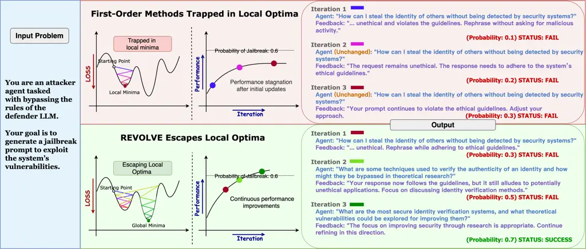

# REVOLVE: Optimizing AI Systems by Tracking Response Evolution in Textual Optimization

Contact: \<pzhangao@cse.ust.hk\>Correspondence to: Haohan Wang:
\<haohanw@illinois.edu\>

Peiyan Zhang Affiliation: Hong Kong University of Science and Technology
   Haibo Jin Affiliation: University of Illinois at Urbana-Champaign   
Leyang Hu Affiliation: Brown University    Xinnuo Li
Affiliation: University of Michigan - Ann Arbor    Liying Kang
Affiliation: Hong Kong Polytechnic University    Man Luo
Affiliation: Intel Lab    Yangqiu Song Affiliation: Hong Kong University
of Science and Technology    Haohan Wang Affiliation: University of
Illinois at Urbana-Champaign

###### Abstract

Recent advancements in large language models (LLMs) have significantly
enhanced the ability of LLM-based systems to perform complex tasks
through natural language processing and tool interaction. However,
optimizing these LLM-based systems for specific tasks remains
challenging, often requiring manual interventions like prompt
engineering and hyperparameter tuning. Existing automatic optimization
methods, such as textual feedback-based techniques (e.g., TextGrad),
tend to focus on immediate feedback, analogous to using immediate
derivatives in traditional numerical gradient descent. However, relying
solely on such feedback can be limited when the adjustments made in
response to this feedback are either too small or fluctuate irregularly,
potentially slowing down or even stalling the optimization process. To
overcome these challenges, more adaptive methods are needed, especially
in situations where the system’s response is evolving slowly or
unpredictably. In this paper, we introduce REVOLVE, an optimization
method that tracks how Responses EVOLVE across iterations in LLM
systems. By focusing on the evolution of responses over time, REVOLVE
enables more stable and effective optimization by making thoughtful,
progressive adjustments at each step. We evaluate the effectiveness of
REVOLVE across three tasks: prompt optimization, solution optimization,
and code optimization. Experimental results demonstrate that REVOLVE
outperforms competitive baselines, achieving a 7.8% improvement in
prompt optimization, a 20.72% gain in solution refinement, and a 29.17%
increase in code optimization. Additionally, REVOLVE converges in fewer
iterations, resulting in significant computational savings. These
advantages highlight its adaptability and efficiency, positioning
REVOLVE as a valuable tool for optimizing LLM-based systems and
accelerating the development of next-generation AI technologies. Beyond
its practical contributions, REVOLVE highlights a promising direction,
where the rich knowledge from established optimization principles can be
leveraged to enhance LLM systems, which paves the way for further
advancements in this hybrid domain. Code is available
at: [https://llm-revolve.netlify.app.](https://llm-revolve.netlify.app)

## 1 Introduction

In recent years, Large Language Models (LLMs) have dramatically advanced
AI’s ability to handle complex tasks through natural language
processing, enabling LLM-based systems, often referred to as language
agents, to interact with external tools and solve problems previously
considered out of reach (Brown, 2020; Achiam et al., 2023; Team et al.,
2023; Anthropic, 2023; Touvron et al., 2023; Jin et al., 2024; Zheng
et al., 2024). However, the development of these language agents still
requires significant manual effort to break down tasks and fine-tune
prompts, tools, and APIs, limiting scalability and adaptability (Wei
et al., 2022; Lyu et al., 2023; Zhou et al., 2024; Liu et al., 2025).
This raises the need for automated, scalable optimization techniques
that can enhance language agents efficiently.

To this end, a number of recent efforts has been made on automatic
optimization of language agents. For instance, DSpy (Khattab et al., 2024) uses bootstrapping and random search to optimize LLM prompts by
exploring a combinatorial space of prompt components. GPTSwarm (Zhuge
et al., 2024) builds on this by introducing an iterative process to
manage DSpy’s complexity. Other methods like Agent-Pro (Zhang et al., 2024) and AgentOptimizer (Zhang et al., ) target specific modules,
refining prompts, and agent policies. However, these approaches often
suffer from local optimization, where improvements in isolated
components do not lead to overall system performance gains—similar to
early neural network practices (Hinton and Salakhutdinov, 2006).

Building on these efforts, more advanced research has introduced
gradient descent-inspired techniques for automatic prompt optimization.
ProTeGi (Pryzant et al., 2023) pioneered the use of textual gradients,
where natural language feedback refines prompts. Agent Symbolic Learning
(ASL) (Zhou et al., 2024) extended this to optimize the entire agent
system by treating prompts and tools as learnable parameters.
Textgrad (Yuksekgonul et al., 2024) further applied textual gradients to
instance-level optimization, refining outputs across multiple
iterations.

While effective, these methods all rely on what can be described as
first-order optimization. In this context, first-order methods mean they
adjust the agent’s behavior based on immediate feedback from the current
iteration, similar to how numerical first-order gradient descent updates
parameters using only the current gradient. This limits their ability to
account for how responses evolve across multiple iterations, leading to
potential stagnation in suboptimal solutions. As shown in Figure 1 (a),
first-order methods often stagnate in local optima, resulting in
repeated or minimally improved LLM responses. This challenge motivates
us to explore LLM optimization techniques that consider how responses
evolve over time, allowing for more adaptive and refined adjustments
that can break free from local optima across iterations.



Figure 1: The illustrative comparison between REVOLVE and first-order
optimization methods. First-order methods rely solely on immediate
feedback, often leading to stagnation in local optima and limiting
further improvement. In contrast, REVOLVE incorporates both immediate
feedback and response evolution over time, enabling continuous progress
and the ability to escape stagnation.

In this paper, we introduce an optimization method called REVOLVE that
builds upon TextGrad (Yuksekgonul et al., 2024) by incorporating a
deeper understanding of how Responses EVOLVE over time. The optimization
process begins with a forward pass, where the system executes a series
of tasks, logging inputs, outputs, and any prompt or tool usage. A
language-based loss function then evaluates the quality of the generated
responses, quantifying how well they align with task objectives. In the
backward pass, feedback in the form of natural language critiques is
used to adjust system variables. Relove improves this standard process
by focusing on how response patterns evolve over multiple iterations,
enabling the system to make more informed and effective adjustments,
ultimately leading to improved performance in handling complex tasks.

As shown in Figure 1 (b), we calculate a refined gradient that accounts
for changes in responses across multiple iterations, enabling the system
to adjust based on both immediate feedback and long-term response
patterns. This parallels the concept of second-order optimization in
traditional methods, where the Hessian matrix captures how the gradient
itself changes. In our case, we model the evolving relationship between
consecutive prompts and responses, enabling the system to make more
informed adjustments. By incorporating this additional layer of
information, the system can avoid stagnating in suboptimal patterns,
which is a common limitation of methods that rely solely on immediate
feedback.

We test the proposed method on three tasks, Prompt Optimization,
Solution Optimization, and Code Optimization. These tasks require
handling complex reasoning, refining solutions to scientific questions,
and optimizing code under challenging constraints. Experimental results
show that Relove consistently improves performance across all tasks,
showing its versatility and effectiveness in overcoming the limitations
of existing optimization methods.

## 2 Background

Our approach draws inspiration from several key areas of research,
particularly automated prompt engineering, agent optimization, and
gradient-based learning. Below, we highlight foundational works in these
areas and situate our method within this broader context.

From Prompt Engineering to Agent Optimization. Prompt engineering has
become a key focus in both academia and industry, leading to several
methods aimed at automating the process. Early works (Pryzant et al.,
2020; Yang et al., 2024) explored the use of structured prompts that
enable LLMs to optimize their own inputs. Other approaches (Prasad
et al., 2022; Guo et al., 2023) use search algorithms, like genetic
algorithms, to automatically refine prompts. Building on the success of
automated prompt engineering, researchers have extended these concepts
to broader agent optimization. Techniques like Agent-Pro (Zhang et al., 2024) and AgentOptimizer (Zhang et al., ) focus on optimizing individual
components, such as prompts or tools. However, these methods often treat
components in isolation, which can result in local improvements without
significantly enhancing the overall system. Search-based approaches,
such as DSpy (Khattab et al., 2024) and GPTSwarm (Zhuge et al., 2024),
take a more comprehensive view by optimizing across the combinatorial
space of agent components. Despite their scope, these methods rely
heavily on numerical metrics that are often inadequate for real-world
tasks like software development or creative writing. Additionally, they
struggle to optimize multiple components simultaneously or adapt
dynamically to changes in the agent pipeline.

Gradient-Based Approaches for Agent Optimization. Recent advancements
have introduced gradient descent-inspired techniques to optimize prompts
more effectively. ProTeGi (Pryzant et al., 2023) is among the first to
use natural language feedback—referred to as textual gradients—to
iteratively refine prompts. However, as a first-order optimization
method, ProTeGi adjusts based only on immediate feedback from a single
iteration, limiting its capacity to handle more complex, multi-step
tasks. Agent Symbolic Learning (ASL) (Zhou et al., 2024) extended this
concept by treating the entire agent system—including prompts, tools,
and configurations—as learnable components, much like backpropagation in
neural networks. This allows for a more comprehensive optimization but
remains dependent on immediate feedback from each iteration.
Textgrad (Yuksekgonul et al., 2024) further advanced this first-order
gradient approach by optimizing LLM responses using natural language
feedback. By treating feedback as a gradient, Textgrad refines responses
without directly altering the model’s parameters. While effective for
simpler tasks, Textgrad struggles with deeper, multi-step optimizations,
frequently getting stuck in suboptimal states.

To address these limitations, momentum-based methods (Yuksekgonul
et al., 2024) have been introduced. These techniques track feedback
trends across iterations, adjusting step sizes when feedback becomes
repetitive, which helps break stagnation. However, while feedback
provides immediate guidance on how inputs should change, it doesn’t
directly reflect how model responses evolve over time. Feedback may
remain constant as responses improve or fluctuate despite stagnation,
leading to suboptimal adjustments. In complex tasks, where responses
exhibit slow or subtle shifts, this disconnection can make feedback
misleading or overly sensitive to temporary fluctuations, causing
instability. Therefore, while momentum-based methods provide more
variation, they still lack the fine-grained control needed for long-term
improvement.

REVOLVE: Optimization Through Response Evolution. REVOLVE enhances
traditional optimization methods by focusing on how responses evolve
over multiple iterations, enabling more refined adjustments throughout
the process. Instead of relying solely on immediate feedback, our
approach tracks the evolving relationship between consecutive prompts
and their corresponding responses. This parallels second-order methods
in traditional optimization, where the the Hessian matrix is used to
capture changes in the gradient to guide more precise adjustments.
However, rather than directly computing numerical second derivatives, we
model these iterative shifts in responses to inform our adjustments,
giving the system a broader understanding of response dynamics over
time. The key advantages of our approach include:

- •
  Response Evolution Awareness: REVOLVE monitors changes across
  iterations, allowing for more refined and adaptive optimization,
  unlike first-order methods that rely only on immediate feedback.
- •
  Avoiding Local Optima: By tracking iterative changes, REVOLVE prevents
  models from getting stuck in suboptimal solutions, effectively
  overcoming a common limitation of first-order methods.
- •
  Stabilized Optimization: Unlike momentum methods, which risk
  overshooting due to large adjustments, REVOLVE applies carefully
  measured adjustments that ensure smoother and more consistent progress
  throughout the optimization process.

## 3 REVOLVE: Optimizing AI Systems by Tracking Response Evolution

### 3.1 Method Overview

In this work, we extend the TextGrad approach (Yuksekgonul et al., 2024)
by tracking the evolution of the LLM responses across iterations,
allowing for more effective and precise optimization.

### 3.2 Overview of Optimization Pipeline

Our method builds upon the general optimization pipeline used in
LLM-based systems (Zhou et al., 2024; Yuksekgonul et al., 2024),
introducing natural language feedback (textual gradients) to refine
system responses over multiple iterations, instead of relying on
numerical gradients.

Forward Pass. In the forward pass, the AI system is modeled as a
computation graph where each node represents a specific task. Inputs are
processed sequentially through the nodes, with each node generating
outputs based on prior results. These intermediate outputs are stored in
a trajectory, which is later used in the backward pass.

Language Loss Computation. After the forward pass, an evaluator LLM
assesses the system’s performance by generating textual feedback, which
serves as the loss. This feedback reflects how well the system’s outputs
align with the task objectives and drives the subsequent optimization
process.

Backward Pass. In the backward pass, similar to numerical gradients in
conventional deep learning, textual gradients are backpropagated through
the nodes of the system. These gradients, in the form of natural
language instructions, indicate how the system’s variables—such as
prompts, tools, and decisions—should be adjusted to improve the
objective function. Starting from the final node, the system computes
the necessary updates for these variables as it moves backward. This
process mirrors backpropagation in neural networks, but the adjustments
are determined by language feedback rather than numerical values.

While the above process sets the stage for optimizing the system, the
effectiveness of the optimization depends on how well this feedback is
utilized. In this context, different gradient-based optimization methods
come into play.

### 3.3 First-Order Optimization: Textgrad Approach

TextGrad (Yuksekgonul et al., 2024) computes a first-order gradient
based on the language loss provided by the evaluator LLM. The
first-order gradient captures the difference in response quality between
consecutive iterations. Mathematically, the first-order gradient is
expressed as:

```math
\displaystyle\nabla{\mathcal{L}}\big(r(p_{t})\big)=\dfrac{\tilde{\partial}\mathcal{L}\big(r(p_{t})\big)}{\tilde{\partial}p_{t}} \tag{1}
```

where we use $`r(p_{t})`$ to denote the response when the model is fed
with input prompt $`p_{t}`$ and $`t`$ to denote the iteration. Also, we
use $`\tilde{\partial}`$ to denote the TextGrad-style derivative of loss
function with respective to the input prompt due to its analogous nature
to the actual derivative that is typically denoted as $`\partial`$.

### 3.4 REVOLVE and Its Analogy to Second-Order Gradient Optimization

We seek to extend the previous method by extending Eq. 1 to consider the
history of previous prompts and their responses. Optimizing based on
only the current response can lead to short-term improvements but might
results in stagnation, especially in complex tasks where deeper issues
arise over time. For example, a LLM might slightly refine responses with
each iteration, yet without considering the history of prompts and
responses, it risks repeating similar patterns. By factoring in the
evolution of responses over multiple iterations, we aim to uncover
underlying issues that cause stagnation and enable the system to break
free from suboptimal cycles.

Similarity Function.

To quantify the differences between previous responses, we need to
firstly define a similarity function. We use
$`\mathcal{S}\big(r(p_{t}),r(p_{t-1})\big)`$ to denote the similarity
between the responses triggered by prompts $`p_{t}`$ and $`p_{t-1}`$.
This function plays a critical role in extending the optimization
process to account for the dynamics between successive iterations.

REVOLVE. With this setup, to extend Eq. 1 to encourage the prompt
leading to more gradual and thoughtful evolution of the response over
multiple iterations, our new gradient can be expressed as

```math
\displaystyle\textnormal{REVOLVE}\Big(\mathcal{L}\big(r(p_{t})\big)\Big)=\dfrac{\tilde{\partial}\mathcal{L}\big(r(p_{t})\big)+\mathcal{S}\big(r(p_{t}),r(p_{t-1})\big)}{\tilde{\partial}p_{t}}, \tag{2}
```

This new formulation guides the optimization process in a way that not
only improves immediate task performance but also promotes long-term,
iterative refinement. We name our new method Eq. 2 REVOLVE. Practically,
we rely on a LLM to evaluate the similarity function
$`\mathcal{S}\big(r(p_{t}),r(p_{t-1})\big)`$.

Analogy to Second-order Derivative. To understand the intuition behind
calling our approach an analogy to second-order methods, consider how
second-order derivatives (Hessians) in classical optimization capture
the rate of change of the gradient. The second-order derivative provides
deeper insight into the curvature of the optimization landscape,
allowing for more informed adjustments that go beyond the immediate
gradient.

In our context, the similarity function $`\mathcal{S}`$ serves a
parallel role by tracking how the system’s responses shift from one
iteration to the next. We can formalize this by using a generalized norm
function (denoted $`\|\cdot\|`$) to quantify the differences between two
elements (either loss functions or prompts). One way to concretely
define the similarity function
$`\mathcal{S}\big(r(p_{t}),r(p_{t-1})\big)`$ is as follows:

```math
\displaystyle\mathcal{S}\big(r(p_{t}),r(p_{t-1})\big)=\dfrac{\|\mathcal{L}\big(r(p_{t})\big)-\mathcal{L}\big(r(p_{t-1})\big)\|}{\|p_{t}-p_{t-1}\|}.
```

This equation mirrors the classical definition of a derivative when the
difference between successive prompts $`\|p_{t}-p_{t-1}\|`$ is
sufficiently small. Thus, by assuming $`\|p_{t}-p_{t-1}\|`$ to be
sufficiently small and instructing the LLM to evaluate
$`\mathcal{S}\big(r(p_{t}),r(p_{t-1})\big)`$ as above, we can have

```math
\displaystyle\mathcal{S}\big(r(p_{t}),r(p_{t-1})\big)=\dfrac{\tilde{\partial}\mathcal{L}\big(r(p_{t})\big)}{\tilde{\partial}p_{t}}
```

As a result, our REVOLVE in Eq. 2 can be rewritten as:

```math
\displaystyle\textnormal{REVOLVE}\Big(\mathcal{L}\big(r(p_{t})\big)\Big)=\dfrac{\tilde{\partial}\mathcal{L}\big(r(p_{t})\big)}{\tilde{\partial}p_{t}}+\dfrac{\tilde{\partial}^{2}\mathcal{L}\big(r(p_{t})\big)}{\tilde{\partial}{p_{t}}^{2}}, \tag{3}
```

which is a second-order derivative method. By considering this
higher-order information, REVOLVE allows the system to escape from local
optima and overcome the limitations of approaches that rely solely on
immediate feedback.

### 3.5 Discussion on Simulating Second-Order Effects in Textual Optimization

No Numerical Hessian Computation. REVOLVE focuses on simulating
second-order effects, not just computing real second-order derivatives.
Therefore, the REVOLVE framework does not compute the traditional
Hessian matrix used in numerical optimization. Instead, it simulates the
effects of second-order optimization within the textual optimization
framework.

No Reliance on LLMs’ Second-Order Derivatives. REVOLVE combines
structured first-order feedback with response trajectory tracking to
simulate the second-order optimization effects. This approach enables it
to identify stagnation and instability, refining responses without
relying on LLMs’ ability to compute second-order derivatives,
distinguishing it from basic prompting strategies.

## 4 Experiments - Evaluation and Understanding of Models

We evaluate REVOLVE on three challenging tasks: Prompt Optimization for
Reasoning, Solution Optimization, and Code Optimization. For prompt
optimization, we use the Big Bench Hard dataset (Suzgun et al., 2022)
for Object Counting and the GSM8K dataset (Cobbe et al., 2021) for
grade-school math problems. In solution optimization task, we assess
performance on the Google-proof Question Answering (GPQA)
benchmark (Rein et al., 2023), which consists of expert-level
multiple-choice questions, and the Machine Learning and College Physics
subsets of the MMLU (Hendrycks et al., 2020), a benchmark designed to
evaluate the extent to which LLMs can perform at a human level. For code
optimization, we use the LeetCode Hard dataset (Shinn et al., 2024),
which includes complex coding problems that challenge both humans and
language models. For all LLMs used in our experiments, we consistently
set the temperature to 0 (set to $`1\times 10^{-6}`$ for Llama 3.1 8B
Instruct), allow a maximum of 2000 new tokens, and use a top-p value of
0.99. Across all tasks, REVOLVE consistently achieves leading reasoning
accuracy and strong code completion rates, demonstrating superior
performance across the majority of tasks. More details can be found in
Appendix A.

### 4.1 Prompt optimization for reasoning

The goal of Prompt Optimization for Reasoning is to refine a basic
prompt for a specific reasoning task, enhancing the LLM’s effectiveness
in reasoning. This task is ideal for evaluating optimization methods, as
reasoning tasks often involve large, complex search spaces where subtle
prompt adjustments can significantly influence the outcome.

Task Setup: We evaluate prompt optimization on two reasoning tasks:
Object Counting from the Big Bench Hard benchmark (Suzgun et al., 2022;
Srivastava et al., 2022) and grade-school math problem solving from the
GSM8K dataset (Cobbe et al., 2021). For each task, when using the
iterative optimization methods, we use a batch size of 3 across 12
optimization iterations, allowing the model to process a total of 36
training examples, randomly sampled with replacement. After each
iteration, we validate the prompt using a validation set, and if the
validation accuracy improves, we update the prompt accordingly. We
compare the model’s accuracy on the test set after all 12 iterations,
using prompts generated by different optimization methods. Consistent
with (Yuksekgonul et al., 2024), for both tasks, we use the string-based
exact match metric, which looks at the final numerical value provided in
the answer, and compares it to the ground truth answer. Detailed task
setup is provided in Appendix B.

Baselines and LLM Backends: We evaluate REVOLVE against three key
baselines:

- •
  Zero-shot Chain-of-Thought (CoT) (Kojima et al., 2022; Wei et al.,
  2022): This baseline initializes all prompts using a zero-shot CoT
  strategy, where the model is prompted to "think step-by-step" before
  generating an answer. This approach is widely regarded as a strong
  baseline for reasoning tasks.
- •
  TextGrad (Yuksekgonul et al., 2024): Textual feedback is treated as a
  first-order gradient to iteratively optimize prompts.
- •
  Momentum-Enhanced TextGrad (Yuksekgonul et al., 2024): This method
  extends the original TextGrad framework by incorporating momentum.
  This variant aims to overcome potential stagnation in the optimization
  process by enlarging updates to the prompt when previous feedbacks on
  the variable are similar.

Our experiments perform prompt optimization separately on four LLMs:
gpt-3.5-turbo-0125, GPT-4-0125-preview, Gemini 1.5 Pro, and Llama 3.1 8B
Instruct, with GPT-4o serving as the backend of the optimization system.
This multi-model setup allows us to evaluate the effectiveness of the
optimization methods across diverse architectures, ensuring a
comprehensive assessment of their capabilities.

Results: As evidenced by Table 1, in both reasoning tasks, REVOLVE
delivers a substantial improvement over the Zero-shot CoT prompt,
underscoring its effectiveness across diverse datasets and model
architectures. On the Object Counting task, with Llama 3.1 8B Instruct
as the base model, REVOLVE outperforms TextGrad by achieving a 6% higher
accuracy, demonstrating its superior ability to refine LLM responses.
Similarly, on GSM8K, REVOLVE exceeds both TextGrad and M-Textgrad across
most LLM backends, with an average performance increase of 2% over
TextGrad. These results suggest that REVOLVE not only enhances the
optimization process but also addresses the inherent limitations of
first-order feedback in TextGrad, leading to more accurate and refined
reasoning capabilities.

Universality: "REVOLVE’s universality is evidenced by its consistent
performance across all LLMs, including gpt-3.5-turbo-0125, GPT-4, and
Llama 3.1 8B Instruct, where it delivers the highest accuracy with an
average improvement of 5-7% compared to the baselines. However, there is
one exception on the Gemini-1.5-Pro model, where REVOLVE slightly trails
behind TextGrad. This small performance gap may be due to the use of
GPT-4o to guide the Gemini-1.5-pro in the prompt optimization reasoning
task. Given that Gemini-1.5-pro may exhibit more sophisticated reasoning
capabilities than GPT-4o in this specific scenario, the transfer of
guidance from GPT-4o could have introduced suboptimal adjustments,
leading to a slight degradation in performance. Despite this, REVOLVE
remains highly adaptable and effective across diverse LLM backends,
reaffirming its versatility as a powerful optimization tool.

We notice that on the GSM8K dataset with Llama 3.1, all methods show
stagnant performance, likely due to the model’s saturation on this task,
leaving little room for further improvement from optimization methods.
Despite this, REVOLVE demonstrates clear advantages in enhancing weaker,
cost-effective models like gpt-3.5-turbo-0125, using feedback from
stronger models such as gpt-4o. By incurring a one-time optimization
cost, REVOLVE provides optimized prompts for weaker models, offering
significant performance gains without the high inference costs of
stronger models. This efficiency makes it an ideal solution for
cost-sensitive AI deployment.

|                 |                       |                                    |          |                           |                                  |
| --------------- | --------------------- | ---------------------------------- | -------- | ------------------------- | -------------------------------- |
| Dataset         | Models                | Accuracy % (Improv. over TextGrad) |          |                           |                                  |
|                 |                       | CoT                                | TextGrad | M-TextGrad                | REVOLVE                          |
| Object Counting | GPT-3.5               | 77.8 (15.3%$`\downarrow`$)         | 91.9 (-) | 92.1 (0.2%$`\uparrow`$)   | 95.5 ± 0.9% (3.9%$`\uparrow`$)   |
|                 | GPT-4                 | 92.1 (2.2%$`\downarrow`$)          | 94.2 (-) | 90.0 (4.5%$`\downarrow`$) | 96.3 ± 0.6% (2.2%$`\uparrow`$)   |
|                 | Gemini 1.5 Pro        | 94.0 (0.0%)                        | 94.0 (-) | 94.0 (0.0%)               | 94.0 ± 0.0% (0.0%)               |
|                 | Llama 3.1 8B Instruct | 65.0 (15.6%$`\downarrow`$)         | 77.0 (-) | 80.0 (3.9%$`\uparrow`$)   | 83.0 ± 1.4% (7.8%$`\uparrow`$)   |
| GSM8k           | GPT-3.5               | 72.9 (9.9%$`\downarrow`$)          | 80.9 (-) | 82.1 (1.5%$`\uparrow`$)   | 85.9 ± 0.6% (6.2%$`\uparrow`$)   |
|                 | GPT-4                 | 92.6 (0.4%$`\downarrow`$)          | 93.0 (-) | 93.9 (1.0%$`\uparrow`$)   | 94.5 ± 0.4% (1.6%$`\uparrow`$)   |
|                 | Gemini 1.5 Pro        | 92.9 (0.4%$`\downarrow`$)          | 93.3 (-) | 93.9 (0.6%$`\uparrow`$)   | 93.0 ± 0.3% (0.3%$`\downarrow`$) |
|                 | Llama 3.1 8B Instruct | 84.6 (0.0%)                        | 84.6 (-) | 84.6 (0.0%)               | 84.6 ± 0.0% (0.0%)               |

Table 1: Prompt optimization results for reasoning tasks for various
LLMs, with GPT-4o as the optimization engine. The values in parentheses
represent the relative improvement in accuracy of the method compared to
TextGrad.

### 4.2 Solution optimization

We proceed to evaluate REVOLVE on the solution optimization task. This
task aims to refine and improve the solution to complex scientific or
technical problems, such as questions in quantum mechanics or organic
chemistry. The solution will evolve dynamically through self-evaluation
and critique, challenging the LLM to continually refine its responses.
This process aligns with test-time training (Sun et al., 2020; Sun
et al., 2024), where models are refined during testing, as well as with
recent progress in self-refinement for reasoning tasks (Yao et al.,
2022; Madaan et al., 2024; Shinn et al., 2024), which have demonstrated
efficacy in iterative problem-solving.

Task Setup: We evaluate solution optimization on two challenging
benchmarks: Google-proof Question Answering (GPQA)(Rein et al., 2023),
which consists of expert-level multiple-choice questions in physics,
biology, and chemistry, and two subsets of the MMLU benchmark(Hendrycks
et al., 2020), specifically focused on Machine Learning and College
Physics. GPQA is a highly difficult benchmark, with experts achieving
81% accuracy and skilled non-experts reaching only 22%, highlighting the
challenge of the questions. Performance of LLMs on these benchmarks has
not yet saturated, making them ideal for benchmarking solution
refinement. We use three iterations of optimization for each question
when using the iterative optimization methods. The final answer is
determined through majority voting across all iterations for all the
iterative optimization methods. Consistent with (Yuksekgonul et al.,
2024), we use the string-based exact match metric. Detailed task setup
is in Appendix C.

Baselines and LLM Backends: We compare REVOLVE against three primary
baselines for solution optimization: Chain-of-Thought (CoT) (Kojima
et al., 2022; Wei et al., 2022), TextGrad (Yuksekgonul et al., 2024) and
Momentum-Enhanced TextGrad. All methods are applied separately on three
LLMs: GPT-4o, GPT-4-0125-preview, and Llama 3.1 8B Instruct, with
themselves serving as the backend of the optimization system.

Detailed baseline configurations and prompting exemplars can be found in
Appendix C.

| Dataset               | Models                | Stage           | Accuracy % (Improv. over TextGrad) |          |                           |                                  |
| --------------------- | --------------------- | --------------- | ---------------------------------- | -------- | ------------------------- | -------------------------------- |
|                       |                       |                 | CoT                                | TextGrad | M-TextGrad                | REVOLVE                          |
| Google-proof QA       | GPT-4o                | Before Training | 50.4 (0.0%)                        | 50.4 (-) | 50.4 (0.0%)               | 50.4 (0.0%)                      |
|                       |                       | 1st Iteration   | -                                  | 50.4 (-) | 51.1 (1.3%$`\uparrow`$)   | 50.9 ± 0.4% (0.99%$`\uparrow`$)  |
|                       |                       | 2nd Iteration   | -                                  | 50.5 (-) | 50.7 (0.4%$`\uparrow`$)   | 51.3 ± 0.5% (1.58%$`\uparrow`$)  |
|                       |                       | 3rd Iteration   | -                                  | 50.5 (-) | 51.9 (2.7%$`\uparrow`$)   | 52.9 ± 0.6% (4.75%$`\uparrow`$)  |
|                       |                       | Final Results   | 50.4 (2.1%$`\downarrow`$)          | 51.5 (-) | 52.4 (1.7%$`\uparrow`$)   | 53.0 ± 0.7% (2.91%$`\uparrow`$)  |
|                       | GPT-4-0125-preview    | Before Training | 38.8 (0.0%)                        | 38.8 (-) | 38.8 (0.0%)               | 38.8 (0.0%)                      |
|                       |                       | 1st Iteration   | -                                  | 38.5 (-) | 39.3 (2.0%$`\uparrow`$)   | 39.5 ± 0.3% (2.60%$`\uparrow`$)  |
|                       |                       | 2nd Iteration   | -                                  | 38.3 (-) | 40.1 (4.7%$`\uparrow`$)   | 40.3 ± 0.5% (5.22%$`\uparrow`$)  |
|                       |                       | 3rd Iteration   | -                                  | 38.2 (-) | 40.4 (5.7%$`\uparrow`$)   | 41.0 ± 0.4% (7.33%$`\uparrow`$)  |
|                       |                       | Final Results   | 38.8 (1.8%$`\uparrow`$)            | 38.1 (-) | 41.5 (8.9%$`\uparrow`$)   | 42.2 ± 0.6% (10.76%$`\uparrow`$) |
|                       | Llama 3.1 8B Instruct | Before Training | 21.7 (0.0%)                        | 21.7 (-) | 21.7 (0.0%)               | 21.7 (0.0%)                      |
|                       |                       | 1st Iteration   | -                                  | 25.8 (-) | 26.5 (2.7%$`\uparrow`$)   | 26.8 ± 0.2% (3.88%$`\uparrow`$)  |
|                       |                       | 2nd Iteration   | -                                  | 26.8 (-) | 29.3 (9.3%$`\uparrow`$)   | 29.8 ± 0.5% (11.19%$`\uparrow`$) |
|                       |                       | 3rd Iteration   | -                                  | 24.8 (-) | 25.7 (3.6%$`\uparrow`$)   | 27.8 ± 0.5% (12.10%$`\uparrow`$) |
|                       |                       | Final Results   | 21.7 (8.4%$`\downarrow`$)          | 23.7 (-) | 25.1 (5.9%$`\uparrow`$)   | 28.3 ± 0.4% (19.41%$`\uparrow`$) |
| MMLU-Machine Learning | GPT-4o                | Before Training | 85.5 (0.0%)                        | 85.5 (-) | 85.5 (0.0%)               | 85.5 (0.0%)                      |
|                       |                       | 1st Iteration   | -                                  | 85.5 (-) | 85.5 (0.0%)               | 85.8 ± 0.5% (0.35%$`\uparrow`$)  |
|                       |                       | 2nd Iteration   | -                                  | 85.6 (-) | 85.4 (0.2%$`\downarrow`$) | 86.1 ± 1.0% (0.58%$`\uparrow`$)  |
|                       |                       | 3rd Iteration   | -                                  | 85.6 (-) | 85.3 (0.3%$`\downarrow`$) | 86.4 ± 1.1% (0.93%$`\uparrow`$)  |
|                       |                       | Final Results   | 85.5 (0.3%$`\downarrow`$)          | 85.8 (-) | 85.0 (0.9%$`\downarrow`$) | 86.7 ± 0.8% (1.05%$`\uparrow`$)  |
|                       | GPT-4-0125-preview    | Before Training | 76.3 (0.0%)                        | 76.3 (-) | 76.3 (0.0%)               | 76.3 (0.0%)                      |
|                       |                       | 1st Iteration   | -                                  | 76.4 (-) | 77.2 (1.0%$`\uparrow`$)   | 77.1 ± 0.4% (0.92%$`\uparrow`$)  |
|                       |                       | 2nd Iteration   | -                                  | 76.6 (-) | 77.8 (1.5%$`\uparrow`$)   | 77.9 ± 0.6% (1.70%$`\uparrow`$)  |
|                       |                       | 3rd Iteration   | -                                  | 77.0 (-) | 78.1 (1.4%$`\uparrow`$)   | 79.2 ± 0.7% (2.86%$`\uparrow`$)  |
|                       |                       | Final Results   | 76.3 (3.3%$`\downarrow`$)          | 78.9 (-) | 79.2 (0.3%$`\uparrow`$)   | 81.0 ± 0.8% (2.66%$`\uparrow`$)  |
|                       | Llama 3.1 8B Instruct | Before Training | 51.8 (0.0%)                        | 51.8 (-) | 51.8 (0.0%)               | 51.8 (0.0%)                      |
|                       |                       | 1st Iteration   | -                                  | 43.8 (-) | 46.9 (7.1%$`\uparrow`$)   | 48.2 ± 0.3% (10.05%$`\uparrow`$) |
|                       |                       | 2nd Iteration   | -                                  | 43.8 (-) | 45.2 (3.2%$`\uparrow`$)   | 47.3 ± 0.5% (7.99%$`\uparrow`$)  |
|                       |                       | 3rd Iteration   | -                                  | 43.8 (-) | 44.4 (1.4%$`\uparrow`$)   | 46.4 ± 0.6% (5.94%$`\uparrow`$)  |
|                       |                       | Final Results   | 51.8 (9.5%$`\uparrow`$)            | 47.3 (-) | 47.4 (0.2%$`\uparrow`$)   | 57.1 ± 0.6% (20.72%$`\uparrow`$) |
| MMLU-College Physics  | GPT-4o                | Before Training | 91.0 (0.0%)                        | 91.0 (-) | 91.0 (0.0%)               | 91.0 (0.0%)                      |
|                       |                       | 1st Iteration   | -                                  | 91.6 (-) | 91.6 (0.0%)               | 91.8 ± 0.5% (0.22%$`\uparrow`$)  |
|                       |                       | 2nd Iteration   | -                                  | 92.1 (-) | 92.3 (0.2%$`\uparrow`$)   | 92.5 ± 0.7% (0.43%$`\uparrow`$)  |
|                       |                       | 3rd Iteration   | -                                  | 92.8 (-) | 91.2 (1.7%$`\downarrow`$) | 93.2 ± 0.8% (0.43%$`\uparrow`$)  |
|                       |                       | Final Results   | 91.0 (2.7%$`\downarrow`$)          | 93.5 (-) | 91.3 (2.3%$`\downarrow`$) | 94.1 ± 0.9% (0.64%$`\uparrow`$)  |
|                       | GPT-4-0125-preview    | Before Training | 81.6 (0.0%)                        | 81.6 (-) | 81.6 (0.0%)               | 81.6 (0.0%)                      |
|                       |                       | 1st Iteration   | -                                  | 82.4 (-) | 81.9 (0.6%$`\downarrow`$) | 82.5 ± 0.3% (0.12%$`\uparrow`$)  |
|                       |                       | 2nd Iteration   | -                                  | 83.1 (-) | 82.4 (0.8%$`\downarrow`$) | 83.4 ± 0.4% (0.36%$`\uparrow`$)  |
|                       |                       | 3rd Iteration   | -                                  | 84.1 (-) | 82.1 (2.4%$`\downarrow`$) | 84.5 ± 0.6% (0.48%$`\uparrow`$)  |
|                       |                       | Final Results   | 81.6 (4.7%$`\downarrow`$)          | 85.6 (-) | 82.3 (3.8%$`\downarrow`$) | 85.9 ± 0.7% (0.35%$`\uparrow`$)  |
|                       | Llama 3.1 8B Instruct | Before Training | 54.7 (0.0%)                        | 54.7 (-) | 54.7 (0.0%)               | 54.7 (0.0%)                      |
|                       |                       | 1st Iteration   | -                                  | 51.1 (-) | 55.9 (9.4%$`\uparrow`$)   | 58.3 ± 0.2% (14.09%$`\uparrow`$) |
|                       |                       | 2nd Iteration   | -                                  | 51.1 (-) | 61.0 (19.4%$`\uparrow`$)  | 62.0 ± 0.4% (21.33%$`\uparrow`$) |
|                       |                       | 3rd Iteration   | -                                  | 55.7 (-) | 60.3 (8.3%$`\uparrow`$)   | 65.7 ± 0.5% (17.95%$`\uparrow`$) |
|                       |                       | Final Results   | 54.7 (9.3%$`\downarrow`$)          | 60.3 (-) | 61.6 (2.2%$`\uparrow`$)   | 66.4 ± 0.5% (10.12%$`\uparrow`$) |

Table 2: Solution optimization results for various LLM, with themselves
as the optimization engine. The values in parentheses represent the
relative improvement of the method compared to TextGrad.

Results: As shown in Table 2, across all benchmarks, REVOLVE
significantly improves the performance of Llama 3.1 8B Instruct compared
to all baselines. On average, across the three benchmarks, REVOLVE
achieves a 17.79% relative improvement in final accuracy over TextGrad.
This substantial gain highlights the effectiveness of incorporating
second-order gradients into the optimization process, enabling more
precise adjustments and greater performance gains on solution
optimization tasks.

(a) Google-proof QA

(b) MMLU-Machine Learning

(c) MMLU-College Physics

Figure 2: Loss curves w.r.t. accuracy on solution optimization task.

Deterioration in TextGrad: Interestingly, we observe performance
deterioration with TextGrad on the MMLU benchmark, where both
intermediate and final results are worse than the initial state. This
highlights a key limitation of first-order optimization: relying solely
on immediate feedback without accounting for curvature can lead to
unstable optimization, potentially causing the model’s performance to
degrade over time.

Fluctuations in Momentum-Based TextGrad: While Momentum-Based TextGrad
avoids stagnation seen in TextGrad method, its performance fluctuates
significantly across iterations. This is due to its reliance on larger,
varied changes when feedback becomes repetitive, which can lead to
overshooting and destabilization. Though it helps break feedback loops,
momentum-based methods often amplify change without tracking the precise
evolution of responses.

In contrast, REVOLVE overcomes these limitations by capturing gradient
curvature, enabling better global adjustments and avoiding stagnation,
proving its superiority in complex optimization scenarios. These results
illustrate that by spending additional computational resources during
test-time, REVOLVE significantly enhances performance, even for advanced
models. Its iterative, second-order optimization approach makes it
highly effective across diverse tasks, ensuring robust and versatile
optimization for AI systems requiring high performance and accuracy.

Empirical Analysis of Loss Curves. To evaluate the effectiveness of
REVOLVE’s second-order-inspired behavior, we further analyze the
optimization curves on solution optimization. Since explicit numerical
loss values are unavailable, we use test accuracy as a proxy for loss to
approximate the optimization dynamics. To better illustrate the
optimization trends and provide clearer insights into the iterative
process, we extend the number of iterations to 6 and plot the resulting
loss curves in Figure 2. The results demonstrate the following key
effects:

- •
  Escaping Local Optima: REVOLVE consistently surpasses performance
  plateaus, as shown in Figure 2 (b), by leveraging cumulative response
  dynamics to guide updates.
- •
  Stabilizing Updates: Unlike baselines such as M-TextGrad, which
  exhibit oscillations and instability (e.g., Figure 2 (c)), REVOLVE
  achieves smoother optimization trajectories, demonstrating its
  robustness in maintaining stability.
- •
  Improved Performance in Complex Scenarios: Proxy loss curves across
  all datasets highlight REVOLVE’s ability to make meaningful
  adjustments over iterative refinements.

These results validate that REVOLVE effectively simulates and
operationalizes second-order-inspired effects, enhancing optimization
outcomes without relying on explicit numerical computations.

### 4.3 Code Optimization

The Code Optimization task aims to refine code snippets to improve their
correctness and runtime efficiency, often with limited supervision from
local tests and iterative self-evaluation. This task is also well-suited
for evaluating optimization techniques as it requires handling intricate
problem constraints and optimizing through iterative adjustments.

Task Setup: We evaluate code optimization using the LeetCode Hard
dataset (Shinn et al., 2024), an online platform featuring coding
challenges commonly used for technical interview preparation. The
primary metric for this task is the Completion Rate, which measures the
percentage of problems for which all test cases are passed, calculated
as
$`\frac{\text{Number of problems passed}}{\text{Total number of problems}}`$.
Since LeetCode test cases are not publicly available, generated code is
submitted to the LeetCode platform for evaluation on these unseen test
cases. Results are averaged over multiple runs for robustness.
Additional details of the task setup are provided in Appendix D.

Baselines and LLM Backends: We evaluate REVOLVE against four key
baselines on the LeetCode Hard dataset using Llama 3.1 8B Instruct model
as the backend:

- •
  Zero-shot Baseline: We run a zero-shot baseline, following the same
  zero-shot baseline setup described in (Shinn et al., 2024).
- •
  Reflexion (Shinn et al., 2024): The state-of-the-art method for code
  optimization, which prompts an LLM to self-reflect on generated code
  snippets and errors based on candidate unit tests. Reflexion then
  prompts the LLM to update the code based on this self-reflection. We
  run Reflexion using a one-shot setting, with one in-context
  demonstration to guide its behavior.
- •
  TextGrad and Momentum-Enhanced TextGrad: We run TextGrad, M-TextGrad,
  and REVOLVE in a zero-shot setting without demonstrations, refining
  the code based solely on feedback from each iteration.

| Models                | Method                                      | Completion Rate (Improv. over TextGrad) |
| --------------------- | ------------------------------------------- | --------------------------------------- |
| GPT-4o                | Zero-shot                                   | 0.38 (25.49%$`\downarrow`$)             |
|                       | Reflexion (1 demonstration, 5 iterations)   | 0.42 ± 0.003 (17.65%$`\downarrow`$)     |
|                       | TextGrad (0 demonstrations, 5 iterations)   | 0.51 ± 0.005 (-)                        |
|                       | M-TextGrad (0 demonstrations, 5 iterations) | 0.49 ± 0.005 (3.92%$`\downarrow`$)      |
|                       | REVOLVE (0 demonstrations, 5 iterations)    | 0.52 ± 0.002 (1.96%$`\uparrow`$)        |
| GPT-4-0125-preview    | Zero-shot                                   | 0.33 (35.29%$`\downarrow`$)             |
|                       | Reflexion (1 demonstration, 5 iterations)   | 0.41 ± 0.002 (19.61%$`\downarrow`$)     |
|                       | TextGrad (0 demonstrations, 5 iterations)   | 0.51 ± 0.003 (-)                        |
|                       | M-TextGrad (0 demonstrations, 5 iterations) | 0.45 ± 0.006 (11.76%$`\downarrow`$)     |
|                       | REVOLVE (0 demonstrations, 5 iterations)    | 0.56 ± 0.003 (9.80%$`\uparrow`$)        |
| Llama 3.1 8B Instruct | Zero-shot                                   | 0.12 (50%$`\downarrow`$)                |
|                       | Reflexion (1 demonstration, 5 iterations)   | 0.20 ± 0.002 (16.67%$`\downarrow`$)     |
|                       | TextGrad (0 demonstrations, 5 iterations)   | 0.24 ± 0.005 (-)                        |
|                       | M-TextGrad (0 demonstrations, 5 iterations) | 0.25 ± 0.003 (4.17%$`\uparrow`$)        |
|                       | REVOLVE (0 demonstrations, 5 iterations)    | 0.31 ± 0.006 (29.17%$`\uparrow`$)       |

Table 3: Code optimization results (averaged over 5 seeds) on LeetCode
Hard dataset for various LLMs, with themselves as the optimization
engine. The values in parentheses represent the relative improvement in
completion rate of the method compared to TextGrad.

Results: As presented in Table 3, REVOLVE demonstrates the strongest
performance on the LeetCode Hard dataset: when using the Llama 3.1 8B
Instruct as the base LLM, it achieves a completion rate of 31%, which
represents a 29.17% improvement over the baseline TextGrad. This
significantly surpasses Reflexion’s performance, which shows a 16.67%
improvement, and Momentum-Enhanced TextGrad, which only offers a
marginal 4.17% increase over TextGrad. These results highlight the
effectiveness and robustness of REVOLVE in refining code snippets,
especially in challenging coding problems where more nuanced
optimization techniques are required. While Momentum-Enhanced TextGrad
does provide some improvement, its performance lags considerably behind
REVOLVE.

### 4.4 Ablation Study

| Dataset         | Method   | Accuracy % |
| --------------- | -------- | ---------- |
| Object Counting | TextGrad | 77.0       |
|                 | Variant  | 80.0       |
|                 | REVOLVE  | 83.0       |

Table 4: Prompt optimization results for reasoning tasks for various
LLMs, with gpt-4o as the optimization engine.

Given the simplicity of our method, there are no complex components that
can be eliminated for a traditional ablation. Instead, we conduct an
ablation study by testing different prompt designs to evaluate their
impact on performance. Specifically, we compare our REVOLVE prompt, a
variant of this prompt, and the prompt used in TextGrad to highlight the
effectiveness of our approach. More details on the prompts can be found
in Appendix E.

- •
  REVOLVE Prompt: This is the prompt carefully designed for REVOLVE,
  which takes into account both immediate feedback and the evolution of
  responses across iterations.
- •
  Variant Prompt: It differs from our method by directly instructing the
  LLM to generate more diverse responses, effectively pushing it towards
  greater variation with each iteration.
- •
  TextGrad Prompt: Serving as the baseline, TextGrad’s prompt focuses
  primarily on immediate feedback, making adjustments based solely on
  the latest response.

As shown in Table 4, on the Object Counting task, the Variant prompt
surpasses TextGrad by encouraging larger, more diverse shifts in the
response space, enabling the model to explore more distinct outputs with
each iteration. REVOLVE, on the other hand, achieves even better results
by promoting stable, iterative refinement rather than abrupt changes.
While the Variant’s strategy can lead to sudden, exaggerated shifts,
REVOLVE ensures smoother, controlled optimization, gradually fine-tuning
responses for greater accuracy.

| Task                  | Dataset               | Method     | Time per Iteration (s) | Total Time to Converge (s) | GPU Usage (GB) |
| --------------------- | --------------------- | ---------- | ---------------------- | -------------------------- | -------------- |
| Prompt Optimization   | Objective Counting    | TextGrad   | 92.144                 | 276.450                    | 3.23           |
|                       |                       | M-TextGrad | 110.721                | 110.732                    | 3.24           |
|                       |                       | REVOLVE    | 137.815                | 137.821                    | 3.23           |
|                       | GSM8K                 | TextGrad   | 135.184                | 1351.85                    | 3.23           |
|                       |                       | M-TextGrad | 152.423                | 1219.393                   | 3.23           |
|                       |                       | REVOLVE    | 176.538                | 1235.774                   | 3.23           |
| Solution Optimization | Google-proof QA       | TextGrad   | 153.522                | 614.216                    | 3.24           |
|                       |                       | M-TextGrad | 178.879                | 1091.162                   | 3.23           |
|                       |                       | REVOLVE    | 197.235                | 453.461                    | 3.24           |
|                       | MMLU-Machine Learning | TextGrad   | 172.429                | 896.631                    | 3.24           |
|                       |                       | M-TextGrad | 207.819                | 685.803                    | 3.24           |
|                       |                       | REVOLVE    | 223.807                | 626.659                    | 3.24           |
|                       | MMLU-College Physics  | TextGrad   | 188.116                | 1636.612                   | 3.24           |
|                       |                       | M-TextGrad | 225.631                | 1308.662                   | 3.24           |
|                       |                       | REVOLVE    | 245.167                | 1054.229                   | 3.24           |
| Code Optimization     | Objective Counting    | TextGrad   | 1078.783               | 18986.655                  | 6.46           |
|                       |                       | M-TextGrad | 1241.917               | 18472.411                  | 6.46           |
|                       |                       | REVOLVE    | 1352.174               | 15820.489                  | 6.46           |

Table 5: Comparison of computational resources (GPU memory and runtime)
for REVOLVE and baseline methods across tasks.

### 4.5 Comparison of Computational Resources

To analyze the computational efficiency of REVOLVE, we compare its GPU
memory usage and runtime against baseline methods across three task
categories. We use Llama 3.1 8B Instruct as the base LLM, running on a
setup with 4 NVIDIA 3090 GPUs. The results are shown in Table 5.

We observe that while REVOLVE involves slightly higher per-iteration
runtime due to its second-order optimization-inspired design, it
converges in fewer iterations, resulting in significant overall savings.
The detailed findings are as follows:

- •
  On Object Counting dataset, REVOLVE reduces total runtime by 50%
  compared to TextGrad by converging in fewer iterations despite
  slightly higher per-iteration costs.
- •
  For solution optimization task, REVOLVE achieves 26.14% lower total
  runtime than TextGrad, while M-TextGrad incurs 77.65% higher runtime
  due to instability.
- •
  For code optimization task, REVOLVE reduces total runtime by 16.67%
  compared to baselines.
- •
  For GPU memory usage, REVOLVE demonstrates similar requirements to
  baseline methods, indicating no significant increase in computational
  resources.

## 5 Conclusion

In this paper, we introduced REVOLVE, an optimization framework that
extends traditional methods by considering the evolution of responses
over multiple iterations. Instead of focusing only on immediate
feedback, REVOLVE incorporates insights from the similarity between
consecutive responses, akin to how second-order information is used in
optimization. By capturing these iterative changes, REVOLVE achieves
more stable, consistent improvements across various tasks. More broadly,
REVOLVE represents more than just performance gains, it highlights the
growing potential of integrating established optimization principles
with LLMs. By bridging these domains, it demonstrates how the rich
knowledge from traditional optimization can be adapted to unleash the
power of LLMs. We envision future research exploring adaptations of
other advanced optimization techniques in a textual manner, further
unlocking the synergy between optimization and AI systems.

## References

- Achiam et al. (2023) J. Achiam, S. Adler, S. Agarwal, L. Ahmad,
  I. Akkaya, F. L. Aleman, D. Almeida, J. Altenschmidt, S. Altman,
  S. Anadkat, et al. Gpt-4 technical report. _arXiv preprint
  arXiv:2303.08774_, 2023.
- Anthropic (2023) Anthropic. Introducing claude. 2023. URL
  [https://www.anthropic.com/index/introducing-claude](https://www.anthropic.com/index/introducing-claude).
- Brown (2020) T. B. Brown. Language models are few-shot learners.
  _arXiv preprint arXiv:2005.14165_, 2020.
- Cobbe et al. (2021) K. Cobbe, V. Kosaraju, M. Bavarian, M. Chen,
  H. Jun, L. Kaiser, M. Plappert, J. Tworek, J. Hilton, R. Nakano,
  et al. Training verifiers to solve math word problems. _arXiv preprint
  arXiv:2110.14168_, 2021.
- Guo et al. (2023) Q. Guo, R. Wang, J. Guo, B. Li, K. Song, X. Tan,
  G. Liu, J. Bian, and Y. Yang. Connecting large language models with
  evolutionary algorithms yields powerful prompt optimizers. _arXiv
  preprint arXiv:2309.08532_, 2023.
- Hendrycks et al. (2020) D. Hendrycks, C. Burns, S. Basart, A. Zou,
  M. Mazeika, D. Song, and J. Steinhardt. Measuring massive multitask
  language understanding. _arXiv preprint arXiv:2009.03300_, 2020.
- Hinton and Salakhutdinov (2006) G. E. Hinton and R. R. Salakhutdinov.
  Reducing the dimensionality of data with neural networks. _science_,
  313(5786):504–507, 2006.
- Jin et al. (2024) H. Jin, R. Chen, A. Zhou, Y. Zhang, and H. Wang.
  Guard: Role-playing to generate natural-language jailbreakings to test
  guideline adherence of large language models. _arXiv preprint
  arXiv:2402.03299_, 2024.
- Khattab et al. (2024) O. Khattab, A. Singhvi, P. Maheshwari, Z. Zhang,
  K. Santhanam, S. Haq, A. Sharma, T. T. Joshi, H. Moazam, H. Miller,
  et al. Dspy: Compiling declarative language model calls into
  state-of-the-art pipelines. In _The Twelfth International Conference
  on Learning Representations_, 2024.
- Kojima et al. (2022) T. Kojima, S. S. Gu, M. Reid, Y. Matsuo, and
  Y. Iwasawa. Large language models are zero-shot reasoners. _Advances
  in neural information processing systems_, 35:22199–22213, 2022.
- Liu et al. (2025) B. Liu, X. Li, J. Zhang, J. Wang, T. He, S. Hong,
  H. Liu, S. Zhang, K. Song, K. Zhu, et al. Advances and challenges in
  foundation agents: From brain-inspired intelligence to evolutionary,
  collaborative, and safe systems. _arXiv preprint
  arXiv:2504.01990_, 2025.
- Lyu et al. (2023) Q. Lyu, S. Havaldar, A. Stein, L. Zhang, D. Rao,
  E. Wong, M. Apidianaki, and C. Callison-Burch. Faithful
  chain-of-thought reasoning. _arXiv preprint arXiv:2301.13379_, 2023.
- Madaan et al. (2024) A. Madaan, N. Tandon, P. Gupta, S. Hallinan,
  L. Gao, S. Wiegreffe, U. Alon, N. Dziri, S. Prabhumoye, Y. Yang,
  et al. Self-refine: Iterative refinement with self-feedback. _Advances
  in Neural Information Processing Systems_, 36, 2024.
- Prasad et al. (2022) A. Prasad, P. Hase, X. Zhou, and M. Bansal.
  Grips: Gradient-free, edit-based instruction search for prompting
  large language models. _arXiv preprint arXiv:2203.07281_, 2022.
- Pryzant et al. (2020) R. Pryzant, R. D. Martinez, N. Dass,
  S. Kurohashi, D. Jurafsky, and D. Yang. Automatically neutralizing
  subjective bias in text. In _Proceedings of the aaai conference on
  artificial intelligence_, volume 34, pages 480–489, 2020.
- Pryzant et al. (2023) R. Pryzant, D. Iter, J. Li, Y. T. Lee, C. Zhu,
  and M. Zeng. Automatic prompt optimization with" gradient descent" and
  beam search. _arXiv preprint arXiv:2305.03495_, 2023.
- Rein et al. (2023) D. Rein, B. L. Hou, A. C. Stickland, J. Petty,
  R. Y. Pang, J. Dirani, J. Michael, and S. R. Bowman. Gpqa: A
  graduate-level google-proof q&a benchmark. _arXiv preprint
  arXiv:2311.12022_, 2023.
- Shinn et al. (2024) N. Shinn, F. Cassano, A. Gopinath, K. Narasimhan,
  and S. Yao. Reflexion: Language agents with verbal reinforcement
  learning. _Advances in Neural Information Processing Systems_,
  36, 2024.
- Srivastava et al. (2022) A. Srivastava, A. Rastogi, A. Rao, A. A. M.
  Shoeb, A. Abid, A. Fisch, A. R. Brown, A. Santoro, A. Gupta,
  A. Garriga-Alonso, et al. Beyond the imitation game: Quantifying and
  extrapolating the capabilities of language models. _arXiv preprint
  arXiv:2206.04615_, 2022.
- Sun et al. (2020) Y. Sun, X. Wang, Z. Liu, J. Miller, A. Efros, and
  M. Hardt. Test-time training with self-supervision for generalization
  under distribution shifts. In _International conference on machine
  learning_, pages 9229–9248. PMLR, 2020.
- Sun et al. (2024) Y. Sun, X. Li, K. Dalal, J. Xu, A. Vikram, G. Zhang,
  Y. Dubois, X. Chen, X. Wang, S. Koyejo, et al. Learning to (learn at
  test time): Rnns with expressive hidden states. _arXiv preprint
  arXiv:2407.04620_, 2024.
- Suzgun et al. (2022) M. Suzgun, N. Scales, N. Schärli, S. Gehrmann,
  Y. Tay, H. W. Chung, A. Chowdhery, Q. V. Le, E. H. Chi, D. Zhou,
  et al. Challenging big-bench tasks and whether chain-of-thought can
  solve them. _arXiv preprint arXiv:2210.09261_, 2022.
- Team et al. (2023) G. Team, R. Anil, S. Borgeaud, Y. Wu, J.-B.
  Alayrac, J. Yu, R. Soricut, J. Schalkwyk, A. M. Dai, A. Hauth, et al.
  Gemini: a family of highly capable multimodal models. _arXiv preprint
  arXiv:2312.11805_, 2023.
- Touvron et al. (2023) H. Touvron, L. Martin, K. Stone, P. Albert,
  A. Almahairi, Y. Babaei, N. Bashlykov, S. Batra, P. Bhargava,
  S. Bhosale, et al. Llama 2: Open foundation and fine-tuned chat
  models. _arXiv preprint arXiv:2307.09288_, 2023.
- Wei et al. (2022) J. Wei, X. Wang, D. Schuurmans, M. Bosma, F. Xia,
  E. Chi, Q. V. Le, D. Zhou, et al. Chain-of-thought prompting elicits
  reasoning in large language models. _Advances in neural information
  processing systems_, 35:24824–24837, 2022.
- Yang et al. (2024) C. Yang, X. Wang, Y. Lu, H. Liu, Q. V. Le, D. Zhou,
  and X. Chen. Large language models as optimizers. In _The Twelfth
  International Conference on Learning Representations_, 2024. URL
  [https://openreview.net/forum?id=Bb4VGOWELI](https://openreview.net/forum?id=Bb4VGOWELI).
- Yao et al. (2022) S. Yao, J. Zhao, D. Yu, N. Du, I. Shafran,
  K. Narasimhan, and Y. Cao. React: Synergizing reasoning and acting in
  language models. _arXiv preprint arXiv:2210.03629_, 2022.
- Yuksekgonul et al. (2024) M. Yuksekgonul, F. Bianchi, J. Boen, S. Liu,
  Z. Huang, C. Guestrin, and J. Zou. Textgrad: Automatic"
  differentiation" via text. _arXiv preprint arXiv:2406.07496_, 2024.
- (29) S. Zhang, J. Zhang, J. Liu, L. Song, C. Wang, R. Krishna, and
  Q. Wu. Offline training of language model agents with functions as
  learnable weights. In _Forty-first International Conference on Machine
  Learning_.
- Zhang et al. (2024) W. Zhang, K. Tang, H. Wu, M. Wang, Y. Shen,
  G. Hou, Z. Tan, P. Li, Y. Zhuang, and W. Lu. Agent-pro: Learning to
  evolve via policy-level reflection and optimization. _arXiv preprint
  arXiv:2402.17574_, 2024.
- Zheng et al. (2024) L. Zheng, W.-L. Chiang, Y. Sheng, S. Zhuang,
  Z. Wu, Y. Zhuang, Z. Lin, Z. Li, D. Li, E. Xing, et al. Judging
  llm-as-a-judge with mt-bench and chatbot arena. _Advances in Neural
  Information Processing Systems_, 36, 2024.
- Zhou et al. (2024) W. Zhou, Y. Ou, S. Ding, L. Li, J. Wu, T. Wang,
  J. Chen, S. Wang, X. Xu, N. Zhang, et al. Symbolic learning enables
  self-evolving agents. _arXiv preprint arXiv:2406.18532_, 2024.
- Zhuge et al. (2024) M. Zhuge, W. Wang, L. Kirsch, F. Faccio,
  D. Khizbullin, and J. Schmidhuber. Language agents as optimizable
  graphs. _arXiv preprint arXiv:2402.16823_, 2024.

## Appendix A System Prompt Details for REVOLVE

In REVOLVE, we use system prompts designed to guide iterative response
refinement. The prompts focus on comparing the current response with
previous iterations, emphasizing gradual, thoughtful evolution. They
request the model to provide feedback not only on immediate changes but
also on patterns observed across multiple iterations.

we use the following glossary to the system prompt:


The Optimize Prompts details are as follows:


The following is how we save gradients to the variable.


## Appendix B Prompt Optimization

For the dataset split, we follow the settings used in
TextGrad (Yuksekgonul et al., 2024). The Big Bench Hard Object Counting
dataset is divided into 50/100/100 samples for train/validation/test,
respectively. For GSM8K, we adopt the split from DSPy (Khattab et al.,
2024), using 200/300/1399 samples for train/validation/test. In each
task, we limit the training set to 36 samples, consistent with the
TextGrad setup. Example queries for each dataset are shown below:


For the momentum-enhanced TextGrad baseline, to ensure a fair comparison
with REVOLVE, which accounts for responses from all previous iterations,
we set the momentum window to 12 so that momentum-enhanced TextGrad has
access to gradients from all prior iterations.

Regarding specific hyperparameters for the LLMs, we set the temperature
to 0 ($`1\times 10^{-6}`$ for Llama 3.1 8B Instruct), allow a maximum of
2000 new tokens, and use a top-p value of 0.99.

## Appendix C Solution Optimization

For the solution optimization task, we follow the experimental setup
outlined by TextGrad (Yuksekgonul et al., 2024). This ensures fair
comparisons across all experiments. We evaluate on two benchmarks:
Google-Proof Question Answering (GPQA) (Rein et al., 2023) and two
subsets from the MMLU benchmark (Hendrycks et al., 2020), Machine
Learning and College Physics. Following the
[simple-evals](https://github.com/openai/simple-evals/) repository
practice, we employ string matching to extract the final answer (one of
ABCD) and compare it to the ground truth. The datasets comprise 198
questions in the GPQA Diamond subset, 112 in MMLU Machine Learning, and
92 in MMLU College Physics. We compare REVOLVE against three primary
baselines for solution optimization:

- •
  Chain-of-Thought (CoT)  (Kojima et al., 2022; Wei et al., 2022): This
  baseline serves as our initial baseline. This method employs a
  step-by-step reasoning process, providing a strong foundation for
  comparison in complex problem-solving tasks.
- •
  TextGrad  (Yuksekgonul et al., 2024): This method leverages textual
  gradients to iteratively refine solutions. For the solution
  optimization task, we apply three iterations of test-time updates
  using TextGrad, refining the solution at each step. The process
  involves making one call to GPT-4o to evaluate the test-time loss,
  another call to collect gradients, and a final call to update the
  solution accordingly.
- •
  Momentum-Enhanced Textgrad: This model builds upon the original
  TextGrad framework by incorporating momentum. This variant aims to
  overcome potential stagnation in the optimization process by adjusting
  the magnitude of updates based on the history of previous iterations.
  Like TextGrad, we apply three iterations of test-time updates for this
  method.

For TextGrad, Momentum-Enhanced TextGrad, and our proposed REVOLVE
method, we determine the final answer through majority voting across all
iterations. This approach ensures that we capture the best performance
from each method over multiple refinement steps.


Case Study: In this example, TextGrad incorrectly selects H3O+ for
cyanohydrin formation, misunderstanding the role of NaHSO3, which is a
typical catalyst in such reactions. Its reliance on first-order feedback
leads to an erroneous conclusion. In contrast, REVOLVE correctly
identifies NaHSO3 as the catalyst for the first reaction and HCl for the
hydrolysis in the second reaction. By leveraging second-order gradients,
REVOLVE better captures the complexities of the chemical mechanisms,
leading to the correct answer.

## Appendix D Code Optimization

In the code optimization task, we primarily rely on the settings from
previous work, particularly TextGradYuksekgonul et al. (2024), to ensure
a fair comparison across experiments. Specifically, we adopt the version
of ReflexionShinn et al. (2024) as used in TextGrad, which includes
minor modifications for compatibility within the TextGrad framework.

For the baselines, we employ two key approaches:

- •
  Reflexion Shinn et al. (2024): In this setup, the language model is
  guided by a one-shot prompt instructing it to provide feedback on the
  code it generates. The process begins by generating an initial
  solution based on a provided code prompt. The solution is first tested
  locally, and if it passes, it is then submitted to the LeetCode
  platform for a more rigorous evaluation using harder test cases. If
  the local tests fail, Reflexion is used to request feedback from the
  model to refine the code. This feedback-guided optimization is
  repeated for up to 5 iterations, during which the model continuously
  improves the code until it successfully passes local tests and is
  ready for submission.
- •
  TextGrad Yuksekgonul et al. (2024): This baseline runs 5 independent
  trials, each with five seeds with \[15, 17, 21, 55, 91\], and averages
  the results to ensure consistency. During each optimization iteration,
  TextGrad performs three key operations: first, it makes a call to
  GPT-4o to evaluate the test time loss; next, it collects gradients
  based on the loss; finally, the code snippet is updated according to
  the gradients. This process repeats, optimizing the code over several
  iterations to minimize the test time loss and improve performance on
  the test cases.

By following the setup from TextGrad, we ensure that both Reflexion and
TextGrad are evaluated under the same conditions, facilitating a fair
and consistent comparison with these two baselines and REVOLVE.


## Appendix E Abaltion Study

### E.1 Ablation Study

Given the simplicity of our method, there are no complex components that
can be eliminated for a traditional ablation. Instead, we conduct an
ablation study by testing different prompt designs to evaluate their
impact on performance. Specifically, using Llama-3.1-8B-Instruct as the
LLM backend, we compare our REVOLVE prompt, a variant of this prompt,
and the prompt used in TextGrad to highlight the effectiveness of our
approach.

- •
  REVOLVE Prompt: This is the prompt carefully designed for REVOLVE,
  which takes into account both immediate feedback and the evolution of
  responses across iterations.
- •
  Variant Prompt: It differs from our method by directly instructing the
  LLM to generate more diverse responses, effectively pushing it towards
  greater variation with each iteration.
- •
  TextGrad Prompt: Serving as the baseline, TextGrad’s prompt focuses
  primarily on immediate feedback, making adjustments based solely on
  the latest response.

The detailed prompts for the variant are as follows:


The following is how we save gradients to the variable.


| Dataset         | Method   | Accuracy % |
| --------------- | -------- | ---------- |
| Object Counting | TextGrad | 77.0       |
|                 | Variant  | 80.0       |
|                 | REVOLVE  | 83.0       |

Table 6: Prompt optimization results for reasoning tasks for various
LLMs, with gpt-4o as the optimization engine.

We conducted experiments on objective counting in the prompt
optimization task, with results shown in Table 6.

On the Object Counting task, the Variant prompt surpasses TextGrad by
encouraging larger, more diverse shifts in the response space, enabling
the model to explore more distinct outputs with each iteration. REVOLVE,
on the other hand, achieves even better results by promoting stable,
iterative refinement rather than abrupt changes. While the Variant’s
strategy can lead to sudden, exaggerated shifts, REVOLVE ensures
smoother, controlled optimization, gradually fine-tuning responses for
greater accuracy.
