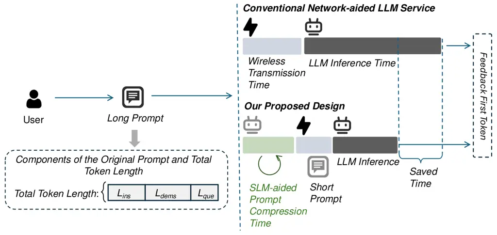
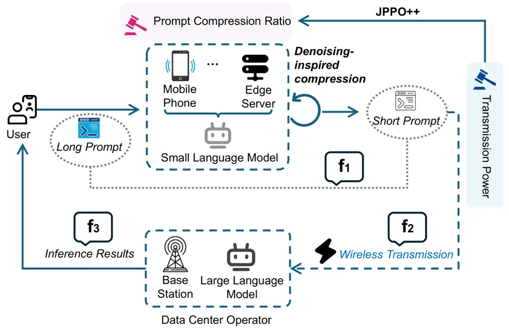
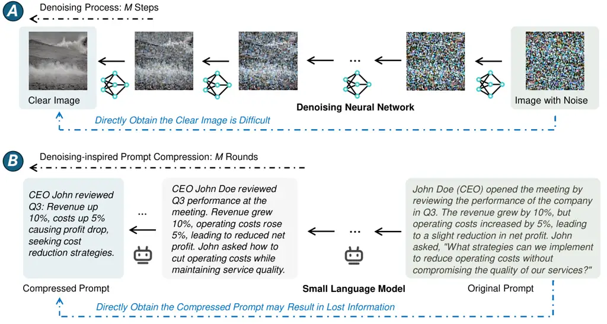
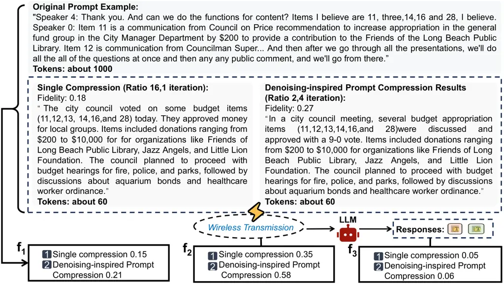

# JPPO++: Joint Power and Denoising-inspired Prompt Optimization for Mobile LLM Services

Feiran You    Hongyang Du    Kaibin Huang    Abbas Jamalipour
^(†)^(†)thanks: F. You, H. Du, and K. Huang are with the Department of
Electrical and Electronic Engineering, University of Hong Kong, Pok Fu
Lam, Hong Kong SAR, China (email: fryou@eee.hku.hk, duhy@eee.hku.hk,
huangkb@hku.hk).^(†)^(†)thanks: A. Jamalipour is with the School of
Electrical and Computer Engineering, University of Sydney, Sydney,
Australia (email: a.jamalipour@ieee.org).^(†)^(†)thanks: The conference
version of this work has been accepted by the IEEE International
Conference on Communications (ICC) 2025˜\[1\].

###### Abstract

Large Language Models (LLMs) are increasingly integrated into mobile
services over wireless networks to support complex user requests. This
trend has led to longer prompts, which improve LLMs’ performance but
increase data transmission costs and require more processing time,
thereby reducing overall system efficiency and negatively impacting user
experience. To address these challenges, we propose Joint Prompt and
Power Optimization (JPPO), a framework that jointly optimizes prompt
compression and wireless transmission power for mobile LLM services.
JPPO leverages a Small Language Model (SLM) deployed at edge devices to
perform lightweight prompt compression, reducing communication load
before transmission to the cloud-based LLM. A Deep Reinforcement
Learning (DRL) agent dynamically adjusts both the compression ratio and
transmission power based on network conditions and service constraints,
aiming to minimize service time while preserving response fidelity. We
further extend the framework to JPPO++, which introduces a
denoising-inspired compression scheme. This design performs iterative
prompt refinement by progressively removing less informative tokens,
allowing for more aggressive yet controlled compression. Experimental
results show that JPPO++ reduces service time by $`17\%`$ compared to
the no-compression baseline while maintaining output quality. Under
compression-prioritized settings, a reduction of up to $`16\times`$ in
prompt length can be achieved with an acceptable loss in accuracy.
Specifically, JPPO with a $`16\times`$ ratio reduces total service time
by approximately $`42.3\%`$, and JPPO++ further improves this reduction
to $`46.5\%`$.

###### Index Terms: 

Large language models, small language models, prompt engineering, power
allocation, joint optimization

## I Introduction

The rapid advancement of Artificial Intelligence (AI) has positioned it
as a key enabler for Sixth Generation (6G) communication systems \[1\],
supporting a broad range of intelligent services. Among AI technologies,
Large Language Models (LLMs) have become central to applications such as
question answering, code generation, and real-time dialogue \[2, 3\].
Their ability to interpret and generate context-aware information has
significantly advanced natural language processing, enabling a variety
of services that are accessed through both cloud and edge
environments \[4, 5\]. As users increasingly access these services via
mobile devices, wireless networks have become a critical infrastructure
for delivering LLM-powered intelligence \[6\].

Unlike traditional network-aided services that primarily involve
structured data transmission, LLM-based applications impose
significantly higher communication demands due to the complexity and
variability of natural language prompts and generated responses.
Moreover, LLM services often require real-time interaction and are
sensitive to prompt transmission delays, presenting new challenges for
wireless systems, especially under constraints such as limited transmit
power, fluctuating channel conditions, and restricted edge computing
resources. These challenges are further amplified in mobile edge
scenarios, where users interact with cloud-hosted LLMs via edge devices
by sending prompts and receiving responses over wireless links \[7\].
This mode of service places substantial pressure on the wireless
infrastructure, exposing a mismatch between the LLM service requirements
and available communications and computing resources. Addressing this
mismatch requires new system-level optimization frameworks that
adaptively manage transmission and processing strategies to maintain
service quality under dynamic network conditions \[8, 9\].

Among the various factors contributing to the system load, the structure
and length of the input prompt play a central role. In LLMs, a prompt is
first tokenized into a sequence of subword units, known as
tokens \[10\]. These tokens are embedded and passed through a
transformer architecture comprising multiple layers of self-attention
and feed-forward networks \[11\], which model contextual dependencies
and generate the final output. This computation scales with prompt
length, as each token attends to all previous tokens, resulting in
quadratic time and memory complexity. Furthermore, recent prompting
strategies such as In-Context Learning (ICL) \[12\] and Chain-of-Thought
(CoT) \[13\] have pushed LLMs toward more advanced reasoning, but often
at the cost of significantly longer prompts \[14\]. In practical
scenarios, users may upload entire documents along with queries, such as
research papers or legal texts containing thousands of words, to elicit
accurate and context-rich responses. While these techniques improve LLM
service quality, they commonly result in prompt lengths reaching tens of
thousands of tokens \[15\]. This introduces a fundamental trade-off:
longer, more informative prompts enhance output quality but impose heavy
burdens on wireless transmission and edge-side inference.



Fig. 1: Time consumption comparison of first token generation between
conventional network-aided LLM inference service architecture and our
design under long user prompts.

Prior research has approached these challenges from both the model and
network perspectives. From the model side, the authors in \[16\]
introduced LLMLingua, a coarse-to-fine prompt compression method that
demonstrates significant potential for compressing LLM prompts while
preserving their semantic integrity. LLMLingua utilizes a Small Language
Model (SLM) for compression, which can be aligned with the target LLM
through instruction tuning. While this approach shows promise for
reducing communication overhead, it does not fully account for the
challenges posed by wireless transmission. From the network side,
LLM-Slice \[17\] introduces a wireless slicing mechanism that reserves
dedicated network resources for LLM services, thereby reducing response
latency. Yet this method focuses purely on communication resource
allocation and does not incorporate prompt-level adaptation tailored to
individual service requirements. These limitations highlight the need
for a unified solution to address two key questions:

- •
  Q1) How to achieve adjustable prompt compression without significantly
  degrading LLM inference performance and service quality?
- •
  Q2) How to jointly allocate wireless resources, particularly
  transmission power, to meet the latency and energy constraints of
  network-aided LLM services?

For Q1, natural language processing methods offer potential solutions
for prompt compression. However, traditional NLP compression techniques,
such as text summarization or keyword extraction, often fail to capture
the complex reasoning patterns and task-specific requirements embedded
in LLM prompts, leading to degraded inference performance. Alternative
AI-based solutions, including large autoencoder models or task-specific
compression networks, typically demand substantial computational
resources and introduce additional latency at the user side, rendering
them unsuitable for wireless scenarios with constrained devices.
Motivated by LLMLingua \[16\], we consider SLMs as a practical solution
for prompt compression to achieve resource-efficient deployment. SLMs
can be easily integrated into user terminals and offer sufficient
semantic understanding to retain task-critical content during
compression. They have also been shown to be effective in enabling
transformer-based inference in edge applications \[18\].

Furthermore, inspired by the diffusion models, especially the Denoising
Diffusion Probabilistic Models (DDPM) \[19\], we propose an iterative
prompt compression algorithm to complement direct SLM-based compression.
In this approach, the original long prompt is treated as a “noisy”
input, and the refined compressed version represents the “denoised”
state. Analogous to how diffusion models progressively remove noise from
images, our method performs multi-stage prompt refinement, gradually
filtering out redundant or non-essential content. This design mitigates
the risk of semantic loss that can occur when compressing lengthy
prompts in a single step. This principle is similar to how humans revise
long-form text: reducing a complex document by $`90\%`$ in one attempt
often results in missing key points, while multiple rounds of revision,
each removing a manageable portion, allow for better content
preservation and clarity. Likewise, a $`16\times`$ compression can be
achieved through four iterations of $`2\times`$ compression, enabling
the model to operate on smaller, semantically coherent segments at each
stage. This controlled process enhances the likelihood of retaining
task-critical information while maintaining high compression. Despite
its iterative structure, the method introduces minimal computational
overhead due to the efficiency of SLMs. Empirically, each compression
round adds only about $`2\%`$ to the total LLM inference time, making it
well-suited for latency-sensitive wireless applications.

Building upon this insight and for addressing the Q2, we propose Joint
Power and Denoising-inspired Prompt Optimization (JPPO++), a framework
that combines SLM-based prompt compression with wireless power
allocation optimization, as illustrated in Fig. 1. JPPO++ captures the
trade-off between compression ratio and wireless resource consumption
using Deep Reinforcement Learning (DRL), adapting to both channel
conditions. The contributions of this paper are summarized as

- •
  We utilize a small, aligned language model as a prompt compressor in
  JPPO++ for network-aided LLM services. The SLM efficiently captures
  essential meaning while significantly reducing the length of the
  prompt without requiring training at the transmitter. Additionally, we
  design a denoising-inspired prompt compression mechanism that performs
  compression through iterative refinement steps, further improving the
  system’s overall performance with marginal additional computational
  overhead.
- •
  We formulate a joint optimization problem that captures the trade-offs
  among wireless transmission efficiency and LLM service quality. The
  objective is to maximize end-to-end Quality of Service (QoS) under
  energy and delay constraints, where the compression ratio and
  transmission power serve as coupled decision variables.
- •
  To solve this dynamic optimization problem, we employ a Deep
  Reinforcement Learning (DRL) framework. The DRL agent learns adaptive
  compression and power strategies based on real-time network conditions
  and prompt characteristics. This enables JPPO++ to outperform static
  baselines by reducing communication cost and improving responsiveness
  in resource-constrained wireless environments.

The remainder of this paper is organized as follows: Section 2 discusses
related work in LLM deployment, prompt optimization, and wireless
resource allocation. Section 3 presents our system model for wireless
network-aided LLM services and introduces the novel denoising-inspired
prompt compression method. Section 4 details the JPPO++ framework,
including its mathematical foundations and implementation approach.
Section 5 presents comprehensive numerical results and performance
analysis. Finally, Section 6 concludes the paper with a summary of our
key findings. A list of mathematical symbols frequently used in this
paper is shown in Table I.

|                                                                                          |                                                                                                                                     |
| ---------------------------------------------------------------------------------------- | ----------------------------------------------------------------------------------------------------------------------------------- |
| Notation                                                                                 | Description                                                                                                                         |
| $`{\textit{{x}}}_{\text{ins}},{\textit{{x}}}_{\text{dems}},{\textit{{x}}}_{\text{que}}`$ | The instruction component, the demonstrations or examples, and the specific question or task that consisted in an original prompt x |
| $`\hat{\textit{{x}}}`$                                                                   | The compressed prompt                                                                                                               |
| $`\mathcal{L}_{x},\mathcal{L}_{\hat{x}}`$                                                | The total token length of the original prompt and the token length of the compressed prompt                                         |
| $`\mathbf{f_{1}},\mathbf{f_{2}},\mathbf{f_{3}}`$                                         | The three essential aspects of semantic preservation during information transmission to evaluate the quality of prompt compression  |
| $`\phi_{1},\phi_{2},\phi_{3}`$                                                           | The weight factors determining the relative importance of each fidelity component                                                   |
| $`\alpha(t)`$                                                                            | The compression ratio at any time $`t`$                                                                                             |
| $`\psi_{\kappa}`$                                                                        | The target compression ratio                                                                                                        |
| $`\sigma(t)`$                                                                            | A monotonically increasing scheduling function                                                                                      |
| $`\beta(i)`$                                                                             | The compression ratio between consecutive steps                                                                                     |
| $`E_{e}`$, $`E_{t}`$                                                                     | The encoding energy and transmission energy                                                                                         |
| $`R`$                                                                                    | The transmission rate                                                                                                               |
| $`w`$                                                                                    | The bandwidth of the offloading link between the user and DCO                                                                       |
| $`\gamma`$                                                                               | The Signal-to-Noise Ratio (SNR)                                                                                                     |
| $`\omega`$                                                                               | The path-loss exponent                                                                                                              |
| $`\lambda^{2}`$                                                                          | The Gaussian noise term in the Additive White Gaussian Noise (AWGN) channel                                                         |
| $`T`$                                                                                    | The total time consumption                                                                                                          |
| $`t_{\text{e}}^{{\rm SLM}}`$, $`t_{\text{e}}^{{\rm LLM}}`$, $`t_{\text{t}}`$             | The encoding delay in both SLM and LLM, and transmission delay                                                                      |
| $`\varphi`$                                                                              | The Probability Density Function (PDF) expression for wireless channel fading                                                       |
| $`P_{\text{T}}`$                                                                         | The transmit power                                                                                                                  |
| $`\eta`$                                                                                 | BEP                                                                                                                                 |
| $`P_{\text{th}}`$                                                                        | The maximum allowable power consumption                                                                                             |
| $`T_{\text{th}}`$                                                                        | The maximum tolerable end-to-end latency                                                                                            |
| $`\mathbf{f}_{\text{th}}`$                                                               | The minimum required fidelity                                                                                                       |

TABLE I: Mathematical Notations

## II Related Work

This section discusses several related works about LLMs, prompt
compression, and wireless network management.

### II-A Large Language Model Services

The integration of LLMs into wireless network-aided services has enabled
a range of intelligent applications, including real-time decision-making
and natural language understanding \[20\]. However, this trend imposes
increasing demands on both computation and communication resources due
to the growing size of LLMs and the complexity of their input prompts.
To address computational bottlenecks, several recent efforts have
focused on optimizing LLM inference at the network edge. For example,
the authors in \[21\] formulate a scheduling problem that jointly
allocates computing and transmission resources for transformer-based
LLMs, maximizing throughput under edge constraints. Similarly, the
authors in \[22\] propose an edge inference framework that combines
model quantization and batching, and develop the Optimal Tree-search
with Generalized Assignment Heuristics (OT-GAH) algorithm for efficient
scheduling on resource-limited devices. These studies highlight the
importance of inference-side optimization, yet they operate under an
implicit assumption that the input prompt is already available. In
practice, especially in cloud-based LLM deployments accessed via
wireless networks, uploading long prompts often accounts for a
substantial portion of the total latency. This issue is exacerbated by
recent prompting strategies, such as ICL and CoT reasoning, which
require longer, more structured inputs to fully exploit model
capabilities. As prompt length grows, communication costs become a
dominant factor in end-to-end performance, particularly in
bandwidth-limited or energy-constrained environments. While the authors
in \[23\] offer a broad vision for aligning foundation models with the
needs of wireless systems and discuss emerging Large Multi-modal Models
(LMMs), they do not directly address prompt transmission overhead or
latency. This gap highlights a critical insight: without coordinated
control of both prompt input and transmission behavior, LLM services
over wireless networks will remain bottlenecked by front-end
communication delays. Thus, prompt compression and adaptive resource
control must be treated as essential optimization targets, jointly
considered alongside inference design to support scalable, low-latency
LLM services in next-generation networks.

### II-B Prompt Compression

Prompt compression has emerged as a crucial technique for mitigating the
computing and communication overhead introduced by increasingly lengthy
prompt inputs in LLM services. However, existing compression methods
face significant challenges, including limited compression efficiency,
reliance on fine-tuning or task-specific heuristics, and the risk of
degrading LLM performance due to loss of critical contextual
information \[24\]. These limitations are particularly critical in
wireless environments, where bandwidth and energy constraints amplify
the impact of prompt length. Moreover, conventional interference
management techniques become less effective when signal and interference
power levels converge, further degrading system-level
performance \[25\]. Several recent works have attempted to improve
prompt processing efficiency. VR-CMC \[26\] introduces variable-rate
prompts for cross-modal compression, allowing data to be represented at
multiple levels of granularity. PCRL \[27\] formulates prompt editing as
a discrete decision process and applies reinforcement learning to learn
efficient compression policies. Furthermore, the authors in \[24\]
propose a framework that integrates summarization, soft prompt
compression, and utility-aware mechanisms to reduce context processing
load while maintaining model utility across tasks. While these
approaches offer meaningful gains in compression quality and model
efficiency, they are primarily designed without considering the dynamics
of wireless systems. Crucially, none of these methods consider the joint
effects of prompt compression and wireless transmission control. In
bandwidth and energy-constrained settings, compression alone reduces
data volume but cannot guarantee reliable or timely delivery.
Conversely, adaptive power allocation improves link quality but does not
reduce the underlying transmission load. These two levers—prompt
compression and wireless resource control—are inherently complementary.
Their joint optimization is crucial for enabling efficient, low-latency
LLM services over wireless networks, particularly under stringent QoS
and energy constraints.

### II-C Wireless Network Management

Extensive research in wireless network management has led to effective
solutions for power allocation and joint optimization under resource
constraints. For example, the authors in \[28\] propose the
Delayed-Interaction Collaborative-Learning Independent-Decision
Multi-Agent DRL (DICLID-MADRL) algorithm, where access points
independently optimize user selection and power configuration using only
local observations, improving global energy efficiency through
decentralized multi-agent reinforcement learning. Beyond power control,
recent studies have addressed more complex joint optimization problems.
In \[29\], a block coordinate descent and successive convex
approximation framework is applied to jointly optimize receive
beamforming, power allocation, HAPS positioning, and computation
resource distribution. Similarly, the authors in \[30\] employ a graph
neural network-based method to jointly solve power control and spectrum
allocation in multi-user interference scenarios with shared channels.
These works demonstrate the potential of learning-based and algorithmic
strategies for managing wireless resources in complex environments.
However, they do not account for the unique characteristics of
network-aided LLM services, where large, dynamic prompt inputs and
strict latency constraints fundamentally alter the nature of the
optimization problem. In particular, the interplay between input
compression and transmission power remains unaddressed. Bridging this
gap requires extending joint optimization frameworks to explicitly
incorporate the semantic structure and variability of LLM inputs
alongside traditional physical-layer resource control.

In summary, while prior studies have made significant progress in both
prompt compression and wireless resource management, they treat these
aspects in isolation. Our work departs from this separation by
introducing JPPO++, which enables efficient and scalable LLM service
delivery in resource-constrained wireless networks.

## III System Model

In this section, we present the system model of wireless network-aided
mobile LLM services, the SLM-based prompt compression method, and the
wireless transmission model with constraints on power consumption and
service delay.



Fig. 2: System model of wireless network-aided mobile LLM services and
overview of our proposed JPPO++, where user-generated long prompts are
first compressed through SLM-based edge computing, then transmitted with
optimized power allocation via wireless networks to the LLM server, and
finally inference results are returned to users. The illustration of the
three components in the overall fidelity metric is also demonstrated:
$`\mathbf{f_{1}}`$ represents the representation accuracy,
$`\mathbf{f_{2}}`$ denotes the transmission completeness, and
$`\mathbf{f_{3}}`$ is the understanding accuracy.

### III-A Wireless Network-aided LLM Services

We consider a heterogeneous wireless network where a Data Center
Operator (DCO) provides LLM inference services to $`N`$ users with
diverse task requirements, e.g., prompts. As illustrated in Fig. 2, our
proposed framework consists of three key components: an SLM agent
deployed at user devices or edge servers for prompt compression, a
target LLM for inference service, and a JPPO++ scheme for reliable
wireless transmission. On the user side, the SLM agent leverages its
semantic understanding capability to compress prompts while preserving
task-critical information. The compressed prompts are then transmitted
through wireless channels with jointly optimized power allocation and
finally processed by the target LLM for inference. This framework
adaptively adjusts both compression ratios and transmission power based
on channel conditions and prompt characteristics to achieve high LLM
service quality.

### III-B Prompt Compression

To efficiently reduce prompt sizes while preserving semantic integrity,
we adopt a coarse-to-fine compression approach in SLMs. Our compression
method is designed to achieve two primary objectives: preserving
critical information in the prompt while ensuring the recoverability of
the original semantic meaning, and enabling flexible compression ratios
that can be dynamically adjusted together with communication resources.

Let us formally define the prompt structure and compression process.
Consider an original prompt x that consists of three components as:

```math
{\textit{{x}}}=\left({\textit{{x}}}_{\text{ins}},{\textit{{x}}}_{\text{dems}},{\textit{{x}}}_{\text{que}}\right), \tag{1}
```

where $`{\textit{{x}}}_{\text{ins}}`$ represents the instruction
component, $`{\textit{{x}}}_{\text{dems}}`$ denotes the demonstrations
or examples, and $`{\textit{{x}}}_{\text{que}}`$ contains the specific
question or task. As depicted in Fig. 1, the token length of each
component is denoted by $`\mathcal{L}_{\text{ins}}`$,
$`\mathcal{L}_{\text{dems}}`$, and $`\mathcal{L}_{\text{que}}`$,
respectively. The total token length $`\mathcal{L}_{x}`$ of the original
prompt is given by:

```math
\mathcal{L}_{x}=\mathcal{L}_{\text{ins}}+\mathcal{L}_{\text{dems}}+\mathcal{L}_{\text{que}}. \tag{2}
```

Our SLM-based compression mechanism generates a compressed prompt
$`\hat{\textit{{x}}}`$ with length $`\mathcal{L}_{\hat{x}}`$. The
compression ratio $`\alpha`$ is defined as:

```math
\alpha=\frac{\mathcal{L}_{\hat{x}}}{\mathcal{L}_{x}},\quad\alpha\in[0,1] \tag{3}
```

where $`\alpha=1`$ indicates no compression and smaller $`\alpha`$
represent higher compression rates.

We evaluate the quality of prompt compression using a composite fidelity
metric $`\mathbf{f}`$ that captures three complementary aspects:
semantic preservation, transmission integrity, and interpretability by
the downstream LLM. These three components jointly reflect the
end-to-end effectiveness of delivering and using compressed prompts in
wireless network-aided LLM services, as shown in Fig. 2:

- •
  Representation accuracy ($`f_{1}`$): measures how accurately the
  compressed prompt preserves the semantic content of the original
  prompt. It reflects the degree to which key information is retained
  during the compression process, independent of the channel effects.
  This component is computed based on token-level overlap between the
  original prompt x and the compressed prompt $`\hat{\textit{{x}}}`$ as:

  ```math
  f_{1}=\frac{|\hat{\textit{{x}}}\cap\textit{{x}}|}{|\textit{{x}}|}, \tag{4}
  ```

  where $`|\hat{\textit{{x}}}\cap\textit{{x}}|`$ denotes the number of
  overlapping tokens. This metric serves as a direct measure of semantic
  fidelity after the compression mechanism.

- •
  Transmission completeness ($`f_{2}`$): evaluates the fraction of the
  compressed prompt that is successfully transmitted under practical
  wireless channel conditions. It captures the effect of both prompt
  length reduction and bit-level errors due to signal degradation.
  Formally, $`f_{2}`$ is defined as:

  ```math
  f_{2}=\frac{|\hat{\textit{{x}}}|}{|\textit{{x}}|}\cdot\left(1-\text{BEP}(\text{SNR})\right), \tag{5}
  ```

  where $`\text{BEP}(\cdot)`$ denotes the bit error probability as a
  function of the Signal-to-Noise Ratio (SNR) ratio. This term models
  the effective information retained after wireless transmission, taking
  into account real-world physical-layer impairments.

- •
  Understanding accuracy ($`f_{3}`$): assesses the utility of the
  compressed prompt from the LLM’s perspective. It quantifies how well
  the transmitted prompt enables the LLM to generate an output that
  aligns with the expected response to the original uncompressed input.
  This is measured via token-level overlap between the LLM’s output
  $`\hat{\textit{{y}}}`$ and the reference original response y as:

  ```math
  f_{3}=\frac{|\hat{\textit{{y}}}\cap\textit{{y}}|}{|\textit{{y}}|}. \tag{6}
  ```

  This component captures the ultimate effectiveness of the entire
  prompt compression and transmission pipeline in supporting the
  downstream task.

Together, these three fidelity components form a holistic evaluation
framework. $`f_{1}`$ focuses on semantic preservation during
compression, $`f_{2}`$ captures the degradation during transmission, and
$`f_{3}`$ reflects the downstream interpretability and task utility. The
overall fidelity metric $`\mathbf{f}`$ can be defined as a weighted sum
of these components as:

```math
\mathbf{f}=\phi_{1}\mathbf{f_{1}}+\phi_{2}\mathbf{f_{2}}+\phi_{3}\mathbf{f_{3}}, \tag{7}
```

where $`\phi_{1}`$, $`\phi_{2}`$, and $`\phi_{3}`$ are weight factors
determining the relative importance of each fidelity component.
Additionally, these weights can be adjusted based on LLM application
requirements and QoS priorities.

### III-C Denoising-inspired Prompt Compression

We propose a framework for controlling the compression ratio across
multiple steps, inspired by the denoising process in DDPM \[19\].

#### III-C1 Motivation



Fig. 3: The motivation of our proposed denoising-inspired prompt
compression method. Part A illustrates the process of generating images
using DDPM through a denoising process. Rather than directly generating
a clear image, the denoising neural network focuses on predicting noise
one step at a time, using the image from the previous step to generate
the current one. Part B illustrates the denoising-inspired prompt
compression. Instead of directly obtaining a fully compressed prompt,
SLM can also perform gradual prompt compression to reduce the degree of
information that needs to be compressed in each round of processing,
minimizing information loss.

As shown in Part A of Fig. 3, in DDPM’s denoising process, the denoising
network predicts the noise between the current state and the previous
state, gradually removing noise through this process until a clean image
is obtained. Compared to many AI algorithms that directly generate
images, DDPM’s approach reduces training difficulty and improves image
generation performance.

Similarly, when we use SLM for text compression, the SLM continuously
predicts the next token based on the input text to ultimately obtain the
compressed prompt, as shown in Part B of Fig. 3. If we set a very high
compression ratio all at once, the SLM might lose crucial information.
However, if we consider denoising-inspired prompt compression, where the
compressed prompt is viewed as a clean image and the original long
prompt is seen as a noisy state, we can enable the SLM to perform
gradual compression of the prompt. During each compression step, we can
select a relatively larger compression ratio, reducing the degree of
compression, and achieve the same compression effect through multiple
iterations. This way, during each compression step, the SLM needs to
consider relatively less information to reduce, resulting in a lower
probability of losing important information, as shown in Fig. 4 in
Section V.

Although the iterative nature introduces additional SLM processing time,
the system maintains its efficiency due to SLM’s swift operation.
Experiments in Section V show that each compression round only adds
approximately $`2\%`$ to the total LLM inference time, while the
optimized compression scheme can reduce subsequent LLM inference delay
by around $`40\%`$.

#### III-C2 Compression Ratios Scheduling

JPPO++ allows flexible scheduling of compression ratios while
maintaining a deterministic path toward the target compression rate.
Given the target compression ratio $`\psi_{\kappa}=1/\kappa`$, e.g.,
$`\psi=16`$ for $`16\times`$ compression, we define a compression
progress variable as $`t\in[0,1]`$, where $`t=0`$ represents the
original text and $`t=1`$ represents the fully compressed text. The
compression ratio at any time $`t`$ is given by:

```math
\alpha(t)=\psi_{\kappa}^{-\sigma(t)}, \tag{8}
```

where $`\sigma(t)`$ is a monotonically increasing scheduling function
with $`\sigma(0)=0`$ and $`\sigma(1)=1`$.

Considering a sequence of $`M`$ compression steps, we can discretize
$`t`$ into $`\{t_{0},t_{1},...,t_{M}\}`$, where $`t_{0}=0`$ and
$`t_{M}=1`$. The compression ratio between consecutive steps is:

```math
\beta(i)=\frac{\alpha(t_{i})}{\alpha(t_{i-1})}=\psi_{\kappa}^{-\left(\sigma(t_{i})-\sigma(t_{i-1})\right)}. \tag{9}
```

To enable flexible management of the compression process, we employ
different scheduling methods tailored to various input prompt types,
thereby allowing for efficient management of the compression process.
The behavior of the compression process can be controlled through
different choices of $`\sigma(t)`$:

- •
  The linear schedule is defined as:

  ```math
  \sigma(t)=t. \tag{10}
  ```

  This schedule applies a uniform compression rate throughout the entire
  process, ensuring consistent behavior across all steps, which is
  straightforward and computationally efficient.

- •
  The cosine schedule is defined as:

  ```math
  \sigma(t)=\frac{1-\cos(\pi t)}{2}. \tag{11}
  ```

  This schedule introduces smooth transitions at the beginning and end
  of the process. By tapering the compression rate during these stages,
  it minimizes abrupt changes, making it ideal for applications where
  gradual adjustments are critical to maintaining output quality.

- •
  The quadratic schedule is defined as:

  ```math
  \sigma(t)=t^{2}. \tag{12}
  ```

  This schedule concentrates the majority of compression in the later
  stages of the process, leaving earlier stages relatively unaffected,
  which would be effective for tasks requiring precise compression
  towards the final steps.

Different types of long prompts may require different optimal
compression schedules to ensure efficiency. For a uniform $`M`$-step
compression process with linear scheduling, the discrete time steps are
given by $`t_{i}=\frac{i}{M}`$, where $`i\in\{0,1,\ldots,M\}`$, with
each step applying a constant compression ratio of
$`\psi_{\kappa}^{-1/M}`$. The total compression at any time $`t`$
satisfies
$`\alpha(t)\cdot\alpha\left(0\right)=\psi_{\kappa}^{-\sigma(t)}`$. This
formulation ensures that the initial state maintains the original length
(i.e., $`\alpha\left(0\right)=1`$), the final state achieves the target
compression (i.e., $`\alpha(1)=\frac{1}{\psi_{\kappa}}`$), and the
compression path remains continuously differentiable when using smooth
scheduling functions. This framework offers a principled approach to
designing multi-step compression strategies, allowing for precise
control over the compression ratio at each step.

### III-D Energy Consumption

The total energy consumption $`E`$ in the one-shot LLM service request
process for each user consists of two components: encoding energy
$`E_{e}`$ and transmission energy $`E_{t}`$, as is given by:

```math
E\left(\kappa,P_{T}\right)=E_{e}\left(\kappa\right)+E_{t}\left(\kappa,P_{T}\right), \tag{13}
```

where $`P_{\text{T}}`$ is the transmit power. The encoding energy
consumption $`E_{e}`$, which represents the energy used by the SLM
encoder for prompt compression, is calculated as \[31\]:

```math
E_{e}=t_{\text{e}}^{{\rm SLM}}\left(\kappa\right)n_{\text{gpu}}^{{\rm SLM}}P_{\text{gpu}}^{{\rm SLM}}+t_{\text{e}}^{{\rm LLM}}\left(\kappa\right)n_{\text{gpu}}^{{\rm LLM}}P_{\text{gpu}}^{{\rm LLM}}, \tag{14}
```

where $`t_{\text{e}}^{{\rm SLM}}`$ represents the GPU execution time in
SLM, $`n_{\text{gpu}}`$ denotes the number of GPUs utilized, and
$`P_{\text{gpu}}`$ is the thermal design power per GPU, and superscript
$`{\rm LLM}`$ denotes the corresponding parameters for the LLM.

The transmission energy consumption $`E_{t}`$ is given by:

```math
E_{t}=t_{\text{t}}\left(\kappa\right)P_{\text{T}}=\frac{s\left(\kappa\right)}{R}P_{\text{T}}, \tag{15}
```

where $`s`$ represents the bit length of the compressed prompt
$`\hat{\textit{{x}}}`$ with compression ratio $`\kappa`$, and $`R`$ is
the transmission rate that can be expressed as:

```math
R=W\log_{2}\left(1+\gamma\right)=W\log_{2}\left(1+\frac{P_{\text{T}}gd^{-\omega}}{\lambda^{2}}\right), \tag{16}
```

where $`W`$ is the bandwidth of the offloading link between the user and
DCO, $`\gamma`$ is the SNR, $`g`$ is the Rayleigh fading coefficient
(exponentially distributed with unit mean), $`d`$ represents the
distance between user and DCO, $`\omega`$ is the path-loss exponent, and
$`\lambda^{2}`$ represents the Gaussian noise term in the Additive White
Gaussian Noise (AWGN) channel.

### III-E Service Delay and Error

The total time consumption $`T`$ comprises three components: encoding
delay in both SLM and LLM, and transmission delay, as is given by:

```math
T\left(\kappa,P_{T}\right)=t_{\text{e}}^{{\rm SLM}}\left(\kappa\right)+t_{\text{e}}^{{\rm LLM}}\left(\kappa\right)+t_{\text{t}}\left(\kappa,P_{T}\right). \tag{17}
```

Beyond maintaining the delay within acceptable bounds, we must also
consider potential service degradation caused by transmission errors in
the wireless channel.

For wireless network-aided LLM services, user prompts must be uploaded
to the LLM through a wireless environment. Due to potential bit errors
during wireless transmission, these errors can directly affect the
fidelity of the transmitted data. Therefore, it is crucial to consider
the BEP to reflect the likelihood that the textural prompt will be
incorrectly received or decoded in the wireless system. For the
$`n_{\rm th}`$ user, the average BEP $`\eta`$ can be given under various
modulation formats by \[32\]:

```math
{\rm BEP}=\int_{0}^{\infty}{\frac{{\zeta\ \left({{\mu_{2}},{\mu_{1}}\tau}\right)}}{{2\zeta\ \left({{\mu_{2}}}\right)}}{\varphi_{\tau_{n}}}\left(\tau\right)d\tau}, \tag{18}
```

where $`\zeta\left({\cdot,\cdot}\right)`$ is the upper incomplete Gamma
function \[33, eq. (8.350.2)\], $`\varphi`$ represents the Probability
Density Function (PDF) expression for wireless channel fading.
$`{{{\zeta\left({{\mu_{2}},{\mu_{1}}\tau}\right)}}/{{2\zeta\left({{\mu_{2}}}\right)}}}`$
is the conditional bit-error probability, $`{\mu_{1}}`$ and
$`{\mu_{2}}`$ are parameters specific to the modulation scheme,
representing different combinations of modulation and detection
techniques.

## IV Joint Power and Prompt Optimization

This section introduces the JPPO++ for wireless network-aided LLM
services. After formulating the problem, we propose a Double Deep
Q-Network (DQN) method \[34\] to address the joint optimization problem.

### IV-A Problem Formulation

For our JPPO++ framework, we formulate an optimization problem that
balances three key aspects: prompt compression quality, wireless
transmission efficiency, and LLM service performance. The objective is
to maximize the overall fidelity while satisfying power and latency
constraints in the wireless network-aided LLM service system.
Specifically, the joint optimization problem can be formulated as:

```math
\displaystyle\mathop{\max}\limits_{\{\kappa,P_{T}\}} \displaystyle\ \mathbf{f}\left(\kappa,\eta\left(P_{T}\right)\right), \tag{19}
```

```math
\displaystyle~E\left(\kappa,P_{T}\right)\leq E_{\text{th}},
```

```math
\displaystyle~P_{\text{T}}\leq P_{\text{th}},
```

```math
\displaystyle~T\leq T_{\text{th}},
```

```math
\displaystyle~\mathbf{f}>\mathbf{f}_{\text{th}},
```

where $`P_{\text{th}}`$ is the maximum allowable power consumption,
$`T_{\text{th}}`$ represents the maximum tolerable end-to-end latency,
and $`\mathbf{f}_{\text{th}}`$ defines the minimum required fidelity.
The constraints are designed to ensure the practical operation of the
system. Constraint (a) is the energy constraint that represents the
total energy budget limitation at the edge device side, introducing a
critical trade-off: while higher transmission power $`P_{T}`$ can lead
to lower BEP $`\eta`$ and thus improved wireless transmission fidelity
$`\mathbf{f_{2}}`$ to enhance the overall fidelity $`\mathbf{f}`$, the
energy constraint forces a higher compression ratio $`\kappa`$ to reduce
both the SLM and LLM inference energy cost and wireless transmission
energy consumption. However, an excessively high compression ratio can
result in significant information loss from the original prompt,
potentially degrading both the semantic preservation fidelity
$`\mathbf{f_{1}}`$ and LLM service quality fidelity $`\mathbf{f_{3}}`$.
Constraint (b) ensures the power consumption remains within the device’s
power budget, Constraint (c) guarantees that the total service latency
meets real-time requirements, and Constraint (d) maintains the quality
of service by enforcing a minimum threshold on fidelity. This
optimization framework allows us to find the optimal balance between
compression ratio and transmission power while maintaining high-quality
LLM service delivery.

### IV-B Double DQN Solution

To solve the complex JPPO++ optimization problem, we deploy a
centralized Double DQN method to find optimal prompt compression and
transmission strategies for $`N`$ users, as shown in Algorithm 1.

#### IV-B1 Algorithm Design

The centralized control of the DDQN agent ensures fairness by
dynamically allocating bandwidth and power based on real-time user
demands and varying channel conditions. The key elements of the proposed
Double DQN design are given as follows:

- •
  _Environment:_ The environment of the Double DQN algorithm in the
  proposed framework is the communication environment with $`N`$ users.
- •
  _State:_ The state information includes the current fidelity of the
  transmitted message, SNR, and BEP. The state information of the
  $`n_{\rm th}`$ user is captured in a 3-dimensional vector:
  $`\left[\mathbf{f}_{n}(\eta_{n}),\gamma_{n},\right]`$.
- •
  _Action:_ The actions include selecting compression and power levels.
  The action space is denoted as
  $`\mathcal{A}=\{\mathcal{A}_{1},\ldots,\mathcal{A}_{N}\}`$, where
  $`\mathcal{A}_{n}`$ is the action of the $`n_{\rm th}`$ user and
  consists of a tuple with discrete values of compression ratio and
  transmission power level. The compression ratio level is a discrete
  value range from $`0`$ to $`4`$. The transmission power level is a
  discrete value ranging from $`0`$ to $`9`$, which affects BEP.
- •
  _Reward:_ The reward of the $`n_{\rm th}`$ user is
  $`\mathcal{R}_{n}`$. In each episode, the agent accumulates rewards
  based on its actions. The reward maximizes fidelity while minimizing
  penalties related to BEP and power usage.

Input:

- •
  Action space
  $`\mathcal{A}=\{\mathcal{A}_{1},\ldots,\mathcal{A}_{N}\}`$
- •
  Target privacy parameters $`(\epsilon,\delta)`$
- •
  Learning rate $`\xi`$, exploration decay $`\epsilon_{\text{decay}}`$

Output:

- •
  Learned Q-network with optimized policy

1: Initialize Q-network and target Q-network with random weights

2: Initialize replay buffer and initial state $`s_{0}`$

3: for each episode $`k\in\{1,\dots,K\}`$ do

4:   Reset environment and observe initial state $`s_{0}`$

5:   while not episode terminated do

6:    Select action $`a_{t}`$ using $`\epsilon`$-greedy policy from
Q-network

7:    Execute $`a_{t}`$ and observe reward $`r_{t}`$, and then go to
next state $`s_{t+1}`$

8:    Store transition $`(s_{t},a_{t},r_{t},s_{t+1})`$ into replay
buffer

9:    $`s_{t}\leftarrow s_{t+1}`$

10:    \# Training step:

11:    Sample mini-batch of transitions $`(s,a,r,s^{\prime})`$ from
replay buffer

12:    for each transition in the mini-batch do

13:      if $`s^{\prime}`$ is terminal then

14:       $`y\leftarrow r`$

15:      else

16:       Go to (22)

17:      end if

18:      Compute loss
$`\mathcal{L}=\left(y-Q\left(s,a;\theta\right)\right)^{2}`$

19:      Perform gradient descent step on $`\mathcal{L}`$ to update
Q-network

20:    end for

21:    Decay exploration rate:
$`\epsilon\leftarrow\max\left(\epsilon\cdot\epsilon_{\text{decay}},\epsilon_{\min}\right)`$

22:    Periodically update target Q-network:
$`\theta^{-}\leftarrow\theta`$

23:   end while

24: end for

Algorithm 1 Double DQN Algorithm

The key design of the Double DQN is to decouple action selection from
evaluation and address the over-estimation issue by using two separate
networks: Current Q-network, which predicts Q-values based on the
current state, and Target Q-network, which calculates target Q-values
during updates and evaluates the Q-value of the best next action
selected by the current Q-network, making the learning process of the
Double DQN more stable.

The update steps of DQN are:

```math
Q\left(s_{t},a_{t}\right)\leftarrow Q\left(s_{t},a_{t}\right)+\xi r_{t+1}+\mu\max_{a}Q(s_{t+1},a)-Q\left(s_{t},a_{t}\right), \tag{20}
```

where $`Q\left(s_{t},a_{t}\right)`$ is the estimated Q-value updated by
the Bellman equation for taking action $`a_{t}`$ in state $`s_{t}`$.
$`\xi`$ is the learning rate. $`r_{t+1}`$ is the reward received after
taking action $`a_{t}`$ in state $`s_{t}`$ and transitioning to state
$`s_{t+1}`$. $`\mu`$ is the discount factor. And the loss function is
the Mean Squared Error (MSE) between the predicted Q-values and the
target Q-values, as is given by:

```math
L_{i}(\theta_{i})=\left[r_{t+1}+\mu\max_{a^{\prime}}Q_{\text{target}}(s_{t+1},a^{\prime};\theta_{i}^{*})-Q(s_{t},a_{t};\theta_{i})\right]^{2}, \tag{21}
```

where $`L_{i}(\theta_{i})`$ is the loss for the $`i`$-th iteration with
parameter $`\theta_{i}`$. $`r_{t+1}`$ and $`s_{t+1}`$ are the reward and
next state observed after taking action $`a_{t}`$ in state $`s_{t}`$.
$`Q_{\text{target}}(s_{t+1},a^{\prime};\theta_{i}^{*})`$ is the target
Q-value estimated by the target network with parameter
$`\theta_{i}^{*}`$. $`Q(s_{t},a_{t};\theta_{i})`$ is the predicted
Q-value by current Q-network with parameter $`\theta_{i}`$.

Then the update of the Double DQN can be given by:

```math
y=r+\mu Q_{\text{target}}\left(s^{\prime},\arg\max_{a^{\prime}}Q(s^{\prime},a^{\prime};\theta);\theta^{-}\right), \tag{22}
```

where $`Q(s,a;\theta)`$ is the estimated Q-value from the current
Q-network with parameter $`\theta`$ and
$`Q_{\text{target}}(s^{\prime},a^{\prime};\theta^{-})`$ is the Q-value
from the target network with parameter $`\theta^{-}`$.

#### IV-B2 Complexity Analysis

The computational complexity of the Double DQN algorithm is primarily
determined by the number of training episodes, the size of the neural
network, and the batch operations performed during training. Let $`K`$
denote the number of training episodes, $`\mathcal{T}`$ denote the
average number of time steps per episode, $`B`$ denote the batch size,
and $`\mathcal{P}`$ denote the number of parameters in the Q-network.

At each time step, the algorithm performs a forward pass through the
Q-network for action selection, taking $`\mathcal{O}(\mathcal{P})`$
time. When updating the Q-network, a mini-batch of $`B`$ transitions is
sampled from the replay buffer. For each sample, forward passes through
both the current and target Q-networks, as well as a backward pass for
optimization, are required. These operations contribute a per-step
training cost of $`\mathcal{O}(B\cdot\mathcal{P})`$. Therefore, the
total time complexity over all episodes is
$`\mathcal{O}(K\cdot\mathcal{T}\cdot B\cdot\mathcal{P})`$.

In terms of space, the main contributors are the Q-network parameters,
requiring $`\mathcal{O}(\mathcal{P})`$ memory, and the replay buffer,
which stores up to $`M`$ transitions of size proportional to the state
and action dimensions. Assuming each transition requires
$`\mathcal{O}(d)`$ space, where $`d`$ is the dimension of the state
vector, the total space complexity is
$`\mathcal{O}(\mathcal{P}+M\cdot d)`$.

## V Numerical Results

We consider a practical simulation environment with variable fidelity,
SNR, and BEP to support a wireless network-aided LLM service framework.
The centralized DQN agent manages the environment, which involves
selecting compression and power levels. Its goal is to balance fidelity,
minimize errors, and optimize power usage. The trained DRL model is
designed with a modular architecture, making it adaptable to other types
of networks and tasks. Its state representation, action selection, and
reward mechanisms can be independently modified to accommodate
communication networks.

### V-A Experimental Setup

Following the LLMLingua platform, we employ the SLM, i.e., GPT-Neo 125M,
for prompt compression and the LLM, i.e., GPT-J 6B, to generate
responses for users \[35\]. The simulations are carried out based on the
MeetingBank-transcript dataset \[36\] and LongBench datset  \[37\],
where we select the long prompt data whose length exceeds $`500`$ tokens
from the dataset to apply in our system simulations. Other parameter
settings are in Table II.

|                                                |                           |
| ---------------------------------------------- | ------------------------- |
| Parameter                                      | Value                     |
| Learning Rate                                  | $`10^{-3}`$               |
| $`\alpha_{1}`$, $`\alpha_{2}`$, $`\alpha_{3}`$ | $`0.4`$, $`0.3`$, $`0.3`$ |
| Total Test Runs Range                          | $`\left[1,10\right]`$     |
| Episodes per Test Run                          | $`10{,}000`$              |

TABLE II: Simulation Parameter Configuration

The details of the datasets and experimental conditions are given as
follows:

- •
  Network Conditions: Our simulated MEC environment includes a total
  bandwidth of $`20`$ MHz, a maximum transmission power of $`10`$ dBm
  per user. In the MEC environment, the transmission power ranges from a
  minimum of 1 dBm (approximately 0.00126 W) to a maximum of 10 dBm
  (0.01 W). We divide the range of power into 10 power levels evenly,
  where each level increases by 1 dBm, corresponding to a gradual
  increase in power from low to high. Additionally, the channel quality
  of the network varies dynamically in the range of $`0.1`$ to $`1`$.
- •
  User Demand: User task demands are randomly initialized, simulating
  heterogeneous data processing requirements.
- •
  Step Limit: Each episode is capped at $`100`$ steps to simulate
  practical usage constraints.
- •
  Random Seed: To ensure reproducibility, we have initialized random
  seeds for both NumPy and PyTorch, ensuring consistency in experimental
  results.



Fig. 4: The example illustrates wireless network-aided LLM services with
SLM-based prompt compression, with a compression example of a single
$`16\times`$ compression ratio and an iterative $`4`$ times $`2\times`$
compression ratio.

### V-B Experiments Performance Analysis

To demonstrate the effectiveness and generalizability of our proposed
JPPO++ framework, we design a sequence of experiments to answer the
following research questions:

- •
  Q1. Effectiveness: Does denoising-inspired prompt compression improve
  fidelity compared to one-shot compression?
- •
  Q2. Necessity: How do compression ratio and transmission power jointly
  affect QoS in network-aided LLM services?
- •
  Q3. Adaptivity: Can DRL effectively optimize prompt compression and
  power control under dynamic network and task conditions?

#### V-B1 Q1. Effectiveness

Fig. 4 compares prompt compression using a single-round $`16\times`$
compression ratio with an iterative method applying $`2\times`$
compression over 4 times. Based on the fidelity metric $`\mathbf{f}`$,
the iterative strategy consistently outperforms the single-step
counterpart across all three components, demonstrating better semantic
preservation and communication robustness. The iterative method achieves
a final fidelity score of $`0.27`$, compared to $`0.18`$ for the
single-round compression. The total processing time is $`5.90`$ seconds,
including $`2.92`$ seconds for compression, $`2.48`$ seconds for LLM
response generation, and $`0.50`$ seconds for transmission. From the DRL
perspective, it yields a higher reward score of $`26.40`$ while
consuming $`8.18`$ units of power.

In contrast, the single-round $`16\times`$ compression approach consumes
less power (i.e., $`2.90`$ units), but produces a lower reward of
$`17.74`$ and a longer total processing time of $`11.25`$ seconds that
is nearly double that of the iterative method. This includes $`6.59`$
seconds for compression, $`4.12`$ seconds for response generation, and
$`0.55`$ seconds for transmission. These results confirm that
denoising-inspired iterative compression in JPPO++ not only improves
fidelity but also significantly reduces end-to-end latency, making it a
more efficient strategy for LLM prompt compression under wireless
constraints. We further validate the effectiveness of our framework
using wider tests in the MeetingBank-transcript dataset \[36\], where
prompts exceed $`500`$ tokens. When prioritizing aggressive compression
while tolerating up to a $`30\%`$ fidelity drop, JPPO++ supports
compression ratios up to $`16\times`$. Under this setting, service time
is significantly reduced. The single-round baseline achieves a
$`42.3\%`$ reduction in total service time compared to the
no-compression case, while our iterative denoising-based method improves
it further to $`46.5\%`$.

#### V-B2 Q2. Necessity

|             |     |             |       |       |       |       |       |       |       |       |       |
| ----------- | --- | ----------- | ----- | ----- | ----- | ----- | ----- | ----- | ----- | ----- | ----- |
|             |     | Power Level |       |       |       |       |       |       |       |       |       |
|             |     | 1           | 2     | 3     | 4     | 5     | 6     | 7     | 8     | 9     | 10    |
| Compression | 1   | 10.11       | 10.64 | 10.76 | 10.71 | 10.58 | 10.39 | 10.18 | 9.95  | 9.71  | 9.45  |
|             | 2   | 11.12       | 11.66 | 11.77 | 11.72 | 11.59 | 11.41 | 11.20 | 10.97 | 10.72 | 10.47 |
|             | 3   | 11.40       | 11.93 | 12.05 | 12.00 | 11.87 | 11.69 | 11.47 | 11.24 | 11.00 | 10.75 |
|             | 4   | 11.41       | 11.94 | 12.06 | 12.01 | 11.87 | 11.69 | 11.48 | 11.25 | 11.01 | 10.75 |
|             | 5   | 11.31       | 11.85 | 11.96 | 11.91 | 11.78 | 11.60 | 11.39 | 11.16 | 10.91 | 10.66 |
|             | 6   | 11.19       | 11.72 | 11.84 | 11.79 | 11.65 | 11.47 | 11.26 | 11.03 | 10.79 | 10.53 |
|             | 7   | 11.04       | 11.58 | 11.69 | 11.64 | 11.51 | 11.33 | 11.12 | 10.89 | 10.64 | 10.39 |
|             | 8   | 10.90       | 11.43 | 11.55 | 11.50 | 11.36 | 11.18 | 10.97 | 10.74 | 10.50 | 10.24 |
|             | 9   | 10.75       | 11.28 | 11.40 | 11.35 | 11.21 | 11.03 | 10.82 | 10.59 | 10.35 | 10.09 |
|             | 10  | 10.60       | 11.13 | 11.25 | 11.20 | 11.07 | 10.88 | 10.67 | 10.44 | 10.20 | 9.94  |

TABLE III: One-shot reward values of the baseline single-round
compression method.

|             |     |             |       |       |       |       |       |       |       |       |       |
| ----------- | --- | ----------- | ----- | ----- | ----- | ----- | ----- | ----- | ----- | ----- | ----- |
|             |     | Power Level |       |       |       |       |       |       |       |       |       |
|             |     | 1           | 2     | 3     | 4     | 5     | 6     | 7     | 8     | 9     | 10    |
| Compression | 1   | 10.25       | 10.93 | 11.17 | 11.25 | 11.24 | 11.17 | 11.07 | 10.94 | 10.79 | 10.63 |
|             | 2   | 11.27       | 11.94 | 12.18 | 12.26 | 12.24 | 12.18 | 12.07 | 11.94 | 11.79 | 11.63 |
|             | 3   | 11.54       | 12.21 | 12.46 | 12.53 | 12.51 | 12.44 | 12.34 | 12.21 | 12.06 | 11.89 |
|             | 4   | 11.55       | 12.21 | 12.46 | 12.53 | 12.51 | 12.44 | 12.34 | 12.20 | 12.05 | 11.88 |
|             | 5   | 11.45       | 12.12 | 12.36 | 12.43 | 12.41 | 12.34 | 12.23 | 12.10 | 11.95 | 11.78 |
|             | 6   | 11.32       | 11.99 | 12.23 | 12.30 | 12.28 | 12.20 | 12.09 | 11.96 | 11.80 | 11.63 |
|             | 7   | 11.18       | 11.84 | 12.08 | 12.15 | 12.13 | 12.05 | 11.94 | 11.80 | 11.65 | 11.47 |
|             | 8   | 11.03       | 11.69 | 11.93 | 12.00 | 11.97 | 11.90 | 11.78 | 11.65 | 11.49 | 11.31 |
|             | 9   | 10.88       | 11.54 | 11.78 | 11.84 | 11.82 | 11.74 | 11.62 | 11.48 | 11.32 | 11.15 |
|             | 10  | 10.73       | 11.39 | 11.62 | 11.69 | 11.66 | 11.58 | 11.46 | 11.32 | 11.16 | 10.98 |

TABLE IV: One-shot reward values of the denoising-inspired prompt
compression method with linear schedule.

|             |     |             |       |       |       |       |       |       |       |       |       |
| ----------- | --- | ----------- | ----- | ----- | ----- | ----- | ----- | ----- | ----- | ----- | ----- |
|             |     | Power Level |       |       |       |       |       |       |       |       |       |
|             |     | 1           | 2     | 3     | 4     | 5     | 6     | 7     | 8     | 9     | 10    |
| Compression | 1   | 9.96        | 10.50 | 10.62 | 10.57 | 10.44 | 10.27 | 10.06 | 9.83  | 9.59  | 9.34  |
|             | 2   | 10.84       | 11.38 | 11.50 | 11.45 | 11.33 | 11.15 | 10.95 | 10.72 | 10.48 | 10.24 |
|             | 3   | 10.98       | 11.52 | 11.64 | 11.60 | 11.48 | 11.31 | 11.10 | 10.88 | 10.65 | 10.40 |
|             | 4   | 10.85       | 11.39 | 11.52 | 11.48 | 11.36 | 11.19 | 10.99 | 10.78 | 10.54 | 10.30 |
|             | 5   | 10.62       | 11.17 | 11.30 | 11.27 | 11.15 | 10.98 | 10.79 | 10.57 | 10.34 | 10.10 |
|             | 6   | 10.36       | 10.92 | 11.05 | 11.02 | 10.90 | 10.74 | 10.55 | 10.33 | 10.11 | 9.87  |
|             | 7   | 10.10       | 10.65 | 10.79 | 10.76 | 10.65 | 10.49 | 10.30 | 10.09 | 9.86  | 9.63  |
|             | 8   | 9.83        | 10.38 | 10.52 | 10.50 | 10.39 | 10.23 | 10.04 | 9.84  | 9.62  | 9.39  |
|             | 9   | 9.56        | 10.12 | 10.26 | 10.24 | 10.13 | 9.98  | 9.79  | 9.59  | 9.37  | 9.14  |
|             | 10  | 9.29        | 9.85  | 10.00 | 9.98  | 9.88  | 9.72  | 9.54  | 9.34  | 9.13  | 8.90  |

TABLE V: One-shot reward values of the denoising-inspired prompt
compression method with cosine schedule.

|             |     |             |       |       |       |       |       |       |       |       |       |
| ----------- | --- | ----------- | ----- | ----- | ----- | ----- | ----- | ----- | ----- | ----- | ----- |
|             |     | Power Level |       |       |       |       |       |       |       |       |       |
|             |     | 1           | 2     | 3     | 4     | 5     | 6     | 7     | 8     | 9     | 10    |
| Compression | 1   | 4.44        | 8.61  | 10.29 | 10.80 | 10.68 | 10.22 | 9.56  | 8.80  | 7.98  | 7.15  |
|             | 2   | 5.62        | 9.92  | 11.77 | 12.45 | 12.51 | 12.22 | 11.72 | 11.10 | 10.43 | 9.72  |
|             | 3   | 6.01        | 10.36 | 12.27 | 13.04 | 13.18 | 12.97 | 12.55 | 12.01 | 11.40 | 10.76 |
|             | 4   | 6.10        | 10.46 | 12.41 | 13.22 | 13.41 | 13.25 | 12.88 | 12.38 | 11.82 | 11.21 |
|             | 5   | 6.09        | 10.44 | 12.40 | 13.24 | 13.46 | 13.33 | 12.99 | 12.52 | 11.99 | 11.41 |
|             | 6   | 6.03        | 10.36 | 12.33 | 13.18 | 13.42 | 13.31 | 12.99 | 12.55 | 12.03 | 11.48 |
|             | 7   | 5.96        | 10.26 | 12.23 | 13.08 | 13.34 | 13.24 | 12.94 | 12.52 | 12.02 | 11.48 |
|             | 8   | 5.87        | 10.15 | 12.11 | 12.97 | 13.23 | 13.15 | 12.86 | 12.45 | 11.96 | 11.43 |
|             | 9   | 5.79        | 10.03 | 11.98 | 12.84 | 13.11 | 13.03 | 12.75 | 12.35 | 11.88 | 11.36 |
|             | 10  | 5.70        | 9.91  | 11.85 | 12.71 | 12.98 | 12.91 | 12.64 | 12.24 | 11.77 | 11.27 |

TABLE VI: One-shot reward values of the denoising-inspired prompt
compression method with quadratic schedule.

Tables III-VI show the end-to-end DRL reward values of wireless
network-aided LLM service under different combinations of compression
levels and transmission power levels. Specifically, Table III presents
the results for baseline single-round $`16\times`$ compression, while
Tables IV-VI show the outcomes of denoising-inspired iterative
compression with linear, cosine, and quadratic scheduling strategies,
respectively. For each approach, the reward matrix reflects the impact
of varying compression ratios (i.e., rows) and transmission power levels
(i.e., columns) on final system performance.

We observe that, across all methods, the highest reward values are
typically achieved at moderate compression levels (e.g.,
$`2\times`$-$`5\times`$) and moderate power levels (e.g., 2-5). This
pattern reflects a fundamental trade-off shaped by energy constraints
and semantic preservation. On the one hand, aggressive compression
reduces prompt length and transmission overhead, enabling higher
transmit power within the same energy budget. However, it also increases
the risk of discarding critical semantic content, which in turn degrades
the quality of LLM inference. On the other hand, lower compression
ratios preserve more of the original prompt, thereby improving fidelity,
but result in longer input sequences. This increases LLM inference
latency and limits the available transmission power, potentially raising
the BEP and reducing the overall reward. Similarly, power levels exhibit
a non-linear effect: very low power leads to high BEP and unreliable
transmission, while very high power may violate energy constraints. The
observed reward surface, therefore, captures the complex interplay
between compression aggressiveness and transmission reliability,
highlighting the necessity of joint optimization.

Therefore, a key insight from this analysis is that compression ratio
and power control are not independently tunable. Thus, joint
optimization is necessary to strike a context-aware balance. Another
critical observation lies in the differences among scheduling
strategies. The denoising-inspired schemes with dynamic compression
progression (particularly the quadratic and cosine schedules) achieve
higher peak rewards compared to the single-shot baseline. For instance,
the best-performing configuration under the quadratic schedule exceeds
the baseline reward by over $`10\%`$. This indicates that gradually
compressing prompts in stages, especially with curvature-adaptive
schedules, better preserves key information and aligns more effectively
with LLM inference patterns. These findings suggest that selecting a
compression trajectory tailored to the prompt structure, according to
real scenarios, can provide substantial performance benefits.

#### V-B3 Q3. Adaptivity

Fig. 5: The convergence performance of reward over 100 iterations for
the DRL algorithm.

Fig. 5 presents the reward convergence curves during the training
process over $`100`$ training episodes using our Double DQN-based
solution for the JPPO++ framework on long prompts from the
MeetingBank-transcript dataset \[36\]. The DRL agent successfully learns
optimal compression and power control policies under different iterative
schedules. Notably, the cosine schedule consistently achieves the
highest reward, demonstrating its effectiveness in preserving semantic
coherence in long, structured dialogues. Its smooth transition function
$`\sigma(t)=\frac{1-\cos(\pi t)}{2}`$ enables gradual compression, with
moderate intensity at the beginning and end and stronger compression in
the middle. This pattern is particularly suited for meeting transcripts,
where key information is interleaved with contextual background.
Compared to the static baseline, the learned policy yields faster
convergence and higher final performance, confirming that JPPO++ can
adaptively balance fidelity and efficiency in real-time through policy
learning.

(a) Transmission time reduction percentage

(b) Service time reduction percentage

Fig. 6: The illustration of transmission time and service time reduction
percentages of using the denoising-inspired prompt compression method in
JPPO++ compared to the single-round compression baseline.

As part of the testing phase, Fig. 6 presents the transmission time and
service time reduction for five randomly selected samples from the
MeetingBank-transcript dataset. Specifically, transmission time
reduction corresponds to the time reduced by the denoising-inspired
prompt compression method in JPPO++ compared to the single-round
compression baseline. Service time, as illustrated in Fig. 1, is defined
as the sum of compression time, transmission time, and LLM inference
time, capturing the end-to-end efficiency of the mobile LLM service.
Across all samples, the denoising-inspired method consistently
outperforms the baseline, achieving transmission time reductions of
approximately $`10\%`$ to $`65\%`$ and service time reductions of
$`39\%`$ to $`52\%`$. These results confirm that the proposed JPPO++
enhances data delivery efficiency while preserving task quality. The
consistent improvements across diverse prompts and varying content
structures demonstrate the robustness and suitability for real-world
mobile networks.

(a) Multi-news category

(b) GovReport category

Fig. 7: The score performance when running with the LongBench dataset.

Fig. 7 compares the task performance of three compression strategies,
i.e., no compression, JPPO with single-round $`16\times`$ compression,
and JPPO++ with iterative $`4\times 2\times`$ compression, on the
LongBench dataset. Results are reported on both the Multi-news and
GovReport categories using the average Question-Answering (QA) F1 score
and ROUGE-$`L`$ score. The no-compression strategy achieves the highest
performance across all samples. In the Multi-news category, as shown in
Fig. 7 (a), where contextual coherence is less critical, the gap between
compressed and uncompressed prompts is relatively small. However, in the
GovReport category, as shown in Fig. 7 (b), which contains longer and
more information-dense documents, the difference becomes more
pronounced. Despite both JPPO and JPPO++ operating under the same
$`16\times`$ compression constraint, JPPO++ consistently yields higher
F1 and ROUGE-$`L`$ scores, demonstrating better retention of key
information through iterative refinement. These results highlight the
practical advantage of JPPO++. It enables aggressive compression with
minimal degradation of task performance. Even though uncompressed input
naturally yields the best performance, JPPO++ offers a viable trade-off
for resource-constrained deployments, maintaining task utility while
significantly reducing prompt length.

## VI Conclusion and Future Direction

We proposed JPPO++, a joint optimization framework that integrates
denoising-inspired prompt compression with wireless transmission power
control to support mobile LLM services. By leveraging a lightweight SLM
for iterative prompt compression and a DRL-based policy for adapting
compression ratio and power allocation, JPPO++ enabled aggressive
compression while preserving response fidelity under resource
constraints. The framework demonstrated stable convergence during
training, and experimental results showed that it consistently reduced
both service time and transmission overhead compared to
single-compression baselines. Specifically, JPPO++ achieved up to
$`46.5\%`$ service time reduction and maintained competitive performance
on downstream QA and summarization tasks, even under a $`16\times`$
compression setting. These findings demonstrate the practical value of
JPPO++ in enabling scalable and low-latency mobile LLM services.

There are several directions for further research:

- •
  Optimizing Compression Schedules : The current JPPO++ uses a fixed
  denoising schedule and iteration count. Future work may treat both as
  decision variables. Different input types may benefit from tailored
  schedules, and the number of iterations directly affects computational
  cost and compression quality. Including these factors in the
  optimization can further improve performance across diverse tasks.
- •
  Edge Deployment and Distributed Control: SLMs can be deployed at edge
  devices to perform real-time compression before wireless transmission.
  Future studies may explore their interaction with LLMs in hierarchical
  settings. Additionally, transitioning from centralized to distributed
  optimization, where multiple edge nodes collaboratively manage
  compression and power allocation, can enhance system scalability and
  resilience.
- •
  Personalized and Adaptive Service Provisioning: Incorporating
  user-specific demands and heterogeneous network conditions into the
  joint optimization can enable context-aware service delivery. This is
  particularly relevant in autonomous systems and smart home networks,
  where latency and efficiency requirements vary significantly.

## References

- \[1\] F. You, H. Du, K. Huang, and A. Jamalipour, “JPPO: Joint power
  and prompt optimization for accelerated large language model
  services,” in _IEEE International Conference on Communications_, to
  appear, 2025.
- \[2\] Y. He, J. Fang, F. R. Yu, and V. C. Leung, “Large language
  models (LLMs) inference offloading and resource allocation in
  cloud-edge computing: An active inference approach,” _IEEE
  Transactions on Mobile Computing_, 2024.
- \[3\] G. O. Boateng, H. Sami, A. Alagha, H. Elmekki, A. Hammoud,
  R. Mizouni, A. Mourad, H. Otrok, J. Bentahar, S. Muhaidat _et al._, “A
  survey on large language models for communication, network, and
  service management: Application insights, challenges, and future
  directions,” _IEEE Communications Surveys & Tutorials_, 2025.
- \[4\] R. Yi, L. Guo, S. Wei, A. Zhou, S. Wang, and M. Xu, “EdgeMoE:
  Empowering sparse large language models on mobile devices,” _IEEE
  Transactions on Mobile Computing_, 2025.
- \[5\] G. Qu, Q. Chen, W. Wei, Z. Lin, X. Chen, and K. Huang, “Mobile
  edge intelligence for large language models: A contemporary survey,”
  _IEEE Communications Surveys & Tutorials_, 2025.
- \[6\] Y. Ren, H. Zhang, F. R. Yu, W. Li, P. Zhao, and Y. He,
  “Industrial internet of things with large language models (LLMs): an
  intelligence-based reinforcement learning approach,” _IEEE
  Transactions on Mobile Computing_, 2024.
- \[7\] O. Friha, M. Amine Ferrag, B. Kantarci, B. Cakmak, A. Ozgun, and
  N. Ghoualmi-Zine, “LLM-based edge intelligence: A comprehensive survey
  on architectures, applications, security and trustworthiness,” _IEEE
  Open Journal of the Communications Society_, vol. 5, pp.
  5799–5856, 2024.
- \[8\] B. Min, H. Ross, E. Sulem, A. P. B. Veyseh, T. H. Nguyen,
  O. Sainz, E. Agirre, I. Heintz, and D. Roth, “Recent advances in
  natural language processing via large pre-trained language models: A
  survey,” _ACM Computing Surveys_, vol. 56, no. 2, pp. 1–40, 2023.
- \[9\] F. Jiang, Y. Peng, L. Dong, K. Wang, K. Yang, C. Pan, D. Niyato,
  and O. A. Dobre, “Large language model enhanced multi-agent systems
  for 6G communications,” _IEEE Wireless Communications_, 2024.
- \[10\] R. Patil and V. Gudivada, “A review of current trends,
  techniques, and challenges in large language models (LLMs),” _Applied
  Sciences_, vol. 14, no. 5, p. 2074, 2024.
- \[11\] S. Qian, Y. Zhu, W. Li, M. Li, and J. Jia, “What makes for good
  tokenizers in vision transformer?” _IEEE Transactions on Pattern
  Analysis and Machine Intelligence_, vol. 45, no. 11, pp.
  13 011–13 023, 2023.
- \[12\] T. Li, G. Zhang, Q. D. Do, X. Yue, and W. Chen, “Long-context
  LLMs struggle with long in-context learning,” _arXiv preprint
  arXiv:2404.02060_, 2024.
- \[13\] J. Wei, X. Wang, D. Schuurmans, M. Bosma, F. Xia, E. Chi, Q. V.
  Le, D. Zhou _et al._, “Chain-of-thought prompting elicits reasoning in
  large language models,” _Advances in Neural Information Processing
  System_, vol. 35, pp. 24 824–24 837, 2022.
- \[14\] B. Xiao, B. Kantarci, J. Kang, D. Niyato, and M. Guizani,
  “Efficient prompting for LLM-based generative internet of things,”
  _IEEE Internet of Things Journal_, pp. 1–1, 2024.
- \[15\] F. Xue, Y. Fu, W. Zhou, Z. Zheng, and Y. You, “To repeat or not
  to repeat: Insights from scaling LLM under token-crisis,” _Advances in
  Neural Information Processing Systems_, vol. 36, 2024.
- \[16\] H. Jiang, Q. Wu, C.-Y. Lin, Y. Yang, and L. Qiu, “LLMLingua:
  Compressing prompts for accelerated inference of large language
  models,” _arXiv preprint arXiv:2310.05736_, 2023.
- \[17\] B. Liu, J. Tong, and J. Zhang, “LLM-Slice: Dedicated wireless
  network slicing for large language models,” in _Proceedings of the ACM
  Conference on Embedded Networked Sensor Systems_, 2024, pp. 853–854.
- \[18\] M. Scherer, L. Macan, V. J. B. Jung, P. Wiese, L. Bompani,
  A. Burrello, F. Conti, and L. Benini, “Deeploy: Enabling
  energy-efficient deployment of small language models on heterogeneous
  microcontrollers,” _IEEE Transactions on Computer-Aided Design of
  Integrated Circuits and Systems_, vol. 43, no. 11, pp.
  4009–4020, 2024.
- \[19\] J. Ho, A. Jain, and P. Abbeel, “Denoising diffusion
  probabilistic models,” _Advances in neural information processing
  systems_, vol. 33, pp. 6840–6851, 2020.
- \[20\] J. Shao, J. Tong, Q. Wu, W. Guo, Z. Li, Z. Lin, and J. Zhang,
  “WirelessLLM: Empowering large language models towards wireless
  intelligence,” _Journal of Communications and Information Networks_,
  vol. 9, no. 2, pp. 99–112, 2024.
- \[21\] X. Zhang, J. Liu, Z. Xiong, Y. Huang, G. Xie, and R. Zhang,
  “Edge intelligence optimization for large language model inference
  with batching and quantization,” in _2024 IEEE Wireless Communications
  and Networking Conference (WCNC)_, 2024, pp. 1–6.
- \[22\] X. Zhang, J. Nie, Y. Huang, G. Xie, Z. Xiong, J. Liu,
  D. Niyato, and X. S. Shen, “Beyond the cloud: Edge inference for
  generative large language models in wireless networks,” _IEEE
  Transactions on Wireless Communications_, pp. 1–1, 2024.
- \[23\] S. Xu, C. Kurisummoottil Thomas, O. Hashash, N. Muralidhar,
  W. Saad, and N. Ramakrishnan, “Large multi-modal models (LMMs) as
  universal foundation models for AI-native wireless systems,” _IEEE
  Network_, vol. 38, no. 5, pp. 10–20, 2024.
- \[24\] C. Wang, Y. Yang, R. Li, D. Sun, R. Cai, Y. Zhang, and C. Fu,
  “Adapting LLMs for efficient context processing through soft prompt
  compression,” in _Proceedings of the International Conference on
  Modeling, Natural Language Processing and Machine Learning_, 2024, pp.
  91–97.
- \[25\] Z. Meng, Q. Li, A. Pandharipande, and X. Ge, “Prompt-assisted
  semantic interference cancelation on moderate interference channels,”
  _IEEE Wireless Communications Letters_, vol. 13, no. 10, pp.
  2847–2851, 2024.
- \[26\] J. Gao, J. Li, C. Jia, S. Wang, S. Ma, and W. Gao, “Cross modal
  compression with variable rate prompt,” _IEEE Transactions on
  Multimedia_, vol. 26, pp. 3444–3456, 2024.
- \[27\] H. Jung and K.-J. Kim, “Discrete prompt compression with
  reinforcement learning,” _IEEE Access_, vol. 12, pp.
  72 578–72 587, 2024.
- \[28\] Z. Wang, L. Zhang, D. Feng, G. Wu, and L. Yang, “Intelligent
  cloud-edge collaborations for energy-efficient user association and
  power allocation in space-air-ground integrated networks,” _IEEE
  Journal on Selected Areas in Communications_, vol. 42, no. 12, pp.
  3659–3673, 2024.
- \[29\] X. Yu, X. Zhang, Y. Rui, K. Wang, X. Dang, and M. Guizani,
  “Joint resource allocations for energy consumption optimization in
  HAPS-aided MEC-NOMA systems,” _IEEE Journal on Selected Areas in
  Communications_, vol. 42, no. 12, pp. 3632–3646, 2024.
- \[30\] M. Marwani and G. Kaddoum, “Graph neural networks approach for
  joint wireless power control and spectrum allocation,” _IEEE
  Transactions on Machine Learning in Communications and Networking_,
  vol. 2, pp. 717–732, 2024.
- \[31\] A. Faiz, S. Kaneda, R. Wang, R. Osi, P. Sharma, F. Chen, and
  L. Jiang, “LLMCarbon: Modeling the end-to-end carbon footprint of
  large language models,” in _Proceedings of the International
  Conference on Learning Representations_. ICLR, 2024.
- \[32\] D. Tse and P. Viswanath, _Fundamentals of wireless
  communication_. Cambridge university press, 2005.
- \[33\] I. S. Gradshteyn and I. M. Ryzhik, _Table of Integrals, Series,
  and Products_, 7th ed. Academic Press, 2007.
- \[34\] H. Van Hasselt, A. Guez, and D. Silver, “Deep reinforcement
  learning with double q-learning,” in _Proceedings of the AAAI
  conference on artificial intelligence_, vol. 30, no. 1, 2016.
- \[35\] D. Rothman, _Transformers for Natural Language Processing:
  Build, train, and fine-tune deep neural network architectures for NLP
  with Python, Hugging Face, and OpenAI’s GPT-3, ChatGPT, and
  GPT-4_. Packt Publishing Ltd, 2022.
- \[36\] Y. Hu, T. Ganter, H. Deilamsalehy, F. Dernoncourt, H. Foroosh,
  and F. Liu, “Meetingbank: A benchmark dataset for meeting
  summarization,” in _Proceedings of the 61st Annual Meeting of the
  Association for Computational Linguistics (ACL)_. Toronto, Canada:
  Association for Computational Linguistics, 2023.
- \[37\] Y. Bai, X. Lv, J. Zhang, H. Lyu, J. Tang, Z. Huang, Z. Du,
  X. Liu, A. Zeng, L. Hou _et al._, “Longbench: A bilingual, multitask
  benchmark for long context understanding,” _arXiv preprint
  arXiv:2308.14508_, 2023.
