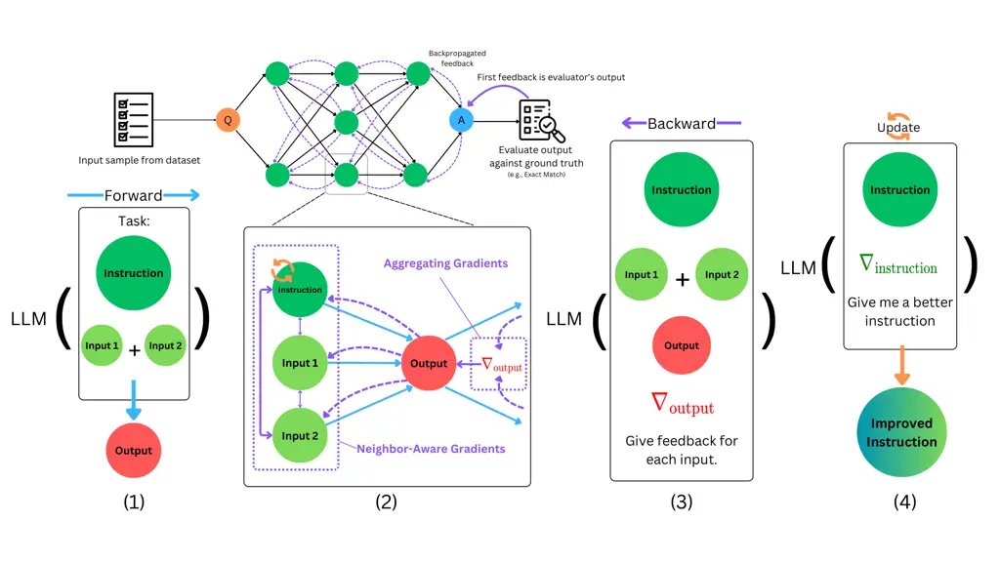

# How to Correctly do Semantic Backpropagation on Language-based Agentic Systems

Wenyi Wang Affiliation: ^(\*)Hisham A. Alyahya    Dylan R. Ashley   
Dmitrii Khizbullin  ,   Francesco Faccio  ,   and Jürgen Schmidhuber  
Affiliation: Oleg Serikov,    Center of Excellence for Generative AI,
King Abdullah University of Science Affiliation: Oleg Serikov,    and
Technology, Thuwal, Saudi Arabia    National Center for AI, Saudi Data &
AI Authority, Riyadh, Saudi Arabia    The Swiss AI Lab IDSIA
(USI-SUPSI), Lugano, Switzerland

###### Abstract

Language-based agentic systems have shown great promise in recent years,
transitioning from solving small-scale research problems to being
deployed in challenging real-world tasks. However, optimizing these
systems often requires substantial manual labor. Recent studies have
demonstrated that these systems can be represented as computational
graphs, enabling automatic optimization. Despite these advancements,
most current efforts in Graph-based Agentic System Optimization (GASO)
fail to properly assign feedback to the system’s components given
feedback on the system’s output. To address this challenge, we formalize
the concept of semantic backpropagation with semantic gradients—a
generalization that aligns several key optimization techniques,
including reverse-mode automatic differentiation and the more recent
TextGrad by exploiting the relationship among nodes with a common
successor. This serves as a method for computing directional information
about how changes to each component of an agentic system might improve
the system’s output. To use these gradients, we propose a method called
semantic gradient descent which enables us to solve GASO effectively.
Our results on both BIG-Bench Hard and GSM8K show that our approach
outperforms existing state-of-the-art methods for solving GASO problems.
A detailed ablation study on the LIAR dataset demonstrates the
parsimonious nature of our method. A full copy of our implementation is
publicly available at
[https://github.com/HishamAlyahya/semantic_backprop](https://github.com/HishamAlyahya/semantic_backprop)

|     |
| --- |
|     |

## 1 Introduction

Language-based agentic systems are being hailed as a major breakthrough
in artificial intelligence, with real-world deployment well underway and
numerous companies already being founded based on this technology (e.g.,
Pythagora-io (2023) ). Such agentic systems typically consist of
multiple components. These components are selected to perform specific
tasks, such as question answering, implementing and executing computer
programs, or performing web searches (Wang et al., 2024; Guo et al.,
2024). Due to the strength of Large Language Models (LLMs) in doing a
wide array of tasks, agentic systems typically have most of their key
components rely on querying LLMs. This results in communication between
the components of such systems being handled with free-form natural
language (Zhuge et al., 2023). However, while relying on LLMs does
partially alleviate the engineering burden of building such systems,
designing agentic systems remains nontrivial.

Agentic systems are often modeled as computational graphs, with
components involving frozen large models having auxiliary optimizable
parameters (Zhuge et al., 2024). When the graph topology is fixed, the
challenge of optimizing these parameters to enable an agentic system to
solve a specific problem can be modeled as the Graph-based Agent System
Optimization (GASO) problem.

Famous methods that attempt to solve the GASO problem include DSPy
prompt optimization methods (e.g., COPRO) (Khattab et al., 2024),
GPTSwarm’s node optimization (Zhuge et al., 2024), Textgrad (Yuksekgonul
et al., 2024), and Trace’s OptoPrime (Cheng et al., 2024). DSPy prompt
optimization methods and GPTSwarm’s node optimization both do so by
optimizing a prompt template for each node given the input-output pairs
of each node that were observed during predictions. In contrast, both
TextGrad and OptoPrime adopt a backpropagation-inspired approach,
wherein both of them attempt to assign a feedback to each of the
components in a system by message passing in the reverse topological
order (backward) of the graph given an output feedback. However,
OptoPrime fails to build a compact and explicit representation of how
each component can be improved to pass backward. On the other hand,
TextGrad omits neighborhood nodes while computing the backward messages.
We argue that the aforementioned drawbacks of OptoPrime and TextGrad
significantly hinder the effectiveness of backpropagation and
reverse-mode automatic differentiation.



Figure 1: The entire process of our proposed LLM-based solution to GASO.
Given a sample query to optimize over, (1) the forward pass of each node
can be executed by joining an instruction alongside other inputs to
process. Then, (2,3) the semantic gradients are generated through
semantic backpropagation that crucially takes into account the
neighboring nodes. And finally, (4), the semantic gradients accumulated
are joined with the optimizable parameter (e.g., the instruction) and an
optimization meta-prompt to retrieve update in the direction given by
the semantic gradients.

To address the issues with TextGrad and other proposed GASO solutions,
we propose semantic backpropagation over semantic gradients. Semantic
gradients generalize mathematical gradients by representing directional
information in any semantically interoperable form, indicating how a
variable in a system would change to improve the overall system
performance. Semantic backpropagation serves to align TextGrad with
reverse-mode automatic differentiation (Linnainmaa, 1970; Linnainmaa,
1976), which is also known as backpropagation (Werbos, 1982) in the
context of neural network optimization. ¹¹ 1 The method proposed in this
paper is not to be confused with semantic backpropagation in Genetic
Programming (Pawlak et al., 2014) where input-output pairs are
propagated which, while different, both pass messages backward, in
different semantic spaces. We further propose semantic gradient descent
which uses semantic gradients to update the optimizable parameters, and
therefore solve the GASO problem. Our overall approach to solving the
GASO problem is summarized in Figure 1.

We apply semantic backpropagation and semantic gradient descent to
BIG-Bench Hard (BBH) (Suzgun et al., 2023) and GSM8K (Cobbe et al.,
2021), finding that semantic gradient descent outperforms TextGrad,
OptoPrime, and COPRO on these benchmarks. We also perform an extensive
ablation study on the LIAR (Wang, 2017) dataset, showing that the method
is parsimonious.

Our contributions can be summarized as follows: We (1) formalize the
Graph-Based Agentic System Optimization (GASO) problem. (2) Introduce
Semantic Gradients, Semantic Gradient Descent, and Semantic
Backpropagation, demonstrating how these methods resolve challenges in
existing GASO solvers. (3) Show improved performance over other GASO
solvers, including COPRO, OptoPrime, and TextGrad when evaluating on BBH
and GSM8K with a general question-answering setup. (4) Perform an
ablation study on the LIAR dataset that highlights a decrease in
performance when key components of our methods are removed.

A full implementation of our method is available at
[https://github.com/HishamAlyahya/semantic_backprop](https://github.com/HishamAlyahya/semantic_backprop)

## 2 Background

### 2.1 The Graph-based Agentic System Optimization Problem

The Graph-based Agentic System Optimization (GASO) problem aims to
optimize a system capable of delivering precise answers to a variety of
user queries through a structured computational approach. We formalize
this system using a directed acyclic computational graph
$`(V,E,H,\Theta)`$. In this graph, $`V`$ represents the set of vertices
or nodes, with each node $`v\in V`$ being a variable within the system.
$`E`$ denotes the set of directed edges between nodes, $`H`$ is a set of
forward functions assigned to certain nodes, and $`\Theta\subset V`$
consists of variables that are optimizable parameters²² 2 While the GASO
problem is general and accounts for both node and edge optimization
within a graph, in this work, we are interested in credit assignment
methods that distribute a semantic feedback to each of the node
variables. Therefore, we focus on the special case where we assume that
the edges are fixed and only optimize the parameters $`\Theta`$..

For any vertex $`v`$ in the graph, let $`\Predecessors(v)`$ denote its
predecessor vertices and $`\Successors(v)`$ denote its successor
vertices. If a node $`v\in V`$ has no predecessors, it either holds a
specified user query $`Q`$ or an optimizable parameter
$`\theta\in\Theta`$. Conversely, if a node has predecessors, it contains
the result of computations performed by the function $`h_{v}\in H`$ on
its predecessors, expressed as:

```math
\displaystyle\forall v\in V\,\text{s.t.}\Predecessors(v)\neq\emptyset,\,v=h_{v}(\Predecessors(v)). \tag{1}
```

The final response $`A`$ to the user query $`Q`$ is produced by a
special output node where $`\Successors(v)=\emptyset`$. The notation
$`A(Q,\Theta)`$ highlights the functional relationship between the graph
output and the user query-parameter pair. To obtain the final response,
each node of the graph is executed in topological order.

The objective in the GASO problem is to find a set of parameters
$`\Theta^{*}`$ that minimizes the expected loss
$`\mathbb{E}_{Q\sim D}[l(Q,A(Q,\Theta^{*}))]`$ over a distribution of
queries $`D`$. Here, $`l`$ represents a loss function (e.g., negative
utility) defined for a query and its corresponding response. In addition
to the loss $`l(Q,A)`$, a semantic alphanumeric feedback $`F(Q,A)`$ is
provided as an additional signal for optimization. In this paper, we
focus on cases where variables are represented in free-form natural
language; that is, $`Q`$, $`A`$, $`\Theta`$, and the outputs of
$`h_{v}`$ are composed of alphanumeric strings. To effectively process
the semantic content, the functions $`h_{v}`$ often require querying
LLMs. For instance, consider a variable $`v_{a}`$ linked to its
predecessors $`v_{q}`$ (a user query) and $`v_{\theta}`$ (an additional
optimizable instruction that can affect the response to $`v_{q}`$). The
function for $`v_{a}`$ could be expressed as
$`h_{v_{a}}(v_{q},v_{\theta})=\LLM(v_{q}\oplus v_{\theta}),`$ where
$`\oplus`$ denotes the concatenation operator, and the $`\LLM`$ function
returns an LLM response. In practical applications, $`v_{\theta}`$ is
often a prompt prefix or suffix optimized to improve the LLM’s response
to the task. In the general case, forward functions could take more
complex forms, such as accessing a file, executing a command line and
reading the result, and managing some internal thought (Wang et al.,
2024; Zhang et al., 2024; Jin et al., 2024).

### 2.2 Reverse-Mode Automatic Differentiation

When the forward functions and the loss function are differentiable,
first-order optimization methods (see the work of Beck (2017)) compute
the gradient of the loss with respect to all optimizable parameters to
solve GASO. Reverse-mode automatic differentiation (Linnainmaa, 1970;
Linnainmaa, 1976), or RMAD, facilitates this by computing the gradient
of each variable in accordance with the chain rule:

```math
\frac{\partial l}{\partial v}=\sum_{w\in\Successors(v)}\frac{\partial l}{\partial w}\frac{\partial w}{\partial v}=\sum_{w\in\Successors(v)}\frac{\partial l}{\partial w}\mathbb{J}_{h_{w}^{v}}, \tag{2}
```

where $`h_{w}^{v}`$ represents the function $`h_{w}`$ with variables
$`\Predecessors(w)\setminus\{v\}`$ fixed at their current values. Here,
$`\mathbb{J}`$ denotes the Jacobian of $`h_{w}^{v}`$ with respect to
$`v`$. The numerical gradients can be interpreted as a vector that could
be added to the weights if one wants to improve the loss function. In
the next section, we generalize the numerical gradients of RMAD to
arbitrary strings, and the RMAD method to handle arbitrary forms of
gradients.

## 3 Methods

Building on the foundational work of Linnainmaa (1970); Linnainmaa
(1976), Pryzant et al. (2023), and Yuksekgonul et al. (2024), we
introduce the concept of Semantic Backpropagation over Semantic
Gradients. In the context of the GASO problem, the semantic gradient of
a loss function $`l(Q,A(Q,\Theta))`$ with respect to a variable $`v`$,
denoted as $`\nabla_{v}l_{Q}`$, provides directional information on how
altering $`v`$ can improve system performance for a query $`Q`$.
Semantic backpropagation employs the final semantic gradient
$`\nabla_{A}l_{Q}`$—typically derived from the answer feedback
$`F(Q,A)`$—to generate semantic gradients $`\nabla_{v}l_{Q}`$ for all
variables $`v\in V`$. Specifically, for a given variable $`v`$, the
backward functions—acting as a generalization of the chain rule—are used
to partially compute the semantic gradients for $`\Predecessors(v)`$
using the semantic gradient with respect to $`v`$. This procedure is
systematically applied to all variables $`v\in V`$, proceeding in
reverse topological order.

Using semantic gradients, we propose Semantic Gradient Descent to
address the GASO problem. Generalizing from numerical gradient
descent (Lemaréchal, 2012), this method involves the following iterative
steps: (1) Sample a query $`Q`$ from a distribution $`D`$, (2) Apply
semantic backpropagation to compute the semantic gradients
$`\nabla_{v}l_{Q}`$ for all variables $`v\in V`$ if $`l(Q,A(Q,\Theta))`$
exceeds a specified threshold, (3) Use an optimizer $`\phi`$ on each
parameter $`\theta\in\Theta`$, guided by its semantic gradients, to
update the optimizable parameters. The subsequent sections detail the
mechanisms of semantic backpropagation and semantic gradient descent.

### 3.1 Semantic Backpropagation

Given a computational graph as described in Section 2, in our approach,
we generalize the term
$`\frac{\partial l}{\partial w}\mathbb{J}_{h_{w}^{v}}`$ in Equation 2 by
introducing a set of backward functions
$`\{\hat{h}^{v}_{w}:w\in V,v\in\Predecessors(w)\}`$. Each backward
function $`\hat{h}^{v}_{w}`$ serves as an analogue to the product of the
derivative and the Jacobian in RMAD, extending it to arbitrary forward
functions $`h_{w}`$ that might incorporate natural language.
Specifically, for any query $`Q`$, node $`w\in V`$, and
$`v\in\Predecessors(w)`$, $`\hat{h}_{w}^{v}`$ maps the values of
$`\Predecessors(w)`$, $`w`$, and the gradient $`\nabla_{w}l_{Q}`$, to a
direction $`\nabla_{v}^{w}l_{Q}`$, in the space of $`v`$. This direction
represents how a change in $`v`$ would affect
$`w=h_{w}(\Predecessors(w))`$ in alignment with $`\nabla_{v}^{w}l_{Q}`$,
while keeping the other predecessors fixed.

Instead of the summation over successors in RMAD, we introduce an
aggregation function $`\mathcal{A}_{v}`$ that combines the set of
directions $`\{\nabla_{v}^{w}l_{Q}:w\in\Successors(v)\}`$ into a single
semantic gradient $`\nabla_{v}l_{Q}`$ for each variable $`v`$. This
generalizes the summation operator in RMAD, allowing for more flexible
and problem-specific methods of combining gradients. Formally, we have:

```math
\nabla_{v}l_{Q}=\mathcal{A}_{v}(\{\nabla_{v}^{w}l_{Q}\,:w\in\Successors(v)\}),\,\text{where}\;\nabla_{v}^{w}l_{Q}=\hat{h}_{w}^{v}(\Predecessors(w),w,\nabla_{w}l_{Q})
```

for all $`w\in\Successors(v)`$. Algorithm 1 shows the procedure for
backpropagation of semantic gradients. Our formulation thus extends the
chain rule and RMAD to accommodate arbitrary functions and aggregation
mechanisms.

0:  A computational graph with vertices $`V`$, a set of backward
functions $`\{\hat{h}^{v}_{w}:w\in V,v\in\Predecessors(w)\}`$, a set of
gradient aggregation functions $`\{\mathcal{A}_{v}:v\in V\}`$, and
$`\nabla_{A}l_{Q}`$, the gradient of $`l(Q,A)`$ for some query $`Q`$
with respect to answer $`A`$.

 for $`v`$ in $`\text{ReverseTopologicalSort}(V\setminus\{A\})`$ do

  for $`w`$ in $`\Successors(v)`$ do

   $`\nabla_{v}^{w}l_{Q}\leftarrow\hat{h}_{w}^{v}(\Predecessors(w),w,\nabla_{w}l_{Q})`$

  end for

  $`\nabla_{v}l_{Q}\leftarrow\mathcal{A}_{v}(\{\nabla_{v}^{w}l_{Q}\,:w\in\Successors(v)\})`$

 end for

 $`\{\nabla_{v}l_{Q}:v\in V\}`$

Algorithm 1 Semantic Backpropagation


In this work, the forward functions $`h_{v}`$ process semantic
information from natural language inputs. Our implementation of the
corresponding backward functions $`\hat{h}_{v}^{w}`$ involves querying
an LLM to understand how the input value $`v`$ influences the output
value $`w`$. This requires considering all inputs of $`h_{w}`$(i.e.,
$`\Predecessors(w)`$) and the semantic gradient of the output
$`\nabla_{w}l_{Q}`$. These backward functions can be customized as
needed. For example, in this paper, we adopt a specific form of semantic
gradient for all optimizable parameters $`\theta\in\Theta`$, where
$`\nabla_{\theta}l_{Q}`$ is calculated as the aggregation over all
successors of $`\theta`$, their semantic gradients, and the predecessors
of $`h_{w}`$ excluding $`\theta`$ for all $`w\in\Successors(\theta)`$.
Implementation 1 provides an example of our approach for computing
semantic gradients for optimizable parameters.

### 3.2 Semantic Gradient Descent

In this section, we first formalize the notion of parameter updating
given semantic gradients, and then present in detail the procedure in
which it is applied.

#### 3.2.1 Parameter Update Function

Similar to numerical gradient descent, semantic gradient descent also
requires a parameter update function, denoted as $`\phi`$. Given an
optimizable parameter $`\theta`$ and a set of semantic gradients
$`G_{\theta}=\{\nabla_{\theta}l_{Q_{i}}:i\in\mathbb{N},i\leq k\}`$ of
losses $`l_{Q_{i}}=l(Q_{i},A(Q_{i},\Theta))`$ for queries $`Q_{i}`$, the
function $`\phi`$ updates the parameter value by moving $`\theta`$
according to $`G_{\theta}`$. Analogously to numerical gradient descent,
the parameter $`\theta`$ is updated by applying the formula
$`\theta\leftarrow\theta-\alpha\sum_{i=1}^{k}\nabla_{\theta}l_{Q_{i}}`$.
One method to implement $`\phi`$ involves querying an LLM for an
improved version of $`\theta`$, conditioned on $`G_{\theta}`$. We adopt
this strategy and detail our implementation of the parameter update
function in Implementation 2.


#### 3.2.2 The Optimization Procedure

Given a parameterized graph, a loss function as described in Section 2,
and a parameter update function $`\phi`$, semantic gradient descent
solves the agentic graph optimization problem as follows. The
optimizable parameters $`\Theta`$ are first initialized. Then, we
iteratively execute the following steps. First, we repeatedly sample a
query $`Q`$ and only compute the semantic gradients of $`l_{Q}`$ with
respect to the variables if $`l(Q,A(Q,\Theta))`$ is above a certain
threshold. Move to the next step if this threshold condition is met
$`b`$ times for some batch size $`b`$. Second, we apply $`\phi`$ to each
parameter-gradients pair $`(\theta,G_{\theta})`$ to obtain an
alternative parameter value $`\theta^{\prime}`$ for each parameter
$`\theta\in\Theta`$. Lastly, we apply an update gate³³ 3 Note that while
TextGrad does not include such a mechanism, the official implementation
of TextGrad does include it. so that the parameters values are updated
if the newly generated values outperform the current values on a
validation set. Formally, define a validation function

```math
L_{\text{Val}}(\Theta)=\sum_{Q\in\text{Val}}l(Q,A(Q,\Theta)),
```

where elements of Val are samples from the query distribution $`D`$. We
update $`\Theta\leftarrow\{\phi(\theta,G_{\theta}):\theta\in\Theta\}`$
if
$`L_{\text{Val}}(\{\phi(\theta,G_{\theta}):\theta\in\Theta\})\leq L_{\text{Val}}(\Theta)`$.
See Algorithm 2 for details.

0:  A computational graph with vertices $`V`$ and optimizable parameters
$`\Theta\subset V`$, a distribution of queries $`D`$, a loss function
$`l`$, a output feedback function $`F`$, a parameter update function
$`\phi`$, a loss threshold $`\tau`$, a batch size $`b`$, and validation
function $`L_{\text{Val}}`$.

 Initialize $`\theta`$ for all $`\theta\in\Theta`$.

 while terminate condition not met do

  $`G_{v}\leftarrow\emptyset`$

  while $`|G_{v}|<b`$ for any $`v\in V`$ do

   Sample query $`Q\sim D`$.

   if $`l(Q,A(Q,\Theta))>\tau`$ then

    Given an output feedback $`F(Q,A(Q,\Theta))`$, compute semantic
gradients $`\nabla_{v}l_{Q}`$ according to Algorithm 1 for all
$`v\in V`$.

    $`G_{v}\leftarrow G_{v}\cup\{\nabla_{v}l_{Q}\}`$ for all $`v\in V`$

   end if

  end while

  if
$`L_{\text{Val}}(\{\phi(\theta,G_{\theta}):\theta\in\Theta\})<L_{\text{Val}}(\Theta)`$
then

   $`\Theta\leftarrow\{\phi(\theta,G_{\theta}):\theta\in\Theta\}`$

  end if

 end while

 $`\Theta`$

Algorithm 2 Semantic Gradient Descent

##### Remark

Unlike numerical gradient descent, which keeps updating the solution in
each iteration, our practical experience suggests that the update gate
is essential to avoid the solution deviating to less favored regions. We
argue that this gating process is necessary for consistent performance
improvement against the always-update strategy implemented by many
first-order optimization methods since there is a lack of theoretical
justification for semantic gradient descent to improve. See empirical
evidence for the significance of this gating in Section 5.2.

### 3.3 Difference with TextGrad

Here we present our difference with TextGrad (Yuksekgonul et al., 2024).
Inspired by backpropagation, TextGrad aims to solve the GASO problem by
propagating“textual gradients” in the reverse direction of the
computational graph. A textual gradient of a variable is defined as a
criticism of the variable presented in natural language. See Section 4.1
for more details on textual gradients. Given a query $`Q`$, TextGrad can
be implemented as a special case of semantic backpropagation by having
$`A_{v}`$ as an identity function and the backward functions $`\hat{h}`$
satisfying:

```math
\displaystyle\hat{h}_{w}^{v}(\cdot,w,\nabla_{w}l_{Q}) \displaystyle=\hat{h}_{w}^{u}(\cdot,w,\nabla_{w}l_{Q}),\quad\text{and} \tag{3}
```

```math
\displaystyle\hat{h}_{w}^{v}(\Predecessors(w),w,\nabla_{w}l_{Q}) \displaystyle=\hat{h}_{w}^{v}(v,w,\nabla_{w}l_{Q}) \tag{4}
```

for all $`u\in V,w\in\Successors(v),`$ and $`u\in\Predecessors(w)`$.

We believe Equation 3 and Equation 4 are critical issues of TextGrad.
These equations can be interpreted as follows: the function to compute
$`\nabla^{w}_{v}l_{Q}`$ is independent of $`v`$; and
$`\nabla_{v}^{w}l_{Q}`$—the direction of how $`v`$ changes that would
lead to a change of $`w`$—does not depend on any other predecessors of
$`w`$ . These are not the case in reverse-mode automatic
differentiation, where $`\hat{h}_{w}^{v}`$ implements
$`\frac{\partial l}{\partial w}\mathbb{J}_{h_{w}^{v}}`$ depending on
$`v`$, and $`h_{w}^{v}`$ is the function $`h_{w}`$ with predecessors
other than $`v`$ fixed at their current value. Equations 3 and 4
implicitly impose independence and symmetry among the input variables of
the forward functions, which is typically not true in computational
graphs. This limitation is especially apparent in agentic graphs, where
heterogeneity between neighboring nodes is of high importance in order
for complimentary and synergistic behavior to emerge (Zhuge et al.,
2023). A prominent example is the importance of having system prompts
that synergize well with users’ prompts in a conversational LLM, which
allows it to successfully approach virtually any objective (OpenAI,
2024, e.g.,). It is neither necessary, nor justified, to ignore nodes
with a common successor during backpropagation.

Consider, for a concrete example, a variable $`v_{a}`$ with predecessors
$`v_{q}`$ and $`v_{\theta}`$, where $`v_{q}`$ is a user query, $`v_{a}`$
is an answer to the query, and $`v_{\theta}`$ is an instruction that
helps produce a good answer to the user query with relation
$`v_{a}=h_{v_{a}}(v_{q},v_{\theta})`$ for some $`h_{v_{a}}`$. Following
TextGrad’s formulation, the gradient with respect to instruction
$`v_{\theta}`$, would only explicitly depend on $`v_{\theta}`$ and
$`v_{a}`$, and not the question $`v_{q}`$. It keeps any possibly useful
information about the question unavailable when updating $`v_{\theta}`$.
This could potentially lead to an instance learning an instruction
$`v_{\theta}`$ that completely ignores the nature of the approached
question, e.g., attempting to memorize the last suited answer as the
exact instruction to follow. Moreover, when computing the gradient with
respect to the question $`v_{q}`$, an identical function is applied as
when computing the gradient with respect to $`v_{\theta}`$, which
disregards the difference between the role of these variables in the
system.

Semantic backpropagation solves this issue by incorporating dependency
and heterogeneity between neighboring nodes into our formulation.
In Section 5.2, we show empirical evidence that this issue can decrease
the optimization performance.

## 4 Related Works

### 4.1 Textual Gradients for Prompt Optimization

The concept of textual gradient was first introduced in the context of
prompt optimization as “a local loss signal which contains information
on how to improve the current prompt” (Pryzant et al., 2023).
Furthermore, Pryzant et al. (2023) propose ProTeGi, an optimization
method that improves prompt parameters that are used to instruct an LLM
to produce an answer. Given some query-expected-answer pairs, ProTeGi
computes a textual gradient for each pair and applies the textual
gradients to optimize the prompt parameter. By refining the prompt
through a series of textual gradient-informed edits, an improvement is
observed over baseline methods including APE (Zhou et al., 2023) and
AutoGPT (Significant Gravitas, 2023). GRAD-SUM (Austin & Chartock, 2024)
extends ProTeGi by introducing a gradient summation procedure to prevent
the prompt updates from being too specific to a query-expected-answer
pair. GRAD-SUM also generalizes ProTeGi by incorporating an
LLMs-as-a-judge module (Zheng et al., 2024; Fu et al., 2023; Chen
et al., 2024) to relax the expected-answer requirement of ProTeGi. While
textual gradient  (Significant Gravitas, 2023), ProTeGi and GRAD-SUM
introduce first-order optimization-like methods to text-based functions,
these methods are not defined for variables not directly connected to
the output variable. In addition, we observe an interesting analogy
between optimizing textual prompts using textual gradients and
optimizing numerical prompts using numerical gradients, as done by
Schmidhuber (2015), where numerical prompts are used to query a world
model (Schmidhuber, 1990) through a numerical interface.

### 4.2 Other Backpropagation-Inspired Methods for GASO

Trace (Cheng et al., 2024) models the execution trace of computer
programs as computational graphs (i.e., trace graphs). In Trace, the
authors introduce OptoPrime as an optimization algorithm similar to
TextGrad and semantic backpropagation that uses a feedback signal
propagated backwards in the trace graph and then used for optimization.
For each node $`v`$ in the trace graph, a subgraph that contains all
nodes $`u`$ such that there is a path from $`v`$ through $`u`$ and then
to the output node is assigned as feedback to $`v`$. Conceptually, this
subgraph includes all computations influenced by $`v`$ that have an
effect on the output. Then, an optimizer (typically based on large
language models) leverages the subgraphs as feedback signals to improve
the optimizable nodes. Although the subgraph of $`v`$ contains all
relevant information on how $`v`$ influences the output, it does not
directly indicate how improvements can be made (i.e., there is no
gradient-like information). Without gradient-like information gained
from a backpropagation-like process, an optimizer must itself implicitly
try to estimate such information—a very non-trivial task. Another issue
with the aforementioned subgraphs is that the size of these graphs
scales linearly with the depth of the overall computational graph. This
makes Trace incompatible with large graphs when the optimizer uses
transformer-based language models (Vaswani, 2017; Schmidhuber, 1992;
Schlag et al., 2021). Unlike in Trace, semantic backpropagation
explicitly backpropagates this gradient-like information and is not
limited by the same linear scaling requirement. Zhou et al. (2024)—a
concurrent work—introduces a backpropagation-like method for GASO which
includes edge optimization. However, this approach is limited to
chain-structured agentic systems, with edge optimization involving the
addition, removal, or rearrangement of agents within the chain.

### 4.3 Other Methods for GASO

DSPy (Khattab et al., 2024) attempts to abstract executions of language
model pipelines into text transformation graphs. Each node in such a
graph is defined as a declarative module that takes a type of text as
input and transforms it to another type of text as output. These nodes
are parameterized by the instructions and sets of demonstrations that
are prefixed to the input text before querying an LLM. DSPy has many
implementations of optimizers for finding the best values for these
parameters. Two such optimizers are BootstrapFewshot, which provides
few-shot demonstrations for each step in the pipeline, and COPRO, which
does coordinate-ascent optimization on each of the optimizable
instruction prompts in the pipeline. These two optimizers are locally
focused, i.e. each step is only implicitly aware of the entire pipeline.

GPTSwarm’s node optimization method Zhuge et al. (2024) solves GASO when
the edges are fixed, which is the focus of this paper. Compared to
COPRO, in each iteration of GPTSwarm’s node optimization method, each
node’s parameter is updated with respect to a local objective function
specific to the node. Such local objective functions are not always
available and require an accurate understanding of the function of each
specific node. Optimizing such a local objective function also limits
the possibility that a node could change its function through global
optimization. On the other hand, GPTSwarm offers an edge optimization
method that can be used as a complement of our method when approaching
the GASO problem with optimizable edges.

## 5 Experimental Results

In this section, we evaluate semantic gradient descent on BIG-Bench Hard
(BBH) (Suzgun et al., 2023), GSM8k (Cobbe et al., 2021) (for comparing
with TextGrad, Trace’s OptoPrime and DSPy’s COPRO), BigCodeBench
(BCB) (Zhuo et al., 2024), and LIAR (Wang, 2017) (for performing
ablation and evaluating ProTeGi) datasets. Using these datasets allows
for multi-domain benchmarking of our method. In all experiments, the
number of forward computations required is significantly higher than the
number of backward computations and optimizer calls. Therefore, for
consideration of the cost-quality balance, unless otherwise specified,
we use gpt-4o-mini (a relative cheap language model) when performing
forward execution and gpt-4-turbo when executing the backward
computation or the parameter update function. See Section B.1 for more
discussion on the choice of language models.

### 5.1 General Question Answering

Figure 2: Initial graphs for general question answering on BBH and GSM8K
(a) and LIAR (b). The variables in green (the $`\theta`$s) are
optimizable.

In the GSM8K, BBH, and BCB datasets, we do not provide any a priori
information to the agentic system regarding the task (e.g., we do not
tell the system whether “True” should be represented by a “1” or by the
word “True”).

The computational graph consists of seven variables with three
optimizable parameters, initialized identical across tasks. The
initialization is chosen to be generic. Specifically, the first two
parameters are initialized to “Work out an intermediate step that helps
solve the problem” and the last parameter is initialized to “Solve the
problem” (Figure 2, a).

Tasks. We experiment with the GSM8K, BBH, and BCB datasets. The GSM8K
dataset includes samples of mathematical problems with a numerical
answer. The BBH dataset consists of 23 tasks and 27 subtasks. Mastering
all (sub)tasks requires a diverse set of skills, ranging from general
mathematics to formal language processing to geometrical reasoning and
more. BCB consists of diverse coding tasks, with many tasks requiring
explicit function calls to external libraries.

Baselines. We compare against TextGrad on all three datasets, and
OptoPrime on the GSM8K and BBH datasets. To make this a fair comparison,
we use gpt-4o-mini as the LLM for the GASO loss evaluations and
gpt-4-turbo for the backward computations and parameter updates. In all
instances, we use the official implementations but with minor
modifications made to allow them to work without task-specific
assumptions. We detail these modifications in Section B.2. We also
compare against the performance of OptoPrime and COPRO on the BBH
dataset, as reported by Cheng et al. (2024). Due to missing
implementation details, we were unable to reproduce a comparable level
of performance—even when gpt-4o-mini was fully replaced in the
implementation by gpt-4-turbo. We compare with the reported results on
DSPy’s COPRO instead of BootstrapFewshot since the latter optimizes
few-shot demonstration examples, while the methods looked at here
perform prompt optimization.

Experimental Setup. For each of the (sub)tasks, we apply our method and
the baselines to a training set, and report the accuracy in a test set.
For GSM8K, the training set consists of 128 randomly selected samples
from the training split, and the test set is GSM8K’s test split. For
each of the BBH (sub)tasks, following Cheng et al. (2024), 20 samples
are randomly selected as the training set, and the rest of the samples
are taken as the test set. For BCB, we use the first 50 samples training
split and the rest for testing. We apply four iterations of optimization
with GSM8k and BBH, and 12 for BCB, where an iteration is counted when a
new set of parameters is proposed. This proposal may be integrated or
rejected depending on the (as introduced in Section 3.2iteration
regardless. This update gate helps minimize destructive parameter
updates and, in our experiments, it is computed using the training
samples. In our method, we set the query distribution $`D`$ to be the
uniform distribution on the training set. See Appendix B for more
details.

Results and Analysis. The full experimental results are shown in Table

1. BBH results are averaged over two categories (NLP and Algorithmic),
   following the methodology of Suzgun et al. (2023). Semantic gradient
   descent performs roughly equal to TextGrad on BCB and the best in all
   other instances. See Appendix D for the BBH subtask-wise results.
   Notably, our method clearly outperforms OptoPrime as well as COPRO under
   BBH—even in the setting where OptoPrime and COPRO are making exclusive
   use of a much more expensive language model.

| Method                    | GSM8K | BBH NLP | BBH Algorithmic | BCB  |
| ------------------------- | ----- | ------- | --------------- | ---- |
| Semantic Gradient Descent | 93.2  | 82.5    | 85.6            | 27.8 |
| TextGrad                  | 78.2  | 48.7    | 66.9            | 27.6 |
| OptoPrime                 | 83.9  | 42.3    | 50.4            | \-   |
| OptoPrime^(†)             | \-    | 75.8    | 80.6            | \-   |
| COPRO^(†)                 | \-    | 73.9    | 70.0            | \-   |

Table 1: Average accuracy of our method on BBH (NLP and Algorithmic
categories), BCB, and the GSM8K dataset. The $`{\dagger}`$ symbol
denotes results originally reported by Cheng et al. (2024).

### 5.2 Specialized Initialization Experiments and Ablation Study

In this section, we perform an ablation study to validate the importance
of each component in the semantic gradient descent pipeline. We look at
a more realistic scenario where the variables of the initial graph are
highly specialized. This matches better the contemporary usage of
agentic systems, where the components of the systems are assigned to
implement specific and fine-grained functions (Wang et al., 2024), e.g.,
considering the question from a particular role’s perspective (Li
et al., 2023). Please also refer to Appendix A for additional ablation
experiments using different network architectures and using a different
forward engine.

Task. In the LIAR dataset (Wang, 2017), the task is to decide whether a
political statement is a lie or not. Each sample in the dataset consists
of five attributes, i.e., (i) the statement, (ii) the political party of
the speaker, (iii) the job title of the speaker, (iv) the state from
which the speaker comes from, and (v) the source from which this
statement is released. This five-attribute structure leads to an
intuitive decomposition of the problem, where each component of an
agentic system analyzes an attribute and then merges the
analysis(Figure 2, b). This intuitive decomposition is desirable here as
it allows for a relatively naive yet practically plausible agentic
system architecture and prompts. Thus we can focus our evaluation on the
performance of the optimizers. We use the binary classification version
of LIAR as done by Pryzant et al. (2023).Here, the prefix of the
response (required to be either “Yes” or “No”) is used to determine how
the agentic system has classified a query.

Experiment Design. Following the aforementioned decomposition strategy,
we optimize a graph of 13 variables, of which six are optimizable
parameters. These six optimizable parameters serve as instructions for
an LLM. Five are initialized to guide the LLM in analyzing specific
attributes of a sample, while the last parameter instructs the LLM to
formulate a final answer based on the previous analyses. See Figure 2
for the visualization of the initial graph.

We compare our optimization method with four variants: (1) optimizing
without semantic gradients by removing the feedback (see
Implementation 1) as input of the parameter update function; (2)
optimizing one parameter only (running this variant six times with a
different parameter each time and reporting the average); (3) optimizing
with semantic gradients computed without conditioning the neighborhood
(i.e., as in Equation 3), emulating TextGrad in our implementation; and
(4) optimizing without the update gate introduced in Section 3.2, where
update gate accepts parameter updates only if they performs better on a
validation set.

Each variant is applied for 8 iterations. We run all the variants five
times with different random seeds except for the variant that optimizes
one parameter only. For this variant , we try optimizing each of the six
parameters separately (once each) and report the average of these six
optimizations. We optimize on 50 randomly selected samples from the LIAR
training split, as done by Pryzant et al. (2023). We use these 50 random
samples as both the query distribution $`D`$ and the validation set.
Samples with missing values are filtered out since in this study we are
interested in the case where each of the attributes is analyzed
specifically by a component of the system.

Results. Table 2 shows the performance results and their respective
standard errors. A noticeable drop in performance is observed when a
component is removed. This supports the minimalism of semantic gradient
descent. For the one instruction variant, we also compare with a
best-of-$`N`$ method.

| Method                        | Classification Accuracy (%) |
| ----------------------------- | --------------------------- |
| Semantic Gradient Descent     | 71.2 $`\pm`$ 3.2            |
| No Gradient                   | 66.0 $`\pm`$ 2.8            |
| One Instruction               | 67.7                        |
| Gradient without Neighborhood | 63.2 $`\pm`$ 4.1            |
| No Validation                 | 49.2 $`\pm`$ 5.0            |

Table 2: Ablation study results on the LIAR dataset. The table reports
the empirical mean and standard error of the classification accuracy
(i.e., the negative loss plus one). The “one instruction” variant does
not have a corresponding standard error since the optimization results
under this category are averaged over different optimizable parameters,
which are not i.i.d. random variables.

We observe that the semantic gradient descent outperforms its one
instruction variant on the best-of-$`N`$ metric. We report the token
usage of our method in Appendix B.3.

## 6 Conclusion

In this work, we tackled the challenge of optimizing language-based
agentic systems by introducing semantic gradients and semantic
backpropagation. These concepts generalize existing credit-assignment
methods, such as reverse-mode automatic differentiation and TextGrad, by
incorporating neighborhood conditioning to compute directional
information which can be leveraged to improve each optimizable component
of the system. This framework enabled us to propose semantic gradient
descent, effectively solving the Graph-based Agentic System Optimization
(GASO) problem. Altogether, our results indicate that semantic gradients
can significantly reduce the manual effort needed to optimize agentic
systems, paving the way for greater scalability in AI solutions.

## Acknowledgements

The research reported in this publication was supported by funding from
King Abdullah University of Science and Technology (KAUST) - Center of
Excellence for Generative AI, under award number 5940 and by the
SDAIA-KAUST Center of Excellence in Data Science and Artificial
Intelligence.

## References

- Austin & Chartock (2024) Derek Austin and Elliott Chartock. Grad-sum:
  Leveraging gradient summarization for optimal prompt engineering.
  _arXiv preprint arXiv:2407.12865_, 2024.
- Beck (2017) Amir Beck. _First-order methods in optimization_.
  SIAM, 2017.
- Chen et al. (2024) Dongping Chen, Ruoxi Chen, Shilin Zhang, Yinuo Liu,
  Yaochen Wang, Huichi Zhou, Qihui Zhang, Pan Zhou, Yao Wan, and Lichao
  Sun. Mllm-as-a-judge: Assessing multimodal llm-as-a-judge with
  vision-language benchmark. _arXiv preprint arXiv:2402.04788_, 2024.
- Cheng et al. (2024) Ching-An Cheng, Allen Nie, and Adith Swaminathan.
  Trace is the new autodiff–unlocking efficient optimization of
  computational workflows. _arXiv preprint arXiv:2406.16218_, 2024.
- Cobbe et al. (2021) Karl Cobbe, Vineet Kosaraju, Mohammad Bavarian,
  Mark Chen, Heewoo Jun, Lukasz Kaiser, Matthias Plappert, Jerry Tworek,
  Jacob Hilton, Reiichiro Nakano, et al. Training verifiers to solve
  math word problems. _arXiv preprint arXiv:2110.14168_, 2021.
- Fu et al. (2023) Jinlan Fu, See-Kiong Ng, Zhengbao Jiang, and Pengfei
  Liu. Gptscore: Evaluate as you desire. _arXiv preprint
  arXiv:2302.04166_, 2023.
- Guo et al. (2024) T Guo, X Chen, Y Wang, R Chang, S Pei, NV Chawla,
  O Wiest, and X Zhang. Large language model based multi-agents: A
  survey of progress and challenges. In _33rd International Joint
  Conference on Artificial Intelligence (IJCAI 2024)_. IJCAI; Cornell
  arxiv, 2024.
- Jin et al. (2024) Haolin Jin, Linghan Huang, Haipeng Cai, Jun Yan,
  Bo Li, and Huaming Chen. From llms to llm-based agents for software
  engineering: A survey of current, challenges and future. _arXiv
  preprint arXiv:2408.02479_, 2024.
- Khattab et al. (2024) Omar Khattab, Arnav Singhvi, Paridhi Maheshwari,
  Zhiyuan Zhang, Keshav Santhanam, Saiful Haq, Ashutosh Sharma, Thomas T
  Joshi, Hanna Moazam, Heather Miller, et al. Dspy: Compiling
  declarative language model calls into state-of-the-art pipelines. In
  _The Twelfth International Conference on Learning
  Representations_, 2024.
- Lemaréchal (2012) Claude Lemaréchal. Cauchy and the gradient method.
  _Doc Math Extra_, 251(254):10, 2012.
- Li et al. (2023) Guohao Li, Hasan Hammoud, Hani Itani, Dmitrii
  Khizbullin, and Bernard Ghanem. Camel: Communicative agents for” mind”
  exploration of large language model society. _Advances in Neural
  Information Processing Systems_, 36:51991–52008, 2023.
- Linnainmaa (1970) Seppo Linnainmaa. _The representation of the
  cumulative rounding error of an algorithm as a Taylor expansion of the
  local rounding errors_. PhD thesis, Master’s Thesis (in Finnish),
  Univ. Helsinki, 1970.
- Linnainmaa (1976) Seppo Linnainmaa. Taylor expansion of the
  accumulated rounding error. _BIT Numerical Mathematics_,
  16(2):146–160, 1976.
- OpenAI (2024) OpenAI. Prompt engineering.
  [https://platform.openai.com/docs/guides/prompt-engineering](https://platform.openai.com/docs/guides/prompt-engineering), 2024.
  Accessed: 2024-10-01.
- Pawlak et al. (2014) Tomasz P Pawlak, Bartosz Wieloch, and Krzysztof
  Krawiec. Semantic backpropagation for designing search operators in
  genetic programming. _IEEE Transactions on Evolutionary Computation_,
  19(3):326–340, 2014.
- Pryzant et al. (2023) Reid Pryzant, Dan Iter, Jerry Li, Yin Lee,
  Chenguang Zhu, and Michael Zeng. Automatic prompt optimization with
  “gradient descent” and beam search. In _Proceedings of the 2023
  Conference on Empirical Methods in Natural Language Processing_, pp.
  7957–7968, 2023.
- Pythagora-io (2023) Pythagora-io. Gpt-pilot: Open-source ai agent for
  software development.
  [https://github.com/Pythagora-io/gpt-pilot](https://github.com/Pythagora-io/gpt-pilot), 2023.
  Accessed: 2024-10-14.
- Schlag et al. (2021) Imanol Schlag, Kazuki Irie, and Jürgen
  Schmidhuber. Linear transformers are secretly fast weight programmers.
  _Proceedings of the 38th International Conference on Machine
  Learning_, pp. 9355–9366, 2021. URL
  [http://proceedings.mlr.press/v139/schlag21a.html](http://proceedings.mlr.press/v139/schlag21a.html).
- Schmidhuber (1990) J. Schmidhuber. Making the world differentiable: On
  using fully recurrent self-supervised neural networks for dynamic
  reinforcement learning and planning in non-stationary environments.
  Technical Report FKI-126-90, Institut für Informatik, Technische
  Universität München, February 1990. (In November there appeared a
  revised and extended version.).
- Schmidhuber (1992) Jürgen Schmidhuber. Learning to control fast-weight
  memories: An alternative to recurrent nets. _Neural Computation_,
  4(1):131–139, 1992. doi: 10.1162/neco.1992.4.1.131.
- Schmidhuber (2015) Jürgen Schmidhuber. On learning to think:
  Algorithmic information theory for novel combinations of reinforcement
  learning controllers and recurrent neural world models. _arXiv
  preprint arXiv:1511.09249_, 2015.
- Significant Gravitas (2023) Significant Gravitas. AutoGPT.
  https://github.com/Significant-Gravitas/AutoGPT, 2023.
- Suzgun et al. (2023) Mirac Suzgun, Nathan Scales, Nathanael Schärli,
  Sebastian Gehrmann, Yi Tay, Hyung Won Chung, Aakanksha Chowdhery, Quoc
  Le, Ed Chi, Denny Zhou, et al. Challenging big-bench tasks and whether
  chain-of-thought can solve them. In _Findings of the Association for
  Computational Linguistics: ACL 2023_, pp. 13003–13051, 2023.
- Vaswani (2017) A Vaswani. Attention is all you need. _Advances in
  Neural Information Processing Systems_, 2017.
- Wang et al. (2024) Lei Wang, Chen Ma, Xueyang Feng, Zeyu Zhang, Hao
  Yang, Jingsen Zhang, Zhiyuan Chen, Jiakai Tang, Xu Chen, Yankai Lin,
  et al. A survey on large language model based autonomous agents.
  _Frontiers of Computer Science_, 18(6):186345, 2024.
- Wang (2017) William Yang Wang. “liar, liar pants on fire”: A new
  benchmark dataset for fake news detection. In _Proceedings of the 55th
  Annual Meeting of the Association for Computational Linguistics
  (Volume 2: Short Papers)_, pp. 422–426, 2017.
- Werbos (1982) Paul Werbos. Applications of advances in nonlinear
  sensitivity analysis. _System Modeling and Optimization_, pp.
  762–770, 1982.
- Yuksekgonul et al. (2024) Mert Yuksekgonul, Federico Bianchi, Joseph
  Boen, Sheng Liu, Zhi Huang, Carlos Guestrin, and James Zou. Textgrad:
  Automatic” differentiation” via text. _arXiv preprint
  arXiv:2406.07496_, 2024.
- Zhang et al. (2024) Zeyu Zhang, Xiaohe Bo, Chen Ma, Rui Li, Xu Chen,
  Quanyu Dai, Jieming Zhu, Zhenhua Dong, and Ji-Rong Wen. A survey on
  the memory mechanism of large language model based agents. _arXiv
  preprint arXiv:2404.13501_, 2024.
- Zheng et al. (2024) Lianmin Zheng, Wei-Lin Chiang, Ying Sheng, Siyuan
  Zhuang, Zhanghao Wu, Yonghao Zhuang, Zi Lin, Zhuohan Li, Dacheng Li,
  Eric Xing, et al. Judging llm-as-a-judge with mt-bench and chatbot
  arena. _Advances in Neural Information Processing Systems_, 36, 2024.
- Zhou et al. (2024) Wangchunshu Zhou, Yixin Ou, Shengwei Ding, Long Li,
  Jialong Wu, Tiannan Wang, Jiamin Chen, Shuai Wang, Xiaohua Xu, Ningyu
  Zhang, et al. Symbolic learning enables self-evolving agents. _arXiv
  preprint arXiv:2406.18532_, 2024.
- Zhou et al. (2023) Yongchao Zhou, Andrei Ioan Muresanu, Ziwen Han,
  Keiran Paster, Silviu Pitis, Harris Chan, and Jimmy Ba. Large language
  models are human-level prompt engineers. In _The Eleventh
  International Conference on Learning Representations_, 2023.
- Zhuge et al. (2023) Mingchen Zhuge, Haozhe Liu, Francesco Faccio,
  Dylan R Ashley, Róbert Csordás, Anand Gopalakrishnan, Abdullah Hamdi,
  Hasan Abed Al Kader Hammoud, Vincent Herrmann, Kazuki Irie, et al.
  Mindstorms in natural language-based societies of mind. _arXiv
  preprint arXiv:2305.17066_, 2023.
- Zhuge et al. (2024) Mingchen Zhuge, Wenyi Wang, Louis Kirsch,
  Francesco Faccio, Dmitrii Khizbullin, and Jürgen Schmidhuber.
  Gptswarm: Language agents as optimizable graphs. In _Forty-first
  International Conference on Machine Learning_, 2024.
- Zhuo et al. (2024) Terry Yue Zhuo, Minh Chien Vu, Jenny Chim, Han Hu,
  Wenhao Yu, Ratnadira Widyasari, Imam Nur Bani Yusuf, Haolan Zhan,
  Junda He, Indraneil Paul, et al. Bigcodebench: Benchmarking code
  generation with diverse function calls and complex instructions.
  _arXiv preprint arXiv:2406.15877_, 2024.

## Appendix A Additional Ablations

### A.1 Experiments with Different Architectures

We experiment with semantic backpropagation on GSM8k when using 2 larger
graph variants, each containing 5 optimizable parameters instead of the
reported 3. The first graph is organized as a network of 2x2x1
optimizable parameters, and the second is organized as a chain. The
initialization is done in the same way described in Section 2, where
every parameter is initialized to “Work out an intermediate step that
helps solve the problem”, except for the last parameter, which is
initialized to “Solve the problem.” These achieved a performance of
$`88.3\%`$ and $`88.4\%`$, respectively, as compared with the original
reported performance of $`93.2\%`$. While the reported performance is
lower than that of our original architecture, it still outperforms the
best results achieved by TextGrad and OptoPrime.

### A.2 Experiments with Different Forward Engines

The proposed method is expected to scale in power very closely to the
underlying model, and so we would not expect it to perform well on a
benchmark if backed by a weak model and using a relatively small
network. Regardless, we expect to see some marginal improvements even in
this case. Thus, to determine if this is indeed the case, we’ve run an
ablation experiment with Llama3.1-8b-Instruct. We observed that our
method using Llama led to a performance of $`78.77\%`$ on GSM8k and
$`55.3\%`$ on BBH, compared with a performance of $`77.41\%`$ on GSM8k
and $`51\%`$ on BBH using the model alone. This implies that the model
is a critical part of the performance of these methods (which is
unsurprising) but that our method still improves upon this.

## Appendix B Experimental Details

For all experiments with semantic gradient descent, we use a batch size
of two and a loss threshold of $`0.5`$. Four optimization iterations are
applied for all tasks and methods we experiment in Figure 2.
See Section C.1 for the prompt templates we used in our implementation.

### B.1 Use of Language Models

The exact versions of language models used are gpt-4o-mini-2024-07-18
when performing forward execution and gpt-4-turbo-2024-04-09 when
executing the backward computation or the parameter update function.
gpt-4o-mini-2024-07-18 is a language model that is more than fifty times
cheaper than gpt-4-turbo-2024-04-09 or any other version of gpt-4-turbo.
We choose a cheaper language model for forward computation since for all
competing methods in Figure 2, the forward computation are executed tens
or hundreds more times than backward computation or parameter update
function. However, results reported by (Cheng et al., 2024) that are
presented in Figure 2 are based on gpt-4-0125-preview an early version
of gpt-4-turbo-2024-04-09 which is in the gpt-4-turbo family. Using an
expensive language model for forward computation results in a large
increase in the cost for a single experiment.

### B.2 Baseline Methods

##### TextGrad.

We use TextGrad’s official implementation of prompt optimization with
their default hyperparameters. However, TextGrad frequently fails to
learn the format of tasks when a generic initial prompt such as “Answer
the question” is used, resulting in a zero score in most of the
(sub)tasks. To overcome this issue, we set its initial prompt to “Answer
the Question. Think step by step. Finish with an answer to the question
wrapped by \<answer\>\</answer\>.” with a post-processing step that
extracts the content between the answer tags before evaluation.

##### OptoPrime.

We use the official implementation of Trace and its IPython Notebook
example on BBH with reference to Cheng et al. (2024)’s paper. Whenever
the official implementation diverges from the paper, we modify the code
to rectify this divergence.There are two initializations presented by
Cheng et al. (2024). We report only results using the COT initialization
as this achieves stronger performance. We adopt the same update gating
as in semantic gradient descent, which is also done by TextGrad’s
implementation. We also experimented with a version without an update
gate. The removal of the update gate led to a sharp decline in
performance with a score of zero on more than half the tasks.

### B.3 Comparison of Token Counts

To determine how much the inclusion of neighbouring information affects
the cost of the method, we calculated the total number of tokens
generated for the forward and backward passes when running the
aforementioned experiment on the LIAR dataset. The results of this
analysis are shown in Table 3. While the inclusion of neighbouring
information has a relatively inconsequential effect on token usage, the
exclusion of neighbouring information actually leads to lower token
usage in the forward pass.

|                        | Neighbor | No Neighbor |
| ---------------------- | -------- | ----------- |
| Forward Input Tokens   | 273,300  | 289,850     |
| Forward Output Tokens  | 150,841  | 164,652     |
| Backward Input Tokens  | 4,182    | 3,811       |
| Backward Output Tokens | 2,006    | 1,277       |

Table 3: Comparison of token counts with and without neighbors.

## Appendix C Prompts

### C.1 Prompt templates used in our implementation

We use the string “The answer should be {desire}.” for external feedback
$`F(Q,A)`$ on the graph output $`A`$ given a query $`Q`$, where
“{desire}” is a placeholder for the target output given by the dataset.
Figures 3, 4, 5, 6, 8, 9 and 10 show the Python implementation of the
prompt templates used in our experiments. Specifically, Figure 3 shows
the prompt templates for the forward functions for general question
answering, Figure 4 shows the backward functions for general question
answering, Figure 5 shows the forward functions for LIAR, Figure 6 shows
the backward functions for LIAR and Figure 7 for the no neighborhood
variant, Figure 8 shows the gradients with respect to optimizable
parameters, Figure 9 shows a replacement of the gradients with respect
to optimizable parameters for the ablation study that the gradients are
not used for optimization, and Figure 10 shows the optimizer. We show
the resilience of the proposed method to sensible variations of the
prompts in Appendix C.4.

1 f"""Question:

2 {utils.add_indent(self.question.question_str)}

3 """

4 if len(self.pred_statements) != 0:

5 prompt += \\

6 f"""

7 Consider the following hints:

8 {utils.add_indent(utils.listing(\[statement.statement_str for
statement in self.pred_statements\]))}

9 """

10 prompt += \\

11 f"""

12 Task:

13 {utils.add_indent(self.instruction.instruciton_str)}

14

15 Show your reasoning steps.

16 Finish with an output statement wrapped by \<output statement\> and
\</output statement\>.

17 """

Figure 3: Prompt template of forward function for general question
answering

1 f"""A task is performed given a question and some hints.

2

3 Task:

4 {utils.add_indent(self.instruction.instruciton_str)}

5

6 Question:

7 {utils.add_indent(self.question.question_str)}

8

9 Hints:

10 {utils.add_indent(utils.listing(\[statement.statement_str for
statement in self.pred_statements\]))}

11

12 Output attempt in response to the task:

13 {utils.add_indent(self.statement_str)}

14

15 Feedback on the output:

16 {utils.add_indent(utils.listing(feedback))}

17

18 Based on the feedback, how each hint should to be changed?

19 Respond one line per hint. Start with "Hint x" for the xth line.

20 """

Figure 4: Prompt template of backward function for general question
answering

1 def template_context(task, problem):

2 return """# Task

3 {task_content}

4

5 \# Output format

6 Answer in no more than two sentences.

7

8 \# Context

9 {text}

10

11 \#Answer""".format(task_content=task, text=problem\[’text’\])

12

13 def template_final(self, task, problem, inputs):

14 return """# Task

15 {task_content}

16

17 \# Output format

18 Answer Yes or No as labels

19

20 \# Context

21 {text}

22

23 \# Hints

24 {input}

25

26 \# Answer""".format(task_content=task, text=problem\[’text’\],
input=inputs)

Figure 5: Prompt template of forward function for LIAR. Function
template_context is for the first five intermediate variables, while
function template_final is for the answer variable.

1 def fdbk_prompt(final_task, context, hints, answer, desire):

2 return f"""A task is performed given a context and some hints

3 Task:

4 {final_task}

5

6 Context:

7 {context}

8

9 Hints:

10 {hints}

11

12 Answered: {answer}

13

14 However, the desired answer is {desire}.

15

16 How each hint needs to be changed to get the desired output? Respond
one line per hint. Start with "Hint x" for the xth line.

17 """

Figure 6: Prompt template of backward function for LIAR

1 def fdbk_prompt_no_sibling(hint, answer, desire, idx):

2 return f"""A task is performed given a context and some hints.

3 One of the hints is:

4 {hint}

5

6 Answered: {answer}

7

8 However, the desired answer is {desire}.

9

10 How the hint needs to be changed to get the desired output? Respond
one line."""

Figure 7: Prompt template of backward function for LIAR with no neighbor
information

1 def example_str(i, input, output, fdbk):

2 return f"""Input:

3 {utils.add_indent(input)}

4

5 My output:

6 {utils.add_indent(output)}

7

8 Feedback received on my output:

9 {utils.add_indent(fdbk)}

10 """

Figure 8: Prompt template of the gradient with respect to optimizable
parameters

1 def example_str_no_grad(i, input, output):

2 return f"""## Example {i}

3 Input:

4 {utils.add_indent(input)}

5

6 My output:

7 {utils.add_indent(output)}

8 """

Figure 9: A replacement of prompt template of the gradient with respect
to optimizable parameters for ablation study when the gradient is not
used for optimization.

1 def meta_prefix(task, examples, bad_examples):

2 prompt = f"""I’m trying to write a task-specific question answering
assistant.

3

4 My current prompt is:

5 "{task}"

6 """

7

8 prompt += f"""\nHere are some examples that it did not answer well:

9 {utils.add_indent(examples)}

10 """

11 return prompt

12

13 def opt_prompt(task, examples, include_grad, n, is_final,
bad_examples=True, short_prompt=False):

14 prompt = meta_prefix(task, examples, bad_examples)

15

16 prompt += f"""\nBased on the above examples, write an improved
prompt.

17 Show your reasoning steps.

18 Do not include the keyword "feedback" or any example-specific content
in the prompt.

19 Finish with the improved prompt wrapped by \<prompt\> and
\</prompt\>{short_prompt}.

20 """

21 return prompt

Figure 10: Prompt template for the optimizer. opt_prompt returns the
optimization prompt.

### C.2 Examples of prompt evolution

An example showing how the optimization results diverge from an
identical initialization is presented in Figure 11. The same set of
initial prompts is broadcast to all 23 subtasks of BIG-Bench Hard. An
example of prompt evolution for a specific task is presented
in Figure 12 using the results of the experiments in Figure 2.

Figure 11: Processes of prompt evaluation for different BBH subtasks.
The same initial prompts are set for all 23 subtasks of BIG-Bench Hard.
However, the optimized prompts are specialized for each subtask.

Figure 12: Evolution of prompts over the optimization iterations for
”web of lies” subtask of BBH. Notice, that the initial prompts are
generic, and are the same across all 23 subtasks of BIG-Bench Hard,
whereas starting from iteration 1 onwards the prompts become more
specialized to the target task.

### C.3 Example of semantic gradient

We manually look at the gradients generated in the LIAR task and
highlight an example that neatly demonstrates the importance of
integrating neighbor information in the backward function. We can see
that the information that is injected in the prompt that generates all
gradients at once makes it so that important information that was
generated by neighbors is taken into account when generating the
feedback for the other neighbors.

In this particular example, we can see that a gradient of a neighbor
that affirmatively stated a factual inaccuracy in the statement was used
when generating the feedback for other neighbors. This contrasts with
the no-sibling setting, where there was no way for the gradient to know
that there was a factual inaccuracy.

#### Feedback Prompt with Neighbor Information (Template in Figure 6)

A task is performed given a context and some hints Task: Determine
whether the Statement is a lie (Yes) or not (No) based on the Context
and other information. Context: Statement: On (the federal minimum wage
of) \$7.75, you cant even make half the poverty level. Job title: U.S.
Representative State: Washington state Party: democrat Source: an
interview on MSNBC’s ”Politics Nation” Hints: 1. The statement
highlights that the federal minimum wage of \$7.75 is insufficient to
lift individuals above half the poverty level, emphasizing the
inadequacy of current wage standards. This reflects a broader concern
about economic inequality and the need for wage reform, particularly
from a Democratic perspective. 2. The Democratic party likely feels that
the statement highlights the inadequacy of the federal minimum wage in
addressing poverty, emphasizing the need for an increase to better
support low-income workers. They would generally advocate for raising
the minimum wage to ensure a living wage for all. 3. Yes, the statement
is consistent with the job title of a U.S. Representative, as it
reflects a concern for economic issues affecting constituents. As a
Democrat, advocating for higher wages aligns with party values focused
on social justice and economic equity. 4. The U.S. Representative likely
released the statement to highlight the inadequacy of the federal
minimum wage in addressing poverty and to advocate for an increase in
wages. This aligns with the Democratic Party’s focus on economic justice
and support for worker s’ rights. 5. The state likely feels that the
federal minimum wage of \$7.75 is insufficient, as it does not provide a
living wage and fails to meet the basic needs of individuals and
families. This sentiment aligns with the Democratic Party’s advocacy for
raising the minimum wage to combat poverty and support workers.
Answered: No However, the desired answer is Yes. How does each hint need
to be changed to get the desired output? Respond one line per hint.
Start with ”Hint x” for the xth line.  

#### Generated Gradients with Neighbor information

Hint 1: Clarify that the federal minimum wage is $`7.25,not`$7.75, and
explicitly state that the claim ”you can’t make half the poverty level”
is factually incorrect based on federal poverty guidelines. Hint 2:
Emphasize that while Democrats advocate for raising the minimum wage,
the specific claim in the statement is demonstrably false because the
federal minimum wage exceeds half the poverty level for a single
individual. Hint 3: Indicate that the job title and party affiliation do
not validate the accuracy of the statement, as the claim must be
fact-checked against objective standards. Hint 4: Reframe the intent
behind the statement as an exaggeration to emphasize wage inadequacy,
but note that exaggeration is not aligned with the factual context. Hint
5: Specify that while Washington state’s stance may favor higher wages,
this does not negate the factual inaccuracy of the claim about making
half the poverty level on the federal minimum wage.

#### Feedback Prompt without Neighbor Information (Template in Figure 7)

A task is performed given a context and some hints. One of the hints is:
The Democratic party likely feels that the statement highlights the
inadequacy of the federal minimum wage in addressing poverty,
emphasizing the need for an increase to better support low-income
workers. They would generally advocate for raising the minimum wage to
ensure a living wage for all. Answered: No However, the desired answer
is Yes. How the hint needs to be changed to get the desired output?
Respond one line.  

#### Generated Gradients without Neighbor information

Reframe the hint to explicitly state: ”The Democratic party believes the
federal minimum wage must be raised to effectively combat poverty and
ensure economic security for low-income workers, strongly supporting
this action as a key policy priority.”

### C.4 Effect of Prompt Rephrasing

To determine the sensitivity of the proposed method to the choice of
prompt, we used GPT-4o to rephrase the forward and backward prompts for
the ablation experiment on the LIAR dataset reported in Table 2. The
alternative forward prompts used are given in Figures 13, 14 and 15 and
the alternative backwards prompts in Figures 16, 17 and 18.

With each of the three alternative forward prompts, the performance on
the LIAR dataset was $`72\%`$, $`68\%`$, and $`74\%`$, respectively.
With each of the three alternative backward prompts, the performance on
the LIAR dataset was $`70\%`$, $`72\%`$, and $`68\%`$, respectively.
This implies that the proposed method is relatively robust to sensible
variations in the prompts.

1 async def forward(self):

2 prompt = \\

3 f"""Context Information:

4 {utils.add_indent(self.question.question_str)}

5 """

6 if len(self.pred_statements) != 0:

7 prompt += \\

8 f"""

9 Hints to Consider:

10 {utils.add_indent(utils.listing(\[statement.statement_str for
statement in self.pred_statements\]))}

11 """

12 prompt += \\

13 f"""

14 Task Description:

15 {utils.add_indent(self.instruction.instruciton_str)}

16

17 Explain your reasoning process in detail.

18 End your response with an output statement enclosed in \<output
statement\> and \</output statement\>.

19 """

20 if self.is_final:

21 prompt += self.question.output_format

22 response = (await llm.chat(prompt))\[0\]

23 statement = utils.parse_tagged_text(response, ’\<output statement\>’,
’\</output statement\>’)\[0\]

24

25 self.prompt = prompt

26 self.response = response

27 self.statement_str = response if self.is_final else statement

Figure 13: First rephrased prompt template of forward function for LIAR.

1 async def forward(self):

2 prompt = \\

3 f"""Background Context:

4 {utils.add_indent(self.question.question_str)}

5 """

6 if len(self.pred_statements) != 0:

7 prompt += \\

8 f"""

9 Relevant Hints:

10 {utils.add_indent(utils.listing(\[statement.statement_str for
statement in self.pred_statements\]))}

11 """

12 prompt += \\

13 f"""

14 Assigned Task:

15 {utils.add_indent(self.instruction.instruciton_str)}

16

17 Describe your reasoning step by step.

18 Conclude with an output statement enclosed in \<output statement\>
and \</output statement\>.

19 """

20 if self.is_final:

21 prompt += self.question.output_format

22 response = (await llm.chat(prompt))\[0\]

23 statement = utils.parse_tagged_text(response, ’\<output statement\>’,
’\</output statement\>’)\[0\]

24

25 self.prompt = prompt

26 self.response = response

27 self.statement_str = response if self.is_final else statement

Figure 14: Second rephrased prompt template of forward function for
LIAR.

1 async def forward(self):

2 prompt = \\

3 f"""Initial Context:

4 {utils.add_indent(self.question.question_str)}

5 """

6 if len(self.pred_statements) != 0:

7 prompt += \\

8 f"""

9 Hints for Consideration:

10 {utils.add_indent(utils.listing(\[statement.statement_str for
statement in self.pred_statements\]))}

11 """

12 prompt += \\

13 f"""

14 Task Details:

15 {utils.add_indent(self.instruction.instruciton_str)}

16

17 Provide detailed reasoning for your response.

18 End with an output statement wrapped in \<output statement\> and
\</output statement\>.

19 """

20 if self.is_final:

21 prompt += self.question.output_format

22 response = (await llm.chat(prompt))\[0\]

23 statement = utils.parse_tagged_text(response, ’\<output statement\>’,
’\</output statement\>’)\[0\]

24

25 self.prompt = prompt

26 self.response = response

27 self.statement_str = response if self.is_final else statement

Figure 15: Third rephrased prompt template of forward function for LIAR.

1 prompt = \\

2 f"""A task is provided along with a question and several hints.

3

4 Task Description:

5 {utils.add_indent(self.instruction.instruciton_str)}

6

7 Provided Question:

8 {utils.add_indent(self.question.question_str)}

9

10 List of Hints:

11 {utils.add_indent(utils.listing(\[statement.statement_str for
statement in self.pred_statements\]))}

12

13 Attempted Output:

14 {utils.add_indent(self.statement_str)}

15

16 Review of the Attempt:

17 {utils.add_indent(utils.listing(feedback))}

18

19 Suggest how each hint could be improved based on the feedback.

20 Write one suggestion per hint, starting each line with "Hint x".

21 """

Figure 16: First rephrased prompt template of backward function for
LIAR.

1 prompt = \\

2 f"""Below is a task that requires responding to a question using
provided hints.

3

4 Task Details:

5 {utils.add_indent(self.instruction.instruciton_str)}

6

7 Question to Answer:

8 {utils.add_indent(self.question.question_str)}

9

10 Hints Provided:

11 {utils.add_indent(utils.listing(\[statement.statement_str for
statement in self.pred_statements\]))}

12

13 Attempted Solution:

14 {utils.add_indent(self.statement_str)}

15

16 Feedback on the Solution:

17 {utils.add_indent(utils.listing(feedback))}

18

19 For each hint, indicate changes needed based on the feedback.

20 Respond with "Hint x" followed by the suggested improvement.

21 """

Figure 17: Second rephrased prompt template of backward function for
LIAR.

1 prompt = \\

2 f"""Given a task, a question, and a set of hints, complete the
analysis below.

3

4 Task Specification:

5 {utils.add_indent(self.instruction.instruciton_str)}

6

7 Question Presented:

8 {utils.add_indent(self.question.question_str)}

9

10 Available Hints:

11 {utils.add_indent(utils.listing(\[statement.statement_str for
statement in self.pred_statements\]))}

12

13 Solution Attempt:

14 {utils.add_indent(self.statement_str)}

15

16 Feedback Review:

17 {utils.add_indent(utils.listing(feedback))}

18

19 Suggest improvements for each hint, referring to them as "Hint x" in
your suggestions.

20 Provide one suggestion per hint.

21 """

Figure 18: Third rephrased prompt template of backward function for
LIAR.

## Appendix D Task-wise and Subtask-wise Performance Results

Figure 19 presents the performance results of our method, TextGrad, and
OptoPrime on BBH subtasks and GSM8k. GPT-4o-mini is used during the
forward pass of all methods and GPT-4-Turbo is used during the backward
pass.

Figure 19: Scores of OptoPrime, TextGrad and semantic gradient descent
(ours) on BBH and GSM8K. Semantic gradient descent outperforms both
OptoPrime and TextGrad on the majority of BBH subtasks as well as GSM8K.
In BBH subtasks “Movie recommendation” and “Salient translation error
detection” semantic gradient descent is the only one that achieves a
non-zero score.
