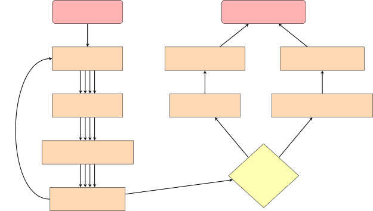

# Fast Prompt Alignment for Text-to-Image Generation

Khalil Mrini Affiliation: TikTok  
{khalil.mrini, hanlin.lu, linjie.yang, xuhu.ai}@tiktok.com,
hengwang00@gmail.com    Hanlin Lu Affiliation: TikTok  
{khalil.mrini, hanlin.lu, linjie.yang, xuhu.ai}@tiktok.com,
hengwang00@gmail.com    Linjie Yang Affiliation: TikTok  
{khalil.mrini, hanlin.lu, linjie.yang, xuhu.ai}@tiktok.com,
hengwang00@gmail.com    Weilin Huang Affiliation: TikTok  
{khalil.mrini, hanlin.lu, linjie.yang, xuhu.ai}@tiktok.com,
hengwang00@gmail.com    Heng Wang Affiliation: TikTok  
{khalil.mrini, hanlin.lu, linjie.yang, xuhu.ai}@tiktok.com,
hengwang00@gmail.com

###### Abstract

Text-to-image generation has advanced rapidly, yet aligning complex
textual prompts with generated visuals remains challenging, especially
with intricate object relationships and fine-grained details. This paper
introduces Fast Prompt Alignment (FPA), a prompt optimization framework
that leverages a one-pass approach, enhancing text-to-image alignment
efficiency without the iterative overhead typical of current methods
like OPT2I. FPA uses large language models (LLMs) for single-iteration
prompt paraphrasing, followed by fine-tuning or in-context learning with
optimized prompts to enable real-time inference, reducing computational
demands while preserving alignment fidelity. Extensive evaluations on
the COCO Captions and PartiPrompts datasets demonstrate that FPA
achieves competitive text-image alignment scores at a fraction of the
processing time, as validated through both automated metrics (TIFA, VQA)
and human evaluation. A human study with expert annotators further
reveals a strong correlation between human alignment judgments and
automated scores, underscoring the robustness of FPA’s improvements. The
proposed method showcases a scalable, efficient alternative to iterative
prompt optimization, enabling broader applicability in real-time,
high-demand settings. The codebase is provided to facilitate further
research.¹¹ 1 Github link:
[https://github.com/tiktok/fast_prompt_alignment](https://github.com/tiktok/fast_prompt_alignment)

## 1 Introduction

Text-to-image generation models, such as Stable Diffusion and DALL-E,
have made significant advances in generating high-quality images from
textual descriptions. Despite these advancements, models often struggle
to maintain consistent alignment between complex prompts and the
resulting images, particularly when dealing with intricate object
relationships or fine-grained details. Prompt optimization techniques
have been introduced to address these challenges, with the goal of
refining input prompts to improve alignment between text and generated
images.

Figure 1: Example of iterative optimization for a prompt used to
generate images. The model we use is Stable Diffusion 3 Medium. We
provide Google image search results for the original prompt for
comparison.

One prominent approach to prompt optimization is OPT2I Mañas et al.
(2024), which iteratively generates paraphrases of an input prompt,
evaluates the corresponding generated images using metrics like TIFA Hu
et al. (2023) and CLIP Radford et al. (2021), and selects the paraphrase
that produces the best results. While OPT2I achieves notable
improvements in image alignment, its iterative nature makes it
computationally expensive and slow. Each prompt requires multiple rounds
of paraphrasing and evaluation, making the method less feasible for
real-time or large-scale applications.

To address these limitations, we propose Fast Prompt Alignment (FPA), a
method that accelerates the process of prompt optimization without
sacrificing alignment quality. Instead of relying on multiple
iterations, FPA takes the results from iterative optimization processes
like OPT2I and uses them to train a model capable of real-time prompt
optimization. This approach allows FPA to offer a computationally
efficient alternative, providing near-instant alignment improvements
with performance close to, but faster than, full iterative methods.

Our method leverages large language models (LLMs) such as GPT-4o²² 2 For
clarification, we use the Azure-provided API for OpenAI’s GPT-4o. The
ubiquitous UI version is ChatGPT-4o. for prompt paraphrasing, where a
single iteration of paraphrasing is sufficient. We then fine-tune
smaller LLMs (e.g., 7B parameters) on the optimized prompts derived from
the iterative process. This fine-tuning enables real-time inference with
minimal overhead while still producing high-quality results. We find
that the alignment achieved by FPA on a 7B-parameter LLM is lower, even
when fine-tuned with iteratively optimized prompts, than a fully
iterative approach like OPT2I. However, FPA on a 123B-parameter LLM with
in-context learning demonstrates competitive performance while offering
significant speed improvements Rombach et al. (2022).

In our experiments, we find that FPA significantly reduces the time
required for prompt optimization. While it seems that we are unable to
transfer the learnings from iterative prompt optimization to a
7B-parameter LLM, simple in-context learning with 100 examples on a
123B-parameter LLM provides high scores in TIFA and VQA scores, well
above the scores obtained by the user-generated original prompts.
Additionally, we conducted a human evaluation with expert annotators,
who assessed text-to-image alignment and image structure across
optimized and original prompts. The results showed a strong positive
correlation between human judgment and automated metrics (TIFA and VQA),
validating the alignment improvements achieved by FPA. By significantly
reducing the time required for prompt optimization and demonstrating
competitive performance, FPA offers a scalable, efficient alternative
suitable for real-time, high-demand settings.

## 2 Related Work

Prompt optimization has become a critical research area in text-to-image
generation, aiming to enhance the alignment between complex textual
inputs and the generated images. Several methods have been proposed to
improve this alignment, with varying approaches in terms of
paraphrasing, reinforcement learning (RL), and fine-tuning large
language models (LLMs).

One of the prominent methods is Promptist Hao et al. (2023), which uses
reinforcement learning combined with a language model to iteratively
rephrase prompts. By generating more detailed and informative prompts,
Promptist improves the text-to-image consistency across different
datasets, including DiffusionDB, MS COCO Chen et al. (2015), and
ImageNet-21k Deng et al. (2009). This method fine-tunes a GPT model
using supervised data and leverages RL to explore better paraphrases,
demonstrating significant gains in image fidelity.

Another approach, Dynamic Prompt Optimizing, explores multimodal
prompting and refinement to generate better text-image alignments Mo
et al. (2024). This method provides interactive ways for users to refine
their prompts in real-time, enhancing the control over image generation
through multiple iterations of prompt refinement.

Gradient-based optimization methods have also been applied to prompt
tuning, as demonstrated in Hard Prompts Made Easy Wen et al. (2023).
This method enables the optimization of hard prompts for text-to-image
models without requiring extensive manual tuning. By using a
gradient-based approach to search for optimal prompts, this method
bypasses traditional token-level content filters and improves alignment
across datasets such as LAION Schuhmann et al. (2022) and Celeb-A Liu
et al. (2015).

The idea of improving prompt alignment through few-shot learning was
proposed by Lee et al. (2024), where in-context learning is used to
guide the model in generating better prompts. This method utilizes
prompt templates and a few example prompts to significantly improve the
fidelity and aesthetics of the generated images. The use of GPT-J in
combination with a few-shot learning paradigm allows the model to
generate prompts that align better with the text-to-image generation
tasks.

Another key method, NegOpt Zhou et al. (2024), focuses on optimizing
negative prompts to remove undesirable characteristics from generated
images. This method uses supervised fine-tuning and reinforcement
learning to optimize these negative prompts, significantly improving the
visual quality and coherence of the generated images.

Our work is closely related to OPT2I Mañas et al. (2024), which
iteratively optimizes prompts using an LLM and automatic scoring metrics
such as TIFA Hu et al. (2023) and CLIP Radford et al. (2021). While
effective in improving text-image consistency, OPT2I suffers from
computational inefficiencies due to its iterative nature. In contrast,
our proposed Fast Prompt Alignment (FPA) reduces the time and
computational cost by leveraging results from iterative optimization to
train a fine-tuned model capable of real-time inference, and to use
in-context learning with a large LLM. This last approach achieves
performance comparable to OPT2I but with significantly reduced
computational overhead.

## 3 Methodology

Fast Prompt Alignment (FPA) is a prompt optimization method designed to
enhance the efficiency of text-to-image generation models. Leveraging
the results of iterative methods such as OPT2I, which require multiple
rounds of paraphrasing and evaluation, FPA optimizes the process with a
single inference pass. This section outlines the key steps of FPA:
paraphrase generation, image generation, scoring, fine-tuning and
inference for a smaller LLM (7B parameters), or just inference with
in-context learning for a larger LLM (123B parameters).



Figure 2: Diagram of the Fast Prompt Alignment (FPA) method for
text-to-image generation. The process includes paraphrase generation,
image scoring, and both fine-tuning and in-context learning methods for
efficient prompt optimization. We generate 4 paraphrases in our case,
and we illustrate that with the 4 parallel arrows.

### 3.1 Overview of FPA Architecture

The FPA architecture follows these steps:

- •
  Paraphrase Generation: A large language model (LLM) generates several
  paraphrases of the input prompt.
- •
  Image Generation: Each paraphrase is used by a frozen text-to-image
  model to generate images.
- •
  Scoring: The generated images are evaluated using automated metrics,
  and the highest-scoring paraphrase is selected.
- •
  Fine-tuning and Inference on a smaller LLM: The selected paraphrases
  are used to fine-tune a smaller LLM to internalize the optimization
  process. The fine-tuned model performs real-time prompt optimization
  without requiring iterative refinements.
- •
  Inference with In-Context Learning on a larger LLM: This method
  enables prompt optimization in one pass by leveraging a random set of
  example pairs, reducing the need for iterative refinement and
  enhancing computational efficiency. The example pairs consist of
  user-generated prompts and their iteratively optimized counterparts.

Steps 1, 2, and 3 may be repeated using the highest-scoring paraphrase
from the previous round. This architecture is shown in Figure 2.

### 3.2 Paraphrase Generation

Given an initial prompt $`P_{0}`$, a large LLM (e.g., GPT-4o) generates
multiple paraphrases $`\mathcal{P}=\{P_{1},P_{2},\dots,P_{n}\}`$, each
of which expresses the meaning of the input prompt in a different way.
The goal of this step is to explore alternative formulations of the
prompt, which may lead to improved text-to-image alignment. These
paraphrases are generated in a single iteration, with the option to
repeat the process using the highest-scoring paraphrase to further
improve alignment.

### 3.3 Image Generation and Scoring

Each paraphrase $`P_{i}\in\mathcal{P}`$ is used by the frozen
text-to-image model $`M`$ (e.g., Stable Diffusion 3.0) to generate an
image $`I_{i}`$ as follows:

```math
I_{i}=M(P_{i})
```

The generated images are scored based on their alignment with the
prompts using two key metrics:

- •
  TIFA (Text-to-Image Faithfulness): The TIFA score Hu et al. (2023) is
  computed by generating question-answer pairs from the input text
  prompt using a language model, in our case GPT-4o, which targets
  specific elements of the image like objects, attributes, and
  relationships. These questions are then answered by a
  visual-question-answering model that analyzes the image content. The
  final TIFA score represents the accuracy of the VQA model’s answers
  when compared to the expected answers based on the text prompt,
  providing a measure of how faithfully the image reflects the input
  text, with a score ranging from 0 to 1.
- •
  VQA (Visual Question Answering): VQAScore Lin et al. (2024) is
  computed by converting the input text prompt into a question format,
  such as: “Does this figure show {text}?”, where the text corresponds
  to one of the noun chunks mentioned in the prompt, as detected by a
  call to an LLM. The image and the corresponding question are then
  passed through a VQA model, which predicts the probability that the
  answer is “Yes” using an answer decoder. The final VQAScore is the
  probability that the VQA model will generate a “Yes” answer, averaged
  for all noun chunks, serving as an alignment metric between the input
  text and the generated image. In this case again, we use GPT-4o and
  get the probability from the OpenAI API.

The final score for the $`i`$-th paraphrase $`P_{i}`$ and image $`I`$
is:

```math
S(P_{i},I)=\text{TIFA}(P_{i},I)+\text{VQA}(P_{i},I)
```

The paraphrase with the highest score is selected, and steps 2 and 3 can
be repeated with the highest-scoring paraphrase from the previous round.

### 3.4 Fine-tuning and Inference with a 7B-parameter LLM

After identifying the best paraphrase $`P^{*}`$, FPA fine-tunes a
smaller LLM (7B parameters) using the top-performing paraphrases. This
fine-tuning step enables the smaller LLM to internalize the optimization
process, allowing it to generate optimized prompts during inference. The
fine-tuning objective aims to minimize the probability distribution
difference between the paraphrases generated by the smaller LLM and the
best-scoring paraphrases from the larger LLM, and is defined as:

```math
\mathcal{L}_{\text{SFT}}=-\sum_{t=1}^{m}\log P_{\theta}(y_{t}|y_{<t},\mathbf{x})
```

where $`(y_{1},...,y_{m})`$ is the target output, corresponding to the
best-scoring paraphrase.

The fine-tuned smaller LLM is then used for real-time inference. For a
new prompt $`P_{\text{new}}`$, the fine-tuned model generates an
optimized paraphrase $`P_{\text{opt}}`$ in one pass:

```math
P_{\text{opt}}^{\text{one-pass}}=\text{LLM}_{\text{small}}^{\text{fine-tuned}}(P_{\text{new}})
```

The optimized paraphrase is passed to the text-to-image model to
generate the final image:

```math
I_{\text{opt}}=M(P_{\text{opt}}^{\text{one-pass}})
```

### 3.5 Inference with In-Context Learning on a 123B-parameter LLM

In lieu of fine-tuning, we can leverage in-context learning by using a
random set of $`n`$ example pairs $`(P_{\text{orig}},P_{\text{opt}})`$,
where $`P_{\text{orig}}`$ is a user-generated original prompt, and
$`P_{\text{opt}}`$ is the corresponding optimized prompt obtained
through iterative optimization. By conditioning a 123B-parameter LLM
with these $`n`$ example pairs, the model can generalize the
optimization pattern and produce an optimized prompt
$`P_{\text{opt}}^{\text{one-pass}}`$ directly from a new input prompt
$`P_{\text{new}}`$, bypassing the need for iterative refinement.

Define:

- •
  The example set as
  $`\{(P_{\text{orig}}^{(i)},P_{\text{opt}}^{(i)})\}_{i=1}^{n}`$
- •
  The optimization function learned by the LLM as $`f_{\text{LLM}}`$

Then, given a new prompt $`P_{\text{new}}`$, the optimized prompt
$`P_{\text{opt}}^{\text{one-pass}}`$ can be generated in one pass as:

```math
P_{\text{opt}}^{\text{one-pass}}=f_{\text{LLM}}(P_{\text{new}};\{(P_{\text{orig}}^{(i)},P_{\text{opt}}^{(i)})\}_{i=1}^{n})
```

This single-pass optimization reduces computational complexity and
leverages in-context examples for real-time prompt enhancement, thus
achieving efficient and scalable prompt optimization suitable for
large-scale applications.

### 3.6 Computational Efficiency

One of the primary advantages of FPA is its computational efficiency.
Iterative methods like OPT2I typically require multiple rounds of
paraphrasing and scoring, with a complexity of $`O(n\cdot m)`$, where
$`n`$ is the number of iterations and $`m`$ is the number of paraphrases
per iteration. In contrast, FPA reduces the complexity to $`O(m)`$ for
paraphrasing and $`O(1)`$ for inference, making it suitable for
real-time applications.

## 4 Experiments

| Dataset       | Mode                         | TIFA Score | VQA Score | Average |
| ------------- | ---------------------------- | ---------- | --------- | ------- |
| Coco Captions | Original Prompts             | 0.863      | 0.829     | 0.846   |
|               | After 2 Iterations           | 0.967      | 0.954     | 0.961   |
|               | Mistral 7B                   | 0.845      | 0.850     | 0.848   |
|               | Fine-tuned Mistral 7B        | 0.839      | 0.811     | 0.825   |
|               | Mistral Large (no examples)  | 0.882      | 0.873     | 0.878   |
|               | Mistral Large (100 examples) | 0.872      | 0.867     | 0.869   |
| PartiPrompts  | Original Prompts             | 0.813      | 0.760     | 0.787   |
|               | After 2 Iterations           | 0.937      | 0.930     | 0.934   |
|               | Mistral 7B                   | 0.799      | 0.761     | 0.780   |
|               | Fine-tuned Mistral 7B        | 0.820      | 0.784     | 0.802   |
|               | Mistral Large (no examples)  | 0.844      | 0.812     | 0.828   |
|               | Mistral Large (100 examples) | 0.856      | 0.833     | 0.845   |

Table 1: Comparison of TIFA and VQA scores for CocoCaptions and
PartiPrompt datasets under different modes: original prompts versus
after two iterations of iterative prompt optimization. The combined
score is the average of the TIFA and VQA scores.

### 4.1 Datasets

For our experiments, we utilize three datasets with distinct
characteristics—COCO Captions, PartiPrompts, and MidJourney Prompts—to
evaluate the performance of FPA. We use the MidJourney Prompts for
training, while COCO Captions and PartiPrompts are reserved for testing.

#### COCO Captions:

The COCO Captions dataset Chen et al. (2015) consists of over 330,000
images, each accompanied by five human-generated captions. For our
experiments, we use the well-known 2,000-image subset defined by
Karpathy and Li (2015), which has become a standard benchmark for
text-to-image evaluation tasks. This subset allows for direct comparison
against other state-of-the-art models by providing a balanced testing
ground that focuses on everyday scenes and objects. We evaluate FPA’s
performance on this dataset using TIFA and VQA metrics to assess
image-text alignment consistency.

#### PartiPrompts:

PartiPrompts is a dataset designed to evaluate text-to-image models on
complex and detailed prompts. It contains 1,600 prompts categorized into
sections such as “Properties & Positioning,” “Quantity,” and
“Fine-Grained Detail,” which challenge models to handle abstract and
multi-object relationships. This dataset is used to evaluate FPA’s
ability to generate images from intricate and abstract prompts Yu et al.
(2022).

#### MidJourney Prompts:

The MidJourney Prompts dataset Vivym (2024) consists of over 7 million
user-generated prompts aimed at creating artistic and imaginative
images. For training, we randomly sampled 42,000 prompts from this
dataset. These prompts provide a diverse and creative training set,
allowing the model to learn to optimize prompts effectively across a
variety of artistic styles and inputs.

It must be noted that to obtain the 42,000 iteratively optimized
prompts, it takes over 7 days of processing for 2 iterations. This
highlights the high computational cost of the iterative prompt
optimization technique and the need for FPA.

### 4.2 Training Details

We fine-tuned a Mistral LLM of 7 billion parameters.

The hyperparameters used during training were as follows: a learning
rate of 5e-5, a batch size of 256, and a maximum sequence length of 512
tokens. Gradient accumulation was set to 1, and the models were
optimized using the AdamW optimizer. The learning rate schedule followed
a linear decay with 500 warmup steps. Training was conducted for 15,000
steps. A weight decay of 0.01 was applied during training to regularize
the models.

The training objective focused on generating paraphrases that could
produce well-aligned images when evaluated against Stable Diffusion 3.0.

### 4.3 Metrics

#### Preparing Prompts for VQA Scoring.

For VQA scoring, we extracted noun chunks from the original text prompts
using GPT-4o. These noun chunks represent the critical elements of the
prompt, such as objects, entities, or features that are expected to
appear in the generated image.

#### Generating Multiple-Choice Questions for TIFA Scoring.

For TIFA scoring, we generated multiple-choice questions based on the
core elements of the original prompt, using GPT-4o. These questions were
designed to evaluate the faithfulness of the image to the text. Each
question included one correct answer, derived from the prompt, and
several distractor options to challenge the model’s understanding of the
image. The generated questions focused on verifying the presence,
attributes, or relationships that are expected to appear in the image.
Using a long pre-defined prompt and in-context learning examples, these
key elements were identified and then used to create questions about the
image content.

The GPT-4o model was tasked with answering these multiple-choice
questions based on the content of the generated image. The percentage of
correct answers formed the TIFA score for each image, with higher scores
indicating better text-image alignment and greater faithfulness to the
original prompt.

Whereas extracting noun chunks does not take a long time, extracting
multiple-choice questions is a time-consuming operation, that we
estimate to last for 24 hours for each batch of 10,000 questions.

### 4.4 Prompts & Methods Compared

#### Original Prompts.

This is the starting point of this project. The original prompts are
user-generated and can help us know whether we have improved the quality
of prompts when rephrasing. We always compute the TIFA and VQA scores
with regard to the original prompts.

#### After 2 Iterations.

These are the prompts resulting from 2 iterations of prompt
optimization, with TIFA and VQA scores as the optimized scores. These
prompts are the highest achievable result, and should be the upper bound
we strive towards.

#### Mistral 7B.

These are the prompts generated by Mistral 7B without any fine-tuning.
We use the same prompt that we have used for fine-tuning, and for
inference as well.

#### Fine-tuned Mistral 7B.

These are the prompts generated by Mistral 7B after fine-tuning with the
data obtained from 2 iterations of prompt optimization with TIFA and VQA
scores. We expect that Mistral 7B will perform better for the target
image generation model after fine-tuning.

#### Mistral Large (no examples).

These prompts are obtained by prompting the largest version of Mistral
(123B). We use the following introductory prompt: “You are a prompt
improver for a text-to-image generation model. You are improving prompts
in a way that is specific to one such model, and you are expected to
improve the prompts in a way that is specific to that model, such that
the images are faithful to the original user prompt, and more
aesthetically pleasing and complete than if they had been generated
without any prompt improver.” Then the user prompt is simply prefixed
with “User Prompt:” and the improved prompt generated by the assistant
is prefixed with “Improved Prompt:”.

#### Mistral Large (100 examples).

In this case, we add a random subset of 100 examples (pairs of original
and improved prompts) from our training data as in-context learning
examples to Mistral Large. We do not modify the introductory prompt. We
add a “history” of dialogue where the user and assistant have given each
other user prompts and improved prompts from our training data.

### 4.5 Results and Discussion

Table 1 presents our results.

We notice that while no method is able to exceed the 2 iterations of
prompt optimizing with TIFA and VQA scores, there are methods that can
actually get worse results than the original prompts. This means that we
have room for improvement in transferring the ability of selecting best
paraphrases to the LLMs, without resorting to viewing the images through
the visual QA scores. There is a big improvement between the original
prompts and the prompts after 2 iterations, showing that the method does
improve images generated by the target image generation model.

Second, all results obtained by Mistral 7B are lower than any results
obtained with Mistral Large (123B). This suggests that Mistral 7B is too
small of an LLM to be able to absorb the ability of selecting the best
paraphrases for prompts aimed at generating images from Stable Diffusion
3.0. Another possibility would be that LoRA is not sufficient to
fine-tune Mistral 7B, but this assumption is not supported by current
research.

Third, we notice contradictory trends for Coco Captions and PartiPrompts
with regard to adding fine-tuning and in-context learning examples from
the training data. It must be noted that these two datasets are test
sets, and that the results emanate from the same training data. For Coco
Captions, Mistral 7B’s performance decreases slightly after fine-tuning,
and the same happens for Mistral Large’s performance after adding 100
in-context learning examples. For PartiPrompts, Mistral 7B’s performance
increases after fine-tuning, and the same happens for Mistral Large’s
performance after adding 100 in-context learning examples. This could be
due to differences between the two test datasets, and the fact that
PartiPrompts may be of a similar distribution to the training data
whereas Coco Captions belongs to a different distribution. This should
be kept in mind when selecting training data, as it could either
positively or negatively affect the performance on the target test data.

Finally, we notice that regardless of training data, the size of the LLM
seems to be a defining factor: Mistral 7B always gets results lower than
those obtained by Mistral Large. While that is true, a question remains
around whether we will be able to bridge the gap between the best
Mistral Large result and the result of prompts after 2 iterations.
Ultimately, we must find the right way to transfer the ability of
selecting the best paraphrase for Stable Diffusion 3.0 to the LLM.

| Human Evaluation Scores    | Automatic Scores |         |
| -------------------------- | ---------------- | ------- |
|                            | TIFA             | VQA     |
| Text-Image Alignment Score | +0.2313          | +0.2755 |
| Image Structure Score      | +0.0574          | -0.0031 |

Table 2: Pearson Correlation Coefficients between Human Evaluation
scores and automatic scores.

|                  |                  |         |                         |                 |
| ---------------- | ---------------- | ------- | ----------------------- | --------------- |
| Prompt Case      | Automatic Scores |         | Human Evaluation Scores |                 |
|                  | TIFA             | VQA     | Text-Image Alignment    | Image Structure |
| Original Prompt  | 0.8168           | 0.7890  | 3.2500/4                | 2.8947/4        |
| Optimized Prompt | 0.8592           | 0.8416  | 3.3597/4                | 2.8447/4        |
| Change           | +0.0424          | +0.0526 | +0.1097                 | -0.0500         |

Table 3: Average Scores for Original and Optimized Prompts with Changes
Highlighted.

### 4.6 Human Evaluation

To evaluate the quality of images generated by our Fast Prompt Alignment
(FPA) method, we conducted a human evaluation involving five expert
annotators. These annotators, each with experience in scoring text-image
alignment and image structure, assessed the quality of generated images
based on specific criteria. Their evaluations were used to compare human
judgment with automated metrics (TIFA and VQA), providing a
comprehensive view of FPA’s effectiveness.

#### Annotation Instructions.

The annotators received a set of instructions to guide their
evaluations. They were presented with the original text prompt and one
generated image. The image was generated from a paraphrased version of
the prompt, or the original prompt itself. For a fair evaluation, the
annotators were not told what was the prompt used for generation, and
were only shown the original prompt. Their primary task was to rate each
image on text-to-image alignment, with scores ranging from 0 (no
alignment) to 4 (excellent alignment), depending on how accurately the
image captured the content, details, and themes of the prompt. In
addition to alignment, annotators were also instructed to evaluate the
overall image structure, assessing aspects like composition, clarity,
and coherence of visual elements to ensure the image’s structural
integrity matched expectations from the prompt. Annotators were
encouraged to maintain consistency and objectivity in their assessments
across all image sets.

#### Results and Analysis.

The results in Tables 2 and 3 indicate a strong positive correlation
between human evaluations and automated metrics. Specifically, the
Pearson correlation coefficients of +0.23 (TIFA) and +0.28 (VQA) suggest
that the automated metrics reliably align with human judgment,
reinforcing the validity of FPA’s alignment quality. These correlation
coefficients are very close to the ones found between our annotators’
ratings (+0.30).

Table 3 further shows that optimized prompts scored higher than original
prompts across both automatic scores, and particularly for Text-Image
alignment. Annotators scored optimized prompts with a +0.11 increase in
alignment compared to original prompts, closely aligning with
improvements seen in TIFA (+0.04) and VQA (+0.05) scores. This indicates
that FPA enhances alignment quality while preserving structural
consistency in images.

We did not notice strong correlations between the automatic scores and
the image structure score. The score are very similar for image
structure for both the original and optimized prompt. The consistency
and the lack of correlation for image structure scores are expected as a
result of the blind evaluation.

The human evaluation results highlight FPA’s ability to generate images
with strong text alignment, validated by both human and automated
scores. By achieving alignment improvements comparable to iterative
methods in a single pass, FPA offers a scalable, efficient solution for
high-quality text-to-image generation.

## 5 Conclusion

This study presents Fast Prompt Alignment (FPA), a novel framework
designed to address the inefficiencies of traditional iterative prompt
optimization methods in text-to-image generation. By consolidating the
optimization process into a single inference pass, FPA offers
substantial improvements in speed and resource efficiency while
maintaining competitive alignment quality. Through experiments on
multiple datasets and a human evaluation study, we demonstrate that FPA
achieves alignment scores close to iterative methods like OPT2I, but
with significantly reduced computational demands. Our findings reveal a
strong correlation between human judgment and automated metrics,
underscoring FPA’s effectiveness in enhancing text-image alignment.
Furthermore, the results emphasize the role of model size in retaining
paraphrasing effectiveness, with larger LLMs more capable of emulating
iterative alignment capabilities. Moving forward, FPA opens avenues for
efficient prompt optimization techniques, with implications for scaling
text-to-image models in practical, large-scale applications. The release
of our code aims to foster continued innovation in this field.

## Acknowledgments

We extend our sincere thanks to Anqi Wang, Junwei Wang, Linkai Ceng, and
Meng Zhang for their amazing coordination and quality assurance of the
annotation efforts.

## References

- Chen et al. (2015) Xinlei Chen, Hao Fang, Tsung-Yi Lin, Ramakrishna
  Vedantam, Saurabh Gupta, Piotr Dollar, and C Lawrence Zitnick. 2015.
  Microsoft coco captions: Data collection and evaluation server.
- Deng et al. (2009) Jia Deng, Wei Dong, Richard Socher, Li-Jia Li, Kai
  Li, and Fei-Fei Li. 2009. Imagenet: A large-scale hierarchical image
  database. In _Proceedings of the IEEE Conference on Computer Vision
  and Pattern Recognition (CVPR)_, pages 248–255.
- Hao et al. (2023) Yaru Hao, Zewen Chi, Li Dong, and Furu Wei. 2023.
  [Optimizing prompts for text-to-image
  generation](https://proceedings.neurips.cc/paper_files/paper/2023/file/d346d91999074dd8d6073d4c3b13733b-Paper-Conference.pdf).
  In _Advances in Neural Information Processing Systems (NeurIPS)_.
- Hu et al. (2023) Yalong Hu et al. 2023. Tifa: Accurate and
  interpretable text-to-image faithfulness evaluation with question
  answering. In _International Conference on Computer Vision (ICCV)_.
- Karpathy and Li (2015) Andrej Karpathy and Fei-Fei Li. 2015. Deep
  visual-semantic alignments for generating image descriptions. In
  _Proceedings of the IEEE conference on computer vision and pattern
  recognition (CVPR)_, pages 3128–3137.
- Lee et al. (2024) Seunghun Lee, Jihoon Lee, Chan Ho Bae, Myung-Seok
  Choi, Ryong Lee, and Sangtae Ahn. 2024. [Optimizing prompts using
  in-context few-shot learning for text-to-image generative
  models](https://doi.org/10.1109/ACCESS.2023.3348778). _IEEE Access_,
  12:2660–2673.
- Lin et al. (2024) Zhiqiu Lin, Deepak Pathak, Baiqi Li, Jiayao Li, Xide
  Xia, Graham Neubig, Pengchuan Zhang, and Deva Ramanan. 2024.
  Evaluating text-to-visual generation with image-to-text generation.
  _arXiv preprint arXiv:2404.01291_.
- Liu et al. (2015) Ziwei Liu, Ping Luo, Xiaogang Wang, and Xiaoou
  Tang. 2015. Deep learning face attributes in the wild. In _Proceedings
  of the IEEE International Conference on Computer Vision (ICCV)_, pages
  3730–3738.
- Mañas et al. (2024) Oriol Mañas et al. 2024. Improving text-to-image
  consistency via automatic prompt optimization (opt2i). _arXiv preprint
  arXiv:2403.17804_.
- Mo et al. (2024) Wenyi Mo, Tianyu Zhang, Yalong Bai, Bing Su, Ji-Rong
  Wen, and Qing Yang. 2024. [Text-to-image generation through
  multi-modal prompting and
  refinement](https://arxiv.org/pdf/2403.04014v1.pdf). In _Proceedings
  of the IEEE Conference on Computer Vision and Pattern Recognition
  (CVPR)_.
- Radford et al. (2021) Alec Radford et al. 2021. Learning transferable
  visual models from natural language supervision. In _International
  Conference on Machine Learning (ICML)_.
- Rombach et al. (2022) Robin Rombach et al. 2022. High-resolution image
  synthesis with latent diffusion models. In _IEEE Conference on
  Computer Vision and Pattern Recognition (CVPR)_.
- Schuhmann et al. (2022) Christoph Schuhmann, Richard Beaumont, Ross
  Vencu, Casey Gordon, Ross Wightman, Mohamed Cherti, Tim Coombes, Amol
  Katta, Charlie Mullis, Lukas Wagner, and Patrick Schramowski. 2022.
  Laion-5b: An open large-scale dataset for training next generation
  image-text models. _NeurIPS Datasets and Benchmarks Track_.
- Vivym (2024) Vivym. 2024. Midjourney prompts dataset.
  [https://huggingface.co/datasets/vivym/midjourney-prompts](https://huggingface.co/datasets/vivym/midjourney-prompts).
- Wen et al. (2023) Yuxin Wen, Neel Jain, John Kirchenbauer, Micah
  Goldblum, Jonas Geiping, and Tom Goldstein. 2023. [Hard prompts made
  easy: Gradient-based discrete optimization for prompt tuning and
  discovery](https://proceedings.neurips.cc/paper_files/paper/2023/file/a00548031e4647b13042c97c922fadf1-Paper-Conference.pdf).
  In _Advances in Neural Information Processing Systems (NeurIPS)_.
- Yu et al. (2022) Jiahui Yu, Yuanzhong Xu, Jing Yu Koh, Thang Luong,
  Gunjan Baid, Zirui Wang, Vijay Vasudevan, Alexander Ku, Yinfei Yang,
  Burcu Karagol Ayan, Ben Hutchinson, and Wei Han. 2022. Scaling
  autoregressive models for content-rich text-to-image generation.
  _arXiv preprint arXiv:2206.10789_.
- Zhou et al. (2024) Lin Zhou, Michael Ogezi, and Ning Shi. 2024.
  [Optimizing negative prompts for enhanced aesthetics and fidelity in
  text-to-image generation](https://arxiv.org/pdf/2403.07605.pdf).
  _arXiv preprint arXiv:2403.07605_.
