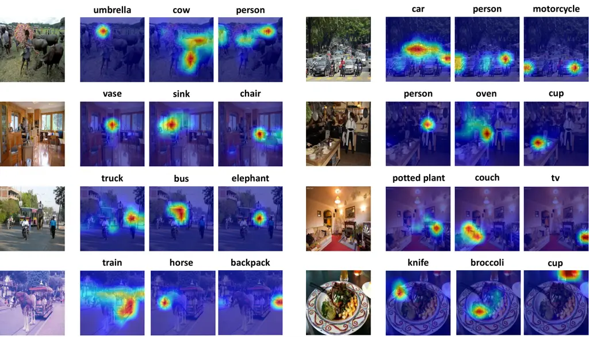
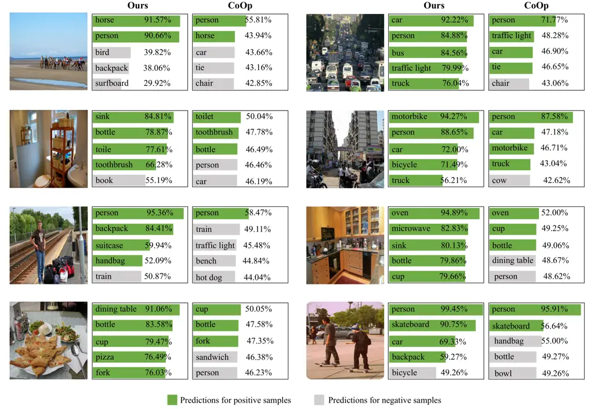
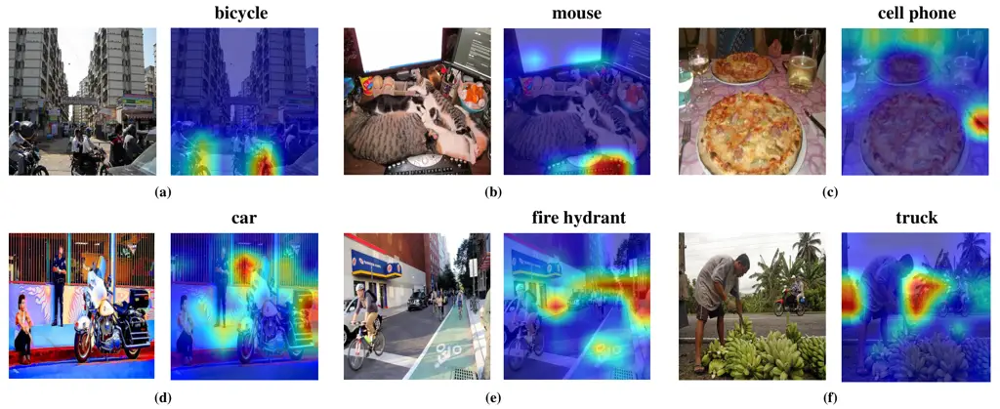

^(†)^(†)footnotetext: Haoxian Ruan and Zhihua Xu share first
authorships. Tianshui Chen is the Corresponding author.

# Learning Semantic-Aware Representation in Visual-Language Models for Multi-Label Recognition with Partial Labels

Journal: TOMMCCS: Computing methodologies Object recognition

Haoxian Ruan email: <HowxRuan@mail2.gdut.edu.cn> Affiliation: Guangdong
University of Technology, Guangzhou, Guangdong, China , Zhihua Xu email:
<zihua@mail2.gdut.edu.cn> Affiliation: Guangdong University of
Technology, Guangzhou, Guangdong, China , Zhijing Yang
Affiliation: Guangdong University of Technology, Guangzhou, Guangdong,
China email: <yzhj@gdut.edu.cn> , Yongyi Lu Affiliation: Guangdong
University of Technology, Guangzhou, Guangdong, China email:
<yylu@gdut.edu.cn> , Jinghui Qin Affiliation: Guangdong University of
Technology, Guangzhou, Guangdong, China email: <qinjinghui@gdut.edu.cn>
and Tianshui Chen\* Affiliation: Guangdong University of Technology,
Guangzhou, Guangdong, China email: <tianshuichen@gmail.com>

###### Abstract.

Multi-label recognition with partial labels (MLR-PL), in which only some
labels are known while others are unknown for each image, is a practical
task in computer vision, since collecting large-scale and complete
multi-label datasets is difficult in real application scenarios.
Recently, vision language models (e.g. CLIP) have demonstrated
impressive transferability to downstream tasks in data limited or label
limited settings. However, current CLIP-based methods suffer from
semantic confusion in MLR task due to the lack of fine-grained
information in the single global visual and textual representation for
all categories. In this work, we address this problem by introducing a
semantic decoupling module and a category-specific prompt optimization
method in CLIP-based framework. Specifically, the semantic decoupling
module following the visual encoder learns category-specific feature
maps by utilizing the semantic-guided spatial attention mechanism.
Moreover, the category-specific prompt optimization method is introduced
to learn text representations aligned with category semantics.
Therefore, the prediction of each category is independent, which
alleviate the semantic confusion problem. Extensive experiments on
Microsoft COCO 2014 and Pascal VOC 2007 datasets demonstrate that the
proposed framework significantly outperforms current state-of-art
methods with a simpler model structure. Additionally, visual analysis
shows that our method effectively separates information from different
categories and achieves better performance compared to CLIP-based
baseline method.

###### Keywords: 

Multi-label recognition; Partial labels; Vision-language model

## 1. Introduction

Multi-label image recognition (MLR) is a fundamental yet practical task
in computer vision. Since images in the real-world generally contain
multiple instances of different categories, MLR provides a more
comprehensive understanding in vision systems compared to single-label
image recognition. It also benefits various applications ranging from
content-based image retrieval (Cheng et al., 2005; Li et al., 2010;
Zhang and Peng, 2021; Lai et al., 2016), recommendation systems
(Carrillo et al., 2013; Darban and Valipour, 2022; Zheng et al., 2014)
to human attribute analysis (Chen et al., 2021; Pu et al., 2021; Wu
et al., 2019). Many significant progress has been made in this task
thanks to the development of deep neural networks in recent years (He
et al., 2016; Dosovitskiy et al., 2021). However, these methods rely on
large-scale and high quality datasets with clean and complete
annotations for training, while it is very time-consuming and
labor-intensive to annotate a consistent and complete list of labels for
each image in multi-label task. With this consideration, we consider the
task of multi-label recognition with partial labels (MLR-PL), where only
part of labels are known in each image, while others are unknown, as
shown in Figure 1. Such annotation strategy is more flexible and
scalable as the number of samples and categories are always expanding in
real application scenarios.

Current algorithms for the MLR-PL task mainly exploit label dependencies
or feature similarity to transfer knowledge from known labels to unknown
labels and gain extra supervision information for model training (Wang
et al., 2021; Chen et al., 2022b; Pu et al., 2022). Despite significant
progress, these methods still rely on substantial amounts of data to
learn category relations and discriminative features. Additionally, they
require complex framework designs to obtain additional supervisory
information during training, which demands intricate training strategies
and dataset-specific tuning of hyperparameters. These factors limit the
scalability and performance in practical applications. Recently,
vision-language models (VLM) such as CLIP (Radford et al., 2021) and
ALIGN (Jia et al., 2021) have demonstrated great potential in
label-limited tasks, benefiting from rich visual knowledge acquired
through training on large-scale datasets with image-text pairs.
Therefore, we propose leveraging the prior knowledge of CLIP to
establish a framework for MLR-PL without the need for extensive training
data. Prompt learning provides an efficient way to adapt VLM to other
tasks, which is implemented by setting manual templated prompts or
learnable prompt tokens to avoid costs for fine-tuning the entire model.
Through this method, current works like CoOp (Zhou et al., 2022b) have
demonstrated their effectiveness and generalization ability to various
few shot visual tasks. However, these methods mainly extract a global
representation of the entire image using the visual encoder and utilize
a single prompt text for all categories, which is suitable for
single-label classification with only one dominant category. In
contrast, in MLR-PL, images contain multiple semantic objects, leading
to entangled category information in the global representation.
Moreover, the semantics of the global representation tend to be
dominated by salient objects after coarse-grained operations (e.g.,
pooling). These factors result in semantic confusion when matching with
text features, particularly when features across different categories
share similarities, thereby diminishing the model’s performance. This
enables us to explore methods for extracting fine-grained visual
semantic information from CLIP’s global visual representation, which is
essential for MLR-PL.


Figure 1. An illustration of MLR image with complete labels \[a\] and
partial labels \[b\]. All positive and negative labels are known in
traditional MLR, while some labels are missing in MLR-PL (airplane,
clock, traffic light).A figure containing a bus and other things,
besides with its annotations.

Building on the analysis above, we enhance the original CLIP’s
capability in MLR-PL by integrating a fine-grained approach to obtain
decoupled representations for each category. Specifically, we introduce
a semantic-guided spatial attention mechanism on top of the CLIP visual
encoder, which locates informative regions for different semantic
objects and separates category-specific feature maps from the
semantically entangled global representation. The existence of a target
class is then determined by matching the decoupled visual features with
textual representations, which effectively alleviates the semantic
confusion arising from semantic uncertainty. Moreover, considering the
diversity of features across different categories in MLR, adopting a
unified prompt template is limited in expressiveness and lacks
category-specific descriptive information. It is also challenging for
the model to integrate the semantics of all categories into a single
prompt template, which restricts its performance in MLR-PL. To address
these problems, we introduce a category-specific prompt optimization
method to learn text representations that are aligned with category
semantics, further decoupling semantic information across categories.

Our main contributions in this paper are summarized as follows.

- •
  We introduce a simple yet effective framework for MLR-PL task based on
  vision-language models. To alleviate the semantic confusion caused by
  entangled global representation, we incorporate a semantic decoupling
  module based on a semantic-guided spatial attention mechanism to learn
  semantic-specific features. We also utilize category-specific prompt
  optimization method for learning the prompts that best aligned with
  category semantics. During training, only the semantic-decoupling
  module and prompt optimization module are learnable, while the
  remaining parameters of the vision-language model are kept fixed. This
  approach avoids fine-tuning the entire model.
- •
  We conduct extensive experiments on various datasets (e.g., Microsoft
  COCO 2014 and Pascal VOC 2007), which demonstrate superior performance
  compared to traditional leading methods and previous CLIP-based
  approaches. Additionally, we conduct ablation studies to analyze the
  contribution of semantic-decoupling module and provide visualization
  analysis on our method for a more comprehensive understanding.

## 2. Related Works

### 2.1. Multi-label Recognition

Multi-label recognition has drawn increasing attention in recent years
(Zhou et al., 2023b; Zhou et al., 2023a; Chen et al., 2024b). One
straightforward method for this task is to view it as a multiple-binary
classification task. This method ignores the label correlations among
categories, which is crucial in multi-label recognition task. Hence,
recent works proposed exploiting the underlying label structure to
regularize the training of MLR models. One way to achieve this goal is
by introducing recurrent neural network (RNN)/long short-term memory
(LSTM) (Hochreiter and Schmidhuber, 1997; Wang et al., 2017) to capture
label dependencies implicitly. Wang et al. (Wang et al., 2016) proposed
a CNN-RNN framework that model label dependency with semantic redundancy
and co-occurrence dependency. Additionally, Chen et al. (Chen et al., 2018) proposed a recurrent attention reinforcement learning framework to
model long-term dependencies among attentional regions and capture
semantic label co-occurrences. Another line of works explicitly model
label dependencies with graph neural network (GNN) (Li et al., 2015;
Kipf and Welling, 2016; Yuan et al., 2023; Zhou et al., 2023c). For
example, Chen et al. (Chen et al., 2019a) introduced an inter-dependent
object classifier built on a graph convolutional neural network (GCN),
which is trained to model the correlations between different categories.
Moreover, Chen et al. (Chen et al., 2019b) proposed a semantic-specific
graph representation learning (SSGRL) framework that utilizes a graph
propagation scheme to obtain semantic-aware features, which achieved
state-of-the-art performance on several multi-label datasets. Despite
achieving remarkable performance in various datasets and application
scenarios, these methods are built on deep neural network (DNN) that
require large-scale and complete annotated datasets for training.
However, it is very time-consuming and labor-intensive to annotate a
complete label list for each image, which makes the collection of these
datasets less practical and thus limits the application of MLR.

### 2.2. Multi-label Recognition With partial labels

To reduce the annotation cost, many works have been dedicated to the
task of multi-label recognition with partial labels (MLR-PL), where only
part of labels are known in each image. Current works tend to introduce
pseudo-labels for the complement of unknown labels. For example, Durand
et al. (Durand et al., 2019) introduced the curriculum learning strategy
where pseudo-labels are generated by the pre-trained model, and used the
partial-BCE loss normalized by the proportion of known labels for model
training. Moreover, Huynh et al. (Huynh and Elhamifar, 2020) proposed to
regularize the BCE loss with the statistical co-occurrences and
image-level feature similarity. Recently, some works employ
category-specific feature blending (Pu et al., 2022; Pu et al., 2024) or
label correlations between categories (Chen et al., 2022b; Chen et al.,
2024a) to transfer information from known labels and supplement extra
pseudo-labels for model training. These methods basically rely on the
modeling of label dependencies. Other works propose reject or correct
samples with large loss fluctuation to prevent the model from memorizing
the noisy labels (Kim et al., 2022), or enhance the salient object
regions corresponding to the present labels (Wang et al., 2023; Kim
et al., 2023b).

Although achieving significant progress, these MLR-PL methods rely on
complex model architectures and training strategies. Motivated by recent
progress in vision-language model (VLM), our approach suggests to
transfer knowledge from large-scale pre-trained VLM by prompt
optimization and thus provides a simple framework for solving the MLR-PL
task.

### 2.3. Vision-Language Models

Vision-language pre-training models (Jia et al., 2021; Radford et al., 2021) have demonstrated impressive performance on various downstream
tasks. Among these models, CLIP (Radford et al., 2021) is a
representative framework which leverage large-scale image-text pairs
collected from the Internet to align image and text representations in
the embedding space. It has obtained rich visual representations and
knowledge through large-scale contrastive learning and thus demonstrated
remarkable performance and scalability in zero-shot inference and
few-shot tasks(Du et al., 2022; He et al., 2023; Kim et al., 2023a; Qin
et al., 2023). To fit models to downstream tasks while preserving the
learned representation space, recent approaches mainly adopt
prompt-tuning method(Ge et al., 2023; Lu et al., 2022; Bulat and
Tzimiropoulos, 2023; Jia et al., 2022) instead of fine-tuning the entire
model. It provides a parameter-efficient and flexible way and is ease of
use. In CoOp (Zhou et al., 2022b), Zhou et al.proposed to learn the
prompts from the target dataset and avoid manually fine-tuning prompt
templates. CoCoOp (Zhou et al., 2022a) further enhanced CoOp by
introducing image-conditional information to improve generalization to
unseen classes. However, although achieving remarkable process, CLIP is
trained to focus on global image and text representations. Consequently,
it tends to predict the closest semantic class while neglecting other
potential classes during inference. Since images contain multiple
objects in MLR task, fine-grained information is essential for the
prediction accuracy. For similar consideration, RegionCLIP (Zhong
et al., 2022) proposed to learn region-level visual features in object
detection and align the region-text pairs to make prediction. However,
large-scale dataset for object detection is needed to fine-tune the
detector, which does not match the need of partial label learning.
Different from the above approaches, our method proposes to learn
semantic-specific representations to better disentangle visual and
textual information from different categories to avoid semantic
confusion caused by global representation scheme.

## 3. Proposed Method

| Notation                 | Description                                                                     |
| ------------------------ | ------------------------------------------------------------------------------- |
| $`\mathcal{D}`$          | The training dataset                                                            |
| $`N`$                    | The number of samples in training dataset                                       |
| $`I^{n}`$                | The $`n`$-th image in the dataset                                               |
| $`y^{n}`$                | The label vector for the $`n`$-th image                                         |
| $`Enc_{v}`$              | The visual encoder in CLIP with slight modification                             |
| $`Enc_{t}`$              | The textual encoder in CLIP                                                     |
| $`F_{att}`$              | The attention mapping function in semantic decoupling module                    |
| $`F_{g}`$                | The pre-trained language model GloVe (Pennington et al., 2014)                  |
| $`\odot`$                | The Hadamard product between features                                           |
| $`\widetilde{a}_{c,wh}`$ | The semantic attention coefficient for category $`c`$ at position $`(w,h)`$     |
| $`a_{c,wh}`$             | The normalized attention coefficient for category $`c`$ at position $`(w,h)`$   |
| $`f^{g}_{wh}`$           | The global visual representation from CLIP visual encoder at position $`(w,h)`$ |
| $`\widetilde{f}_{c,wh}`$ | Spatial feature fused with semantic information for category $`c`$ at $`(w,h)`$ |
| $`f^{v}_{c}`$            | Visual feature for category $`c`$                                               |
| $`f^{t}_{c}`$            | Textual feature for category $`c`$                                              |
| $`x_{c}`$                | The semantic representation of category $`c`$                                   |
| $`t_{c}`$                | The learnable prompt for category $`c`$                                         |
| $`[V]_{c}^{i}`$          | The $`i`$-th learnable word vector in $`t_{c}`$                                 |
| $`[CLS]`$                | The word embedding of the category name                                         |
| $`p_{c}`$                | Model’s prediction score for category $`c`$                                     |
| $`\tau`$                 | The temperature parameter in softmax                                            |
| $`\gamma_{+}`$           | The exponential coefficient in P-ASL for positive samples                       |
| $`\gamma_{-}`$           | The exponential coefficient in P-ASL for negative samples                       |
| $`\mathcal{L}^{n}_{c}`$  | The loss term for category $`c`$ of the $`n`$-th sample                         |
| $`\mathcal{L}`$          | The overall loss function                                                       |

Table 1. Mathematical Notations and Descriptions

We formulate the MLR-PL task as follows. Let
$`\mathcal{D}=\{(I^{1},y^{1}),...,(I^{N},y^{N})\}`$ be the training set
containing $`N`$ training samples and $`C`$ categories, where $`I^{n}`$
denotes the $`n`$-th image and
$`y^{n}=[y^{n}_{1},...,y^{n}_{C}]\in\{-1,0,1\}^{C}`$ denotes its label
vector. Each image may contain objects of multiple categories. In
partial label setting, $`y^{n}_{c}`$ is assigned to 1 if the category
$`c`$ is present in the $`n`$-th image, assigned to -1 if it is absent,
or assigned to 0 if it is unknown.

In this section, we introduce the proposed framework which builds on
pre-trained VLM with rich prior information. To alleviate the semantic
confusion problem caused by utilizing single global visual and textual
representation for all categories in current VLM methods, the visual
semantic decoupling module first extracts category-specific features
from entangled global representation. It employs a semantic-guided
spatial attention mechanism to locate informative regions for specific
category, and obtains visual features that encode the category-specific
information. Furthermore, we set category-specific prompts that best
align with the semantics of certain category. To avoid manual tuning, we
propose using prompt optimization method to update prompt tokens through
the training process. The prediction probability for each category is
calculated by coupling the category-specific visual feature with the
corresponding textual feature. Finally, the model supervises the
parameter learning of the semantic decoupling module and the
category-specific prompts by minimizing the classification loss, while
the parameters of visual and textual encoders remain fixed during
training. We adopt the partial asymmetric loss widely used in MLR, in
which only the annotated samples are considered for calculating the
loss. An overall illustration of our framework is shown in Figure 2. We
also include the notations used in this section in Table 1 for clarity.


Figure 2. An overall illustration of the proposed framework. For each
class, a prompt is initialized with each component as a learnable
vector. These prompts are passed through CLIP textual encoder to obtain
category-specific text embeddings. Meanwhile, the semantic decoupling
module employs a semantic-guided spatial attention mechanism to extract
fine-grained visual features for each category. The parameters of
semantic decoupling module and the category-specific learnable prompts
are optimized by minimizing the classification loss, while the
parameters of CLIP visual and textual encoders remain fixed.Pipeline for
CLIP-based MLR-PL framework.

### 3.1. Visual Semantic Decoupling

The semantic decoupling module is introduced to extract
category-specific information from the global feature maps of semantic
entanglement. It is implemented by introducing a semantic-guided spatial
attention mechanism. Specifically, given an image $`I`$, the framework
first utilizes the visual encoder in CLIP to extract its global feature
map $`f^{g}\in\mathbb{R}^{N\times W\times H}`$ as follows, where $`N`$,
$`W`$ and $`H`$ are the channel numbers, width and height of the feature
map,

```math
f^{g}=Enc_{v}(I), \tag{1}
```

and $`Enc_{v}`$ is the visual encoder in CLIP with slight modification.
To extract semantic information of certain category $`c`$, we utilize
pre-trained language model GloVe (Pennington et al., 2014) to obtain the
semantic representation $`x_{c}\in\mathbb{R}^{D}`$ as guidance,
formulated as

```math
x_{c}=F_{g}(w_{c}), \tag{2}
```

where $`w_{c}`$ is the semantic word of category $`c`$ and $`F_{g}`$ is
the pre-trained GloVe model. We can then incorporate $`f^{g}`$ with
$`x_{c}`$ to focus on spatial regions with semantic information of
category $`c`$. Specifically, for each location $`(w,h)`$, we fuse these
information with a low-rank bilinear pooling method (Kim et al., 2017):

```math
\widetilde{f}_{c,wh}=P^{T}(tanh((U^{T}f^{g}_{wh})\odot(V^{T}x_{c})))+b, \tag{3}
```

where $`f^{g}_{wh}`$ is the local feature of $`f^{g}`$ at position
$`(w,h)`$, $`P,U,V`$ are learnable linear functions, $`b`$ is a
learnable bias vector, and $`\odot`$ represents the Hadamard product.
$`\widetilde{f}_{c,wh}`$ is the spatial feature that fuses category
semantic. We then utilize an attention mapping function $`F_{att}`$
implemented by a fully connected layer to compute the spatial attention
map as follows.

```math
\widetilde{a}_{c,wh}=F_{att}(\widetilde{f}_{c,wh}). \tag{4}
```

The coefficient at position $`(w,h)`$ on the map represents the semantic
relevance of the region to category c. Additionally, to make these
attention coefficients more comparable across different samples, we
normalize them with a softmax function over all regions on the map,
formulated as

```math
a_{c,wh}=\frac{exp(\widetilde{a}_{c,wh})}{\sum_{w^{\prime},h^{\prime}}exp(\widetilde{a}_{c,w^{\prime}h^{\prime}})}. \tag{5}
```

Finally, we extract the spatial-related representation $`f^{v}_{c}`$ by
applying attention pooling for the $`c`$-th category as follows:

```math
f_{c}^{v}=\sum_{w,h}a_{c,wh}\odot f^{g}_{c,wh}. \tag{6}
```

The $`f_{c}^{v}`$ encodes all semantic information related to category
$`c`$. Consequently, the semantic decoupling module disentangles the
global representation into distinct semantic components. By repeating
this procedure, the model obtains category-specific representations
$`\{f_{1}^{v},f_{2}^{v},...,f_{C}^{v}\}`$ for all categories. We further
present visualization illustrations to demonstrate the effectiveness of
the module, as shown in Figure 3.

### 3.2. Category-specific Prompt Optimization

Due to the fine-grained characteristics of MLR task, we propose setting
category-specific prompts that best align with the given semantic
contexts. To avoid manual prompt tuning, we follow CoOp (Zhou et al.,
2022b) by modeling the tokens as continues, learnable parameters that
can be optimized in an end-to-end manner with classification loss, while
keeping the parameters of pre-trained text encoder fixed. Specifically,
we define the specific prompt $`t_{c}`$ for category $`c`$ as follows:

```math
t_{c}=[V]_{c}^{1}[V]_{c}^{2}...[V]_{c}^{M}[CLS], \tag{7}
```

where $`M`$ is the length of prompt. Each $`[V]^{i}_{c}`$ is a learnable
word vector (with a dimension of 512 in CLIP) and $`[CLS]`$ represents
the word embedding corresponding to the category name. These tokens are
randomly initialized by sampling from a Gaussian distribution and are
independent for each category. we obtain the textual representation for
the $`c`$-th category as follows:

```math
f_{c}^{t}=Enc_{t}(t_{c}), \tag{8}
```

where $`Enc_{t}`$ is the text encoder of CLIP. By coupling the visual
and textual features from each category, the prediction score for
category $`c`$ is computed as:

```math
p_{c}=\frac{exp(\langle f_{c}^{v},f_{c}^{t}\rangle/\tau)}{\sum_{c=1}^{C}exp(\langle f_{c}^{v},f_{c}^{t}\rangle/\tau)}, \tag{9}
```

where $`\langle\cdot,\cdot\rangle`$ calculate the cosine similarity
between two features, $`c\in\{1,2,...,{C}\}`$ is the category index, and
$`\tau`$ is the temperature parameter.

### 3.3. Model Optimization

During the training process, only the semantic decoupling module and
category-specific prompts are updated, while the parameters of visual
and textual encoders remain fixed. The optimization process is performed
to minimize the classification loss. To address the inherent
positive-negative imbalance in MLR datasets, we adopt partial Asymmetric
Loss (P-ASL) (Ridnik et al., 2021) to alleviate this problem.
Specifically, given the model prediction scores
$`p^{n}=[p^{n}_{1},...,p^{n}_{C}]`$ for the $`n`$-th sample in training
set, only the annotated samples are utilized to calculate the loss,
which is formulated as

```math
\mathcal{L}^{n}_{c}=\begin{cases}(1-p^{n}_{c})^{\gamma_{+}}log(p^{n}_{c})&y^{n}_{c}=1\\
(\bar{p}^{n}_{c})^{\gamma_{-}}log(1-\bar{p}^{n}_{c})&y^{n}_{c}=-1,\\
\end{cases} \tag{10}
```

where $`\bar{p}_{c}^{n}=max(p_{c}^{n}-m,0)`$ represents the probability
for negative samples shifted by a hard threshold $`m`$ which is set to
down-weight the easy negative samples. We also set the focusing
parameter $`\gamma_{-}\geq\gamma_{+}`$ to further reduce the
contribution of easy negative samples. The semantic decoupling module
and learnable prompts are updated through back-propagation using P-ASL.
Finally, the objective for training is formulated as follows:

```math
\mathcal{L}=-\frac{1}{N}\sum_{n=1}^{N}\sum_{c=1}^{C}\mathcal{L}_{c}^{n}. \tag{11}
```

The training procedure of our proposed framework is summarized in
Algorithm 1.

0:  $`\mathcal{D}=\{(I^{n},y^{n})\}_{n=1}^{N}`$: training dataset with
partial labels   $`Enc_{v},Enc_{t}`$: visual and textual encoders from
CLIP   $`\{t_{1},t_{2},...,t_{C}\},\mathcal{F}_{sd}`$: initialized
category-specific prompts and semantic decoupling module.

0:  updated parameters of $`\{t_{1},t_{2},...,t_{C}\}`$ and
$`\mathcal{F}_{sd}`$

1:  Initialize parameters of $`\{t_{1},t_{2},...,t_{C}\}`$ and
$`\mathcal{F}_{sd}`$ randomly;

2:  for $`epoch=1,2,...,E_{max}`$ do

3:   Extract the category-specific visual features:
$`\{f_{1}^{v},f_{2}^{v},...,f_{C}^{v}\}=\mathcal{F}_{sd}(Enc_{v}(I))`$;

4:   Extract category-specific text embeddings:
$`\{f_{1}^{t},f_{2}^{t},...,f_{C}^{t}\}=Enc_{t}(t_{1},t_{2},...,t_{C})`$;

5:   Compute categorical prediction scores $`\{p_{1},p_{2},...,p_{C}\}`$
with Equation 9;

6:   Compute the value of partial asymmetric loss with Equation 11;

7:   Update the parameters of $`\{t_{1},t_{2},...,t_{C}\}`$ and
$`\mathcal{F}_{sd}`$ with SGD;

8:  end for

Algorithm 1 Training procedure of the proposed framework.

## 4. Experiments

In this section, we evaluate the performance of our framework through
extensive experiments and comparisons with current leading MLR-PL
methods. Furthermore, we present visual illustrations to demonstrate the
effectiveness of the proposed modules.

### 4.1. Datasets and Evaluation Metrics

We conduct experiments and comparisons on the MS-COCO (Lin et al., 2014)
and Pascal VOC 2007 (Everingham et al., 2010) datasets, which are the
most widely used benchmarks in MLR. The MS-COCO dataset contains about
120k images and 80 different categories in daily life. The dataset is
further divided into a training set with around 80k images and a testing
dataset with about 40k images. The Pascal VOC 2007 dataset contains
around 10k images with 20 object categories, and it is divided into a
training set and a validation set with 5,011 images and 4,952 images,
respectively. Since both of these datasets are completely-annotated, we
randomly drop certain proportions of labels to create training datasets
with partial-labels. In our experiments, the proportions of known labels
in datasets vary from 10% to 90%. The testing datasets retain complete
labels to ensure adequate samples for evaluation.

For the evaluation metrics, we follow current works and mainly adopt the
mean average precision (mAP) over all categories under different
proportions of known labels. Additionally, we compute the average mAP
across all proportions for a more comprehensive comparison. Furthermore,
we follow current MLR works to adopt the overall and per-class
F1-measure (i.e., the OF1 and CF1 metrics), which are defined as
follows:

```math
OP=\frac{\sum_{i}N^{c}_{i}}{\sum_{i}N^{p}_{i}},\quad CP=\frac{1}{C}\frac{\sum_{i}N^{c}_{i}}{\sum_{i}N^{p}_{i}}, \tag{12}
```

```math
OR=\frac{\sum_{i}N^{c}_{i}}{\sum_{i}N^{g}_{i}},\quad CR=\frac{1}{C}\frac{\sum_{i}N^{c}_{i}}{\sum_{i}N^{g}_{i}}, \tag{13}
```

```math
OF1=\frac{2\times OP\times OR}{OP+OR},\quad CF1=\frac{2\times CP\times CR}{CP+CR}, \tag{14}
```

where $`C`$ is the number of labels, $`N^{c}_{i}`$ is the number of
images that are correctly predicted in the $`i`$-th category,
$`N^{p}_{i}`$ is the number of predicted in the $`i`$-th category, and
$`N^{g}_{i}`$ is the number of ground truth images in the $`i`$-th
category. We also compute the average OF1 and CF1 scores across all
proportions of known labels.

### 4.2. Implementation Details

We adopt ResNet-101 (He et al., 2016) from the CLIP pre-trained model as
the visual encoder to extract global representation, and the input size
is 448$`\times`$448. We replace the last average pooling layer in ResNet
with another average pooling layer with a size of 2$`\times`$2 and a
stride of 2 while keeping other layers unchanged. We also use the same
Transformer in CLIP as the text encoder. Both of the visual and text
encoder are frozen during training. For visual semantic decoupling
module, the attention mapping function is implemented by a fully
connected layer that maps vector from dimension 1024 to 1. We also set
an intermediate layer implemented by a 1024-to-512 linear map to cope
with the dimension of text features in each category. For
category-specific prompts, we set independent prompt vector with 16
tokens (M=16) for each category. During training process, only the
category-specific prompts and the visual semantic decoupling module are
trainable. The total number of trainable parameters is 4.8M.

The proposed framework is trained by minimizing the loss $`\mathcal{L}`$
as shown in Equation 11. In partial Asymmetric Loss, we set
$`\gamma_{-}=2`$, $`\gamma_{+}=1`$ to better down-weight easy negative
samples, and the hard threshold $`m`$ for negative probability is set to
0.05. We use the SGD optimizer with initial learning rate of 0.002,
which is decayed by the cosine annealing rule during training. We also
use warm-up strategy with learning rate of 0.0005 in the first epoch.
The model is trained with batch-size of 64 and epoch of 100. Our model
is implemented in PyTorch (Paszke et al., 2019), and training is
conducted on one 24GB NVIDIA RTX 3090 GPU.

|            |                             |                  |                  |                  |                  |                  |                  |                  |                  |                  |                  |
| ---------- | --------------------------- | ---------------- | ---------------- | ---------------- | ---------------- | ---------------- | ---------------- | ---------------- | ---------------- | ---------------- | ---------------- |
| Datasets   | Methods                     | 10%              | 20%              | 30%              | 40%              | 50%              | 60%              | 70%              | 80%              | 90%              | Avg.             |
|            |                             |                  |                  |                  |                  |                  |                  |                  |                  |                  |                  |
| MS-COCO    | SSGRL (Chen et al., 2019b)  | $`62.4\pm 0.4`$  | $`70.5\pm 0.4`$  | $`73.2\pm 0.3`$  | $`74.6\pm 0.2`$  | $`76.3\pm 0.2`$  | $`76.5\pm 0.1`$  | $`77.1\pm 0.1`$  | $`77.9\pm 0.1`$  | $`78.4\pm 0.1`$  | $`74.1\pm 0.2`$  |
|            | GCN-ML (Chen et al., 2019a) | $`63.8\pm 0.2`$  | $`70.9\pm 0.2`$  | $`72.8\pm 0.2`$  | $`74.0\pm 0.2`$  | $`76.7\pm 0.2`$  | $`77.1\pm 0.2`$  | $`77.3\pm 0.1`$  | $`78.3\pm 0.1`$  | $`78.6\pm 0.1`$  | $`74.4\pm 0.2`$  |
|            | KGGR (Chen et al., 2022a)   | $`66.6\pm 0.1`$  | $`71.4\pm 0.2`$  | $`73.8\pm 0.1`$  | $`76.7\pm 0.1`$  | $`77.5\pm 0.1`$  | $`77.9\pm 0.1`$  | $`78.4\pm 0.1`$  | $`78.7\pm 0.1`$  | $`79.1\pm 0.1`$  | $`75.6\pm 0.1`$  |
|            | SST (Chen et al., 2022b)    | $`68.1\pm 0.3`$  | $`73.5\pm 0.2`$  | $`75.9\pm 0.2`$  | $`77.3\pm 0.2`$  | $`78.1\pm 0.1`$  | $`78.9\pm 0.1`$  | $`79.2\pm 0.1`$  | $`79.6\pm 0.1`$  | $`79.9\pm 0.1`$  | $`76.7\pm 0.1`$  |
|            | HST (Chen et al., 2024a)    | $`70.6\pm 0.4`$  | $`75.8\pm 0.3`$  | $`77.3\pm 0.3`$  | $`78.3\pm 0.2`$  | $`79.0\pm 0.2`$  | $`79.4\pm 0.1`$  | $`79.9\pm 0.1`$  | $`80.2\pm 0.1`$  | $`80.4\pm 0.1`$  | $`77.9\pm 0.2`$  |
|            | SARB (Pu et al., 2022)      | $`71.2\pm 0.3`$  | $`75.0\pm 0.3`$  | $`77.1\pm 0.3`$  | $`78.3\pm 0.3`$  | $`78.9\pm 0.3`$  | $`79.6\pm 0.2`$  | $`79.8\pm 0.2`$  | $`80.5\pm 0.2`$  | $`80.5\pm 0.2`$  | $`77.9\pm 0.3`$  |
|            | DSRB (Pu et al., 2024)      | $`72.5\pm 0.6`$  | $`76.0\pm 0.5`$  | $`77.6\pm 0.5`$  | $`78.7\pm 0.4`$  | $`79.6\pm 0.4`$  | $`79.8\pm 0.3`$  | $`80.0\pm 0.2`$  | $`80.5\pm 0.2`$  | $`80.8\pm 0.2`$  | $`78.4\pm 0.3`$  |
|            | Ours                        | 78.3 $`\pm`$ 0.2 | 80.2 $`\pm`$ 0.2 | 81.2 $`\pm`$ 0.2 | 81.6 $`\pm`$ 0.2 | 82.3 $`\pm`$ 0.1 | 82.4 $`\pm`$ 0.1 | 82.6 $`\pm`$ 0.1 | 83.4 $`\pm`$ 0.1 | 83.6 $`\pm`$ 0.1 | 81.7 $`\pm`$ 0.2 |
|            |                             |                  |                  |                  |                  |                  |                  |                  |                  |                  |                  |
| Pascal VOC | SSGRL (Chen et al., 2019b)  | $`77.7\pm 0.9`$  | $`87.6\pm 0.6`$  | $`89.9\pm 0.4`$  | $`90.7\pm 0.3`$  | $`91.4\pm 0.3`$  | $`91.8\pm 0.3`$  | $`92.0\pm 0.2`$  | $`92.2\pm 0.2`$  | $`92.2\pm 0.2`$  | 89.5 $`\pm`$ 0.4 |
|            | GCN-ML (Chen et al., 2019a) | $`74.5\pm 0.3`$  | $`87.4\pm 0.2`$  | $`89.7\pm 0.2`$  | $`90.7\pm 0.2`$  | $`91.0\pm 0.2`$  | $`91.3\pm 0.2`$  | $`91.5\pm 0.2`$  | $`91.8\pm 0.1`$  | $`92.0\pm 0.1`$  | 88.9 $`\pm`$ 0.2 |
|            | KGGR (Chen et al., 2022a)   | $`81.3\pm 0.1`$  | $`88.1\pm 0.2`$  | $`89.9\pm 0.1`$  | $`90.4\pm 0.1`$  | $`91.2\pm 0.1`$  | $`91.3\pm 0.1`$  | $`91.5\pm 0.1`$  | $`91.6\pm 0.1`$  | $`91.8\pm 0.1`$  | 89.7 $`\pm`$ 0.1 |
|            | SST (Chen et al., 2022b)    | $`81.5\pm 0.2`$  | $`89.0\pm 0.2`$  | $`90.3\pm 0.2`$  | $`91.0\pm 0.2`$  | $`91.6\pm 0.1`$  | $`92.0\pm 0.1`$  | $`92.5\pm 0.1`$  | $`92.6\pm 0.1`$  | $`92.7\pm 0.1`$  | 90.4 $`\pm`$ 0.2 |
|            | HST (Chen et al., 2024a)    | $`84.3\pm 0.4`$  | $`89.1\pm 0.3`$  | $`90.5\pm 0.3`$  | $`91.6\pm 0.2`$  | $`92.1\pm 0.2`$  | $`92.4\pm 0.1`$  | $`92.5\pm 0.1`$  | $`92.8\pm 0.1`$  | $`92.8\pm 0.1`$  | 90.9 $`\pm`$ 0.2 |
|            | SARB (Pu et al., 2022)      | $`83.5\pm 0.3`$  | $`88.6\pm 0.3`$  | $`90.7\pm 0.3`$  | $`91.4\pm 0.3`$  | $`91.9\pm 0.3`$  | $`92.2\pm 0.3`$  | $`92.6\pm 0.2`$  | $`92.8\pm 0.2`$  | $`92.9\pm 0.2`$  | 90.7 $`\pm`$ 0.3 |
|            | DSRB (Pu et al., 2024)      | $`85.7\pm 0.6`$  | $`89.8\pm 0.6`$  | $`91.8\pm 0.5`$  | $`92.0\pm 0.4`$  | $`92.3\pm 0.4`$  | $`92.7\pm 0.3`$  | $`92.9\pm 0.2`$  | $`93.1\pm 0.2`$  | $`93.2\pm 0.2`$  | 91.5 $`\pm`$ 0.3 |
|            | Ours                        | 88.5 $`\pm`$ 0.2 | 91.5 $`\pm`$ 0.2 | 92.6 $`\pm`$ 0.2 | 93.2 $`\pm`$ 0.2 | 93.3 $`\pm`$ 0.1 | 93.5 $`\pm`$ 0.1 | 93.8 $`\pm`$ 0.1 | 94.1 $`\pm`$ 0.1 | 94.3 $`\pm`$ 0.1 | 92.8 $`\pm`$ 0.2 |

Table 2. The average mAP and mAP values achieved by our framework and
current state-of-the-art methods for MLR-PL under different known label
proportions on the MS-COCO and Pascal VOC 2007 datasets. The best
results are highlighted in bold. The proposed method achieves superior
performance compared to current mainstream methods under all settings of
known labels proportions.

|            |                             |         |         |
| ---------- | --------------------------- | ------- | ------- |
| Datasets   | Methods                     | Avg.OF1 | Avg.CF1 |
|            |                             |         |         |
| MS-COCO    | SSGRL (Chen et al., 2019b)  | 73.9    | 68.1    |
|            | GCN-ML (Chen et al., 2019a) | 73.1    | 68.4    |
|            | KGGR (Chen et al., 2022a)   | 73.7    | 69.7    |
|            | SST (Chen et al., 2022b)    | 75.8    | 71.2    |
|            | HST (Chen et al., 2024a)    | 76.7    | 72.6    |
|            | SARB (Pu et al., 2022)      | 76.5    | 72.2    |
|            | DSRB (Pu et al., 2024)      | 76.8    | 72.7    |
|            | Ours                        | 77.9    | 75.1    |
|            |                             |         |         |
| Pascal VOC | SSGRL (Chen et al., 2019b)  | 87.7    | 84.5    |
|            | GCN-ML (Chen et al., 2019a) | 87.3    | 84.6    |
|            | KGGR (Chen et al., 2022a)   | 86.5    | 84.7    |
|            | SST (Chen et al., 2022b)    | 88.2    | 85.6    |
|            | HST (Chen et al., 2024a)    | 88.4    | 86.1    |
|            | SARB (Pu et al., 2022)      | 88.4    | 85.9    |
|            | DSRB (Pu et al., 2024)      | 88.3    | 86.0    |
|            | Ours                        | 88.6    | 86.5    |

Table 3. The average OF1 and CF1 values achieved by our framework
compared to current state-of-the-art methods for MLR-PL on the MS-COCO
and Pascal VOC 2007 datasets.

### 4.3. Comparison with State-of-the-Art Methods

To evaluate the effectiveness of the proposed framework, we compare it
with the following baseline methods, which can be divided into three
groups. (1) SSGRL (ICCV’19) (Chen et al., 2019b), GCN-ML (CVPR’19) (Chen
et al., 2019a), and KGGR (TPAMI’22) (Chen et al., 2022a). These methods
adopt graph neural networks to model label dependencies, and they
achieved leading performance in MLR with complete labels. In MLR-PL
task, we adapt these methods by replacing the BCE loss with partial BCE
loss (Durand et al., 2019) during training. (2) SST (AAAI’22) (Chen
et al., 2022b) and HST (IJCV’24) (Chen et al., 2024a). These methods
generate pseudo-labels by exploring semantic correlations of visual
features within and across images. HST further proposed a dynamical
threshold learning method to adaptively search the optimal threshold for
pseudo-label generation. (3) SARB (AAAI’22) (Pu et al., 2022) and DSRB
(ESWA’24) (Pu et al., 2024). These methods blend category-specific
representation across different images to complement unknown labels with
information from known labels.

For the MS-COCO dataset, Table 2 and 3 shows the comparisons of mAP and
average OF1 and CF1 scores with all baseline methods under known label
proportions of 10% to 90%. Our framework significantly outperforms other
baseline methods under all proportions of known labels, particularly
when the label proportions are extremely low. Specifically, it obtains
mAPs of 78.3%, 80.2%, 81.2%, 81.6%, 82.3%, 82.4%, 82.6%, 83.4% and 83.6%
under the settings of 10%-90% known labels, respectively. Additionally,
our framework obtains average mAP, OF1 and CF1 values of 81.7%, 77.9%,
75.1%, with average improvements over the second-best method by 3.3%,
1.1%, 2.4% respectively.

For the Pascal VOC 2007 dataset, we also present the comparison results
in Table 2 and 3. Since the dataset contains only 20 categories and is
simpler than MS-COCO, the advantage of our framework over other baseline
methods is less significant. However, the proposed framework
demonstrates superior performance compared to other baseline methods
when label proportions are extremely low (e.g., under 20%).
Specifically, it outperforms the best baseline method (i.e., DSRB) by
1.3% in average mAP and maintains higher average OF1 and CF1 scores.
Additionally, our framework consistently outperforms all other baseline
methods under all label proportions.

### 4.4. Analysis on Visual Semantic Decoupling

The semantic decoupling module is a critical component in our framework,
which is introduced to extract semantic-specific information from the
global representation obtained by the CLIP visual encoder. To
demonstrate the effectiveness of the semantic decoupling module, we
visualize examples from the MS-COCO dataset in Figure 3. Each row
contains two images and the corresponding class activation maps (CAMs)
for the top-3 highest confidence positive categories in each image.
These results illustrate that the semantic decoupling module can
efficiently highlight objects of the corresponding category, even when
the scenes and relationships between objects in the image are complex.
For example, the module precisely locates the regions of the umbrella,
cow and person in the first sample, even when these objects are
spatially overlapping. This capability is also evident in other samples.
Thus, our framework effectively avoids semantic confusion, as the visual
features corresponding to different categories of objects are distinctly
separated.



Figure 3. Several examples of input images and category activation maps
corresponding to the top-3 highest confidence categories predicted by
the proposed framework.

Figure 4. Comparison of the proposed semantic decoupling module and
semantic attention fusion method (SA) under all label settings in the
MS-COCO (left) and Pascal VOC (right) datasets.

Additionally, there are alternative methods that can be utilized within
the MLR framework to extract fine-grained visual features for different
categories. To further demonstrate the superiority of semantic
decoupling, we investigate additional design variants for the decoupling
of global visual representation within the CLIP-based framework.
Semantic attention (SA) (Ye et al., 2020) is a prominent method that
utilizes stacked convolutional layers to extract content-aware feature
maps for each category. For a fair comparison, we replace the proposed
semantic decoupling module with the SA module while maintaining the rest
of the framework unchanged and conduct experiments across all settings.
As illustrated in Figure 4, the semantic decoupling method demonstrates
significant advantages, achieving average mAP improvements of 1.1% and
1.9% on the MS-COCO and Pascal VOC datasets, respectively. These results
demonstrate the effectiveness of the proposed semantic decoupling
framework, which incorporates prior knowledge from the pre-trained
semantic model into the network architecture to more effectively guide
the decoupling of spatial feature information across different
categories, thereby improving the performance of CLIP-based methods.

### 4.5. Ablation Studies

Since our method builds on CoOp (Zhou et al., 2022b), we emphasize
comparisons with CoOp to evaluate the effectiveness of our framework. We
conduct experiments both on MS-COCO and Pascal VOC datasets, under the
label proportions of 10%, 30%, 50%, 70% and 90%.

We first evaluate the contribution of the semantic decoupling module. As
shown in Table 4, the baseline CoOp method obtains average mAP values of
74.6%, 89.9% on MS-COCO dataset and Pascal VOC datasets, respectively.
By adding the semantic decoupling module to the end of CLIP visual
encoder (CoOp w/sd), the average mAP values are boosted to 80.1% and
91.8%, with improvements of 5.5% and 1.9%, respectively. We further
introduce the category-specific prompt optimization method, considering
the fine-grained property of MLR. To evaluate its effectiveness, we also
conduct experiments by adding it to the baseline method (CoOp w/csp). As
presented in Table 4, the mAP values of CoOp improves to 76.9% and 90.6%
when utilizing the category-specific prompt optimization method.
Additionally, incorporating the prompt optimization method on top of the
semantic decoupling module integration can further improve the mAP
values by 1.5% and 0.7%, respectively.

|            |                           |      |      |      |      |      |      |
| ---------- | ------------------------- | ---- | ---- | ---- | ---- | ---- | ---- |
| Datasets   | Methods                   | 10%  | 30%  | 50%  | 70%  | 90%  | Avg. |
|            |                           |      |      |      |      |      |      |
| MS-COCO    | CoOp (Zhou et al., 2022b) | 71.2 | 73.0 | 75.6 | 76.3 | 76.9 | 74.6 |
|            | CoOp w/csp                | 72.3 | 76.9 | 77.8 | 78.4 | 78.9 | 76.9 |
|            | CoOp w/sd                 | 76.7 | 79.8 | 80.5 | 81.2 | 82.1 | 80.1 |
|            | Ours                      | 78.3 | 81.2 | 82.3 | 82.6 | 83.6 | 81.6 |
|            |                           |      |      |      |      |      |      |
| Pascal VOC | CoOp (Zhou et al., 2022b) | 85.7 | 88.9 | 91.3 | 91.9 | 92.0 | 89.9 |
|            | CoOp w/csp                | 86.3 | 89.3 | 91.8 | 92.6 | 93.2 | 90.6 |
|            | CoOp w/sd                 | 87.2 | 91.7 | 92.9 | 93.4 | 94.0 | 91.8 |
|            | Ours                      | 88.5 | 92.6 | 93.3 | 93.8 | 94.3 | 92.5 |

Table 4. mAP comparisons between the baseline CoOp method, CoOp with
category-specific prompt optimization (CoOp w/csp), CoOp with semantic
decoupling module (CoOp w/sd) and our framework (Ours) incorporating
both category-specific prompt optimization and semantic decoupling
module on the MS-COCO and Pascal VOC 2007 datasets under certain
proportions of known labels.

Figure 5. Per-class average precision (AP) of our proposed framework and
baseline method with known label proportion of 10% on the MS-COCO
dataset.

To further analyze the improvements compared to the baseline method, we
present the average precision (AP) of each category when the known label
proportion is 10% in the MS-COCO dataset, as shown in Figure 5. It
demonstrates that the our method significantly improves classification
performance in most categories compared to the baseline method.



Figure 6. Visualizations of multi-label classification results for
several images predicted by our proposed method and the baseline CoOp
method. Both models are trained on the MS-COCO dataset with known label
proportion of 10%.

Moreover, we present some classification examples from the MS-COCO
dataset under the same setting, as shown in Figure 6. We compare the
top-5 highest scores of our method with those of the baseline method in
each image. These results illustrate that our framework achieves
comprehensive recognition results with high accuracy even in complex
scenes. In contrast, the baseline method exhibits less distinguishable
scores for different categories in complex scenarios, which degrades its
performance. For example, in the first sample of the third row, our
method successfully recognizes all positive labels, whereas the baseline
method only recognizes the ’person’ category. Similar situations are
observed in other examples, where our method consistently achieves
higher prediction scores for the positive categories compared to the
baseline method. Despite the small size of objects and their complex
interactions within the scene, our method maintains excellent
performance due to the effectiveness of visual semantic decoupling
mechanism, which separates the object information with different
semantics.

Figure 7. Comparison of P-ASL and P-BCE as loss functions for the
proposed framework. All the experiments are conducted on the MS-COCO
dataset (left) and Pascal VOC dataset (right) with known label
proportions from 10% to 90%.

Except the above discussion, we further conduct experiments to explore
the benefits of P-ASL on our task, which is adopted to alleviate the
problem of the imbalance between negative and positive samples in
MLR-PL. Such imbalance is overlooked in traditional partial BCE loss
(P-BCE) (Durand et al., 2019). Specifically, we alternated between P-ASL
and P-BCE as the loss function while keeping the rest of the framework
unchanged. As shown in Figure 7, using P-ASL results in an average mAP
improvement of 1.1% on MS-COCO and 1.2% on Pascal VOC compared to P-BCE,
respectively. Moreover, P-ASL demonstrates significant advantages when
label proportions are particularly low (below 30%), where the
negative-positive imbalance becomes more severe. These results suggest
that adopting P-ASL effectively mitigates the optimization problems
caused by this imbalance in partial label settings.

Figure 8. Analysis of the effect of $`\gamma_{+}`$ (left) and
$`\gamma_{-}`$ (right) in P-ASL. These experiments are conducted on the
MS-COCO dataset with known label proportions of 50% and 80%.

Moreover, the parameters $`\gamma_{+}`$ and $`\gamma_{-}`$ are critical
to the performance of P-ASL. To gain a more comprehensive understanding,
we further explore the optimal parameter choices in our framework. In
Figure 8, we present the variation in mAP as $`\gamma_{+}`$ changes from
0 to 4 under the 50% and 80% known label settings, with $`\gamma_{-}`$
fixed at 2. The framework achieves its best performance at
$`\gamma_{+}`$ = 1 in both settings, while further increases in
$`\gamma_{+}`$ lead to a drop in performance. We also analyze the effect
of $`\gamma_{-}`$ while keeping $`\gamma_{+}`$ fixed at 1. As
$`\gamma_{-}`$ increases from 0 to 2, the mAP improves from 76.5 and
77.6 to 82.0 and 82.3, respectively, but drops sharply with further
increases in $`\gamma_{-}`$. Thus, we set $`\gamma_{+}`$ = 1 and
$`\gamma_{-}`$ = 2 as the optimal parameters for P-ASL in our framework.



Figure 9. Examples of failure cases in the proposed semantic decoupling
method. Typical failures include inaccurate positioning (a, b, c) and
excessive positioning (d, e, f) of specific objects in the attention
map.

### 4.6. Limitations

Despite the effectiveness of the semantic decoupling method in
separating information from different semantic objects, it still
exhibits certain limitations, particularly when objects in an image are
small or severely occluded. Several typical failure cases are
illustrated in Figure 9. The localization of the attention map may lack
accuracy when objects are occluded. For instance, the motorcycle is
incorrectly recognized as a bicycle due to semantic similarity in (a),
as the bicycle is largely overlapped. Similarly, the mouse and cell
phone in (b) and (c) are misclassified as other relevant semantic
targets due to their lack of prominence. Additional failure cases in the
attention map occur when the area of the objects is excessively large
and contains background noise. For example, the attention map for the
car in (d) extends beyond the relevant area and covers part of the
motorcycle. Similar issues are observed in (e) and (f), where the fire
hydrant and truck are less salient, leading to uncertainty in the
positioning of the target areas. These problems occur when information
about small targets is overlooked in the global representation after
coarse-grained operations, resulting in the failure to effectively align
semantic features with the corresponding spatial feature regions.
Nonetheless, in images containing multiple targets, these decoupled
features remain valuable, as they incorporate less background noise and
mixed target information compared to the global representation.

## 5. Conclusions

In this work, we introduce a CLIP-based framework to address the
multi-label recognition with partial labels (MLR-PL) task, in which only
some labels are known while others are unknown in each image. We propose
a semantic-guided spatial attention mechanism and a category-specific
prompt optimization method to learn decoupled visual and textual
features for each category. By integrating these components, our
framework captures fine-grained information for predicting different
categories, thereby improving the classification accuracy in MLR-PL.
Extensive experiments on the MS-COCO 2014 and Pascal VOC 2007 datasets
demonstrate the superiority of our framework compared to the current
leading algorithms. Additionally, visual analysis shows that our method
can effectively decouple feature information of different categories. In
the future, we will continue to enhance the semantic decoupling
framework by introducing label correlation information, which can
improve the performance on MLR-PL task by enriching the contextual
semantic information in categorical features.

###### Acknowledgements.

This work was supported in part by National Natural Science Foundation
of China (NSFC) under Grant No. 62206060 and No. 62206314, in Part by
Natural Science Foundation of Guangdong Province (2022A1515011555,
2023A1515012568, 2023A1515012561), Guangdong Provincial Key Laboratory
of Human Digital Twin (2022B1212010004), in part by Science and
Technology Projects in Guangzhou under Grant No. 2024A04J4388, and in
part by Guangzhou Basic and Applied Basic Research Foundation under
Grant No. SL2022A04J01626.

## References

- Bulat and Tzimiropoulos (2023) Adrian Bulat and Georgios
  Tzimiropoulos. 2023. Lasp: Text-to-text optimization for
  language-aware soft prompting of vision & language models. In
  _Proceedings of the IEEE/CVF Conference on Computer Vision and Pattern
  Recognition_. 23232–23241.
- Carrillo et al. (2013) Dolly Carrillo, Vivian F López, and María N
  Moreno. 2013. Multi-label classification for recommender systems. In
  _Trends in Practical Applications of Agents and Multiagent Systems:
  11th International Conference on Practical Applications of Agents and
  Multi-Agent Systems_. Springer, 181–188.
- Chen et al. (2022a) Tianshui Chen, Liang Lin, Riquan Chen, Xiaolu Hui,
  and Hefeng Wu. 2022a. Knowledge-Guided Multi-Label Few-Shot Learning
  for General Image Recognition. _IEEE Transactions on Pattern Analysis
  and Machine Intelligence_ 44, 3 (2022), 1371–1384.
  [https://doi.org/10.1109/TPAMI.2020.3025814](https://doi.org/10.1109/TPAMI.2020.3025814)
- Chen et al. (2024a) Tianshui Chen, Tao Pu, Lingbo Liu, Yukai Shi,
  Zhijing Yang, and Liang Lin. 2024a. Heterogeneous semantic transfer
  for multi-label recognition with partial labels. _International
  Journal of Computer Vision_ (2024), 1–16.
- Chen et al. (2022b) Tianshui Chen, Tao Pu, Hefeng Wu, Yuan Xie, and
  Liang Lin. 2022b. Structured semantic transfer for multi-label
  recognition with partial labels. In _Proceedings of the AAAI
  conference on artificial intelligence_, Vol. 36. 339–346.
- Chen et al. (2021) Tianshui Chen, Tao Pu, Hefeng Wu, Yuan Xie, Lingbo
  Liu, and Liang Lin. 2021. Cross-domain facial expression recognition:
  A unified evaluation benchmark and adversarial graph learning. _IEEE
  transactions on pattern analysis and machine intelligence_ 44, 12
  (2021), 9887–9903.
- Chen et al. (2024b) Tianshui Chen, Weihang Wang, Tao Pu, Jinghui Qin,
  Zhijing Yang, Jie Liu, and Liang Lin. 2024b. Dynamic Correlation
  Learning and Regularization for Multi-Label Confidence Calibration.
  _arXiv preprint arXiv:2407.06844_ (2024).
- Chen et al. (2018) Tianshui Chen, Zhouxia Wang, Guanbin Li, and Liang
  Lin. 2018. Recurrent Attentional Reinforcement Learning for
  Multi-Label Image Recognition. _Proceedings of the AAAI Conference on
  Artificial Intelligence_ 32, 1 (Apr. 2018).
  [https://doi.org/10.1609/aaai.v32i1.12281](https://doi.org/10.1609/aaai.v32i1.12281)
- Chen et al. (2019b) Tianshui Chen, Muxin Xu, Xiaolu Hui, Hefeng Wu,
  and Liang Lin. 2019b. Learning Semantic-Specific Graph Representation
  for Multi-Label Image Recognition. In _Proceedings of the IEEE/CVF
  International Conference on Computer Vision (ICCV)_.
- Chen et al. (2019a) Zhao-Min Chen, Xiu-Shen Wei, Peng Wang, and Yanwen
  Guo. 2019a. Multi-label image recognition with graph convolutional
  networks. In _Proceedings of the IEEE/CVF conference on computer
  vision and pattern recognition_. 5177–5186.
- Cheng et al. (2005) Shyi-Chyi Cheng, Tzu-Chuan Chou, Chao-Lung Yang,
  and Hung-Yi Chang. 2005. A semantic learning for content-based image
  retrieval using analytical hierarchy process. _Expert Systems with
  Applications_ 28, 3 (2005), 495–505.
- Darban and Valipour (2022) Zahra Zamanzadeh Darban and Mohammad Hadi
  Valipour. 2022. GHRS: Graph-based hybrid recommendation system with
  application to movie recommendation. _Expert Systems with
  Applications_ 200 (2022), 116850.
- Dosovitskiy et al. (2021) Alexey Dosovitskiy, Lucas Beyer, Alexander
  Kolesnikov, Dirk Weissenborn, Xiaohua Zhai, Thomas Unterthiner,
  Mostafa Dehghani, Matthias Minderer, Georg Heigold, Sylvain Gelly,
  Jakob Uszkoreit, and Neil Houlsby. 2021. An Image is Worth 16x16
  Words: Transformers for Image Recognition at Scale. In _International
  Conference on Learning Representations_.
  [https://openreview.net/forum?id=YicbFdNTTy](https://openreview.net/forum?id=YicbFdNTTy)
- Du et al. (2022) Yu Du, Fangyun Wei, Zihe Zhang, Miaojing Shi, Yue
  Gao, and Guoqi Li. 2022. Learning to prompt for open-vocabulary object
  detection with vision-language model. In _Proceedings of the IEEE/CVF
  Conference on Computer Vision and Pattern Recognition_. 14084–14093.
- Durand et al. (2019) Thibaut Durand, Nazanin Mehrasa, and Greg
  Mori. 2019. Learning a deep convnet for multi-label classification
  with partial labels. In _Proceedings of the IEEE/CVF conference on
  computer vision and pattern recognition_. 647–657.
- Everingham et al. (2010) Mark Everingham, Luc Van Gool, Christopher KI
  Williams, John Winn, and Andrew Zisserman. 2010. The pascal visual
  object classes (voc) challenge. _International journal of computer
  vision_ 88 (2010), 303–338.
- Ge et al. (2023) Chunjiang Ge, Rui Huang, Mixue Xie, Zihang Lai, Shiji
  Song, Shuang Li, and Gao Huang. 2023. Domain Adaptation via Prompt
  Learning. _IEEE Transactions on Neural Networks and Learning Systems_
  (2023), 1–11.
  [https://doi.org/10.1109/TNNLS.2023.3327962](https://doi.org/10.1109/TNNLS.2023.3327962)
- He et al. (2016) Kaiming He, Xiangyu Zhang, Shaoqing Ren, and Jian
  Sun. 2016. Deep residual learning for image recognition. In
  _Proceedings of the IEEE conference on computer vision and pattern
  recognition_. 770–778.
- He et al. (2023) Sunan He, Taian Guo, Tao Dai, Ruizhi Qiao, Xiujun
  Shu, Bo Ren, and Shu-Tao Xia. 2023. Open-Vocabulary Multi-Label
  Classification via Multi-Modal Knowledge Transfer. _Proceedings of the
  AAAI Conference on Artificial Intelligence_ 37, 1 (Jun. 2023),
  808–816.
  [https://doi.org/10.1609/aaai.v37i1.25159](https://doi.org/10.1609/aaai.v37i1.25159)
- Hochreiter and Schmidhuber (1997) Sepp Hochreiter and Jürgen
  Schmidhuber. 1997. Long short-term memory. _Neural computation_ 9, 8
  (1997), 1735–1780.
- Huynh and Elhamifar (2020) Dat Huynh and Ehsan Elhamifar. 2020.
  Interactive multi-label cnn learning with partial labels. In
  _Proceedings of the IEEE/CVF Conference on Computer Vision and Pattern
  Recognition_. 9423–9432.
- Jia et al. (2021) Chao Jia, Yinfei Yang, Ye Xia, Yi-Ting Chen, Zarana
  Parekh, Hieu Pham, Quoc Le, Yun-Hsuan Sung, Zhen Li, and Tom
  Duerig. 2021. Scaling Up Visual and Vision-Language Representation
  Learning With Noisy Text Supervision. In _Proceedings of the 38th
  International Conference on Machine Learning_ _(Proceedings of Machine
  Learning Research, Vol. 139)_, Marina Meila and Tong Zhang (Eds.).
  PMLR, 4904–4916.
  [https://proceedings.mlr.press/v139/jia21b.html](https://proceedings.mlr.press/v139/jia21b.html)
- Jia et al. (2022) Menglin Jia, Luming Tang, Bor-Chun Chen, Claire
  Cardie, Serge Belongie, Bharath Hariharan, and Ser-Nam Lim. 2022.
  Visual Prompt Tuning. In _Computer Vision – ECCV 2022_, Shai Avidan,
  Gabriel Brostow, Moustapha Cissé, Giovanni Maria Farinella, and Tal
  Hassner (Eds.). Springer Nature Switzerland, Cham, 709–727.
- Kim et al. (2023a) Dahun Kim, Anelia Angelova, and Weicheng Kuo.
  2023a. Region-aware pretraining for open-vocabulary object detection
  with vision transformers. In _Proceedings of the IEEE/CVF conference
  on computer vision and pattern recognition_. 11144–11154.
- Kim et al. (2017) Jin-Hwa Kim, Kyoung-Woon On, Woosang Lim, Jeonghee
  Kim, Jung-Woo Ha, and Byoung-Tak Zhang. 2017. Hadamard Product for
  Low-rank Bilinear Pooling. In _International Conference on Learning
  Representations_.
  [https://openreview.net/forum?id=r1rhWnZkg](https://openreview.net/forum?id=r1rhWnZkg)
- Kim et al. (2022) Youngwook Kim, Jae Myung Kim, Zeynep Akata, and
  Jungwoo Lee. 2022. Large loss matters in weakly supervised multi-label
  classification. In _Proceedings of the IEEE/CVF Conference on Computer
  Vision and Pattern Recognition_. 14156–14165.
- Kim et al. (2023b) Youngwook Kim, Jae Myung Kim, Jieun Jeong, Cordelia
  Schmid, Zeynep Akata, and Jungwoo Lee. 2023b. Bridging the gap between
  model explanations in partially annotated multi-label classification.
  In _Proceedings of the IEEE/CVF Conference on Computer Vision and
  Pattern Recognition_. 3408–3417.
- Kipf and Welling (2016) Thomas N. Kipf and Max Welling. 2016.
  Semi-Supervised Classification with Graph Convolutional Networks.
  _CoRR_ abs/1609.02907 (2016). arXiv:1609.02907
  [http://arxiv.org/abs/1609.02907](http://arxiv.org/abs/1609.02907)
- Lai et al. (2016) Hanjiang Lai, Pan Yan, Xiangbo Shu, Yunchao Wei, and
  Shuicheng Yan. 2016. Instance-aware hashing for multi-label image
  retrieval. _IEEE Transactions on Image Processing_ 25, 6 (2016),
  2469–2479.
- Li et al. (2010) Ran Li, YaFei Zhang, Zining Lu, Jianjiang Lu, and
  Yulong Tian. 2010. Technique of Image Retrieval Based on Multi-label
  Image Annotation. In _2010 Second International Conference on
  Multimedia and Information Technology_, Vol. 2. 10–13.
  [https://doi.org/10.1109/MMIT.2010.34](https://doi.org/10.1109/MMIT.2010.34)
- Li et al. (2015) Yujia Li, Daniel Tarlow, Marc Brockschmidt, and
  Richard Zemel. 2015. Gated graph sequence neural networks. _arXiv
  preprint arXiv:1511.05493_ (2015).
- Lin et al. (2014) Tsung-Yi Lin, Michael Maire, Serge Belongie, James
  Hays, Pietro Perona, Deva Ramanan, Piotr Dollár, and C. Lawrence
  Zitnick. 2014. Microsoft COCO: Common Objects in Context. In _Computer
  Vision – ECCV 2014_, David Fleet, Tomas Pajdla, Bernt Schiele, and
  Tinne Tuytelaars (Eds.). Springer International Publishing, Cham,
  740–755.
- Lu et al. (2022) Yuning Lu, Jianzhuang Liu, Yonggang Zhang, Yajing
  Liu, and Xinmei Tian. 2022. Prompt distribution learning. In
  _Proceedings of the IEEE/CVF Conference on Computer Vision and Pattern
  Recognition_. 5206–5215.
- Paszke et al. (2019) Adam Paszke, Sam Gross, Francisco Massa, Adam
  Lerer, James Bradbury, Gregory Chanan, Trevor Killeen, Zeming Lin,
  Natalia Gimelshein, Luca Antiga, Alban Desmaison, Andreas Kopf, Edward
  Yang, Zachary DeVito, Martin Raison, Alykhan Tejani, Sasank
  Chilamkurthy, Benoit Steiner, Lu Fang, Junjie Bai, and Soumith
  Chintala. 2019. PyTorch: An Imperative Style, High-Performance Deep
  Learning Library. In _Advances in Neural Information Processing
  Systems_, H. Wallach, H. Larochelle, A. Beygelzimer, F. d'Alché-Buc,
  E. Fox, and R. Garnett (Eds.), Vol. 32. Curran Associates, Inc.
  [https://proceedings.neurips.cc/paper_files/paper/2019/file/bdbca288fee7f92f2bfa9f7012727740-Paper.pdf](https://proceedings.neurips.cc/paper_files/paper/2019/file/bdbca288fee7f92f2bfa9f7012727740-Paper.pdf)
- Pennington et al. (2014) Jeffrey Pennington, Richard Socher, and
  Christopher D Manning. 2014. Glove: Global vectors for word
  representation. In _Proceedings of the 2014 conference on empirical
  methods in natural language processing (EMNLP)_. 1532–1543.
- Pu et al. (2022) Tao Pu, Tianshui Chen, Hefeng Wu, and Liang
  Lin. 2022. Semantic-aware representation blending for multi-label
  image recognition with partial labels. In _Proceedings of the AAAI
  Conference on Artificial Intelligence_, Vol. 36. 2091–2098.
- Pu et al. (2024) Tao Pu, Tianshui Chen, Hefeng Wu, Yukai Shi, Zhijing
  Yang, and Liang Lin. 2024. Dual-perspective semantic-aware
  representation blending for multi-label image recognition with partial
  labels. _Expert Systems with Applications_ 249 (2024), 123526.
  [https://doi.org/10.1016/j.eswa.2024.123526](https://doi.org/10.1016/j.eswa.2024.123526)
- Pu et al. (2021) Tao Pu, Tianshui Chen, Yuan Xie, Hefeng Wu, and Liang
  Lin. 2021. AU-Expression Knowledge Constrained Representation Learning
  for Facial Expression Recognition. In _2021 IEEE International
  Conference on Robotics and Automation (ICRA)_. 11154–11161.
  [https://doi.org/10.1109/ICRA48506.2021.9561252](https://doi.org/10.1109/ICRA48506.2021.9561252)
- Qin et al. (2023) Jie Qin, Jie Wu, Pengxiang Yan, Ming Li, Ren Yuxi,
  Xuefeng Xiao, Yitong Wang, Rui Wang, Shilei Wen, Xin Pan, et al. 2023.
  Freeseg: Unified, universal and open-vocabulary image segmentation. In
  _Proceedings of the IEEE/CVF Conference on Computer Vision and Pattern
  Recognition_. 19446–19455.
- Radford et al. (2021) Alec Radford, Jong Wook Kim, Chris Hallacy,
  Aditya Ramesh, Gabriel Goh, Sandhini Agarwal, Girish Sastry, Amanda
  Askell, Pamela Mishkin, Jack Clark, Gretchen Krueger, and Ilya
  Sutskever. 2021. Learning Transferable Visual Models From Natural
  Language Supervision. In _Proceedings of the 38th International
  Conference on Machine Learning_ _(Proceedings of Machine Learning
  Research, Vol. 139)_, Marina Meila and Tong Zhang (Eds.). PMLR,
  8748–8763.
  [https://proceedings.mlr.press/v139/radford21a.html](https://proceedings.mlr.press/v139/radford21a.html)
- Ridnik et al. (2021) Tal Ridnik, Emanuel Ben-Baruch, Nadav Zamir, Asaf
  Noy, Itamar Friedman, Matan Protter, and Lihi Zelnik-Manor. 2021.
  Asymmetric loss for multi-label classification. In _Proceedings of the
  IEEE/CVF international conference on computer vision_. 82–91.
- Wang et al. (2021) Haobo Wang, Ruixuan Xiao, Yixuan Li, Lei Feng, Gang
  Niu, Gang Chen, and Junbo Zhao. 2021. Pico: Contrastive label
  disambiguation for partial label learning. In _International
  Conference on Learning Representations_.
- Wang et al. (2016) Jiang Wang, Yi Yang, Junhua Mao, Zhiheng Huang,
  Chang Huang, and Wei Xu. 2016. Cnn-rnn: A unified framework for
  multi-label image classification. In _Proceedings of the IEEE
  conference on computer vision and pattern recognition_. 2285–2294.
- Wang et al. (2023) Shouwen Wang, Qian Wan, Xiang Xiang, and Zhigang
  Zeng. 2023. Saliency Regularization for Self-Training with Partial
  Annotations. In _Proceedings of the IEEE/CVF International Conference
  on Computer Vision_. 1611–1620.
- Wang et al. (2017) Zhouxia Wang, Tianshui Chen, Guanbin Li, Ruijia Xu,
  and Liang Lin. 2017. Multi-label image recognition by recurrently
  discovering attentional regions. In _Proceedings of the IEEE
  international conference on computer vision_. 464–472.
- Wu et al. (2019) Hefeng Wu, Yafei Hu, Keze Wang, Hanhui Li, Lin Nie,
  and Hui Cheng. 2019. Instance-aware representation learning and
  association for online multi-person tracking. _Pattern Recognition_ 94
  (2019), 25–34.
- Ye et al. (2020) Jin Ye, Junjun He, Xiaojiang Peng, Wenhao Wu, and Yu
  Qiao. 2020. Attention-driven dynamic graph convolutional network for
  multi-label image recognition. In _Computer Vision–ECCV 2020: 16th
  European Conference, Glasgow, UK, August 23–28, 2020, Proceedings,
  Part XXI 16_. Springer, 649–665.
- Yuan et al. (2023) Jin Yuan, Shikai Chen, Yao Zhang, Zhongchao Shi,
  Xin Geng, Jianping Fan, and Yong Rui. 2023. Graph Attention
  Transformer Network for Multi-label Image Classification. _ACM Trans.
  Multimedia Comput. Commun. Appl._ 19, 4, Article 150 (feb 2023),
  16 pages.
  [https://doi.org/10.1145/3578518](https://doi.org/10.1145/3578518)
- Zhang and Peng (2021) Zhiwei Zhang and Hanyu Peng. 2021.
  Instance-weighted central similarity for multi-label image retrieval.
  _arXiv preprint arXiv:2108.05274_ (2021).
- Zheng et al. (2014) Yong Zheng, Bamshad Mobasher, and Robin
  Burke. 2014. Context Recommendation Using Multi-label Classification.
  In _2014 IEEE/WIC/ACM International Joint Conferences on Web
  Intelligence (WI) and Intelligent Agent Technologies (IAT)_, Vol. 2.
  288–295.
  [https://doi.org/10.1109/WI-IAT.2014.110](https://doi.org/10.1109/WI-IAT.2014.110)
- Zhong et al. (2022) Yiwu Zhong, Jianwei Yang, Pengchuan Zhang,
  Chunyuan Li, Noel Codella, Liunian Harold Li, Luowei Zhou, Xiyang Dai,
  Lu Yuan, Yin Li, et al. 2022. Regionclip: Region-based language-image
  pretraining. In _Proceedings of the IEEE/CVF conference on computer
  vision and pattern recognition_. 16793–16803.
- Zhou et al. (2022a) Kaiyang Zhou, Jingkang Yang, Chen Change Loy, and
  Ziwei Liu. 2022a. Conditional prompt learning for vision-language
  models. In _Proceedings of the IEEE/CVF conference on computer vision
  and pattern recognition_. 16816–16825.
- Zhou et al. (2022b) Kaiyang Zhou, Jingkang Yang, Chen Change Loy, and
  Ziwei Liu. 2022b. Learning to prompt for vision-language models.
  _International Journal of Computer Vision_ 130, 9 (2022), 2337–2348.
- Zhou et al. (2023a) Wei Zhou, Yanke Hou, Dihu Chen, Haifeng Hu, and
  Tao Su. 2023a. Attention-Augmented Memory Network for Image
  Multi-Label Classification. _ACM Trans. Multimedia Comput. Commun.
  Appl._ 19, 3, Article 116 (feb 2023), 24 pages.
  [https://doi.org/10.1145/3570166](https://doi.org/10.1145/3570166)
- Zhou et al. (2023b) Wei Zhou, Zhiwu Xia, Peng Dou, Tao Su, and Haifeng
  Hu. 2023b. Aligning Image Semantics and Label Concepts for Image
  Multi-Label Classification. _ACM Trans. Multimedia Comput. Commun.
  Appl._ 19, 2, Article 75 (feb 2023), 23 pages.
  [https://doi.org/10.1145/3550278](https://doi.org/10.1145/3550278)
- Zhou et al. (2023c) Wei Zhou, Zhiwu Xia, Peng Dou, Tao Su, and Haifeng
  Hu. 2023c. Double Attention Based on Graph Attention Network for Image
  Multi-Label Classification. _ACM Trans. Multimedia Comput. Commun.
  Appl._ 19, 1, Article 18 (jan 2023), 23 pages.
  [https://doi.org/10.1145/3519030](https://doi.org/10.1145/3519030)
