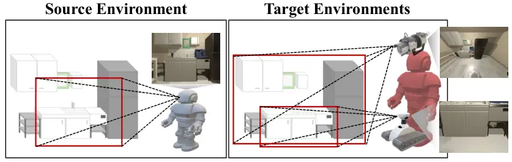
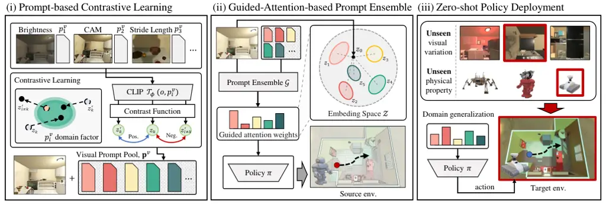
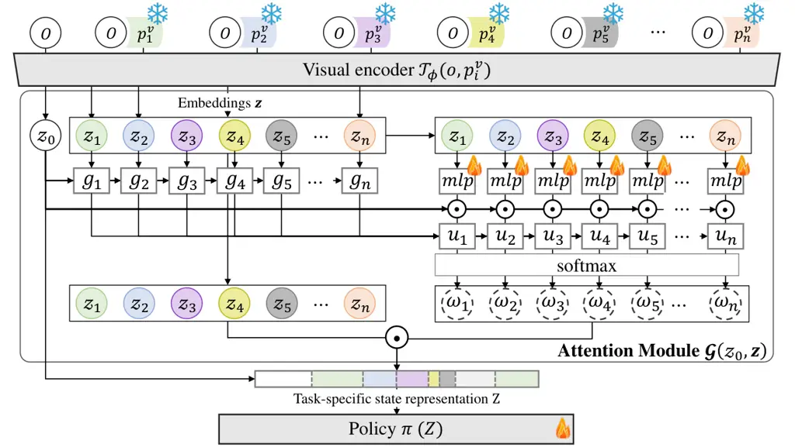
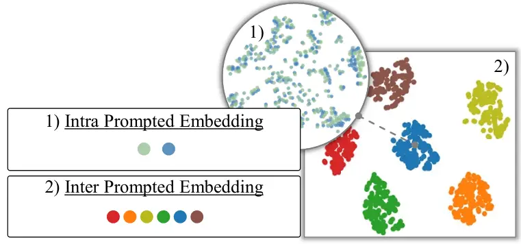
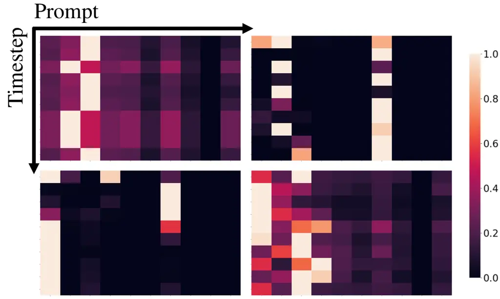
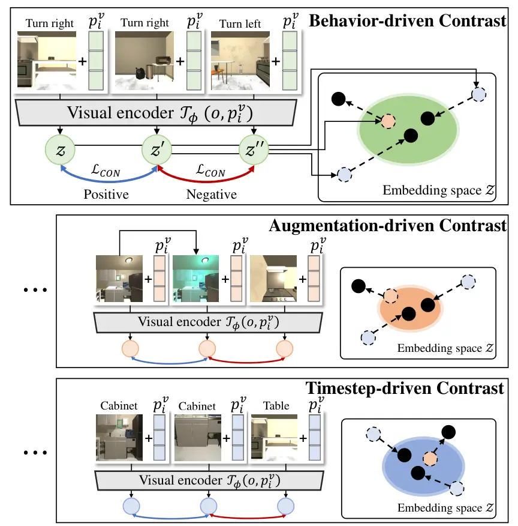
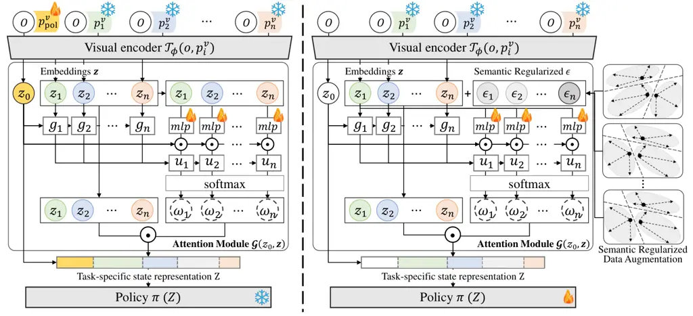
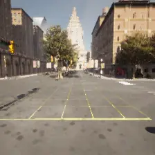
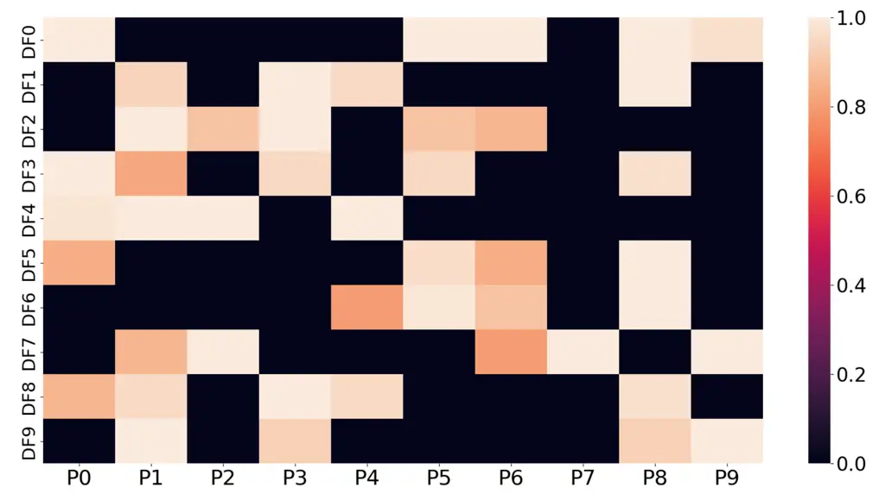

# Efficient Policy Adaptation with Contrastive Prompt Ensemble for Embodied Agents

Wonje Choi    Woo Kyung Kim    SeungHyun Kim    Honguk Woo
^(†)^(†)thanks: Honguk Woo is the corresponding author.
Affiliation: Department of Computer Science and Engineering
Affiliation: Sungkyunkwan University Affiliation: {wjchoi1995, kwk2696,
kimsh571, hwoo}@skku.edu

###### Abstract

For embodied reinforcement learning (RL) agents interacting with the
environment, it is desirable to have rapid policy adaptation to unseen
visual observations, but achieving zero-shot adaptation capability is
considered as a challenging problem in the RL context. To address the
problem, we present a novel contrastive prompt ensemble (ConPE)
framework which utilizes a pretrained vision-language model and a set of
visual prompts, thus enabling efficient policy learning and adaptation
upon a wide range of environmental and physical changes encountered by
embodied agents. Specifically, we devise a guided-attention-based
ensemble approach with multiple visual prompts on the vision-language
model to construct robust state representations. Each prompt is
contrastively learned in terms of an individual domain factor that
significantly affects the agent’s egocentric perception and observation.
For a given task, the attention-based ensemble and policy are jointly
learned so that the resulting state representations not only generalize
to various domains but are also optimized for learning the task. Through
experiments, we show that ConPE outperforms other state-of-the-art
algorithms for several embodied agent tasks including navigation in
AI2THOR, manipulation in egocentric-Metaworld, and autonomous driving in
CARLA, while also improving the sample efficiency of policy learning and
adaptation.

## 1 Introduction

In the literature of vision-based reinforcement learning (RL), with the
advance of unsupervised techniques and large-scale pretrained models for
computer vision, the decoupled structure, in which visual encoders are
separately trained and used later for policy learning, has gained
popularity \[59, 60, 61\]. This decoupling demonstrates high efficiency
in low data regimes with sparse reward signals, compared to end-to-end
RL. In this regard, several works on adopting the decoupled structure to
embodied agents interacting with the environment were introduced \[62,
63\], and specifically, pretrained vision models (e.g., ResNet
in \[64\]) or vision-language models (e.g., CLIP in \[65, 66\]) were
exploited for visual state representation encoders. Yet, it is
non-trivial to achieve zero-shot adaptation to visual domain changes in
the environment with high diversity and non-stationarity, which are
inherent for embodied agents. It was rarely investigated how to optimize
those popular large-scale pretrained models to ensure the zero-shot
capability of embodied agents.

Embodied agents have several environmental and physical properties, such
as egocentric camera position, stride length, and illumination, which
are domain factors making significant changes in agents’ perception and
observation. In the target (deployment) environment with uncalibrated
settings on those domain factors, RL policies relying on pretrained
visual encoders remain vulnerable to domain changes.



Figure 1: Visual Domain Changes of Embodied Agents

Figure 1 provides an example of egocentric visual domain changes
experienced by embodied agents due to different camera positions. When
policies learned in the source environment are applied to the target
environment, zero-shot performance can be significantly degraded, unless
the visual encoder could adapt not only to environmental differences but
also to the physical diversity of agents. In this paper, we investigate
RL policy adaptation techniques for embodied agents to enable zero-shot
adaptation to domain changes, by leveraging prompt-based learning for
pretrained models in the decoupled RL structure. To this end, we present
ConPE, a novel contrastive prompt ensemble framework that uses the CLIP
vision-language model as the visual encoder, and facilitates dynamic
adjustments of visual state representations against domain changes
through an ensemble of contrastively learned visual prompts. In ConPE,
the ensemble employs attention-based state composition on multiple
visual embeddings from the same input observation, where each embedding
corresponds to a state representation individually prompted for a
specific domain factor. Specifically, the cosine similarity between an
input observation and its respective prompted embeddings is used to
calculate attention weights effectively.

Through experiments, we demonstrate the benefits of our approach. First,
RL policies learned via ConPE achieve competitive zero-shot performance
upon a wide variety of egocentric visual domain variations for several
embodied agent tasks, such as navigation tasks in AI2THOR \[67\],
vision-based robot manipulation tasks in egocentric-Metaworld, and
autonomous driving tasks in CARLA \[68\]. For instance, the policy via
ConPE outperforms EmbCLIP \[65\] in zero-shot performance by 20.7% for
unseen target domains in the AI2THOR object navigation. Second, our
approach achieves high sample-efficiency in the decoupled RL structure.
For instance, ConPE requires less than 50.0% and 16.7% of the samples
compared to ATC \[59\] and 60% and 50% of the samples compared to
EmbCLIP to achieve comparable performance in seen and unseen target
domains in the AI2THOR object navigation.

In the context of RL, our work is the first to explore policy adaptation
using visual prompts for embodied agents, achieving superior zero-shot
performance and high sample-efficiency. The main contributions of our
work are as follows.

- •
  We present a novel ConPE framework with an ensemble of visual
  contrastive prompts, which enables zero-shot adaptation for
  vision-based embodied RL agents.
- •
  We devise visual prompt-based contrastive learning and
  guided-attention-based prompt ensemble algorithms to represent
  task-specific information in the CLIP embedding space.
- •
  We experimentally show that policies via ConPE achieve comparable or
  superior zero-shot performance, compared to other state-of-the-art
  baselines, for several tasks. We also demonstrate high
  sample-efficiency in policy learning and adaptation.
- •
  We create the datasets with various visual domains in AI2THOR,
  egocentric-Metaworld and CARLA, and make them publicly accessible for
  further research on RL policy adaptation.

## 2 Problem Formulation

In RL formulation, a learning environment is defined as a Markov
decision process (MDP) of $`(S,A,\mathcal{P},R)`$ with state space
$`s\in S`$, action space $`a\in A`$, transition probability
$`\mathcal{P}:S\times A\rightarrow S`$ and reward function
$`R:S\times A\rightarrow\mathbb{R}`$. The objective of RL is to find an
optimal policy $`\pi^{*}:S\rightarrow A`$ maximizing the sum of
discounted rewards. For embodied agents, states might not be fully
observable, and the environment is represented by a partially observable
MDP (POMDP) of a tuple $`(S,A,\mathcal{P},R,\Omega,\mathcal{O})`$ with
an observation space $`o\in\Omega`$ and a conditional observation
probability \[69\] $`\mathcal{O}:S\times A\rightarrow\Omega`$.

Given visual domains in the dynamic environment, we consider policy
adaptation to find the optimal policy that remains invariant across the
domains or is transferable to some target domain, where each domain is
represented by a POMDP and domain changes are formulated by different
$`\mathcal{O}`$. We denote domains as $`D=(\Omega,\mathcal{O})`$. Aiming
to enable zero-shot adaptation to various domains, we formulate the
policy adaptation problem as finding the optimal policy $`\pi^{*}`$ such
that

```math
\pi^{*}=\argmax_{\pi}\left[\expectation_{D\sim p(D)}\left[\sum_{t=1}^{\infty}\gamma^{t}R(s_{t},\pi(o_{t}))\right]\right] \tag{1}
```

where $`p(D)`$ is a given domain distribution and $`\gamma`$ is a
discount factor of the environment.

For embodied agents, the same state can be differently observed
depending on the configuration of properties such as egocentric camera
position, stride length, illumination, and object style. We refer to
such a property causing domain changes in the environment as a domain
factor. Practical scenarios often involve the interplay of multiple
domain factors in the environment.



Figure 2: ConPE Framework. The CLIP visual encoder is enhanced offline
via (i) prompt-based contrastive learning that generates the visual
prompt pool, and a policy is learned online by (ii)
guided-attention-based prompt ensemble that uses the prompt pool. In
(iii) zero-shot deployment, the policy is immediately evaluated upon
domain changes.

## 3 Our Approach

### 3.1 Framework Structure

To enable zero-shot policy adaptation to unseen domains, we develop the
ConPE framework consisting of (i) prompt-based contrastive learning with
the CLIP visual encoder, (ii) guided-attention-based prompt ensemble,
and (iii) zero-shot policy deployment, as illustrated in Figure 2. The
capability of the CLIP visual encoder is enhanced using multiple visual
prompts that are contrastively learned on expert demonstrations for
several domain factors. This establishes the visual prompt pool in (i).
Then, the prompts are used to train the guided-attention-based ensemble
with the environment in (ii). To enhance learning efficiency and
interpretability of attention weights, we use the cosine similarity of
embeddings. The attention module and policy are jointly learned for a
specific task so that resulting state representations tend to generalize
across various domains and be optimized for task learning. In
deployment, a non-stationary environment where its visual domain varies
according to the environment conditions and agent physical properties is
considered, and the zero-shot performance is evaluated in (iii).

### 3.2 Prompt-based Contrastive Learning

To construct domain-invariant representations with respect to a specific
domain factor for egocentric perception data, we adopt several
contrastive tasks for visual prompt learning, which can be learned on a
few expert demonstrations. For this, we use a visual prompt

```math
p^{v}=[e^{v}_{1},e^{v}_{2},...,e^{v}_{u}],\ e^{v}_{i}\in\mathbb{R}^{d} \tag{2}
```

where $`e^{v}_{i}`$ is a continuous learnable vector with the image
patch embedding dimension $`d`$ (e.g., 768 for CLIP visual encoder) and
$`u`$ is the length of a visual prompt. Let a pretrained model
$`\mathcal{T}_{\phi}`$ parameterized by $`\phi`$ maps observations
$`o\in\Omega`$ to the embedding space $`\mathcal{Z}`$. With a contrast
function $`P:\Omega\times\Omega\rightarrow\{0,1\}`$ \[59, 60, 70\] to
discriminate whether an observation pair is positive or not, consider an
$`m`$-sized batch of observation pairs
$`\mathcal{B}_{P}=\{(o_{i},o_{i}^{\prime})\}_{i\leq m}`$ containing one
positive pair $`\{(o_{k},o_{k}^{\prime})|P(o_{k},o_{k}^{\prime})=1\}`$
for some $`k\leq m`$. Then, we enhance the capability of
$`\mathcal{T}_{\phi}`$ by learning a visual prompt $`p^{v}`$ through
contrastive learning, where the contrastive loss function \[71\] is
defined as

```math
\mathcal{L}_{\text{CON}}(p^{v},\mathcal{B}_{P})=-\log\left(\frac{S(\mathcal{T}_{\phi}(o_{k},p^{v}),\mathcal{T}_{\phi}(o_{k}^{\prime},p^{v}))}{\sum_{i\neq k}S(\mathcal{T}_{\phi}(o_{i},p^{v}),\mathcal{T}_{\phi}(o_{i}^{\prime},p^{v}))}\right),\ S(x,y)=\frac{1}{\lambda}\exp\left(\frac{\langle x,y\rangle}{\|x\|\|y\|}\right). \tag{3}
```

As in \[clr\], for latent vectors $`x,\ y\in\mathcal{Z}`$, their
similarity in the embedding space $`\mathcal{Z}`$ is calculated by
$`S(x,y)`$, where $`\lambda`$ is a hyperparameter. By conducting the
prompt-based contrastive learning on $`n`$ different domain factors, we
obtain a visual prompt pool

```math
\mathbf{p}^{v}=[p^{v}_{1},p^{v}_{2},...,p^{v}_{n}]. \tag{4}
```

Through this process, each visual prompt in $`\mathbf{p}^{v}`$
encapsulates domain-invariant knowledge pertinent to its respective
domain factor.



Figure 3: Guided-Attention-based Prompt Ensemble. The cosine
similarity-guided attention module $`\mathcal{G}`$ yields task-specific
state representations from multiple prompted embeddings and is learned
with a policy network $`\pi`$.

### 3.3 Guided-Attention-based Prompt Ensemble

To effectively integrate individual prompted embeddings from multiple
visual prompts into a task-specific state representation, we devise a
guided-attention-based prompt ensemble structure, as shown in Figure 3
where the attention weights on the embeddings are dynamically computed
via the attention module $`\mathcal{G}`$ for each observation.

Given observation $`o`$ and the learned visual prompt pool
$`\mathbf{p}^{v}`$, an image embedding $`z_{0}=\mathcal{T}_{\phi}(o)`$
and prompted embeddings
$`\mathbf{z}=[z_{1}=\mathcal{T}_{\phi}(o,p^{v}_{1}),...,z_{n}]`$ are
calculated. Then, $`z_{o}`$ and $`\mathbf{z}`$ are fed to the attention
module $`\mathcal{G}`$, where attention weights $`\omega_{i}`$ for each
prompted embedding $`z_{i}`$ are optimized. Since directly computing the
attention weights using $`z_{0}`$ and $`\mathbf{z}`$ is prone to have an
uninterpretable local optima, we introduce a guidance score $`g_{i}`$
based on the cosine similarity between the input image and visual
prompted image embeddings in $`\mathcal{Z}`$, i.e.,
$`g_{i}=\frac{\langle z_{0},z_{i}\rangle}{\|z_{0}\|\|z_{i}\|}`$. Given
that larger $`g_{i}`$ signifies a stronger conformity of an observation
to the domain factor relevant to the prompted embedding $`z_{i}`$, we
use $`g_{i}`$ to steer the attention weights, aiming to not only improve
learning efficiency but also provide interpretability. With guidance
$`g_{i}`$, we compute the attention weights $`\omega_{i}`$ by

```math
\omega_{i}=\frac{\text{exp}(u_{i}/\tau)}{\sum_{k}\text{exp}(u_{k}/\tau)},\ \ \ u_{i}=\frac{\langle z_{0},k_{i}\rangle}{\sqrt{d}}g_{i} \tag{5}
```

where $`k_{i}`$ is the projection of $`z_{i}`$, $`d`$ is dimension of
$`z`$, and $`\tau`$ is a softmax temperature. Then, state embedding
$`Z`$ is obtained by

```math
Z=\mathcal{G}(z_{0},\mathbf{z})=z_{0}+\sum_{i=1}^{n}\omega_{i}z_{i}. \tag{6}
```

Algorithm 1 shows the procedures in ConPE, where the first half
corresponds to prompt-based contrastive learning (in Section 3.2) and
the other half corresponds to joint learning of a policy $`\pi(Z)`$ and
the attention module $`\mathcal{G}`$. As $`\mathcal{G}`$ is optimized by
a given RL task objective in the source domains (in line 12), the
resulting $`Z`$ tends to be task-specific, while $`Z`$ is also
domain-invariant by the ensemble of contrastively learned visual prompts
based on $`\mathcal{G}`$ with respect to the combinations of multiple
domain factors. The entire algorithm can be found in Appendix.

Dataset $`\mathcal{D}=\{(o_{1},o^{\prime}_{1}),...\}`$, replay buffer
$`Z_{D}\leftarrow\emptyset`$, pretrained vision-language model
$`\mathcal{T}_{\phi}`$  
Visual prompt pool $`\mathbf{p}^{v}=[p^{v}_{1},...,p^{v}_{n}]`$,
attention module $`\mathcal{G}`$, policy $`\pi`$

1:  /\* Prompt-based Contrastive Learning \*/

2:  for $`i=1,...,n`$ do

3:   while not converge do

4:    Sample a batch
$`\mathcal{B}_{P_{i}}=\{(o_{j},o_{j}^{\prime})\}_{j\leq m}\sim\mathcal{D}`$

5:    Update prompt
$`p^{v}_{i}\leftarrow p^{v}_{i}-\nabla\mathcal{L}_{\text{CON}}(p^{v}_{i},\mathcal{B}_{P_{i}})`$
using (3)

6:   end while

7:  end for

8:  /\* Prompt Ensemble-based Policy Learning \*/

9:  for each environment step do

10:   Sample action
$`a=\pi(\mathcal{G}(\mathcal{T}_{\phi}(o),\textbf{z}))`$ using (5), (6)

11:   $`Z_{D}\leftarrow Z_{D}\cup\{(\textbf{z},a,r)\}`$

12:   Jointly optimize policy $`\pi`$ and module $`\mathcal{G}`$ on
$`\{(\textbf{z}_{j},a_{j},r_{j})\}_{j\leq m}\sim Z_{D}`$

13:  end for

Algorithm 1 Procedure of ConPE Framework

## 4 Evaluation

Experiments. We use AI2THOR \[67\], Metaworld \[72\], and CARLA  \[68\]
environments, specifically configured for embodied agent tasks with
dynamic domain changes. These environments allow us to explore various
domain factors such as camera settings, stride length, rotation degree,
gravity, illuminations, wind speeds, and others. For prompt-based
contrastive learning (in Section 3.2), we use a small dataset of expert
demonstrations for each domain factor (i.e., 10 episodes per domain
factor). For prompt ensemble-based policy learning (in Section 3.3), we
use a few source domains randomly generated through combinatorial
variations of the seen domain factors (i.e., 4 source domains). In our
zero-shot evaluations, we use target domains that can be categorized as
either seen or unseen. The seen target domains are those encountered
during the phase of prompt-based contrastive learning, while these
domains are not present during the phase of prompt ensemble-based policy
learning. On the other hand, the unseen target domains refer to those
that are entirely new, implying that they are not encountered during
either learning phases.

Baselines. We implement several baselines for comparison. LUSR \[73\] is
a reconstruction-based domain adaptation method in RL, which uses the
variational autoencoder structure for robust representations.
CURL \[60\] and ACT \[59\] employ contrastive learning in RL frameworks
for high sample-efficiency and generalization to visual domains.
ACO \[70\] utilizes augmentation-driven and behavior-driven contrastive
tasks in the context of RL. EmbCLIP \[65\] is a state-of-the-art
embodied AI model, which exploits the pretrained CLIP visual encoder for
visual state representations.

Implementation. We implement ConPE using the CLIP model with ViT-B/32,
similar to VPT \[74\] and CoOp \[75\]. In prompt-based contrastive
learning, we adopt various contrastive learning schemes including
augmentation-driven \[60, 59, 76\] and behavior-driven \[70, 77, 78,
79\] contrastive learning, where the prompt length sets to be 8. In
policy learning, we exploit online learning (i.e., PPO \[80\]) for
AI2THOR and imitation learning (i.e., DAGGER \[81\]) for
egocentric-Metaworld and CARLA.

Method ObjectNav. PointNav. Source Seen Target Unseen Target Source Seen
Target Unseen Target LUSR $`53.3{\pm 1.1}`$ $`21.3{\pm 1.9}`$
$`15.1{\pm 1.8}`$ $`85.6{\pm 4.6}`$ $`71.8{\pm 3.8}`$ $`62.4{\pm 5.8}`$
CURL $`51.3{\pm 1.0}`$ $`8.0{\pm 0.1}`$ $`6.9{\pm 1.3}`$
$`70.8{\pm 7.4}`$ $`55.2{\pm 2.7}`$ $`54.8{\pm 3.0}`$ ATC
$`82.2{\pm 9.7}`$ $`72.3{\pm 3.3}`$ $`51.3{\pm 8.6}`$ $`95.0{\pm 3.3}`$
$`89.1{\pm 1.9}`$ $`81.9{\pm 3.6}`$ ACO $`55.0{\pm 23.8}`$
$`39.6{\pm 21.5}`$ $`35.8{\pm 5.8}`$ $`91.1{\pm 6.3}`$ $`73.4{\pm 2.0}`$
$`67.5{\pm 2.8}`$ EmbCLIP $`89.3{\pm 3.0}`$ $`77.6{\pm 1.3}`$
$`59.0{\pm 6.4}`$ $`95.3{\pm 4.6}`$ $`84.5{\pm 1.9}`$ $`77.4{\pm 1.4}`$
ConPE $`\mathbf{96.3{\pm 1.0}}`$ $`\mathbf{83.3{\pm 0.3}}`$
$`\mathbf{79.7{\pm 6.4}}`$ $`\mathbf{97.8{\pm 1.0}}`$
$`\mathbf{89.7{\pm 1.6}}`$ $`\mathbf{84.3{\pm 2.0}}`$

(a) Zero-shot Performance in AI2THOR with Object and Point Goal
Navigation Tasks

Method Reach Reach-Wall Source Seen Target Unseen Target Source Seen
Target Unseen Target LUSR $`100.0{\pm 0.0}`$ $`46.0{\pm 15.1}`$
$`44.7{\pm 2.3}`$ $`50.0{\pm 10.0}`$ $`33.3{\pm 6.1}`$ $`30.7{\pm 6.4}`$
CURL $`100.0{\pm 0.0}`$ $`53.3{\pm 5.0}`$ $`46.7{\pm 3.1}`$
$`43.3{\pm 15.3}`$ $`2.0{\pm 0.0}`$ $`0.7{\pm 1.2}`$ ATC
$`100.0{\pm 0.0}`$ $`71.3{\pm 8.1}`$ $`72.0{\pm 2.0}`$ $`66.7{\pm 5.8}`$
$`5.3{\pm 1.2}`$ $`4.0{\pm 0.0}`$ ACO $`100.0{\pm 0.0}`$
$`52.0{\pm 2.0}`$ $`44.0{\pm 3.5}`$ $`63.3{\pm 15.3}`$ $`8.7{\pm 2.3}`$
$`4.7{\pm 1.2}`$ EmbCLIP $`100.0{\pm 0.0}`$ $`64.7{\pm 6.1}`$
$`66.7{\pm 4.2}`$ $`\mathbf{100.0{\pm 0.0}}`$ $`58.0{\pm 7.2}`$
$`49.3{\pm 5.0}`$ ConPE $`100.0{\pm 0.0}`$ $`\mathbf{88.7{\pm 3.1}}`$
$`\mathbf{86.7{\pm 3.1}}`$ $`\mathbf{100.0{\pm 0.0}}`$
$`\mathbf{75.3{\pm 3.1}}`$ $`\mathbf{67.3{\pm 2.3}}`$

(b) Zero-shot Performance in egocentric-Metaworld with Reach and
Reach-wall Tasks

Method Map 1 Map 2 Source Seen Target Unseen Target Source Seen Target
Unseen Target LUSR $`2141.9`$ $`635.1{\pm 606.2}`$ $`1073.9{\pm 212.6}`$
$`\mathbf{2279.6}`$ $`1173.7{\pm 914.3}`$ $`2159.4{\pm 146.5}`$ CURL
$`945.4`$ $`864.2{\pm 638.0}`$ $`1256.0{\pm 61.6}`$ $`1050.1`$
$`1089.9{\pm 824.0}`$ $`2190.3{\pm 10.2}`$ ATC $`2280.5`$
$`1684.4{\pm 368.2}`$ $`1073.7{\pm 618.8}`$ $`2272.2`$
$`2253.9{\pm 218.7}`$ $`2200.1{\pm 307.8}`$ ACO $`2265.8`$
$`1545.6{\pm 596.1}`$ $`1330.0{\pm 144.5}`$ $`2270.6`$
$`2360.9{\pm 88.0}`$ $`2415.5{\pm 53.0}`$ EmbCLIP $`2235.7`$
$`1732.2{\pm 588.6}`$ $`1415.1{\pm 669.9}`$ $`2262.7`$
$`2139.1{\pm 655.9}`$ $`2401.3{\pm 12.3}`$ ConPE $`\mathbf{2237.5}`$
$`\mathbf{1738.0{\pm 163.5}}`$ $`\mathbf{1933.4{\pm 29.7}}`$ $`2277.2`$
$`\mathbf{2422.5{\pm 79.6}}`$ $`\mathbf{2512.9{\pm 15.7}}`$

(c) Zero-shot Performance in CARLA with Different Maps

Table 1: Zero-shot Performance. The policies of each method (ConPE and
the baselines) are learned on 4 source domains. The Source column
presents the performance for those source domains. In all evaluations,
we use 30 seen target domains and 10 unseen target domains. The Seen
Target column presents the performance for the seen target domains, and
the Unseen Target column presents the performance for the unseen target
domains. The unseen target domains are not used for representation
learning.

### 4.1 Zero-shot Performance

Table 1 shows zero-shot performance of ConPE and the baselines across
source, seen and unseen target domains. We evaluate with 3 different
seeds and report the average performance (i.e., task success rate in
AI2THOR and egocentric-Metaworld, the sum of rewards in CARLA). As shown
in Table 2(a), ConPE outperforms the baselines in the AI2THOR tasks. It
particularly surpasses the most competitive baseline, EmbCLIP, by
achieving $`5.2\!\sim\!5.7\%`$ higher success rate for seen target
domains, and $`6.9\!\sim\!20.7\%`$ for unseen target domains. For
egocentric-Metaworld, as shown in Table 2(b), ConPE demonstrates
superior performance with a significant success rate for both seen and
unseen target domains, which is $`17.3\!\sim\!24.0\%`$ and
$`18.0\!\sim\!20.0\%`$ higher than EmbCLIP, respectively. For autonomous
driving in CARLA, we take into account external environment factors,
such as weather conditions and times of day, as domain factors that can
influence the driving task. In Table 2(c), ConPE consistently maintains
competitive zero-shot performance across all conditions, outperforming
the baselines.

In these experiments, LUSR shows relatively low success rates, as the
reconstruction-based representation model can abate some task-specific
information from observations, which is critical to conduct vision-based
complex RL tasks. EmbCLIP shows the most comparative performance among
the baselines, but its zero-shot performance for target domains is not
comparable to ConPE. In contrast, ConPE effectively estimates the domain
shifts pertaining to each domain factor through the use of guided
attention weights, leading to robust performance in both seen and unseen
target domains.

(a) Success Rate in Seen Target Domain

(b) Success Rate in Unseen Target Domain

Figure 4: Sample-efficiency of Prompt Ensemble-based Policy Learning for
Object Navigation in AI2THOR. The x-axis represents the number of
samples (timesteps) used for policy learning, while the y-axis
represents the task success rate for zero-shot evaluation.

Sample Efficiency. Figure 4 presents performance with respect to samples
(timesteps) that are used by ConPE and baselines for policy learning.
Compared to the most competitive baseline EmbCLIP, ConPE requires less
than $`60.0\%`$ timesteps (online samples) for seen target domains and
$`50.0\%`$ for unseen target domains to have comparable success rates.



(a) Prompted Embeddings



(b) Attention Weights

Figure 5: Prompt Ensemble Interpretability. In (a), the embeddings in
the big circle are intra prompted embeddings obtained by varying domains
within a domain factor, and the embeddings in the rectangle are inter
prompted embeddings obtained by changing the visual prompts with aligned
observation. The closely located intra prompted embeddings indicate the
domain-invariant knowledge, while the inter prompted embeddings
clustered by different visual prompts indicate the alignment between the
visual prompts and the domain factors. In (b), each cell represents
attention weight $`\omega_{i}`$ applied for prompted embedding
$`z_{i}`$.

Prompt Ensemble Interpretability. Figure 5(a) visualizes the prompted
embeddings using the prompt pool obtained through ConPE. For intra
prompted embeddings, we use observation pairs, where each pair is
generated by varying domains within a domain factor. We observe that the
embeddings are paired to form the domain-invariant knowledge because the
visual prompt is learned through prompt-based contrastive learning. The
inter prompted embeddings specify that each prompt distinctly clusters
prompted embeddings that correspond to the domains associated to its
domain factor. Figure 5(b) shows examples of the attention weight matrix
of ConPE for four different domains. The x-axis denotes the visual
prompts and the y-axis denotes timesteps. This shows the consistency of
the attention weights on the prompts across the timesteps in the same
domain.

### 4.2 Prompt Ensemble with a Pretrained Policy

While we previously presented joint learning of a policy and the
attention module $`\mathcal{G}`$, here we also present how to update
$`\mathcal{G}`$ for a pretrained policy $`\pi`$ to make the policy
adaptable to domain changes. In this case, we add a policy prompt
$`p^{v}_{\text{pol}}`$ to concentrate on task-relevant features from
observations for the pretrained policy $`\pi`$ so that prompted
embedding $`\tilde{z}_{0}`$ with the task-relevant features is
incorporated into the guided-attention-based ensemble, i.e.,
$`\pi(\mathcal{G}(\tilde{z}_{0},\mathbf{z})),\ \text{where}\ \tilde{z}_{0}=\mathcal{T}_{\phi}(o,p^{v}_{\text{pol}})`$.

Method ObjectNav. (Aln.) PointNav. (Not Aln.) ImageNav. (Not Aln.)
RoomR. (Not Aln.) Source Target Source Target Souce Target Scoure Target
Pretrained $`87.5{\pm 17.2}`$ $`65.8{\pm 19.1}`$ $`95.3{\pm 4.6}`$
$`80.9{\pm 1.6}`$ $`77.2{\pm 3.3}`$ $`56.2{\pm 2.2}`$ $`87.3{\pm 3.1}`$
$`75.2{\pm 13.2}`$ ConPE $`88.4{\pm 1.7}`$ $`\mathbf{72.8{\pm 3.1}}`$
$`98.9{\pm 1.0}`$ $`\mathbf{84.4{\pm 1.0}}`$ $`79.2{\pm 1.4}`$
$`\mathbf{61.6{\pm 1.1}}`$ $`93.3{\pm 1.2}`$ $`\mathbf{82.2{\pm 14.4}}`$

(a) Zero-shot Performance in AI2THOR with Visual Navigation and Room
Rearrangement Tasks

Method Reach (Aln.) Reach-Wall (Not Aln.) Button-Press (Not Aln.)
Door-Open (Not Aln.) Source Target Source Target Source Target Source
Target Pretrained $`100.0{\pm 0.0}`$ $`65.7{\pm 6.4}`$
$`100.0{\pm 0.0}`$ $`58.0{\pm 5.8}`$ $`100.0{\pm 0.0}`$
$`16.8{\pm 2.3}`$ $`100.0{\pm 0.0}`$ $`35.6{\pm 6.2}`$ ConPE
$`100.0{\pm 0.0}`$ $`\mathbf{74.7{\pm 5.0}}`$ $`100.0{\pm 0.0}`$
$`\mathbf{75.7{\pm 9.0}}`$ $`100.0{\pm 0.0}`$ $`\mathbf{73.7{\pm 8.3}}`$
$`100.0{\pm 0.0}`$ $`\mathbf{93.2{\pm 1.1}}`$

(b) Zero-shot Performance in egocentric-Metaworld with 4 Different Robot
Manipulation Tasks

Table 2: Prompt Ensemble with a Pretrained Policy. The pretrained
policies of each task are learned on 4 source domains. The Source column
presents the performance for those source domains. In all evaluations,
we use 40 unseen target domains. The Target column presents the
performance for the unseen target domains not used for policy training.

Table 2 reports zero-shot performance for the scenarios when a
pretrained policy is given. We evaluate two different cases: aligned
(Aln.) when prompt-based contrastive learning is conducted on data from
the same task of a pretrained policy; otherwise, not aligned (Not Aln.).
In AI2THOR, we use data from the object goal navigation task for
prompt-based contrastive learning, while each pretrained policy is
learned individually through one of tasks including object goal
navigation, point goal navigation, image goal navigation, and room
rearrangement. Similarly, in egocentric-Metaworld, we use data from the
reach task for prompt-based contrastive learning, while each pretrained
policy is learned individually through one of tasks including reach,
reach-wall, button-press, and door-open. In Table 3(a), ConPE enhances
zero-shot performance of the pretrained policies by $`3.5\!\sim\!7.0\%`$
for unseen target domains in AI2THOR. This prompt ensemble adaptation
requires only 400K samples, equivalent to $`10\%`$ of the total samples
used for policy learning. In Table 3(b), ConPE significantly boosts
zero-shot performance of the pretrained policies by
$`9.0\!\sim\!57.6\%`$ in egocentric-Metaworld.

### 4.3 Ablation Study

Here we conduct ablation studies with AI2THOR. All the performances are
reported in success rates.

$`n`$ Source Seen Target Unseen Target 2 $`98.7{\pm 0.4}`$
$`40.5{\pm 2.2}`$ $`43.0{\pm 2.9}`$ 5 $`96.1{\pm 0.6}`$
$`59.2{\pm 9.6}`$ $`45.0{\pm 10.1}`$ 10 $`96.3{\pm 1.0}`$
$`83.3{\pm 0.3}`$ $`79.7{\pm 6.4}`$ 16 $`91.8{\pm 2.0}`$
$`83.8{\pm 1.3}`$ $`77.1{\pm 6.2}`$ 18 $`98.5{\pm 1.8}`$
$`83.3{\pm 2.3}`$ $`79.0{\pm 4.5}`$

Table 3: Prompt Ensemble Scalability

Ensemble Method Source Seen Target Unseen Target COM-UNI-AVG
$`52.9{\pm 12.2}`$ $`51.4{\pm 7.6}`$ $`43.1{\pm 12.7}`$ COM-WEI-AVG
$`63.6{\pm 11.2}`$ $`42.3{\pm 5.2}`$ $`50.3{\pm 6.1}`$ ENS-UNI-AVG
$`88.6{\pm 1.4}`$ $`79.8{\pm 3.4}`$ $`65.5{\pm 5.0}`$ ENS-WEI-AVG
$`94.1{\pm 6.3}`$ $`75.5{\pm 3.5}`$ $`61.2{\pm 12.7}`$ ConPE
$`\mathbf{96.3{\pm 1.0}}`$ $`\mathbf{83.3{\pm 0.3}}`$
$`\mathbf{79.7{\pm 6.4}}`$

Table 4: Prompt Ensemble Methods

Prompt Ensemble Scalability. Table 4 evaluates ConPE with respect to the
number of prompts ($`n`$). ConPE effectively enhances zero-shot
performance for both seen and unseen target domains through prompt
ensemble that captures various domain factors. Compared to the case of
$`n=2`$, for $`n=10`$, there was a significant improvement in zero-shot
performance for both seen and unseen target domains, with increases of
$`42.8\%`$ and $`36.7\%`$, respectively. For $`n\geq 10`$, we observe
stable performance that specifies that ConPE can scale for combining
multiple prompts to some extent.

Prompt Ensemble Methods. Tabel 4 compares the performance of various
prompt integration methods \[82, 83, 84\] including our guided
attention-based prompt ensemble. We denote prompt-level integration as
COM, and prompted embeddings-level integration as ENS. UNI-AVG and
WEI-AVG refer to uniform average and weighted average mechanisms,
respectively. ConPE achieves superior success rates over the most
competitive ensemble method ENS-UNI-AVG, showing $`3.5\%`$ and
$`14.2\%`$ performance gain for seen and unseen target domains.

Optimization Source Target Pretrained $`95.3{\pm 4.6}`$
$`80.9{\pm 1.6}`$ w/o $`p^{v}_{pol}`$ $`59.5{\pm 2.9}`$
$`54.2{\pm 0.6}`$ w $`p^{v}_{pol}`$ $`\mathbf{98.9{\pm 1.0}}`$
$`\mathbf{84.4{\pm 1.0}}`$ E2E $`96.4{\pm 0.5}`$ $`83.3{\pm 3.3}`$

Table 5: Prompt Ensemble Adaptation

$`\delta`$ w/o Semantic w Semantic Source Target Source Target 0.1
$`97.4{\pm 3.8}`$ $`83.6{\pm 8.9}`$ $`\mathbf{100.0{\pm 0.0}}`$
$`\mathbf{84.1{\pm 10.2}}`$ 0.2 $`94.7{\pm 0.0}`$ $`77.6{\pm 12.8}`$
$`\mathbf{94.8{\pm 7.4}}`$ $`\mathbf{79.7{\pm 9.1}}`$ 0.3
$`84.2{\pm 3.7}`$ $`75.3{\pm 8.8}`$ $`\mathbf{96.1{\pm 1.9}}`$
$`\mathbf{83.1{\pm 10.0}}`$ 0.4 $`80.3{\pm 16.2}`$ $`74.0{\pm 14.9}`$
$`\mathbf{86.9{\pm 3.8}}`$ $`\mathbf{81.3{\pm 12.3}}`$

Table 6: Semantic Regularized Data Augmentation

Prompt Ensemble Adaptation Method. Table 6 shows the effect of our
ensemble adaptation method for the situation when a pretrained policy is
given. As explained in Section 4.2, in this situation, ConPE can update
the attention module with an additional prompt $`p^{v}_{\text{pol}}`$.
Note that $`p^{v}_{\text{pol}}`$ corresponds to this case, while w/o
$`p^{v}_{\text{pol}}`$ corresponds to the other case of using the
attention module without $`p^{v}_{\text{pol}}`$. In addition, E2E
denotes the fine-tuning of both the policy and the attention module
along with $`p^{v}_{\text{pol}}`$. The results demonstrate that our
method enhances the zero-shot performance of the pretrained policy,
showing that $`p^{v}_{\text{pol}}`$ facilitates the extraction of
task-specific features.

Semantic Regularized Data Augmentation. So far, we have only utilized
vision data, but here, we discuss one extension of ConPE using semantic
information. Specifically, we use a few samples of object-level text
descriptions to regularize the data augmentation process in policy
learning. This aims to mitigate overfitting issues \[85, 86\]. The
detailed explanations can be found in Appendix. As shown in Table 6,
ConPE with semantic data (w Semantic) consistently yields better
performance than ConPE without semantic data (w/o Semantic) for all
noise scale settings ($`\delta`$). Note that the noise scale manages the
variance of augmented prompted embeddings. This experiment indicates
that ConPE can be improved by incorporating semantic information.

## 5 Related Work

Adaptation in Embodied AI. In the literature of robotics, numerous
studies focused on developing generalized visual encoders for robotic
agents across various domains \[87, 88\], exploiting pretrained visual
encoders \[89, 90\], and establishing robust control policies with
domain randomized techniques \[91, 92\]. Furthermore, in the field of
learning embodied agents, a few works addressed adaptation issues of
agents to unseen scenarios in complex environments, using data
augmentation techniques  \[93, 94, 95, 96, 97\] or adopting
self-supervised learning schemes \[98, 99, 100\]. Recently, several
works showed the feasibility and benefits of adopting large-scale
pretrained vision-language models for embodied agents \[65, 101, 102,
103\]. Our work is in the same vein of these prior works of embodied
agents, but unlike them, we explore visual prompt learning and
ensembles, aiming to enhance both zero-shot performance and
sample-efficiency.

Decoupled RL Structure. The decoupled structure, where a state
representation model is separated from RL, has been investigated in
vision-based RL \[104, 60, 73\]. Recently, contrastive representation
learning on expert trajectories gains much interest, as it allows expert
behavior patterns to be incorporated into the state encoder even when a
policy is not jointly learned \[59, 77\]. They established generalized
state representations, yet in that direction, sample-efficiency issues
in both representation learning and policy learning remain unexplored.

Prompt-based Learning. Prompt-based learning or prompt tuning is a
parameter-efficient optimization method for large pretrained models.
Prompt tuning was used for computer vision tasks, optimizing a few
learnable vectors in the text encoder \[75\], and it was also adopted
for vision transformer models to handle a wide range of downstream
tasks \[74\]. Recently, visual prompting \[105\] was introduced, and
both visual and text prompt tuning were explored together in the
multi-modal embedding space \[106, 107\]. We also use visual prompt
tuning, but we concentrate on the ensemble of multiple prompts to tackle
complex embodied RL tasks. We take advantage of the fact that the
generalized representation capability of different prompts can vary
depending on a given task and domain, and thus we strategically utilize
them to enable zero-shot adaptation of RL policies.

## 6 Conclusion

Limitation. Our ConPE framework exploits visual inputs and their
relevant domain factors for policy adaptation. For environments where
domain changes extend beyond those domain factors, the adaptability of
the framework might be constrained. In our future work, we will adapt
the framework with semantic knowledge based on pretrained language
models to improve the policy generalization capability for embodied
agents in dynamic complex environments and to cover various scenarios
associated with multi-modal agent interfaces.

Conclusion. In this work, we presented the ConPE framework, a novel
approach that allows embodied RL agents to adapt in a zero-shot manner
across diverse visual domains, exploring the ensemble structure that
incorporates multiple contrastive visual prompts. The ensemble
facilitates domain-invariant and task-specific state representations,
thus enabling the agents to generalize to visual variations influenced
by specific domain factors. Through various experiments, we demonstrated
that the framework can enhance policy adaptation across various domains
for vision-based object navigation, rearrangement, manipulation tasks as
well as autonomous driving tasks.

## 7 Acknowledgement

We would like to thank anonymous reviewers for their valuable comments
and suggestions. This work was supported by Institute of Information &
communications Technology Planning & Evaluation (IITP) grant funded by
the Korea government (MSIT) (No. 2022-0-01045, 2022-0-00043,
2020-0-01821, 2019-0-00421) and by the National Research Foundation of
Korea (NRF) grant funded by the MSIT (No. NRF-2020M3C1C2A01080819,
RS-2023-00213118).

## References

- \[1\] Adam Stooke, Kimin Lee, Pieter Abbeel and Michael Laskin
  “Decoupling representation learning from reinforcement learning” In
  _Proceedings of the 38th International Conference on Machine
  Learning_, 2021, pp. 9870–9879
- \[2\] Aravind Srinivas, Michael Laskin and Pieter Abbeel “CURL:
  Contrastive unsupervised representations for reinforcement learning”
  In _Proceedings of the 37th International Conference on Machine
  Learning_, 2020, pp. 5639–5650
- \[3\] Max Schwarzer et al. “Data-efficient reinforcement learning with
  self-predictive representations” In _arXiv preprint arXiv:2007.05929_,
  2020
- \[4\] Shangda Li et al. “Unsupervised domain adaptation for visual
  navigation” In _arXiv preprint arXiv:2010.14543_, 2020
- \[5\] Ziad Al-Halah, Santhosh. Ramakrishnan and Kristen Grauman “Zero
  experience required: Plug & play modular transfer learning for
  semantic visual navigation” In _Proceedings of the 9th International
  Conference on Vision and Pattern Recognition_, 2021, pp. 17010–17020
- \[6\] Qianfan Zhao et al. “Zero-shot object goal visual navigation” In
  _arXiv preprint arXiv:2206.07423_, 2022
- \[7\] Apoorv Khandelwal, Luca Weihs, Roozbeh Mottaghi and Aniruddha
  Kembhavi “Simple but Effective: CLIP embeddings for embodied AI” In
  _Proceedings of the IEEE/CVF Conference on Computer Vision and Pattern
  Recognition_, 2022, pp. 14809–14818
- \[8\] Arjun Majumdar et al. “Zson: Zero-shot object-goal navigation
  using multimodal goal embeddings” In _arXiv preprint
  arXiv:2206.12403_, 2022
- \[9\] Eric Kolve et al. “Ai2-thor: An interactive 3d environment for
  visual ai” In _arXiv preprint arXiv:1712.05474_, 2017
- \[10\] Alexey Dosovitskiy et al. “CARLA: An open urban driving
  simulator” In _Proceedings of the 1st Conference on Robot Learning_,
  2017, pp. 1–16
- \[11\] Richard. Sutton and Andrew. Barto “Reinforcement learning: An
  introduction” MIT press, 2018
- \[12\] Qihang zhang, Zheghao Peng and Bolei Zhou “Learning to drive by
  watching youtube videos: Action-conditioned contrastive policy
  pretraining” In _Proceedings of the 17th European Conference on
  Computer Vision_, 2022, pp. 111–128
- \[13\] Aaron van Oord, Yazhe Li and Oriol Vinyals “Representation
  learning with contrastive predictive coding” In _arXiv preprint
  arXiv:1807.03748_, 2018
- \[14\] Tianhe Yu et al. “Meta-World: A benchmark and evaluation for
  multi-task and meta reinforcement learning” In _Proceedings of the 3rd
  Conference on Robot Learning_, 2019, pp. 1094–1100
- \[15\] Jinwei Xing et al. “Domain adaptation in reinforcement learning
  via latent unified state representation” In _Proceedings of the 35th
  AAAI Conference on Artificial Intelligence_, 2021, pp. 10452–10459
- \[16\] Menglin Jia et al. “Visual prompt tuning” In _Proceedings of
  the 17th European Conference on Computer Vision_, 2022, pp. 709–727
- \[17\] Kaiyang Zhou, Jingkang Yang, Chen Loy and Ziwei Li “Learning to
  prompt for vision-language models” In _International Journal of
  Computer Vision_, 2022
- \[18\] Bang You, Oleg Arenz, Youping Chen and Jan Peters “Integrating
  contrastive learning with dynamic models for reinforcement learning
  from images” In _Neurocomputing_, 2022
- \[19\] Minbeom Kim, Kyeongha Rho, Yong-duk Kim and Kyomin Jung
  “Action-driven contrastive representation for reinforcement learning”
  In _PLOS ONE_, 2022
- \[20\] Rishabh Agarwal, Marlos Machado, Pablo Castro and Marc
  Bellemare “Contrastive behavioral similarity embeddings for
  generalization in reinforcement learning” In _arXiv preprint
  arXiv:2101.05265_, 2021
- \[21\] Young Lee et al. “STACoRe: Spatio-temporal and action-based
  contrastive representations for reinforcement learning in Atari” In
  _Neural Networks_, 2023
- \[22\] John Schulman et al. “Proximal policy optimization algorithms”
  In _arXiv preprint arXiv:1707.06347_, 2017
- \[23\] Stéphane Ross, Geoffrey. Gordon and J. Bagnell “A reduction of
  imitation learning and structured prediction to no-regret online
  learning” In _Proceedings of the 14th International Conference on
  Artificial Intelligence and Statistics_, 2011, pp. 627–635
- \[24\] Pengfei Liu et al. “Pre-train, prompt, and predict: A
  systematic survey of prompting methods in natural language processing”
  In _ACM Computing Surveys_, 2023
- \[25\] Minh-Thang Luong, Hieu Pham and Christopher Manning “Effective
  approaches to attention-based neural machine translation” In _arXiv
  preprint arXiv:1508.04025_, 2015
- \[26\] Ashish Vaswani et al. “Attention is all you need” In _Advances
  in neural information processing systems_, 2017
- \[27\] Denis Yarats, Ilya Kostrikov and Rob Fergus “Image Augmentation
  Is All You Need: Regularizing deep reinforcement learning from pixels”
  In _Proceedings of the 9th International Conference on Learning
  Representations_, 2021
- \[28\] Samarth Sinha, Ajay Mandlekar and Animesh Garg “S4RL:
  Surprisingly Simple Self-Supervision for Offline Reinforcement
  Learning in Robotics” In _Proceedings of the 5th Conference on
  Robotics Learning_, 2021, pp. 907–917
- \[29\] Arjun Majumdar et al. “Where are we in the search for an
  Artificial Visual Cortex for Embodied Intelligence?” In _arXiv
  preprint arXiv:2303.18240_, 2023
- \[30\] Suraj Nair et al. “R3m: A universal visual representation for
  robot manipulation” In _arXiv preprint arXiv:2203.12601_, 2022
- \[31\] Austin Stone et al. “Open-world object manipulation using
  pre-trained vision-language models” In _arXiv preprint
  arXiv:2303.00905_, 2023
- \[32\] Jiange Yang et al. “Pave the Way to Grasp Anything:
  Transferring Foundation Models for Universal Pick-Place Robots” In
  _arXiv preprint arXiv:2306.05716_, 2023
- \[33\] Dhruv Shah et al. “Gnm: A general navigation model to drive any
  robot” In _Proceedings of the IEEE International Conference on
  Robotics and Automation_, 2023, pp. 7226–7233 IEEE
- \[34\] Noriaki Hirose, Dhruv Shah, Ajay Sridhar and Sergey Levine
  “ExAug: Robot-conditioned navigation policies via geometric experience
  augmentation” In _Proceedings of the IEEE International Conference on
  Robotics and Automation_, 2023, pp. 4077–4084 IEEE
- \[35\] Daniel Fried et al. “Speaker-follower models for
  vision-and-language navigation” In _Proceedings of the 31th Conference
  on Neural Information Processing Systems_, 2018, pp. 3318–3329
- \[36\] Felix Yu, Zhiwei Deng, Karthik Narasimhan and Olga Russakovsky
  “Take the scenic route: Improving generalization in
  vision-and-language navigation” In _arXiv preprint arXiv:2003.14269_,
  2020
- \[37\] Xiaofeng Gao et al. “Dialfred: Dialogue-enabled agents for
  embodied instruction following” In _arXiv preprint arXiv:2202.13330_,
  2022
- \[38\] Chong Liu et al. “Vision-language navigation with random
  environmental mixup” In _Proceedings of the International Conference
  on Computer Vision_, 2021, pp. 1624–1634
- \[39\] Jialu Li, Hao Tan and Mohit Bansal “EnvEdit: Environment
  Editing for Vision-and-Language Navigation” In _Proceedings of the
  IEEE/CVF Conference on Computer Vision and Pattern Recognition_, 2022,
  pp. 15386–15396
- \[40\] Xin Wang et al. “Reinforced cross-modal matching and
  self-supervised imitation learning for vision-language navigation” In
  _Proceedings of the IEEE/CVF Conference on Computer Vision and Pattern
  Recognition_, 2019, pp. 6629–6638
- \[41\] Roberto Bigazzi et al. “Explore and explain: self-supervised
  navigation and recounting” In _Proceeding of the 25th International
  Conference on Pattern Recognition_, 2020, pp. 1152–1159
- \[42\] Eun Lee, Junho Kim, SangWon Park and Young Kim “MoDA: Map style
  transfer for self-supervised Domain Adaptation of embodied agents” In
  _Proceeding of the 17th European Conference on Computer Vision_, 2022,
  pp. 338–354
- \[43\] Vishnu Dorbala et al. “CLIP-Nav: Using CLIP for zero-shot
  vision-and-language navigation” In _arXiv preprint arXiv:2211.16649_,
  2022
- \[44\] Samir Gadre et al. “CLIP on Wheels: zero-shot object navigation
  as object localization and exploration” In _arXiv preprint
  arXiv:2203.10421_, 2022
- \[45\] Dhruv Shah, Blazej Osinski, Brian Ichter and Sergey Levine
  “Lm-nav: Robotic navigation with large pre-trained models of language,
  vision, and action” In _Proceedings of the 6th Conference on Robot
  Learning_, 2022, pp. 492–504
- \[46\] Irina Higgins et al. “DARLA: Improving zero-shot transfer in
  reinforcement learning” In _Proceedings of the 34th International
  Conference on Machine Learning_, 2018, pp. 1480–1490
- \[47\] Hyojin Bahng, Ali Jahanian, Swami Sankaranarayanan and Philip
  Isola “Exploring visual prompts for adapting large-scale models” In
  _arXiv preprint arXiv:2203.17274_, 2022
- \[48\] Muhammad Khattak et al. “MaPLe: Multi-modal prompt learning” In
  _Proceedings of the IEEE/CVF Conference on Computer Vision and Pattern
  Recognition_, 2023
- \[49\] Yuhang Zang et al. “Unified vision and language prompt
  learning.” In _arXiv preprint arXiv:2210.07225_, 2022
- \[50\] John Hartigan and Manchek Wong “Algorithm AS 136: A k-means
  clustering algorithm” In _Journal of the royal statistical society.
  series c (applied statistics)_, 1979
- \[51\] Ting Chen, Simon Kornblith, Mohammad Norouzi and Geoffrey.
  Hinton “A simple framework for contrastive learning of visual
  representations” In _Proceedings of the 37th International Conference
  on Machine Learning_, 2020, pp. 1597–1607
- \[52\] Nicklas Hansen and Xiaolong Wang “Generalization in
  reinforcement learning by soft data augmentation” In _Proceedings of
  the 38th International Conference on Robotics and Automation_, 2021,
  pp. 13611–13617 IEEE
- \[53\] Adrian Galdran et al. “Data-driven color augmentation
  techniques for deep skin image analysis” In _arXiv preprint
  arXiv:1703.03702_, 2017
- \[54\] Prithvijit Chattopadhyay, Judy Hoffman, Roozbeh Mottaghi and
  Aniruddha Kembhavi “Robustnav: Towards benchmarking robustness in
  embodied navigation” In _Proceedings of the IEEE/CVF International
  Conference on Computer Vision_, 2021, pp. 15691–15700
- \[55\] Ryan Julian et al. “Efficient adaptation for end-to-end
  vision-based robotic manipulation” In _Proceedings of the 4th Lifelong
  Machine Learning Workshop at ICML_, 2020
- \[56\] Peter Anderson et al. “On evaluation of embodied navigation
  agents” In _arXiv preprint arXiv:1807.06757_, 2018
- \[57\] Akari Asai, Mohammadreza Salehi, Matthew Peters and Hannaneh
  Hajishirzi “Attempt: Parameter-efficient multi-task tuning via
  attentional mixtures of soft prompts” In _Proceedings of the
  Conference on Empirical Methods in Natural Language Processing_, 2022,
  pp. 6655–6672
- \[58\] Xiangyu Peng et al. “Model ensemble instead of prompt fusion: a
  sample-specific knowledge transfer method for few-shot prompt tuning”
  In _arXiv preprint arXiv:2210.12587_, 2022

Appendix

## Appendix A Prompt-based Contrastive Learning

To construct domain-invariant representations efficiently for egocentric
perception data in embodied agent environments, we adopt contrastive
tasks for visual prompt learning on the domain factors, which can be
learned from a few expert demonstrations.

When conducting prompt-based contrastive learning, as shown in Figure 6
and explained below, we specifically adopt several methods to generate
positive visual observation pairs for different domain factors.

Consider a pretrained model $`\mathcal{T}_{\phi}`$ parameterized by
$`\phi`$ that maps observations $`o\in\Omega`$ to the embedding space
$`\mathcal{Z}`$. The contrast function
$`P:\Omega\times\Omega\rightarrow\{0,1\}`$ discriminates whether an
observation pair is positive or not. Then, we fine-tune
$`\mathcal{T}_{\phi}`$ by learning a visual prompt $`p^{v}`$ through
contrastive learning, where the contrastive loss function \[71\] is
defined as Equation (2) in the main manuscript.



Figure 6: Prompt-based Contrastive Learning with Different Contrastive
Tasks

Behavior-driven Contrast. Similar to \[77\], we exploit expert actions
to obtain positive sample pairs from expert trajectories of different
domains. With observation and action pairs
$`(o,a),(o^{\prime},a^{\prime})`$, a behavior-driven contrast function
is defined as
$`P_{\text{beh}}(o,o^{\prime})=\mathbbm{1}_{a=a^{\prime}}`$. If the
environment has a discrete action space, the behavior-driven contrast
can be applied immediately to obtain positive sample pairs; otherwise,
it can be applied after discretizing continuous actions with
unsupervised clustering algorithms such as $`k`$-means
clustering \[108\].

Augmentation-driven Contrast. Similar to visual domain randomization
techniques \[109, 110\], we use data augmentation (e.g., color
perturbation \[111\]) for unstructured pixel-level visual domain factors
such as illumination. An augmentation-driven contrast function is
defined as
$`P_{\text{aug}}(o,o^{\prime})=\mathbbm{1}_{o^{\prime}=AUG(o)}`$, where
$`AUG`$ augments $`o`$.

Timestep-driven Contrast. Similar to \[59\], we exploit timesteps of
expert trajectory to obtain positive sample pairs across different
domains. With observation and timestep pairs
$`(o,t),(o^{\prime},t^{\prime})`$, a timestep-driven contrast function
is defined as
$`P_{\text{tim}}(o,o^{\prime})=\mathbbm{1}_{t=t^{\prime}}`$, where
$`t-k\leqq t^{\prime}\leqq t+k`$ and $`k`$ is hyperparameter.



Figure 7: Guided-Attention-based Prompt Ensemble. The cosine
similarity-guided attention module $`\mathcal{G}`$ generates
task-specific state representations by combining multiple prompted
embeddings, and it is learned with a policy network $`\pi`$. The left
part of the figure illustrates prompt ensemble adaptation to a
pretrained policy, while the right part shows the semantic regularized
data augmentation scheme.

## Appendix B Prompt Ensemble with a Pretrained Policy

As mentioned in the main manuscript, we devise an optimization method to
update $`\mathcal{G}`$ specifically for a pretrained policy $`\pi`$.
Specifically, we use a policy prompt $`p^{v}_{\text{pol}}`$ that focuses
on task-relevant features from observations for $`\pi`$. By
incorporating the prompted embedding $`\tilde{z}_{0}`$, which contains
these task-relevant features, into the guided-attention-based ensemble,
we can effectively integrate the policy $`\pi`$ with the attention
module, resulting in $`\pi(\mathcal{G}(\tilde{z}_{0},\mathbf{z}))`$.
Here, $`\tilde{z}_{0}`$ is obtained by applying the transformation to
the observation $`o`$ using the policy prompt $`p^{v}_{\text{pol}}`$.

As such, ConPE enables efficient adaptation of the attention module to a
pretrained policy by fine-tuning only a small number of parameters. This
achieves robust zero-shot performance for unseen domains in different
tasks.

Algorithm 2 shows the procedures of ConPE to adapt the attention module
for a pretrained policy. The first half corresponds to prompt-based
contrastive learning and the other half corresponds to learning of the
attention module $`\mathcal{G}`$ with a pretrained policy $`\pi(Z)`$.
This is slightly extended from the algorithm in the main manuscript,
where joint learning of the attention module and a policy is explained.

Dataset $`\mathcal{D}=\{(o_{1},o^{\prime}_{1}),...\}`$, replay buffer
$`Z_{D}\leftarrow\emptyset`$, pretrained vision-language model
$`\mathcal{T}_{\phi}`$  
Visual prompt pool $`\mathbf{p}^{v}=[p^{v}_{1},...,p^{v}_{n}]`$,
attention module $`\mathcal{G}`$  
Pretrained policy $`\pi`$

1:  /\* Prompt-based Contrastive Learning \*/

2:  for $`i=1,...,n`$ do

3:   while not converge do

4:    Sample a batch
$`\mathcal{B}_{P_{i}}=\{(o_{j},o_{j}^{\prime})\}_{j\leq m}\sim\mathcal{D}`$

5:    Update prompt
$`p^{v}_{i}\leftarrow p^{v}_{i}-\nabla\mathcal{L}_{\text{CON}}(p^{v}_{i},\mathcal{B}_{P_{i}})`$
using main manuscript Equation (3)

6:   end while

7:  end for

8:  /\* Prompt Ensemble Learning with a Pretrained Policy \*/

9:  for each environment step do

10:   Sample action
$`a=\pi(\mathcal{G}(\mathcal{T}_{\phi}(o),\textbf{z}))`$ using main
manuscript Equation (5), (6)

11:   Store $`Z_{D}\leftarrow Z_{D}\cup\{(\textbf{z},a,r)\}`$

12:   Optimize module $`\mathcal{G}`$ on
$`\{(\textbf{z}_{j},a_{j},r_{j})\}_{j\leq m}\sim Z_{D}`$

13:  end for

Algorithm 2 Procedure in ConPE with a Pretrained Policy

## Appendix C Semantic Regularized Data Augmentation

For a source environment that is sufficiently accessible, the attention
module and policy network can be jointly trained by RL algorithms. In
this case, to address overfitting problems to the source environment,
data augmentation methods can be adopted. For example, when training a
policy, it is feasible to add Gaussian noise to each prompted embedding
as part of data augmentation to avoid overfitting \[85, 86\].

To enhance both policy optimization and zero-shot performance, we
investigate semantic regularization schemes in the CLIP embedding space,
which are specific to the prompt ensemble-based policy learning.
Specifically, using a few object-level descriptions in datasets, we
control the noise effectively.

In our semantic regularization, the language prompt
$`p^{l}_{i}=[e^{l}_{1},e^{l}_{2},...,e^{l}_{u^{\prime}}],\ e^{l}_{i}\in\mathbb{R}^{d^{\prime}}`$
is pretrained with description data and fixed $`p^{v}_{i}`$. Then,
$`p^{l}_{i}`$ is used as a semantic regularizer, where $`e^{l}_{i}`$ is
a continuous learnable vector of the word embedding dimension
$`d^{\prime}`$ (e.g., 512 for CLIP language encoder) and $`u^{\prime}`$
is the length of a language prompt. Similar to \[75\], we adopt language
prompt learning schemes. We also use the binary cross entropy loss for
observations and object-level description pairs $`(o,m)`$,

```math
\mathcal{L}_{\text{BCE}}(p^{v}_{i},p^{l}_{i})=\sum_{k=1}^{n}\sum_{q\in\Phi}[\log f(\mathcal{T}_{\phi}(o_{k},p^{v}_{i}),\mathcal{T}_{\phi}(q,p^{l}_{i}))-\mathbbm{1}_{q\in m_{k}}\log f(\mathcal{T}_{\phi}(o_{k},p^{v}_{i}),\mathcal{T}_{\phi}(q,p^{l}_{i}))] \tag{7}
```

where $`\Phi`$ is the collection of object-level descriptions and $`f`$
is a cosine similarity function.

Given representation $`z_{i}=\mathcal{T}_{\phi}(o,p^{v}_{i})`$, we add a
small Gaussian noise $`\epsilon\sim\mathcal{N}(0,\delta)`$ with variance
$`\delta`$ to $`z_{i}`$. For all object-level descriptions $`q_{i}`$ in
the given $`\Phi`$, we maintain regularizing augmented representations
to hold the below condition.

```math
\text{CL}(z_{i}+\epsilon,\mathcal{T}_{\phi}(q_{i},p^{l}_{i}))=\text{CL}(z_{i},\mathcal{T}_{\phi}(q_{i},p^{l}_{i})),\ \text{where }\text{CL}(z,z^{\prime})=\mathbbm{1}_{\{\sigma(S(z,z^{\prime}))\geq 0.5\}}. \tag{8}
```

This tends to achieve more generalized representations for a specific
domain that is relevant to the object-level descriptions, while
maintaining semantic information in the representations.

Algorithm 3 shows the procedure of ConPE with semantic regularized data
augmentation. This algorithm includes three steps: the first step
corresponds to prompt-based contrastive learning (same as the algorithm
in the main manuscript), the second step corresponds to language prompt
learning (addition for this algorithm), and the third step corresponds
to the modified process of joint learning for policy $`\pi(Z)`$ and the
attention module $`\mathcal{G}`$ with semantic regularized data
augmentation.

Dataset $`\mathcal{D}=\{(o_{1},o^{\prime}_{1},m),...\}`$, replay buffer
$`Z_{D}\leftarrow\emptyset`$, pretrained vision-language model
$`\mathcal{T}_{\phi}`$  
Visual prompt pool $`\mathbf{p}^{v}=[p^{v}_{1},...,p^{v}_{n}]`$,
Language prompts $`p^{l}_{1},...,p^{l}_{n}`$  
Attention module $`\mathcal{G}`$, policy $`\pi`$

1:  /\* Prompt-based Contrastive Learning \*/

2:  for $`i=1,...,n`$ do

3:   while not converge do

4:    Sample a batch
$`\mathcal{B}_{P_{i}}=\{(o_{j},o_{j}^{\prime})\}_{j\leq m}\sim\mathcal{D}`$

5:    Update prompt
$`p^{v}_{i}\leftarrow p^{v}_{i}-\nabla\mathcal{L}_{\text{CON}}(p^{v}_{i},\mathcal{B}_{P_{i}})`$
using main manuscript Equation (3)

6:   end while

7:  end for

8:  /\* Language Prompt Learning \*/

9:  for $`i=1,...,n`$ do

10:   while not converge do

11:    Sample a batch $`\{(o_{k},m_{k})\}_{k\leq B}\sim\mathcal{D}`$

12:    Update prompt
$`p^{l}_{i}\leftarrow p^{l}_{i}-\nabla\mathcal{L}_{\text{BCE}}(p^{v}_{i},p^{l}_{i})`$
using (7)

13:   end while

14:  end for

15:  /\* Prompt Ensemble-based Policy Learning with Semantic Regularized
Data Augmentation\*/

16:  for each environment step do

17:   Sample $`\bm{\epsilon}=[\epsilon_{1},...,\epsilon_{n}]`$
satisfying the condition (8)

18:   Compute
$`\mathbf{z}_{\epsilon}=\mathbf{z}+\bm{\epsilon}=[z_{1}+\epsilon_{1},...,z_{n}+\epsilon_{n}]`$

19:   Sample action
$`a=\pi(\mathcal{G}(\mathcal{T}_{\phi}(o),\textbf{z}))`$ using main
manuscript Equation (5), (6)

20:   Store $`Z_{D}\leftarrow Z_{D}\cup\{(\textbf{z},a,r)\}`$

21:   Jointly optimize policy $`\pi`$ and module $`\mathcal{G}`$ on
$`\{(\textbf{z}_{j},a_{j},r_{j})\}_{j\leq m}\sim Z_{D}`$

22:  end for

Algorithm 3 Procedure of ConPE with Semantic Regularized Data
Augmentation

## Appendix D Environments and Datasets

### D.1 AI2THOR

Environment settings. We use AI2THOR \[67\], a large-scale interactive
simulation platform for Embodied AI. In AI2THOR, we use iTHOR datasets
that have 120 room-sized scenes with bedrooms, bathrooms, kitchens, and
living rooms. iTHOR includes over 2000 unique objects based on Unity 3D.
Among embodied AI tasks in AI2THOR, we evaluate our framework with
object goal navigation and point goal navigation tasks. We also test the
image goal navigation task, a modified version of the object goal
navigation, as well as the room rearrangement task for adaptation to a
pretrained policy.

|                    |                                |
| ------------------ | ------------------------------ |
| Actions            |                                |
| Navigation         | Move \[Ahead/Left/Right/Back\] |
|                    | Rotate \[Right/Left\]          |
|                    | Look \[Up/Down\]               |
|                    | Done                           |
| Object Interaction | PickUp \[Object Type\]         |
|                    | Open \[Object Type\]           |
|                    | PlaceObject                    |

Table 7: AI2THOR Actions

Object Goal Navigation. The object navigation task requires an agent to
navigate through its environment and find an object of a given category
(e.g., apple). The agent is initially placed at a random location in a
near-photorealistic home, and it receives an egocentric viewpoint image
and one target object instruction for each timestep. The agent uses
several navigation actions such as MoveAhead and RotateRight to complete
the task.

Point Goal Navigation. In the point goal navigation task, an agent is
given a specific coordinate in the environment as its target goal.
Similar to the object goal navigation task, the agent receives an
egocentric viewpoint image and a target coordinate for each timestep.

Image Goal Navigation. In the image goal navigation task, an agent is
provided with a target image that represents a desired scene
configuration. The agent’s goal is to navigate through the environment
and reach a location where the observed scene matches the target image.
This task involves using visual perception to compare the current scene
to the target image and selects appropriate navigation actions to
achieve the desired scene configuration. The agent receives egocentric
viewpoint images and target image for each timestep. The task is
considered successful when the agent reaches a specific position where
the observed scene closely resembles the target image.

Room Rearrangement. In the room Rearrangement task, the goal of an agent
is to reach the goal configuration by interacting with the environment.
At each timestep, the images of both the current state and goal state
are given, and the agent uses navigation actions and higher-level
semantic actions (e.g., PickUp CUP) to rearrange the objects and recover
the goal room configuration.

Our experiment settings. We adopt the similar configuration in \[65\]
for our experiments, while some settings are modified to evaluate
zero-shot adaptation for different domains.

We use “FloorPlan21” as our default environment. For zero-shot
adaptation scenarios, 75 different domains are randomly generated with
several predefined domain factors (i.e., camera field of views, stride
length, rotation degrees, look degrees and illuminations). These
factors, previously examined in embodied RL studies  \[112, 91, 113\],
can be characterized by either discrete or continuous values based on
their intrinsic properties. For instance, we treat rotation degrees as a
discrete factor, determined based on the feasibility of task success;
conversely, brightness is treated as a continuous factor, with a range
extending from $`0.0`$ to $`1.0`$. Each of these domain factors is
randomly selected from a uniform distribution, leading to a combination
of varied domains. Using the domain factors, we define several seen
domains that can be used for representation and policy learning as well
as unseen domains for evaluating the zero-shot adaptation performance.

Datasets. Using rule-based policies, we create expert datasets for
contrastive representation learning. The datasets comprise 28,464
samples for AI2THOR. Table 17 illustrates the examples of the expert
datasets in which the experts of each domain reflect external
differences amongst domains and physical differences of agents. SPL is
the evaluation metric, success weighted by (normalized inverse) path
length \[114\]. Length is the average episode length of entire
trajectories.

### D.2 Egocentric-Metaworld

Environment settings. The Metaworld benchmark \[72\] includes diverse
table-top manipulation tasks that require a Sawyer robot to interact
with various objects. With different objects, such as door and button,
the robot needs to manipulate them based on the object’s affordance,
leading to different reward functions. At each timestep, the Sawyer
robot conducts a 4-dimensional fine-grained action that determines the
3D position movements of the end-effector and the variation of gripper
openness. For embodied AI settings, we slightly modify Metaworld to have
egocentric images as observations. We use several tasks such as
reach-v2, reach-wall-v2, button-press-topdown-v2 and door-open-v2 for
our experiments.

Reach. In the Reach task, the objective is to control a Sawyer robot’s
end-effector to reach a target position. The agent directly controls the
XYZ location of the end-effector.

Reach-Wall. In the Reach-Wall task, the agent controls the Sawyer
robot’s end-effector to reach a target position in the presence of
obstacles such as walls. The agent needs to plan and navigate a path
that avoids collisions to the walls while reaching the target.

Button-Press. In the Button-Press task, the agent is required to
accurately guide the Sawyer robot’s end-effector to a designated button
and press it. This task involves precise control and coordination to
successfully interact with the button.

Door-Open. In the Door-Open task, the agent’s objective is to manipulate
a Sawyer robot’s end-effector to open a door. The agent needs to grasp
and manipulate the door handle to open the door.

Our experiment settings. For zero-shot adaptation scenarios, 70
different domains are randomly generated with predefined domain factors
such as camera positions, gravity, wind speeds, and illuminations. Each
domain factor can be represented as either discrete or continuous
values, depending on its inherent nature. Regarding sampling methods,
these domain factors are individually drawn from a uniform distribution
to produce combinatorial domain variations.

Datasets. For predefined seen domains, we implement a rule-based expert
policy to collect expert trajectory data. The datasets comprise 3,840
samples for Metaworld. Table 18 illustrates a few examples of our expert
dataset where experts of each domain reflect external differences among
domains and physical differences in agents.

### D.3 CARLA

Environment settings. CARLA \[68\] is a self-driving simulation
environment where an agent navigates to the target location while
avoiding collisions and lane crossings. For experiments, we use the
CARLA simulator v0.9.13 and choose Town10HD as our map. For RL
formulation, we incorporate the RGB image data and sensor values
(acceleration, velocity, angular velocity) into states, and use control
steer, throttle, and brake as actions. Each action ranges from -1 to 1.
The actions are automatically calibrated when the speed of the car
reaches the maximum. The agent is evaluated based on the reward function
below that involves the desired velocity and goal distance,

```math
\mathbf{reward}=v_{t}\cdot\frac{v_{target}}{\|v_{target}\|}-\frac{goal\_distance}{100} \tag{9}
```

where $`v_{t}`$ denotes the agent’s current velocity and $`v_{target}`$
denotes the target velocity.

|                              |                                                   |
| ---------------------------- | ------------------------------------------------- |
| Configures                   | Value                                             |
| Observation space $`\Omega`$ | $`[0,1]^{224\times 224\times 3}\times[-1,1]^{9}`$ |
| Action space $`A`$           | $`[-1,1]^{2}`$                                    |
| Maximum speed                | 20km/h                                            |

Table 8: CARLA Environment Configuration

Our experiment settings. To implement 50 different domains, we use
camera positions, camera field of views, weather conditions, times of
day, and different ranges of action magnitude as domain factors. Each
domain factor can be represented as either discrete or continuous
values, depending on its inherent nature. For example, we treat weather
conditions as a discrete factor, which can be classified as either
clear, rainy, cloudy, or other. Through these factors, we define several
seen domains that can be used for representation and policy learning as
well as unseen domains for evaluating the zero-shot adaptation
performance. For prompt-based contrastive learning, the training dataset
consists of a single trajectory for each of 50 domains. In policy
learning, we utilize 4 source domains across 2 different maps.

Datasets. For predefined seen domains, we implement a rule-based expert
policy to collect expert trajectory data. The datasets comprise 7,394
samples for CARLA. The detailed information of the expert dataset is
explained in Table 19.


(a) Source Domain



(b) Seen Target Domain


(c) Unseen Target Domain

Figure 8: Examples from the Source, Seen Target, and Unseen Target
Domains. (a) represents the source domain, (b) depicts the seen target
domain with an altered camera position, and (c) showcases the unseen
target domain, differing from both the source and seen target domains.

## Appendix E Implementation Details

In this section, we present the implementation details of our proposed
framework ConPE and each baseline method. ConPE is implemented using
Python v3.7, Jax v0.3.4, and PyTorch v1.13.1, and is trained on a system
of an Intel(R) Core (TM) i9-10980XE processor and an NVIDIA RTX A6000
GPU.

### E.1 LUSR

LUSR is a domain adaptation method that utilizes the latent embedding of
encoder-decoder models to extract generalized representations. LUSR uses
$`\beta`$-VAE to learn disentangled representations of different visual
domains. For implementation, we use the open source
(https://github.com/KarlXing/LUSR). When implementing LUSR, we use a CNN
encoder for both DAE and $`\beta`$-VAE. We conduct online policy
learning with PPO algorithms \[80\]. The hyperparameter settings are
summarized in Table 9.

Hyperparameters Value image size (3, 224, 224) RGB batch size 10 train
epochs 200 optimizer Adam learning rate $`1e-4`$ beta $`\beta`$ 10
latent size 32

(a) Hyperparameters for Representation Learning

Hyperparameters Value observation (3, 224, 224) RGB discount factor 0.99
GAE parameter 0.95 clipping parameter 0.1 value loss coefficient 0.5
entropy loss coefficient 0.01 learning rate $`3e-4`$ optimizer Adam
training steps 3M steps per rollout 500

(b) Hyperparameters for Policy Learning

Table 9: Hyperparameter Settings for LUSR

### E.2 CURL and ATC

CURL and ATC are a contrastive learning based framework for visual RL.
CURL uses contrastive representation learning to extract discriminative
features from raw pixels which greatly enhance sample efficiency in RL
training. ATC enables the training of an encoder to associate pairs of
observations separated by short time difference, leading to RL
performance enhancement. For implementation, we use the open source
(https://github.com/facebookresearch/moco) and
(https://github.com/astooke/rlpyt/tree/master/rlpyt/ul). The
hyperparameter settings of CURL and ATC are summarized in Table 11 and
 11, respectively, where the other settings are the same as in
Table 10(b).

Hyperparameters Value image size (3, 224, 224) RGB batch size 256 model
architecture ViT-B/32 train epochs 500 optimizer sgd learning rate
$`1e-3`$

Table 10: Hyperparameter Settings for CURL

Hyperparameters Value image size (3, 224, 224) RGB batch size 256 model
architecture ViT-B/32 train epochs 500 optimizer sgd timestep $`k`$ 3
learning rate $`1e-3`$

Table 11: Hyperparameter Settings for ATC

### E.3 ACO

ACO utilizes augmentation-driven and behavior-driven contrastive tasks
in the context of RL. For implementation, we use the open source
(https://github.com/metadriverse/ACO). The hyperparameter settings are
summarized in Table 12, where other settings are the same as in
Table 10(b).

|                    |                   |
| ------------------ | ----------------- |
| Hyperparameters    | Value             |
| image size         | (3, 224, 224) RGB |
| batch size         | 256               |
| model architecture | ViT-B/32          |
| train epochs       | 500               |
| optimizer          | sgd               |
| learning rate      | $`1e-3`$          |

Table 12: Hyperparameter Settings for ACO

### E.4 EmbCLIP

EmbCLIP is a state-of-the-art model for embodied AI tasks. By using CLIP
as the visual encoder, EmbCLIP extracts generalized representation which
is useful for an embodied agent, enabling the agent to effectively
generalize to different environments and tasks. We use the open source
(https://github.com/allenai/embodied-clip) for the implementation of
AI2-THOR environments. To evaluate this with the CARLA simulator, we
also use the open source (https://github.com/openai/CLIP). The
configurations for policy learning are the same as in Table 10(b).

### E.5 ConPE

The procedure of our ConPE consists of prompt learning and policy
learning steps.

Prompt-based Contrastive Learning. In prompt learning step, for
sample-efficiency, ConPE conducts prompt-based contrastive learning,
exploiting the pretrained CLIP model. We set the length of visual
prompts to be 8 for each contrastive learning with Equation (2) in the
main manuscript. In cases when metadata is available (the cases of using
the semantic regularized data augmentation), 8 language prompts are used
for (7). The hyperparameter settings are summarized in Table 13.

Hyperparameters Value image size (3, 224, 224) RGB batch size 256 visual
prompt length 8 pretrained model CLIP ViT-B/32 train epoch 1000
optimizer Adam learning rate $`1e-2`$

(a) Augmentation-driven

Hyperparameters Value image size (3, 224, 224) RGB batch size 64 visual
prompt length 8 pretrained model CLIP ViT-B/32 train epoch 500 optimizer
Adam learning rate $`1e-2`$

(b) Behavior-driven

Hyperparameters Value image size (3, 224, 224) RGB batch size 64 visual
prompt length 8 pretrained model CLIP ViT-B/32 train epoch 500 optimizer
Adam timestep $`k`$ 3 learning rate $`1e-2`$

(c) Timestep-driven

Table 13: Hyperparameter Settings for ConPE’s Prompt-based Contrastive
Learning

Prompt Ensemble-based Policy Learning. ConPE obtains domain-invariant
states from observations using the ensemble of multiple prompts. The
prompt attention module $`\mathcal{G}`$ consists of as many
MLP(Multi-Layer Perceptron) layers as the number of the prompts and it
is learned jointly with a policy network for a given task. The
hyperparameter settings for policy learning are the same as in
Table 10(b).

## Appendix F Additional Experiments

### F.1 Zero-shot Performance for Seen Domains Factors

Table 14 presents the zero-shot performance of ConPE across specific
domain factors (DF). For example, DF0 refers to various domains where
the camera position is a domain factor of interest, and LUSR’s 48.5 in
DF0 indicates the success rate of LUSR for the domains generated by
different camera positions.

As shown, ConPE maintains robust zero-shot performance for all the cases
(DF0$`\sim`$ DF9), compared to the baselines. Additionally, as shown in
Figure 10 where a specific domain factor is changed, the attention
weights assigned to the prompted embedding (denoted as P$`n`$, where
$`n=\{0..9\}`$) that is trained for the corresponding domain factor are
high (in the bright color).

Method DF0 DF1 DF2 DF3 DF4 DF5 DF6 DF7 DF8 DF9 LUSR $`48.5`$ $`37.2`$
$`27.5`$ $`66.4`$ $`69.5`$ $`41.6`$ $`11.7`$ $`40.6`$ $`26.8`$ $`48.1`$
CURL $`28.6`$ $`27.3`$ $`8.4`$ $`28.3`$ $`13.0`$ $`14.9`$ $`2.2`$
$`13.2`$ $`11.8`$ $`26.6`$ ATC $`73.2`$ $`84.9`$ $`73.1`$ $`89.8`$
$`95.4`$ $`79.8`$ $`55.8`$ $`89.8`$ $`69.0`$ $`88.1`$ ACO $`38.3`$
$`39.6`$ $`36.0`$ $`37.2`$ $`35.9`$ $`30.8`$ $`21.5`$ $`31.1`$ $`24.1`$
$`41.1`$ EmbCLIP $`71.6`$ $`79.3`$ $`83.5`$ $`92.3`$ $`96.8`$
$`\mathbf{90.8}`$ $`62.0`$ $`92.7`$ $`\mathbf{75.8}`$ $`92.4`$ ConPE
$`\mathbf{78.1}`$ $`\mathbf{90.9}`$ $`\mathbf{93.2}`$ $`\mathbf{95.5}`$
$`\mathbf{97.0}`$ $`88.2`$ $`\mathbf{68.7}`$ $`\mathbf{93.9}`$ $`67.0`$
$`\mathbf{93.7}`$

Table 14: Zero-shot Performance for Seen Domains Factors

(a) Domain Factor 1

(b) Domain Factor 2

(c) Domain Factor 3

Figure 9: Intra Prompted Embeddings. Two distinct domains, represented
in blue and red dots in the figures, are chosen based on different
configurations of the same domain factor to assess their embedding
alignment.



Figure 10: Prompt Ensemble Attention Weight Matrix for Seen Domains
Factors.

### F.2 Prompt Ensemble with a Pretrained Policy

Table 15 reports detailed zero-shot performance for the scenarios when a
pretrained policy is given. We additionally test widely used baselines
that leverage large pretrained models in the fields of vision and
natural language, specifically in the context of prompt-meta learning.
ATTEMPT \[115\] is a parameter-efficient multi-task language model
tuning method that transfers knowledge across different tasks via a
mixture of soft prompts. SESoM \[116\] is a soft prompts ensemble method
that leverages multiple source tasks and effectively improves few-shot
performance of prompt tuning by transferring knowledge from the source
tasks to a target task. ConPE demonstrates the ability to effectively
improve zero-shot performance with a small number of samples, especially
when a pretrained policy is given. As shown in Figure 12 (a) and (b),
prompt ensemble adaptation demonstrates an increase in success rate with
a small number of samples in both the train and unseen environments of
the pretrained policy, compared to other baselines. This results present
the sample-efficiency of our prompt ensemble adaptation method.

Method ObjectNav. (Aln.) PointNav. (Not Aln.) ImageNav. (Not Aln.)
RoomR. (Not Aln.) Source Target Source Target Souce Target Scoure Target
Pretrained $`87.5{\pm 17.2}`$ $`65.8{\pm 19.1}`$ $`95.3{\pm 4.6}`$
$`80.9{\pm 1.6}`$ $`77.2{\pm 3.3}`$ $`56.2{\pm 2.2}`$ $`87.3{\pm 3.1}`$
$`75.2{\pm 13.2}`$ ATTEMPT $`2.85{\pm 0.4}`$ $`3.24{\pm 0.3}`$
$`20.2{\pm 0.5}`$ $`20.7{\pm 0.3}`$ $`13.8{\pm 3.0}`$ $`15.0{\pm 2.3}`$
$`5.3{\pm 1.2}`$ $`3.6{\pm 1.6}`$ SESoM $`2.0{\pm 6.6}`$
$`3.4{\pm 5.0}`$ $`19.7{\pm 0.5}`$ $`20.6{\pm 0.1}`$ $`11.2{\pm 2.4}`$
$`8.9{\pm 1.2}`$ $`60.0{\pm 2.0}`$ $`44.2{\pm 14.0}`$ ConPE
$`88.4{\pm 1.7}`$ $`\mathbf{72.8{\pm 3.1}}`$ $`98.9{\pm 1.0}`$
$`\mathbf{84.4{\pm 1.0}}`$ $`79.2{\pm 1.4}`$ $`\mathbf{61.6{\pm 1.1}}`$
$`93.3{\pm 1.2}`$ $`\mathbf{82.2{\pm 14.4}}`$

(a) Zero-shot Performance in AI2THOR with Visual Navigation and Room
Rearrangement Tasks

Method Reach (Aln.) Reach-Wall (Not Aln.) Button-Press (Not Aln.)
Door-Open (Not Aln.) Source Target Source Target Source Target Source
Target Pretrained $`100.0{\pm 0.0}`$ $`65.7{\pm 6.4}`$
$`100.0{\pm 0.0}`$ $`58.0{\pm 5.8}`$ $`100.0{\pm 0.0}`$
$`16.8{\pm 2.3}`$ $`100.0{\pm 0.0}`$ $`35.6{\pm 6.2}`$ ATTEMPT
$`73.3{\pm 5.8}`$ $`33.7{\pm 7.7}`$ $`76.7{\pm 15.3}`$ $`38.0{\pm 4.0}`$
$`100.0{\pm 0.0}`$ $`25.7{\pm 8.3}`$ $`100.0{\pm 0.0}`$
$`44.0{\pm 7.4}`$ SESoM $`16.7{\pm 5.8}`$ $`9.3{\pm 2.1}`$
$`0.0{\pm 0.0}`$ $`0.0{\pm 0.0}`$ $`0.0{\pm 0.0}`$ $`0.0{\pm 0.0}`$
$`0.0{\pm 0.0}`$ $`0.0{\pm 0.0}`$ ConPE $`100.0{\pm 0.0}`$
$`\mathbf{74.7{\pm 5.0}}`$ $`100.0{\pm 0.0}`$ $`\mathbf{75.7{\pm 9.0}}`$
$`100.0{\pm 0.0}`$ $`\mathbf{73.7{\pm 8.3}}`$ $`100.0{\pm 0.0}`$
$`\mathbf{93.2{\pm 1.1}}`$

(b) Zero-shot Performance in Egocentric-Metaworld with 4 Different Robot
Manipulation Tasks

Table 15: Prompt Ensemble with a Pretrained Policy.

(a) Success Rate of Train Environment

(b) Success Rate of Unseen Environment

Figure 11: Sample-efficiency of Prompt Ensemble-based Policy Learning
(up to 1 million timesteps). These detailed evaluation graphs focused on
the initial part of the training, are consistent with the experiment in
Figure 4 of the manuscript.

(a) Success Rate of Train Environment

(b) Success Rate of Unseen Environment

Figure 12: Sample-efficiency of Prompt Ensemble with a Pretrained
Policy. The pretrained policy is learned on the Object Goal Navigation
task and then adapted to the Point Goal Navigation task with policy
prompt.

### F.3 Semantic Regularized Data Augmentation

Table 16 shows the zero-shot performance for semantic regularized data
augmentation in ConPE, where language data is additionally used. As
shown, ConPE with language data (w Semantic Reg.) consistently yields
better performance over ConPE without language data (w/o Semantic Reg.)
across various noise scales ($`\delta`$). As the deviation ($`\delta`$)
of the Gaussian noise varies, it is observed that larger deviation does
not necessarily lead to performance improvement. This indicates that
enhancing data augmentation diversity through higher noise deviation may
not always be beneficial. However, when maintaining the semantics (w
Semantic Reg.), the performance can improve with larger deviation.

$`\delta`$ w/o Semantic Reg. w Semantic Reg. Source Seen Target Unseen
Target Source Seen Target Unseen Target 0 $`90.8{\pm 10.9}\%`$
$`72.1{\pm 6.5}\%`$ $`80.0{\pm 7.2}\%`$ $`90.8{\pm 10.9}\%`$
$`78.0{\pm 9.6}\%`$ $`80.0{\pm 7.2}\%`$ 0.1 $`97.4{\pm 3.8}\%`$
$`84.5{\pm 8.3}\%`$ $`82.7{\pm 9.4}\%`$ $`\mathbf{100.0{\pm 0.0}}\%`$
$`\mathbf{86.0{\pm 6.2}}\%`$ $`\mathbf{82.1{\pm 14.2}}\%`$ 0.2
$`94.7{\pm 0.0}\%`$ $`82.1{\pm 9.5}\%`$ $`73.1{\pm 16.1}\%`$
$`\mathbf{94.8{\pm 7.4}}\%`$ $`\mathbf{84.2{\pm 6.2}}\%`$
$`\mathbf{75.1{\pm 11.9}}\%`$ 0.3 $`84.2{\pm 3.7}\%`$
$`77.4{\pm 6.6}\%`$ $`73.1{\pm 10.9}\%`$ $`\mathbf{96.1{\pm 1.9}}\%`$
$`\mathbf{86.1{\pm 4.7}}\%`$ $`\mathbf{80.1{\pm 15.2}}\%`$ 0.4
$`80.3{\pm 16.2}\%`$ $`75.8{\pm 12.1}\%`$ $`72.2{\pm 17.7}\%`$
$`\mathbf{86.9{\pm 3.8}}\%`$ $`\mathbf{80.5{\pm 8.6}}\%`$
$`\mathbf{76.0{\pm 15.8}}\%`$ 0.5 $`71.1{\pm 9.6}\%`$
$`64.5{\pm 12.8}\%`$ $`59.1{\pm 14.2}\%`$ $`\mathbf{73.7{\pm 3.8}}\%`$
$`\mathbf{68.4{\pm 4.6}}\%`$ $`\mathbf{66.7{\pm 9.8}}\%`$

Table 16: Semantic Regularized Data Augmentation.

ID Observation Environmental Difference Physical Property Expert Episode
Brightness Contrast Saturation Hue Camera Step Size Rotation Degree Look
Degree SPL Length 1 ![[Uncaptioned
image]](arxiv-2412-11484v1--d51d5e3a4bab.figures/figure-12.webp) 1.0
1.0 1.0 0.0 63.5 0.25 30.0° 30.0° 0.90 9.58 2 ![[Uncaptioned
image]](arxiv-2412-11484v1--d51d5e3a4bab.figures/figure-13.webp) 1.0
1.0 1.0 0.0 29.7 0.25 30.0° 30.0° 0.92 23.30 3 ![[Uncaptioned
image]](arxiv-2412-11484v1--d51d5e3a4bab.figures/figure-14.webp) 1.0
1.0 1.0 0.4 63.5 0.25 30.0° 30.0° 0.90 9.50 4 ![[Uncaptioned
image]](arxiv-2412-11484v1--d51d5e3a4bab.figures/figure-15.webp) 1.0
1.0 1.0 0.0 63.5 0.25 5.0° 30.0° 0.91 24.90 5 ![[Uncaptioned
image]](arxiv-2412-11484v1--d51d5e3a4bab.figures/figure-16.webp) 1.0
1.0 1.0 0.0 46.0 0.25 30.0° 30.0° 0.88 35.80 6 ![[Uncaptioned
image]](arxiv-2412-11484v1--d51d5e3a4bab.figures/figure-17.webp) 1.0
1.0 1.7 0.0 63.5 0.25 30.0° 30.0° 0.90 9.58 7 ![[Uncaptioned
image]](arxiv-2412-11484v1--d51d5e3a4bab.figures/figure-18.webp) 1.0
1.0 1.0 0.0 63.5 0.01 30.0° 30.0° 0.97 110.0 8 ![[Uncaptioned
image]](arxiv-2412-11484v1--d51d5e3a4bab.figures/figure-19.webp) 1.0
3.3 1.0 0.0 63.5 0.25 30.0° 30.0° 0.90 9.58 9 ![[Uncaptioned
image]](arxiv-2412-11484v1--d51d5e3a4bab.figures/figure-20.webp) 1.0
1.0 1.0 0.0 92.9 0.25 30.0° 30.0° 0.84 8.82 10 ![[Uncaptioned
image]](arxiv-2412-11484v1--d51d5e3a4bab.figures/figure-21.webp) 1.0
1.0 1.0 0.0 127.0 0.25 30.0° 30.0° 0.82 8.58

Table 17: AI2THOR Expert Dataset

ID Observation Environmental Difference Physical Property Expert Episode
Brightness Contrast Saturation Hue Camera Position Wind Gravity Rewards
Length 1 ![[Uncaptioned
image]](arxiv-2412-11484v1--d51d5e3a4bab.figures/figure-22.webp) 1.0
1.0 1.0 0.0 1.0 0.0 0.0 315.48 48.00 2 ![[Uncaptioned
image]](arxiv-2412-11484v1--d51d5e3a4bab.figures/figure-23.webp) 1.0
1.0 1.0 0.0 2.0 0.0 0.0 315.48 48.00 3 ![[Uncaptioned
image]](arxiv-2412-11484v1--d51d5e3a4bab.figures/figure-24.webp) 1.0
1.0 1.0 0.0 2.0 0.0 9.0 199.14 35.00 4 ![[Uncaptioned
image]](arxiv-2412-11484v1--d51d5e3a4bab.figures/figure-25.webp) 1.0
1.0 1.0 0.0 3.0 0.0 1.0 315.48 48.00 5 ![[Uncaptioned
image]](arxiv-2412-11484v1--d51d5e3a4bab.figures/figure-26.webp) 1.0
3.3 1.0 0.0 2.0 0.0 1.0 315.48 48.00 6 ![[Uncaptioned
image]](arxiv-2412-11484v1--d51d5e3a4bab.figures/figure-27.webp) 1.0
1.0 1.7 0.0 2.0 0.0 1.0 315.48 48.00 7 ![[Uncaptioned
image]](arxiv-2412-11484v1--d51d5e3a4bab.figures/figure-28.webp) 1.0
1.0 1.0 0.0 2.0 8.0 1.0 387.49 56.00 8 ![[Uncaptioned
image]](arxiv-2412-11484v1--d51d5e3a4bab.figures/figure-29.webp) 1.0
1.0 1.0 0.4 2.0 0.0 1.0 315.48 48.00 9 ![[Uncaptioned
image]](arxiv-2412-11484v1--d51d5e3a4bab.figures/figure-30.webp) 1.5
1.0 1.0 0.0 2.0 0.0 1.0 315.48 48.00 10 ![[Uncaptioned
image]](arxiv-2412-11484v1--d51d5e3a4bab.figures/figure-31.webp) 1.0
1.0 1.0 0.0 2.0 0.0 1.0 252.86 41.00

Table 18: Egocentric-Metaworld Expert Dataset

ID Observation Environmental Difference Physical Property Expert Episode
Weather Daytime Control Sensitivity Camera Position Field of View
Rewards Length 1 ![[Uncaptioned
image]](arxiv-2412-11484v1--d51d5e3a4bab.figures/figure-32.webp) Clear
Sunset (100%, 100%, 100%) high 75 ° 2691.8 758 2 ![[Uncaptioned
image]](arxiv-2412-11484v1--d51d5e3a4bab.figures/figure-9.webp) Clear
Noon (100%, 85%, 100%) low 60 ° 2713.2 749 3 ![[Uncaptioned
image]](arxiv-2412-11484v1--d51d5e3a4bab.figures/figure-33.webp) Cloudy
Night (85%, 100%, 85%) low 90 ° 2747.9 733 4 ![[Uncaptioned
image]](arxiv-2412-11484v1--d51d5e3a4bab.figures/figure-34.webp) Clear
Sunset (100%, 100%,100%) high 110 ° 2742.8 733 5 ![[Uncaptioned
image]](arxiv-2412-11484v1--d51d5e3a4bab.figures/figure-35.webp) Cloudy
Noon (100%, 85%, 100%) low 60 ° 2746.6 736 6 ![[Uncaptioned
image]](arxiv-2412-11484v1--d51d5e3a4bab.figures/figure-36.webp)
MidRainy Sunset (70%, 70%, 85%) low 60 ° 2736.9 734 7 ![[Uncaptioned
image]](arxiv-2412-11484v1--d51d5e3a4bab.figures/figure-37.webp)
MidRainy Noon (100%, 85%, 70%) low 60 ° 2735.2 736 8 ![[Uncaptioned
image]](arxiv-2412-11484v1--d51d5e3a4bab.figures/figure-38.webp)
SoftRainy Nigjht (70%, 70%, 70%) low 60 ° 2716.8 746 9 ![[Uncaptioned
image]](arxiv-2412-11484v1--d51d5e3a4bab.figures/figure-39.webp) Cloudy
Sunset (70%, 70%, 100%) low 60 ° 2739.8 731 10 ![[Uncaptioned
image]](arxiv-2412-11484v1--d51d5e3a4bab.figures/figure-40.webp) Clear
Sunset (100%, 100%, 100%) high 95 ° 2725.7 738

Table 19: CARLA Expert Dataset

## References

- \[59\] Adam Stooke, Kimin Lee, Pieter Abbeel and Michael Laskin
  “Decoupling representation learning from reinforcement learning” In
  _Proceedings of the 38th International Conference on Machine
  Learning_, 2021, pp. 9870–9879
- \[60\] Aravind Srinivas, Michael Laskin and Pieter Abbeel “CURL:
  Contrastive unsupervised representations for reinforcement learning”
  In _Proceedings of the 37th International Conference on Machine
  Learning_, 2020, pp. 5639–5650
- \[61\] Max Schwarzer et al. “Data-efficient reinforcement learning
  with self-predictive representations” In _arXiv preprint
  arXiv:2007.05929_, 2020
- \[62\] Shangda Li et al. “Unsupervised domain adaptation for visual
  navigation” In _arXiv preprint arXiv:2010.14543_, 2020
- \[63\] Ziad Al-Halah, Santhosh. Ramakrishnan and Kristen Grauman “Zero
  experience required: Plug & play modular transfer learning for
  semantic visual navigation” In _Proceedings of the 9th International
  Conference on Vision and Pattern Recognition_, 2021, pp. 17010–17020
- \[64\] Qianfan Zhao et al. “Zero-shot object goal visual navigation”
  In _arXiv preprint arXiv:2206.07423_, 2022
- \[65\] Apoorv Khandelwal, Luca Weihs, Roozbeh Mottaghi and Aniruddha
  Kembhavi “Simple but Effective: CLIP embeddings for embodied AI” In
  _Proceedings of the IEEE/CVF Conference on Computer Vision and Pattern
  Recognition_, 2022, pp. 14809–14818
- \[66\] Arjun Majumdar et al. “Zson: Zero-shot object-goal navigation
  using multimodal goal embeddings” In _arXiv preprint
  arXiv:2206.12403_, 2022
- \[67\] Eric Kolve et al. “Ai2-thor: An interactive 3d environment for
  visual ai” In _arXiv preprint arXiv:1712.05474_, 2017
- \[68\] Alexey Dosovitskiy et al. “CARLA: An open urban driving
  simulator” In _Proceedings of the 1st Conference on Robot Learning_,
  2017, pp. 1–16
- \[69\] Richard. Sutton and Andrew. Barto “Reinforcement learning: An
  introduction” MIT press, 2018
- \[70\] Qihang zhang, Zheghao Peng and Bolei Zhou “Learning to drive by
  watching youtube videos: Action-conditioned contrastive policy
  pretraining” In _Proceedings of the 17th European Conference on
  Computer Vision_, 2022, pp. 111–128
- \[71\] Aaron van Oord, Yazhe Li and Oriol Vinyals “Representation
  learning with contrastive predictive coding” In _arXiv preprint
  arXiv:1807.03748_, 2018
- \[72\] Tianhe Yu et al. “Meta-World: A benchmark and evaluation for
  multi-task and meta reinforcement learning” In _Proceedings of the 3rd
  Conference on Robot Learning_, 2019, pp. 1094–1100
- \[73\] Jinwei Xing et al. “Domain adaptation in reinforcement learning
  via latent unified state representation” In _Proceedings of the 35th
  AAAI Conference on Artificial Intelligence_, 2021, pp. 10452–10459
- \[74\] Menglin Jia et al. “Visual prompt tuning” In _Proceedings of
  the 17th European Conference on Computer Vision_, 2022, pp. 709–727
- \[75\] Kaiyang Zhou, Jingkang Yang, Chen Loy and Ziwei Li “Learning to
  prompt for vision-language models” In _International Journal of
  Computer Vision_, 2022
- \[76\] Bang You, Oleg Arenz, Youping Chen and Jan Peters “Integrating
  contrastive learning with dynamic models for reinforcement learning
  from images” In _Neurocomputing_, 2022
- \[77\] Minbeom Kim, Kyeongha Rho, Yong-duk Kim and Kyomin Jung
  “Action-driven contrastive representation for reinforcement learning”
  In _PLOS ONE_, 2022
- \[78\] Rishabh Agarwal, Marlos Machado, Pablo Castro and Marc
  Bellemare “Contrastive behavioral similarity embeddings for
  generalization in reinforcement learning” In _arXiv preprint
  arXiv:2101.05265_, 2021
- \[79\] Young Lee et al. “STACoRe: Spatio-temporal and action-based
  contrastive representations for reinforcement learning in Atari” In
  _Neural Networks_, 2023
- \[80\] John Schulman et al. “Proximal policy optimization algorithms”
  In _arXiv preprint arXiv:1707.06347_, 2017
- \[81\] Stéphane Ross, Geoffrey. Gordon and J. Bagnell “A reduction of
  imitation learning and structured prediction to no-regret online
  learning” In _Proceedings of the 14th International Conference on
  Artificial Intelligence and Statistics_, 2011, pp. 627–635
- \[82\] Pengfei Liu et al. “Pre-train, prompt, and predict: A
  systematic survey of prompting methods in natural language processing”
  In _ACM Computing Surveys_, 2023
- \[83\] Minh-Thang Luong, Hieu Pham and Christopher Manning “Effective
  approaches to attention-based neural machine translation” In _arXiv
  preprint arXiv:1508.04025_, 2015
- \[84\] Ashish Vaswani et al. “Attention is all you need” In _Advances
  in neural information processing systems_, 2017
- \[85\] Denis Yarats, Ilya Kostrikov and Rob Fergus “Image Augmentation
  Is All You Need: Regularizing deep reinforcement learning from pixels”
  In _Proceedings of the 9th International Conference on Learning
  Representations_, 2021
- \[86\] Samarth Sinha, Ajay Mandlekar and Animesh Garg “S4RL:
  Surprisingly Simple Self-Supervision for Offline Reinforcement
  Learning in Robotics” In _Proceedings of the 5th Conference on
  Robotics Learning_, 2021, pp. 907–917
- \[87\] Arjun Majumdar et al. “Where are we in the search for an
  Artificial Visual Cortex for Embodied Intelligence?” In _arXiv
  preprint arXiv:2303.18240_, 2023
- \[88\] Suraj Nair et al. “R3m: A universal visual representation for
  robot manipulation” In _arXiv preprint arXiv:2203.12601_, 2022
- \[89\] Austin Stone et al. “Open-world object manipulation using
  pre-trained vision-language models” In _arXiv preprint
  arXiv:2303.00905_, 2023
- \[90\] Jiange Yang et al. “Pave the Way to Grasp Anything:
  Transferring Foundation Models for Universal Pick-Place Robots” In
  _arXiv preprint arXiv:2306.05716_, 2023
- \[91\] Dhruv Shah et al. “Gnm: A general navigation model to drive any
  robot” In _Proceedings of the IEEE International Conference on
  Robotics and Automation_, 2023, pp. 7226–7233 IEEE
- \[92\] Noriaki Hirose, Dhruv Shah, Ajay Sridhar and Sergey Levine
  “ExAug: Robot-conditioned navigation policies via geometric experience
  augmentation” In _Proceedings of the IEEE International Conference on
  Robotics and Automation_, 2023, pp. 4077–4084 IEEE
- \[93\] Daniel Fried et al. “Speaker-follower models for
  vision-and-language navigation” In _Proceedings of the 31th Conference
  on Neural Information Processing Systems_, 2018, pp. 3318–3329
- \[94\] Felix Yu, Zhiwei Deng, Karthik Narasimhan and Olga Russakovsky
  “Take the scenic route: Improving generalization in
  vision-and-language navigation” In _arXiv preprint arXiv:2003.14269_,
  2020
- \[95\] Xiaofeng Gao et al. “Dialfred: Dialogue-enabled agents for
  embodied instruction following” In _arXiv preprint arXiv:2202.13330_,
  2022
- \[96\] Chong Liu et al. “Vision-language navigation with random
  environmental mixup” In _Proceedings of the International Conference
  on Computer Vision_, 2021, pp. 1624–1634
- \[97\] Jialu Li, Hao Tan and Mohit Bansal “EnvEdit: Environment
  Editing for Vision-and-Language Navigation” In _Proceedings of the
  IEEE/CVF Conference on Computer Vision and Pattern Recognition_, 2022,
  pp. 15386–15396
- \[98\] Xin Wang et al. “Reinforced cross-modal matching and
  self-supervised imitation learning for vision-language navigation” In
  _Proceedings of the IEEE/CVF Conference on Computer Vision and Pattern
  Recognition_, 2019, pp. 6629–6638
- \[99\] Roberto Bigazzi et al. “Explore and explain: self-supervised
  navigation and recounting” In _Proceeding of the 25th International
  Conference on Pattern Recognition_, 2020, pp. 1152–1159
- \[100\] Eun Lee, Junho Kim, SangWon Park and Young Kim “MoDA: Map
  style transfer for self-supervised Domain Adaptation of embodied
  agents” In _Proceeding of the 17th European Conference on Computer
  Vision_, 2022, pp. 338–354
- \[101\] Vishnu Dorbala et al. “CLIP-Nav: Using CLIP for zero-shot
  vision-and-language navigation” In _arXiv preprint arXiv:2211.16649_,
  2022
- \[102\] Samir Gadre et al. “CLIP on Wheels: zero-shot object
  navigation as object localization and exploration” In _arXiv preprint
  arXiv:2203.10421_, 2022
- \[103\] Dhruv Shah, Blazej Osinski, Brian Ichter and Sergey Levine
  “Lm-nav: Robotic navigation with large pre-trained models of language,
  vision, and action” In _Proceedings of the 6th Conference on Robot
  Learning_, 2022, pp. 492–504
- \[104\] Irina Higgins et al. “DARLA: Improving zero-shot transfer in
  reinforcement learning” In _Proceedings of the 34th International
  Conference on Machine Learning_, 2018, pp. 1480–1490
- \[105\] Hyojin Bahng, Ali Jahanian, Swami Sankaranarayanan and Philip
  Isola “Exploring visual prompts for adapting large-scale models” In
  _arXiv preprint arXiv:2203.17274_, 2022
- \[106\] Muhammad Khattak et al. “MaPLe: Multi-modal prompt learning”
  In _Proceedings of the IEEE/CVF Conference on Computer Vision and
  Pattern Recognition_, 2023
- \[107\] Yuhang Zang et al. “Unified vision and language prompt
  learning.” In _arXiv preprint arXiv:2210.07225_, 2022
- \[108\] John Hartigan and Manchek Wong “Algorithm AS 136: A k-means
  clustering algorithm” In _Journal of the royal statistical society.
  series c (applied statistics)_, 1979
- \[109\] Ting Chen, Simon Kornblith, Mohammad Norouzi and Geoffrey.
  Hinton “A simple framework for contrastive learning of visual
  representations” In _Proceedings of the 37th International Conference
  on Machine Learning_, 2020, pp. 1597–1607
- \[110\] Nicklas Hansen and Xiaolong Wang “Generalization in
  reinforcement learning by soft data augmentation” In _Proceedings of
  the 38th International Conference on Robotics and Automation_, 2021,
  pp. 13611–13617 IEEE
- \[111\] Adrian Galdran et al. “Data-driven color augmentation
  techniques for deep skin image analysis” In _arXiv preprint
  arXiv:1703.03702_, 2017
- \[112\] Prithvijit Chattopadhyay, Judy Hoffman, Roozbeh Mottaghi and
  Aniruddha Kembhavi “Robustnav: Towards benchmarking robustness in
  embodied navigation” In _Proceedings of the IEEE/CVF International
  Conference on Computer Vision_, 2021, pp. 15691–15700
- \[113\] Ryan Julian et al. “Efficient adaptation for end-to-end
  vision-based robotic manipulation” In _Proceedings of the 4th Lifelong
  Machine Learning Workshop at ICML_, 2020
- \[114\] Peter Anderson et al. “On evaluation of embodied navigation
  agents” In _arXiv preprint arXiv:1807.06757_, 2018
- \[115\] Akari Asai, Mohammadreza Salehi, Matthew Peters and Hannaneh
  Hajishirzi “Attempt: Parameter-efficient multi-task tuning via
  attentional mixtures of soft prompts” In _Proceedings of the
  Conference on Empirical Methods in Natural Language Processing_, 2022,
  pp. 6655–6672
- \[116\] Xiangyu Peng et al. “Model ensemble instead of prompt fusion:
  a sample-specific knowledge transfer method for few-shot prompt
  tuning” In _arXiv preprint arXiv:2210.12587_, 2022
