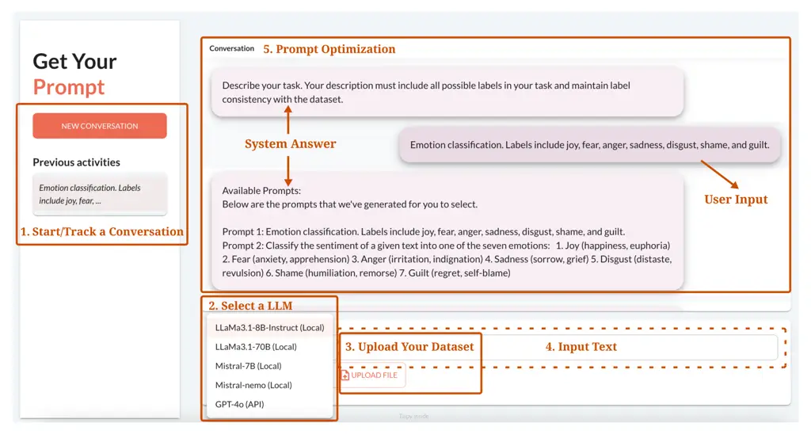
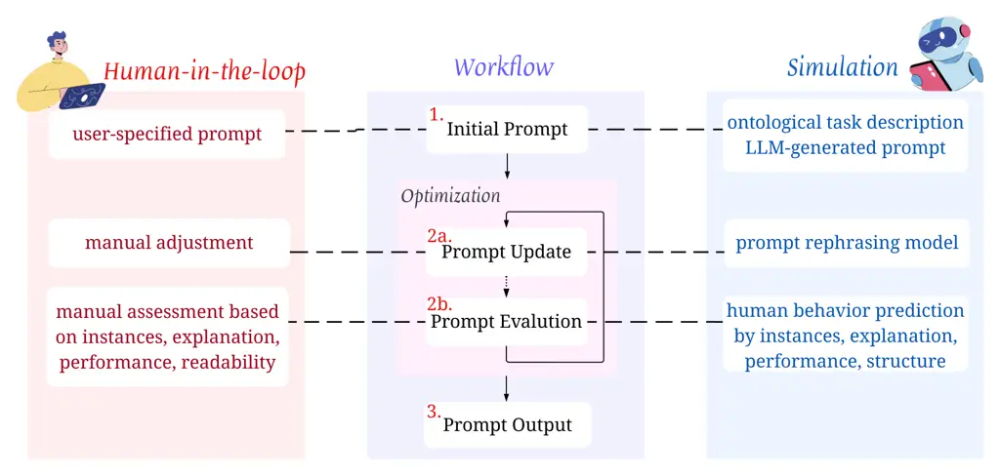

# iPrOp: Interactive Prompt Optimization for Large Language Models with a Human in the Loop

Jiahui Li    Roman Klinger Affiliation: Fundamentals of Natural Language
Processing, University of Bamberg, Germany
Email: [{jiahui.li,roman.klinger}@uni-bamberg.de](mailto:)

###### Abstract

Prompt engineering has made significant contributions to the era of
large language models, yet its effectiveness depends on the skills of a
prompt author. This paper introduces iPrOp, a novel interactive prompt
optimization approach, to bridge manual prompt engineering and automatic
prompt optimization while offering users the flexibility to assess
evolving prompts. We aim to provide users with task-specific guidance to
enhance human engagement in the optimization process, which is
structured through prompt variations, informative instances, predictions
generated by large language models along with their corresponding
explanations, and relevant performance metrics. This approach empowers
users to choose and further refine the prompts based on their individual
preferences and needs. It can not only assist non-technical domain
experts in generating optimal prompts tailored to their specific tasks
or domains, but also enable to study the intrinsic parameters that
influence the performance of prompt optimization. The evaluation shows
that our approach has the capability to generate improved prompts,
leading to enhanced task performance.



Figure 1: Screenshot of the iPrOp Web application, where key components
are annotated.

## 1 Introduction

With the advancement of large language models (LLMs), prompt engineering
emerged for instructing these models to generate responses that align
with users’ requirements. Prompting allows LLMs to perform
user-specified tasks, including tasks in previously unseen scenarios or
particular domains (Devlin et al., 2019; Raffel et al., 2020; Mishra
et al., 2022).

However, prompt-based natural language processing (NLP) has demonstrated
limited robustness across domains, instances, or label schemes
(Plaza-del Arco et al., 2022; Yin et al., 2019; Zhou et al., 2022). It
is also challenging to develop reliable methods for evaluation of LLMs
that factor in prompt brittleness (Ceron et al., 2024). The question of
how to design a well-crafted prompt has received an increasing amount of
attention. Although there exists research on analyzing which prompts are
more effective for tasks like classification and question answering (Liu
et al., 2022; Lu et al., 2022; Xu et al., 2022), the need to efficiently
identify high-quality prompts has sparked increased attention into
automatic prompt optimization (Shin et al., 2020; Pryzant et al., 2023).
However, they tend to overlook the inherent contextuality and the
domain-dependent nature of prompt engineering (Pei et al., 2025;
Anthropic, 2024). There is a lack of studies that combines user-guided
prompt optimization with data-driven prompt optimization. Given that the
user constitutes the ultimate authority to develop prompts that satisfy
the varying trade-offs across different aspects of a specific task, we
consider this an important research gap.

Combining prompt optimization with a user in the loop comes with the
potential for a more guided engineering process, from which any user may
benefit. Two examples are particularly prominent: (1) Technical
laypeople may require help with prompt development for dedicated tasks.
(2) Manual prompt engineering may lead to biased configurations, as
generic prompts often fail to capture the complexities and nuances
specific to particular domains, such as medical knowledge (Lu et al.,
2023). Prior research has demonstrated the role of human-in-the-loop
methodologies in building robust systems across a variety of tasks,
including debugging text classifiers (Lertvittayakumjorn et al., 2020),
hate speech classification (Kotarcic et al., 2022), and question
answering chatbots (Afzal et al., 2024).

To achieve the goal of supporting users in their prompt development
process, we hypothesize that a set of prompt properties is important to
decide if a prompt $`p`$ is considered better than another prompt
$`p^{\prime}`$. These are (a) the performance of a prompt on some
annotated data, for instance measured by F₁ (we focus in this paper on
text classification tasks); (b) The readability and interpretability of
the prompt; (c) The quality of an explanation of the predictions of the
prompt; and (d), the alignment of the annotations with the users
expectations. We therefore propose an interactive prompt optimization
approach with a human-in-the-loop that considers all these aspects. The
proposed approach enables studies on the interaction between these
various parameters in the spirit of an iterative optimization in which
the automatic evaluation of an objective function is supported by a
human. We further envision that some decisions may be made
automatically, while others require the human to decide on the prompt
quality. Such collaborative decision process helps to maintain the high
quality of the prompts, while limiting the required user interactions to
those of particularly high value.

The repository of a prototypical web interface for the iPrOp approach
and an explanation video is available at
[https://www.uni-bamberg.de/nlproc/ressourcen/iprop/](https://www.uni-bamberg.de/nlproc/ressourcen/iprop/).
Figure 1 presents a screenshot of the web-based user interface.



Figure 2: The conceptual workflow of our iPrOp approach. The general
workflow is shown in the middle. The left part shows potential human
interaction in the various modules. To limit the amount of user
interactions, each module can be supported by a simulated interaction.

## 2 Related Work

### 2.1 Prompt Engineering for LLMs

Prompt engineering is the process of designing and optimizing prompts to
guide a language model for effective results on a downstream task. Liu
et al.’s (2023) survey categorizes previous works in prompt shapes and
human-designed prompt templates. While the former category includes
techniques such as cloze prompts (Cui et al., 2021) and prefix prompts
(Li and Liang, 2021), the latter focuses on manually crafted prompts
(Brown et al., 2020) and automated prompt templating processes (Shin
et al., 2020). Our work is derived from the latter case with the
addition of human interventions.

The output of an LLM is influenced by the quality of prompts (Lu et al.,
2022). Prompts need to be adapted to particular domains (Karmaker Santu
and Feng, 2023; Wei et al., 2021), and for different LLMs (Chen et al.,
2023). Previous work therefore attempted to search through paraphrases
of prompts (Jiang et al., 2020), by compiling prompts based on templates
and class-triggering tokens (Shin et al., 2020), or by learning soft
prompts (Qin and Eisner, 2021). Another approach is to combine gradient
descent method with hard prompts (Wen et al., 2023; Pryzant et al.,
2023). In contrast, our framework focuses on multiple factors such as
task selection, choice of LLM, and user-provided feedback as external
parameters. Further, we exploit the capabilities of LLMs as prompt
engineers (Zhou et al., 2023; Ye et al., 2024; Fernando et al., 2024;
Menchaca Resendiz and Klinger, 2025).

### 2.2 Cooperative Artificial Intelligence

This work is related to the field of cooperative artificial
intelligence, which touches upon topics of human-machine interaction and
efficient protocols of information exchange, enabling humans to solve
tasks collaboratively with machines. Such methods also influenced NLP
tasks, such as question answering (Benamara and Saint Dizier, 2003),
information retrieval (Manning et al., 2008), and chatbot interactions
(Hancock et al., 2019). More recent papers draw their attention on
collaborative annotation processes and model direct manipulation (Baur
et al., 2020; Wang et al., 2021). However, we introduce a
human-in-the-loop via replacing the automatic evaluation of an objective
function by a human. Prior research has explored incorporated human
feedback by presenting users with responses generated from paired
prompts and asking for their preferences (Lin et al., 2024). In
contrast, our framework offers a more comprehensive structure,
encompassing a broader range of factors that should be considered during
human evaluation.

### 2.3 Explainable Artificial Intelligence

Users which manually change properties of a system benefit from a good
understanding of the model’s decisions. This task is approached by
explainable artificial intelligence (XAI) techniques (Roscher et al.,
2020). One prominent work that introduced the interaction between model
intervention and XAI is Teso and Kersting (2019). Another study combines
explanatory interactive machine-learning methods with fair machine
learning for the bias-mitigation problem (Heidrich et al., 2023). They
both integrate interpretability methods for machine learning models,
such as SHAP (Lundberg and Lee, 2017), LIME (Ribeiro et al., 2016), and
Anchors (Ribeiro et al., 2018).

Although these tools offer intuitive explanations for classifiers, their
reliance on perturbations makes them computationally expensive to apply
to LLMs because of the high-dimensional nature and complexity of LLMs.
An alternative is to leverage the inherent explainability of LLMs
(Mavrepis et al., 2024). Wu et al.’s (2024) analysis of strategies to
enhance the transparency of LLMs. Bills et al. (2023) demonstrate that
LLMs are able to explain individual neurons in LLMs. This work motivates
our attempt to prompt LLMs for the explanations of their predictions.

## 3 Methods

Figure 2 visualizes the conceptual workflow of our iPrOp approach. The
workflow begins with an initial seed prompt and proceeds through
iterations of prompt updates and evaluations, led by informative
samples, explanations, and data evaluation with performance metrics. To
reduce human workload, each step can, in principle, be performed either
by the user or automatically.

We formalize the process of the workflow as follows. The user is
presented prompts in iterations and selects the preferred prompt
$`p^{*}`$ based on their assessment $`H`$:

```math
p^{*}=\argmax_{p\in P\cup M(P)}H(I(p_{i})),
```

Here, $`M(P)`$ is a prompt paraphrasing model that varies the prompts
$`P`$ selected from the previous iteration. $`I(p_{i})`$ is a
presentation of prompt properties to the user, which consists of

```math
I(p_{i})=(p_{i},T^{p_{i}}_{\alpha},E(T_{\alpha},p_{i}),F_{1}(T^{p_{i}}_{\beta})))\,.
```

The user provides a (potentially small) training set $`T`$ for their
task, from which we sample two subsets $`T_{\alpha}\subseteq T`$ and
$`T_{\beta}\subseteq T`$ according to strategies $`\alpha,\beta`$.
$`T^{p_{i}}_{\alpha}`$ consists of instances to be shown to the user
together with model based explanations $`E(T_{\alpha},p_{i})`$.
$`T_{\beta}`$ serves to calculate an evaluation score
$`F_{1}(T^{p_{i}}_{\beta})`$ (we focus on text classification tasks for
simplicity).

This procedure is also visualized in Figure 2. The initialization of
seed prompts ((1) in Figure 2) requires users to describe the task. In
simulation scenarios, this process can be substituted with an
ontological task description or prompts generated automatically by LLMs.
Subsequently, the initial prompts are passed to the optimization
modules. In the prompt update module (2a), prompts are paraphrased. As
an example, this paraphrasing of ‘Classification task with labels: joy
and sadness.’ with a meta-prompt of an LLM ‘Rephrase the following
prompt’ may lead to ‘Classify the emotion of text into joy and sadness.’

In the prompt evaluation stage (2b), the human in the loop assesses the
prompt quality, as described above. Figure 3 further provides a
prototypical display of the relevant information for two prompts to be
chosen from. In the current prototype interface, the explanations are
automatically generated by prompting a LLM. For instance, the specific
prompt used is: ‘In your answer, provide only the label you choose and
the explanation of your choice.’. Examples of the generated explanations
during the evaluation process are provided in the Appendix A. The
optimization process is terminated once the user is satisfied (3).

Figure 3: User interface prototype for an emotion analysis example
during the interactive prompt optimization process. "Exp." refers to
explanations for why a specific label is predicted by the model.


Figure 4: F1 scores for three datasets, shown separately on training and
validation data. The abbreviations GE, TEC, and TE correspond to the
Grounded-Emotions (blue), TEC (red), and Tales-Emotion (green) datasets,
respectively. The left violet y-axis corresponds to Grounded-Emotions
and TEC. The right green y-axis corresponds to Tales-Emotion.

## 4 Evaluation

We envision our iPrOp approach to enable future research on the
interaction of the various aspects to consider when humans make
preference decisions on particular prompts under the available
information. To validate the principled feasibility of our approach, we
run experiments on three emotion classification datasets using the
llama3.1:8b-instruct-fp16 model¹¹ 1
[https://ollama.com/library/llama3.1:8b-instruct-fp16](https://ollama.com/library/llama3.1:8b-instruct-fp16)
(Dubey et al., 2024). In this experiment, we only consider automated
classification performance scores and leave an automated evaluation of
the other measures or a user study for future work. In this simulation,
the prompt is selected corresponding to the weighted F₁ score over a
fixed subset of the training data. We expect to demonstrate a rising
trend during the optimization process to verify the effectiveness of our
approach.

#### Datasets.

We select three datasets for single labeled emotion classification task
from Bostan and Klinger (2018), namely TEC, covering general topics on
tweets (Mohammad, 2012); Grounded-Emotions, focusing on event-related
topics on tweets (Liu et al., 2017); and Tales-Emotion, built upon
fairytales (Alm and Sproat, 2005).

#### Result.

Figure 4 illustrates the F₁ scores over 15 iterations. We observe an
overall increasing trend in both training and validation data.

## 5 Conclusions and Future Work

We proposed interactive prompt optimization as a novel approach to
configure instruction-tuned language models. The user is guided by
information that is distilled from the prompt and its performance on
user-provided data. With this approach, we suggested to aggregate
information that may be relevant for users to decide on prompt
preferences.

The proposed approach has revealed several challenges that deserve
further investigation. There is a need to explore more effective
methodologies for enhancing the diversity of rephrased prompts. It is
important to limit the numbers of instances shown to the user, and that
selection requires methods to do so. It is essential to optimize the
various meta-prompts in the approach. Additionally, the optimization
algorithm is essential to improving the efficiency and user-friendliness
of our approach.

We envision that our iPrOp approach lays the groundwork for future
research by addressing several open questions: (Q1) Which parameters do
influence the performance of the workflow configuration in this
approach? We presume that the example selection to better understand how
the prompt performs affects a user’s ability to estimate which prompt is
preferable. Further, the methods to explain the prompt prediction are
crucial. Finally, underlying aspects such as the model and its
robustness are relevant factors for the approach to succeed. (Q2) How do
prompts evolve throughout the optimization iterations? An aspect of this
question is what is the difference between automatic prompt optimization
and the human optimization is, and in which cases the human intervention
is indeed helpful. (Q3) To what extent can human involvement be reduced
while maintaining a balanced trade-off across competing evaluation
criteria? Can the interactive prompt optimization approach be a
collaborative learning procedure, in which the machine only requests
information if needed? We propose to study these research questions
based on the paradigm of interactive prompt optimization introduced in
this paper.

## Limitations

Although the iPrOp approach offers a convenient interface for
non-technical users to attain suitable prompts, it has several
limitations that warrant consideration in the future enhancement. First,
in an effort to provide comprehensive explanations of LLM predictions,
the challenge of computation time remains significant, and as a result,
the streaming output is not effectively communicated to users. Second,
developing an effective strategy to address problems related to
train-validation-test splitting for user-provided datasets of varying
sizes remains an ongoing challenge. Third, the development of prompt
optimization iterations partially depends on the quality and variability
of prompt rephrasing. This implies that rephrased prompts may
occasionally retain low quality across multiple iterations. Furthermore,
we observe that certain datasets exhibit limited sensitivity to
divergent prompts, allowing a simple or even naive initial prompt to
achieve superior performance.

## Acknowledgments

This paper is supported by the project INPROMPT (Interactive Prompt
Optimization with the Human in the Loop for Natural Language
Understanding Model Development and Intervention, funded by the German
Research Foundation, KL 2869/13-1, project number 521755488).

## Ethical Considerations

Our approach is designed with careful attention to ethical standards in
data usage, privacy, and compliance with the ACL Code of Ethics. Our
method does not contribute to the republication or redistribution of any
datasets. The datasets used for testing and evaluation are publicly
available and we ensure that they have been collected according to
ethical standards before using them. To safeguard user privacy, all data
provided by users is stored exclusively on their local machines. While
potential risks associated with the underlying LLMs could result in the
exposure of user-provided datasets, we aim to mitigate these risks by
offering more secure local models. In addition, our approach cannot
guarantee that the optimal prompts identified are state of the art for
specific tasks. Furthermore, individual preferences may introduce
biases, which could potentially mislead users. We are committed to
continuously monitoring and improving the ethical performance of our
approach.

## References

- Afzal et al. (2024) Anum Afzal, Alexander Kowsik, Rajna Fani, and
  Florian Matthes. 2024. [Towards optimizing and evaluating a retrieval
  augmented QA chatbot using LLMs with
  human-in-the-loop](https://doi.org/10.18653/v1/2024.dash-1.2). In
  _Proceedings of the Fifth Workshop on Data Science with
  Human-in-the-Loop (DaSH 2024)_, pages 4–16, Mexico City, Mexico.
  Association for Computational Linguistics.
- Alm and Sproat (2005) Cecilia Ovesdotter Alm and Richard Sproat. 2005.
  [Emotional sequencing and development in fairy
  tales](https://doi.org/10.1007/11573548_86). In _Affective Computing
  and Intelligent Interaction, First International Conference, ACII
  2005, Beijing, China, October 22-24, 2005, Proceedings_, volume 3784
  of _Lecture Notes in Computer Science_, pages 668–674. Springer.
- Anthropic (2024) Anthropic. 2024. [_The claude 3 model family: Opus,
  sonnet, haiku_](https://www.anthropic.com/news/claude-3-family).
- Baur et al. (2020) Tobias Baur, Alexander Heimerl, Florian
  Lingenfelser, Johannes Wagner, Michel F. Valstar, Björn W. Schuller,
  and Elisabeth André. 2020. [explainable cooperative machine learning
  with NOVA](https://doi.org/10.1007/S13218-020-00632-3). _Künstliche
  Intell._, 34(2):143–164.
- Benamara and Saint Dizier (2003) Farah Benamara and Patrick
  Saint Dizier. 2003. [WEBCOOP: A cooperative question answering system
  on the web](https://aclanthology.org/E03-1060). In _10th Conference of
  the European Chapter of the Association for Computational
  Linguistics_, Budapest, Hungary. Association for Computational
  Linguistics.
- Bills et al. (2023) Steven Bills, Nick Cammarata, Dan Mossing, Henk
  Tillman, Leo Gao, Gabriel Goh, Ilya Sutskever, Jan Leike, Jeff Wu, and
  William Saunders. 2023. [Language models can explain neurons in
  language
  models](https://openaipublic.blob.core.windows.net/neuron-explainer/paper/index.html).
  Online:
  [https://openaipublic.blob.core.windows.net/neuron-explainer/paper/index.html](https://openaipublic.blob.core.windows.net/neuron-explainer/paper/index.html).
- Bostan and Klinger (2018) Laura-Ana-Maria Bostan and Roman
  Klinger. 2018. [An analysis of annotated corpora for emotion
  classification in text](https://aclanthology.org/C18-1179). In
  _Proceedings of the 27th International Conference on Computational
  Linguistics_, pages 2104–2119, Santa Fe, New Mexico, USA. Association
  for Computational Linguistics.
- Brown et al. (2020) Tom B. Brown, Benjamin Mann, Nick Ryder, Melanie
  Subbiah, Jared Kaplan, Prafulla Dhariwal, Arvind Neelakantan, Pranav
  Shyam, Girish Sastry, Amanda Askell, Sandhini Agarwal, Ariel
  Herbert-Voss, Gretchen Krueger, Tom Henighan, Rewon Child, Aditya
  Ramesh, Daniel M. Ziegler, Jeffrey Wu, Clemens Winter, Christopher
  Hesse, Mark Chen, Eric Sigler, Mateusz Litwin, Scott Gray, Benjamin
  Chess, Jack Clark, Christopher Berner, Sam McCandlish, Alec Radford,
  Ilya Sutskever, and Dario Amodei. 2020. [Language models are few-shot
  learners](https://arxiv.org/abs/2005.14165). _CoRR_, abs/2005.14165.
- Ceron et al. (2024) Tanise Ceron, Neele Falk, Ana Barić, Dmitry
  Nikolaev, and Sebastian Padó. 2024. [Beyond prompt brittleness:
  Evaluating the reliability and consistency of political worldviews in
  LLMs](https://doi.org/10.1162/tacl_a_00710). _Transactions of the
  Association for Computational Linguistics_, 12:1378–1400.
- Chen et al. (2023) Yuyan Chen, Zhihao Wen, Ge Fan, Zhengyu Chen, Wei
  Wu, Dayiheng Liu, Zhixu Li, Bang Liu, and Yanghua Xiao. 2023. [MAPO:
  Boosting large language model performance with model-adaptive prompt
  optimization](https://doi.org/10.18653/v1/2023.findings-emnlp.215). In
  _Findings of the Association for Computational Linguistics: EMNLP
  2023_, pages 3279–3304, Singapore. Association for Computational
  Linguistics.
- Cui et al. (2021) Leyang Cui, Yu Wu, Jian Liu, Sen Yang, and Yue
  Zhang. 2021. [Template-based named entity recognition using
  BART](https://doi.org/10.18653/v1/2021.findings-acl.161). In _Findings
  of the Association for Computational Linguistics: ACL-IJCNLP 2021_,
  pages 1835–1845, Online. Association for Computational Linguistics.
- Devlin et al. (2019) Jacob Devlin, Ming-Wei Chang, Kenton Lee, and
  Kristina Toutanova. 2019. [BERT: Pre-training of deep bidirectional
  transformers for language
  understanding](https://doi.org/10.18653/v1/N19-1423). In _Proceedings
  of the 2019 Conference of the North American Chapter of the
  Association for Computational Linguistics: Human Language
  Technologies, Volume 1 (Long and Short Papers)_, pages 4171–4186,
  Minneapolis, Minnesota. Association for Computational Linguistics.
- Dubey et al. (2024) Abhimanyu Dubey, Abhinav Jauhri, Abhinav Pandey,
  Abhishek Kadian, Ahmad Al-Dahle, Aiesha Letman, Akhil Mathur, Alan
  Schelten, Amy Yang, Angela Fan, Anirudh Goyal, Anthony Hartshorn, Aobo
  Yang, Archi Mitra, Archie Sravankumar, Artem Korenev, Arthur Hinsvark,
  Arun Rao, Aston Zhang, Aurélien Rodriguez, Austen Gregerson, Ava
  Spataru, Baptiste Rozière, Bethany Biron, Binh Tang, Bobbie Chern,
  Charlotte Caucheteux, Chaya Nayak, Chloe Bi, Chris Marra, Chris
  McConnell, Christian Keller, Christophe Touret, Chunyang Wu, Corinne
  Wong, Cristian Canton Ferrer, Cyrus Nikolaidis, Damien Allonsius,
  Daniel Song, Danielle Pintz, Danny Livshits, David Esiobu, Dhruv
  Choudhary, Dhruv Mahajan, Diego Garcia-Olano, Diego Perino, Dieuwke
  Hupkes, Egor Lakomkin, Ehab AlBadawy, Elina Lobanova, Emily Dinan,
  Eric Michael Smith, Filip Radenovic, Frank Zhang, Gabriel Synnaeve,
  Gabrielle Lee, Georgia Lewis Anderson, Graeme Nail, Grégoire Mialon,
  Guan Pang, Guillem Cucurell, Hailey Nguyen, Hannah Korevaar, Hu Xu,
  Hugo Touvron, Iliyan Zarov, Imanol Arrieta Ibarra, Isabel M. Kloumann,
  Ishan Misra, Ivan Evtimov, Jade Copet, Jaewon Lee, Jan Geffert, Jana
  Vranes, Jason Park, Jay Mahadeokar, Jeet Shah, Jelmer van der Linde,
  Jennifer Billock, Jenny Hong, Jenya Lee, Jeremy Fu, Jianfeng Chi,
  Jianyu Huang, Jiawen Liu, Jie Wang, Jiecao Yu, Joanna Bitton, Joe
  Spisak, Jongsoo Park, Joseph Rocca, Joshua Johnstun, Joshua Saxe,
  Junteng Jia, Kalyan Vasuden Alwala, Kartikeya Upasani, Kate Plawiak,
  Ke Li, Kenneth Heafield, Kevin Stone, and et al. 2024. [The llama 3
  herd of models](https://doi.org/10.48550/ARXIV.2407.21783). _CoRR_,
  abs/2407.21783.
- Fernando et al. (2024) Chrisantha Fernando, Dylan Banarse, Henryk
  Michalewski, Simon Osindero, and Tim Rocktäschel. 2024.
  [Promptbreeder: Self-referential self-improvement via prompt
  evolution](https://openreview.net/forum?id=9ZxnPZGmPU). In
  _Forty-first International Conference on Machine Learning, ICML 2024,
  Vienna, Austria, July 21-27, 2024_. OpenReview.net.
- Hancock et al. (2019) Braden Hancock, Antoine Bordes, Pierre-Emmanuel
  Mazare, and Jason Weston. 2019. [Learning from dialogue after
  deployment: Feed yourself,
  chatbot!](https://doi.org/10.18653/v1/P19-1358) In _Proceedings of the
  57th Annual Meeting of the Association for Computational Linguistics_,
  pages 3667–3684, Florence, Italy. Association for Computational
  Linguistics.
- Heidrich et al. (2023) Louisa Heidrich, Emanuel Slany, Stephan
  Scheele, and Ute Schmid. 2023. [Faircaipi: A combination of
  explanatory interactive and fair machine learning for human and
  machine bias reduction](https://doi.org/10.3390/MAKE5040076). _Mach.
  Learn. Knowl. Extr._, 5(4):1519–1538.
- Jiang et al. (2020) Zhengbao Jiang, Frank F. Xu, Jun Araki, and Graham
  Neubig. 2020. [How can we know what language models
  know?](https://doi.org/10.1162/tacl_a_00324) _Transactions of the
  Association for Computational Linguistics_, 8:423–438.
- Karmaker Santu and Feng (2023) Shubhra Kanti Karmaker Santu and Dongji
  Feng. 2023. [TELeR: A general taxonomy of LLM prompts for benchmarking
  complex tasks](https://doi.org/10.18653/v1/2023.findings-emnlp.946).
  In _Findings of the Association for Computational Linguistics: EMNLP
  2023_, pages 14197–14203, Singapore. Association for Computational
  Linguistics.
- Kotarcic et al. (2022) Ana Kotarcic, Dominik Hangartner, Fabrizio
  Gilardi, Selina Kurer, and Karsten Donnay. 2022. [Human-in-the-loop
  hate speech classification in a multilingual
  context](https://aclanthology.org/2022.findings-emnlp.548). In
  _Findings of the Association for Computational Linguistics: EMNLP
  2022_, pages 7414–7442, Abu Dhabi, United Arab Emirates. Association
  for Computational Linguistics.
- Lertvittayakumjorn et al. (2020) Piyawat Lertvittayakumjorn, Lucia
  Specia, and Francesca Toni. 2020. [FIND: Human-in-the-Loop Debugging
  Deep Text
  Classifiers](https://doi.org/10.18653/v1/2020.emnlp-main.24). In
  _Proceedings of the 2020 Conference on Empirical Methods in Natural
  Language Processing (EMNLP)_, pages 332–348, Online. Association for
  Computational Linguistics.
- Li and Liang (2021) Xiang Lisa Li and Percy Liang. 2021.
  [Prefix-tuning: Optimizing continuous prompts for
  generation](https://doi.org/10.18653/v1/2021.acl-long.353). In
  _Proceedings of the 59th Annual Meeting of the Association for
  Computational Linguistics and the 11th International Joint Conference
  on Natural Language Processing (Volume 1: Long Papers)_, pages
  4582–4597, Online. Association for Computational Linguistics.
- Lin et al. (2024) Xiaoqiang Lin, Zhongxiang Dai, Arun Verma, See-Kiong
  Ng, Patrick Jaillet, and Bryan Kian Hsiang Low. 2024. [Prompt
  optimization with human
  feedback](https://doi.org/10.48550/ARXIV.2405.17346). _CoRR_,
  abs/2405.17346.
- Liu et al. (2022) Jiachang Liu, Dinghan Shen, Yizhe Zhang, Bill Dolan,
  Lawrence Carin, and Weizhu Chen. 2022. [What makes good in-context
  examples for GPT-3?](https://doi.org/10.18653/v1/2022.deelio-1.10) In
  _Proceedings of Deep Learning Inside Out (DeeLIO 2022): The 3rd
  Workshop on Knowledge Extraction and Integration for Deep Learning
  Architectures_, pages 100–114, Dublin, Ireland and Online. Association
  for Computational Linguistics.
- Liu et al. (2023) Pengfei Liu, Weizhe Yuan, Jinlan Fu, Zhengbao Jiang,
  Hiroaki Hayashi, and Graham Neubig. 2023. [Pre-train, prompt, and
  predict: A systematic survey of prompting methods in natural language
  processing](https://doi.org/10.1145/3560815). _ACM Comput. Surv._,
  55(9):195:1–195:35.
- Liu et al. (2017) Vicki Liu, Carmen Banea, and Rada Mihalcea. 2017.
  [Grounded emotions](https://doi.org/10.1109/ACII.2017.8273642). In
  _Seventh International Conference on Affective Computing and
  Intelligent Interaction, ACII 2017, San Antonio, TX, USA, October
  23-26, 2017_, pages 477–483. IEEE Computer Society.
- Lu et al. (2022) Yao Lu, Max Bartolo, Alastair Moore, Sebastian
  Riedel, and Pontus Stenetorp. 2022. [Fantastically ordered prompts and
  where to find them: Overcoming few-shot prompt order
  sensitivity](https://doi.org/10.18653/v1/2022.acl-long.556). In
  _Proceedings of the 60th Annual Meeting of the Association for
  Computational Linguistics (Volume 1: Long Papers)_, pages 8086–8098,
  Dublin, Ireland. Association for Computational Linguistics.
- Lu et al. (2023) Yuxing Lu, Xukai Zhao, and Jinzhuo Wang. 2023.
  [Medical knowledge-enhanced prompt learning for diagnosis
  classification from clinical
  text](https://doi.org/10.18653/v1/2023.clinicalnlp-1.33). In
  _Proceedings of the 5th Clinical Natural Language Processing
  Workshop_, pages 278–288, Toronto, Canada. Association for
  Computational Linguistics.
- Lundberg and Lee (2017) Scott M. Lundberg and Su-In Lee. 2017. [A
  unified approach to interpreting model
  predictions](https://proceedings.neurips.cc/paper/2017/hash/8a20a8621978632d76c43dfd28b67767-Abstract.html).
  In _Advances in Neural Information Processing Systems 30: Annual
  Conference on Neural Information Processing Systems 2017, December
  4-9, 2017, Long Beach, CA, USA_, pages 4765–4774.
- Manning et al. (2008) Christopher D. Manning, Prabhakar Raghavan, and
  Hinrich Schütze. 2008. [_Introduction to information
  retrieval_](https://doi.org/10.1017/CBO9780511809071). Cambridge
  University Press.
- Mavrepis et al. (2024) Philip Mavrepis, Georgios Makridis, Georgios
  Fatouros, Vasileios Koukos, Maria Margarita Separdani, and Dimosthenis
  Kyriazis. 2024. [XAI for all: Can large language models simplify
  explainable ai?](https://doi.org/10.48550/ARXIV.2401.13110) _CoRR_,
  abs/2401.13110.
- Menchaca Resendiz and Klinger (2025) Yarik Menchaca Resendiz and Roman
  Klinger. 2025. Mopo: Multi-objective prompt optimization for affective
  text generation. In _Proceedings of the 31st International Conference
  on Computational Linguistics_, Abu Dhabi, UAE. International Committee
  on Computational Linguistics.
- Mishra et al. (2022) Swaroop Mishra, Daniel Khashabi, Chitta Baral,
  and Hannaneh Hajishirzi. 2022. [Cross-task generalization via natural
  language crowdsourcing
  instructions](https://doi.org/10.18653/v1/2022.acl-long.244). In
  _Proceedings of the 60th Annual Meeting of the Association for
  Computational Linguistics (Volume 1: Long Papers)_, pages 3470–3487,
  Dublin, Ireland. Association for Computational Linguistics.
- Mohammad (2012) Saif Mohammad. 2012. [\#emotional
  tweets](https://aclanthology.org/S12-1033). In _\*SEM 2012: The First
  Joint Conference on Lexical and Computational Semantics – Volume 1:
  Proceedings of the main conference and the shared task, and Volume 2:
  Proceedings of the Sixth International Workshop on Semantic Evaluation
  (SemEval 2012)_, pages 246–255, Montréal, Canada. Association for
  Computational Linguistics.
- Pei et al. (2025) Aihua Pei, Zehua Yang, Shunan Zhu, Ruoxi Cheng, and
  Ju Jia. 2025. [SelfPrompt: Autonomously evaluating LLM robustness via
  domain-constrained knowledge guidelines and refined adversarial
  prompts](https://aclanthology.org/2025.coling-main.457/). In
  _Proceedings of the 31st International Conference on Computational
  Linguistics_, pages 6840–6854, Abu Dhabi, UAE. Association for
  Computational Linguistics.
- Plaza-del Arco et al. (2022) Flor Miriam Plaza-del Arco, María-Teresa
  Martín-Valdivia, and Roman Klinger. 2022. [Natural language inference
  prompts for zero-shot emotion classification in text across
  corpora](https://aclanthology.org/2022.coling-1.592). In _Proceedings
  of the 29th International Conference on Computational Linguistics_,
  pages 6805–6817, Gyeongju, Republic of Korea. International Committee
  on Computational Linguistics.
- Pryzant et al. (2023) Reid Pryzant, Dan Iter, Jerry Li, Yin Lee,
  Chenguang Zhu, and Michael Zeng. 2023. [Automatic prompt optimization
  with “gradient descent” and beam
  search](https://doi.org/10.18653/v1/2023.emnlp-main.494). In
  _Proceedings of the 2023 Conference on Empirical Methods in Natural
  Language Processing_, pages 7957–7968, Singapore. Association for
  Computational Linguistics.
- Qin and Eisner (2021) Guanghui Qin and Jason Eisner. 2021. [Learning
  how to ask: Querying LMs with mixtures of soft
  prompts](https://doi.org/10.18653/v1/2021.naacl-main.410). In
  _Proceedings of the 2021 Conference of the North American Chapter of
  the Association for Computational Linguistics: Human Language
  Technologies_, pages 5203–5212, Online. Association for Computational
  Linguistics.
- Raffel et al. (2020) Colin Raffel, Noam Shazeer, Adam Roberts,
  Katherine Lee, Sharan Narang, Michael Matena, Yanqi Zhou, Wei Li, and
  Peter J. Liu. 2020. [Exploring the limits of transfer learning with a
  unified text-to-text
  transformer](https://jmlr.org/papers/v21/20-074.html). _J. Mach.
  Learn. Res._, 21:140:1–140:67.
- Ribeiro et al. (2016) Marco Túlio Ribeiro, Sameer Singh, and Carlos
  Guestrin. 2016. ["why should I trust you?": Explaining the predictions
  of any classifier](https://doi.org/10.1145/2939672.2939778). In
  _Proceedings of the 22nd ACM SIGKDD International Conference on
  Knowledge Discovery and Data Mining, San Francisco, CA, USA, August
  13-17, 2016_, pages 1135–1144. ACM.
- Ribeiro et al. (2018) Marco Túlio Ribeiro, Sameer Singh, and Carlos
  Guestrin. 2018. [Anchors: High-precision model-agnostic
  explanations](https://doi.org/10.1609/AAAI.V32I1.11491). In
  _Proceedings of the Thirty-Second AAAI Conference on Artificial
  Intelligence, (AAAI-18), the 30th innovative Applications of
  Artificial Intelligence (IAAI-18), and the 8th AAAI Symposium on
  Educational Advances in Artificial Intelligence (EAAI-18), New
  Orleans, Louisiana, USA, February 2-7, 2018_, pages 1527–1535. AAAI
  Press.
- Roscher et al. (2020) Ribana Roscher, Bastian Bohn, Marco F. Duarte,
  and Jochen Garcke. 2020. [Explainable machine learning for scientific
  insights and
  discoveries](https://doi.org/10.1109/ACCESS.2020.2976199). _IEEE
  Access_, 8:42200–42216.
- Shin et al. (2020) Taylor Shin, Yasaman Razeghi, Robert L. Logan IV,
  Eric Wallace, and Sameer Singh. 2020. [AutoPrompt: Eliciting Knowledge
  from Language Models with Automatically Generated
  Prompts](https://doi.org/10.18653/v1/2020.emnlp-main.346). In
  _Proceedings of the 2020 Conference on Empirical Methods in Natural
  Language Processing (EMNLP)_, pages 4222–4235, Online. Association for
  Computational Linguistics.
- Teso and Kersting (2019) Stefano Teso and Kristian Kersting. 2019.
  [Explanatory Interactive Machine
  Learning](https://doi.org/10.1145/3306618.3314293). In _Proceedings of
  the 2019 AAAI/ACM Conference on AI, Ethics, and Society_, pages
  239–245, Honolulu, HI, USA. ACM.
- Wang et al. (2021) Zijie J. Wang, Dongjin Choi, Shenyu Xu, and Diyi
  Yang. 2021. [Putting humans in the natural language processing loop: A
  survey](https://aclanthology.org/2021.hcinlp-1.8). In _Proceedings of
  the First Workshop on Bridging Human–Computer Interaction and Natural
  Language Processing_, pages 47–52, Online. Association for
  Computational Linguistics.
- Wei et al. (2021) Colin Wei, Sang Michael Xie, and Tengyu Ma. 2021.
  [Why do pretrained language models help in downstream tasks? an
  analysis of head and prompt
  tuning](https://proceedings.neurips.cc/paper/2021/hash/86b3e165b8154656a71ffe8a327ded7d-Abstract.html).
  In _Advances in Neural Information Processing Systems 34: Annual
  Conference on Neural Information Processing Systems 2021, NeurIPS
  2021, December 6-14, 2021, virtual_, pages 16158–16170.
- Wen et al. (2023) Yuxin Wen, Neel Jain, John Kirchenbauer, Micah
  Goldblum, Jonas Geiping, and Tom Goldstein. 2023. [Hard prompts made
  easy: Gradient-based discrete optimization for prompt tuning and
  discovery](http://papers.nips.cc/paper_files/paper/2023/hash/a00548031e4647b13042c97c922fadf1-Abstract-Conference.html).
  In _Advances in Neural Information Processing Systems 36: Annual
  Conference on Neural Information Processing Systems 2023, NeurIPS
  2023, New Orleans, LA, USA, December 10 - 16, 2023_.
- Wu et al. (2024) Xuansheng Wu, Haiyan Zhao, Yaochen Zhu, Yucheng Shi,
  Fan Yang, Tianming Liu, Xiaoming Zhai, Wenlin Yao, Jundong Li, Mengnan
  Du, and Ninghao Liu. 2024. [Usable XAI: 10 strategies towards
  exploiting explainability in the LLM
  era](https://doi.org/10.48550/ARXIV.2403.08946). _CoRR_,
  abs/2403.08946.
- Xu et al. (2022) Lei Xu, Yangyi Chen, Ganqu Cui, Hongcheng Gao, and
  Zhiyuan Liu. 2022. [Exploring the universal vulnerability of
  prompt-based learning
  paradigm](https://doi.org/10.18653/v1/2022.findings-naacl.137). In
  _Findings of the Association for Computational Linguistics: NAACL
  2022_, pages 1799–1810, Seattle, United States. Association for
  Computational Linguistics.
- Ye et al. (2024) Qinyuan Ye, Mohamed Ahmed, Reid Pryzant, and Fereshte
  Khani. 2024. [Prompt engineering a prompt
  engineer](https://doi.org/10.18653/v1/2024.findings-acl.21). In
  _Findings of the Association for Computational Linguistics: ACL 2024_,
  pages 355–385, Bangkok, Thailand. Association for Computational
  Linguistics.
- Yin et al. (2019) Wenpeng Yin, Jamaal Hay, and Dan Roth. 2019.
  [Benchmarking zero-shot text classification: Datasets, evaluation and
  entailment approach](https://doi.org/10.18653/v1/D19-1404). In
  _Proceedings of the 2019 Conference on Empirical Methods in Natural
  Language Processing and the 9th International Joint Conference on
  Natural Language Processing (EMNLP-IJCNLP)_, pages 3914–3923, Hong
  Kong, China. Association for Computational Linguistics.
- Zhou et al. (2022) Chunting Zhou, Junxian He, Xuezhe Ma, Taylor
  Berg-Kirkpatrick, and Graham Neubig. 2022. [Prompt consistency for
  zero-shot task
  generalization](https://doi.org/10.18653/v1/2022.findings-emnlp.192).
  In _Findings of the Association for Computational Linguistics: EMNLP
  2022_, pages 2613–2626, Abu Dhabi, United Arab Emirates. Association
  for Computational Linguistics.
- Zhou et al. (2023) Yongchao Zhou, Andrei Ioan Muresanu, Ziwen Han,
  Keiran Paster, Silviu Pitis, Harris Chan, and Jimmy Ba. 2023. [Large
  language models are human-level prompt
  engineers](https://openreview.net/forum?id=92gvk82DE-). In _The
  Eleventh International Conference on Learning Representations, ICLR
  2023, Kigali, Rwanda, May 1-5, 2023_. OpenReview.net.

## Appendix A Appendix

| Text                                                                      | Predicted Label & Explanation                                                                                                                                                                                                                                                                                                                                                                                      |
| ------------------------------------------------------------------------- | ------------------------------------------------------------------------------------------------------------------------------------------------------------------------------------------------------------------------------------------------------------------------------------------------------------------------------------------------------------------------------------------------------------------ |
| hey you! Hope school is going well for you! Love ya$`\heartsuit`$         | Joy. The presence of the $`\heartsuit`$ symbol and the affectionate message ("Love ya") convey a positive emotional tone, indicating joy.                                                                                                                                                                                                                                                                          |
| Mmmm breakfast in bed :)                                                  | Joy. The person is expressing excitement and delight through the use of a happy emoticon :).                                                                                                                                                                                                                                                                                                                       |
| A wonderful story about how an act of kindness can change someone’s life. | Joy. The use of "wonderful" to describe the story suggests a positive tone, and the sharing of it on social media implies that the act of kindness is uplifting and inspiring.                                                                                                                                                                                                                                     |
| Someday….                                                                 | Sadness. The use of the word "someday" can imply a sense of longing or wistfulness, and the fact that itś used in conjunction with two links to online content may suggest that the author is reflecting on something theyv́e written in the past.                                                                                                                                                                  |
| With immigration drop, who needs a wall?                                  | Sadness. The text mentions an "immigration drop", which implies a negative change or decrease in something related to immigration. This is likely to evoke feelings of sadness or concern rather than joy. The use of the phrase "who needs a wall" also suggests a sense of pessimism or hopelessness, further indicating that the overall tone of the text is more negative and therefore classified as sadness. |
| do not try to stop them                                                   | Sadness. The use of "do not try to stop them" is a warning or cautionary statement, often implying something bad or undesirable is happening. The link provided does not provide context, but the tone of the message suggests a sense of urgency and possibly desperation, which are common indicators of sadness or concern.                                                                                     |

Table 1: Examples of an explanation generated for a predicted label in
the Grounded-Emotions dataset task.
