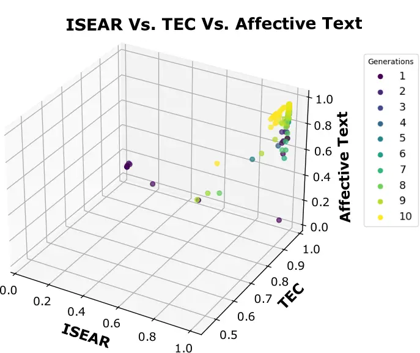
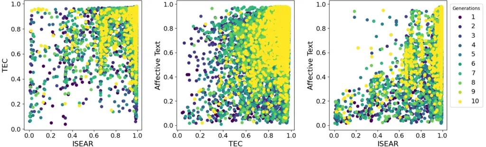
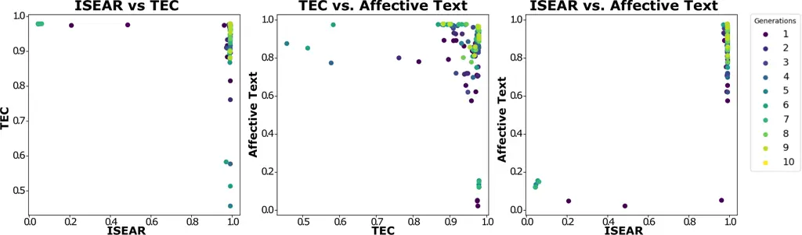
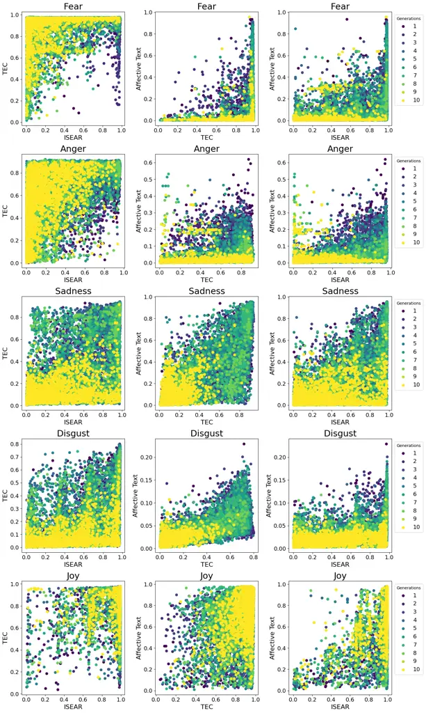

# MOPO: Multi-Objective Prompt Optimization forAffective Text Generation

Yarik Menchaca Resendiz Affiliation: Institut für Maschinelle
Sprachverarbeitung, University of Stuttgart, Germany
Affiliation: Fundamentals of Natural Language Processing, University of
Bamberg, Germany
Email: [yarik.menchaca-resendiz@uni-bamberg.de](mailto:)    Roman
Klinger Affiliation: Fundamentals of Natural Language Processing,
University of Bamberg, Germany
Email: [roman.klinger@uni-bamberg.de](mailto:)

###### Abstract

How emotions are expressed depends on the context and domain. On X
(formerly Twitter), for instance, an author might simply use the hashtag
\#anger, while in a news headline, emotions are typically written in a
more polite, indirect manner. To enable conditional text generation
models to create emotionally connotated texts that fit a domain, users
need to have access to a parameter that allows them to choose the
appropriate way to express an emotion. To achieve this, we introduce
MOPO, a Multi-Objective Prompt Optimization methodology. MOPO optimizes
prompts according to multiple objectives (which correspond here to the
output probabilities assigned by emotion classifiers trained for
different domains). In contrast to single objective optimization, MOPO
outputs a set of prompts, each with a different weighting of the
multiple objectives. Users can then choose the most appropriate prompt
for their context. We evaluate MOPO using three objectives, determined
by various domain-specific emotion classifiers. MOPO improves
performance by up to 15 pp across all objectives with a minimal loss
(1–2 pp) for any single objective compared to single-objective
optimization. These minor performance losses are offset by a broader
generalization across multiple objectives – which is not possible with
single-objective optimization. Additionally, MOPO reduces computational
requirements by simultaneously optimizing for multiple objectives,
eliminating separate optimization procedures for each objective.

## 1 Introduction

Figure 1: Examples of prompt-based generated text. The prompts are
optimized for two conflicting objectives: News Headlines and Social
Media. The Emotion Fitness Score evaluates how well the text fulfills
each objective. In the Single Objective section, prompts are optimized
either for News Headlines (high score for news) or Social Media (high
score for social media), leading to lower fitness scores in the other
category. In contrast, Multi-Objective prompts optimize for both News
Headlines and Social Media simultaneously, generating a range of
high-performing options. Users can select the best-performing prompt for
each objective or choose a balanced option (e.g., “Severe Weather Alert
– Stay Prepared”, which fits 85% across all objectives).

Large language models (LLMs) have improved system performances on many
natural language processing (NLP) tasks. The standard approach to find
prompts is either manual prompt engineering or automatic prompt
optimization with some annotated data. In the case of prompt
optimization, it is however difficult to consider all relevant aspects:
Real-world applications often demand prompts that satisfy multiple
requirements (objectives) simultaneously. For instance, in healthcare
systems, prompts must balance clarity and accuracy (factuality) to
provide information that is both understandable and reliable. However,
simplifying medical information for clarity might compromise medical
accuracy. Similarly, in affective text generation (our use case), a
newspaper headline is usually formal, while the same meaning would be
communicated in a more informal way in social media. Figure 1 shows an
example, including an output that would be acceptable across domains.
Automatic prompt optimization can lead to a well-performing prompt for
the domain it has been optimized for, but it might not generalize well
to other domains.

To enable end-users to select their desired weighting across multiple
domains without retraining the prompts, we introduce the Multi-Objective
Prompt Optimization (MOPO) method. It consists of a three-layer
optimization model, two of which are self-optimizing (see Figure 2).
Each layer corresponds to a set of prompts and specific tasks in the
optimization process. Layer-1 consists of prompts that solve the task at
hand: affective text generation (e.g., “Write a text that expresses
Joy”). Layer-2 consists of prompts that change the set of Layer-1
prompts, by paraphrasing and combing them into new prompts (e.g.,
“Paraphrase…” or “Mix the two prompts … into a new single prompt.” ).
Layer-3 changes Layer-2 prompts such that they are potentially more
effective in optimizing Layer-1 prompts. Layer-3 is not iteratively
optimized. MOPO uses Pareto optimization to explore trade-offs between
multiple objectives within the Layer-1 prompts by applying the
Non-dominated Sorting Genetic Algorithm II (Deb et al., 2000,
NSGA-II,)¹¹ 1 The code and resources can be found at
[https://www.uni-bamberg.de/en/nlproc/resources/mopo/](https://www.uni-bamberg.de/en/nlproc/resources/mopo/).

To understand the properties of MOPO, we answer the following research
questions: “RQ1: How does single-objective prompt optimization for
affective text generation compare to multi-objective prompt
optimization?”, “RQ2: How do paraphrasing and combining prompts affect
the performance of the overall optimization procedure?”, and “RQ3: How
does multi-objective optimization impact the quality of the generated
texts?”.

Figure 2: Three layers of prompts in our MOPO approach for
multi-objective prompt optimization for affective text generation.

## 2 Related Work

### 2.1 Affective Text Generation

Research on conditional language generation has predominantly focused on
sentiment polarity (Zhang et al., 2019; Maqsud, 2015; Niu and Bansal, 2018) and generating text based on topics Orbach and Goldberg (2020);
Chan et al. (2021). Among the few studies addressing emotion conditions,
Affect-LM Ghosh et al. (2017) stands out as a language model for
crafting conversational texts. In the area of dialogue systems, the
Emotional Chatting Machine (Zhou et al., 2018) integrates modules for
abstract emotion representation, emotion state transitions, and uses an
external emotion lexicon. EmoDS (Song et al., 2019) generates responses
conveying specific emotions through either direct input or context,
using a sequence-level emotion classifier. Colombo et al. (2019)
introduces a GPT-2-based (Radford et al., 2019) framework that combines
classifiers with emotion and topic lexicons for conditioned outputs. The
Multi-turn Emotional Conversation Model (Cui et al., 2022, MECM)
enhances conversation by maintaining emotional continuity. Furthermore,
Menchaca Resendiz and Klinger (2023a) demonstrate that incorporating
appraisal alongside emotion conditions enables fine-grained control of
emotion generated text. Further, they show how prompts can be
automatically optimized for affective text generation (Menchaca Resendiz
and Klinger, 2023b).

### 2.2 Multi-Objective Optimization

Genetic algorithms (GAs), introduced by Holland (1975), are used in
various optimization tasks due to their ability to explore large and
complex solution spaces (Goldberg, 1989; Mitchell, 1996). This
exploration is achieved by introducing randomized changes to individual
solutions (mutation) and combining traits from two-parent solutions
(crossover) to create new candidates. Genetic evolutionary optimization
handles multiple solutions at the same time, and is therefore a
straight-forward candidate for extension to multi-objective
optimization. Here, each solution has a different weighting of multiple
objectives, offering a selection to end users. Prominent instances of
such multi-objective optimization methods are NSGA (Srinivas and Deb,
1994), NSGA-II (Deb et al., 2002), and NSGA-III (Deb and Jain, 2014),
which use Pareto optimization (Pareto, 1906) to rank solutions based on
competing objectives.

In NLP, GAs have been applied to tasks such as machine translation,
where Jon and Bojar (2023) explored modifications to mutation and
crossover processes. In a similar context, Huang et al. (2023) used
Pareto optimization to manage trade-offs between two languages. Liu
et al. (2022) introduced an evaluation framework that utilizes the
Pareto Frontier to assess performance across various language
understanding tasks. This work showcases the utility of Pareto
optimization in enhancing language models’ efficiency and efficacy.

### 2.3 Prompt Optimization

LLMs have demonstrated the ability to solve tasks in zero- or few-shot
learning settings via prompting (Semnani et al., 2023; Lin et al.,
2022). These prompts include instructions to guide the model’s text
generation. For example, in text classification Hu et al. (2022); Gu
et al. (2022), they combine the instruction with a class label (e.g.,
“Tag the following text as positive or negative …”). Summarization
prompts mention keywords like “TL;DR” or “summarize” Radford et al.
(2019); Narayan et al. (2021). Machine translation prompts Raffel et al.
(2020) specify the languages to translate between (e.g., “Translate
English to German”).

While manual prompt development can be successful, automatic prompt
optimization is crucial for overcoming limited adaptability and user
subjectivity. AutoPrompt Shin et al. (2020) suggests a
“fill-in-the-blanks” method with gradient-guided search.
Menchaca Resendiz and Klinger (2023b) introduce an iterative method for
automatic prompt optimization in emotion-conditioned text generation,
which modifies prompts by adding, replacing, or removing tokens.
OpenPrompt Ding et al. (2022) provides tools for prompt training through
templates and verbalizers. Deng et al. (2022) employ reinforcement
learning to discover effective prompt variation tactics. Promptbreeder
(Fernando et al., 2024) uses self-referential optimization of a group of
task prompts. We build on top of their work and extend it to text
generation. Further, we include Pareto optimization, which has, so far,
not been used in any prompt optimization task.

## 3 MOPO

In the following section, we introduce our Multi-Objective Prompt
Optimization method MOPO for emotion-conditioned text generation. It
uses prompts for text generation, which are optimized with Pareto
optimization following multiple objectives. We refer to these
task-specific prompts as Layer-1 prompts. The variations in the set of
prompts are induced by paraphrasing them (in GA terminology: mutation)
and combining them (in GA terminology: crossover). These variations are
performed via prompting as well (we refer to these prompts as Layer-2
prompts). The Layer-2 prompts that perform the variations on Layer-1
prompts are further optimized by fixed prompts which we refer as
Layer-3. The selection of Layer-1 prompts follows multiple objective
functions – Layer-2 prompts are selected based on their contribution to
the success of Layer-1 prompts. This intuitive understanding, visualized
in Figure 2, is explained more formally in the next section.

Input : Seed Prompts $`\mathbf{SP}`$, Combine Prompts
$`\mathbf{P}_{\textit{c}}`$, Paraphrase Prompts
$`\mathbf{P}_{\textit{p}}`$, Generations $`I`$, Generation size $`G`$,
Max Chromosomes per Breeding $`C`$

Output : Optimized Prompts $`\mathbf{P}_{\textit{opt}}`$

$`\mathbf{P}_{\textit{opt}}\leftarrow\mathbf{SP}`$;

$`i\leftarrow 0`$;

$`\mathbf{P}_{\textit{cands}}\leftarrow\{\}`$;

while _$`i<I`$_ do

   $`\mathbf{P}_{\textit{pop}}\leftarrow\mathbf{P}_{\textit{opt}}`$;

   $`\mathbf{P}_{\textit{pop}},\mathbf{P}_{\textit{c}}\,+\kern-3.0pt=\textit{Combine}(\mathbf{P}_{\textit{pop}},\mathbf{P}_{\textit{c}},C)`$;

   $`\mathbf{P}_{\textit{pop}},\mathbf{P}_{\textit{p}}\,+\kern-3.0pt=\textit{Paraphrase}(\mathbf{P}_{\textit{pop}},\mathbf{P}_{\textit{p}},C)`$;

   $`\mathbf{T}_{\textit{pop}}\leftarrow\textit{TextGeneration}(\mathbf{P}_{\textit{pop}})`$;

   $`\mathbf{T}_{\textit{eval}}\leftarrow\textit{FitnessEvaluation}(\mathbf{T}_{\textit{pop}})`$;

   $`\mathbf{P}_{\textit{opt}}\leftarrow\textit{ParetoSelection}(\mathbf{T}_{\textit{eval}},G)`$
;

   $`\mathbf{P}_{\textit{cands}}+\kern-3.0pt=\mathbf{P}_{\textit{opt}}`$
;

   $`\mathbf{P}_{\textit{c}}\leftarrow\textit{CombinePromptSelection}(\mathbf{P}_{\textit{c}})`$
;

   $`\mathbf{P}_{\textit{p}}\leftarrow\textit{ParaphrasePromptSelection}(\mathbf{P}_{\textit{p}})`$
;

   $`i\leftarrow i+1`$;

$`\mathbf{P}_{\textit{opt}}\leftarrow\textrm{ParetoSelection}(\mathbf{P}_{\textit{cands}},G)`$;

return $`P_{\textit{opt}}`$;

Algorithm 1 MOPO

### 3.1 Algorithm

The iterative process (Algorithm 1) optimizes a set of task-specific
prompts (Layer-1, e.g., “Write a text that expresses Joy”). Initially,
the optimized prompts $`\mathbf{P}\textit{opt}`$ are the seed
task-specific prompts $`\mathbf{SP}`$. Each generation starts by
treating the current prompts to be optimized
($`\mathbf{P}\textit{opt}`$) as the full prompt population
($`\mathbf{P}\textit{pop}`$). We then expand $`\mathbf{P}\textit{pop}`$
by applying the operations Combine and Paraphrase (Section 3.2). Next,
we use a pre-trained language model to generate $`n`$ texts for each
task-specific prompt ($`T\textit{pop}`$, e.g., “I like to eat tacos”,
Section 3.3). The performance of each $`\mathbf{P}\textit{pop}`$ is
evaluated by the FitnessEvaluation function (Section 3.4), based on the
texts it generates ($`T\textit{pop}`$).

The top $`G`$ task-specific prompts are selected from the current
generation using non-dominated sorting within the ParetoSelection,
forming the next generation $`\mathbf{P}_{\textit{opt}}`$. Finally, we
optimize Layer-2 prompts ($`\mathbf{P}\textit{c}`$ and
$`\mathbf{P}\textit{p}`$) to make them more effective and adaptable in
the operations Combine and Paraphrase. This is done by selecting the
Layer-2 prompts that contributed to the best Layer-1 results across all
objectives, using CombinePromptSelection and ParaphrasePromptSelection.

### 3.2 Genetic Operations

#### Combine.

We pair the best task-specific prompts from each objective to create
prompts that better fulfill both objectives simultaneously.²² 2 For
example, combining $`P_{\textit{m}}`$ (“Write a polite text expressing
Joy”) and $`P_{\textit{n}}`$ (“Write a text expressing Joy in less than
20 words”) can result in the prompt “Write a short and polite text
expressing joy”. Algorithm 2 first paraphrases
$`\mathbf{P}_{\textit{c}}`$ (the Layer-2 prompts that are used to
combine multiple Layer-1 prompts) using Layer-3 prompts (fixed prompts,
Table 11), with the aim of optimizing not only the task-specific prompts
$`\mathbf{P}_{\textit{pop}}`$ but also the $`\mathbf{P}_{\textit{c}}`$
in each iteration. PairSample selects all pair combinations
$`P_{\textit{m}},P_{\textit{n}}`$ of the best prompts from each
objective³³ 3 Selection is based on the FitnessEvaluation from the
previous generation or is random if $`i=0`$.. Finally, we generate $`C`$
new prompts for each prompt in $`\mathbf{P}_{\textit{c}}`$ for each pair
$`P_{\textit{m}},P_{\textit{n}}`$.

Input : Parent Prompts $`\mathbf{P}_{\textit{pop}}`$, Combine Prompts
$`\mathbf{P}_{\textit{c}}`$, Max Chromosomes per Breeding $`C`$

Output : Combined Prompts $`\mathbf{P}_{\textit{c-pop}}`$, Paraphrased
Combine-Prompts $`\mathbf{P}_{\textit{c}}`$

$`\mathbf{P}_{\textit{c}}\leftarrow\textit{Paraphrase}(\mathbf{P}_{\textit{c}})`$;

for _$`P_{\textit{m}},P_{\textit{n}}`$ $`\mathbf{in}`$
$`\textit{PairSample}(\mathbf{P}_{\textit{pop}})`$_ do

   $`\mathbf{P}_{\textit{c-pop}}+\kern-3.0pt=\textrm{PromptCombine}(P_{\textit{m}},P_{\textit{n}},\mathbf{P}_{\textit{c}},C)`$;

return $`\mathbf{P}_{\textit{c-pop}}`$, $`\mathbf{P}_{\textit{c}}`$;

Algorithm 2 Combine

#### Paraphrase.

We paraphrase each task-specific prompt $`\mathbf{P}_{\textit{m}}`$
within $`\mathbf{P}_{\textit{pop}}`$ individually. Analogous to the
Combine operation, we paraphrase $`\mathbf{P}_{\textit{p}}`$ with the
same fixed set of prompts. As shown in Algorithm 3, we perform two
separate paraphrasing steps: (1) Sentence level (SentenceParaphrase),
which uses each paraphrase prompt in $`\mathbf{P}_{\textit{c}}`$ (e.g.,
“Paraphrase the following sentence: …”) to generate $`C`$ new prompts
for $`\mathbf{P}_{\textit{m}}`$. (2) Word level (WordParaphrase), which
involves three operations, one at a time: Addition adds the most
probable token at any position within the prompt, including both the
beginning and the end, based on a masked pre-trained model (e.g.,
RoBERTa). Removal deletes a token from the prompt. Replacement exchanges
a token by the most probable token⁴⁴ 4 Addition and Replacement use the
$`\langle`$mask$`\rangle`$ token..

Input : Parent Prompts $`\mathbf{P}_{\textit{pop}}`$, Paraphrase Prompts
$`\mathbf{P}_{\textit{p}}`$, Max Chromosomes per Breeding $`C`$

Output : Paraphrase Prompts $`\mathbf{P}_{\textit{p\_mod}}`$, Optimized
Paraphrase Prompts $`\mathbf{P}_{\textit{p}}`$

$`\mathbf{P}_{\textit{p}}\leftarrow\textit{Mutate}(\mathbf{P}_{\textit{p}})`$;

for _$`P_{\textit{m}}`$ $`\mathbf{in}`$ $`\mathbf{P}_{\textit{pop}}`$_
do

   $`\mathbf{P}_{\textit{p-pop}}+\kern-3.0pt=\textrm{SentenceParaphrase}(P_{\textit{m}},\mathbf{P}_{\textit{p}},C)`$;

   $`\mathbf{P}_{\textit{p-pop}}+\kern-3.0pt=\textrm{WordParaphrase}(P_{\textit{m}},C)`$;

return $`\mathbf{P}_{\textit{p-pop}}`$, $`\mathbf{P}_{\textit{p}}`$;

Algorithm 3 Paraphrase

### 3.3 Text Generation

We generate text for each task-specific prompt (e.g., “Text that
expresses $`\langle`$em$`\rangle`$”) in $`\mathbf{P}_{\textit{pop}}`$
using a large pre-trained language model, such as GPT-3.5 OpenAI (2022),
Llama-2 (Touvron et al., 2023), or Mistral 7B Jiang et al. (2023). To do
this, $`\langle`$em$`\rangle`$ is replaced with each relevant emotion
category – anger, disgust, fear, joy, or sadness. We refer to these
instantiations as Text Generation Prompts.

### 3.4 Fitness Evaluation

Each task-specific prompt is evaluated through the texts generated from
its corresponding Text Generation Prompt. The evaluation compares the
intended emotional condition of the prompt with the predictions made by
objective classifiers. The probability scores for the correct class are
used as the objective value during optimization and final evaluation.
These probability scores are obtained from two independent classifiers,
each trained on separate data. In the evaluation, we filter out
generated texts that are a paraphrase of the Text Generation Prompt⁵⁵ 5
We filter out texts with a BLEU score ¿ 0.2. For example, a language
model generates “The text expresses joy.” from the Text Generation
Prompt: “Write a text that expresses joy”..

### 3.5 Pareto Selection

We utilize the NSGA-II algorithm to rank prompts from the set
$`\mathbf{T}_{\textit{eval}}`$, which forms the Pareto front – the set
of optimal solutions balancing multiple conflicting objectives. While
the ideal in natural language generation is to find a single solution
that maximizes all objectives, this is rarely achievable in practice.
Pareto selection provides a practical approach, allowing us to identify
a set of solutions that represent the best possible trade-offs between
competing objectives.

The NSGA-II uses non-dominated sorting to rank prompts based on their
performance across the objective front. A prompt $`a`$ is non-dominated
if no other prompt $`b`$ exists such that
$`\forall i,f_{i}(b)\geq f_{i}(a)`$ and $`\exists j,f_{j}(b)>f_{j}(a)`$,
where $`f_{i}`$ represents the objective functions. This approach finds
solutions that may not be perfect for every objective, but are optimal
given the inherent trade-offs.

In addition to the top-n solutions ranked by NSGA-II, we also include
the top-n performing solutions from each individual objective that were
excluded from the Pareto ranking. This inclusion is based on the
assumption that highly objective-specific solutions can contribute
valuable features to the next generation, particularly during genetic
operations such as combination.

[TABLE]

Table 1: Performance of the best seed prompt and multi-objective
optimized prompts for three LLMs. ISEAR, TEC, and Affective Text (AT)
columns show their respective fitness evaluations and Average (Avg.)
represents the fitness averaged across all objectives.

## 4 Experiments

We evaluate the Multi-Objective Prompt Optimization (MOPO) algorithm for
affect-driven text generation using three datasets. Each of them
exhibits distinct emotional characteristics. We compare MOPO to the
single-objective method by Menchaca Resendiz and Klinger (2023b) which
is the only approach we are aware of that studied prompt optimization
for text generation (see Section 2).

#### Objective Functions.

We use three emotion datasets to train the emotion classifiers. The
ISEAR dataset contains personal narratives from people across various
cultures, capturing emotional experiences (Scherer and Wallbott, 1994).
AffectiveText includes news headlines annotated for emotional content
and valence (Strapparava and Mihalcea, 2007). TEC is a collection of
tweets labeled with emotions, representing the spontaneous expression of
feelings on social media (Mohammad, 2012). See Appendix B for more
information on the training and performance of these classifiers.

#### Language Model.

We employ GPT-3.5⁶⁶ 6 The total cost of the experiments was 80.95 USD.
They have been performed in April 2024., LLama-7B-Chat, and Mistral-7B
as the underlying language models for conditional text generation,
paraphrasing, and crossover operations⁷⁷ 7 We generate 5 sentences per
Text Generation Prompt. Crossover and Paraphrase generate 3 prompts
each..

#### Seed Prompts.

We use 10 task-specific seed prompts ($`\mathbf{P}\textit{pop}`$), as
listed in Table 9 in the Appendix. We designed these prompts based on
simplicity and data set specificity. The Combination Prompts
($`\mathbf{P}\textit{c}`$, Mix the two prompts: “\[prompt*1\]”
“\[prompt_2\]” Into a new single sentence. ), Paraphrase Prompts
($`\mathbf{P}\textit{p}`$, Paraphrase the following sentence into a new
sentence: “\[prompt\]”), and Fixed Paraphrase Prompts
($`\mathbf{P}*{\textit{fix}}`$, Reorganize the sentence to convey the
same meaning: “\[prompt\]”) were designed following similar strategies.
The full list of prompts is provided in Appendix A.

Figure 3: Improvement in the 10 best-performing prompts from Generation
1 (dark blue) to 10 (yellow). Most prompts reach almost a score of 1.

| G.  | Prompt (Layer-1)                                                                                       | Operation Prompt (Layer-2)                                                                                                                                                                                                                                                                                                                                  | Op. | Generated Text                                                                                                                    |
| --- | ------------------------------------------------------------------------------------------------------ | ----------------------------------------------------------------------------------------------------------------------------------------------------------------------------------------------------------------------------------------------------------------------------------------------------------------------------------------------------------- | --- | --------------------------------------------------------------------------------------------------------------------------------- |
| 0   | Please complete the sentence: I felt $`\langle`$em$`\rangle`$ when/because                             | —                                                                                                                                                                                                                                                                                                                                                           | —   | accomplished something I have been working towards for a long time.                                                               |
| 1   | Finish the sentence by writing: I felt $`\langle`$em$`\rangle`$ due to or when.                        | Please paraphrase the following sentence in a clear and concise manner: “Please complete the sentence: I felt $`\langle`$em$`\rangle`$ when/because”                                                                                                                                                                                                        | p\. | I felt joy when I saw my newborn baby for the first time.                                                                         |
| 2   | Complete the sentence by adding: I experienced $`\langle`$em$`\rangle`$ because or when.               | Please paraphrase the following sentence in a clear and concise manner: “Finish the sentence by writing: I felt $`\langle`$em$`\rangle`$ due to or when.”                                                                                                                                                                                                   | p\. | I experienced joy because I achieved my goal of running a marathon.                                                               |
| 3   | Enhance the sentence by incorporating: I encountered $`\langle`$em$`\rangle`$ at the moment when…      | Rewrite “Complete the sentence by adding: I experienced $`\langle`$em$`\rangle`$ because or when.” in a creative and engaging manner while keeping the original message intact.                                                                                                                                                                             | p\. | I encountered joy at the moment when I saw my loved ones after being apart for so long.                                           |
| 4   | I encountered $`\langle`$em$`\rangle`$ at the moment when \<reason\> due to or while \<circumstance\>. | Carefully examine both “Enhance the sentence by incorporating: I encountered $`\langle`$em$`\rangle`$ at the moment when…” and “Finish the sentence by stating: I encountered $`\langle`$em$`\rangle`$ due to or while.” before combining their main ideas or themes into a single, coherent sentence incorporating elements from both original statements. | c\. | I encountered joy at the moment when my team won the championship game due to our hard work and dedication throughout the season. |

Table 2: Example of prompt optimization over four generations (G.),
where generation 0 is the seed prompt. The Operation Prompt column shows
the genetic operation prompt used to improve the Layer-1 prompt from the
previous generation. The Operation (Op.) column specifies the genetic
operation: paraphrase (p.) or combine (c.). All generated texts are for
the emotion ($`\langle`$em$`\rangle`$) Joy.

#### Single- & Multi-objective optimization.

We start the prompt optimization process with the same set of seed
prompts over 10 generations across four setups: (1) Multi-objective
optimization applying three objective functions simultaneously, and
(2–4) Single-objective, using each objective individually.

#### Single-Objective Baseline.

Similar to MOPO, we use the same objective functions (classifiers), seed
prompts, and language models for the single-objective automatic prompt
optimization.

## 5 Results

### 5.1 RQ1: Multi-objective vs. single-objective optimization

We begin by evaluating the generalization performance of multi-objective
optimization. We compare multi- and single-objective optimized prompts
against seed prompts to confirm that the process generally works. Then,
we compare multi- vs. single-objectively optimized prompts.

#### Multi-objective.

Table 1 compares seed prompts with optimized prompts using three
different LLMs. MOPO improves the macro-average score by up to 34 pp
(GPT-3.5) and by at least 25 pp (Mistral). We focus on GPT-3.5 because
it outperforms Llama-7B and Mistral-7B. The consistent high fitness
scores – .99 (ISEAR), .97 (TEC), and .96 (Affective Text) – demonstrate
effective multi-objective optimization. Corresponding results and
analyses for the other models are available in the appendix.

Figure 4: Improvement across generations of the best-performing prompts
for the emotion joy. Comparing two objectives at the time. In the last
generation (yellow) most of the prompts are close to 1 score (optimal
performance).

Table 2 traces the operations in the optimization process of the best
prompts. It shows examples of generated text across generations.
Figure 3 shows the optimization process across all emotions, while
Figure 4 focuses on the emotion joy – comparing two of the three
objectives simultaneously. Optimization results for all emotions are
provided in Figure 6 in the appendix. Both plots demonstrate a
successful optimization process: initially, prompts (darker colors) have
lower fitness, but as optimization progresses, the final generation
(yellow) achieves high fitness across all objectives.

Finally, Table 3 presents a sample of the (self-optimized) Layer-2
prompts that generated the best-performing Layer-1 prompts for GPT-3.5
(Table 1), during the final generation. Appendix D provides the complete
set of optimized prompts derived from the seed layer prompts. Compared
to the seed Layer-2 prompts (Tables 10 and 12 in the appendix), the
optimized prompts are more specific and descriptive.

| Op. | Layer-3 Prompt (Fix)                                                                                                                           | G. Layer-2 Prompt                                                                                         |
| --- | ---------------------------------------------------------------------------------------------------------------------------------------------- | --------------------------------------------------------------------------------------------------------- |
| p\. | Rephrase the sentence by changing the form of the words: “Paraphrase the following sentence into a new sentence: “SENTENCE_1””                 | Transform the following sentence into a different sentence: “SENTENCE_1”                                  |
| c\. | Paraphrase the following sentence: "Combine “SENTENCE_1” and “SENTENCE_2” to create a new, cohesive sentence that retains elements from both.” | Merge “SENTENCE_1” and “SENTENCE_2” to form a fresh, unified statement that incorporates aspects of both. |

Table 3: Example of the final optimization process for Layer-2 prompts
using Layer-3 Prompts (fix). The Operation (Op.) column specifies the
genetic operation: paraphrase (p.) or combine (c.), from the final
generation. “SENTENCE_1” and “SENTENCE_2”are place holder for a Layer-1
prompt.

[TABLE]

Table 4: Performance of the two top-performing single- and
multi-objective optimized prompts. The Optimization (Opt.) column shows
the objective used for optimization: ISEAR, TEC, or Affective Text (AT)
for single-objective, and All for multi-objective. The ISEAR, TEC, and
AT columns indicate the fitness scores for each respective objective.
The Average (Avg.) column represents the averaged score across all
objectives.

#### Single-objective.

Table 4 presents scores for the best-performing single- and
multi-objective optimized prompts, and the optimization objective (Opt.)
used. Optimizing for a specific objective improves its performance
notably more than for others – diagonal scores are higher under the
single-objective (O.) section. However, these optimizations also expose
generalization challenges across datasets: ISEAR and TEC prompts achieve
high mutual scores (above .90, columns ISEAR and TEC) but fall short in
matching the style of AffectiveText when evaluated outside their
optimization context (Rows 1–4). In contrast, prompts optimized for
AffectiveText demonstrate a higher ability to produce text resembling
ISEAR and TEC content (Rows 5,7). This implies that news headlines are
more challenging to classify, which often imply emotions indirectly
(e.g., “UK announces immigration restrictions”) compared to the explicit
emotional expressions in self-reports or tweets (e.g., “I feel happy
\#WatchingTheSunset”), from the ISEAR and TEC datasets.

#### Single- vs. Multi-objective.

We now want to understand if multi-objective optimization comes with a
loss or gain in single-objective values, when optimized only for them.
Table 5 compares the performance of single-objective (S. Obj columns)
with multi-objective (M. Obj) and the difference (M. vs. S.) across the
three objectives (rows). Multi-objective prompts perform similarly to
the best individual single-objective prompts, with only a small loss for
AT (2 pp, diagonal in M. vs. S.). However, the best multi-objective
prompts can achieve noticeable improvements in other domains (up to 6 pp
for TEC and up to 25 pp for AT), suggesting that multi-objective
optimization enhances generalizability across different datasets. These
findings indicate that while single-objective optimization may be
sufficient for specific tasks, multi-objective optimization can provide
broader benefits across various domains.

[TABLE]

Table 5: Comparison between Single-Objective (S. Obj.) and
Multi-Objective (M. Obj.) prompt optimization. ISEAR, TEC, and Affective
Text (AT) rows show evaluations from the best-performing prompt. The M.
vs. S. columns indicate the improvement or decrease of Multi-objective
optimization compared to Single-objective.

### 5.2 RQ2: How do paraphrasing and combining prompts affect performance?

To understand if both paraphrasing prompts and combining them have an
impact on the overall optimization performance, we individually remove
the operations to evaluate their impact, using the same objectives and
seed prompts as the multi-objective optimization in Section 5.1. Table 6
shows the results of this ablation study. The results reveal that
removing Combination decreases performance by 4 pp, and omitting
Paraphrase by 1 pp on average across all objectives. These findings are
consistent with their contribution to generating the top-n prompts in
each generation. Paraphrase generate 88% of the prompts in the Pareto
front, and Combination 12%.

### 5.3 RQ3: Does objective optimization impact the quality of the generated text?

To understand if the optimization paradigm impacts the language quality,
we perform an automatic and a human annotation study. We use GPT-3.5,
known for its ability to match human performance in text quality
assessment Chiang and Lee (2023); Liu et al. (2023), and three human
annotators. The evaluation focuses on Coherence, Fluency, Grammar,
Plausibility, Native Speaker Likeness, and Human Likeness. We adopt a
5-point Likert scale, ranging from 1 (strongly disagree) to 5 (strongly
agree), to rate each dimension of text quality (Table 13).

| Config.        | ISEAR | TEC | AT  | Avg. |
| -------------- | ----- | --- | --- | ---- |
| All            | .99   | .96 | .94 | .96  |
| No Combination | .99   | .96 | .81 | .92  |
| No Paraphrase  | .99   | .95 | .92 | .95  |

Table 6: Ablation study for MOPO’s genetic operations using the ten
best-performing prompts.

[TABLE]

Table 7: Text quality evaluation was conducted using both GPT-3.5 and
human evaluators (H.) on a five-point Likert scale, where 1 means
“strongly disagree” and 5 means “strongly agree” (higher is better).

For the automatic evaluation, we randomly sampled 1,000 texts from the
final outputs of MOPO, covering both single- and multi-objective setups,
as well as from the ISEAR, TEC, and AffectiveText datasets. For the
human evaluation, we sample 100 instances from the multi-objective
optimization (MOPO-All).

Table 7 shows the results. Generally, the AffectiveText dataset yields
higher scores, closely followed by MOPO-generated texts. This
discrepancy may stem from AffectiveText’s professionally written and
reviewed headlines. Nonetheless, the majority of scores fall within an
acceptable range. Text quality is largely influenced by the language
model itself rather than the optimization objective(s) – MOPO’s
generated texts maintain similar quality across different objectives
(see Appendix E for an analysis of MOPO with the other LLMs). However,
the model conditioned on Affective Text produces lower-quality text
compared to other configurations, implying that generating headlines is
challenging. This may account for the low scores observed in Section
5.1.

### 5.4 State-of-the-art Baseline

Table 8 compares SOTA (top) prompt optimization with MOPO (bottom) using
three LLMs as base models. MOPO outperform the SOTA optimizations across
all objectives. Similar to Section 5.1, SOTA for a single objective
struggles to generalize across objectives. The underlying LLMs show
similar performance trends, with GPT-3.5 outperforming Llama2 and
Mistral. These results demonstrate MOPO’s superiority over SOTA methods
for prompt optimization. Additionally, MOPO allows users to select the
best prompt for a specific objective or one that generalizes across all
objectives – no multiple optimizations are required.

|      | Model         | ISEAR | TEC | AT  | Avg. |
| ---- | ------------- | ----- | --- | --- | ---- |
| SOTA | Llama2-ISEAR  | .99   | .92 | .49 | .80  |
|      | Llama2-TEC    | .98   | .97 | .55 | .83  |
|      | Llama2-AT     | .96   | .94 | .60 | .83  |
|      | Mistral-ISEAR | .99   | .95 | .46 | .80  |
|      | Mistral-TEC   | .99   | .97 | .57 | .84  |
|      | Mistral-AT    | .98   | .95 | .63 | .85  |
|      | GPT-3.5-ISEAR | .99   | .90 | .83 | .90  |
|      | GPT-3.5-TEC   | .94   | .97 | .70 | .87  |
|      | GPT-3.5-AT    | .97   | .91 | .88 | .92  |
| MOPO | GPT-3.5-All   | .99   | .97 | .96 | .97  |
|      | Llama2-All    | .99   | .97 | .94 | .96  |
|      | Mistral-All   | .99   | .97 | .69 | .88  |

Table 8: Comparison between state-of-the-art prompt optimization
(Menchaca Resendiz and Klinger, 2023b) and MOPO. ISEAR, TEC, and
Affective Text (AT) rows show evaluations from the best-performing
prompt.

## 6 Conclusion and Future Work

In this paper, we have shown the first algorithm that optimizes prompts
multiobjectively. We see that the performance increases substantially
across multiple objectives – which single-objective optimization cannot
achieve – with only a minimal loss (1–2 pp). Additionally, MOPO
eliminates the need for separate optimizations for each objective. MOPO
uses a self-referential process to optimize task-specific and
mutation/combination prompts.

This leads to important future work. We focused on affective text
generation, but MOPO’s design is generic. Therefore, we suggest to
evaluate it across various setups, including machine translation,
question-answering, and text classification. Investigating the
limitations concerning the number of objectives, such as optimizing a
single prompt for multiple languages or LLM models, is crucial.
Additionally, our current method treats combination and mutation
equally. Alternative approaches to learning in the Markov decision
process, like reinforcement learning, could offer more efficient prompt
selection and variation strategies.

## Acknowledgements

This work has been supported by a CONACYT scholarship
(2020-000009-01EXTF-00195) and by the German Research Council (DFG),
project “Interactive Prompt Optimization with the Human in the Loop for
Natural Language Understanding Model Development and Intervention”
(InPrompt, KL 2869/13-1, project number 521755488).

## Ethical Considerations

The proposed methodology aims to optimize prompts with one or more
objectives, but MOPO must be used cautiously to avoid risks. Optimized
prompts might produce harmful content, such as discriminatory language,
misinformation, fake news, or imitations of specific individuals or
groups, if such conditions are set as objectives. Therefore, responsible
and ethical use of MOPO is essential.

Additionally, the underlying risks associated with the base pre-trained
language models (e.g., GPT, Llama-2, FLAN) must be considered. These
models may have been trained on biased data, potentially leading to text
that perpetuates stereotypes or marginalizes certain groups. It is
important to note that such risks are not inherent to the MOPO
methodology but stem from the base models used.

## Limitations

The effectiveness of our proposed method largely depends on the base
language models (e.g., GPT, LLama-7B-Chat, and Mistral-7B) used to
modify and combine the initial seed prompts. The number of generations
needed can vary significantly depending on the underlying model used and
genetic operations. Additionally, the objective functions are crucial as
they direct the entire optimization process, and they can be sensitive
to their initial setup, tuning, and performance.

There are several limitations to consider in each module of our
approach. First, the variability of outcomes based on the choice of the
base language model means that different models may require varying
numbers of generations to achieve optimal results. Second, while the
genetic operations facilitate diversity in prompt generation, they can
introduce unpredictability in performance across different tasks. Third,
the number of samples generated from the genetic operations
($`\mathbf{P}\textit{c}`$ and $`\mathbf{P}\textit{p}`$) and the Text
Generation Prompt may influence the convergence of the objectives.
Fourth, the objective functions themselves may not fully capture the
complexity of the task, potentially leading to less optimal results in
some cases.

Another important limitation is that each run of the experiment setup
was conducted only once, meaning that the results may not account for
variability or potential improvements that could arise from multiple
iterations.

Overall, this method has proven useful for generating text based on
specific emotions, it is important for users to be aware of these
limitations when considering its capabilities and applications. We
encourage users to keep these limitations in mind when evaluating the
method’s capabilities and applications.

## References

- Chan et al. (2021) Alvin Chan, Yew-Soon Ong, Bill Pung, Aston Zhang,
  and Jie Fu. 2021. [Cocon: A self-supervised approach for controlled
  text generation](https://openreview.net/forum?id=VD_ozqvBy4W). In
  _International Conference on Learning Representations_.
- Chiang and Lee (2023) Cheng-Han Chiang and Hung-yi Lee. 2023. [A
  closer look into using large language models for automatic
  evaluation](https://doi.org/10.18653/v1/2023.findings-emnlp.599). In
  _Findings of the Association for Computational Linguistics: EMNLP
  2023_, pages 8928–8942, Singapore. Association for Computational
  Linguistics.
- Colombo et al. (2019) Pierre Colombo, Wojciech Witon, Ashutosh Modi,
  James Kennedy, and Mubbasir Kapadia. 2019. [Affect-driven dialog
  generation](https://doi.org/10.18653/v1/N19-1374). In _Proceedings of
  the 2019 Conference of the North American Chapter of the Association
  for Computational Linguistics: Human Language Technologies, Volume 1
  (Long and Short Papers)_, pages 3734–3743, Minneapolis, Minnesota.
  Association for Computational Linguistics.
- Cui et al. (2022) Fuwei Cui, Hui Di, Lei Shen, Kazushige Ouchi,
  Ze Liu, and Jinan Xu. 2022. [Modeling semantic and emotional
  relationship in multi-turn emotional conversations using multi-task
  learning](https://link.springer.com/article/10.1007/s10489-021-02683-x).
  _Applied Intelligence_, 52(4):4663–4673.
- Deb et al. (2002) K. Deb, A. Pratap, S. Agarwal, and
  T. Meyarivan. 2002. [A fast and elitist multiobjective genetic
  algorithm: Nsga-ii](https://doi.org/10.1109/4235.996017). _IEEE
  Transactions on Evolutionary Computation_, 6(2):182–197.
- Deb et al. (2000) Kalyanmoy Deb, Samir Agrawal, Amrit Pratap, and
  Tanaka Meyarivan. 2000. A fast elitist non-dominated sorting genetic
  algorithm for multi-objective optimization: Nsga-ii. In _Parallel
  Problem Solving from Nature PPSN VI: 6th International Conference
  Paris, France, September 18–20, 2000 Proceedings 6_, pages 849–858.
  Springer.
- Deb and Jain (2014) Kalyanmoy Deb and Himanshu Jain. 2014. [An
  evolutionary many-objective optimization algorithm using
  reference-point-based nondominated sorting approach, part i: Solving
  problems with box
  constraints](https://doi.org/10.1109/TEVC.2013.2281535). _IEEE
  Transactions on Evolutionary Computation_, 18(4):577–601.
- Deng et al. (2022) Mingkai Deng, Jianyu Wang, Cheng-Ping Hsieh, Yihan
  Wang, Han Guo, Tianmin Shu, Meng Song, Eric Xing, and Zhiting
  Hu. 2022. [RLPrompt: Optimizing discrete text prompts with
  reinforcement learning](https://aclanthology.org/2022.emnlp-main.222).
  In _Proceedings of the 2022 Conference on Empirical Methods in Natural
  Language Processing_, pages 3369–3391, Abu Dhabi, United Arab
  Emirates. Association for Computational Linguistics.
- Ding et al. (2022) Ning Ding, Shengding Hu, Weilin Zhao, Yulin Chen,
  Zhiyuan Liu, Haitao Zheng, and Maosong Sun. 2022. [OpenPrompt: An
  open-source framework for
  prompt-learning](https://doi.org/10.18653/v1/2022.acl-demo.10). In
  _Proceedings of the 60th Annual Meeting of the Association for
  Computational Linguistics: System Demonstrations_, pages 105–113,
  Dublin, Ireland. Association for Computational Linguistics.
- Fernando et al. (2024) Chrisantha Fernando, Dylan Sunil Banarse,
  Henryk Michalewski, Simon Osindero, and Tim Rocktäschel. 2024.
  [Promptbreeder: Self-referential self-improvement via prompt
  evolution](https://openreview.net/forum?id=HKkiX32Zw1).
- Ghosh et al. (2017) Sayan Ghosh, Mathieu Chollet, Eugene Laksana,
  Louis-Philippe Morency, and Stefan Scherer. 2017. [Affect-LM: A neural
  language model for customizable affective text
  generation](https://doi.org/10.18653/v1/P17-1059). In _Proceedings of
  the 55th Annual Meeting of the Association for Computational
  Linguistics (Volume 1: Long Papers)_, pages 634–642, Vancouver,
  Canada. Association for Computational Linguistics.
- Goldberg (1989) David E. Goldberg. 1989. [_Genetic Algorithms in
  Search, Optimization, and Machine
  Learning_](https://doi.org/https://doi.org/10.1023/A:1022602019183).
  Addison-Wesley, New York.
- Gu et al. (2022) Yuxian Gu, Xu Han, Zhiyuan Liu, and Minlie
  Huang. 2022. [PPT: Pre-trained prompt tuning for few-shot
  learning](https://doi.org/10.18653/v1/2022.acl-long.576). In
  _Proceedings of the 60th Annual Meeting of the Association for
  Computational Linguistics (Volume 1: Long Papers)_, pages 8410–8423,
  Dublin, Ireland. Association for Computational Linguistics.
- Holland (1975) J.J. Holland. 1975. [_Adaptation in natural and
  artificial
  systems_](https://mitpress.mit.edu/9780262581110/adaptation-in-natural-and-artificial-systems/),
  volume Reprinted by MIT Press, 1992. University of Michigan Press, Ann
  Arbor, Michigan.
- Hu et al. (2022) Shengding Hu, Ning Ding, Huadong Wang, Zhiyuan Liu,
  Jingang Wang, Juanzi Li, Wei Wu, and Maosong Sun. 2022. [Knowledgeable
  prompt-tuning: Incorporating knowledge into prompt verbalizer for text
  classification](https://doi.org/10.18653/v1/2022.acl-long.158). In
  _Proceedings of the 60th Annual Meeting of the Association for
  Computational Linguistics (Volume 1: Long Papers)_, pages 2225–2240,
  Dublin, Ireland. Association for Computational Linguistics.
- Huang et al. (2023) Yichong Huang, Xiaocheng Feng, Xinwei Geng,
  Baohang Li, and Bing Qin. 2023. [Towards higher Pareto frontier in
  multilingual machine
  translation](https://doi.org/10.18653/v1/2023.acl-long.211). In
  _Proceedings of the 61st Annual Meeting of the Association for
  Computational Linguistics (Volume 1: Long Papers)_, pages 3802–3818,
  Toronto, Canada. Association for Computational Linguistics.
- Jiang et al. (2023) Albert Q Jiang, Alexandre Sablayrolles, Arthur
  Mensch, Chris Bamford, Devendra Singh Chaplot, Diego de las Casas,
  Florian Bressand, Gianna Lengyel, Guillaume Lample, Lucile Saulnier,
  et al. 2023. Mistral 7b. _arXiv preprint arXiv:2310.06825_.
- Jon and Bojar (2023) Josef Jon and Ondřej Bojar. 2023. [Breeding
  machine translations: Evolutionary approach to survive and thrive in
  the world of automated
  evaluation](https://doi.org/10.18653/v1/2023.acl-long.122). In
  _Proceedings of the 61st Annual Meeting of the Association for
  Computational Linguistics (Volume 1: Long Papers)_, pages 2191–2212,
  Toronto, Canada. Association for Computational Linguistics.
- Lin et al. (2022) Xi Victoria Lin, Todor Mihaylov, Mikel Artetxe,
  Tianlu Wang, Shuohui Chen, Daniel Simig, Myle Ott, Naman Goyal, Shruti
  Bhosale, Jingfei Du, Ramakanth Pasunuru, Sam Shleifer, Punit Singh
  Koura, Vishrav Chaudhary, Brian O’Horo, Jeff Wang, Luke Zettlemoyer,
  Zornitsa Kozareva, Mona Diab, Veselin Stoyanov, and Xian Li. 2022.
  [Few-shot learning with multilingual generative language
  models](https://doi.org/10.18653/v1/2022.emnlp-main.616). In
  _Proceedings of the 2022 Conference on Empirical Methods in Natural
  Language Processing_, pages 9019–9052, Abu Dhabi, United Arab
  Emirates. Association for Computational Linguistics.
- Liu et al. (2022) Xiangyang Liu, Tianxiang Sun, Junliang He, Jiawen
  Wu, Lingling Wu, Xinyu Zhang, Hao Jiang, Zhao Cao, Xuanjing Huang, and
  Xipeng Qiu. 2022. [Towards efficient NLP: A standard evaluation and a
  strong baseline](https://doi.org/10.18653/v1/2022.naacl-main.240). In
  _Proceedings of the 2022 Conference of the North American Chapter of
  the Association for Computational Linguistics: Human Language
  Technologies_, pages 3288–3303, Seattle, United States. Association
  for Computational Linguistics.
- Liu et al. (2023) Yang Liu, Dan Iter, Yichong Xu, Shuohang Wang,
  Ruochen Xu, and Chenguang Zhu. 2023. [G-eval: NLG evaluation using
  gpt-4 with better human
  alignment](https://doi.org/10.18653/v1/2023.emnlp-main.153). In
  _Proceedings of the 2023 Conference on Empirical Methods in Natural
  Language Processing_, pages 2511–2522, Singapore. Association for
  Computational Linguistics.
- Liu et al. (2019) Yinhan Liu, Myle Ott, Naman Goyal, Jingfei Du,
  Mandar Joshi, Danqi Chen, Omer Levy, Mike Lewis, Luke Zettlemoyer, and
  Veselin Stoyanov. 2019. [Roberta: A robustly optimized bert
  pretraining approach](http://arxiv.org/abs/1907.11692).
- Maqsud (2015) Umar Maqsud. 2015. [Synthetic text generation for
  sentiment analysis](https://doi.org/10.18653/v1/W15-2922). In
  _Proceedings of the 6th Workshop on Computational Approaches to
  Subjectivity, Sentiment and Social Media Analysis_, pages 156–161,
  Lisboa, Portugal. Association for Computational Linguistics.
- Menchaca Resendiz and Klinger (2023a) Yarik Menchaca Resendiz and
  Roman Klinger. 2023a. [Affective natural language generation of event
  descriptions through fine-grained appraisal
  conditions](https://doi.org/10.18653/v1/2023.inlg-main.26). In
  _Proceedings of the 16th International Natural Language Generation
  Conference_, pages 375–387, Prague, Czechia. Association for
  Computational Linguistics.
- Menchaca Resendiz and Klinger (2023b) Yarik Menchaca Resendiz and
  Roman Klinger. 2023b. [Emotion-conditioned text generation through
  automatic prompt
  optimization](https://aclanthology.org/2023.tllm-1.3). In _Proceedings
  of the 1st Workshop on Taming Large Language Models: Controllability
  in the era of Interactive Assistants!_, pages 24–30, Prague, Czech
  Republic. Association for Computational Linguistics.
- Mitchell (1996) Melanie Mitchell. 1996. [_An Introduction to Genetic
  Algorithms_](https://doi.org/https://doi.org/10.7551/mitpress/3927.003.0001).
  MIT Press, Cambridge.
- Mohammad (2012) Saif Mohammad. 2012. [\#emotional
  tweets](https://aclanthology.org/S12-1033). In _\*SEM 2012: The First
  Joint Conference on Lexical and Computational Semantics – Volume 1:
  Proceedings of the main conference and the shared task, and Volume 2:
  Proceedings of the Sixth International Workshop on Semantic Evaluation
  (SemEval 2012)_, pages 246–255, Montréal, Canada. Association for
  Computational Linguistics.
- Narayan et al. (2021) Shashi Narayan, Yao Zhao, Joshua Maynez, Gonçalo
  Simões, Vitaly Nikolaev, and Ryan McDonald. 2021. [Planning with
  learned entity prompts for abstractive
  summarization](https://doi.org/10.1162/tacl_a_00438). _Transactions of
  the Association for Computational Linguistics_, 9:1475–1492.
- Niu and Bansal (2018) Tong Niu and Mohit Bansal. 2018. [Polite
  dialogue generation without parallel
  data](https://transacl.org/ojs/index.php/tacl/article/view/1424).
  _Transactions of the Association for Computational Linguistics_,
  6:373–389.
- OpenAI (2022) OpenAI. 2022. Gpt-3.5 model.
  [https://www.openai.com](https://www.openai.com). Accessed:
  \[30.03.2024\].
- Orbach and Goldberg (2020) Eyal Orbach and Yoav Goldberg. 2020.
  [Facts2Story: Controlling text generation by key
  facts](https://doi.org/10.18653/v1/2020.coling-main.211). In
  _Proceedings of the 28th International Conference on Computational
  Linguistics_, pages 2329–2345, Barcelona, Spain (Online).
  International Committee on Computational Linguistics.
- Pareto (1906) Vilfredo Pareto. 1906. [_Manual of Political Economy: A
  Critical and Variorum
  Edition_](https://global.oup.com/academic/product/manual-of-political-economy-9780198867661?cc=ca&lang=en&#).
  Oxford University Press.
- Radford et al. (2019) Alec Radford, Jeffrey Wu, Rewon Child, David
  Luan, Dario Amodei, Ilya Sutskever, et al. 2019. [Language models are
  unsupervised multitask
  learners](https://d4mucfpksywv.cloudfront.net/better-language-models/language-models.pdf).
  _OpenAI blog_, 1(8):9.
- Raffel et al. (2020) Colin Raffel, Noam Shazeer, Adam Roberts,
  Katherine Lee, Sharan Narang, Michael Matena, Yanqi Zhou, Wei Li, and
  Peter J. Liu. 2020. [Exploring the limits of transfer learning with a
  unified text-to-text
  transformer](http://jmlr.org/papers/v21/20-074.html). _Journal of
  Machine Learning Research_, 21(140):1–67.
- Scherer and Wallbott (1994) Klaus R. Scherer and Harald G.
  Wallbott. 1994. [Evidence for universality and cultural variation of
  differential emotion response
  patterning.](https://doi.org/10.1037/0022-3514.66.2.310) _Journal of
  personality and social psychology_, 66(2):310.
- Semnani et al. (2023) Sina Semnani, Violet Yao, Heidi Zhang, and
  Monica Lam. 2023. [WikiChat: Stopping the hallucination of large
  language model chatbots by few-shot grounding on
  Wikipedia](https://doi.org/10.18653/v1/2023.findings-emnlp.157). In
  _Findings of the Association for Computational Linguistics: EMNLP
  2023_, pages 2387–2413, Singapore. Association for Computational
  Linguistics.
- Shin et al. (2020) Taylor Shin, Yasaman Razeghi, Robert L. Logan IV,
  Eric Wallace, and Sameer Singh. 2020. [AutoPrompt: Eliciting knowledge
  from language models with automatically generated
  prompts](https://doi.org/10.18653/v1/2020.emnlp-main.346). In
  _Empirical Methods in Natural Language Processing (EMNLP)_.
- Song et al. (2019) Zhenqiao Song, Xiaoqing Zheng, Lu Liu, Mu Xu, and
  Xuanjing Huang. 2019. [Generating responses with a specific emotion in
  dialog](https://doi.org/10.18653/v1/P19-1359). In _Proceedings of the
  57th Annual Meeting of the Association for Computational Linguistics_,
  pages 3685–3695, Florence, Italy. Association for Computational
  Linguistics.
- Srinivas and Deb (1994) N. Srinivas and K. Deb. 1994. [Multiobjective
  optimization using nondominated sorting in genetic
  algorithms](https://doi.org/10.1162/evco.1994.2.3.221). _Evolutionary
  Computation_, 2(3):221–248.
- Strapparava and Mihalcea (2007) Carlo Strapparava and Rada
  Mihalcea. 2007. [SemEval-2007 task 14: Affective
  text](https://aclanthology.org/S07-1013). In _Proceedings of the
  Fourth International Workshop on Semantic Evaluations (SemEval-2007)_,
  pages 70–74, Prague, Czech Republic. Association for Computational
  Linguistics.
- Touvron et al. (2023) Hugo Touvron, Louis Martin, Kevin Stone, Peter
  Albert, Amjad Almahairi, Yasmine Babaei, Nikolay Bashlykov, Soumya
  Batra, Prajjwal Bhargava, Shruti Bhosale, et al. 2023. Llama 2: Open
  foundation and fine-tuned chat models. _arXiv preprint
  arXiv:2307.09288_.
- Zhang et al. (2019) Rui Zhang, Zhenyu Wang, Kai Yin, and Zhenhua
  Huang. 2019. [Emotional text generation based on cross-domain
  sentiment transfer](https://doi.org/10.1109/ACCESS.2019.2931036).
  _IEEE Access_, 7:100081–100089.
- Zhou et al. (2018) Hao Zhou, Minlie Huang, Tianyang Zhang, Xiaoyan
  Zhu, and Bing Liu. 2018. [Emotional chatting machine: Emotional
  conversation generation with internal and external
  memory](https://doi.org/10.5555/3504035.3504125). In _Proceedings of
  the Thirty-Second AAAI Conference on Artificial Intelligence and
  Thirtieth Innovative Applications of Artificial Intelligence
  Conference and Eighth AAAI Symposium on Educational Advances in
  Artificial Intelligence_, AAAI’18/IAAI’18/EAAI’18, page 730–738. AAAI
  Press.

## Appendix A Prompts

We utilized 10 Layer-1 prompts for conditional text generation, as shown
in Table 9. These prompts were chosen for their simplicity and include
two questions taken directly from the ISEAR dataset. For Layer-2, we
applied similar techniques to create Paraphrase Prompts (Table 10) and
Crossover Prompts (Table 12). Lastly, the Layer-3 unoptimized prompts,
which only mutate Layer-2 prompts, are detailed in Table 11.

[TABLE]

| Layer-2: Paraphrase Prompt                                                                                            |
| --------------------------------------------------------------------------------------------------------------------- |
| Paraphrase the following sentence into a new sentence: “SENTENCE_1”                                                   |
| Given the following sentence: “SENTENCE_1” Paraphrase the sentence into a new one by keeping the same meaning.        |
| Please paraphrase the following sentence in a clear and concise manner: “SENTENCE_1”                                  |
| Rewrite “SENTENCE_1” in a more formal (or informal) tone while retaining the original meaning.                        |
| Simplify “SENTENCE_1” for a younger audience without changing its meaning.                                            |
| Expand “SENTENCE_1” into a more detailed explanation without altering its original intent.                            |
| Creatively rewrite “SENTENCE_1”, ensuring the new version is engaging yet maintains the same message.                 |
| Summarize “SENTENCE_1” in fewer words, ensuring the main idea is fully intact                                         |
| Rewrite “SENTENCE_1” from a different perspective (e.g., first person to third person), keeping the essence the same. |
| Can you simplify this sentence to make it easier to understand? “SENTENCE_1”                                          |

Table 10: List of Paraphrase Prompts (Layer-2): In each generation,
“SENTENCE_1” is substituted with a Layer-1 prompt.

| Layer-3: Paraphrase Prompt                                               |
| ------------------------------------------------------------------------ |
| Reorganize the sentence to convey the same meaning: “SENTENCE_1”         |
| Transform the sentence to a different voice or perspective: “SENTENCE_1” |
| Paraphrase the following sentence: “SENTENCE_1” ”                        |
| Rewrite the sentence using different words: “SENTENCE_1”                 |
| Paraphrase the sentence with a more casual tone: “SENTENCE_1”            |
| Rephrase the sentence by changing the form of the words: “SENTENCE_1”    |

Table 11: List of Level-3 Fixed (Unoptimized) paraphrase Seed Prompts,
exclusively optimizing Crossover (Pc) and Paraphrase (Pp) prompts.
“SENTENCE_1” is substituted with either a crossover or paraphrase prompt
at each generation of the optimization.

| Layer-2: Crossover Prompt                                                                                                                                                                                                                        |
| ------------------------------------------------------------------------------------------------------------------------------------------------------------------------------------------------------------------------------------------------ |
| The following two sentences are prompts for conditional text generation. “SENTENCE_1”“SENTENCE_2” Summarize both prompts into one.                                                                                                               |
| Mix the two prompts: “SENTENCE_1” “SENTENCE_2” Into a new single sentence.                                                                                                                                                                       |
| Combine “SENTENCE_1” and “SENTENCE_2” to create a new, cohesive sentence that retains elements from both.                                                                                                                                        |
| Merge the themes of “SENTENCE_1” and “SENTENCE_2” into a single sentence that seamlessly integrates their ideas.                                                                                                                                 |
| Craft a new sentence by blending the key elements of “SENTENCE_1” and “SENTENCE_2”, ensuring that the final sentence is coherent and flows naturally.                                                                                            |
| Formulate a new sentence that synthesizes the concepts from “SENTENCE_1” and “SENTENCE_2”, maintaining a balance between the two.                                                                                                                |
| Create a cohesive and fluent sentence that intertwines the essence of both “SENTENCE_1” and “SENTENCE_2”.                                                                                                                                        |
| Read “SENTENCE_1” and “SENTENCE_2”. Then, synthesize their main ideas or themes into a new, single sentence. Ensure that the new sentence reflects elements from both original sentences in a balanced and coherent way.                         |
| Analyze the content and tone of “SENTENCE_1” and “SENTENCE_2”. Use this analysis to construct a new sentence that merges the essence of both, maintaining the style and tone present in the original sentences.                                  |
| Identify the key elements or messages in “SENTENCE_1” and “SENTENCE_2”. Create a new sentence that weaves these elements together, ensuring the resulting sentence is harmonious and fluid, and preserves the intent of both original sentences. |
| Examine “SENTENCE_1” and “SENTENCE_2” for their unique characteristics. Then, blend these characteristics to produce a new sentence that seamlessly combines the distinct qualities of both into a unified, coherent statement.                  |
| Consider the context and underlying themes in “SENTENCE_1” and “SENTENCE_2”. Use this insight to generate a new sentence that encapsulates the themes or messages from both in a cohesive and eloquent manner.                                   |
| Interpret the imagery or concepts presented in “SENTENCE_1” and “SENTENCE_2”. Develop a new sentence that intertwines these images or concepts, ensuring the new sentence is clear, concise, and effectively communicates the blended ideas.     |
| Reflect on the narrative or descriptive elements in “SENTENCE_1” and “SENTENCE_2”. Fuse these elements into a new sentence that tells a story or paints a picture, combining the narratives or descriptions from both original sentences.        |

Table 12: List of Crossover (Layer-2) Prompts: “SENTENCE_1” and
“SENTENCE_2” are replaced with the highest-performing Layer-1 prompts
from the previous generation throughout each optimization cycle.

| Metric           | Prompt                                                                                                                                                                                               |
| ---------------- | ---------------------------------------------------------------------------------------------------------------------------------------------------------------------------------------------------- |
| Fluency          | Assess the text’s fluency, assigning a score from 1 to 5, with 5 representing the highest level of fluency. Do not give an explanation of the selection.                                             |
| Native Speaker   | Assess whether the text was written by a native English speaker, assigning a score from 1 to 5, with 5 indicating native-level. Do not give an explanation of the selection.                         |
| Coherence        | Assess the text’s coherence, assigning a score from 1 to 5, with 5 representing the highest level of coherence. Do not give an explanation of the selection.                                         |
| Plausibility     | Assess the plausibility of the events described in the text, assigning a score from 1 to 5, with 5 indicating the highest level of plausibility. Do not give an explanation of the selection.        |
| Written by AI    | Evaluate the likelihood that the text was written by AI, assigning a score from 1 to 5, with 5 indicating a strong likelihood of AI authorship. Do not give an explanation of the selection.         |
| Written by Human | Evaluate the likelihood that the text was written by a human, assigning a score from 1 to 5, with 5 indicating a strong likelihood of human authorship. Do not give an explanation of the selection. |

Table 13: Text Quality Assessment Criteria prompts to evaluate the
quality of generated text($`\mathbf{T}_{\textit{pop}}`$), employing a
5-point Likert scale from 1 (strongly disagree) to 5 (strongly agree).

## Appendix B Objective Classifiers

We use three emotion datasets to train the classifiers, which will serve
as objective functions during the optimization process. Table 14 shows
the F1 scores over the five subsets of emotions they have in common –
anger, disgust, fear, joy and sadness. The classifiers were trained on
top of RoBERTa Liu et al. (2019) using standard parameters for 10 epochs
on an NVIDIA RTX A6000 GPU. The International Survey on Emotion
Antecedents and Reactions (ISEAR) includes personal narratives from
individuals across various cultures. The AffectiveText dataset consists
of news headlines annotated for emotional content and valence, providing
a distinct insight into how emotions are portrayed in the media. The
Twitter Emotion Corpus (TEC) is a collection of tweets labeled with
emotions, capturing the spontaneous expression of feelings on social
media.

| Dataset | Anger | Disgust | Fear | Joy  | Sadness | Avg. |
| ------- | ----- | ------- | ---- | ---- | ------- | ---- |
| ISEAR   | 0.78  | 0.80    | 0.91 | 0.96 | 0.87    | 0.86 |
| TEC     | 0.56  | 0.68    | 0.71 | 0.81 | 0.68    | 0.69 |
| AT      | 0.81  | 0.53    | 0.92 | 0.96 | 0.92    | 0.82 |

Table 14: F1 scores of the ISEAR, TEC, and AffectiveText (AT)
classifiers, used as objective functions during MOPO’s optimization
process.

## Appendix C Pareto Front

Figure 5: Improvement across generations of the best-performing prompts,
starting in generation 1 to 10. Comparing two objectives at the time. In
the last generation, most of the prompts are close to 1 score.

| Op. | Layer-2 Prompt                                                                                                                                                                                                           | Layer-3 Prompt (Fix)                                                                                                                                                                                                                                                           | Generated Layer-2 Prompt                                                                                                                                 |
| --- | ------------------------------------------------------------------------------------------------------------------------------------------------------------------------------------------------------------------------ | ------------------------------------------------------------------------------------------------------------------------------------------------------------------------------------------------------------------------------------------------------------------------------ | -------------------------------------------------------------------------------------------------------------------------------------------------------- |
| p\. | Given the following sentence: “SENTENCE_1” Paraphrase the sentence into a new one by keeping the same meaning.                                                                                                           | Transform the sentence to a different voice or perspective: “Given the following sentence: “SENTENCE_1” Paraphrase the sentence into a new one by keeping the same meaning.”                                                                                                   | The following sentence is given: “SENTENCE_1”. Please rephrase it while keeping the original message intact.                                             |
| p\. | Paraphrase the following sentence into a new sentence: “SENTENCE_1”                                                                                                                                                      | Rephrase the sentence by changing the form of the words: “Paraphrase the following sentence into a new sentence: “SENTENCE_1””                                                                                                                                                 | Transform the following sentence into a different sentence: “SENTENCE_1”                                                                                 |
| p\. | Given the following sentence: “SENTENCE_1” Paraphrase the sentence into a new one by keeping the same meaning.                                                                                                           | Reorganize the sentence to convey the same meaning: “Given the following sentence: “SENTENCE_1” Paraphrase the sentence into a new one by keeping the same meaning.”                                                                                                           | Paraphrase the sentence by keeping the same meaning: “SENTENCE_1”                                                                                        |
| c\. | Read “SENTENCE_1” and “SENTENCE_2”. Then, synthesize their main ideas or themes into a new, single sentence. Ensure that the new sentence reflects elements from both original sentences in a balanced and coherent way. | Reorganize the sentence to convey the same meaning: “Read “SENTENCE_1” and “SENTENCE_2”. Then, synthesize their main ideas or themes into a new, single sentence. Ensure that the new sentence reflects elements from both original sentences in a balanced and coherent way.” | Read “SENTENCE_1” and “SENTENCE_2”, and synthesize their main ideas or themes into a new, single sentence that effectively combines elements from both." |
| c\. | Paraphrase the sentence with a more casual tone: “SENTENCE_1”                                                                                                                                                            | Paraphrase the sentence with a more casual tone: ”Merge the themes of “SENTENCE_1” and “SENTENCE_2” into a single sentence that seamlessly integrates their ideas.“                                                                                                            | Combine the ideas from “SENTENCE_1” and “SENTENCE_2” into one sentence that flows smoothly.                                                              |
| c   | Paraphrase the following sentence: “SENTENCE_1”                                                                                                                                                                          | Paraphrase the following sentence: "Combine “SENTENCE_1” and “SENTENCE_2” to create a new, cohesive sentence that retains elements from both.”                                                                                                                                 | Merge “SENTENCE_1” and “SENTENCE_2” to form a fresh, unified statement that incorporates aspects of both.                                                |

Table 15: Example of prompt optimization for Layer-2 prompts using
Layer-3 (fix). The Operation (Op.) column specifies the genetic
operation: paraphrase (p.) or combine (c.). The Layer-3 prompt is used
to optimize the Layer-2 prompt, resulting in a new generated Layer-2
prompt.

Figure 3 shows the improvement of top-performing prompts in a
three-objective optimization, comparing the TEC, ISEAR, and Affective
Text objectives in pairs. The ISEAR dataset shows the highest
compatibility with the other two, as shown by the large number of
prompts achieving high scores (few dots in the middle of the plots, in
the extreme plots). In contrast, the TEC and Affective Text datasets
initially exhibit more conflict, with prompt performance starting low.
However, as optimization progresses, performance improves, moving
towards the upper right corner of the plots.

Figure 6 displays the optimization process for each emotion using all
$`\mathbf{P}_{\textit{c-pop}}`$ prompts, not only the best prompts from
each generation. Joy, shown in the last row, shows the least conflict
among the three objectives, consistently improving from the lower left
corner (lower performance) to the upper right corner (higher
performance) with each generation. Conversely, emotions like Fear (first
row), Anger (second row), and Disgust (fourth row) demonstrate
challenges in optimizing for the Affective Text dataset, as most prompts
maintain low objective values throughout the process. Finally, Sadness
has an intermediate behavior; the optimization process is more
dispersed, indicating that mutations produce a varied range of prompts.
However, as optimization progresses, these prompts gradually shift
toward higher scores (upper right corner).

## Appendix D Text Examples

[TABLE]

Table 16: Text quality evaluation using the five-level Likert scale,
where 1 is not agree at all, and 5 is extremely agree (higher is
better).

In the optimization process, Layer-2 prompts are optimized iteratively
to improve Layer-1 prompts – Table 18 shows the final optimized prompts
from the last generation. Each generation evaluates Layer-2 prompts
based on their performance to improve Layer-1 prompts. Table 15 tracks
the evolution of a Layer-2 prompt that significantly improves its
corresponding Layer-1 prompt (see Table 9). Similar to Layer-1 prompts
optimization, Layer-2 prompts also become more descriptive with each
optimization, regardless of the genetic operation (paraphrase or
crossover).

[TABLE]

Table 17: Performance of the two top seed prompts, and single- and
multi-objective optimized prompts. The Optimization (Opt.) column
specifies the objective – ISEAR, TEC or Affective Text (AT) for
single-objective, and All for multi-objective. The ISEAR, TEC, and AT
columns present their respective fitness evaluations, and Average (Avg.)
represents the fitness averaged across all objectives.

|         |     |                                                                                                                                                                                                                                                                              |
| ------- | --- | ---------------------------------------------------------------------------------------------------------------------------------------------------------------------------------------------------------------------------------------------------------------------------- |
| LLM     | Op. | Layer-2 Prompt                                                                                                                                                                                                                                                               |
| GPT-3.5 | p   | Given the following sentence: "SENTENCE_1" Paraphrase the sentence into a new one by keeping the same meaning.                                                                                                                                                               |
| GPT-3.5 | p   | Rewrite "SENTENCE_1" in a more formal (or informal) tone while retaining the original meaning.                                                                                                                                                                               |
| GPT-3.5 | p   | Creatively rewrite "SENTENCE_1", ensuring the new version is engaging yet maintains the same message.                                                                                                                                                                        |
| GPT-3.5 | p   | Rewrite "SENTENCE_1" from a different perspective (e.g., first person to third person), keeping the essence the same.                                                                                                                                                        |
| GPT-3.5 | p   | Please rephrase the sentence "SENTENCE_1."                                                                                                                                                                                                                                   |
| GPT-3.5 | p   | Can you reword the sentence: "SENTENCE_1"?                                                                                                                                                                                                                                   |
| GPT-3.5 | c   | Read "SENTENCE_1" and "SENTENCE_2". Then, synthesize their main ideas or themes into a new, single sentence. Ensure that the new sentence reflects elements from both original sentences in a balanced and coherent way.                                                     |
| GPT-3.5 | c   | Consider the context and underlying themes in "SENTENCE_1" and "SENTENCE_2". Use this insight to generate a new sentence that encapsulates the themes or messages from both sentences in a cohesive and eloquent manner.                                                     |
| GPT-3.5 | c   | A new, cohesive sentence can be created by combining "SENTENCE_1" and "SENTENCE_2" to retain elements from both.                                                                                                                                                             |
| GPT-3.5 | c   | Merge "SENTENCE_1" and "SENTENCE_2" to form a fresh, unified statement that incorporates aspects of both.                                                                                                                                                                    |
| GPT-3.5 | c   | Combine the concepts from "SENTENCE_1" and "SENTENCE_2" into one cohesive sentence that smoothly blends their themes.                                                                                                                                                        |
| Llama   | p   | Paraphrase the following sentence into a new sentence: "SENTENCE_1"                                                                                                                                                                                                          |
| Llama   | p   | Given the following sentence: "SENTENCE_1" Paraphrase the sentence into a new one by keeping the same meaning.                                                                                                                                                               |
| Llama   | p   | Please paraphrase the following sentence in a clear and concise manner: "SENTENCE_1"                                                                                                                                                                                         |
| Llama   | p   | Answer: The company will dispatch SENTENCE_1 to the client by the end of the week.                                                                                                                                                                                           |
| Llama   | p   | Paraphrase the sentence using your own words: SENTENCE_1" Option                                                                                                                                                                                                             |
| Llama   | c   | Mix the two prompts: "SENTENCE_1" "SENTENCE_2" Into a new single sentence.                                                                                                                                                                                                   |
| Llama   | c   | Combine "SENTENCE_1" and "SENTENCE_2" to create a new, cohesive sentence that retains elements from both.                                                                                                                                                                    |
| Llama   | c   | Merge the themes of "SENTENCE_1" and "SENTENCE_2" into a single sentence that seamlessly integrates their ideas.                                                                                                                                                             |
| Llama   | c   | Read "SENTENCE_1" and "SENTENCE_2". Then, synthesize their main ideas or themes into a new, single sentence. Ensure that the new sentence reflects elements from both original sentences in a balanced and coherent way.                                                     |
| Llama   | c   | Reflect on the narrative or descriptive elements in "SENTENCE_1" and "SENTENCE_2". Fuse these elements into a new sentence that tells a story or paints a picture, combining the narratives or descriptions from both original sentences.                                    |
| Mistral | p   | Paraphrase the following sentence into a new sentence: "SENTENCE_1"                                                                                                                                                                                                          |
| Mistral | p   | Given the following sentence: "SENTENCE_1" Paraphrase the sentence into a new one by keeping the same meaning.                                                                                                                                                               |
| Mistral | p   | Assuming SENTENCE_1 is "You are an AI language model and your job is to understand and respond to human queries." A possible paraphrase could be: "A language model like me is tasked with interpreting and generating human-friendly responses." Explanation: The originala |
| Mistral | p   | "SENTENCE_1" "is equivalent to stating that " "SENTENCE_2" "." "Or," "From another perspective, "SENTENCE_1" "can be seen as " "SENTENCE_3" "."                                                                                                                              |
| Mistral | p   | . "Kindly express SENTENCE_1 in simpler and more explicit terms."                                                                                                                                                                                                            |
| Mistral | c   | Mix the two prompts: "SENTENCE_1" "SENTENCE_2" Into a new single sentence.                                                                                                                                                                                                   |
| Mistral | c   | Merge the themes of "SENTENCE_1" and "SENTENCE_2" into a single sentence that seamlessly integrates their ideas.                                                                                                                                                             |
| Mistral | c   | Create a cohesive and fluent sentence that intertwines the essence of both "SENTENCE_1" and SENTENCE_2                                                                                                                                                                       |
| Mistral | c   | Consider the context and underlying themes in "SENTENCE_1" and "SENTENCE_2". Use this insight to generate a new sentence that encapsulates the themes or messages from both sentences in a cohesive and eloquent manner.                                                     |
| Mistral | c   | Read "SENTENCE_1" and "SENTENCE_2". Then, synthesize their main ideas or themes into a new, single sentence. Ensure that the new sentence reflects elements from both original sentences in a balanced and coherent way.                                                     |

Table 18: Optimized Layer-2 prompt from the last generation. The LLM
column indicates the underlying model for MOPO. The Operation column
(Op.) specifies the prompt category, either paraphrasing (p) or
crossover (c). The best prompt variation is selected based on its
performance in enhancing Layer-1 prompts.

Figure 6: Improvements for each emotion are tracked from Generation 1 to
10, with each row comparing two objectives at a time for one of the 5
emotions. The optimization was conducted simultaneously across three
objectives. The axis values are the probability scores from the
classifiers.

## Appendix E Text Quality

We randomly sampled 1000 texts from the final outputs of each MOPO
configuration, using three different underlying models: GPT-3.5,
Mistral, and Lama. Table 16 evaluates the text quality generated by
these models across six metrics on a five-level Likert scale. GPT-3.5
outperforms in fluency and native speaker perception with scores of 4.1,
indicating it produces the most natural and native-like text. Mistral,
with slightly lower scores in fluency (4.0) and native speaker
perception (3.6), performs best in plausibility (3.5) and is most often
perceived as human-written (4.7). Llama, while less fluent (3.8) and
coherent (3.5), shows consistent performance. The differences among the
models are relatively small, indicating all three are capable of
generating high-quality text.
