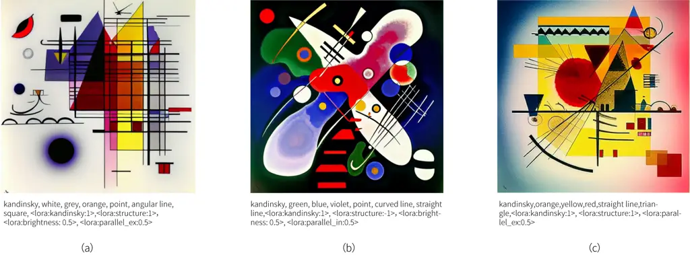
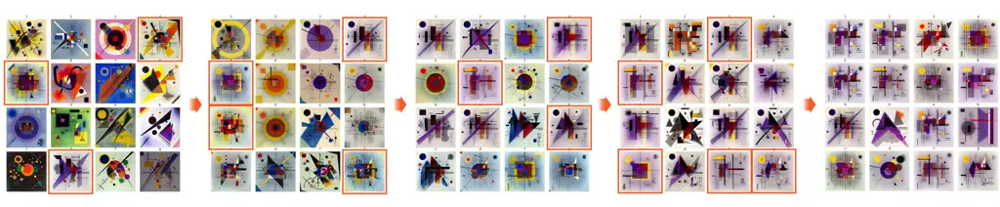
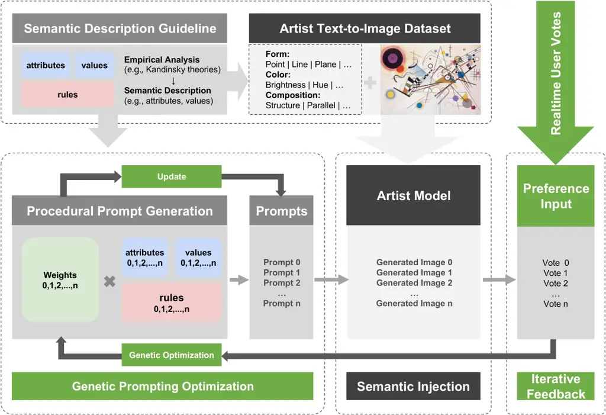
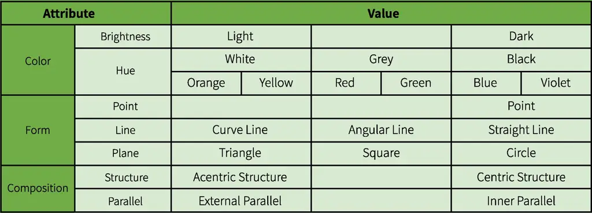
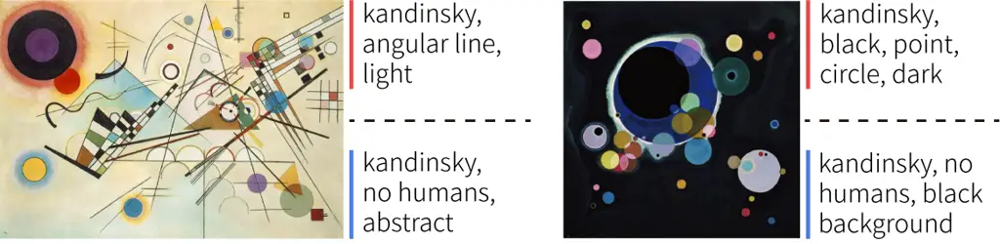
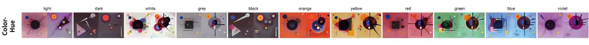
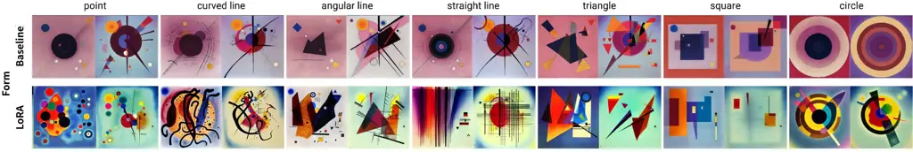
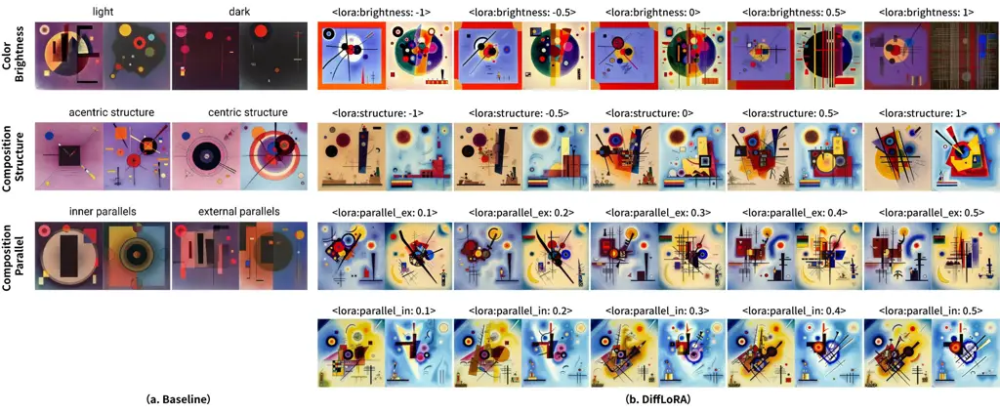
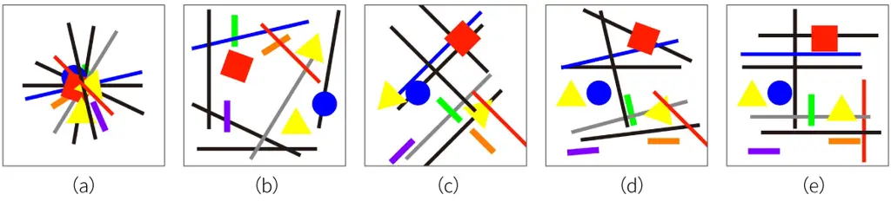
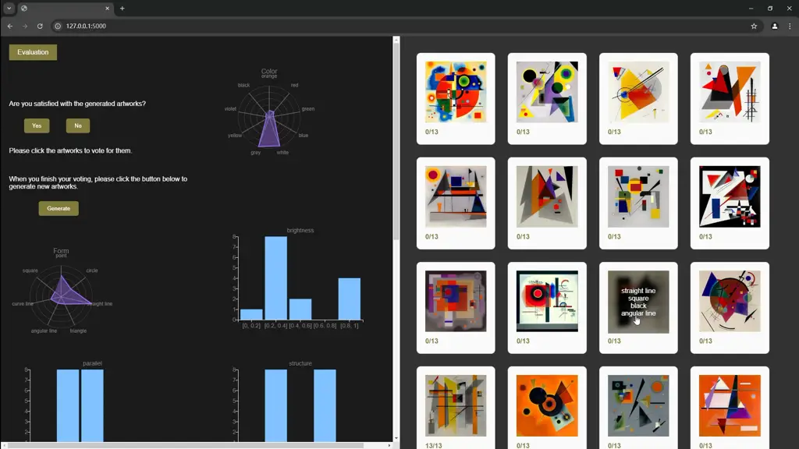

# Steering Large Text-to-Image Model for Abstract Art Synthesis: Preference-based Prompt Optimization and Visualization

Aven-Le Zhou    Wei Wu    Yu-Ao Wang    Kang Zhang Affiliation: The Hong
Kong University of Science and Technology (Guangzhou), P.R. China
E-mail <aven.le.zhou@gmail.com>

###### Abstract

With the advancement of neural generative capabilities, the art
community has increasingly embraced GenAI (Generative Artificial
Intelligence), particularly large text-to-image models, for producing
aesthetically compelling results. However, the process often lacks
determinism and requires a tedious trial-and-error process as users
often struggle to devise effective prompts to achieve their desired
outcomes. This paper introduces a prompting-free generative approach
that applies a genetic algorithm and real-time iterative human feedback
to optimize prompt generation, enabling the creation of user-preferred
abstract art through a customized “Artist Model.” The proposed two-part
approach begins with constructing an Artist Model capable of
deterministically generating abstract art in specific styles, e.g.,
Kandinsky’s Bauhaus style. The second phase integrates real-time user
feedback to optimize the prompt generation and obtains an “Optimized
Prompting Model,” which adapts to user preferences and generates prompts
automatically. When combined with the Artist Model, this approach allows
users to create abstract art tailored to their personal preferences and
artistic style.

###### Keywords: 

Steering AI Human-AI Interaction Image Synthesis Abstract Art Kandinsky.

## 1 Introduction

Generative Artificial Intelligence (GenAI) has emerged as a powerful
tool for creating diverse forms of content, including text, sounds,
images, and videos, demonstrating its transformative potential to
enhance and extend human creativity \[15, 23, 25, 29, 37\]. One of the
most promising applications are large text-to-image models \[21\].
Solutions such as DALL-E 2 \[23\] and Stable Diffusion \[25\] employ
joint image-text embedding techniques, e.g., CLIP \[22\] and diffusion
models \[30\], to generate realistic and aesthetically pleasing
contents. These models have become popular for creating digital images
\[3\] and artworks \[20, 26\].

The text-to-image art (TTI-art) community has embraced various tools,
from open-source models like Stable Diffusion to commercial platforms
like Midjourney. This diverse community includes both amateurs and
professionals, spanning novice creators and seasoned artists. As these
models grow in capability and accessibility, digital art generated
through text-to-image technology progresses rapidly and is on the brink
of becoming a mainstream artistic medium \[20\].

### 1.1 Prompting in Text-to-Image Generation

Large models demonstrate unparalleled capabilities in synthesizing
high-quality and diverse images and text \[23\]. However, these models
operate in a universal and general manner, lacking customization to
match the user-specific preferences within a given reference set \[27\].
Even with detailed descriptions, the text embedding space cannot fully
capture the desired preferences, often producing only variations that
may not align with user expectations \[22\].

Common in text-to-image generation systems is the ability for users to
create digital images and artworks by writing prompts in natural
language. This process, known as prompt engineering \[16\], prompt
programming \[24\], prompt design \[38\], or simply prompting \[20\],
enables users to generate content without requiring deep technical
knowledge of the underlying technologies. However, the interaction
between the user and AI often prioritizes the model’s requirements over
the human experience \[13\]. When creating art from the text, users
inevitably relinquish some degree of control to the AI \[5\].

This restricted human-AI interaction often disregards users’ intuition
and needs, making prompt generation in these systems feel arbitrary
\[13, 21\]. While large text-to-image models can produce aesthetically
pleasing results, their reliance on unstructured, open-ended text inputs
frequently forces users into a trial-and-error approach \[16\]. To
refine their image generation process, users must continuously iterate
on new prompts—a method described as “random and unprincipled”.
Ultimately, this chaotic and non-deterministic process makes prompting
an ongoing challenge for end users.

### 1.2 Controlling Non-determinism

Chaos, in the context of digital art—particularly in generative art such
as randomness and emergence—is not always perceived as negative \[17,
19\]. Instead, it often presents opportunities that artists actively
embrace \[18\]. Generative artists employ processes with a degree of
autonomy to create all or part of an artwork \[5\]. Computer-programmed
art, for example, intentionally incorporates chaos, such as randomness,
as a central element of its creation process \[1\]. This chaos or
non-determinism often leads to emergence, producing unexpected and
interesting results that exceed initial expectations \[19\]. Exploring
non-deterministic artworks in a controlled manner and identifying the
“sweet spot” between full control and total chaos is not new. Kovach
describes generative art as a continual search for the ideal balance
between complete control and total chaos \[12\].

When dealing with non-deterministic text-to-image models, it is
essential to consider how generative art experience can inform the
development of such AI technology and the evolving role of artists in
this process. We argue that understanding and leveraging the history of
generative art offers valuable insights into how one can better
collaborate with GenAI. To support the controlled application of
non-determinism in GenAI from an artistic perspective, we examine how
“traditional” generative art approaches, such as procedural modeling and
genetic algorithm (GA), can be adapted to large text-to-image models for
painterly content creation.

### 1.3 Steering Large Text-to-Image Model for Abstract Art Synthesis

Within the TTI-art community, Low-Rank Adaptation of Large Language
Models (LoRA) \[9\] has inspired numerous derivative applications to
customize large text-to-image models. Given the popular and powerful
nature of GenAI as a new artistic medium, insights from the art
community can provide significant value. Building on these experiences,
we adapt several techniques from the TTI-art community to customize a
large text-to-image model with a specific artist style, referred to as
the Artist Model. We term our approach “semantic injection,” a method
for encoding a describable artist’s style into the large model.

Figure 1: Artist Model (of Kandinsky Bauhaus Style) through Semantic
Injection.

To further integrate insights from generative art, such as evolutionary
generation, we propose applying a Genetic Algorithm combined with
real-time iterative human feedback to optimize prompt generation. Fig 2
shows this optimization process results in an “Optimized Prompting
Model,” which eliminates the need for manual prompt engineering but
automatically prompts with the user’s preferences.

Figure 2: Genetic Prompting Optimization with a User’s Real-time
Feedback Leads to the “Optimized Prompting Model” in Five Iterations.

By combining the Optimized Prompting Model with the Artist Model, we
offer a solution for abstract art synthesis using large text-to-image
models incorporating user preferences. The Optimized Prompting Model
operates autonomously, requiring no additional user input, and generates
abstract art tailored to the user’s preferences—completely eliminating
the need for manual prompting. Our contributions can be summarized as
follows:

1.  1.  We propose a two-part approach that allows users to automatically
        create abstract art based on their preferences, eliminating the need
        for explicit prompting. This approach combines “semantic injection,”
        which customizes the large text-to-image model, with “genetic
        prompting optimization,” which employs real-time iterative feedback
        to generate prompts automatically.
2.  2.  We construct a text-to-image dataset in the Kandinsky Bauhaus style
        and implement the proposed approach as an interactive, open-sourced
        system.

Figure 3: Genetic Prompting Optimization with Real-time Iterative
Feedback based on the “Artist Model” obtained from Semantic Injection.

This paper presents the proposed approach, its methods, implementation
experiments, and discussions. Sec 2 positions the proposed approach and
its methods within the current research landscape while Sec 3 explains
our two primary methods: semantic injection for the large text-to-image
customization and genetic prompting optimization. Sec 4, 5, and 6
provide a detailed account of the implementation process, including the
experiments involved in constructing the dataset, developing the Artist
Model, and creating the Optimized Prompting Model, as well as building
the interactive system that delivers prompting-free user experiences for
generating abstract art tailored to user preferences.

Fig 3 illustrates the process of our approach and experiments. We
establish a semantic descriptive guideline in Sec 4 and construct a
text-to-image dataset in the Kandinsky Bauhaus style. Sec 5 applies the
semantic injection method to customize the Artist Model with the
dataset, forming the foundation for deterministic image synthesis. Sec 6
implements Genetic Prompting Optimization through procedural prompt
generation based on the semantic descriptive guideline and applies
genetic optimization on the prompt generation through iterative user
feedback. Ultimately, in Sec 6.4, we design the interactive system and
interface. In Sec 7 and Sec 8, we reflect on the study’s findings,
discuss its broader implications, and address limitations and potential
directions for future research.

## 2 Related Work

### 2.1 Text-to-Image Models Personalization

Numerous studies have explored techniques for customizing large
text-to-image models to specific objects or styles. For instance,
DreamBooth personalizes text-to-image diffusion models by fine-tuning
them with a small set of images \[27\], enabling the synthesis of
photorealistic images while preserving the key features of the subject.
Similarly, \[35\] introduces a learning-based encoder that facilitates
fast and accurate customized text-to-image generation. The LoRA method
addresses the challenge of parameter efficiency by reducing the number
of trainable parameters for downstream tasks and freezing the
pre-trained model weights during adaptation \[9\]. Meanwhile, \[4\]
proposes a training-free method for guiding diffusion models, enhancing
attribute-binding and compositional capabilities. Additionally, \[34\]
presents a training-free strategy, FABRIC, which utilizes the
self-attention layer in diffusion models to optimize content
customization.

### 2.2 Human Preference and Feedback

Several studies have explored how to model human preferences and
incorporate human feedback into text-to-image generation. For example,
\[36\] addresses the challenge of aligning text-to-image models with
human preferences by employing a human preference classifier, which
adapts the model to generate more preferred images. Similarly, \[31\]
improves the quality of images produced by a diffusion generative model
using human ranking feedback. Meanwhile, \[7\] proposes a prompt
adaptation framework that enhances text-to-image models by incorporating
user input. However, this framework adapts to the model-preferred prompt
rather than generating user-preferred prompts. Finally, \[21\] presents
a human-in-the-loop approach that employs a genetic algorithm to
identify the optimal combination of prompt keywords. While similar to
our method, this approach focuses exclusively on discovering the best
prompt for large-scale models.

## 3 Method

### 3.1 Semantic Injection

Building on open-source research efforts like LoRA, the TTI-art
community has developed numerous effective variations, including
FastLoRA \[2\] and DiffLoRA \[33\]. Our work adapts and extends these
techniques to propose the concept of “semantic injection,” a method for
customizing large text-to-image models.

#### FastLoRA

The FastLoRA technique optimizes the balance between quality and
computational efficiency when fine-tuning stable diffusion models. Built
upon research efforts such as Pivotal Tuning, Dreambooth, and Textual
Inversion, the Fast LoRA technique adjusts the Transformer model’s
attention layers by adding low-rank matrices to the model’s weights to
achieve significant changes in model behavior by modifying a small
number of parameters. For the pre-trained weight matrix
$`W\in\mathbb{R}^{n\times m}`$, the adjusted weight matrix can be
represented as $`W^{\prime}=W+\Delta W=W+AB^{T}`$, where
$`A\in\mathbb{R}^{n\times d}`$ and $`B\in\mathbb{R}^{m\times d}`$, $`n`$
being the dimension of the original weight matrix and $`d`$ being the
low-rank factor, usually much smaller than $`d`$. The residual
$`\Delta W`$ is thus decomposed into smaller-size matrices $`A`$ and
$`B`$, allowing efficient model tuning instead of updating larger $`W`$.
Furthermore, this technique only fine-tunes parts of the transformer
model, specifically the self-attention heads, to reduce the final model
size.

#### DiffLoRA

The DiffLoRA technique is a multi-step operation that utilizes LoRA and
two images: the original image A and the manipulated image B. Initially,
we fine-tune the original stable diffusion model with image A using LoRA
until it over-fits, resulting in Lora A. We then combine this
over-fitting Lora A with the original model to create model A.
Subsequently, we repeat the same process using model A (not the original
model) and image B, generating the over-fitting LoRA B and model B.
Finally, the differences between model B and the original model are
captured to define the DiffLoRA, effectively encoding critical
differences between the two inputs as continuous attribute values.

By combining FastLoRA and DiffLoRA, semantic injection efficiently
encodes both discrete and continuous attribute values into large models.
This process integrates various fine-tuned LoRA models with the original
model to create a customized model capable of deterministic
text-to-image generation, referred to as the Artist Model.

### 3.2 Genetic Prompting Optimization and Visualization

The genetic algorithm (GA), an evolutionary algorithm, mimics the
natural evolutionary process through selection, crossover, and mutation
operations on individuals \[8\]. With the Artist Model, we frame prompt
generation as an optimization problem and apply GA with real-time
iterative feedback for evolutionary optimization. Specifically, we
define the generative function as $`G:C\to I`$, where $`C`$ represents
chromosomes indicating prompts, and $`I`$ denotes individuals in the
population corresponding to the generated images from the Artist Model.

In this approach, individuals represent text-to-image generations, while
chromosomes correspond to user prompts composed of genes encoding
features of artistic style. We assume that users maintain consistent
tendencies in their aesthetic preferences throughout the process and use
them to evaluate the fitness of the individuals accordingly. Following
Darwin’s theory of “Survival of the fittest” \[6\], prompts that
generate higher-fitness images are selected as survivors, leading to an
Optimized Prompting Model that aligns with user preferences.

To illustrate the dynamic evolution of prompts, we integrate multiple
visualization techniques. The generated prompts and corresponding
abstract art images are displayed side-by-side, offering users a
comprehensive view of their preferences across both text and image
domains. At each iteration, radar charts, bar charts, and stream graphs
are used to effectively visualize the iterative changes in prompts.

## 4 Dataset: Kandinsky Bauhaus Style

Kandinsky’s artistic style reached a prominent phase characterized by
geometric elements upon his return to Germany and his subsequent tenure
at the Bauhaus in 1922. This period (1922-1933) also marked the
publication of his significant work, Point and Line to Plane. In this
work and others, Kandinsky thoroughly explained his theories on color,
form, and composition. Alongside his remarkable corpus of paintings
executed under the guidance of these theories, Kandinsky Bauhaus style
presents a perfect yet challenging subject for implementing our proposed
approach.

Figure 4: Semantic Descriptive Guideline: Attribute-Value.

### 4.1 Kandinsky Bauhaus Style Semantic Descriptive Guideline

To systematically describe Kandinsky’s Bauhaus style, we collaborate
with researchers specializing in Kandinsky’s art and examine the texts
in Concerning the Spiritual in Art \[10\] and Point and Line to Plane
\[11\] to establish a semantic descriptive guideline. By summarizing the
literature and Kandinsky’s theories, we derived a list of attributes and
values encompassing Kandinsky’s style. Appendix 0.A provides a brief
introduction to Kandinsky’s theories on color, form, and composition.
Fig 4 shows our summarization of the attribute-value list, which
consists of seven attributes and twenty-two values.

### 4.2 Kandinsky Bauhaus Style Paintings

We gather 209 of Kandinsky’s paintings from his Bauhaus period and
meticulously narrowed down the selection to 65 representative artworks
through expert evaluation and curation. The selection criteria encompass
two key aspects: (1) The artworks need to be complete pieces rather than
incomplete sketches, and (2) they are required to exhibit explicit
attributes that align with the descriptions presented in Point and Line
to Plane and our semantic descriptive guideline.

Figure 5: Kandinsky Text-to-Image Dataset.

We collaborate with experts to categorize and label the selected
paintings using the attribute-value list. Fig 5 shows two examples of
text-image pairs, with the red-marked text descriptions derived from our
labeling process. The text descriptions start with the prefix
“Kandinsky” and are followed by the attribute-values. We selectively
retain attribute-value with discernible effects while omitting those
deemed ambiguous or controversial. This empirical approach ensures a
well-balanced dataset across various attributes of Kandinsky Bauhaus
features.

(a) Baseline Model Performance on Hue Attribute.

(b) FastLoRA vs. Baseline on Form-Related Attributes.

(c) DiffLoRA vs. Baseline on Brightness and Composition-Related
Attributes.

Figure 6: Comparison of Baseline and the Artist Models from Semantic
Injection.

## 5 Artist Model through Semantic Injection

Stable Diffusion is one of the most popular open-source solutions for
text-to-image generation due to its powerful features and user-friendly
interface \[25\]. However, like most large models, it is not built for
specific artists or styles, such as Kandinsky Bauhaus style. To address
this, we utilize the standard Stable Diffusion model \[28\] and employ
semantic injection for customizing the style.

To semantically inject discrete values like form-related attributes
(e.g., point, line, and plane) and hue, we employ the FastLoRA
technique. Although hue is generally considered a continuous value,
Kandinsky categorizes it into six primary colors, necessitating us to
treat it as a discrete value. For continuous attributes, such as
brightness and composition-related features, we use DiffLoRA to inject
semantic information and derive three additional LoRA models
accordingly. By combining these four LoRAs, we complete the semantic
injection of Kandinsky’s attribute-value list.

Additionally, we construct a baseline model to facilitate a comparative
evaluation of the proposed method. We initially employ an automatic
labeling extension \[32\] from the TTI-art community to annotate the
collected Kandinsky paintings. The baseline model was fine-tuned with
these automatically labeled descriptions as shown in Fig 5.
Subsequently, we apply the semantic injection method to fine-tune the
Stable Diffusion model using both the automatically labeled data and our
Kandinsky Bauhaus style dataset, resulting in two models: the baseline
and our proposed Artist Model.

### 5.1 Hue and Form-related Attributes

To evaluate the performance of our FastLoRA models, we use single-word
prompts derived from the attribute-value list and compare the generated
results with the baseline model. Fig 6(a) demonstrates the effective
performance of the baseline model on the color hue attribute, leading us
to regard the color hue attribute as inherent to the original model. Due
to space limitations, we choose to omit the similar results produced by
the fine-tuned fast LoRA model. Fig 6(b) highlights a comparative
analysis of the baseline model and our FastLoRA model on form-related
attributes, demonstrating the significantly superior performance of
FastLoRA in generating Kandinsky-specific form features.

### 5.2 Brightness and Composition-related Attributes.

To incorporate the brightness attribute, we select a Kandinsky painting
as the reference image (Image A), adjust its brightness to create a much
darker version (Image B), and then obtain the DiffLoRA for brightness.
For the structure and parallel composition attributes, modifying an
existing painting to reflect these characteristics is challenging. To
overcome this, we manually create the inputs representing these
attributes as in Fig 7. Kandinsky’s definition of inner parallel
composition as diagonal and external parallel composition as edges
deviates from conventional understanding, making it difficult for the
model to learn these attributes. To address this, we introduce Fig 7d as
an intermediate input representing parallel structures and pair it with
two extreme cases-Fig 7c and Fig 7e-representing inner and external
parallel composition, respectively. This approach results in creating
two DiffLoRA models that effectively capture the attributes. Finally,
Fig 6(c) demonstrates that our DiffLoRA model successfully synthesizes
brightness and composition-related features using single-word prompts.

Figure 7: Data Sample for Composition-related Attributes.

### 5.3 The Artist Model

We combine the fine-tuned FastLoRA and DiffLoRA models to develop the
Artist Model. To validate its generative capabilities, we collaborate
with a Kandinsky expert. Using prompts aligned with our semantic
descriptive guideline, the expert prompts the Artist Model to generate
Kandinsky Bauhaus-style abstract art. Fig 1a illustrates a prompt and
its corresponding generated image, which was based on the expert’s
vision of a painting featuring ”warm-temperature colors (e.g., orange),
light tones (e.g., white, grey), and neutral form elements (such as
points, angular lines, and squares) parallel to the edges of the canvas
in an acentric structure.” Fig 1b and Fig 1c showcase two additional
examples. For users familiar with our semantic descriptive guideline or
Kandinsky’s theories, the Artist Model allows them to generate Kandinsky
Bauhaus-style tailored to their preferences. However, this controllable
process still relies on prompting and has not yet achieved our
envisioned goal of prompt-free generation.

## 6 Genetic Prompting Optimization and Visualization

### 6.1 Procedural Prompt Generation

Using our semantic descriptive guideline for the Kandinsky Bauhaus
style, we implement a procedural prompt generation function associated
with the Artist Model. The prompting of the artist model encompasses
attribute-value pairs and the names of the DiffLoRA models. For
attributes with discrete values, such as hue and form-related
attributes, we use FastLoRA models, with these attributes collectively
represented as $`A_{M}`$, which includes multiple discrete values. When
prompting attributes with continuous values, such as brightness and
composition-related attributes, the attributes are denoted as $`A_{Q}`$.
Due to the distinct types of these attribute-values, we employ
Heterogeneous Encoding to represent the information in prompts as genes.
The chromosome is described as
$`C={\left\{Style,A_{Q},A_{M},S\right\}}`$. $`C`$ represents gene
positions for different attributes. The term $`Style`$ indicates the
consistent keyword, e.g., Kandinsky, in the prompt, while $`S`$
represents the random seed of Stable Diffusion. In this experiment, we
initialize a set of seeds at the first generation by assigning integers
within the range $`[0,2147483647)`$.

### 6.2 Genetic Optimization

This process begins by forming an initial population of $`n`$
individuals. The user votes for their preferred individuals and the
fitness function evaluates the fitness of each individual to select
survivors for the next generation. The genetic mechanism produces a new
population of individuals using the selected survivors. This iterative
process continues until the user is satisfied with the generated images,
resulting in an Optimized Prompting Model.

#### Selection

We use real-time human feedback (i.e., the current user’s votes) to
select individuals for the next generation based on their fitness value.

- •
  Fitness Function: In each iteration, the user votes for individuals
  within a population of $`n=16`$. The number of votes received by an
  individual is denoted as $`V_{i}`$, where $`i\in(1,16)`$, and
  $`V_{i}`$ is an integer in the range of $`(0,+\infty)`$. The fitness
  function is defined as $`f(i)=V_{i}`$. We assign weights to the
  discrete values of attributes $`A_{M}`$ for optimization.
- •
  Weight Updating: Initially, all possible values have weights set to 1,
  denoted as $`w_{v}=1`$, where $`v`$ represents one attribute-value in
  the prompt. In each iteration, the updated weight is computed as
  $`w_{v}^{\prime}=w_{v}+\sum^{n}_{i=0}V_{i}`$, where $`v\in C_{i}`$,
  $`C`$ is the chromosome (prompt) for individual $`i`$. Assuming a
  consistent user preference, attributes with continuous values are
  modeled using a normal distribution. User feedback is applied to
  update the mean and variance of the normal distribution, reflecting
  the dominant characteristics of the population over iterations.

#### Crossover

For crossover, we select two parents using the Roulette Wheel Selection
\[8\]. The selection probability for an individual is calculated as
$`P_{i}=\frac{F_{i}}{\sum^{n}_{j=1}F_{j}}`$, where $`n`$ represents the
population size. We use different strategies to combine genetic
information from two parents into offspring.

- •
  For $`Seed`$ gene, we employ Uniform Crossover \[14\] with a fixed
  probability of $`p=0.5`$ to determine which parent’s gene is
  inherited.
- •
  For $`A_{M}`$, a without-replacement drawing from possible values is
  performed.
- •
  For $`A_{Q}`$, the offspring’s value is generated using Average
  Crossover based on the values of both parents.

We generate only one offspring per crossover due to the following
reasons:

- •
  User Interaction: It ensures a moderate population size, preventing
  user fatigue during selection.
- •
  Methodological Suitability: Since Uniform and Average Crossover
  generate genes independently, producing a single offspring does not
  reduce their effectiveness.
- •
  Population Diversity: With a small population size (n = 16), creating
  one offspring per crossover increases diversity by allowing more
  unique parent combinations.

#### Mutation

We employ the Uniform Mutation for discrete-valued attributes
($`A_{M},Seed`$) with a mutation rate of $`p=0.05`$. Each attribute’s
value is randomly modified with a new value from its possible set. The
values of muted $`A_{M}`$ are selected without replacement. For the gene
encoded as real numbers ($`A_{Q}`$), new values are sampled from a
normal distribution based on the mean and variance of successful traits
from previous iterations. This strategy ensures that the evolutionary
history guides mutations toward promising solutions.

Figure 8: The Interface Design

### 6.3 Prompt Visualization: Iterative Attribute-Value Distribution

We integrate several visualization techniques, such as radar chart, bar
chart, and stream graph, to present the prompt iterations, enhancing
users’ understanding of their preferences in both image and text
domains. Radar charts are used to represent attributes with discrete
values, such as Hue and Plane, while bar charts depict attributes with
continuous values, showcasing the distribution of attribute values in
the current user-voted and selected prompts. Stream graphs illustrate
the progression of attribute-value distributions over multiple
iterations, providing users with a clear view of evolving preferences.
These visualizations facilitate a deep exploration of how
attribute-value aligns with individual preferences, making the iterative
process transparent, engaging, and comprehensible.

### 6.4 The Interactive System and Prompting-free Experience

Figure 9: Flowchart: the Interactive System for Prompting-free
Experience

Combining the Artist Model and genetic prompting optimization, we
implement an interactive system with a point-click interface (as in Fig 8) that enables end users to obtain their Optimized Prompting Model in
real time and generate their preferred abstract art. Fig 9 illustrates
the interaction workflow. The system initializes with a random prompts
set based on the original genes pool, and the user views the generated
artwork. Optionally, users can hover over a generated image to display
its associated prompt and examine the attribute-value distributions
through the visualization graphs displayed on the side.

If the user finds the generated artwork misaligned with their
preference, they can iteratively vote for their preferred abstract art
images by clicking on the images. The votes guide the optimization of
the prompt generation until the system produces an Optimized Prompting
Model that satisfies the user. Fig 8 demonstrates the interface design,
including the generated artworks and the visualizations of
attribute-value distributions throughout the iterative process.

During testing within the research team, convergence is typically
achieved within 3 to 5 iterations, often taking less than 5 minutes.
This user-friendly process allows users to almost effortlessly obtain an
Optimized Prompting Model reflecting their preferences, enabling
automatic generation of their desired Kandinsky Bauhaus-style abstract
art without the need for explicit prompting.

## 7 Discussion and Conclusion

#### Art Experiences as Solution

This paper addresses the challenges faced by the artist community when
working with large text-to-image models. We propose and implement an
art-centered approach that draws heavily on the collective experiences
and established techniques from the TTI-art community, as well as
classic methods from Generative Art, such as procedural modeling and
genetic algorithms. These artistic experiences empower us to exert
creative control over large text-to-image models for abstract art
synthesis. By exploring the evolution of Generative Art and its
potential impact on technology, we provide valuable insights into how
art practices can improve collaboration with large AI models.

#### Mixing Rule-driven and Preference-based Strategies

Our two-part approach begins with semantically injecting Kandinsky’s
theory into the large model and then applies a genetic algorithm to
incorporate the user’s personal preferences. This process balances
expert knowledge with user personality by combining rule-driven and
preference-based mechanisms. The interplay between these approaches
strikes a delicate balance between total control and creative
unpredictability, achieving optimal results that blend high visual
quality with an emotional connection to the user’s preferences.

#### Steering AI as New Artist Strategy

As AI models continue to grow in complexity and size, artists are
increasingly unable to train or recreate models due to resource
constraints. Additionally, the environmental costs, such as the carbon
footprint of training large models, present significant challenges to
building models from scratch. Our proposed approach exemplifies a
paradigm shift for artists working with large AI models, advocating for
“steering AI” as a new strategy that emphasizes fine-tuning, tweaking,
and building upon existing models to offer an expressive and
eco-friendly solution for art practices with AI.

## 8 Limitation and Future Work

The presented work has limitations that should be acknowledged. The
current experiments are primarily artist and expert-oriented, and focus
heavily on technical development with limited user evaluation. To
further validate the concept, we plan to conduct a comprehensive user
study involving participants with minimal knowledge of Kandinsky’s art.
This study will aim to collect and analyze users’ perceptions and
insights regarding the approach. Additionally, the proposed method
relies significantly on expert knowledge and manual literature review to
establish the semantic descriptive guideline. Future research could
focus on automating this process using natural language processing (NLP)
techniques to improve efficiency and scalability.

## References

- \[1\] Bailey, J.: Why love generative art? (Aug 2018),
  \url{https://www.artnome.com/news/2018/8/8/why-love-generative-art}
- \[2\] Cloneofsimo: Cloneofsimo/lora: Using low-rank adaptation to
  quickly fine-tune diffusion models.,
  \url{https://github.com/cloneofsimo/lora}
- \[3\] Crowson, K., Biderman, S., Kornis, D., Stander, D., Hallahan,
  E., Castricato, L., Raff, E.: Vqgan-clip: Open domain image generation
  and editing with natural language guidance. In: Avidan, S., Brostow,
  G., Cissé, M., Farinella, G.M., Hassner, T. (eds.) Computer Vision –
  ECCV 2022. p. 88–105. Springer Nature Switzerland, Cham (2022)
- \[4\] Feng, W., He, X., Fu, T.J., Jampani, V., Akula, A., Narayana,
  P., Basu, S., Wang, X.E., Wang, W.Y.: Training-free structured
  diffusion guidance for compositional text-to-image synthesis
  (arXiv:2212.05032) (Feb 2023).
  https://doi.org/10.48550/arXiv.2212.05032,
  \url{http://arxiv.org/abs/2212.05032}, arXiv:2212.05032 \[cs\]
- \[5\] Galanter, P.: Generative Art Theory, pp. 146–180. John Wiley and
  Sons, Ltd (2016),
  \url{https://onlinelibrary.wiley.com/doi/abs/10.1002/9781118475249.ch5},DOI={10.1002/9781118475249.ch5}
- \[6\] Grefenstette, J.J.: Genetic algorithms and machine learning. In:
  Proceedings of the sixth annual conference on Computational learning
  theory - COLT ’93. p. 3–4. ACM Press, Santa Cruz, California, United
  States (1993). https://doi.org/10.1145/168304.168305,
  \url{http://portal.acm.org/citation.cfm?doid=168304.168305}
- \[7\] Hao, Y., Chi, Z., Dong, L., Wei, F.: Optimizing prompts for
  text-to-image generation (arXiv:2212.09611) (Dec 2023).
  https://doi.org/10.48550/arXiv.2212.09611,
  \url{http://arxiv.org/abs/2212.09611}, arXiv:2212.09611 \[cs\]
- \[8\] Holland, J.H.: Adaptation in Natural and Artificial Systems: An
  Introductory Analysis with Applications to Biology, Control, and
  Artificial Intelligence. MIT Press (Apr 1992), google-Books-ID:
  5EgGaBkwvWcC
- \[9\] Hu, E.J., Shen, Y., Wallis, P., Allen-Zhu, Z., Li, Y., Wang, S.,
  Wang, L., Chen, W.: Lora: Low-rank adaptation of large language models
  (arXiv:2106.09685) (Oct 2021), \url{http://arxiv.org/abs/2106.09685},
  arXiv:2106.09685 \[cs\]
- \[10\] Kandinsky, W.: Concerning the Spiritual in Art. Dover
  Publications, Inc (1977)
- \[11\] Kandinsky, W.: Point and Line to Plane. Courier
  Corporation (1979)
- \[12\] Kovach, B.: A box of chaos: The generative artist’s toolkit
  (Oct 2018), \url{https://www.youtube.com/watch?v=kZNTozzsNqk}
- \[13\] Kumari, N., Zhang, B., Zhang, R., Shechtman, E., Zhu, J.Y.:
  Multi-concept customization of text-to-image diffusion. pp. 1931–1941
  (2023),
  \url{https://openaccess.thecvf.com/content/CVPR2023/html/Kumari_Multi-Concept_Customization_of_Text-to-Image_Diffusion_CVPR_2023_paper.html}
- \[14\] Lim, S.M., Sultan, A.B.M., Sulaiman, M.N., Mustapha, A., Leong,
  K.Y.: Crossover and mutation operators of genetic algorithms.
  International Journal of Machine Learning and Computing 7(1), 9–12
  (Feb 2017). https://doi.org/10.18178/ijmlc.2017.7.1.611
- \[15\] Lin, Z., Ehsan, U., Agarwal, R., Dani, S., Vashishth, V.,
  Riedl, M.: Beyond prompts: Exploring the design space of
  mixed-initiative co-creativity systems (arXiv:2305.07465) (May 2023),
  \url{http://arxiv.org/abs/2305.07465}, arXiv:2305.07465 \[cs\]
- \[16\] Liu, V., Chilton, L.B.: Design guidelines for prompt
  engineering text-to-image generative models. In: Proceedings of the
  2022 CHI Conference on Human Factors in Computing Systems. pp. 1–23.
  CHI ’22, Association for Computing Machinery, New York, NY, USA (Apr
  2022). https://doi.org/10.1145/3491102.3501825,
  \url{https://dl.acm.org/doi/10.1145/3491102.3501825}
- \[17\] McCormack, J.: Art, emergence, and the computational sublime
- \[18\] McCormack, J., Bown, O., Dorin, A., McCabe, J., Monro, G.,
  Whitelaw, M.: Ten questions concerning generative computer art.
  Leonardo 47(2), 135–141 (Apr 2014).
  https://doi.org/10.1162/LEON_a_00533
- \[19\] Monro, G.: Emergence and generative art. Leonardo 42(5),
  476–477 (Oct 2009). https://doi.org/10.1162/leon.2009.42.5.476
- \[20\] Oppenlaender, J.: The creativity of text-to-image generation.
  In: Proceedings of the 25th International Academic Mindtrek
  Conference. p. 192–202. Academic Mindtrek ’22, Association for
  Computing Machinery, New York, NY, USA (Nov 2022).
  https://doi.org/10.1145/3569219.3569352,
  \url{https://dl.acm.org/doi/10.1145/3569219.3569352}
- \[21\] Pavlichenko, N., Ustalov, D.: Best prompts for text-to-image
  models and how to find them. In: Proceedings of the 46th International
  ACM SIGIR Conference on Research and Development in Information
  Retrieval. p. 2067–2071. SIGIR ’23, Association for Computing
  Machinery, New York, NY, USA (Jul 2023).
  https://doi.org/10.1145/3539618.3592000,
  \url{https://dl.acm.org/doi/10.1145/3539618.3592000}
- \[22\] Radford, A., Kim, J.W., Hallacy, C., Ramesh, A., Goh, G.,
  Agarwal, S., Sastry, G., Askell, A., Mishkin, P., Clark, J., Krueger,
  G., Sutskever, I.: Learning transferable visual models from natural
  language supervision. In: Proceedings of the 38th International
  Conference on Machine Learning. p. 8748–8763. PMLR (Jul 2021),
  \url{https://proceedings.mlr.press/v139/radford21a.html}
- \[23\] Ramesh, A., Dhariwal, P., Nichol, A., Chu, C., Chen, M.:
  Hierarchical text-conditional image generation with clip latents
  (arXiv:2204.06125) (Apr 2022).
  https://doi.org/10.48550/arXiv.2204.06125,
  \url{http://arxiv.org/abs/2204.06125}, arXiv:2204.06125 \[cs\]
- \[24\] Reynolds, L., McDonell, K.: Prompt programming for large
  language models: Beyond the few-shot paradigm. In: Extended Abstracts
  of the 2021 CHI Conference on Human Factors in Computing Systems.
  pp. 1–7. CHI EA ’21, Association for Computing Machinery, New York,
  NY, USA (May 2021). https://doi.org/10.1145/3411763.3451760,
  \url{https://dl.acm.org/doi/10.1145/3411763.3451760}
- \[25\] Rombach, R., Blattmann, A., Lorenz, D., Esser, P., Ommer, B.:
  High-resolution image synthesis with latent diffusion models. p.
  10684–10695 (2022),
  \url{https://openaccess.thecvf.com/content/CVPR2022/html/Rombach_High-Resolution_Image_Synthesis_With_Latent_Diffusion_Models_CVPR_2022_paper.html}
- \[26\] Rombach, R., Blattmann, A., Ommer, B.: Text-guided synthesis of
  artistic images with retrieval-augmented diffusion models
  (arXiv:2207.13038) (Jul 2022).
  https://doi.org/10.48550/arXiv.2207.13038,
  \url{http://arxiv.org/abs/2207.13038}, arXiv:2207.13038 \[cs\]
- \[27\] Ruiz, N., Li, Y., Jampani, V., Pritch, Y., Rubinstein, M.,
  Aberman, K.: Dreambooth: Fine tuning text-to-image diffusion models
  for subject-driven generation (arXiv:2208.12242) (Mar 2023).
  https://doi.org/10.48550/arXiv.2208.12242,
  \url{http://arxiv.org/abs/2208.12242}, arXiv:2208.12242 \[cs\]
- \[28\] Runwayml: Runwayml/stable-diffusion-v1-5 · hugging face,
  \url{https://huggingface.co/runwayml/stable-diffusion-v1-5}
- \[29\] Saharia, C., Chan, W., Saxena, S., Li, L., Whang, J., Denton,
  E.L., Ghasemipour, K., Gontijo Lopes, R., Karagol Ayan, B., Salimans,
  T., Ho, J., Fleet, D.J., Norouzi, M.: Photorealistic text-to-image
  diffusion models with deep language understanding. In: Koyejo, S.,
  Mohamed, S., Agarwal, A., Belgrave, D., Cho, K., Oh, A. (eds.)
  Advances in Neural Information Processing Systems. vol. 35, p.
  36479–36494. Curran Associates, Inc. (2022),
  \url{https://proceedings.neurips.cc/paper_files/paper/2022/file/ec795aeadae0b7d230fa35cbaf04c041-Paper-Conference.pdf}
- \[30\] Sohl-Dickstein, J., Weiss, E., Maheswaranathan, N., Ganguli,
  S.: Deep unsupervised learning using nonequilibrium thermodynamics.
  In: Proceedings of the 32nd International Conference on Machine
  Learning. p. 2256–2265. PMLR (Jun 2015),
  \url{https://proceedings.mlr.press/v37/sohl-dickstein15.html}
- \[31\] Tang, Z., Rybin, D., Chang, T.H.: Zeroth-order optimization
  meets human feedback: Provable learning via ranking oracles
  (arXiv:2303.03751) (Mar 2023).
  https://doi.org/10.48550/arXiv.2303.03751,
  \url{http://arxiv.org/abs/2303.03751}, arXiv:2303.03751 \[cs\]
- \[32\] Toriato: Toriato/stable-diffusion-webui-wd14-tagger: Labeling
  extension for automatic1111’s web ui,
  \url{https://github.com/toriato/stable-diffusion-webui-wd14-tagger}
- \[33\] Tsukisuwa, N.: Difflora (Aug 2023),
  \url{https://pixai.art/model}
- \[34\] Von Rütte, D., Fedele, E., Thomm, J., Wolf, L.: Fabric:
  Personalizing diffusion models with iterative feedback
  (arXiv:2307.10159) (Jul 2023), \url{http://arxiv.org/abs/2307.10159},
  arXiv:2307.10159 \[cs\]
- \[35\] Wei, Y., Zhang, Y., Ji, Z., Bai, J., Zhang, L., Zuo, W.: Elite:
  Encoding visual concepts into textual embeddings for customized
  text-to-image generation (arXiv:2302.13848) (Aug 2023).
  https://doi.org/10.48550/arXiv.2302.13848,
  \url{http://arxiv.org/abs/2302.13848}, arXiv:2302.13848 \[cs\]
- \[36\] Wu, X., Sun, K., Zhu, F., Zhao, R., Li, H.: Human preference
  score: Better aligning text-to-image models with human preference
  (arXiv:2303.14420) (Aug 2023).
  https://doi.org/10.48550/arXiv.2303.14420,
  \url{http://arxiv.org/abs/2303.14420}, arXiv:2303.14420 \[cs\]
- \[37\] Yu, J., Xu, Y., Koh, J.Y., Luong, T., Baid, G., Wang, Z.,
  Vasudevan, V., Ku, A., Yang, Y., Ayan, B.K., Hutchinson, B., Han, W.,
  Parekh, Z., Li, X., Zhang, H., Baldridge, J., Wu, Y.: Scaling
  autoregressive models for content-rich text-to-image generation.
  Transactions on Machine Learning Research (2022),
  \url{https://openreview.net/forum?id=AFDcYJKhND}, featured
  Certification
- \[38\] Zhang, N., Li, L., Chen, X., Deng, S., Bi, Z., Tan, C., Huang,
  F., Chen, H.: Differentiable prompt makes pre-trained language models
  better few-shot learners (arXiv:2108.13161) (May 2022),
  \url{http://arxiv.org/abs/2108.13161},DOI={10.48550/arXiv.2108.13161},
  arXiv:2108.13161 \[cs\]

## Appendix 0.A Color, Form and Composition Theory

#### Color

Kandinsky’s color theory consists of three primary colors (i.e., Red,
Yellow, and Blue) and three primary tones (i.e., Black, White, and
Grey). The intersection of these primary colors produces Orange, Green,
and Violet. He categorizes these six colors into warm and cold
temperature, with red, yellow, and orange considered warm, and green,
blue, and purple considered cold. He defines the tone of a painting as
light and dark; determined by the proportion of black and white in a
composition. Each color represents a unique spiritual emotion and has an
influence on others.\[10, pp.39-43\]

#### Form

Kandinsky presents a unique theory of tension that describes an element
based on its shape, position and orientation. He begins with the concept
of the Point and derives two primary forms: Line and Plane \[11,
pp.23-54\]. Lines are influenced by different types of tension and can
take the form of Straight Lines, Curve Lines, or Angular Lines \[11,
pp.55-112\]. Similarly, planes are influenced by tension and can
manifest as Triangles, Squares, or Circles \[11, p.74\]. These seven
elements constitute the primary forms in Kandinsky’s paintings.

#### Composition

Kandinsky claims interrelationships of all elements influence the
composition. The composition involves the positioning of individual
elements, the connections between them, and the arrangement of element
clusters. Our study aims to extract easy-to-use compositions to guide
the model generation and simplify Kandinsky’s complex definitions into
two compositional relationships: Acentric and Centric Structure \[11,
pp.137-139\]. These relationships describe the tension of elements
relative to the center. In contrast, the tension of elements in relation
to the composition’s boundaries manifests as Inner and External
Parallel, which is parallel to diagonal and edge of the painting
respectively \[11, pp.130-131\].
