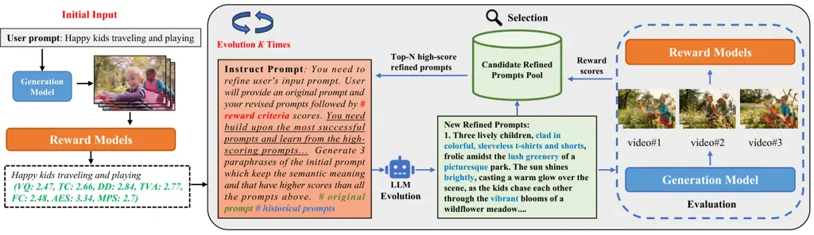
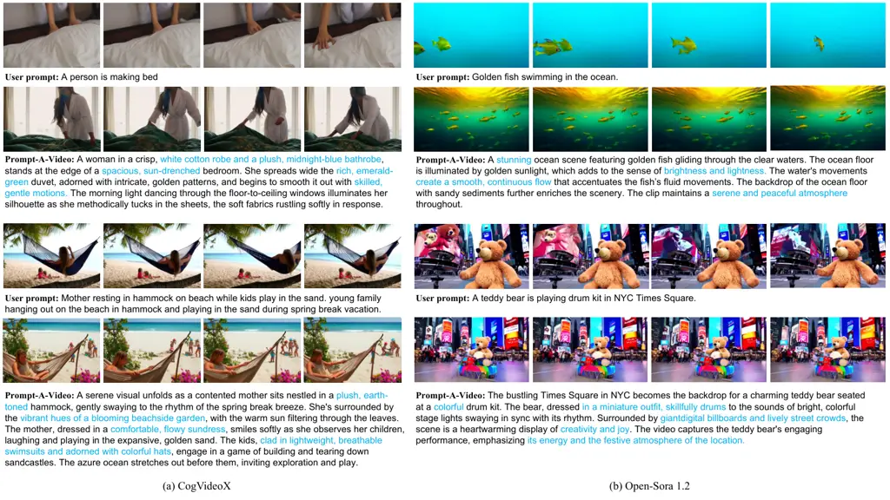
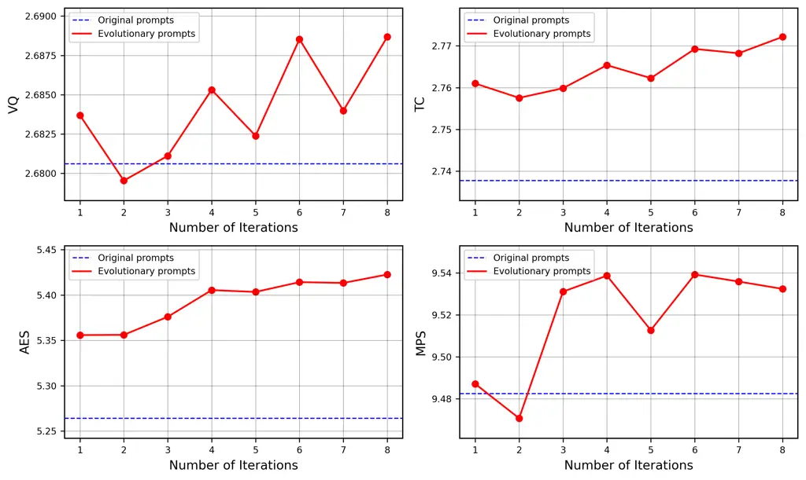
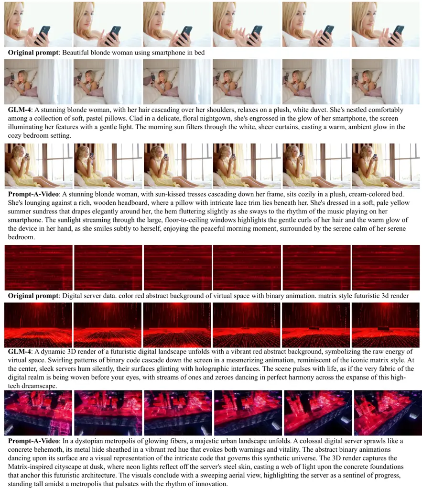

# Prompt-A-Video: Prompt Your Video Diffusion Model via Preference-Aligned LLM

Yatai Ji$`{}^{\textnormal{1}}`$¹¹ 1 Co-first authors.  Jiacheng
Zhang$`{}^{\textnormal{1}}`$¹¹ 1 Co-first authors.  Jie
Wu$`{}^{\textnormal{2}}`$²² 2 Project lead.  Shilong
Zhang$`{}^{\textnormal{1}}`$  Shoufa Chen$`{}^{\textnormal{1}}`$
 Chongjian Ge$`{}^{\textnormal{1}}`$  
Peize Sun$`{}^{\textnormal{1}}`$  Weifeng Chen$`{}^{\textnormal{2}}`$
 Wenqi Shao$`{}^{\textnormal{3}}`$  Xuefeng Xiao$`{}^{\textnormal{2}}`$
 Weilin Huang$`{}^{\textnormal{2}}`$  Ping Luo$`{}^{\textnormal{1}}`$³³
3 Corresponding Author. and $`{}^{\textnormal{1}}`$The University of
Hong Kong   $`{}^{\textnormal{2}}`$ByteDance
  $`{}^{\textnormal{3}}`$Shanghai AI Lab

###### Abstract

Text-to-video models have made remarkable advancements through
optimization on high-quality text-video pairs, where the textual prompts
play a pivotal role in determining quality of output videos. However,
achieving the desired output often entails multiple revisions and
iterative inference to refine user-provided prompts. Current automatic
methods for refining prompts encounter challenges such as
Modality-Inconsistency, Cost-Discrepancy, and Model-Unaware when applied
to text-to-video diffusion models. To address these problem, we
introduce an LLM-based prompt adaptation framework, termed as
Prompt-A-Video, which excels in crafting Video-Centric, Labor-Free and
Preference-Aligned prompts tailored to specific video diffusion model.
Our approach involves a meticulously crafted two-stage optimization and
alignment system. Initially, we conduct a reward-guided prompt evolution
pipeline to automatically create optimal prompts pool and leverage them
for supervised fine-tuning (SFT) of the LLM. Then multi-dimensional
rewards are employed to generate pairwise data for the SFT model,
followed by the direct preference optimization (DPO) algorithm to
further facilitate preference alignment. Through extensive
experimentation and comparative analyses, we validate the effectiveness
of Prompt-A-Video across diverse generation models, highlighting its
potential to push the boundaries of video generation.

![[Uncaptioned
image]](arxiv-2412-15156v1--eaa2dc87c45c.figures/figure-1.webp)

Figure 1: Illustration of the discrepancies between current prompt
adaption frameworks and our proposed LLM-driven video prompt
optimization system, namely Prompt-A-Video. Current prompt adaption
frameworks predominantly focus on prompt systems tailored for images,
collecting intrinsic modifier templates, or rely on the in-context
capabilities of LLM. However, in the realm of text-to-video, these
methods encounter challenges stemming from Modality-Inconsistency,
Cost-Discrepancy, and Model-Unaware. In this paper, we introduce
Prompt-A-Video, a two-stage optimization and alignment system based on
AI feedback, which aims to provide Video-Centric, Labor-Free and
Preference-Aligned prompts.

## 1 Introduction

Text-to-Video generation \[19, 7, 48, 10, 40, 18\] has witnessed
remarkable progress in recent years, prominently driven by large-scale
high-quality text-video pairs. In text-to-video generation frameworks,
text serves as the exclusive conditioning signal, playing a decisive
role in determining the output videos’ content and quality. However,
empirical evidence highlights that standard user inputs often fail to
prompt the creation of aesthetically appealing videos. This deficiency
stems from the fact that contemporary high-fidelity video generation
models, such as Open-Sora \[55\] and CogVideoX \[50\], predominantly
utilize intricate descriptions generated by large visual language models
(LVLM) \[21, 25, 2, 49, 39, 20, 11\] as training prompts, far exceeding
the quality of human-written inputs. These detailed prompts possess
enhanced expressiveness and complexity, thus we need to recalibrate the
input prompts to align with the model’s preference for optimal
performance.

Previous researches have extensively explored prompt engineering for
improving visual generation, encompassing various approaches: utilizing
high-quality modifier templates \[26, 30\] from experts and open-source
communities, developing text-to-image prompt optimization systems \[16,
29, 52\], learning to append modifiers related to technical
specifications and artistic styles, and leveraging GPT’s in-context
learning ability to expand user prompts \[50, 55\]. However, direct
application of these methodologies to text-to-video generation reveals
significant limitations:

- •
  Modality-Inconsistency Image prompts predominantly accentuate static
  attributes like composition and color, inadequately addressing the
  dynamic requisites of video creation, like motion fluency, narrative
  coherence, and scene transitions. Moreover, in contrast to image
  prompt enhancement techniques that rely on appending quality
  modifiers, text-to-video models are less responsive to overall quality
  descriptors.
- •
  Cost-Discrepancy. There are several established platforms offering
  high-quality prompts for text-to-image generation, but video models
  lag behind image counterparts in maturity. To obtain the optimal
  prompt for specific text-to-video model, it requires extensive domain
  expertise and and community’s exploration.
- •
  Model-Unaware. Recent attempts in video prompt engineering expand and
  enrich user prompts based on in-context learning ability of GPT.
  However, the refined prompts do not adequately consider video quality
  and lack alignment with specific video generation models.

Consequently, a pertinent query emerges: How can we devise a model-aware
system to facilitate generating video-centric, labor-free, and
preference-aligned prompts?

In this paper, we introduce Prompt-A-Video, an LLM-driven automatic
prompt adaptation framework meticulously crafted for enhancing
text-to-video models. As shown in Figure 1, this framework unfolds in
two distinct stages, each characterized by individual data preparation
and model optimization pipelines. We first establish a comprehensive,
multi-dimensional reward system tailored to assess the quality of
generation results from diverse prompts while ensuring fidelity to the
original user intentions. In the initial phase, to avoid labor-intensive
manual engineering, we design a prompt refinement pipeline, inspired by
evolutionary algorithms \[14, 53, 37\], which iteratively produce
model-preferred prompts. The pipeline, namely reward-guided prompt
evolution, uses LLM as evolutionary operator to synthesize and refine
historical prompts, with selection guided by reward models. This
evolutionary pipeline serves dual purposes: it not only optimizes video
generation quality through iterative prompt refinement, but also creates
training data pairs of original and refined prompts. Leveraging this
curated dataset, we fine-tune the LLM, endowing it with foundational
capabilities for prompt enhancement. The subsequent phase involves
employing the reward model to rank candidates generated by the
Supervised Fine-Tuning (SFT) model. Employing Direct Preference
Optimization (DPO) \[32\], we augment the alignment of generated prompts
with the inherent preference of the video generation model.¹¹ 1 Our
codes are available at
[https://github.com/jiyt17/Prompt-A-Video](https://github.com/jiyt17/Prompt-A-Video).

The contributions of this work can be summarized as:

- •
  New Insights: To the best of our knowledge, we offer the first attempt
  to design a video-centric prompt optimization system. Prompt-A-Video
  liberates the text-to-video model from the constraint of meticulously
  crafted user inputs, paving a new way to enhancing video generation
  quality.
- •
  Automatic Data Pipeline: Leveraging multi-dimensional rewards and
  reward-guided prompt evolution pipeline, we achieve labor-free
  generation of model-specific, high-quality prompt datasets for diverse
  text-to-video models.
- •
  Optimization and Alignment: The integration of Supervised Fine-Tuning
  (SFT) optimization techniques and Direct Preference Optimization (DPO)
  alignment strategies reinforces Prompt-A-Video’s efficacy in prompt
  enhancement for specific generation model, deriving a
  preference-aligned LLM.
- •
  Excellent performance and generalization: Extensive evaluations
  reveals that Prompt-A-Video’s superiority on enhancing video results
  across various evaluation metrics. Concurrently, significant
  improvements are achieved when applying Prompt-A-Video to
  text-to-image scenarios, underscoring its robustness and
  generalizability.

## 2 Related Works

### 2.1 Diffusion-based Video Generation

Diffusion models have exhibited remarkable performance in generating
high - quality videos. Early efforts  \[15, 57, 43, 41, 6, 45, 36, 22\]
typically expand the pre-trained image diffusion model  \[33\] into the
video diffusion model by integrating temporal layers (e.g., temporal
convolution or temporal attention). For instance, Animatediff  \[15\]
dissociates video generation into content and motion generation and
appends an additional motion module to the base image generation model
to accomplish video clip generation. Subsequently, large video
pre-trained diffusion models  \[8, 9, 5, 4\], with VideoCrafter  \[8\]
as a representative work, display impressive video quality thanks to the
large-scale video pre-training dataset. However, these methods encounter
limitations in generating long videos due to the inherent restrictions
on capacity and scalability within the UNet design. Pioneered by seminal
works such as Sora  \[7\], a succession of DiT - based video diffusion
models  \[48, 55, 3, 19, 50\] has emerged steadily. Leveraging the
large-scale training and the scalability of the DiT architecture, these
models are capable of generating longer videos of up to one minute.
Despite these progresses, the current text-to-video (T2V) generation
remains sensitive to the input prompt, thereby posing a challenge for
users to input an appropriate one. In this study, our objective is to
develop an effective prompt enhancement system for video generation,
which can substantially alleviate user attempt cost.

### 2.2 Image Prompt Refinement

Prompt adaptation system is aimed at improving the generation quality
(such as visual quality, aesthetic allure, text - image alignment, etc.)
of prompt-based generative models  \[1, 13, 38, 35, 33\] without
altering the user’s original intention by refining the input prompt. A
plethora of works  \[24, 34, 27\] have been proposed to explore prompt
boost techniques in the domain of LLM, inspiring research into such
techniques in the field of text-to-image generation  \[56, 16, 47, 29,
52, 28, 42\]. Among these works, Promptist  \[16\] utilizes
reinforcement learning (i.e., PPO) to refine the user’s initial prompt
based on the aesthetic and text-image alignment rewards of the generated
image, making it more suitable for the diffusion model. Mo et al. \[29\]
propose the prompt auto-edit method (PAE) to enhance the initial user
prompt. This method consists of a fine-tuned and reinforcement learning
stage to dynamically fine-control the weights and injection time steps
of each word within a prompt. Zhan et al. \[52\] develop prompt
refinement with an image pivot. It views the image as a bridge and
converts the data-scarce prompt refinement into a data-rich process,
ultimately resulting in a superior prompt refinement model trained with
abundant data. More recently,  \[28\] focused on text-image consistency
and designed a tuning-free prompt optimization system by leveraging the
LLM to iteratively generate revised prompts that maximize the
consistency score. Despite the efficacy of these methods, they seldom
explore prompt refinement for video generation. In this paper, we
propose a prompt adaptation system customized for text-to-video
generation.

## 3 Method

In this section, we present Prompt-A-Video, an automatic LLM-based
prompt adaptation framework designed for video generation. Our primary
objective is to improve the quality of generated videos by leveraging a
Large Language Model (LLM) that transforms concise user inputs into
rich, detailed prompts tailored for specific generation models. We first
introduce our multi-dimensional reward system in Section 3.1, which
provides a comprehensive video-centric evaluation tool for subsequent
methods. To address the challenge of limited high-quality video prompt
datasets, Section 3.2 outlines our reward-guided prompt evolution
pipeline, serving as a labor-free data engine to produce model-preferred
prompts automatically. Section 3.3 details our two-stage optimization
approach: first fine-tuning the LLM with these curated data pairs,
followed by Direct Preference Optimization (DPO) to align with
preference of generation models.



Figure 2: The Pipeline of Reward-guided Prompt Evolution, which employs
iterative reward-feedback loops to obtain superior prompts through three
processes: evaluation, selection, and evolution. This evolutionary
pipeline serves dual purposes: it not only optimizes video generation
quality through iterative prompt refinement, but also creates training
data pairs of original and refined prompts.

### 3.1 Multi-dimensional Reward System

To thoroughly assess the efficacy of our optimized prompts, we employ a
range of specialized reward models to evaluate the generated videos. Our
reward system is meticulously designed from two perspectives:
image-level and video-level.

Initially, we adopt image-level rewards to measure the quality of video
frames. To quantify aesthetic attributes of the images, we utilize
Aesthetic Predictor¹¹ 1 https://github.com/LAION-AI/aesthetic-predictor
built upon a CLIP \[31\] encoder, like in the previous text-to-image
prompt boost methods. Additionally, we incorporate the Multi-dimensional
Human Preference Score (MPS) \[54\], a competitive text-to-image reward
model, to assess the overall preference for the images.

For video-level evaluation, we adopt VideoScore \[17\], a comprehensive
Large Vision Language Model that evaluates generated videos across five
critical dimensions: visual quality (VQ), temporal consistency (TC),
dynamic degree (DD), text-to-video alignment (TVA), and factual
consistency (FC). VQ appraises videos’ quality in terms of clearness,
resolution, brightness, and color. TC, a distinctive feature of videos
compared to static images, measures the consistency of objects or humans
across frames, crucial for maintaining a coherent video. DD quantifies
the degree of dynamic changes within the video. TVA ensures the semantic
alignment between the video content and the original input prompt,
preserving the user’s intention. FC assesses the video’s adherence to
common-sense and factual knowledge, verifying the absence of artifacts.
The video-level rewards facilitate identifying prompts that are
conducive to high-quality video generation.

### 3.2 Reward-guided Prompt Evolution

Previous prompt boost methods for image generation always collect
descriptions with suffix modifiers as fine-tuning data, like
Lexica.art¹¹ 1 https://lexica.art/. They always only append modifier
words to enhance the art style or emphasize the image quality. However,
due to the modality-inconsistency, text-to-video models are less
responsive to general quality descriptions and require more expressive
and detailed prompts. Therefore, we develop an automatic pipeline to
refine preference-aligned prompts for the specific generation model,
drawing inspiration from evolutionary algorithms (EAs) known for their
performance and fast convergence.

Evolutionary algorithms typically follow these steps: an initial
population of solutions is evaluated to determine fitness scores. Based
on these scores, individuals are selected for operations such as
crossover and mutation to create new solutions. These new solutions are
also scored, and those with higher fitness in the entire population are
selected for the next iteration. The process repeats until a
predetermined score or maximum number of cycles is reached.

As illustrated in Figure 2, based on the idea of EAs, we propose
reward-guided prompt evolution pipeline, which uses GPT-4o \[1\] as the
evolutionary operator to generate model-preferred prompts. Past
researches \[14, 23\] showed that LLMs have the ability to mimic
operations in EAs. In our data construction pipeline, the initial
population is the original user prompt. We define prompts’ fitness
scores that evaluate the video generated by the prompt with our
multi-dimensional reward system. Specifically, the algorithm initializes
with the input prompt and proceeds as follows.

- •
  Evaluation: For the input prompt or newly generated prompts, we first
  create the corresponding videos. Then we score them with our
  multi-dimensional reward system, which has seven metrics in total.
  Finally, we append the scores behind the corresponding prompts,
  rendering candidates for evolution.
- •
  Selection: In the second and subsequent iterations, we select the most
  effective prompts based on their scores. By merging new prompts with
  the existing population, we consider all metrics comprehensively to
  select top N prompts.
- •
  Evolution: We input the initial and selected prompts into GPT-4o to
  produce refined prompts. We design instructions for GPT-4o to
  incorporate historical experiences and combine different input prompts
  according to their scores. Moreover, we provide high-quality video
  descriptions as examples. To improve the efficiency of optimal prompt
  searching, GPT-4o outputs three refined prompts at once. Then we
  return to step 1. The specific GPT-4o instructions are detailed in the
  Appendix A.

We set a maximum number of iterations. As the process continues, the
overall scores of selected refined prompts improve. At the end of the
iterations, we select a target refined prompt whose scores in each
dimension exceed a predefined threshold and have the highest overall
score among all prompts. This allows us to construct data pairs of
original and target prompts, with the target prompt favored by the
specific generation model.

### 3.3 Two-stage Optimization

To achieve automatic prompts refinement, we develop a prompt optimizer
built upon LLama3-Instruct \[12\] as the foundation model, employing a
two-stage training strategy. As shown in the lower part of Figure 1, we
first leverage supervised fine-tuning (SFT) to adapt the LLM for
video-centric prompt enhancement, then use Direct Preference
Optimization (DPO) to align the prompts with generative videos’
preferences.

The curated SFT dataset comprises paired prompts $`\{(x,y)\}`$, where
$`x`$ represents the source prompt and $`y`$ denotes the corresponding
target prompt derived from evolutionary data engine. To preserve the
LLM’s basic language capabilities while adapting it for prompt
refinement, we finetune the model with LoRA-based approach.
Specifically, we design task instruction $`s`$ and train with language
modeling objective as follows:

```math
\displaystyle\mathcal{L}_{\text{SFT}}=-\mathbb{E}_{(x,y)}\operatorname{log}p(y|s,x). \tag{1}
```

In this way, the LLM has the instruction following ability for prompt
refinement.

Following the supervised fine-tuning phase, we employ DPO, a more stable
alternative to proximal policy optimization (PPO), to further enhance
the LLM. DPO focuses on fine-tuning models by directly optimizing for
user preferences. It enhances model performance by adjusting outputs to
align with preferred outcomes, based on feedback or reward signals.

When constructing DPO data, for each input prompt, we utilize the SFT
model to generate five distinct refined versions, which are used to
produce videos. Then these generated videos undergo comprehensive
evaluation using our reward models, including Videoscore, Aesthetic
Predictor and MPS. The evaluation metrics are summed after being
normalized to the same scale. Finally, we identify the best and worst
prompts based on their corresponding video scores, creating
{$`prompt,chosen,rejected`$} triplets for training. This curated dataset
then serves for optimizing the SFT model with the DPO objective
function:

```math
\footnotesize\begin{split}&\mathcal{L}_{\text{DPO}}(\pi_{\theta};\pi_{ref})=\\
&-\mathbb{E}_{(x,y_{w},y_{l})\sim\mathcal{D}}\left[\log\sigma\left(\beta\log\frac{\pi_{\theta}(y_{w}\mid x)}{\pi_{ref}(y_{w}\mid x)}-\beta\log\frac{\pi_{\theta}(y_{l}\mid x)}{\pi_{ref}(y_{l}\mid x)}\right)\right],\end{split} \tag{2}
```

where $`x`$ donates the original prompt, and $`y_{w}`$, $`y_{l}`$ serve
as the chosen and rejected prompts, respectively. To ensure continuous
improvement, we execute multiple iterations of the DPO process,
generating new triplet data based on the model trained with DPO from
last iteration.

## 4 Experiments

### 4.1 Experimental Setup

Data Collection. In the two-stage training process, the WebVid dataset
serves as the source of video prompts. Our reward-guided prompt
evolution pipeline undergoes 4 iterative cycles, with 3 new prompts
being generated per iteration and top 3 prompts being selected for next
iteration. For each generation model, approximately 3,000 prompt pairs
are collected. During the DPO phase, approximately 2,000 prompt triples
are used for preference optimization. Based on our exploratory
experiments, we conduct two iterations of DPO, as additional DPO
iterations does not yield further improvements.

For our experimental evaluation, in accordance with previous research,
we evaluate the effectiveness of prompt enhancement across both in -
domain and out-of-domain test sets. For the in-domain evaluation, 130
prompts are randomly sampled from the WebVid dataset, and the VideoScore
metric is utilized to measure the results. The out-of-domain evaluation
makes use of the public benchmark VBench. Given that VBench encompasses
a large number of prompts, many of which share the same main content but
differ in style, we meticulously curate a representative subset of
prompts. Prompts are selected from four dimensions of VBench: human
action, overall consistency, appearance style, and subject consistency.
Priority is given to prompts containing dynamic actions rather than
static descriptions, resulting in a challenging test set of 100 prompts.
VBench provides a comprehensive evaluation across six dimensions for the
generated videos: subject consistency, background consistency, aesthetic
quality, imaging quality, motion smoothness, and dynamic degree.

Implementation Details. To verify the effectiveness of our
Prompt-A-Video, extensive experiments are conducted across a variety of
visual generation models. For the video generation task, several
representative text-to-video models based on the Diffusion Transformer
architecture are employed, such as Open-Sora 1.2 \[55\] and
CogVideoX \[50\]. Diverse video generation configurations are
implemented to showcase the versatility of our approach. Specifically,
Open-Sora 1.2 is utilized to generate 2-second videos with a resolution
of $`720\times 1080`$, while CogVideoX is employed for generating
4-second videos at $`480\times 720`$ resolution. The detailed training
settings for the two-stage optimization are shown in Appendix B.

Comparison Baselines. In text-to-video generation, our refined prompts
are compared against three types of prompts: (i) original prompts from
the test set, (ii) prompts directly generated by a text-to-image prompt
boost model \[16\], and (iii) prompts refined by state-of-the-art large
language models, such as GPT-4o \[1\] (used by Open-Sora) and
GLM-4 \[51\] (employed by CogVideoX).

### 4.2 Evaluation on Text-to-video

Model WebVid (In-Domain) VBench (Out-of-Domain) VQ TC DD TVA FC Avg SC
BC AQ IQ MS DD Open-Sora 1.2 Original prompts 3.079 3.084 3.203 3.156
3.060 3.116 0.953 0.965 0.522 0.630 0.987 0.44 Promptist 2.959 2.973
2.977 2.955 2.930 2.959 0.962 0.971 0.533 0.617 0.991 0.28 GPT-4o 3.014
3.082 3.103 3.167 3.031 3.079 0.964 0.971 0.546 0.603 0.992 0.37
Prompt-A-Video (SFT) 3.029 3.077 3.113 3.152 3.044 3.083 0.959 0.970
0.531 0.588 0.992 0.29 Prompt-A-Video (DPO-1) 3.090 3.152 3.198 3.180
3.108 3.146 0.968 0.972 0.555 0.621 0.993 0.26 Prompt-A-Video (DPO-2)
3.254 3.286 3.411 3.358 3.282 3.318 0.962 0.970 0.558 0.658 0.990 0.29
CogVideoX Original prompts 2.899 2.886 3.186 3.167 2.808 2.989 0.946
0.959 0.545 0.636 0.976 0.70 Promptist 2.800 2.826 3.016 3.005 2.719
2.873 0.958 0.966 0.561 0.632 0.984 0.56 GLM-4 2.878 2.948 3.139 3.184
2.833 2.996 0.951 0.963 0.614 0.647 0.982 0.60 Prompt-A-Video (SFT) 2.77
2.842 3.045 3.071 2.706 2.887 0.935 0.954 0.590 0.617 0.978 0.70
Prompt-A-Video (DPO-1) 2.900 3.001 3.146 3.238 2.866 3.030 0.948 0.960
0.627 0.662 0.982 0.52 Prompt-A-Video (DPO-2) 2.930 3.019 3.183 3.259
2.888 3.056 0.953 0.959 0.639 0.687 0.983 0.54

Table 1: Performance comparison of different prompt boost methods on
text-to-video datasets. The best scores are in bold and the second best
scores are underlined. Note: Abbreviations are used as follows, VQ:
Visual Quality, TC: Temporal Consistency, DD: Dynamic Degree, TVA:
Text-Video Alignment, FC: Factual Consistency, Avg: Average, SC: Subject
Consistency, BC: Background Consistency, AQ: Aesthetic Quality, IQ:
Image Quality, MS: Motion Smoothness. DPO-1: the first round of DPO,
DPO-2: the second round of DPO.

Table 1 presents a comparison of diverse prompt boost methods within
both in-domain and out-of-domain test sets. The prompts refined through
our proposed methodology yield comprehensive enhancements across
multiple metrics. In the WebVid test set, GPT-4o and GLM-4 fail to
exhibit significant improvements over the original prompts. In contrast,
our refined prompts (after DPO-2) bring about average improvements of
0.201 and 0.067 for Open-Sora 1.2 and CogVideoX, respectively. During
the evaluation of the VBench test set, the metrics related to subject
consistency, background consistency, and motion smoothness display
minimal variations. For Open-Sora, our method increases the aesthetic
quality and image quality by 0.036 and 0.028. Concerning these two
metrics in CogVideoX, our method surpasses GLM-4 with more substantial
enhancements (+0.094 and +0.051 as opposed to +0.069 and +0.011 of
GLM-4). These results demonstrate that our refined prompts are more in
line with the model’s preferences, effectively bolstering the overall
quality of the generated videos. A comparison of the last three rows of
each model corroborates the finding that preference learning plays a
crucial role in prompt enhancement.

Apart from our proposed method and GPT models, we also directly utilize
Promptist, a text-to-image prompt enhancement model, for video
generation. We notice a decline in performance within the WebVid test
set and only limited improvements in VBench, indicating that
image-specific modifiers do not directly translate to enhanced video
quality. Notably, our refined prompts exhibit lower dynamic degree
scores in VBench, potentially because the optimization process for other
metrics (such as visual quality, temporal consistency) might suppress
the motion magnitude. However, based on our observations and the DD
results in WebVid, this reduction in motion intensity can be negligible.

Figure 3: Win Rate of Prompt-A-Video versus original prompts and prompts
refined by GPT-4o or GLM-4 with human evaluation. The user study is
conducted on 100 prompts of VBench test set.

User Study. To conduct a qualitative comparison of the video generation
results among different prompt enhancement methods, a user study is
carried out on the VBench dataset for both Open-Sora 1.2 and CogVideoX.
We contrast the videos generated by Prompt-A-Video with those produced
using original prompts and GPT-generated prompts. Three users are tasked
with comparing pairs of videos and determining which one is of superior
quality. Figure 3 presents a summary of the win/draw/loss rates of
Prompt-A-Video. The superior win rates achieved by our method
demonstrate that our prompt enhancement approach performs optimally
under human subjective evaluation.



Figure 4: Videos generated using CogVideoX and Open-Sora 1.2 with user
prompts and Prompt-A-Video.

### 4.3 Evaluation on Text-to-image

To demonstrate the generalizability of our methodology, we further
extend it to the text-to-image generation task. In accordance with
existing works  \[16, 29\], we conduct experiments with
stable-diffusion-v1-4 and evaluate the performance on the widely-used
HPSv2  \[46\] benchmark. Specifically, we adopt the prompts from the
DiffusionDB  \[44\] and Lexica.art after preprocessing as the initial
user prompts. Subsequently, we utilize our reward-guided prompt
evolution to generate the prompt set for supervised fine-tuning. During
the prompt evolution stage, we exploit the MPS  \[54\] reward model, and
when creating the preference prompt for DPO tuning, we incorporate
additional aesthetic and CLIP semantic alignment metrics.

As the results summarized in Table 2, Prompt-A-Video exhibits superior
performance on the HPSv2 benchmark, surpassing existing methods \[16,
29\] specifically designed for text-to-image generation tasks.
Specifically, our method enhances the generative results across all four
types of prompts, attaining an average improvement of +0.36 points.
Notably, for the prompts related to photorealistic generation, while
previous methods display degraded performance compared to the original
prompts, our method consistently achieves improvements.

| Model     | Anime | Concept-Art | Painting | Photo | Average |
| --------- | ----- | ----------- | -------- | ----- | ------- |
| SD1.4     | 26.94 | 26.44       | 26.57    | 26.96 | 26.73   |
| Promptist | 27.20 | 26.72       | 26.75    | 26.73 | 26.85   |
| PAE       | 27.06 | 26.56       | 26.67    | 26.61 | 26.73   |
| Ours(SFT) | 26.97 | 26.52       | 26.66    | 27.09 | 26.81   |
| Ours      | 27.31 | 26.85       | 26.98    | 27.24 | 27.09   |

Table 2: Performance comparison with the text-to-image prompt boost
methods on HPSv2 benchmark.

### 4.4 Visualization

We visualize two cases for each video generation model, as depicted in
Figure 4. The key modifiers within the enhanced prompts are highlighted
in blue, thereby demonstrating more expressive prompt descriptions.
Regarding the video results, the outputs generated with Prompt-A-Video
enhanced prompts present superior quality, coherence, and aesthetic
allure in comparison to the original ones. For example, in the second
instance of CogVideoX, the videos generated from the original prompt
possess monotonous colors, conspicuous distortions of the mother and
child in the third frame, and restricted motion dynamics. In contrast,
our enhanced version yields more vibrant colors and clearly captures the
mother’s frontal view and movements. Likewise, in the second example
employing Open-Sora, the original video exhibits inconsistent and
chaotic billboards in the background, while the version generated by
Prompt-A-Video features coherent advertising displays and richer
environmental details.

### 4.5 Ablation Studies

#### 4.5.1 Multi-dimensional Reward Signals

Rewards VQ TC DD TVA FC AQ IQ Aes + MPS 2.660 2.592 3.086 3.080 2.432
0.636 0.657 VidS + Aes 2.691 2.576 3.162 3.108 2.447 0.620 0.653 VidS +
MPS 2.667 2.561 3.127 3.084 2.430 0.614 0.665 VidS+Aes+MPS 2.679 2.589
3.100 3.088 2.444 0.627 0.662

Table 3: Ablation studies about different reward models combinations on
VBench test set. VidS indicates VideoScore and Aes serves as Aesthetic
Predictor. The used metrics contain VQ, TC, DD, TVA and FC of
VideoScore, and AQ, IQ from VBench. Gray values indicate the largest
performance drop.

In our framework, the DPO phase primarily aims to align the LLM-enhanced
prompts with the preferences of video generation models. Our
multi-dimensional reward system offers a comprehensive preference
evaluation of the generated videos, where different feedback models
concentrate on distinct aspects of video quality. Our reward models can
be categorized into two types: image-level (encompassing the aesthetic
predictor and MPS) and video-level (specifically, VideoScore). To
evaluate the contribution of each reward model, we conduct ablation
studies on the VBench.

As presented in Table 3, we systematically remove one reward model at a
time and contrast the results with the configuration of full rewards,
when conducting the first round of DPO. By comparing the first and last
rows, it is evident that the removal of VideoScore rewards significantly
deteriorates the visual quality, dynamic degree, and text alignment,
these are precisely the aspects that VideoScore is designed to assess.
Similarly, the absence of MPS feedback results in the lowest score for
image quality, which is consistent with MPS’s function in measuring
overall image preferences. In the third row, the elimination of the
Aesthetic Predictor leads to performance degradation across multiple
metrics, particularly in aesthetic quality and factual consistency. The
experimental results demonstrate that when trained with the combination
of all feedback signals, Prompt-A-Video achieves more accurate
preference alignment, and the enhanced prompts yield comprehensive
performance across all metrics.

#### 4.5.2 Reward-guided Prompt Evolution



Figure 5: Video Metrics for evolutionary prompts generated in each
iteration. VQ: visual quality, TC: temporal consistency, AES: aesthetic
predictor, MPS: Multi-dimensional Human Preference.

In our reward-guided prompt evolution pipeline, GPT - 4o iteratively
generates novel prompts that are better aligned with model preferences
through learning from historically successful prompts. Our pipeline can
effectively explore the prompt space and produce superior video quality.
Figure 5 presents the prompt refinement process for Open-Sora 1.2, which
illustrates the statistics of certain reward scores throughout the
iterations. For each iteration, we calculate the mean value of each
metric from the three newly generated prompts. The results indicate that
all reward metrics display an overall upward trend across generations,
thereby validating the efficacy of our evolutionary approach.

#### 4.5.3 Negative prompts

Beyond prompt enhancement, we also explore approaches for negative
prompt generation, which guides the model’s focus towards preferred
attributes and helps avoid unwanted aspects. While existing
text-to-video models commonly employ fixed negative prompts, a question
arises: Can input-specific negative prompts yield superior results by
reducing particular undesired attributes associated with subjects or
actions in each input? To investigate this, we implement two adaptive
negative prompt generation methods.

The first method involves leveraging the in-context learning capability
of the LLM. Specifically, we manually create a small number of
high-quality refined-negative prompt pairs. These pairs then serve as
few-shot examples, guiding the LLM to generate adaptive negative prompts
based on the input prompts. The other approach is to mimic the
Prompt-A-Video posotive prompt generation process: first, fine-tune with
curated prompt-negative prompt pairs, and then conduct preference
alignment optimization. Our experimental results on the VBench for
CogVideoX, as shown in Table 4, demonstrate that incorporating negative
prompts can further enhance the performance of our videos. However,
neither the in-context learning method nor the fine-tuning with
preference alignment approach shows significant improvements compared to
fixed negative prompts. It indicates that a comprehensive set of
negative terms within fixed negative prompts is sufficient to achieve
substantial performance improvements.

Prompts SC BC AQ IQ MS DD Prompt-A-Video 0.948 0.960 0.627 0.662 0.982
0.52 + NP (fixed) 0.955 0.964 0.639 0.682 0.986 0.46 + NP (ICL) 0.958
0.965 0.637 0.683 0.986 0.50 + NP (tuning) 0.959 0.966 0.634 0.682
0.986 0.48

Table 4: Ablation studies about different negative prompts generation
methods. NP indicates negative prompts.

## 5 Conclusion

Prompt-A-Video facilitates the generation of video-centric, labor-free,
and preference-aligned prompts. By harnessing multidimensional rewards
and evolutionary prompt refinement techniques, this framework automates
the generation of high-quality prompts tailored to diverse text-to-video
models. Through the integration of SFT and DPO strategies,
Prompt-A-Video not only optimizes prompt quality but also ensures
alignment with the inherent preferences of the video generation models.
Our comprehensive evaluations demonstrate the superior performance and
generalizability of our system, showcasing its efficacy in video
generation and its potential for broader applications across
text-to-image scenarios.

## References

- \[1\] Josh Achiam, Steven Adler, Sandhini Agarwal, Lama Ahmad, Ilge
  Akkaya, Florencia Leoni Aleman, Diogo Almeida, Janko Altenschmidt, Sam
  Altman, Shyamal Anadkat, et al. Gpt-4 technical report. _arXiv
  preprint arXiv:2303.08774_, 2023.
- \[2\] Jinze Bai, Shuai Bai, Shusheng Yang, Shijie Wang, Sinan Tan,
  Peng Wang, Junyang Lin, Chang Zhou, and Jingren Zhou. Qwen-vl: A
  frontier large vision-language model with versatile abilities. _CoRR_,
  abs/2308.12966, 2023.
- \[3\] Fan Bao, Chendong Xiang, Gang Yue, Guande He, Hongzhou Zhu,
  Kaiwen Zheng, Min Zhao, Shilong Liu, Yaole Wang, and Jun Zhu. Vidu: a
  highly consistent, dynamic and skilled text-to-video generator with
  diffusion models. _arXiv preprint arXiv:2405.04233_, 2024.
- \[4\] Omer Bar-Tal, Hila Chefer, Omer Tov, Charles Herrmann, Roni
  Paiss, Shiran Zada, Ariel Ephrat, Junhwa Hur, Yuanzhen Li, Tomer
  Michaeli, et al. Lumiere: A space-time diffusion model for video
  generation. _arXiv preprint arXiv:2401.12945_, 2024.
- \[5\] Andreas Blattmann, Tim Dockhorn, Sumith Kulal, Daniel
  Mendelevitch, Maciej Kilian, Dominik Lorenz, Yam Levi, Zion English,
  Vikram Voleti, Adam Letts, et al. Stable video diffusion: Scaling
  latent video diffusion models to large datasets. _arXiv preprint
  arXiv:2311.15127_, 2023a.
- \[6\] Andreas Blattmann, Robin Rombach, Huan Ling, Tim Dockhorn,
  Seung Wook Kim, Sanja Fidler, and Karsten Kreis. Align your latents:
  High-resolution video synthesis with latent diffusion models. In
  _Proceedings of the IEEE/CVF Conference on Computer Vision and Pattern
  Recognition_, pages 22563–22575, 2023b.
- \[7\] Tim Brooks, Bill Peebles, Connor Holmes, Will DePue, Yufei Guo,
  Li Jing, David Schnurr, Joe Taylor, Troy Luhman, Eric Luhman, Clarence
  Ng, Ricky Wang, and Aditya Ramesh. Video generation models as world
  simulators. 2024.
- \[8\] Haoxin Chen, Menghan Xia, Yingqing He, Yong Zhang, Xiaodong Cun,
  Shaoshu Yang, Jinbo Xing, Yaofang Liu, Qifeng Chen, Xintao Wang,
  et al. Videocrafter1: Open diffusion models for high-quality video
  generation. _arXiv preprint arXiv:2310.19512_, 2023a.
- \[9\] Haoxin Chen, Yong Zhang, Xiaodong Cun, Menghan Xia, Xintao Wang,
  Chao Weng, and Ying Shan. Videocrafter2: Overcoming data limitations
  for high-quality video diffusion models. In _Proceedings of the
  IEEE/CVF Conference on Computer Vision and Pattern Recognition_, pages
  7310–7320, 2024.
- \[10\] Weifeng Chen, Jie Wu, Pan Xie, Hefeng Wu, Jiashi Li, Xin Xia,
  Xuefeng Xiao, and Liang Lin. Control-a-video: Controllable
  text-to-video generation with diffusion models. _CoRR_,
  abs/2305.13840, 2023b.
- \[11\] Zhe Chen, Jiannan Wu, Wenhai Wang, Weijie Su, Guo Chen, Sen
  Xing, Muyan Zhong, Qinglong Zhang, Xizhou Zhu, Lewei Lu, Bin Li, Ping
  Luo, Tong Lu, Yu Qiao, and Jifeng Dai. Internvl: Scaling up vision
  foundation models and aligning for generic visual-linguistic tasks.
  _CoRR_, abs/2312.14238, 2023c.
- \[12\] Abhimanyu Dubey, Abhinav Jauhri, Abhinav Pandey, Abhishek
  Kadian, Ahmad Al-Dahle, Aiesha Letman, Akhil Mathur, Alan Schelten,
  Amy Yang, Angela Fan, Anirudh Goyal, Anthony Hartshorn, Aobo Yang,
  Archi Mitra, Archie Sravankumar, Artem Korenev, Arthur Hinsvark, Arun
  Rao, Aston Zhang, Aurélien Rodriguez, Austen Gregerson, Ava Spataru,
  Baptiste Rozière, Bethany Biron, Binh Tang, Bobbie Chern, Charlotte
  Caucheteux, Chaya Nayak, Chloe Bi, Chris Marra, Chris McConnell,
  Christian Keller, Christophe Touret, Chunyang Wu, Corinne Wong,
  Cristian Canton Ferrer, Cyrus Nikolaidis, Damien Allonsius, Daniel
  Song, Danielle Pintz, Danny Livshits, David Esiobu, Dhruv Choudhary,
  Dhruv Mahajan, Diego Garcia-Olano, Diego Perino, Dieuwke Hupkes, Egor
  Lakomkin, Ehab AlBadawy, Elina Lobanova, Emily Dinan, Eric Michael
  Smith, Filip Radenovic, Frank Zhang, Gabriel Synnaeve, Gabrielle Lee,
  Georgia Lewis Anderson, Graeme Nail, Grégoire Mialon, Guan Pang,
  Guillem Cucurell, Hailey Nguyen, Hannah Korevaar, Hu Xu, Hugo Touvron,
  Iliyan Zarov, Imanol Arrieta Ibarra, Isabel M. Kloumann, Ishan Misra,
  Ivan Evtimov, Jade Copet, Jaewon Lee, Jan Geffert, Jana Vranes, Jason
  Park, Jay Mahadeokar, Jeet Shah, Jelmer van der Linde, Jennifer
  Billock, Jenny Hong, Jenya Lee, Jeremy Fu, Jianfeng Chi, Jianyu Huang,
  Jiawen Liu, Jie Wang, Jiecao Yu, Joanna Bitton, Joe Spisak, Jongsoo
  Park, Joseph Rocca, Joshua Johnstun, Joshua Saxe, Junteng Jia,
  Kalyan Vasuden Alwala, Kartikeya Upasani, Kate Plawiak, Ke Li, Kenneth
  Heafield, Kevin Stone, and et al. The llama 3 herd of models. _CoRR_,
  abs/2407.21783, 2024a.
- \[13\] Abhimanyu Dubey, Abhinav Jauhri, Abhinav Pandey, Abhishek
  Kadian, Ahmad Al-Dahle, Aiesha Letman, Akhil Mathur, Alan Schelten,
  Amy Yang, Angela Fan, et al. The llama 3 herd of models. _arXiv
  preprint arXiv:2407.21783_, 2024b.
- \[14\] Qingyan Guo, Rui Wang, Junliang Guo, Bei Li, Kaitao Song, Xu
  Tan, Guoqing Liu, Jiang Bian, and Yujiu Yang. Connecting large
  language models with evolutionary algorithms yields powerful prompt
  optimizers. In _ICLR_. OpenReview.net, 2024.
- \[15\] Yuwei Guo, Ceyuan Yang, Anyi Rao, Zhengyang Liang, Yaohui Wang,
  Yu Qiao, Maneesh Agrawala, Dahua Lin, and Bo Dai. Animatediff: Animate
  your personalized text-to-image diffusion models without specific
  tuning. _arXiv preprint arXiv:2307.04725_, 2023.
- \[16\] Yaru Hao, Zewen Chi, Li Dong, and Furu Wei. Optimizing prompts
  for text-to-image generation. _Advances in Neural Information
  Processing Systems_, 36, 2024.
- \[17\] Xuan He, Dongfu Jiang, Ge Zhang, Max Ku, Achint Soni, Sherman
  Siu, Haonan Chen, Abhranil Chandra, Ziyan Jiang, Aaran Arulraj, Kai
  Wang, Quy Duc Do, Yuansheng Ni, Bohan Lyu, Yaswanth Narsupalli, Rongqi
  Fan, Zhiheng Lyu, Bill Yuchen Lin, and Wenhu Chen. Videoscore:
  Building automatic metrics to simulate fine-grained human feedback for
  video generation. In _EMNLP_, pages 2105–2123. Association for
  Computational Linguistics, 2024.
- \[18\] Jonathan Ho, Tim Salimans, Alexey Gritsenko, William Chan,
  Mohammad Norouzi, and David J Fleet. Video diffusion models. _arXiv
  preprint arXiv:2204.03458_, 2022.
- \[19\] Wenyi Hong, Ming Ding, Wendi Zheng, Xinghan Liu, and Jie Tang.
  Cogvideo: Large-scale pretraining for text-to-video generation via
  transformers. _arXiv preprint arXiv:2205.15868_, 2022.
- \[20\] Yatai Ji, Rongcheng Tu, Jie Jiang, Weijie Kong, Chengfei Cai,
  Wenzhe Zhao, Hongfa Wang, Yujiu Yang, and Wei Liu. Seeing what you
  miss: Vision-language pre-training with semantic completion learning.
  In _CVPR_, pages 6789–6798. IEEE, 2023.
- \[21\] Yatai Ji, Shilong Zhang, Jie Wu, Peize Sun, Weifeng Chen,
  Xuefeng Xiao, Sidi Yang, Yujiu Yang, and Ping Luo. IDA-VLM: towards
  movie understanding via id-aware large vision-language model. _CoRR_,
  abs/2407.07577, 2024.
- \[22\] Levon Khachatryan, Andranik Movsisyan, Vahram Tadevosyan,
  Roberto Henschel, Zhangyang Wang, Shant Navasardyan, and Humphrey Shi.
  Text2video-zero: Text-to-image diffusion models are zero-shot video
  generators. In _Proceedings of the IEEE/CVF International Conference
  on Computer Vision_, pages 15954–15964, 2023.
- \[23\] Joel Lehman, Jonathan Gordon, Shawn Jain, Kamal Ndousse, Cathy
  Yeh, and Kenneth O. Stanley. Evolution through large models. _CoRR_,
  abs/2206.08896, 2022.
- \[24\] Xiaoqiang Lin, Zhongxiang Dai, Arun Verma, See-Kiong Ng,
  Patrick Jaillet, and Bryan Kian Hsiang Low. Prompt optimization with
  human feedback. _arXiv preprint arXiv:2405.17346_, 2024.
- \[25\] Haotian Liu, Chunyuan Li, Qingyang Wu, and Yong Jae Lee. Visual
  instruction tuning. In _NeurIPS_, 2023.
- \[26\] Vivian Liu and Lydia B. Chilton. Design guidelines for prompt
  engineering text-to-image generative models. In _CHI_, pages
  384:1–384:23. ACM, 2022.
- \[27\] Ruotian Ma, Xiaolei Wang, Xin Zhou, Jian Li, Nan Du, Tao Gui,
  Qi Zhang, and Xuanjing Huang. Are large language models good prompt
  optimizers? _arXiv preprint arXiv:2402.02101_, 2024.
- \[28\] Oscar Mañas, Pietro Astolfi, Melissa Hall, Candace Ross, Jack
  Urbanek, Adina Williams, Aishwarya Agrawal, Adriana Romero-Soriano,
  and Michal Drozdzal. Improving text-to-image consistency via automatic
  prompt optimization. _arXiv preprint arXiv:2403.17804_, 2024.
- \[29\] Wenyi Mo, Tianyu Zhang, Yalong Bai, Bing Su, Ji-Rong Wen, and
  Qing Yang. Dynamic prompt optimizing for text-to-image generation. In
  _Proceedings of the IEEE/CVF Conference on Computer Vision and Pattern
  Recognition_, pages 26627–26636, 2024.
- \[30\] Jonas Oppenlaender. A taxonomy of prompt modifiers for
  text-to-image generation. _Behaviour & Information Technology_, pages
  1–14, 2023.
- \[31\] Alec Radford, Jong Wook Kim, Chris Hallacy, Aditya Ramesh,
  Gabriel Goh, Sandhini Agarwal, Girish Sastry, Amanda Askell, Pamela
  Mishkin, Jack Clark, Gretchen Krueger, and Ilya Sutskever. Learning
  transferable visual models from natural language supervision. In
  _ICML_, 2021.
- \[32\] Rafael Rafailov, Archit Sharma, Eric Mitchell, Christopher D.
  Manning, Stefano Ermon, and Chelsea Finn. Direct preference
  optimization: Your language model is secretly a reward model. In
  _NeurIPS_, 2023.
- \[33\] Robin Rombach, Andreas Blattmann, Dominik Lorenz, Patrick
  Esser, and Björn Ommer. High-resolution image synthesis with latent
  diffusion models. In _Proceedings of the IEEE/CVF conference on
  computer vision and pattern recognition_, pages 10684–10695, 2022.
- \[34\] Antonio Sabbatella, Andrea Ponti, Ilaria Giordani, Antonio
  Candelieri, and Francesco Archetti. Prompt optimization in large
  language models. _Mathematics_, 12(6):929, 2024.
- \[35\] Chitwan Saharia, William Chan, Saurabh Saxena, Lala Li, Jay
  Whang, Emily L Denton, Kamyar Ghasemipour, Raphael Gontijo Lopes,
  Burcu Karagol Ayan, Tim Salimans, et al. Photorealistic text-to-image
  diffusion models with deep language understanding. _Advances in neural
  information processing systems_, 35:36479–36494, 2022.
- \[36\] Uriel Singer, Adam Polyak, Thomas Hayes, Xi Yin, Jie An,
  Songyang Zhang, Qiyuan Hu, Harry Yang, Oron Ashual, Oran Gafni, et al.
  Make-a-video: Text-to-video generation without text-video data. _arXiv
  preprint arXiv:2209.14792_, 2022.
- \[37\] Rainer Storn and Kenneth V. Price. Differential evolution - A
  simple and efficient heuristic for global optimization over continuous
  spaces. _J. Glob. Optim._, 11(4):341–359, 1997.
- \[38\] Hugo Touvron, Louis Martin, Kevin Stone, Peter Albert, Amjad
  Almahairi, Yasmine Babaei, Nikolay Bashlykov, Soumya Batra, Prajjwal
  Bhargava, Shruti Bhosale, et al. Llama 2: Open foundation and
  fine-tuned chat models. _arXiv preprint arXiv:2307.09288_, 2023.
- \[39\] Rong-Cheng Tu, Yatai Ji, Jie Jiang, Weijie Kong, Chengfei Cai,
  Wenzhe Zhao, Hongfa Wang, Yujiu Yang, and Wei Liu. Global and local
  semantic completion learning for vision-language pre-training. _CoRR_,
  abs/2306.07096, 2023.
- \[40\] Ruben Villegas, Mohammad Babaeizadeh, Pieter-Jan Kindermans,
  Hernan Moraldo, Han Zhang, Mohammad Taghi Saffar, Santiago Castro,
  Julius Kunze, and Dumitru Erhan. Phenaki: Variable length video
  generation from open domain textual descriptions. In _ICLR_.
  OpenReview.net, 2023.
- \[41\] Jiuniu Wang, Hangjie Yuan, Dayou Chen, Yingya Zhang, Xiang
  Wang, and Shiwei Zhang. Modelscope text-to-video technical report.
  _arXiv preprint arXiv:2308.06571_, 2023a.
- \[42\] Ruochen Wang, Ting Liu, Cho-Jui Hsieh, and Boqing Gong. On
  discrete prompt optimization for diffusion models. _arXiv preprint
  arXiv:2407.01606_, 2024.
- \[43\] Yaohui Wang, Xinyuan Chen, Xin Ma, Shangchen Zhou, Ziqi Huang,
  Yi Wang, Ceyuan Yang, Yinan He, Jiashuo Yu, Peiqing Yang, et al.
  Lavie: High-quality video generation with cascaded latent diffusion
  models. _arXiv preprint arXiv:2309.15103_, 2023b.
- \[44\] Zijie J Wang, Evan Montoya, David Munechika, Haoyang Yang,
  Benjamin Hoover, and Duen Horng Chau. Diffusiondb: A large-scale
  prompt gallery dataset for text-to-image generative models. _arXiv
  preprint arXiv:2210.14896_, 2022.
- \[45\] Jay Zhangjie Wu, Yixiao Ge, Xintao Wang, Stan Weixian Lei,
  Yuchao Gu, Yufei Shi, Wynne Hsu, Ying Shan, Xiaohu Qie, and Mike Zheng
  Shou. Tune-a-video: One-shot tuning of image diffusion models for
  text-to-video generation. In _Proceedings of the IEEE/CVF
  International Conference on Computer Vision_, pages 7623–7633, 2023a.
- \[46\] Xiaoshi Wu, Yiming Hao, Keqiang Sun, Yixiong Chen, Feng Zhu,
  Rui Zhao, and Hongsheng Li. Human preference score v2: A solid
  benchmark for evaluating human preferences of text-to-image synthesis.
  _arXiv preprint arXiv:2306.09341_, 2023b.
- \[47\] Zongyu Wu, Hongcheng Gao, Yueze Wang, Xiang Zhang, and Suhang
  Wang. Universal prompt optimizer for safe text-to-image generation.
  _arXiv preprint arXiv:2402.10882_, 2024.
- \[48\] Jiaqi Xu, Xinyi Zou, Kunzhe Huang, Yunkuo Chen, Bo Liu, MengLi
  Cheng, Xing Shi, and Jun Huang. Easyanimate: A high-performance long
  video generation method based on transformer architecture. _arXiv
  preprint arXiv:2405.18991_, 2024a.
- \[49\] Lin Xu, Yilin Zhao, Daquan Zhou, Zhijie Lin, See-Kiong Ng, and
  Jiashi Feng. Pllava : Parameter-free llava extension from images to
  videos for video dense captioning. _CoRR_, abs/2404.16994, 2024b.
- \[50\] Zhuoyi Yang, Jiayan Teng, Wendi Zheng, Ming Ding, Shiyu Huang,
  Jiazheng Xu, Yuanming Yang, Wenyi Hong, Xiaohan Zhang, Guanyu Feng,
  et al. Cogvideox: Text-to-video diffusion models with an expert
  transformer. _arXiv preprint arXiv:2408.06072_, 2024.
- \[51\] Aohan Zeng, Bin Xu, Bowen Wang, Chenhui Zhang, Da Yin, Diego
  Rojas, Guanyu Feng, Hanlin Zhao, Hanyu Lai, Hao Yu, Hongning Wang,
  Jiadai Sun, Jiajie Zhang, Jiale Cheng, Jiayi Gui, Jie Tang, Jing
  Zhang, Juanzi Li, Lei Zhao, Lindong Wu, Lucen Zhong, Mingdao Liu,
  Minlie Huang, Peng Zhang, Qinkai Zheng, Rui Lu, Shuaiqi Duan, Shudan
  Zhang, Shulin Cao, Shuxun Yang, Weng Lam Tam, Wenyi Zhao, Xiao Liu,
  Xiao Xia, Xiaohan Zhang, Xiaotao Gu, Xin Lv, Xinghan Liu, Xinyi Liu,
  Xinyue Yang, Xixuan Song, Xunkai Zhang, Yifan An, Yifan Xu, Yilin Niu,
  Yuantao Yang, Yueyan Li, Yushi Bai, Yuxiao Dong, Zehan Qi, Zhaoyu
  Wang, Zhen Yang, Zhengxiao Du, Zhenyu Hou, and Zihan Wang. Chatglm: A
  family of large language models from GLM-130B to GLM-4 all tools.
  _CoRR_, abs/2406.12793, 2024.
- \[52\] Jingtao Zhan, Qingyao Ai, Yiqun Liu, Yingwei Pan, Ting Yao,
  Jiaxin Mao, Shaoping Ma, and Tao Mei. Prompt refinement with image
  pivot for text-to-image generation. _arXiv preprint
  arXiv:2407.00247_, 2024.
- \[53\] Jingqiao Zhang and Arthur C. Sanderson. JADE: adaptive
  differential evolution with optional external archive. _IEEE Trans.
  Evol. Comput._, 13(5):945–958, 2009.
- \[54\] Sixian Zhang, Bohan Wang, Junqiang Wu, Yan Li, Tingting Gao, Di
  Zhang, and Zhongyuan Wang. Learning multi-dimensional human preference
  for text-to-image generation. In _Proceedings of the IEEE/CVF
  Conference on Computer Vision and Pattern Recognition_, pages
  8018–8027, 2024.
- \[55\] Zangwei Zheng, Xiangyu Peng, Tianji Yang, Chenhui Shen,
  Shenggui Li, Hongxin Liu, Yukun Zhou, Tianyi Li, and Yang You.
  Open-sora: Democratizing efficient video production for all, 2024.
- \[56\] Shanshan Zhong, Zhongzhan Huang, Weushao Wen, Jinghui Qin, and
  Liang Lin. Sur-adapter: Enhancing text-to-image pre-trained diffusion
  models with large language models. In _Proceedings of the 31st ACM
  International Conference on Multimedia_, pages 567–578, 2023.
- \[57\] Daquan Zhou, Weimin Wang, Hanshu Yan, Weiwei Lv, Yizhe Zhu, and
  Jiashi Feng. Magicvideo: Efficient video generation with latent
  diffusion models. _arXiv preprint arXiv:2211.11018_, 2022.

Supplementary Material

## Appendix A Reward-guided Prompt Evolution

Our reward-guided prompt evolution pipeline uses GPT-4o as evolutionary
operator to automatically generate model-preferred prompts. As
illustrated in Table 6, GPT-4o is guided to learn experience from
historical refined prompts and generate new prompts of higher scores.

Table 5 shows an example of prompt refinement in the first iteration.
Guided by system instructions and provided examples, GPT-4o generates
three different enhanced descriptions, whose scores have improvements of
different degrees compared to the original prompt.

Notably, our pipeline differs slightly from conventional evolutionary
algorithms. Traditional evolutionary algorithms retain the top N results
and sample K candidates from them for the next iteration based on their
scores as probabilities, introducing randomness to avoid local optima.
In our approach, since GPT’s generation inherently possesses stochastic
properties - producing varied outputs even with identical inputs - we
directly advance the top N results to the next iteration.

| Attractive blonde woman doing hand massage in a spa center                                                                                                                                                                                                                                                                                                                                                               | VQ: 2.47, TC: 2.66, DD: 2.84, TVA: 2.77, FC: 2.48, AES: 3.34, MPS: 2.7  |
| ------------------------------------------------------------------------------------------------------------------------------------------------------------------------------------------------------------------------------------------------------------------------------------------------------------------------------------------------------------------------------------------------------------------------ | ----------------------------------------------------------------------- |
| A serene scene in a spa center where an attractive blonde woman is performing a hand massage. The woman has a focused expression and is working gently. The surroundings are tranquil, with soft lighting and calming decor. The environment suggests a soothing and relaxing experience. The video does not contain any text or drastic actions.                                                                        | VQ: 2.63, TC: 2.73, DD: 2.92, TVA: 2.95, FC: 2.42, AES: 3.49, MPS: 3.67 |
| A close-up of a blonde woman giving a hand massage in a quiet spa center. The woman’s hands are applying gentle pressure, with a serene and focused expression on her face. The spa environment features soft lighting, adding to the calm and relaxing atmosphere. The scene is peaceful and intimate, designed to convey comfort and care. No text or significant movements are present in the video.                  | VQ: 2.58, TC: 2.77, DD: 2.88, TVA: 2.98, FC: 2.56, AES: 3.47, MPS: 3.04 |
| An intimate view of a serene spa center with a blonde woman performing a hand massage. The woman appears focused and gentle, with the peaceful surroundings enhancing the calming effect. Soft, ambient lighting highlights the tranquility of the spa. The overall ambiance is relaxing, aiming to provide a sense of comfort and well-being. The video maintains a focus on the woman and her actions without any text | VQ: 2.58, TC: 2.69, DD: 2.77, TVA: 2.88, FC: 2.47, AES: 3.61, MPS: 3.43 |

Table 5: An example of the first iteration. The scores are normalized to
0 - 5.


Table 6: The evolution instruction prompt for GPT-4o.

## Appendix B Training Settings

For model training, we construct around 3,000 prompt pairs for each
video generation model, and use them to fine-tune Llama3-Instruct in a
chat format with LoRA. The instruction prompt for LLama3-Instruct is
shown in Table 7. The supervised fine-tuning is deployed for 14 epochs,
with a batch size of 16 and a learning rate of 1e-4. During the DPO
phase, approximately 2,000 prompt triples are used for preference
optimization. This stage is trained for 3 epochs with a batch size of 32
and a learning rate of 5e-5.


Table 7: The instruction prompt for fine-tuning LLama3-Instruct.

## Appendix C Discussions

### C.1 Model-agnostic prompt boost

We combine fine-tuning data corresponding to each generation model to
train LLaMA together, aiming to capture universal patterns in video
prompt enhancement, so that the prompt booster could generalize to a
broader range of video generation models. However, the suboptimal
performance indicates distinct prompt preferences across different
models, highlighting the importance of our preference-aligned approach.

### C.2 Negative prompts

We try different generation methods of negative prompts. The fixed
negative prompt is shown in Table 8. As for adaptive negative prompts,
considering our refined prompts from previous stages incorporate various
positive modifiers, we can derive antonyms of these modifiers and
negative descriptions of the subject or overall video characteristics to
construct negative prompts. An exmaple is shown in Table 8.

Notably, we structure these negative prompts as comma-separated
descriptors rather than complete sentences containing the original
prompt’s content, as our empirical analysis reveals that
subject-containing negative prompts can interfere with accurate
generation.


Table 8: Negative prompt strategies.

## Appendix D More Visualization

As shown in Figure 6, we qualitatively compare the videos generated with
user prompts, GLM4-refined prompts and Prompt-A-Video. The results
generated with Prompt-A-Video exhibit superior visual quality and
enhanced motion magnitude.



Figure 6: Videos generated using CogVideoX with user prompts,
GLM4-refined prompts and Prompt-A-Video.
