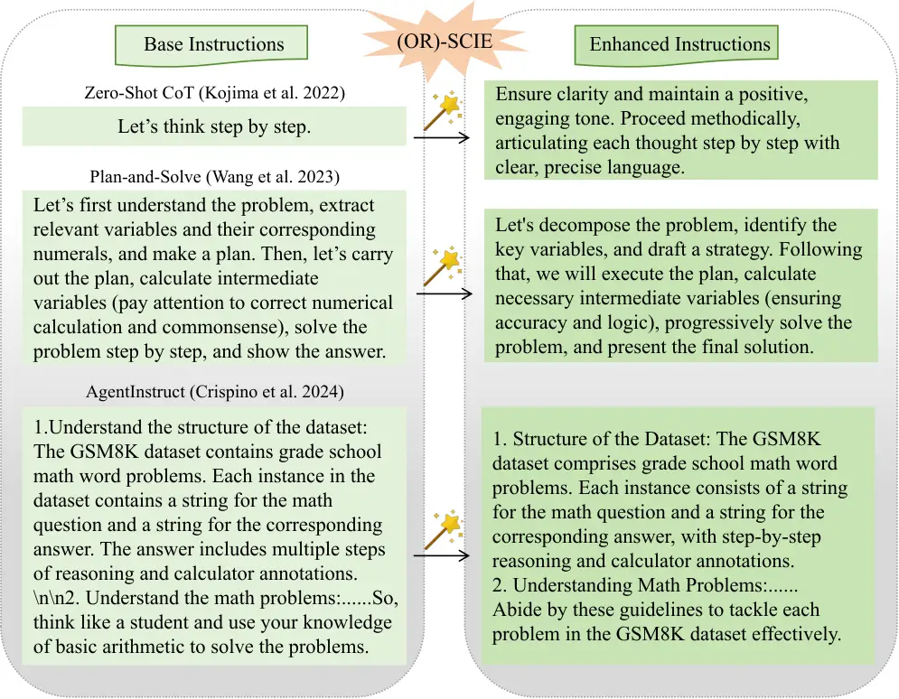
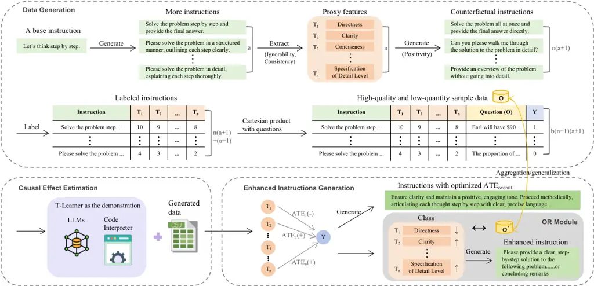
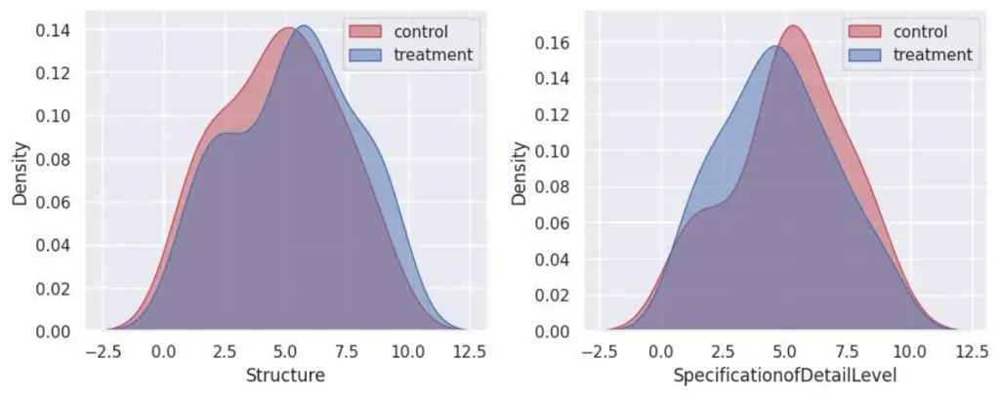
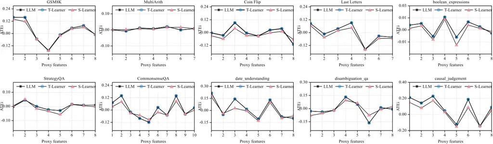

# Eliciting Causal Abilities in Large Language Models for Reasoning Tasks

Yajing Wang    Zongwei Luo ^(†)^(†)thanks: Corresponding author.   
Jingzhe Wang    Zhanke Zhou    Yongqiang Chen    Bo Han

###### Abstract

Prompt optimization automatically refines prompting expressions,
unlocking the full potential of LLMs in downstream tasks. However,
current prompt optimization methods are costly to train and lack
sufficient interpretability. This paper proposes enhancing LLMs’
reasoning performance by eliciting their causal inference ability from
prompting instructions to correct answers. Specifically, we introduce
the Self-Causal Instruction Enhancement (SCIE) method, which enables
LLMs to generate high-quality, low-quantity observational data, then
estimates the causal effect based on these data, and ultimately
generates instructions with the optimized causal effect. In SCIE, the
instructions are treated as the treatment, and textual features are used
to process natural language, establishing causal relationships through
treatments between instructions and downstream tasks. Additionally, we
propose applying Object-Relational (OR) principles, where the uncovered
causal relationships are treated as the inheritable class across task
objects, ensuring low-cost reusability. Extensive experiments
demonstrate that our method effectively generates instructions that
enhance reasoning performance with reduced training cost of prompts,
leveraging interpretable textual features to provide actionable
insights.

¹ Department of Computer Science, BNU-HKBU United International College

² TMLR Group, Hong Kong Baptist University

³ Artificial Intelligence and Future Networks IAIFN, Beijing Normal
University at Zhuhai

⁴ Guangdong Provincial Key Laboratory of IRADS

⁵ The Chinese University of Hong Kong

{wangyajing, wangjingzhe}@uic.edu.cn, lzwqhk@outlook.com,

{cszkzhou,bhanml}@comp.hkbu.edu.hk, yqchen@cse.cuhk.edu.hk

Code — https://github.com/dsubuntu/SCIE

## Introduction

One major remaining challenge for Large Language Models (LLMs) is their
insufficient reasoning capabilities (Dziri et al. 2024; Cao et al.
2024). Current LLMs perform well on System-1 tasks but face limitations
in handling System-2 problems (Bengio et al. 2019). Prompting-based
methods (Lester, Al-Rfou, and Constant 2021; Liu et al. 2023) aim to
enable LLMs to understand input prompts and adapt to the downstream
tasks through the design and crafting of prompts, becoming a focal point
of interest among researchers in recent years. Compared to fine-tuning
methods (Howard and Ruder 2018; Dong et al. 2019; Lewis et al. 2019),
prompting methods do not require substantial computational resources and
time to retrain the model, allowing for the development of more
generalized solutions using the original pre-trained model (Li et al.
2023).



Figure 1: Illustrative examples demonstrating the purpose of our
proposed (Object-Relational) Self-Causal Instruction Enhancement method.

Many exciting prompting methods have emerged, such as Chain of Thought
(CoT) (Wei et al. 2022), Zero-Shot CoT (Kojima et al. 2022), among
others. The prompting instructions in these methods are typically
designed by humans, even introducing some noise (Zhou et al. 2024). This
leads us to question: are these language expressions of the prompts the
best to trigger LLMs? Prompt optimization methods (Chang et al. 2024)
refine and enhance prompts for LLMs, to improve LLMs’ performance on
downstream tasks. However, current prompt optimization methods face
challenges related to training costs and interpretability.
Gradient-based approaches, such as APE (Zhou et al. 2022), APO (Pryzant
et al. 2023), and OPRO (Yang et al. 2023), require substantial training
costs to obtain gradient information. While gradient-free methods like
GPS (Xu et al. 2022) and GrIPS (Prasad et al. 2023), which rely on
editing and searching, also lack the interpretability to be understood
from a human intuitive perspective during the process.

Causal abilities represent higher-level cognition that transitions from
System 1 to System 2 (Bengio et al. 2019), and LLMs demonstrate
potential in causal reasoning tasks (Kıcıman et al. 2023). We propose
enhancing the reasoning ability of LLMs by eliciting their ability for
causal inference and aim to design a method to reduce training costs
while improving interpretability. Furthermore, inspired by the core idea
of meta-prompting abstracting a certain structure or pattern of prompts
that exhibits good generalizability, we propose regarding the uncovered
causal relationships as an abstract meta-template to guide the
generation of prompts.

This paper proposes the Self-Causal Instruction Enhancement (SCIE)
method. Given a basic prompting instruction and several correct
annotations for the corresponding downstream task results, SCIE allows
LLMs to perform causal estimation and optimization on the given
instruction, resulting in better reasoning performance. Moreover,
inspired by meta prompting, we employ Object-Relational (OR) thinking,
enabling new downstream tasks to inherit the uncovered causal
relationships. This approach facilitates easier and more cost-effective
optimization of the instructions. As illustrated in Figure 1, given any
input instruction and prompting method, the (OR)-SCIE method generates
enhanced instructions on the reasoning performance, such as the accuracy
of LLMs.

We summarize the contributions of this paper as follows:

- •
  To the best of our knowledge, this is the first work that enhances the
  prompts of LLMs for reasoning tasks from a causal perspective. The
  proposed SCIE method elicits the causal abilities of LLMs to improve
  their reasoning ability and provide interpretability.
- •
  Inspired by the theory of causal identification, we generate
  high-quality, low-quantity observational data, addressing the need for
  observational data for causal inference on LLM prompts and downstream
  task outcomes.
- •
  The uncovered causal relationships between instructions and task
  outcomes can be regarded as a class and reused in other downstream
  tasks that satisfy the OR relationship. The experiment shows new tasks
  that inherit the corresponding causal relationships through the OR
  model demonstrate improved performance.

## Preliminaries

### Causal Estimand

To quantify the causal effect, we need to identify the causal estimands.
The causal effect for an individual, referred to as the Individual
Treatment Effect (ITE) (Holland 1986), is challenging to identify due to
the counterfactual problem. However, we can estimate the overall average
level, namely, Average Treatment Effect (ATE) (Rubin 1974):

```math
\mathrm{ATE}=\mathbb{E}[Y(1)-Y(0)], \tag{1}
```

where the ATE represents the average difference in potential outcome
variables $`(Y)`$ between the treatment group $`(1)`$ and the control
group $`(0)`$.

### Identification Assumptions for Causal Inference

To perform causal inference using a causal estimand, three
identification assumptions need be satisfied: ignorability, positivity,
and consistency (Feder et al. 2022).

#### Ignorability.

Ignorability, also known as unconfoundedness, refers to the condition
where, for groups with the same values of covariates, the assignment of
the treatment is independent of the potential outcome variables:

```math
T\upmodels Y(t)\mid X,\quad\forall t\in\{0,1\}, \tag{2}
```

where $`X`$ is observed variables (including confound variables), $`T`$
and $`Y`$ are the treatment and the potential outcome separately, and
$`t`$ means the value of $`T`$. In other words, this assumption requires
that we observe all confounding variables and that there is sufficient
variation in $`X`$.

#### Positivity.

Positivity refers to the condition that, for any given observed variable
$`X`$, the assignment of the intervention $`T`$ has a probability
between 0 and 1:

```math
0<\operatorname{Pr}(T=1\mid X=x)<1,\quad\forall x, \tag{3}
```

requiring the assignment of treatments be random, meaning that each unit
has a non-zero probability of being treated.

#### Consistency.

The Consistency Assumption, also known as the Stable Unit Treatment
Value Assumption (SUTVA), states that the potential outcome $`Y`$ of any
unit is not influenced by the treatment $`T`$ applied to other units.
Additionally, for each unit, there are no different forms or versions of
any given $`T`$ that could lead to different $`Y`$:

```math
T=t\Leftrightarrow Y(t)=Y,\quad\forall t\in\{0,1\}. \tag{4}
```

This assumption requires that each treatment be clearly defined and that
the potential outcomes resulting from the treatment are stable.



Figure 2: The overall process of (Object-Relational) Self-Causal
Instruction Enhancement includes Data Generation, Causal Effect
Estimation, Enhanced Instructions Generation, and optional OR Module.

## Self-Causal Instruction Enhancement

This paper aims to enhance the reasoning performance of LLMs in
downstream reasoning tasks by estimating and optimizing the causal
effects of prompting instructions. A natural thought for causal
inference of prompts and task outcomes in LLMs is the potential outcome
framework (Rubin 1974) since we can guide LLMs in generating data that
align as closely as possible with requirements. In our causal effect
estimation method, the instructions serve as the treatment $`T`$, and
the correctness of the results in downstream tasks serves as the
potential outcome $`Y`$. This allows us to further enhance the
instructions based on the estimated causal relations. The causal effect
is:

```math
\displaystyle\mathrm{ATE} \displaystyle=\mathbb{E}[Y(1)-Y(0)] \tag{5}
```

```math
\displaystyle=\mathbb{E}[Y(1)]-\mathbb{E}[Y(0)]
```

```math
\displaystyle=\mathbb{E}[Y\mid T=1]-\mathbb{E}[Y\mid T=0].
```

For simplicity without loss of generality, we assume $`T`$ is expressed
in binary form here. The values of $`Y`$ are 1 and 0, where 1 indicates
a correct outcome, and 0 indicates an incorrect outcome. In other words,
we represent the reasoning ability of LLMs through the causal effect of
instructions on the correctness of reasoning task outcomes. To improve
the reasoning capabilities of LLMs in downstream tasks, we simply need
to identify the instructions that maximize the causal effects of the
prompts to the correctness of the task.

Theoretically, the counterfactual $`Y(t)`$ can be defined for any
treatment $`t`$, but it might be restricted to the representation of the
text (Feder et al. 2022). Methods for handling high-dimensional text as
treatment can be divided into two categories. The first category focuses
on producing interpretable features of the text (Pryzant et al. 2018;
Kunzel et al. 2019; Maiya 2021). The second category involves extracting
latent properties of the text during causal effect estimation
(Wood-Doughty, Shpitser, and Dredze 2018; Pryzant et al. 2021), but they
typically require a proposed causal model and rely on the validity of
the model. Escaping from relying on expert knowledge and for the sake of
interpretability, our SCIE will extract features of interest (referred
to as proxy features, whose values are typically inferred from text with
classifiers, lexicons, or topic models (Pryzant et al. 2018; Kunzel
et al. 2019; Maiya 2021)) from high-dimensional prompting instructions,
preparing for the causal effect estimation as treatments.

In general, the potential outcomes framework is based on observational
data under three key assumptions. Although treating LLMs does not raise
ethical concerns, conducting a large number of randomized controlled
experiments on LLMs is inconvenient and costly to replicate. Therefore,
we propose generating high-quality (satisfying the three assumptions)
and low-quantity observational data and then estimating causal effects
based on the data. Then, based on the uncovered causal effects, we ask
the LLM to generate enhanced instructions that have a stronger causal
effect on the correctness of the results in downstream tasks.
Additionally, the uncovered causal model can be regarded as a
meta-prompting pattern, which can be inherited according to the OR
approach, thereby improving the method’s cost-effective reusability. The
overall process of our method is shown in Figure 2. We will illustrate
in details for the (OR)-SCIE method in the following sections.

### High-quality Observational Data Generation

In this section, we will explain how to generate observational data that
satisfies the three identification assumptions in causal inference while
ensuring that the resulting structured data is manageable for causal
effect estimation.

As shown in the Data Generation part of Figure 2, based on an
instruction for LLMs to complete a task, which can be either manually
constructed or automatically generated based on previous research, we
generate $`a`$ different instructions from the given instruction using
LLMs, such as forward mode and reverse mode in APE (Zhou et al. 2022).
Assuming we are interested in the textual features of the instructions,
as these features are relatively generic for the input instruction and
facilitate subsequent processing, we have LLMs exhaustively enumerate
all $`n`$ textual features $`\{T_{1},T_{2},\ldots,T_{n}\}`$ that
influence the results of downstream tasks for these $`(a+1)`$
instructions, and these proxy features must be independent of each other
(ignorability). The proxy features must be described in detail and be
consistent without version bias (consistency). Next, we have the LLMs
generate counterfactual instructions based on each proxy feature,
resulting in a total of $`n(a+1)`$ counterfactual instances, ensuring
that each proxy feature has both the probability of being treated and
not being treated (positivity).

To label these proxy features as numerical or categorical data, we use
the method by leveraging the scoring capabilities of LLMs for annotation
(Liu et al. 2024). Subsequently, we randomly select $`b`$ data from the
training set of the LLMs’ downstream reasoning tasks. These $`b`$
questions are combined with the $`(n+1)(a+1)`$ instructions (including
the counterfactual and original instructions) using the Cartesian
product, resulting in $`b(n+1)(a+1)`$ instruction-question instances.
These instances are then input into the LLMs, and the potential outcome
$`Y`$ indicating the correctness of the answers can be obtained to
finish the data generation process.

We use an example to illustrate the desired observational data for
causal effect estimation. In this example, the LLM is GPT-4o mini, and
the task is GSM8K, with the given base instruction being Zero-Shot CoT
(Kojima et al. 2022). According to the data generation method, we derive
$`8`$ proxy features: “Directness”, “Clarity”, “Conciseness”,
“Actionability”, “Tone”, “Structure”, “Specification of Detail Level”,
and “Emphasis on Process”. We specify generating $`9`$ different
instructions from the base instruction, resulting in $`(8+1)(9+1)=90`$
instructions. Each of these proxy features is sequentially treated as
the treatment variable with the treated and controlled value (1 and 0),
while the remaining features serve as covariates. We binarize the
current treatment “Directness” and plot the probability density
distributions of the other proxy features over the current treatment. We
show two examples of the distributions for “Structure” and
“Specification of Detail Level” in Figure 3.



Figure 3: Probability density distributions of the proxy features
“Structure” and “Specification of Detail Level” with “Directness” as the
proxy treatment.

Ideally, the overlap of the distributions between the controlled and
treated groups of the treatment variable can be considered as perfect
observational data for causal effect estimation. As shown in Figure 3,
although there are differences, the distributions of the controlled and
treated groups share significant commonalities, making them suitable for
causal effect estimation. We also attempt to further adjust the data
using Propensity Score Matching (PSM) (Rosenbaum and Rubin 1983; Dhawan
et al. 2024), but find that this approach results in poorer outcomes. We
attribute this to the reduction in data volume post-PSM, which adversely
affects the causal effect estimation and hinders the generation of
better instructions, so we discard the PSM step.

### Estimating Causal Effect with LLMs

In the Data Generation step, we prepare the data for causal effect
estimation. In this section, our goal is to perform causal effect
estimation on each proxy treatment to uncover the causal relationships
between the treatments and the correctness of LLM downstream task
results.

During the causal effect estimation, for each proxy feature
$`T_{i}\in\{T_{1},T_{2},\ldots,T_{n}\}`$ considered as a treatment in
turn, its causal effect is estimated:

```math
\displaystyle\mathrm{ATE_{i}} \displaystyle=\mathbb{E}_{x}[\mathbb{E}[Y(1)\mid X]-\mathbb{E}[Y(0)\mid X]] \tag{6}
```

```math
\displaystyle=\mathbb{E}_{x}[\mathbb{E}[Y\mid T_{i}=1,x]-\mathbb{E}[Y\mid T_{i}=0,x]],
```

where $`X`$ represents covariates (proxy features other than the current
proxy treatment), and $`x`$ represents a specific value of $`X`$.
$`E_{x}`$ indicates the expectation over all values of $`X`$.

Ordinary LLMs typically struggle with table data processing. When LLMs
are asked to calculate ATE based on Equation 6, common responses include
problem-solving steps or a piece of code without answers. To solve this
problem, we employ the open interpreter (Open Interpreter 2024) for ATE
estimation. It contains a built-in code interpreter that can generate
and execute code based on prompts and return results. The reason for
using LLMs to estimate causal effects is that, subsequently, to generate
instructions with larger $`\mathrm{ATE_{overall}}`$, the LLM needs to
estimate correct ATE and understand the ATE calculation process. To
enable LLMs to accurately estimate the $`\mathrm{ATE_{i}}`$, we utilize
the in-context learning strategy (Brown et al. 2020), providing the
relevant code along with $`\lceil i/2\rceil`$ ATE results as the
demonstration to the LLMs and ask LLMs estimating the complete $`i`$ ATE
results. This process is shown in the Causal Effect Estimation part of
Figure 2. The idea of this part is to leverage expert knowledge to teach
LLMs how to perform causal effect estimation, enabling them to apply the
learned knowledge to excel in their strength of language generation.

The meta-learners, including T-Learner, S-Learner (Kunzel et al. 2019;
Maiya 2021), are effective methods in potential outcomes framework to
estimate causal effect. The T-Learner is considered as the example for
in-context learning, as the treatment effect between our control and
treatment groups differs significantly in our data (the counterfactual
instruction process), and has low selection bias. The T-Learner employs
the base learner (e.g., the supervised learning or regression estimator)
to separately estimate the control and treatment group functions:

```math
\displaystyle\mu_{0}(x)=\mathbb{E}[Y(0)\mid X=x], \tag{7}
```

```math
\displaystyle\mu_{1}(x)=\mathbb{E}[Y(1)\mid X=x].
```

The difference of these two estimates $`\hat{\mu}_{1}(x)`$ and
$`\hat{\mu}_{0}(x)`$ denotes the estimation of the ATE using T-learner:

```math
\hat{\tau}(x)=\hat{\mu}_{1}(x)-\hat{\mu}_{0}(x). \tag{8}
```

The S-Learners are considered as the other baseline for evaluating the
ATE estimated by LLMs. Detailed experimental results are provided in the
following section.

### Enhanced Instructions Generation

By estimating the ATE of different proxy treatments, we obtain insights
into how instructions causally influence the correctness of LLM
downstream task outcomes through proxy features. Next, we aim to adjust
the instructions based on the uncovered causal relationships to optimize
the causal impact of instructions on the correctness of LLM downstream
task outcomes. Considering the independence among the proxy features, we
define the overall ATE of instructions on the correctness of LLM
downstream task outcomes as:

```math
\mathrm{ATE_{overall}}=\frac{1}{n}\sum_{i=1}^{n}\mathrm{ATE_{i}}. \tag{9}
```

We intend to achieve the optimized $`\mathrm{ATE_{overall}}`$ not by
involving gradient-based optimization concepts but by allowing the LLM
to generate instructions that optimize $`\mathrm{ATE_{overall}}`$ based
on the uncovered causal relationships, which leverages the LLM’s
capabilities to encode and decode natural language, shown in the
Enhanced Instructions Generation part of Figure 2.

Assuming that the LLM can generate instructions with varying degrees of
proxy features by adjusting the value of the treatment, a larger ITE can
be obtained with a higher probability. We will next prove this point.

The Individual Treatment Effect (ITE) is represented as:

```math
\mathrm{ITE_{i}}^{(j)}=Y_{i}^{(j)}(1)-Y_{i}^{(j)}(0), \tag{10}
```

where $`\mathrm{ITE_{i}}^{(j)}`$ and $`Y_{i}^{(j)}`$ represent treatment
effect and outcome of an individual corresponding to $`T_{i}`$,
respectively.

The $`\mathrm{ATE_{i}}`$ can be represented as:

```math
\mathrm{ATE_{i}}=\frac{1}{m}\sum_{j=1}^{m}\mathrm{ITE_{i}}^{(j)}. \tag{11}
```

That is, the ATE is the average of all individuals’ ITE, where $`m`$
denotes the number of individuals.

- •
  When $`\mathrm{ATE_{i}}>0`$, which means that the effect of $`T_{i}`$
  is positive. According to the law of large numbers, the overall
  average effect is the average of individual effects. Therefore, it can
  be inferred that for an individual $`j`$, the likelihood that
  $`Y_{i}^{(j)}(1)`$ is greater than $`Y_{i}^{(j)}(0)`$ is higher, which
  implies that adjusting $`T_{i}`$ from $`0`$ to $`1`$ will increase the
  value of $`\mathrm{ITE_{i}}`$.
- •
  Similarly, when $`\mathrm{ATE_{i}}<0`$, it can be proven that
  adjusting $`T_{i}`$ from $`1`$ to $`0`$ will increase the value of
  $`\mathrm{ITE_{i}}`$.
- •
  When $`\mathrm{ATE_{i}}=0`$, it means that $`T_{i}`$ has no
  significant effect on the overall positive outcome, so the adjustment
  of $`T_{i}`$ can be ignored in this case.

Therefore, based on the discussion of adjusting $`T_{i}`$ to increase
$`\mathrm{ATE_{i}}`$, it is possible for the LLM to generate
instructions that improve the $`\mathrm{ATE_{overall}}`$, under the
consistency assumption that different proxy treatments affect potential
outcomes independently. It is noteworthy that though we aim to obtain
instructions with maximum $`\mathrm{ATE_{overall}}`$, the LLM will give
solutions to generate optimized instructions. However, solutions
generated by our method show enhanced performance compared to the base
instructions.

### The OR Module

The object-relational model is a database model proposed to combine the
characteristics of relational databases with object-oriented
programming. It extends the traditional relational database model by
supporting complex data types, inheritance, and other object-oriented
features (Carey et al. 1997). In the OR approach, there are two common
types of object relationships: aggregation and generalization.
Aggregation represents associations between collections of objects,
emphasizing the whole-part relationship. Generalization relationships
among objects allow for the creation of hierarchies where classes can
inherit attributes and behaviors from other classes of objects. Objects
that satisfy specific relationships can extend or inherit the attributes
and methods of existing classes, offering flexibility and reusability.
This enables more efficient management of complex data.

The causal model is regarded as a framework that can explicitly
represent causal dependencies and allow for automatic reasoning about
these dependencies (Jensen 2021). Applying the OR model in causal
inference leads to a more expressive and flexible causal representation
of a complex world (Jensen 2021; Lee and Ogburn 2021; Wang and Luo
2024). Based on the above argument, we model different tasks and uncover
causal relationships using the OR model to achieve easy reuse of
instruction enhancement. As shown in the OR Module part of Figure 2, we
extract the uncovered causal relationships from the LLM’s explanations,
which are identified by the LLM as having a significant impact on
potential outcomes when generating instructions with optimized ATE.
Usually, LLMs encourage the positive impact of features to guide the
LLM’s-self in generating better instructions. Then, objects (such as
different tasks, $`O`$ and $`O^{\prime}`$ in Figure 2) that have
aggregation or generalization relationships can directly inherit from
this class, and they can adjust instructions based on the positive or
negative impact of the proxy features. This class can be regarded as the
meta-template, which can be reused by other objects.

## Experiments and Results



Figure 4: The causal effect estimation with the LLM (asterisk points),
T-Learner (blue circular points), and S-Learner (red triangle points).
The X-axis represents the $`n`$ proxy features for each reasoning task
(indicated by numerical ticks), used as treatments when calculating
$`\mathrm{ATE_{i}}`$. The Y-axis represents the corresponding ATE values
of treatments.

While the enhanced metric could be changed to others, such as the
certainty of downstream task answers, perplexity, answer length, etc.,
this paper focuses on the accuracy of reasoning tasks for LLMs. To
validate the effectiveness of (OR)-SCIE on the accuracy of LLMs in
reasoning tasks, we set up the experiments with representative reasoning
tasks and datasets, LLMs, and baselines.

#### Reasoning tasks and datasets.

We evaluate ten common datasets across four categories of reasoning
tasks for the experiment. (1) Arithmetic reasoning: GSM8K (Cobbe et al. 2021) and MultiArith (Roy and Roth 2015). (2) Commonsense reasoning:
StrategyQA (Geva et al. 2021) and CommonsenseQA (Talmor et al. 2019).
(3) Symbolic reasoning: Coin Flip (Wei et al. 2022), Last Letter
Concatenation (Wei et al. 2022) and Boolean Expressions (Suzgun et al.
2023). (4) Other logical reasoning: Causal Judgement, Date
Understanding, and DisambiguationQA from Big Bench Hard (BBH) (Suzgun
et al. 2023). For datasets like GSM8K, where the training and test sets
are pre-defined, we perform random sampling on the training set and
evaluate using the test set. For datasets without predefined training
and test sets, we exclude the sampled data used in the SCIE process
during testing on the reasoning tasks.

#### Models.

The experiments in this paper will evaluate inference tasks on several
commonly used LLMs, including GPT-3.5 Turbo (OpenAI 2022), GPT-4o mini
(Achiam et al. 2023) and Llama-3-70b (Dubey et al. 2024). The (OR)-SCIE
process is designed to utilize more powerful LLMs like GPT-4o (Achiam
et al. 2023) whenever possible, aiming to enhance the performance of a
student model (processing downstream tasks) by activating the causal
ability from a teacher (good at causal inference) model.

#### Baselines.

Three base instructions and their corresponding prompting methods are
used as baselines: Zero-Shot CoT (Kojima et al. 2022), Plan-and-Solve
Prompting (Wang et al. 2023), and AgentInstruct (Crispino et al. 2024).
Among them, Zero-Shot CoT and Plan-and-Solve Prompting use a two-stage
prompting method (Kojima et al. 2022). In the first stage, instructions
like “Let’s think step by step.” are added after the specific question
to generate the required CoT. In the second stage, both the question and
the CoT generated in the first stage are input into the LLMs to obtain
the final answer. AgentInstruct is a one-stage prompting method where
the same instruction is input before each question for the same task to
obtain the answer. Additionally, we also note the work using LLMs as
optimizers (Yang et al. 2023), which perform prompt optimization on
Zero-Shot CoT, so we will also specifically compare our method with
theirs.

### Evaluation of Estimating Causal Effect with LLMs

Having LLMs estimate ATE within the SCIE framework is necessary because,
to enable the LLM to generate instructions with the optimized ATE, the
LLM needs to understand the principle of obtaining ATE. While estimating
ATE with LLMs is not mandatory for the OR module. As long as there is a
class reflecting the real causal relationships, the LLM can generate
enhanced instructions based on the class.

Comparative experiments are conducted to verify whether LLMs are
competent to estimate ATE through our generated data. We use Zero-Shot
CoT as the base instruction and generated high-quality observational
data within SCIE, where $`a=9`$, $`b=5`$, and $`n=8`$, which is
automatically generated by GPT-4o mini (using this setting in the
following experiments if not specified). Based on the generated data, we
feed the LLM with the code of T-Learner and $`4`$ answers of
$`\mathrm{ATE_{i}}`$, letting it estimate all values of
$`\mathrm{ATE_{i}}`$. We conduct experiments on each reasoning task and
compare the results with the S-Learner to further assess the accuracy of
the causal effects estimated by the LLM.

Figure 4 shows the ATE estimation results on different reasoning tasks.
We can observe that the LLM has fully mastered the use of the T-Learner
for ATE estimation, as all the results it generated, including the
points with unknown values, aligning perfectly with those produced by
the T-learner. Although there is a slight difference between the ATE
estimation and the S-Learner, the overall trend of the LLM’s results is
consistent, and the difference is minor. This indicates the ATE
estimation by the LLM is robust and also reflects the good quality of
our generated observational data. It is worth noting that although some
ATE results appear close to zero, this does not imply that the treatment
variable has no causal effect on the task outcome correctness. On the
contrary, the LLM will provide explanations and synthesize the impact of
all proxy treatments to offer suggestions for enhancing the
instructions, even slightly.

### Evaluation of SCIE

#### SCIE on Zero-Shot CoT.

We apply SCIE on the Zero-Shot CoT across reasoning tasks and obtain
corresponding enhanced instructions with the LLM explanations (see
Appendix A). Table 1 shows the accuracy of Zero-Shot CoT and SCIE
Zero-Shot CoT on reasoning tasks using GPT-3.5 turbo (results on more
LLMs can be found in Appendix B).

|                    |                        |               |                         |                    |                     |
| ------------------ | ---------------------- | ------------- | ----------------------- | ------------------ | ------------------- |
|                    | Arithmetic reasoning   |               | Symbolic reasoning      |                    |                     |
|                    | GSM8K                  | MultiArith    | Coin Flip               | Last Letters       | Boolean Expressions |
| Zero-Shot CoT      | 75.5                   | 93.8          | 76.8                    | 86.5               | 78.4                |
| SCIE Zero-Shot CoT | 77.3                   | 95.2          | 78.2                    | 87.6               | 79.6                |
|                    | Common-sense reasoning |               | Other logical reasoning |                    |                     |
|                    | StrategyQA             | CommonsenseQA | Causal Judgement        | Date Understanding | DisambiguationQA    |
| Zero-Shot CoT      | 65.5                   | 71.7          | 55.5                    | 71.8               | 61.2                |
| SCIE Zero-Shot CoT | 71.1                   | 72.0          | 59.3                    | 71.0               | 61.6                |

Table 1: Accuracy on reasoning tasks with and without SCIE. Two-stage
prompting is employed, with all other experimental settings remaining
identical except for the instructions. Values in bold denote better
accuracy.

|        |                                                                                                         |                                                                                                                                                                             |          |
| ------ | ------------------------------------------------------------------------------------------------------- | --------------------------------------------------------------------------------------------------------------------------------------------------------------------------- | -------- |
| Method | Interpretability                                                                                        | Instruction                                                                                                                                                                 | Accuracy |
| OPRO   | $`\backslash`$                                                                                          | Analyze the given information, break down the problem … carefully consider the problem’s context for an efficient solution (referenced from Table 4 in (Yang et al. 2023)). | 77.7     |
| SCIE   | To maximize the overall Average Treatment Effect … (Please refer to Appendix A for a full explanation.) | Ensure clarity and maintain a positive, engaging tone. Proceed methodically, articulating each thought step by step with clear, precise language.                           | 78.6     |

Table 2: Comparison between OPRO and SCIE, both following the “Q-end”
setting (Yang et al. 2023) which means the instruction is added after
the original question, rather than the two-stage prompting (Kojima
et al. 2022).

As shown in Table 1, SCIE effectively enhances instructions for most
reasoning tasks. However, Date Understand is an exception. We attribute
this to a potential bias in the ATE estimation process, as also evident
in Figure 4. Furthermore, our method does not require extensive training
and provides interpretability. We also observe that, aside from the bias
in estimation process, if the ATE values exhibit significant
fluctuations, the LLM will adjust the instructions based on more
pronounced proxy features, resulting in greater performance
improvements. For example, the Causal Judgement task shows more
pronounced ATE variations (see Figure 4) compared to other tasks, and
the LLM emphasizes crafting the instruction to maximize the factors that
have the most positive effect in the explanations (see the LLM
explanations in Appendix A), and consequently, it achieves a higher
accuracy improvement relative to the other tasks. This observation
aligns with the design principles of our method.

Figure 5: (a) The reasoning accuracy with and without SCIE, using
Plan-and-Solve and AgentInstruct as base instructions respectively. (b)
The reasoning accuracy for objects inheriting causal relationships with
aggregation(A) and generalization(G) OR relationships, respectively.

#### SCIE on other base instructions.

We evaluate the accuracy of the GSM8K of GPT-3.5 Turbo with
Plan-and-Solve Prompting and AgentInstruct as the base instructions,
respectively. Due to the lengthy instructions of AgentInstruct, we set
$`a=5`$, $`b=5`$, for cost control. We separately conduct experiments
with and without SCIE on the base instructions, obtaining results shown
in Figure 5 (a). The complete instructions can be found in Appendix C.

As shown in Figure 5 (a), when using more complex instructions as base
instructions, our method demonstrates enhancement regardless of whether
the two-zero-shot prompting or one-stage prompting strategy is employed.

#### Comparison with LLMs as Optimizers.

LLMs as Optimizers (OPRO) give the top instructions on GPT-3.5 turbo and
we will compare ours with it. Table 2 shows the comparison results. Our
method demonstrates better accuracy compared to OPRO. Besides, our
approach requires lower training costs and offers superior
interpretability.

### Evaluation of OR-SCIE

#### Aggregation.

We simulate the part-whole relationship in the OR model using the GSM8K
dataset as an example. Specifically, we extract the causal relationships
from LLM explanations that have been proved to produce SCIE-level
instructions. For instance, in this case, we extract the positive causal
relationship between “Clarity” and “Tone” and then instruct the LLM to
generate enhanced instructions based on Zero-Shot CoT (see Appendix D).
Subsequently, we randomly select 70% of the GSM8K dataset as the part
object and conduct the test with instructions generated from OR-SCIE,
achieving an accuracy of 77.9% (see Figure 5 (b)). Intuitively, the
performance of instructions produced by the OR module may be inferior to
those obtained by SCIE, as it does not optimize the ATE. In this
example, the result is slightly higher than that of the complete SCIE
method, which may be due to the randomly extracted test data, but it
demonstrates the effectiveness of the OR module.

#### Generalization.

We use the MultiArith and GSM8K datasets to simulate the generalization
relationship within the OR model. MultiArith inherits the causal
relationships extracted from the LLM’s explanations as a class, and the
resulting accuracy is 94.3%, shown in Figure 5 (b). As we can see, the
results using the OR module outperform those of the no-SCIE method, and
this class is reusable. To further demonstrate the practical utility of
the proposed method, we evaluate GPT-4o mini and Llama-3-70b on a more
challenging dataset, fresh-gaokao-math-2023 (Tang et al. 2024), using
the instruction directly inherited from GSM8K. Among 30 high-difficulty
math problems, the instruction generated by OR-SCIE(G) enables LLMs to
solve several more questions correctly compared to the base instruction.

## Conclusions

This paper enhances LLMs’ reasoning performance by eliciting LLMs’
causal effect estimation abilities and enabling them to further
self-optimize instructions. Besides, the idea of OR is introduced to
achieve cost-effective reusability of the method. Experimental results
not only demonstrate improved accuracy of the optimized instructions but
also provide enhanced interpretability. Despite the impressive causal
inference capabilities evidenced from the empirical results, exploring
theoretical guarantees and refining more robust eliciting methods remain
intriguing and promising avenues.

## Acknowledgments

We thank the anonymous reviewers for their insightful comments. This
work is supported by Beijing Normal University Zhuhai Startup Fund -
Research on Artificial Intelligence Computing Models and Applications,
the Beijing Normal University Zhuhai Teaching Reform Project - Online
and Offline Course on Artificial Intelligence and Ethics, the Ministry
of Education Supply and Demand Matching Employment-Education Integration
Project: Hikvision and Beijing Normal University at Zhuhai; Hikvision
and BNU-HKBU United International College, and Guangdong Provincial Key
Laboratory of Interdisciplinary Research and Application for Data
Science. ZKZ and BH were supported by Guangdong Basic and Applied Basic
Research Foundation Nos. 2022A1515011652 and 2024A1515012399, NSFC
General Program No. 62376235, HKBU Faculty Niche Research Areas No.
RC-FNRA-IG/22-23/SCI/04, and HKBU CSD Departmental Incentive Scheme.

## References

- Achiam et al. (2023) Achiam, J.; Adler, S.; Agarwal, S.; Ahmad, L.;
  Akkaya, I.; Aleman, F. L.; Almeida, D.; Altenschmidt, J.; Altman, S.;
  Anadkat, S.; et al. 2023. Gpt-4 technical report. _arXiv preprint
  arXiv:2303.08774_.
- Bengio et al. (2019) Bengio, Y.; et al. 2019. From system 1 deep
  learning to system 2 deep learning. In _Neural Information Processing
  Systems_.
- Brown et al. (2020) Brown, T.; Mann, B.; Ryder, N.; Subbiah, M.;
  Kaplan, J. D.; Dhariwal, P.; Neelakantan, A.; Shyam, P.; Sastry, G.;
  Askell, A.; et al. 2020. Language models are few-shot learners.
  _Advances in neural information processing systems_, 33: 1877–1901.
- Cao et al. (2024) Cao, C.; Zhong, Z.; Zhou, Z.; Liu, Y.; Liu, T.; and
  Han, B. 2024. Envisioning Outlier Exposure by Large Language Models
  for Out-of-Distribution Detection. In _ICML_.
- Carey et al. (1997) Carey, M. J.; DeWitt, D. J.; Naughton, J. F.;
  Asgarian, M.; Brown, P.; Gehrke, J. E.; and Shah, D. N. 1997. The
  BUCKY object-relational benchmark. In _Proceedings of the 1997 ACM
  SIGMOD international conference on Management of data_, 135–146.
- Chang et al. (2024) Chang, K.; Xu, S.; Wang, C.; Luo, Y.; Xiao, T.;
  and Zhu, J. 2024. Efficient Prompting Methods for Large Language
  Models: A Survey. _arXiv preprint arXiv:2404.01077_.
- Cobbe et al. (2021) Cobbe, K.; Kosaraju, V.; Bavarian, M.; Chen, M.;
  Jun, H.; Kaiser, L.; Plappert, M.; Tworek, J.; Hilton, J.; Nakano, R.;
  et al. 2021. Training verifiers to solve math word problems. _arXiv
  preprint arXiv:2110.14168_.
- Crispino et al. (2024) Crispino, N.; Montgomery, K.; Zeng, F.; Song,
  D.; and Wang, C. 2024. Agent Instructs Large Language Models to be
  General Zero-Shot Reasoners. In _Forty-first International Conference
  on Machine Learning_.
- Dhawan et al. (2024) Dhawan, N.; Cotta, L.; Ullrich, K.; Krishnan, R.;
  and Maddison, C. J. 2024. End-To-End Causal Effect Estimation from
  Unstructured Natural Language Data. In _ICML 2024 Workshop on
  Foundation Models in the Wild_.
- Dong et al. (2019) Dong, L.; Yang, N.; Wang, W.; Wei, F.; Liu, X.;
  Wang, Y.; Gao, J.; Zhou, M.; and Hon, H.-W. 2019. Unified language
  model pre-training for natural language understanding and generation.
  _Advances in neural information processing systems_, 32.
- Dubey et al. (2024) Dubey, A.; Jauhri, A.; Pandey, A.; Kadian, A.;
  Al-Dahle, A.; Letman, A.; Mathur, A.; Schelten, A.; Yang, A.; Fan, A.;
  et al. 2024. The llama 3 herd of models. _arXiv preprint
  arXiv:2407.21783_.
- Dziri et al. (2024) Dziri, N.; Lu, X.; Sclar, M.; Li, X. L.; Jiang,
  L.; Lin, B. Y.; Welleck, S.; West, P.; Bhagavatula, C.; Le Bras, R.;
  et al. 2024. Faith and fate: Limits of transformers on
  compositionality. _Advances in Neural Information Processing
  Systems_, 36.
- Feder et al. (2022) Feder, A.; Keith, K. A.; Manzoor, E.; Pryzant, R.;
  Sridhar, D.; Wood-Doughty, Z.; Eisenstein, J.; Grimmer, J.; Reichart,
  R.; Roberts, M. E.; et al. 2022. Causal inference in natural language
  processing: Estimation, prediction, interpretation and beyond.
  _Transactions of the Association for Computational Linguistics_, 10:
  1138–1158.
- Geva et al. (2021) Geva, M.; Khashabi, D.; Segal, E.; Khot, T.; Roth,
  D.; and Berant, J. 2021. Did aristotle use a laptop? a question
  answering benchmark with implicit reasoning strategies. _Transactions
  of the Association for Computational Linguistics_, 9: 346–361.
- Holland (1986) Holland, P. W. 1986. Statistics and causal inference.
  _Journal of the American statistical Association_, 81(396): 945–960.
- Howard and Ruder (2018) Howard, J.; and Ruder, S. 2018. Universal
  Language Model Fine-tuning for Text Classification. In _Proceedings of
  the 56th Annual Meeting of the Association for Computational
  Linguistics (Volume 1: Long Papers)_, 328–339.
- Jensen (2021) Jensen, D. D. 2021. Improving causal inference by
  increasing model expressiveness. In _Proceedings of the AAAI
  Conference on Artificial Intelligence_, volume 35, 15053–15057.
- Kıcıman et al. (2023) Kıcıman, E.; Ness, R.; Sharma, A.; and
  Tan, C. 2023. Causal reasoning and large language models: Opening a
  new frontier for causality. _arXiv preprint arXiv:2305.00050_.
- Kojima et al. (2022) Kojima, T.; Gu, S. S.; Reid, M.; Matsuo, Y.; and
  Iwasawa, Y. 2022. Large language models are zero-shot reasoners.
  _Advances in neural information processing systems_, 35: 22199–22213.
- Kunzel et al. (2019) Kunzel, S. R.; Sekhon, J. S.; Bickel, P. J.; and
  Yu, B. 2019. Metalearners for estimating heterogeneous treatment
  effects using machine learning. _Proceedings of the national academy
  of sciences_, 116(10): 4156–4165.
- Lee and Ogburn (2021) Lee, Y.; and Ogburn, E. L. 2021. Network
  dependence can lead to spurious associations and invalid inference.
  _Journal of the American Statistical Association_, 116(535):
  1060–1074.
- Lester, Al-Rfou, and Constant (2021) Lester, B.; Al-Rfou, R.; and
  Constant, N. 2021. The Power of Scale for Parameter-Efficient Prompt
  Tuning. In _Proceedings of the 2021 Conference on Empirical Methods in
  Natural Language Processing_, 3045–3059.
- Lewis et al. (2019) Lewis, M.; Liu, Y.; Goyal, N.; Ghazvininejad, M.;
  Mohamed, A.; Levy, O.; Stoyanov, V.; and Zettlemoyer, L. 2019. Bart:
  Denoising sequence-to-sequence pre-training for natural language
  generation, translation, and comprehension. _arXiv preprint
  arXiv:1910.13461_.
- Li et al. (2023) Li, X.; Zhou, Z.; Zhu, J.; Yao, J.; Liu, T.; and
  Han, B. 2023. Deepinception: Hypnotize large language model to be
  jailbreaker. _arXiv preprint arXiv:2311.03191_.
- Liu et al. (2024) Liu, C.; Chen, Y.; Liu, T.; Gong, M.; Cheng, J.;
  Han, B.; and Zhang, K. 2024. Discovery of the Hidden World with Large
  Language Models. In _Proceedings of the Thirty-eighth Annual
  Conference on Neural Information Processing Systems_.
- Liu et al. (2023) Liu, P.; Yuan, W.; Fu, J.; Jiang, Z.; Hayashi, H.;
  and Neubig, G. 2023. Pre-train, prompt, and predict: A systematic
  survey of prompting methods in natural language processing. _ACM
  Computing Surveys_, 55(9): 1–35.
- Maiya (2021) Maiya, A. S. 2021. CausalNLP: A practical toolkit for
  causal inference with text. _arXiv preprint arXiv:2106.08043_.
- Open Interpreter (2024) Open Interpreter. 2024. open-interpreter: A
  natural language interface for computers.
  https://github.com/OpenInterpreter. Accessed: 2024-08-03.
- OpenAI (2022) OpenAI. 2022. GPT-3.5 Turbo fine-tuning and API updates.
  https://openai.com/index/gpt-3-5-turbo-fine-tuning-and-api-updates/.
  Accessed: 2024-12-16.
- Prasad et al. (2023) Prasad, A.; Hase, P.; Zhou, X.; and
  Bansal, M. 2023. GrIPS: Gradient-free, Edit-based Instruction Search
  for Prompting Large Language Models. In _Proceedings of the 17th
  Conference of the European Chapter of the Association for
  Computational Linguistics_, 3845–3864.
- Pryzant et al. (2021) Pryzant, R.; Card, D.; Jurafsky, D.; Veitch, V.;
  and Sridhar, D. 2021. Causal Effects of Linguistic Properties. In
  _Proceedings of the 2021 Conference of the North American Chapter of
  the Association for Computational Linguistics: Human Language
  Technologies_, 4095–4109.
- Pryzant et al. (2023) Pryzant, R.; Iter, D.; Li, J.; Lee, Y. T.; Zhu,
  C.; and Zeng, M. 2023. Automatic Prompt Optimization with” Gradient
  Descent” and Beam Search. In _The 2023 Conference on Empirical Methods
  in Natural Language Processing_.
- Pryzant et al. (2018) Pryzant, R.; Shen, K.; Jurafsky, D.; and
  Wagner, S. 2018. Deconfounded lexicon induction for interpretable
  social science. In _Proceedings of the 2018 Conference of the North
  American Chapter of the Association for Computational Linguistics:
  Human Language Technologies, Volume 1 (Long Papers)_, 1615–1625.
- Rosenbaum and Rubin (1983) Rosenbaum, P. R.; and Rubin, D. B. 1983.
  The central role of the propensity score in observational studies for
  causal effects. _Biometrika_, 70(1): 41–55.
- Roy and Roth (2015) Roy, S.; and Roth, D. 2015. Solving General
  Arithmetic Word Problems. In _Proceedings of the 2015 Conference on
  Empirical Methods in Natural Language Processing_. Association for
  Computational Linguistics.
- Rubin (1974) Rubin, D. B. 1974. Estimating causal effects of
  treatments in randomized and nonrandomized studies. _Journal of
  educational Psychology_, 66(5): 688.
- Suzgun et al. (2023) Suzgun, M.; Scales, N.; Schärli, N.; Gehrmann,
  S.; Tay, Y.; Chung, H. W.; Chowdhery, A.; Le, Q.; Chi, E.; Zhou, D.;
  et al. 2023. Challenging BIG-Bench Tasks and Whether Chain-of-Thought
  Can Solve Them. In _Findings of the Association for Computational
  Linguistics: ACL 2023_, 13003–13051.
- Talmor et al. (2019) Talmor, A.; Herzig, J.; Lourie, N.; and
  Berant, J. 2019. CommonsenseQA: A question answering challenge
  targeting commonsense knowledge. In _Proceedings of the 2019
  Conference of the North_, 4149. Association for Computational
  Linguistics.
- Tang et al. (2024) Tang, Z.; Zhang, X.; Wang, B.; and Wei, F. 2024.
  MathScale: Scaling Instruction Tuning for Mathematical Reasoning. In
  _Forty-first International Conference on Machine Learning_.
- Wang et al. (2023) Wang, L.; Xu, W.; Lan, Y.; Hu, Z.; Lan, Y.; Lee, R.
  K.-W.; and Lim, E.-P. 2023. Plan-and-Solve Prompting: Improving
  Zero-Shot Chain-of-Thought Reasoning by Large Language Models. In
  _Proceedings of the 61st Annual Meeting of the Association for
  Computational Linguistics (Volume 1: Long Papers)_, 2609–2634.
- Wang and Luo (2024) Wang, Y.; and Luo, Z. 2024. Exploring latent
  discrimination through an Object-Relational Causal Inference method.
  _Knowledge-Based Systems_, 112148.
- Wei et al. (2022) Wei, J.; Wang, X.; Schuurmans, D.; Bosma, M.; Xia,
  F.; Chi, E.; Le, Q. V.; Zhou, D.; et al. 2022. Chain-of-thought
  prompting elicits reasoning in large language models. _Advances in
  neural information processing systems_, 35: 24824–24837.
- Wood-Doughty, Shpitser, and Dredze (2018) Wood-Doughty, Z.; Shpitser,
  I.; and Dredze, M. 2018. Challenges of using text classifiers for
  causal inference. In _Proceedings of the Conference on Empirical
  Methods in Natural Language Processing. Conference on Empirical
  Methods in Natural Language Processing_, volume 2018, 4586. NIH Public
  Access.
- Xu et al. (2022) Xu, H.; Chen, Y.; Du, Y.; Shao, N.; Yanggang, W.; Li,
  H.; and Yang, Z. 2022. GPS: Genetic Prompt Search for Efficient
  Few-Shot Learning. In _Proceedings of the 2022 Conference on Empirical
  Methods in Natural Language Processing_, 8162–8171.
- Yang et al. (2023) Yang, C.; Wang, X.; Lu, Y.; Liu, H.; Le, Q. V.;
  Zhou, D.; and Chen, X. 2023. Large Language Models as Optimizers.
  _ArXiv_, abs/2309.03409.
- Zhou et al. (2022) Zhou, Y.; Muresanu, A. I.; Han, Z.; Paster, K.;
  Pitis, S.; Chan, H.; and Ba, J. 2022. Large Language Models are
  Human-Level Prompt Engineers. In _The Eleventh International
  Conference on Learning Representations_.
- Zhou et al. (2024) Zhou, Z.; Tao, R.; Zhu, J.; Luo, Y.; Wang, Z.; and
  Han, B. 2024. Can Language Models Perform Robust Reasoning in
  Chain-of-thought Prompting with Noisy Rationales? In _The
  Thirty-eighth Annual Conference on Neural Information Processing
  Systems_.

## Appendix A Appendix

### Appendix A

The following table shows the enhanced instructions generated by LLMs on
each reasoning task using Zero-Shot CoT as the base instruction. The
content in the LLM explanations column is good for interpretability.

| Reasoning tasks     | LLM explanations                                                                                                                                                                                                                                                                                                                                                                                                                                                                                                                                                                                                                                                                                                                                                                                                                                                                                                                                                                                                                                                                                                                                                                                                                                 | Enhanced instructions                                                                                                                                                                                                                                                                                                                                                                         |
| ------------------- | ------------------------------------------------------------------------------------------------------------------------------------------------------------------------------------------------------------------------------------------------------------------------------------------------------------------------------------------------------------------------------------------------------------------------------------------------------------------------------------------------------------------------------------------------------------------------------------------------------------------------------------------------------------------------------------------------------------------------------------------------------------------------------------------------------------------------------------------------------------------------------------------------------------------------------------------------------------------------------------------------------------------------------------------------------------------------------------------------------------------------------------------------------------------------------------------------------------------------------------------------ | --------------------------------------------------------------------------------------------------------------------------------------------------------------------------------------------------------------------------------------------------------------------------------------------------------------------------------------------------------------------------------------------- |
| GSM8K               | To maximize the overall Average Treatment Effect (ATE) as evidenced by the results from the analysis, we should focus on enhancing the elements that received positive ATE values which indicate a likely benefit to the LLM’s performance when these aspects are emphasized. In this case, treatments for “Clarity” and “Tone” have beneficial ATEs. Here’s a revised instruction designed to leverage these insights: “Ensure clarity and maintain a positive, engaging tone. Proceed methodically, articulating each thought step by step with clear, precise language.” This instruction optimizes the input by emphasizing “Clarity,” which has the highest positive effect, while also considering “Tone”, fostering an engaging and precise approach meant to potentially maximize the effectiveness of the LLM’s output.                                                                                                                                                                                                                                                                                                                                                                                                                 | Ensure clarity and maintain a positive, engaging tone. Proceed methodically, articulating each thought step by step with clear, precise language.                                                                                                                                                                                                                                             |
| MultiArith          | To construct a new input instruction for a large language model that maximizes the overall Average Treatment Effect (ATE) based on the computed results, focus on enhancing attributes that demonstrated positive and significant influences. From our analysis, notable attributes such as ’Directness.’, ’DetailLevel’, and ’Urgency’ demonstrated higher positive ATEs. Here is the crafted instruction integrating these key attributes: New LLM Input Instruction: ”Immediately tackle the problem with a thorough and structured approach. Begin by detailing every aspect of the issue, moving sequentially from one detail to the next. Ensure each explanation is straightforward and direct, avoiding any unnecessary complexities. This methodical and focused approach will not only clarify the steps needed but also expedite effective problem-solving.” This instruction integrates high-impact elements such as urgency, detail, and directness, which are theorized to maximize the effectiveness of the LLM in problem-solving tasks, reflecting our ATE findings.                                                                                                                                                            | Immediately tackle the problem with a thorough and structured approach. Begin by detailing every aspect of the issue, moving sequentially from one detail to the next. Ensure each explanation is straightforward and direct, avoiding any unnecessary complexities. This methodical and focused approach will not only clarify the steps needed but also expedite effective problem-solving. |
| Coin Flip           | Recap of the Plan:1 Identified Treatment with Highest Positive ATE: ”Directness” was found to have the highest positive ATE.2 Craft a New LLM Input Instruction: Aim to maximize overall ATE by emphasizing the ’Directness’ aspect in anew LLM instruction.New LLM Instruction Generation:Given that ”Directness” has the most substantial positive impact on the outcome, here’s a new LLM instruction that emphasizes directness, inspired by the structure and straightforwardness of the example ”Let’s think step by step.”:New LLM Instruction: ”Directly analyze each step to promptly achieve an effective solution.”This instruction is clear and straightforward, promoting a direct approach to problem-solving, which should help maximize the overall Average Treatment Effect.                                                                                                                                                                                                                                                                                                                                                                                                                                                    | Directly analyze each step to promptly achieve an effective solution.                                                                                                                                                                                                                                                                                                                         |
| Last Letters        | To maximize the overall Average Treatment Effect (ATE) based on the previously generated outputs and aiming to create an instruction that synergizes well with the interaction clarity, directiveness, and focusing on the outcome while keeping the instruction straightforward, you could consider an instruction like:”Outline the solution clearly and directly, focusing on the end results. Ensure each point is concise and sequentially organized to guide comprehensively.”This instruction promotes a clear, direct approach to solutions while emphasizing the importance of outcome-oriented, structured communication. It reflects higher values in clarity and directiveness, which have shown positive and significant ATE, and also encourages a focus on the outcome, which could help in enhancing the applicability and real-world relevance of the responses.                                                                                                                                                                                                                                                                                                                                                                | Outline the solution clearly and directly, focusing on the end results. Ensure each point is concise and sequentially organized to guide comprehensively.                                                                                                                                                                                                                                     |
| Boolean Expressions | Given the results where ”Conciseness” enhanced the Average Treatment Effect (ATE) considerably, an optimized instruction for the large language model to further increase the overall ATE would be:”Clearly and concisely step through the solution, focusing on essential details only.”This instruction maintains a structured step-by-step approach while emphasizing brevity and precision, likely maximizing the positive impact on outcomes.                                                                                                                                                                                                                                                                                                                                                                                                                                                                                                                                                                                                                                                                                                                                                                                               | Concisely express the steps needed to solve the problem, focusing clearly and directly on the task.                                                                                                                                                                                                                                                                                           |
| StrategyQA          | Given that the ”Clarity” treatment produced the highest Average Treatment Effect (ATE) in our analysis,creating an instruction that emphasizes clarity is key to maximizing the overall effectiveness of the LLM in solving problems.Building on the existing example ”Let’s think step by step,” we can enhance the instruction to further emphasize not only a methodical approach but also clarity in reasoning. This should help leverage all aspects of the model’s potential by incorporating the most impactful treatment:”Let’s clearly define and analyze each part of the problem step by step, ensuring clarity in each explanation and solution.”This instruction encourages a detailed and transparent approach, aligning with the finding that clarity has the highest positive impact on outcomes. It should stimulate the LLM to approach problem-solving more effectively by focusing on clear, thorough explanations and step wise analysis.                                                                                                                                                                                                                                                                                   | Let’s clearly define and analyze each part of the problem step by step, ensuring clarity in each explanation and solution.                                                                                                                                                                                                                                                                    |
| CommonsenseQA       | Given the analysis of the Average Treatment Effects (ATE) from the dataset, the treatments ”Step-by-step guidance” and ”Instructional tone” were found to have positive effects on the outcome, indicating that detailed, guided, and clearly expressed instructions potentially enhance the likelihood of eliciting correct responses in a query context like CommonsenseQA.To design a new instruction that maximizes these effects based on your example (”Let’s think step by step.”),and incorporating the influential attributes from the ATE results, we could use:New LLM Input Instruction: ”Let’s methodically analyze each possibility, step by step, ensuring our approach is clear and systematic.”This instruction is crafted to:• Emphasize a sequential (”step by step”) and methodical approach, leveraging the positive ATE for”Step-by-step guidance”.• Use a clear and direct explanatory style, aligning with the positive ATE seen in ”Instructional tone”.This enhanced instruction aims to guide the LLM in engaging with the problem-solving task more efficiently and effectively.                                                                                                                                     | Let’s methodically analyze each possibility, step by step, ensuring our approach is clear and systematic.                                                                                                                                                                                                                                                                                     |
| Causal Judgement    | Based on the Average Treatment Effects (ATEs) derived from the data, we should focus on constructing an instruction that enhances the highest contributing factors. Given the results: • Clarity: 0.2118 • Specificity: 0.2277 • SequentialStructure: 0.1876 These three factors have the most positive effects. The goal is to maximize these elements to achieve the highest overall ATE. Here’s an example of how we might construct a new LLM input instruction to optimize the overall ATE, based on the provided example ”Let’s think step by step.”: New LLM Input Instruction: ”Clearly define each step of the process. Make sure to specifically describe the tasks involved in each step, linking them logically to ensure a smooth sequence.” This instruction emphasizes: • Clarity by asking to ”clearly define each step.” • Specificity by ensuring detailed descriptions of ”the tasks involved.” • Sequential Structure by linking the steps ”logically.” By crafting the instruction to maximize these key factors, we enhance the likelihood of a more impactful overall ATE based on previous treatments’ performances.                                                                                                     | Clearly define each step of the process. Make sure to specifically describe the tasks involved in each step, linking them logically to ensure a smooth sequence.                                                                                                                                                                                                                              |
| Date Understanding  | To generate an LLM input instruction that could maximize the overall Average Treatment Effect (ATE) based on the provided results, we should focus on increasing factors with positive ATE and avoid or minimize those with negative ATE. Here’s how we can tailor the instruction: 1 Include Clarity: Clarity has the highest positive ATE, so the instruction should be very clear. 2 Increase Specificity: Specific instructions should be provided, as Specificity has a positive ATE. 3 Include SequentialStructure: Using a step-by-step approach has a beneficial effect. 4 Avoid Action-Oriented terms: Since this has a negative ATE, try not to use urgent or directive language. 5 Minimize Urgency and Modularity: Both factors showed negative ATE, so these should be avoided or reduced in the instruction. Generated LLM Input Instruction: ”Carefully analyze the data provided, and methodically follow each detailed step to ensure a comprehensive understanding, avoiding hurried conclusions or segmenting the analysis into unrelated parts.” This instruction emphasizes clarity, specificity, and a sequential structure, while avoiding urgency and modularity, aiming to optimize the positive impact on the outcome. | Carefully analyze the data provided, and methodically follow each detailed step to ensure a comprehensive understanding, avoiding hurried conclusions or segmenting the analysis into unrelated parts.                                                                                                                                                                                        |
| DisambiguationQA    | To maximize the overall Average Treatment Effect (ATE) based on the attributes we analyzed, focusing on Conciseness which had the highest positive ATE, and incorporating aspects of Urgency, the instruction could be framed to emphasize these traits while still maintaining a structured approach like the example provided. Here’s a revised LLM input instruction: ”Quickly outline the steps required, ensuring each is directly relevant and concisely stated.” This instruction aims to maintain urgency and conciseness, which should lead to a more effective outcome based on the ATE analysis.                                                                                                                                                                                                                                                                                                                                                                                                                                                                                                                                                                                                                                      | Quickly outline the steps required, ensuring each is directly relevant and concisely stated.                                                                                                                                                                                                                                                                                                  |

### Appendix B

The following table shows the accuracy of reasoning tasks with and
without SCIE on GPT-4o mini. We can observe that accuracy improves with
SCIE for most reasoning tasks. However, an intriguing phenomenon is
observed in the DisambiguationQA task, where the performance on GPT-4o
mini is lower than that on GPT-3.5 Turbo. Upon examining the answers, we
found that GPT-4o mini adopts a stricter definition of disambiguation,
resulting in a significant number of options being labeled as
’Ambiguous’. Nevertheless, the primary focus of this paper is the impact
of using SCIE on task performance rather than the models’ inherent
reasoning capabilities. From this perspective, SCIE remains effective on
GPT-4o mini.

|                    |                        |               |                         |                    |                     |
| ------------------ | ---------------------- | ------------- | ----------------------- | ------------------ | ------------------- |
|                    | Arithmetic reasoning   |               | Symbolic reasoning      |                    |                     |
|                    | GSM8K                  | MultiArith    | Coin Flip               | Last Letters       | Boolean Expressions |
| Zero-Shot CoT      | 92.4                   | 95.5          | 83.3                    | 88.0               | 98.4                |
| SCIE Zero-Shot CoT | 92.5                   | 96.3          | 84.0                    | 88.8               | 97.7                |
|                    | Common-sense reasoning |               | Other logical reasoning |                    |                     |
|                    | StrategyQA             | CommonsenseQA | Causal Judgement        | Date Understanding | DisambiguationQA    |
| Zero-Shot CoT      | 76.5                   | 66.9          | 63.7                    | 84.5               | 48.2                |
| SCIE Zero-Shot CoT | 79.3                   | 70.1          | 65.9                    | 82.6               | 55.5                |

The following table shows the accuracy of reasoning tasks with and
without SCIE on Llama-3-70B-T. We can observe that for most reasoning
tasks, SCIE enhanced the reasoning performance.

|                         |                        |               |                         |                    |                     |
| ----------------------- | ---------------------- | ------------- | ----------------------- | ------------------ | ------------------- |
|                         | Arithmetic reasoning   |               | Symbolic reasoning      |                    |                     |
|                         | GSM8K                  | MultiArith    | Coin Flip               | Last Letters       | Boolean Expressions |
| Zero-Shot CoT           | 90.6                   | 93.4          | 85.9                    | 87.6               | 89.4                |
| SCIE Zero-Shot CoT      | 91.3                   | 95.2          | 86.1                    | 88.2               | 88.1                |
|                         | Common-sense reasoning |               | Other logical reasoning |                    |                     |
|                         | StrategyQA             | CommonsenseQA | Causal Judgement        | Date Understanding | DisambiguationQA    |
| Zero-Shot CoT           | 83.1                   | 88.6          | 68.1                    | 83.3               | 66.5                |
| SCIE Zero-Shot CoT 84.5 | 85.4                   | 85.9          | 68.9                    | 85.7               | 69.7                |

### Appendix C

The following table shows the enhanced instructions through SCIE, using
Plan-and-Sove Prompting and AgentInstruct as base instructions,
separately, where the based instruction of AgentInstruct is for GSM8K
specifically.

|                         |                                                                                                                                                                                                                                                                                                                                                                                                                                                                                                                                                                                                                                                                                                                                                                                                                                                                                                                                                                                                                                                                                                                                                                                                                                                                                                                                                                                                                                                                                                                                               |                                                                                                                                                                                                                                                                                                                                                                                                                                                                                                                                                                                                                                                                                                                                                                                                                                                                                                                                                                                                                                                                                                                                                                                                                                                                         |
| ----------------------- | --------------------------------------------------------------------------------------------------------------------------------------------------------------------------------------------------------------------------------------------------------------------------------------------------------------------------------------------------------------------------------------------------------------------------------------------------------------------------------------------------------------------------------------------------------------------------------------------------------------------------------------------------------------------------------------------------------------------------------------------------------------------------------------------------------------------------------------------------------------------------------------------------------------------------------------------------------------------------------------------------------------------------------------------------------------------------------------------------------------------------------------------------------------------------------------------------------------------------------------------------------------------------------------------------------------------------------------------------------------------------------------------------------------------------------------------------------------------------------------------------------------------------------------------- | ----------------------------------------------------------------------------------------------------------------------------------------------------------------------------------------------------------------------------------------------------------------------------------------------------------------------------------------------------------------------------------------------------------------------------------------------------------------------------------------------------------------------------------------------------------------------------------------------------------------------------------------------------------------------------------------------------------------------------------------------------------------------------------------------------------------------------------------------------------------------------------------------------------------------------------------------------------------------------------------------------------------------------------------------------------------------------------------------------------------------------------------------------------------------------------------------------------------------------------------------------------------------- |
| Prompting methods       | Base instructions                                                                                                                                                                                                                                                                                                                                                                                                                                                                                                                                                                                                                                                                                                                                                                                                                                                                                                                                                                                                                                                                                                                                                                                                                                                                                                                                                                                                                                                                                                                             | Enhanced instructions                                                                                                                                                                                                                                                                                                                                                                                                                                                                                                                                                                                                                                                                                                                                                                                                                                                                                                                                                                                                                                                                                                                                                                                                                                                   |
| Plan-and-Sove Prompting | Let’s first understand the problem, extract relevant variables and their corresponding numerals, and make a plan. Then, let’s carry out the plan, calculate intermediate variables (pay attention to correct numerical calculation and commonsense), solve the problem step by step, and show the answer.                                                                                                                                                                                                                                                                                                                                                                                                                                                                                                                                                                                                                                                                                                                                                                                                                                                                                                                                                                                                                                                                                                                                                                                                                                     | Let’s decompose the problem, identify the key variables, and draft a strategy. Following that, we will execute the plan, calculate necessary intermediate variables (ensuring accuracy and logic), progressively solve the problem, and present the final solution.                                                                                                                                                                                                                                                                                                                                                                                                                                                                                                                                                                                                                                                                                                                                                                                                                                                                                                                                                                                                     |
| AgentInstruct           | 1. Understand the question: The first step is to read the question carefully and understand what is being asked. The questions in the GSM dataset are grade school math word problems that require multi-step mathematical reasoning. They are designed to be solvable by a bright middle school student. 2. Identify the mathematical operations: The problems primarily involve basic arithmetic operations such as addition, subtraction, multiplication, and division. Identify the operations required to solve the problem. 3. Apply mathematical reasoning: The problems require a sequence of elementary calculations. Apply your mathematical reasoning to determine the sequence of steps required to solve the problem. 4. Solve the problem: Perform the calculations in the correct sequence to reach the final answer. 5. Check your work: Always check your work to ensure that your answer is reasonable and that you have not made any calculation errors. Tips: - Familiarize yourself with common themes found in grade school math, such as fractions, percentages, simple algebra, and basic geometry. These themes are likely to appear in the problems. - Practice multi-step mathematical reasoning. The problems in the GSM dataset require between 2 and 8 steps to solve. - Remember that the problems are designed to be solvable by a bright middle school student. If a problem seems overly complex, you may be overthinking it. Try to simplify the problem and break it down into smaller, manageable steps. | 1. Structure of the Dataset: The GSM8K dataset comprises grade school math word problems. Each instance consists of a string for the math question and a string for the corresponding answer, with step-by-step reasoning and calculator annotations. 2. Understanding Math Problems: Problems necessitate multi-step reasoning involving basic arithmetic operations like addition, subtraction, multiplication, and division. 3. Answer Format: Each problem’s answer includes the reasoning steps and final answer. Steps are annotated with calculations. 4. Solving the Questions: - Grasp the problem requirements. - Outline the necessary steps for the solution. - Execute step-by-step calculations with annotations. - Present the final answer. 5. Mathematical Topics: Familiarity with basic arithmetic operations and multi-step reasoning is essential. 6. Problem-solving Steps: - Carefully read and comprehend the question. - Identify the required steps for the solution. - Annotate calculations for each step. - State the final answer. Remember, the dataset targets problems solvable by a bright middle school student using basic arithmetic knowledge. Abide by these guidelines to tackle each problem in the GSM8K dataset effectively. |

### Appendix D

The following table shows the enhanced instruction generated from
inheriting the causal relationship as class based on ”Let’s think step
by step.”.

|           |                           |                                                                                                                                                                   |
| --------- | ------------------------- | ----------------------------------------------------------------------------------------------------------------------------------------------------------------- |
| OR module | Base instruction          | Enhanced instruction                                                                                                                                              |
| OR-SCIE   | Let’s think step by step. | Please provide a clear, step-by-step solution to the following problem. Go directly to the steps and final answer without any introductory or concluding remarks. |

### Appendix E

We conduct an ablation study about the counterfactual instruction
generation in the data generation part of SCIE. We directly generate the
same number $`n(a+1)`$ of instructions without counterfactual
instructions according to each proxy feature, and keep the other steps
unchanged. The experimental setting is Zero-Shot CoT as the base
instruction, $`a=9`$, $`b=5`$, and tested on GPT-3.5 Turbo. The
following figures show the ATE estimation of the SCIE without the
counterfactual module (left), and the accuracy of different methods
(right).

![[Uncaptioned
image]](arxiv-2412-15314v1--b2126668279b.figures/figure-5.webp)

We can observe that differences in the ATE estimation between the LLM
(T-Learner) and S-Learner, indicating that the causal effects estimated
by the LLM are not be stable and robust. This is further evidenced by
the right graph, which shows that the accuracy achieved with SCIE
without the counterfactual module is lower than that obtained without
enhancement methods. This demonstrates that the absence of
counterfactual steps in observational data significantly impacts data
quality, adversely affecting subsequent causal effect estimation and
instruction enhancement. The performance of OR-SCIE without the
counterfactual module is better than SCIE without it, suggesting that
the OR module requires enhanced ATE estimation to ensure performance
stability.

The following table shows the instructions with LLM explanations of the
(OR)-SCIE without the counterfactual module.

|                                       |                                                                                                                                                                                                                                                                                                                                                                                                                                                                                                                                                                                                                                                                                                                                                                                                                                                                                                                                                                                                                                                                                                                                             |                                                                                                                                                                                                                                                                                                                                                                                      |
| ------------------------------------- | ------------------------------------------------------------------------------------------------------------------------------------------------------------------------------------------------------------------------------------------------------------------------------------------------------------------------------------------------------------------------------------------------------------------------------------------------------------------------------------------------------------------------------------------------------------------------------------------------------------------------------------------------------------------------------------------------------------------------------------------------------------------------------------------------------------------------------------------------------------------------------------------------------------------------------------------------------------------------------------------------------------------------------------------------------------------------------------------------------------------------------------------- | ------------------------------------------------------------------------------------------------------------------------------------------------------------------------------------------------------------------------------------------------------------------------------------------------------------------------------------------------------------------------------------ |
| Methods                               | LLM explanations                                                                                                                                                                                                                                                                                                                                                                                                                                                                                                                                                                                                                                                                                                                                                                                                                                                                                                                                                                                                                                                                                                                            | Instructions                                                                                                                                                                                                                                                                                                                                                                         |
| SCIE without counterfactual module    | To optimize the overall ATE, the instruction should encourage behaviors or characteristics associated with the treatments that had positive effects based on the calculated ATE results. Positive effects were noted in the following treatments from your causal analysis:• Clarity• Specificity• Sequentiality• Directness• Physical Breakdown of Tasks• Encouragement of Immediate Action Given that ”Physical Breakdown of Tasks” showed the highest ATE, more emphasis should be placed on this aspect.Here’s a revised version of your example instruction that incorporates these successful elements, specifically designed to maximize the overall ATE:”Let’s clearly outline every task required, step by step, ensuring each directive is specific and directly linked to the immediate goal. Focus on breaking down the tasks physically where needed, and encourage prompt action to facilitate effective completion.”This instruction leverages aspects that have proven to have a positive impact on outcomes, making the large language model’s instruction more effective for achieving a higher Average Treatment Effect. | Let’s clearly outline every task required, step by step, ensuring each directive is specific and directly linked to the immediate goal. Focus on breaking down the tasks physically where needed, and encourage prompt action to facilitate effective completion.                                                                                                                    |
| OR-SCIE without counterfactual module | Instruction: ”Break down the problem into clear, manageable steps. Start with the first step and provide a direct answer without any additional commentary. Move sequentially through each step until the solution is fully articulated. Focus on clarity and specificity in each response, ensuring that each task is outlined explicitly. Encourage immediate action at each stage. Let’s begin!”                                                                                                                                                                                                                                                                                                                                                                                                                                                                                                                                                                                                                                                                                                                                         | Break down the problem into clear, manageable steps. Start with the first step and provide a direct answer without any additional commentary. Move sequentially through each step until the solution is fully articulated. Focus on clarity and specificity in each response, ensuring that each task is outlined explicitly. Encourage immediate action at each stage. Let’s begin! |
