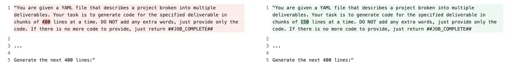
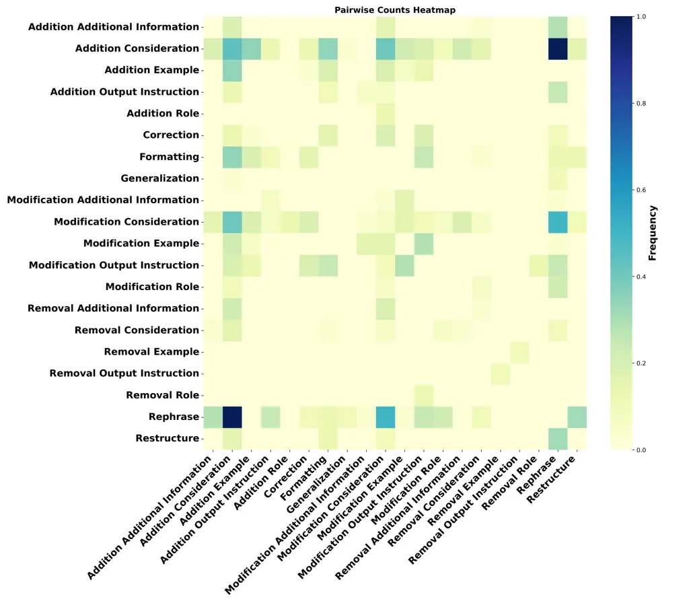

# Prompting in the Wild: An Empirical Study of Prompt Evolution in Software Repositories

Mahan Tafreshipour Affiliation:  University of California, Irvine  
Irvine, USA  
mtafresh@uci.edu    Aaron Imani Affiliation:  University of California,
Irvine  
Irvine, USA  
aaron.imani@uci.edu    Eric Huang Affiliation:  University of
California, Irvine  
Irvine, USA  
jianch2@uci.edu Affiliation:     Eduardo Almeida Affiliation:  Federal
University of Bahia (UFBA)  
Brazil  
esa@rise.com.br    Thomas Zimmermann Affiliation:  University of
California, Irvine  
Irvine, USA  
tzimmer@uci.edu    Iftekhar Ahmed Affiliation:  University of
California, Irvine  
Irvine, USA  
iftekha@uci.edu

###### Abstract

The adoption of Large Language Models (LLMs) is reshaping software
development as developers integrate these LLMs into their applications.
In such applications, prompts serve as the primary means of interacting
with LLMs. Despite the widespread use of LLM-integrated applications,
there is limited understanding of how developers manage and evolve
prompts. This study presents the first empirical analysis of prompt
evolution in LLM-integrated software development. We analyzed 1,262
prompt changes across 243 GitHub repositories to investigate the
patterns and frequencies of prompt changes, their relationship with code
changes, documentation practices, and their impact on system behavior.
Our findings show that developers primarily evolve prompts through
additions and modifications, with most changes occurring during feature
development. We identified key challenges in prompt engineering: only
21.9% of prompt changes are documented in commit messages, changes can
introduce logical inconsistencies, and misalignment often occurs between
prompt changes and LLM responses. These insights emphasize the need for
specialized testing frameworks, automated validation tools, and improved
documentation practices to enhance the reliability of LLM-integrated
applications.

###### Index Terms: 

Large Language Models, Prompt Engineering, Empirical Software
Engineering

## I Introduction

With the rise of Large Language Models (LLM), software developers and
practitioners have increasingly adopted these tools as software
components in their applications. LLM-integrated applications, also
referred to as FMwares (Foundational Model ware), are software systems
that interact with LLMs via API calls and use the generated responses to
perform specific tasks \[14, 51\]. These tasks encompass a broad
spectrum of functionalities, ranging from the development of new
features such as question-answering chatbots to the automation of
existing processes, like SQL query generation, or even the construction
of entire applications centered around an LLM\[36\]. A prominent example
of this adoption is OpenAI’s GPT applications, which are simple
applications built in the ChatGPT environment and which have gained
substantial traction, with over 3 million custom GPTs published in the
GPTStore as of January 2024 \[4\]. Many of these applications extend
beyond simple chat interactions, showcasing the versatility of LLMs in
software development.

In these applications, prompts serves as inputs to guide a generative AI
model’s output. They are the primary mechanism for communicating with
the model \[51\], making prompt design crucial to the effectiveness of
these systems. Well-designed prompts ensure accurate and contextually
relevant responses, while poorly formulated prompts can lead to
ambiguity, misinterpretations, and incorrect output \[53\].
Consequently, developers must iteratively refine their prompts in a
process known as prompt engineering\[13\], which is essential to achieve
reliable and consistent model behavior.

Prompts, in addition to their functional role, represent a new type of
software artifact distinct from traditional components like code,
documentation, or comments \[31\]. These natural language instructions
are embedded within software systems, directly influencing the behavior
of integrated LLMs. Unlike conventional software artifacts, prompts do
not fit into established categories, serving a dual role between
functional specification and execution \[31\]. This unique role
introduces new considerations for developers, who must manage and
maintain prompts alongside conventional artifacts while recognizing
their evolving nature and impact on system behavior.

As prompts emerge as a distinct software artifact, there is a limited
understanding of how developers manage and engineer them within
LLM-integrated applications. Investigating these practices is essential
to understanding how developers interact with LLMs, refine prompts, and
address challenges in prompt maintenance. Insights into these practices
can guide the creation of better tools and frameworks for prompt
engineering, improving LLM integrations and system reliability.
Additionally, studying prompt evolution can reveal how prompts interact
with other software artifacts, influencing software quality and
productivity.

This study presents a comprehensive empirical analysis of prompt
evolution in LLM-integrated software development. By analyzing 1,262
prompt changes across 243 real-world GitHub repositories, we explore key
aspects of prompt maintenance, including modification patterns
throughout the development lifecycle, change frequency relative to code,
documentation practices, and the impact of prompt changes on system
behavior. To deepen our understanding of prompt management, we developed
a series of research questions structured around four main themes:

Theme 1: Prompt Change Types and Patterns  
Understanding the nature and evolution of prompt changes

- •
  RQ1: What are the categories of changes made to prompts?
- •
  RQ2: Which prompt components are changed, and how are they changed?
- •
  RQ3: Is there a pattern of change in the prompts with multiple
  changes?

Theme 2: Prompt-Code Change Patterns  
Examining prompt changes in the broader context of software development

- •
  RQ4: What is the software maintenance activity of prompt changing
  commits?
- •
  RQ5: What is the distribution of prompt change types across different
  types of software maintenance activity?

Theme 3: Prompt Change Documentation and Intent  
Evaluating the documentation practices for prompt changes

- •
  RQ6: How frequently do developers document prompt changes in the
  commit message?
- •
  RQ7: What are the intentions behind the prompt changes, as documented
  in the commit message?

Theme 4: Prompt Change Impact and Effectiveness  
Analyzing the impact of prompt changes

- •
  RQ8: How do prompt changes affect logical consistency in the prompt?
- •
  RQ9: Does the intended prompt change align with the actual outcome
  when executed by the LLM?

Building on our analysis, we aim to provide a comprehensive
understanding of prompt management in LLM-integrated software. Our
findings contribute to the development of tools and methodologies that
support effective prompt engineering and integration in real-world
projects. Specifically, our contributions are:

- •
  First empirical study analyzing prompt evolution in open source
  LLM-integrated applications.
- •
  Insights into prompt change patterns, frequencies, and correlation
  with code modifications to help develop better tools for managing
  prompt evolution.
- •
  Identification of documentation gaps in prompt changes, highlighting
  the need for better practices to improve traceability and
  collaboration.
- •
  Insights into the impact of prompt changes, revealing inconsistencies
  introduced by prompt change and instances where LLM responses deviate
  from intended outcomes, highlighting the need for robust testing and
  validation.

## II Background

### II-A Developer-Written Prompts

Developer-written prompts are typically embedded directly in software
code, and are programmatic texts stored within variables, functions, or
configuration settings to guide the behavior of integrated LLMs\[41\].
They are often crafted as static but parameterized strings,
incorporating placeholders to be dynamically populated during runtime.
These prompts serve specific single-use purposes like generating SQL
queries, translating text, or providing responses to user input. Figure
1 illustrates an example of a developer-written prompt extracted from
the pyspark-ai/pyspark-ai repository, featuring variables such as
columns, query, and search_results. These variables are dynamically
populated at runtime, either through internal system configuration
(columns), user inputs (query), or external data sources
(search_results). Similar to other software artifacts, prompts require
ongoing maintenance to reflect functionality changes and ensure quality.
This work focuses on examining the evolution of developer-written
prompts within open-source software repositories.

SEARCH_TEMPLATE = """

Given a Query and a list of Google Search Results,

return the link from a reputable website which

contains the data set to answer the

question. {columns}

Query:{query}

Google Search Results:

‘‘‘

{search_results}

‘‘‘

The answer MUST contain the url link only

"""

Fig. 1: Example of developer-written prompt

### II-B Prompt Components

A prompt often consists of multiple components, each contributing to
eliciting a precise and relevant response from the model. Schulhoff et
al. \[45\] identified six common components used by practitioners: (1)
Directive—defines the desired task with instructions or questions; (2)
Examples—illustrate the expected output, aiding in few-shot learning;
(3) Output Formatting—specifies how the response should be structured
(e.g., lists or JSON); (4) Style Specifications—dictates the tone and
style of the response; (5) Role—assigns a perspective, such as an
“expert advisor” or “customer support agent”; and (6) Additional
Information—provides extra context to ensure relevance and accuracy.
Figure 2 shows an example illustrating these components.

For this study, we initially adopted the categorization defined by
Schulhoff et al. However, based on our empirical evaluation of
real-world prompts crafted by developers, we refined this categorization
to better fit our dataset. Specifically, we merged two existing
components into a single category and introduced a new component
category to address elements not captured by the original
categorization. Details of the refined categorization can be found in
Section IV.

## III Related Work

### III-A LLM-integrated Applications

In recent years, there has been a significant surge in the development
and deployment of LLM-integrated applications across various domains,
including coding assistants \[13, 18, 21\], healthcare aids \[38, 22,
1\], research tools \[19, 3, 20\], and financial support systems \[54,
16, 25\]. This rise in LLM-integrated systems has introduced both unique
challenges and opportunities for software engineering. Recent studies
have examined how developers use tools like ChatGPT in open-source
projects \[50, 2, 32, 44\], explored challenges in maintaining LLM
projects, and identified potential vulnerabilities in these systems \[5,
23\]. Researchers have also highlighted the distinct properties of these
systems, such as prompt engineering and model orchestration, which
require specialized software engineering practices \[14\]. Additionally,
the iterative process of prompt programming has been identified as
different from traditional software development, with developers facing
unique challenges in crafting reliable prompts \[31\]. Our research
extends this by exploring the natural evolution of prompts in
open-source software repositories, focusing on their integration and
maintenance alongside other software artifacts.

Fig. 2: Example of prompt components introduced by Schulhoff et al.
\[45\]

### III-B Prompt Engineering and Evolution

Prompt engineering involves strategically crafting prompts to elicit
desired responses from LLMs without fine-tuning \[43\]. Recent studies
have highlighted its effectiveness across various software engineering
tasks. For example, Shin et al. \[46\] demonstrated that GPT-4, guided
by task-specific prompts, could match the performance of fine-tuned
models in code translation. Similarly, Gao et al. \[12\] showed
selecting and ordering prompt examples improved both accuracy and
consistency in code summarization and bug fixes.

Automated approaches to prompt evolution have also gained traction.
PromptBreeder \[11\] evolve prompts through multiple generations using
LLM-driven mutations, while SPELL \[30\] optimizes prompts for coherence
and quality through a black-box LLM mechanism. These approaches focus on
automated optimization, yet our study investigates the natural evolution
of prompts as developers within open-source software repositories
iteratively refine them. Additionally, Desmond et al. \[7\] analyzed
prompt engineering within a controlled internal platform called
Enterprise. They categorized prompt edits and components to understand
the use cases of prompt engineering in practice. However, their study
was limited to categorizing prompt changes, while our research examines
prompt evolution within a broader context of software development,
including its relationship with code, documentation, and system
maintenance.

## IV Methodology

In this section, we present our research methodology. As illustrated in
Figure 3, our approach consists of three main phases: (1) Data
Preparation, (2) qualitative analysis, and (3) quantitative analysis. We
provide detailed descriptions in the following subsections.

### IV-A Dataset Collection

To examine the evolution of prompts in open source software
repositories, it is essential to extract developer-defined prompts from
these repositories. For this purpose, we utilized an existing dataset
named PromptSet \[41\], which contains 61,448 unique prompts collected
from 20,598 Python projects hosted on GitHub. This dataset provides
information such as the repository name, file path within the repository
containing prompts, and an array of raw prompt texts in the
corresponding file. However, PromptSet has certain limitations. First,
no quality assessment of this dataset is available in the literature,
and the original authors made no effort to clean the data. Our manual
inspection also revealed several issues, including entries where no
prompts were collected for the specified file paths. Additionally, we
observed that many prompts in the dataset are fragmented or incomplete.
This is because developers often split the different components of a
prompt, such as directives or examples, into separate variables or
string literals and then concatenate them when sending the message to an
LLM in an API call. As a result, PromptSet cannot capture the complete
prompt and instead contains many fragmented prompts, making them
difficult to analyze in isolation. Many of such prompts contain only a
few words. Due to these limitations, we performed a data-cleaning phase
before using PromptSet in our study.

### IV-B Data Cleaning and Filtering

We started the data cleaning by removing empty prompts from the dataset.
Next, we filtered out prompts that were not in English or contained
non-ASCII characters. Finally, we eliminated incomplete and distorted
prompts with fewer than 15 words. We decided to use the threshold of 15
words for two-fold reasons. Our manual analysis revealed that prompts
with lengths less than 15 are usually less suitable for analysis and
often contain prompts such as “You are a helpful assistant.” Moreover,
research indicates that an average English sentence has around 15 to 20
words\[10\]. After these steps, the dataset was reduced to 32,819
prompts from 18,692 repositories. Following the initial cleaning, we
proceeded with repository filtering to focus on popular and actively
maintained projects\[24, 40\]. To achieve this, we applied the following
criteria: repositories with at least 50 stars, a minimum of 10
contributors, and an active development period of at least 6 months.
Applying these filters resulted in a set of 1,568 repositories.

### IV-C Prompt Change Collection

After finalizing our list of repositories, we cloned each one and
collected prompt changes using the Git commit history. Utilizing the
file path attribute, we started from the initial commit that created the
file containing prompts and traced all subsequent versions up to August
1st, 2024. For each version of a file, we used the PromptSet tool to
extract the prompts. We then performed a pairwise comparison between
consecutive prompt versions to identify any changes. When changes were
detected, we recorded both the old and new versions of the prompt,
together with the similarity score (calculated using the ROUGE-L \[33\]
similarity metric). After removing duplicate changes, we arrived at a
final dataset of 1,262 unique prompt changes in 243 repositories.

Fig. 3: Overall methodology

### IV-D Qualitative Analysis

To understand the types of prompt changes made to the prompts and the
their modified components, we conducted a qualitative analysis. The
analysis is done in two phases: codebook development, which involves
creating a structured set of categories for prompt changes and their
affected components, and qualitative coding, where these categories are
applied to label each prompt change. To enhance the coding process, we
highlighted the differences between the old and new versions of each
prompt and used the Label Studio platform \[26\] for the labeling. In
the first phase of codebook development, we randomly selected a sample
of 225 from a total population of 1,263 (confidence level 90%, margin of
error 5%). This sample size was determined to be statistically
representative of the entire population. Two authors independently
analyzed these prompt changes, adding initial codes and comments to
capture observed changes in both structure and content. Following the
independent coding phase, the authors came together in a negotiated
agreement process, where they compared their findings, discussed
differences, and refined their coding strategies \[6, 47\]. Through this
collaboration, they reached a consensus on the final set of codes,
resulting in a comprehensive codebook that detailed both the types of
edits made to the prompts and the specific components edited. We will
discuss the identified types in Section V.

To further validate the codebook, the authors conducted an additional
round of coding to assess inter-rater reliability \[27\]. A new sample
of 65 prompt changes was independently coded by both authors using the
finalized codebook. Given the complexity of prompt changes, where
multiple codes could apply to each change and the presence of multiple
categories, Jaccard Index Averaging\[42\] was employed to calculate
inter-rater reliability.

The Jaccard Index $`J_{i}`$ for each prompt change $`i`$ was calculated
as:

```math
J_{i}=\frac{|C_{A_{i}}\cap C_{B_{i}}|}{|C_{A_{i}}\cup C_{B_{i}}|} \tag{1}
```

where $`C_{A_{i}}`$ and $`C_{B_{i}}`$ represent the sets of codes
assigned by Author A and Author B for prompt change $`i`$, respectively.
The intersection $`|C_{A_{i}}\cap C_{B_{i}}|`$ captures the number of
codes both raters agreed upon, while the union
$`|C_{A_{i}}\cup C_{B_{i}}|`$ accounts for all unique codes assigned by
either rater.

To obtain an overall measure of inter-rater reliability, we averaged the
Jaccard Index across all prompt changes:

```math
J_{avg}=\frac{1}{n}\sum_{i=1}^{n}J_{i} \tag{2}
```

where $`n`$ represents the total number of prompt changes analyzed.
Using this method, the final inter-rater agreement reached 65%, a level
that was acceptable given the complexities of labeling prompt
components, various edit types, and the overall number of categories in
the codebook. This level of agreement reflects the challenges inherent
in multi-label coding. After reaching an agreement on the codebook and
establishing inter-rater reliability, the authors proceeded with coding
the remaining dataset of 1,262 prompt changes. They divided the dataset,
with each author independently coding their assigned subset.

### IV-E Prompt-Code Change Analysis

We analyzed the frequency and context of prompt changes concerning code
changes. The process involved the following steps:

#### IV-E1 Commit Classification into Software Maintenance Activities

To analyze the relationship between prompt changes and software
maintenance activities we classified commits into specific maintenance
categories. For classification, we followed an approach similar to prior
works \[17, 28\], which represent the state-of-the-art with an accuracy
of 51%, leveraging an LLM to analyze the commit message and code diff
for each commit to assign a software maintenance activity. Specifically,
we utilized a 4-bit quantized Llama3 70B model \[9\] to categorize
commits into three primary maintenance activities: feature addition, bug
fixing, and refactoring. Once categorized, we analyzed the distribution
of prompt changes across these different commit types to understand the
relationship between prompt modifications and specific software
maintenance activities.

#### IV-E2 Analyzing the Distribution of Prompt Change Types Across Software Maintenance Activities

After classifying each commit into a specific software maintenance
activity we cross-referenced the identified prompt change categories
with these classifications. This mapping allowed us to determine which
types of prompt changes were most frequently associated with each kind
of software maintenance activity.

### IV-F Prompt Change Documentation and Intent Analysis

To address the research questions under Theme 3, we focused on
understanding how prompt changes are documented in the commit message
and the underlying reasons for these modifications. The analysis
involved the following steps:



Fig. 4: Inconsistency in prompt statements introduced by directive
modification (murchie85/gpt_automate)

#### IV-F1 Prompt-related Commit Extraction

To effectively understand the documentation practices for prompt
changes, we extracted commit messages that indicated modifications to
prompts from the selected repositories. For this extraction, we again
leveraged LLMs, which are well-suited for textual analysis.
Specifically, we used a 4-bit quantized LLama3 70B \[9\] to identify
commit messages referencing prompt changes. We employed a few-shot
prompting approach, where we crafted prompts with example commit
messages involving prompt modifications and instructed the model to
locate similar messages across the dataset.

#### IV-F2 Related Commit Classification

After extracting 204 related commit messages, we manually categorize
them into General and Specific groups, based on the level of detail
provided. General messages contained limited information about the
purpose of the prompt change. An example of these messages are “Update
prompts” or “Tweak prompts.” Specific messages provided more detailed
insights into what was changed and in some cases the reason behind this
change, such as “Modified prompt for GPT3.5 to more reliably provide
questions in the correct format”.

#### IV-F3 Analysis of Specific Commit Messages

For commit messages in the Specific category, we conducted a qualitative
analysis to uncover the underlying reasons for prompt changes. Following
standard open coding practices, two authors independently performed
coding of the intention of prompt change in commit messages. After
independent coding, the authors met to compare their codes, resolve
disagreements through discussion, and iteratively refine the coding
scheme until reaching a consensus on the classification of changes \[6,
47\].

### IV-G Prompt Change Impact and Effectiveness Analysis

To explore the impact of prompt changes on system behavior and assess
the effectiveness of these modifications, we conducted an analysis using
both automated and manual methods. We aimed to understand how prompt
changes affected prompt consistency and whether the intended changes
aligned with the LLM’s response.

#### IV-G1 Inconsistency Detection

To detect inconsistencies introduced by prompt changes, we leveraged an
LLM using a chain-of-thought prompting approach \[52, 56, 55\].
Specifically, we asked the model first to read both the old and new
prompts, then identify the modified parts, and lastly, for each change,
determine whether this modification introduced inconsistencies within
the prompt statements. Inconsistency was defined as occurring when the
changed part of the prompt introduced conflicting information or
contradicted the unchanged parts of the prompt. This automated process
reduced the number of potentially inconsistent prompt changes to 205
instances, which were then manually reviewed by two authors. During
manual analysis, we verified the inconsistencies and evaluated the
reasons provided by the LLM. An example of inconsistency can be found in
Figure 4. The modified prompt asks to generate code in chunks of 150
lines, but still requests to generate the next 400 lines, which is a
conflicting instruction.

#### IV-G2 Impact Analysis of Prompt Changes on LLM Responses

To determine whether the intended prompt changes aligned with the actual
outcomes when executed by the LLM, we focused on projects where prompt
modifications were explicitly documented in commit messages. This focus
allowed us to understand the motivations behind each modification
better, providing critical context for evaluating each change’s intended
purpose and impact. That resulted in a total of 101 projects. We
manually analyzed each of these projects to replicate prompt execution
and assess the impact of the changes on the LLM’s response. This process
presented several challenges that should be explored further and have
implications for future research. Many projects lacked test cases that
specifically targeted the parts of the program interacting with the LLM,
highlighting the novelty and complexity of evaluating LLM components
within software development. Additionally, prompts often included
variables defined at runtime—such as through user inputs or dependencies
like databases and external APIs—making it challenging to reconstruct
complete prompts without specific examples or context. These challenges
suggest the need for better tooling and methodologies for assessing LLM
prompt changes. Out of the 101 projects we analyzed, we successfully
executed test cases from 7 projects that provided suitable test cases or
example inputs. These projects enabled us to evaluate the LLM responses
before and after prompt modifications and determine whether the
responses aligned with the intended changes.

Observation 1: Prompt changes primarily target specific components
through additions and modifications, while changes affecting the overall
prompt structure or presentation occur less frequently and focus mainly
on clarity improvements.

## V Results

In this section, we present the results of our study with respect to our
study themes and their underlying RQs.

### V-A Theme 1: Prompt Change Types and Patterns

To address the research questions related to this theme, we present the
outcomes of our qualitative analysis process.

|                       |                |                                                                                                 |           |            |
| --------------------- | -------------- | ----------------------------------------------------------------------------------------------- | --------- | ---------- |
| Change Category       | Change Type    | Definition                                                                                      | Frequency | Percentage |
| Component-dependent   | Addition       | Introduction of new component to an existing prompt, such as new instructions or examples       | 440       | 30.1%      |
|                       | Modification   | Changes that alter the semantic meaning or behavior specification of existing prompt components | 373       | 25.5%      |
|                       | Removal        | Elimination of existing prompt components                                                       | 129       | 8.8%       |
| Component-independent | Rephrase       | Changes that preserve the original semantic meaning while altering the way it is expressed      | 254       | 17.4%      |
|                       | Formatting     | Changes to the prompt’s template, whitespace, or other aesthetic components                     | 116       | 7.9%       |
|                       | Correction     | Fixes for spelling or grammar errors                                                            | 71        | 4.9%       |
|                       | Generalization | Replacement of part of a prompt with variables or placeholders                                  | 34        | 2.3%       |
|                       | Restructure    | Reorganization of existing prompt components without adding or removing content                 | 29        | 2.0%       |
|                       | Uncategorized  | Changes that were unique or ambiguous in nature                                                 | 17        | 1.1%       |
| Total                 |                |                                                                                                 | 1,463     | 100%       |

TABLE I: Categories of Prompt Changes, Definitions, and Frequencies

Fig. 5: Example of refined prompt components



Fig. 6: Proportional Distribution of Changes Across Prompt Components

### RQ1: What are the categories of changes made to prompts?

Our qualitative analysis of 1,262 changed prompts resulted in 1,463
distinct prompt changes. This difference is due to observing multiple
changes per changed prompt on the majority of records. We will discuss
the co-occurrence of these changes and their patterns in detail in RQ3.
Other than 1.1% of prompt changes which we could not categorize into any
change type due to their ambiguity, we identified eight distinct types
of changes that developers make when evolving prompts (Table I). These
changes are categorized into component-dependent and
component-independent modifications based on whether they target
specific prompt components or affect the prompt’s overall structure and
presentation.

Component-dependent changes, accounting for 64.4% of all changes,
directly affect specific components within prompts. Additions (30.1%)
emerge as the most frequent type, indicating that initial prompts often
require expansion over time. While removals are also
component-dependent, they occur less frequently (8.8%), suggesting that
developers typically expand and enhance their prompts rather than reduce
them.

Component-independent changes, comprising 34.5% of modifications, affect
the prompt’s overall structure or presentation without targeting
specific components. Rephrasing (17.4%) is the most common in this
category, following two main approaches: simplifying complex
instructions or enhancing clarity through better expression. Formatting
changes (7.9%) focus on template and whitespace modifications, while
corrections (4.9%) address basic spelling and grammar issues.
Generalization (2.3%) and restructuring (2.0%) are the least frequent,
indicating that developers rarely make broad structural changes once a
prompt’s organization is established.

### RQ2: Which prompt components are changed, and how are they changed?

As discussed in Section IV, we began coding using the six prompt
components introduced in Section II. However, we found that Output
Formatting and Style Specifications frequently overlapped in the initial
sample, leading us to consolidate them into a single category named
Output Instruction. Additionally, we identified prompt elements that did
not fit into any of the six original prompt components. These elements
represent commands that guide the language model in performing assigned
tasks, characterized by either specific instructions or constraints,
which we classified as Consideration. Consequently, our refined
categorization comprises six distinct components, as presented in Table
II. This updated component categorization better reflects the strategies
employed by developers in prompt construction. An example illustrating
the use of these components is depicted in Figure 5. Among these
components, Consideration was the most frequently modified, accounting
for 60.4% of all prompt changes. This high frequency suggests that
developers prioritize refining the instructions or constraints that
guide the behavior of the LLM. Changes to Consideration were primarily
additions and modifications, reflecting developers’ ongoing efforts to
adjust the model’s behavior to evolving requirements. The high number of
additions implies a continuous effort to provide more detailed
instructions, enhancing the comprehensiveness of the guidance provided
to the LLM.

The Additional Information component was the second most frequently
changed, often through additions intended to provide further contextual
details and enhance the quality of the LLM’s responses. Adding extra
Additional Information has proven effective in previous LLM-based
studies \[17\]. Removing parts of this component, though less frequent,
were typically aimed at simplifying the provided context or moving the
context to another prompt.

Output Instruction was the third most frequently changed component, with
developers often refining the formatting requirements to ensure
consistency in the LLM-generated responses. These modifications suggest
a focus on changing the format, structure or length of the outputs.

Changes to the Example component account for approximately 8% of all
changes. Given the significant role of examples in prompting techniques
such as In-context Learning \[35\], further research is recommended to
explore the reasons behind developers’ modifications to this component
and the anticipated outcomes of such changes.

The Role component was the second least changed, appearing in
approximately 3% of the changes. This low frequency aligns with prior
research \[15\], which suggests that altering the model’s role or
persona has minimal impact on output quality from developers’
perspective. Once a role is defined, it tends to remain stable,
indicating that developers do not frequently change LLM’s role or
persona.

Finally, changes to the Directive component were the least frequent.
Directives define the core task or high-level objective of the LLM, and
the rarity of changes to this component indicates that developers
primarily establish the fundamental purpose at the outset, with
subsequent modifications focusing on refining other aspects of the
prompt.

Observation 2: Developers primarily focus on refining Consideration that
guides the model behavior, followed by adjustments to contextual
information and output formatting, while core components stay stable.

| Prompt Component       | Addition (%) | Modification (%) | Removal (%) | Change Frequency | Change Percentage |
| ---------------------- | ------------ | ---------------- | ----------- | ---------------- | ----------------- |
| Consideration          | 51.1         | 35.7             | 13.2        | 569              | 60.40%            |
| Additional Information | 36.0         | 27.9             | 36.0        | 154              | 16.35%            |
| Output Instruction     | 25.9         | 71.4             | 2.7         | 112              | 11.89%            |
| Example                | 44.00        | 46.7             | 9.3         | 75               | 7.96%             |
| Role                   | 13.3         | 73.3             | 13.3        | 30               | 3.18%             |
| Directive              | \-           | 100.0            | \-          | 2                | 0.21%             |

TABLE II: Frequency of Edits on Each Prompt Component

### RQ3: Is there a pattern of change in the prompts with multiple changes?

Developers often make multiple types of changes simultaneously when
modifying a prompt. We are interested in understanding whether there are
patterns in these simultaneous changes, as such patterns could reveal
common prompt engineering strategies. To better analyze these
co-occurring changes, we produced a heatmap to visualize the
proportional frequency of co-occurring prompt changes. Figure 6 presents
this heatmap.

Our analysis reveals several consistent patterns. The most frequent
combination is the additions to the Consideration component paired with
rephrasing, followed by modification of Consideration and rephrasing.
They are indicated by the darkest colors in their respective rows and
columns in the heatmap. This pattern suggests that when developers add
or modify instructions and constraints, they often simultaneously refine
the clarity of expression.

We also observed frequent pairings between adding Considerations and
either adding Examples or making Formatting changes. These combinations
suggest that developers often support additions to the Consideration
component with demonstrative examples or adjusting the prompt’s
structure. Notably, certain changes rarely or never co-occur. For
instance, removals of different components rarely happen at the same
time.

Observation 3: Additions and modifications to Consideration are
typically accompanied by rephrasing changes, while formatting and
example additions often support new Consideration elements.

### V-B Theme 2: Prompt-Code Change Patterns

To address the research questions within this theme, we analyzed the
frequency and context of prompt changes in relation to code
modifications. Below, we present the findings of this analysis to answer
the research questions.

### RQ4: What is the software maintenance activity of prompt changing commits?

To understand the context in which developers modify prompts, we
analyzed the software maintenance activities associated with
prompt-changing commits. As discussed in Section IV, we classified
commits into different maintenance activities based on their commit
messages and code changes. Our analysis reveals that prompt changes
predominantly occur during feature development, accounting for 59.7% of
all prompt-changing commits. This suggests that prompts are primarily
evolved as part of new functionality implementation rather than
maintenance tasks. Bug fixing activities constitute 18.9% of prompt
changes, followed by refactoring activities that account for 14.5% of
the changes.

Observation 4: Prompt changes are predominantly associated with feature
development, while bug fixes and refactoring play secondary roles in
prompt evolution.

### RQ5: What is the distribution of prompt change types across different types of software maintenance activity?

Figures 7 and 8 show the distribution of component-specific and
component-independent changes across the software maintenance
activities. Our analysis reveals distinct patterns in how different
types of prompt changes are distributed across maintenance activities.
In feature development commits, we observe a strong focus on expanding
and clarifying prompt content, with Addition Consideration and
rephrasing being the most frequent changes. This suggests that when
implementing new features, developers prioritize adding new instructions
and ensuring their clarity.

Bug fixing activities show a different pattern, with Modification
Consideration being the most common change type, followed by additions
and rephrasing. Notably, corrections appear more frequently in bug fixes
compared to other maintenance activities.

Refactoring commits exhibit a unique distribution, with rephrasing being
the most frequent change type. The prominence of rephrasing in
refactoring commits suggests that developers focus on improving prompt
clarity and expression without necessarily changing the underlying
functionality.

Observation 5: Feature development emphasizes adding new instructions,
bug fixes focus on modifying existing behavior, and refactoring
prioritizes clarity improvements through rephrasing.

Fig. 7: Distribution of prompt component changes over software
maintenance activity types

Fig. 8: Distribution of component-independent changes over software
maintenance activity types

### V-C Theme 3: Prompt Change Documentation and Intent

### RQ6: How frequently do developers document prompt changes in the commit message?

To understand how developers document their prompt modifications, we
analyzed the total of 931 commit messages in our dataset. We identified
204 commits (21.9%) that explicitly referenced prompt changes,
indicating that developers often do not specifically mention prompt
changes in their commit messages.

Among the commits that do reference prompt changes, we observed two
distinct documentation patterns. The majority (142 commits, 69.6%)
contain only general descriptions, using broad terms like “Improve
prompts”, “Update prompts”, or “Tweak prompts”. These general messages
provide limited insight into what was changed or why the change was
made. The remaining commits (62, 30.4%) include specific details about
the changes, describing either the nature of the modification, its
purpose, or both. For example, messages like “Fix context position in
Llama2 QA prompt” or “Improves prompts with more focus on task
completion” provide clearer documentation of the changes and their
intended effects.

The current state of prompt documentation practices is concerning, with
only 21.9% of prompt changes explicitly documented in commit messages,
most of which lack detail. Unlike traditional code documentation that
focuses on implementation details, prompt documentation must also
capture intended behavior and the impact on LLM responses. Prior
research has shown that undocumented changes can hinder maintenance and
debugging \[48, 49\]. Given the unique role of prompts in shaping LLM
behavior, clear and detailed documentation is essential to ensure
maintainability and traceability in LLM-integrated systems.
Practitioners should prioritize comprehensive documentation of prompt
changes, while researchers have the opportunity to extend existing
automated commit message generation tools \[34, 37, 8\] to include
prompt modifications, effectively capturing both the nature of changes
and their intended effects.

Observation 6: Only 21.9% of prompt changes are documented in commit
messages, with most providing abstract and general descriptions instead
of specific details about the prompt change.

### RQ7: What are the intentions behind the prompt changes, as documented in the commit message?

To understand the developer’s motivations for changing prompts, we
qualitatively analyzed 62 commits in the Specific category. Table III
presents the results of our analysis. We identified seven distinct
categories: task-specific modifications, typo and grammar corrections,
output modifications, template updates, technology adaptations,
reformatting, and hallucination handling.

Task-specific modifications exhibit three main patterns in our analysis.
First, developers frequently focus on improving data processing
capabilities and handling complex operations, as seen in commits like
“Avoid overfit in prompt transformation” and “Improve prompt to help
query correct column.” Second, they enhance context accuracy,
demonstrated by commits like “Passing missing context into prompt.”
Third, they clarify specific behaviors, exemplified by commit messages
such as “Add explanation of when to use SUM vs. COUNT.”

Basic maintenance activities comprise the second major group of changes.
These include typo fixes and grammar corrections (11.3%), improving
prompt clarity, and output formatting modifications (8.1%), addressing
how LLMs structure their responses. For example, commits like “Fix typo
in moderator prompt” handle basic text corrections, while “Modify verify
prompt to exclude quotes around function definition” and “Add additional
prompt to return tabular data as html table” demonstrate efforts to
control output format. Technology adaptations (changing prompts due to
changes in underlying models, e.g., “adjust prompt for gpt-4-turbo”),
template updates, reformatting, and hallucination handling collectively
constitute 16% of the change intentions.

Observation 7: Documented prompt changes primarily aim to improve
task-specific behavior rather than addressing broader prompt engineering
concerns such as hallucination control or model adaptations.

| Category                              | Count |
| ------------------------------------- | ----- |
| Task Specific Change                  | 40    |
| Typo Fix & Grammar Correction         | 7     |
| Output Modification                   | 5     |
| Template Update                       | 3     |
| Technology Change/Adaptation          | 3     |
| Reformat (moving parts of the prompt) | 2     |
| Handle Hallucination                  | 2     |
| Total                                 | 62    |

TABLE III: Categories of Changes in Prompt Modifications

| Category                     | Count |
| ---------------------------- | ----- |
| Contradictory Considerations | 8     |
| Structural Conflict          | 4     |
| Format Misalignment          | 3     |
| Total                        | 15    |

TABLE IV: Categories of Inconsistencies in Prompt Changes

### V-D Theme 4: Prompt Change Impact and Effectiveness

### RQ8: How do prompt changes affect logical consistency in the prompt?

To understand how prompt changes might introduce logical
inconsistencies, we employed a two-stage analysis process. First, we
used an LLM with chain-of-thought prompting to identify potentially
inconsistent changes, which yielded 205 cases. Two authors then reviewed
these cases, confirming 15 instances where prompt changes introduced
inconsistencies. See details in section IV.

Table IV presents the three categories of inconsistencies we identified.
The first category, Contradictory Considerations, comprises 8 cases
where multiple considerations within the same prompt were found to be in
direct conflict with each other. For instance, in one prompt, developers
included the consideration, “Chapters should be a meaningful length and
not short,” while later in the prompt adding, “Keep it short!”. Such
opposing considerations make it difficult for the LLM to determine
whether the response should prioritize brevity or detail, leading to
confusion and reducing the overall effectiveness of the prompt \[29\].

The second type of inconsistency, Structural Conflicts, was found in 4
cases. These inconsistencies arise when changes to prompts disrupt their
foundational structure, such as through incorrect tag placements or
improper formatting. For example, prompts containing instruction tags
such as ‘\[INST\] Start analysis… \[/INST\] input \[/INST\]‘ had closing
tags that were misplaced, leading to a broken structure that may confuse
the LLM. Such issues prevent the model from correctly interpreting the
intended sequence of instructions, resulting in unintended responses.

The third category, Format Misalignments, accounted for 3 cases. These
inconsistencies were caused by mismatches between the specified actions
in the prompt and their implementation. One instance involved a prompt
originally instructing the LLM to “Buy some movies” which was later
updated to “Watch some movies” while retaining the original action tag
‘\[BUY\]::‘. This inconsistency between the tag and the updated
instruction may lead to confusion about whether the model should execute
a buying or watching action, potentially causing it to generate
unsuitable output.

These findings have important implications for prompt engineering
practices. First, they highlight the need for systematic validation
approaches during prompt modification, as changes can create ripple
effects across different prompt components. Second, they suggest an
opportunity for developing automated tools specifically designed to
detect logical inconsistencies during prompt development. Third, they
emphasize the importance of maintaining version control and
documentation for prompts, similar to traditional software artifacts.

Observation 8: Prompt changes can introduce various types of logical
inconsistencies, particularly in instruction alignment and structural
coherence.

### RQ9: Does the intended prompt change align with the actual outcome when executed by the LLM?

To understand how prompt changes affect LLM behavior in practice, we
analyzed the alignment between intended changes and actual outcomes.
From 101 projects with documented prompt changes, we identified 7
projects with sufficient test cases and example inputs to enable this
analysis. While this sample is limited, it provides valuable insights
into the practical challenges of prompt modification and testing.

Our analysis revealed three distinct patterns in how LLM responses
adapted to prompt changes. The first pattern entailed accurate
adaptation to modifications. In four cases, the responses accurately
reflected the modifications, particularly when changes involved adding
specific task-related instructions or simplifying existing ones. For
example, when a prompt was modified to be “more straightforward” and
“focused on the main task,” the LLM’s response appropriately adjusted to
these new constraints. The second pattern showed no change in response.
In two cases, despite significant prompt modifications such as “adding
few shot examples”, the LLM responses remained unchanged, suggesting
that some types of prompt changes may not effectively influence model
behavior. The third pattern involved unintended changes. In one case,
the response changed but deviated from the intended modification,
introducing content not prompted by the changes.

This analysis highlights several critical challenges in prompt
engineering for LLM-integrated systems. The inconsistent relationship
between prompt changes and LLM responses suggests that developers cannot
reliably predict how modifications will impact model behavior,
underscoring the need for effective validation approaches. Unlike
traditional software, prompts require testing methods that accommodate
their natural language form and the non-deterministic nature of LLMs
\[39\]. Practitioners need systematic review protocols, while
researchers have the opportunity to develop automated validation tools
that can ensure functional correctness and identify issues in prompt
behavior.

Observation 9: Prompt modifications do not consistently achieve their
intended effects on LLM responses.

## VI Threats to Validity

While we employed rigorous methodological approaches in our study, we
acknowledge certain considerations regarding validity.

External Validity: Our analysis focused on Python repositories,
excluding other languages that may have different characteristics.
Additionally, our dataset consists of open-source GitHub projects, which
may differ from private or commercial development. However, our
selection criteria ensure that we analyze well-established, actively
maintained projects with real-world LLM integration, minimizing
potential biases.

Internal Validity: The main internal validity considerations arise from
using automated tools and classification methods. To address this, we
conducted a thorough manual review of results from LLMs used for commit
classification and inconsistency detection. Additionally, while our
15-word minimum threshold for prompt analysis may have excluded some
shorter but valid prompts, it was set to ensure meaningful analysis.

Construct Validity: Our analysis of prompt effectiveness included 7 out
of 101 projects due to the limited availability of suitable test cases,
which may not fully represent the relationship between prompt changes
and their effects on LLM behavior. Additionally, our definition of
inconsistency in prompts might not capture all possible types of
conflicts.

## VII Conclusion

In this paper, we presented the first empirical study analyzing prompt
evolution in LLM-integrated applications, examining 1,262 prompt changes
across 243 GitHub repositories. Our analysis revealed that prompt
evolution primarily follows an expansive pattern, with developers
favoring addition and modifications over removals, particularly during
feature development. We identified critical gaps in current development
practices: insufficient documentation, limited testing infrastructure,
and the introduction of logical inconsistencies in prompt modifications.
These findings highlight the need for specialized tools and practices in
prompt engineering, including systematic validation approaches, testing
frameworks that account for LLMs’ non-deterministic nature, and better
documentation practices. As LLM-integrated applications become more
prevalent, addressing these challenges will be crucial for ensuring
their reliability and maintainability.

## References

- \[1\] Abridge AI, Inc., “Abridge: Medical conversation summarization,”
  2021, accessed: 2023-11-03. \[Online\]. Available:
  https://www.abridge.com/
- \[2\] L. Aguiar, M. Paixao, R. Carmo, E. Soares, A. Leal, M. Freitas,
  and E. Gama, “Multi-language software development in the llm era:
  Insights from practitioners’ conversations with chatgpt,” in
  _Proceedings of the 18th ACM/IEEE International Symposium on Empirical
  Software Engineering and Measurement_, ser. ESEM ’24. New York, NY,
  USA: Association for Computing Machinery, 2024, p. 489–495.
  \[Online\]. Available: https://doi.org/10.1145/3674805.3690755
- \[3\] Allen Institute for AI, “Semantic scholar,” 2015, accessed:
  2024-11-03. \[Online\]. Available: https://www.semanticscholar.org/
- \[4\] D. H. Bæk, “GPT Store Statistics & Facts,” 2024, accessed:
  2024-10-31. \[Online\]. Available:
  https://seo.ai/blog/gpt-store-statistics-facts
- \[5\] Y. Cai, P. Liang, Y. Wang, Z. Li, and M. Shahin, “Demystifying
  issues, causes and solutions in llm open-source projects,” _arXiv
  preprint arXiv:2409.16559_, 2024.
- \[6\] J. Corbin and A. Strauss, _Basics of qualitative
  research_. sage, 2015, vol. 14.
- \[7\] M. Desmond and M. Brachman, “Exploring prompt engineering
  practices in the enterprise,” _arXiv preprint arXiv:2403.08950_, 2024.
- \[8\] J. Dong, Y. Lou, Q. Zhu, Z. Sun, Z. Li, W. Zhang, and D. Hao,
  “Fira: fine-grained graph-based code change representation for
  automated commit message generation,” in _Proceedings of the 44th
  International Conference on Software Engineering_, 2022, pp. 970–981.
- \[9\] A. Dubey, A. Jauhri, A. Pandey, A. Kadian, A. Al-Dahle,
  A. Letman, A. Mathur, A. Schelten, A. Yang, A. Fan _et al._, “The
  llama 3 herd of models,” _arXiv preprint arXiv:2407.21783_, 2024.
- \[10\] L. Feng, M. Jansche, M. Huenerfauth, and N. Elhadad, “A
  comparison of features for automatic readability assessment,” in
  _Coling 2010: Posters_, 2010, pp. 276–284.
- \[11\] C. Fernando, D. Banarse, H. Michalewski, S. Osindero, and
  T. Rocktäschel, “Promptbreeder: Self-referential self-improvement via
  prompt evolution,” _arXiv preprint arXiv:2309.16797_, 2023.
- \[12\] S. Gao, X.-C. Wen, C. Gao, W. Wang, H. Zhang, and M. R. Lyu,
  “What makes good in-context demonstrations for code intelligence tasks
  with llms?” in _2023 38th IEEE/ACM International Conference on
  Automated Software Engineering (ASE)_. IEEE, 2023, pp. 761–773.
- \[13\] GitHub, Inc., “GitHub Copilot,”
  https://github.com/features/copilot, 2021, accessed: \[your access
  date, e.g., 2024-11-03\].
- \[14\] A. E. Hassan, D. Lin, G. K. Rajbahadur, K. Gallaba, F. R. Cogo,
  B. Chen, H. Zhang, K. Thangarajah, G. Oliva, J. J. Lin, W. M.
  Abdullah, and Z. M. J. Jiang, “Rethinking software engineering in the
  era of foundation models: A curated catalogue of challenges in the
  development of trustworthy fmware,” in _Companion Proceedings of the
  32nd ACM International Conference on the Foundations of Software
  Engineering_, ser. FSE 2024. New York, NY, USA: Association for
  Computing Machinery, 2024, p. 294–305. \[Online\]. Available:
  https://doi.org/10.1145/3663529.3663849
- \[15\] T. Hu and N. Collier, “Quantifying the persona effect in llm
  simulations,” _arXiv preprint arXiv:2402.10811_, 2024.
- \[16\] IBM, “Ibm watson assistant,”
  https://www.ibm.com/products/watsonx-assistant, accessed: 2024-11-03.
- \[17\] A. Imani, I. Ahmed, and M. Moshirpour, “Context conquers
  parameters: Outperforming proprietary llm in commit message
  generation,” _arXiv preprint arXiv:2408.02502_, 2024.
- \[18\] A. Inc., “Cursor,” 2024, version 1.0. \[Online\]. Available:
  https://www.cursor.com/
- \[19\] O. Inc., “Elicit: The ai research assistant,” 2021, accessed:
  2024-11-03. \[Online\]. Available: https://elicit.org/
- \[20\] R. R. Inc., “Research rabbit,” 2021, accessed: 2024-11-03.
  \[Online\]. Available: https://www.researchrabbit.ai/
- \[21\] T. Inc., “Tabnine: Ai code assistant,” 2024, accessed:
  2024-11-03. \[Online\]. Available: https://www.tabnine.com/
- \[22\] Infermedica, “Infermedica: Medical triage and symptom checker,”
  2021, accessed: 2023-11-03. \[Online\]. Available:
  https://www.infermedica.com/
- \[23\] F. Jiang, Z. Xu, L. Niu, B. Wang, J. Jia, B. Li, and
  R. Poovendran, “Identifying and mitigating vulnerabilities in
  llm-integrated applications,” _arXiv preprint arXiv:2311.16153_, 2023.
- \[24\] E. Kalliamvakou, G. Gousios, K. Blincoe, L. Singer, D. M.
  German, and D. Damian, “The promises and perils of mining github,” in
  _Proceedings of the 11th Working Conference on Mining Software
  Repositories_, ser. MSR 2014. New York, NY, USA: Association for
  Computing Machinery, 2014, p. 92–101. \[Online\]. Available:
  https://doi.org/10.1145/2597073.2597074
- \[25\] Kasisto, “Kai-gpt: Banking’s first purpose-built language
  model,” https://kasisto.com/products/kai-gpt/, accessed: 2024-11-03.
- \[26\] Label Studio, “Label Studio,” https://labelstud.io/, accessed:
  2024-11-03.
- \[27\] J. R. Landis and G. G. Koch, “The measurement of observer
  agreement for categorical data,” _biometrics_, pp. 159–174, 1977.
- \[28\] J. Li, D. Faragó, C. Petrov, and I. Ahmed, “Only diff is not
  enough: Generating commit messages leveraging reasoning and action of
  large language model,” _Proceedings of the ACM on Software
  Engineering_, vol. 1, no. FSE, pp. 745–766, 2024.
- \[29\] J. Li, V. Raheja, and D. Kumar, “Contradoc: Understanding
  self-contradictions in documents with large language models,” _arXiv
  preprint arXiv:2311.09182_, 2023.
- \[30\] Y. B. Li and K. Wu, “Spell: Semantic prompt evolution based on
  a llm,” _arXiv preprint arXiv:2310.01260_, 2023.
- \[31\] J. T. Liang, M. Lin, N. Rao, and B. A. Myers, “Prompts are
  programs too! understanding how developers build software containing
  prompts,” _arXiv preprint arXiv:2409.12447_, 2024.
- \[32\] J. T. Liang, C. Yang, and B. A. Myers, “A large-scale survey on
  the usability of ai programming assistants: Successes and challenges,”
  in _Proceedings of the IEEE/ACM 46th International Conference on
  Software Engineering_, ser. ICSE ’24. New York, NY, USA: Association
  for Computing Machinery, 2024. \[Online\]. Available:
  https://doi.org/10.1145/3597503.3608128
- \[33\] C.-Y. Lin, “Rouge: A package for automatic evaluation of
  summaries,” in _Text summarization branches out_, 2004, pp. 74–81.
- \[34\] S. Liu, C. Gao, S. Chen, L. Y. Nie, and Y. Liu, “Atom: Commit
  message generation based on abstract syntax tree and hybrid ranking,”
  _IEEE Transactions on Software Engineering_, vol. 48, no. 5, pp.
  1800–1817, 2020.
- \[35\] S. Min, X. Lyu, A. Holtzman, M. Artetxe, M. Lewis,
  H. Hajishirzi, and L. Zettlemoyer, “Rethinking the role of
  demonstrations: What makes in-context learning work?” _arXiv preprint
  arXiv:2202.12837_, 2022.
- \[36\] N. Nahar, C. Kästner, J. Butler, C. Parnin, T. Zimmermann, and
  C. Bird, “Beyond the comfort zone: Emerging solutions to overcome
  challenges in integrating llms into software products,” _arXiv
  preprint arXiv:2410.12071_, 2024.
- \[37\] L. Y. Nie, C. Gao, Z. Zhong, W. Lam, Y. Liu, and Z. Xu,
  “Coregen: Contextualized code representation learning for commit
  message generation,” _Neurocomputing_, vol. 459, pp. 97–107, 2021.
- \[38\] Nuance Communications, Inc., “Nuance dax: Ambient clinical
  intelligence,” 2021, accessed: 2023-11-03. \[Online\]. Available:
  https://www.nuance.com/healthcare/ambient-clinical-intelligence.html
- \[39\] S. Ouyang, J. M. Zhang, M. Harman, and M. Wang, “An empirical
  study of the non-determinism of chatgpt in code generation,” _ACM
  Transactions on Software Engineering and Methodology_, 2024.
- \[40\] P. Pickerill, H. J. Jungen, M. Ochodek, M. Maćkowiak, and
  M. Staron, “Phantom: Curating github for engineered software projects
  using time-series clustering,” _Empirical Software Engineering_,
  vol. 25, pp. 2897–2929, 2020.
- \[41\] K. Pister, D. J. Paul, I. Joshi, and P. Brophy, “Promptset: A
  programmer’s prompting dataset,” in _Proceedings of the 1st
  International Workshop on Large Language Models for Code_, 2024, pp.
  62–69.
- \[42\] R. Real and J. M. Vargas, “The probabilistic basis of jaccard’s
  index of similarity,” _Systematic biology_, vol. 45, no. 3, pp.
  380–385, 1996.
- \[43\] P. Sahoo, A. K. Singh, S. Saha, V. Jain, S. Mondal, and
  A. Chadha, “A systematic survey of prompt engineering in large
  language models: Techniques and applications,” _arXiv preprint
  arXiv:2402.07927_, 2024.
- \[44\] J. Sauvola, S. Tarkoma, M. Klemettinen, J. Riekki, and
  D. Doermann, “Future of software development with generative ai,”
  _Automated Software Engineering_, vol. 31, no. 1, p. 26, 2024.
- \[45\] S. Schulhoff, M. Ilie, N. Balepur, K. Kahadze, A. Liu, C. Si,
  Y. Li, A. Gupta, H. Han, S. Schulhoff _et al._, “The prompt report: A
  systematic survey of prompting techniques,” _arXiv preprint
  arXiv:2406.06608_, 2024.
- \[46\] J. Shin, C. Tang, T. Mohati, M. Nayebi, S. Wang, and
  H. Hemmati, “Prompt engineering or fine tuning: An empirical
  assessment of large language models in automated software engineering
  tasks,” _arXiv preprint arXiv:2310.10508_, 2023.
- \[47\] A. Strauss and J. Corbin, “Basics of qualitative research
  techniques,” 1998.
- \[48\] Y. Tao, Y. Dang, T. Xie, D. Zhang, and S. Kim, “How do software
  engineers understand code changes? an exploratory study in industry,”
  in _Proceedings of the ACM SIGSOFT 20th International Symposium on the
  Foundations of Software Engineering_, ser. FSE ’12. New York, NY, USA:
  Association for Computing Machinery, 2012. \[Online\]. Available:
  https://doi.org/10.1145/2393596.2393656
- \[49\] E. Tryggeseth, “Report from an experiment: Impact of
  documentation on maintenance,” _Empirical Software Engineering_,
  vol. 2, no. 2, pp. 201–207, 1997.
- \[50\] R. Tufano, A. Mastropaolo, F. Pepe, O. Dabić, M. Di Penta, and
  G. Bavota, “Unveiling chatgpt’s usage in open source projects: A
  mining-based study,” in _2024 IEEE/ACM 21st International Conference
  on Mining Software Repositories (MSR)_, 2024, pp. 571–583.
- \[51\] I. Weber, “Large language models as software components: A
  taxonomy for llm-integrated applications,” _ArXiv_, vol.
  abs/2406.10300, 2024. \[Online\]. Available:
  https://api.semanticscholar.org/CorpusID:270559976
- \[52\] J. Wei, X. Wang, D. Schuurmans, M. Bosma, F. Xia, E. Chi, Q. V.
  Le, D. Zhou _et al._, “Chain-of-thought prompting elicits reasoning in
  large language models,” _Advances in neural information processing
  systems_, vol. 35, pp. 24 824–24 837, 2022.
- \[53\] J. White, Q. Fu, S. Hays, M. Sandborn, C. Olea, H. Gilbert,
  A. Elnashar, J. Spencer-Smith, and D. C. Schmidt, “A prompt pattern
  catalog to enhance prompt engineering with chatgpt,” _ArXiv_, vol.
  abs/2302.11382, 2023. \[Online\]. Available:
  https://api.semanticscholar.org/CorpusID:257079092
- \[54\] S. Wu, O. Irsoy, S. Lu, V. Dabravolski, M. Dredze, S. Gehrmann,
  P. Kambadur, D. Rosenberg, and G. Mann, “Bloomberggpt: A large
  language model for finance,” _arXiv preprint arXiv:2303.17564_, 2023.
- \[55\] J. Yang, H. Liu, W. Guo, Z. Rao, Y. Xu, and D. Niu, “Sifid:
  Reassess summary factual inconsistency detection with llm,” _arXiv
  preprint arXiv:2403.07557_, 2024.
- \[56\] Y. Zhang, “Detecting code comment inconsistencies using llm and
  program analysis,” in _Companion Proceedings of the 32nd ACM
  International Conference on the Foundations of Software Engineering_,
  2024, pp. 683–685.
