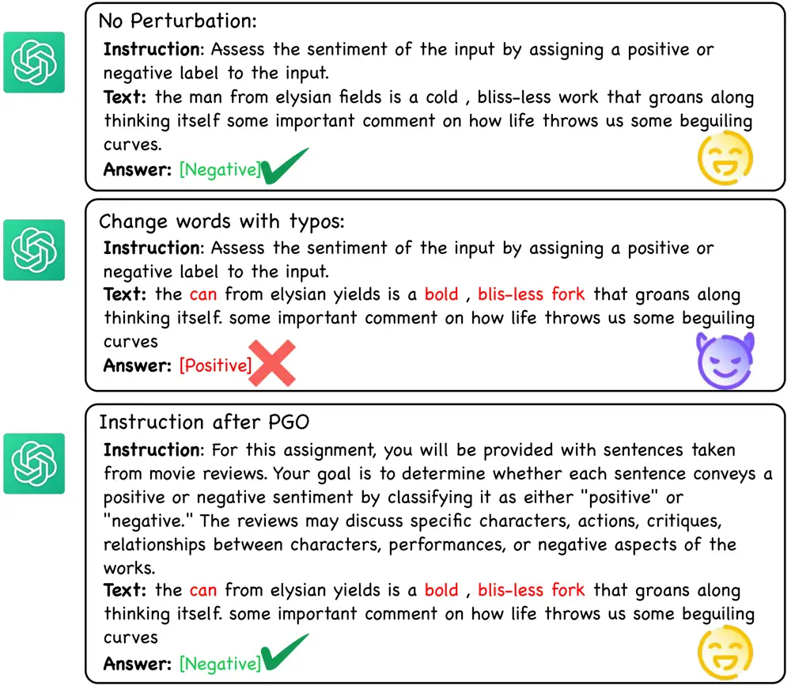
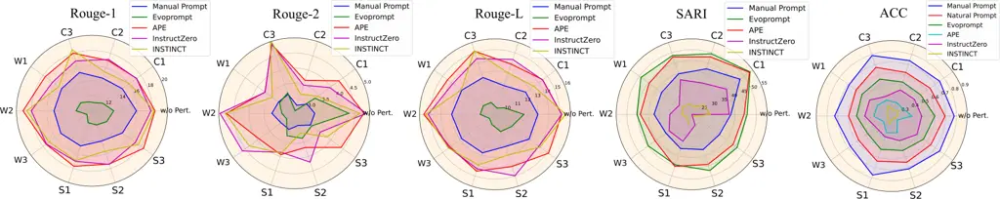
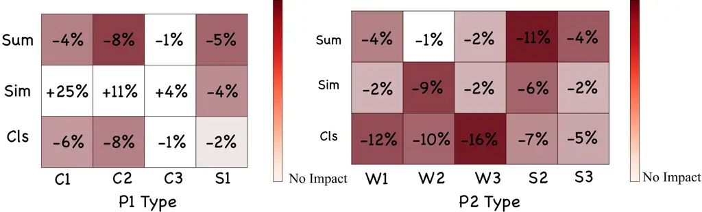
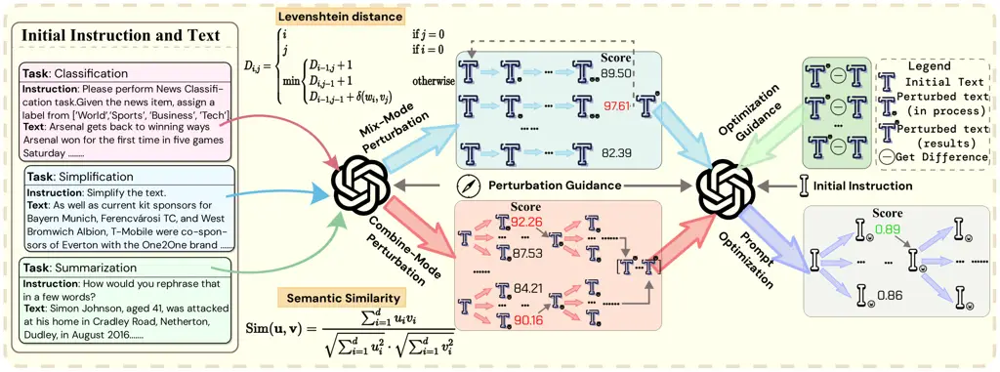
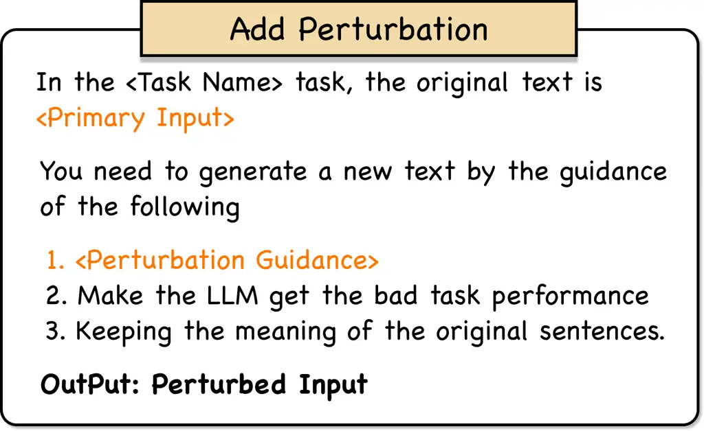
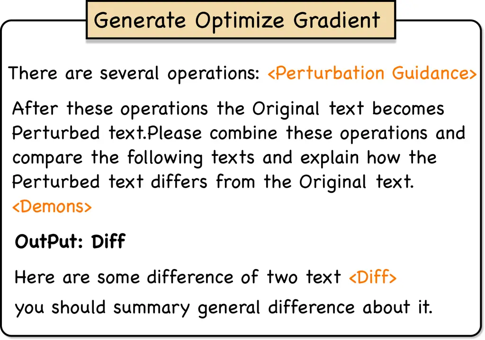
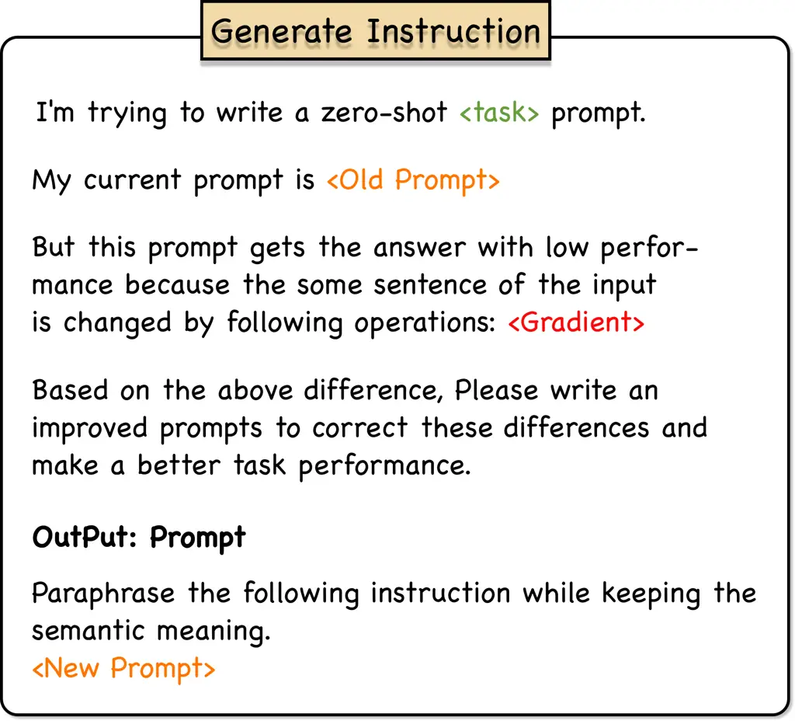
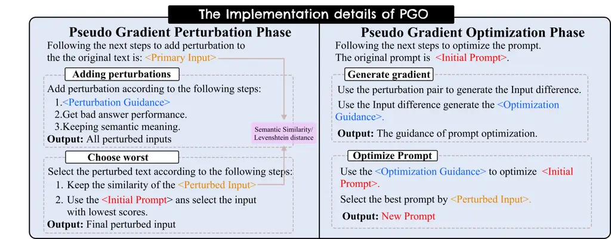
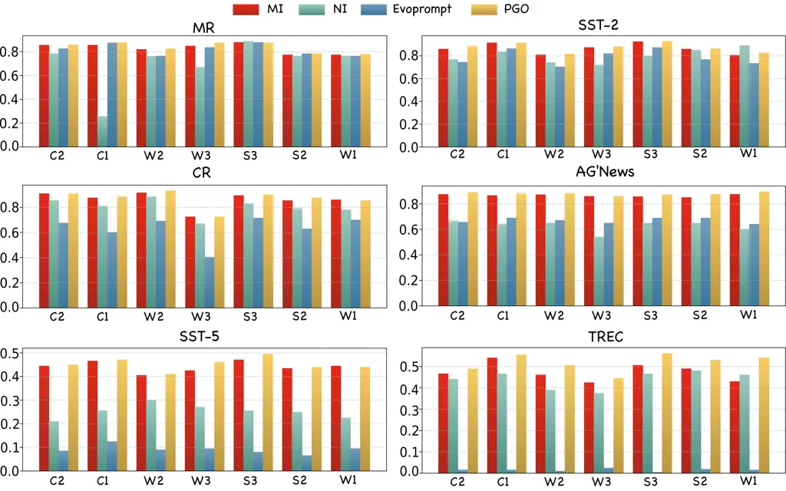

# Auto-Prompt Generation is Not Robust: Prompt Optimization Driven by Pseudo Gradient

Zeru Shi Affiliation:  Rutgers University    Zhenting Wang Affiliation: 
Rutgers University    Yongye Su Affiliation:  Purdue University    Weidi
Luo Affiliation:  Georgia University    Hang Gao Affiliation:  Rutgers
University    Fan Yang Affiliation:  Wake Forest University    Ruixiang
Tang Affiliation:  Rutgers University    Yongfeng Zhang Affiliation: 
Rutgers University

###### Abstract

While automatic prompt generation methods have recently received
significant attention, their robustness remains poorly understood. In
this paper, we introduce PertBench, a comprehensive benchmark dataset
that includes a wide range of input perturbations, designed to
systematically evaluate the robustness of current auto-prompting
techniques. Our analysis reveals substantial vulnerabilities in existing
prompt generation strategies, where even minor modifications to the
prompt can lead to significant differences in model output. To address
this issue, we propose PGO, a gradient-free prompt generation framework
that leverages perturbation types as pseudo-gradient signals to guide
LLMs in producing more robust prompts. In contrast to existing methods
that assess prompt quality only on clean, well-structured inputs, our
approach explicitly emphasizes robustness under noisy and perturbed
conditions. Extensive experiments across diverse tasks and multiple LLMs
show PGO consistently outperforms previous methods in maintaining
performance under input perturbations.

## 1 Introduction



Figure 1: An example of adding a perturbation to the input and its
result in classification task, where the top one indicates that the
prompt gets the correct output under normal input, the middle one
indicates that the prompt gets the wrong result under perturbed input,
the bottom indicates the PGO gets correct result under perturbed input.

Large Language Models (LLMs) have demonstrated impressive capabilities
across a wide spectrum of tasks. Abburi et al. (2023); Ge et al. (2024);
Laban et al. (2023). Given their broad applicability, a growing body of
research has focused on strategies to more effectively elicit and
amplify these capabilities. Among them, prompt engineering has emerged
as a central technique, with recent advances increasingly relying on
LLMs themselves to automate the prompt optimization process.
Representative approaches include instruction fine-tuning Ouyang et al.
(2022); Ziegler et al. (2019), Chain-of-Thought (CoT) prompting Shum
et al. (2023); Zhang et al. (2022), and inference-guided prompt
generation Wang et al. (2023b); Liu et al. (2024). Despite their success
on clean, well-structured inputs, these methods share a key limitation:
they assume idealized input conditions, and thus fail to account for the
noisy, imperfect inputs commonly encountered in real-world scenarios,
such as typographical errors, ambiguous phrasing, or factual
imprecision. These input perturbations can significantly degrade model
performance, revealing a critical robustness gap in current prompt
optimization techniques. As shown in Figure. 1, even subtle input
corruptions (e.g., a minor typo) can mislead an LLMs and trigger
incorrect predictions in tasks like classification.



Figure 2: Comparison of the execution results of all different methods
on PertBench for the three tasks.

[TABLE]

Table 1: Explanation of different kinds of perturbation.

In this work, we introduce PertBench, a comprehensive benchmark designed
to evaluate the robustness of prompt-based methods under diverse input
perturbations. Our benchmark spans three representative natural language
processing tasks, text simplification, summarization, and
classification—capturing a wide spectrum of practical use cases. In
contrast to prior datasets such as NoiseBench Merdjanovska et al.
(2024); Moradi and Samwald (2021); Dong et al. (2023), which primarily
focus on character-level noise within a single task or short form
content (e.g., dialogues), PertBench provides broader coverage across
multiple granularity levels, including character-level, word-level, and
sentence-level perturbations. Moreover, we extend the perturbation
setting to long form text and ensure a uniform and comprehensive
perturbation strategy across all tasks. The specific categories of
perturbations are summarized in Table 1. This design enables a more
systematic and rigorous evaluation of prompt robustness across tasks and
text lengths. Our results demonstrate that existing prompt generation
methods experience substantial performance degradation under perturbed
inputs, exposing their vulnerability and limited generalization.

To mitigate this issue, we propose PGO (Pseudo Gradient Optimization), a
gradient-free framework for robust discrete prompt optimization. Unlike
conventional approaches that rely on model gradients to update prompts,
PGO leverages perturbation information as guidance to guide prompt
refinement. We categorize perturbations into two types P1 and P2
depending on whether they cause significant semantic shifts.
Correspondingly, PGO introduces two complementary optimization
strategies tailored to these categories and iteratively refines prompts
via feedback-driven updates. Through this design, PGO effectively
enhances prompt robustness against a broad range of input disturbances.
Our main contributions are summarized as follows:

- •
  We present PertBench, a comprehensive benchmark for evaluating prompt
  robustness under diverse input perturbations. It includes nine
  perturbation types across three core task categories for systematic
  robustness assessment.
- •
  We propose PGO, a pseudo gradient–based prompt optimization framework
  that enhances robustness across perturbations without requiring model
  internals or true gradients.
- •
  Extensive experiments show that existing methods degrade notably on
  PertBench, while PGO consistently improves robustness across tasks and
  perturbation settings.

## 2 Benchmark Construction

### 2.1 Details of Benchmark

#### 2.1.1 Basic Datasets

In the classification tasks, we focus on six datasets to apply and test
perturbations. These include sentiment classification datasets:
SST-2 Socher et al. (2013), CR Hu and Liu (2004), SST-5 Socher et al.
(2013), and MR PaNgB (2005), as well as topic classification datasets:
AG’s News Zhang et al. (2015) and TREC Voorhees and Tice (2000). In
language generation tasks, we utilize the Asset Alva-Manchego et al.
(2020) for text simplification, which includes multiple benchmarks for
reference translations. For the text summarization task, we use the
XSum Narayan et al. (2018), which consists of concise summaries
generated from longer texts. More details of PertBench in
the Appendix A.

#### 2.1.2 Perturbation Types

We adopt a widely used approach following Xu et al. (2023), which form
the basis for the perturbations in our experiments (See Table. 1). These
disturbances are categorized into two groups: P1 and P2. P1 introduce
typographical errors and non-sensical strings into the text, without
significantly altering the underlying semantic structure of the
sentence. P2 alter the semantic structure of sentences by modifying
their syntactic composition, while maintaining their core meaning. These
modifications can result in a bias in how LLMs interpret the input,
potentially affecting their understanding. We compare the similarity
between the perturbed data set and the original data set, and the
experiment shows that we complete the perturbation of the data while
maintaining the original similarity. The results in the Appendix A.

### 2.2 Benchmark Construction

When constructing the dataset, we apply nine different perturbations to
each type of task to construct separate perturbed datasets. To be more
specific, we introduce various types of perturbation-specific guide
words as a fixed gradient $`g`$, and use it to guide the perturbations
on $`x`$. $`y`$ is the standard output. The performance of the original
prompt on the perturbed inputs is evaluated using a loss function
$`\mathcal{L}_{adv}`$. The score is minimized when perturbed. After
generating the perturbed sample prompt $`p`$, we compute either its
Levenshtein distance or semantic similarity
$`||x^{\prime}-x||<\epsilon`$, depending on the nature of the
perturbation. The perturbations are defined as follows:

```math
x^{\prime}=x+\epsilon\cdot\arg\min\mathcal{L}_{adv}(x+g,y), \tag{1}
```

For both types of perturbation, we adopt an iterative interference
approach. At each step, we select the sentence that affects the outcome
while exhibiting the highest semantic or structural similarity to the
original sentence. Our optimization objective is formulated as follows:

```math
x^{\prime}=x_{0}+\mathcal{P}(x_{0},g)+\mathcal{P}(x_{1},g)+\ldots+\mathcal{P}(x_{n-1},g), \tag{2}
```

Where $`\mathcal{P(\cdot)}`$ denotes that the given input $`x`$ is
perturbed under the guide $`g`$, $`g`$ $`\in`$ {P1, P2}. $`x_{n}`$
denotes the text generated under each iteration. After each iteration,
we compute the Levenshtein distance or semantic similarity between all
perturbed texts and their corresponding source texts, selecting the
resulting text as input for the next iteration. However, such iterative
perturbation is generally only effective for short texts, such as
classification or simplification tasks. When applied to long-text
inputs, such as text summarization, this approach faces two main issues:
❶ The model exhibits weak sensitivity to P1-type perturbations. ❷ The
perturbation model for P2-type perturbations tends to produce shorter
outputs, resulting in deviations from the original intent. To address
these issues, for long-text inputs, we perturb only one sentence at a
time. This sentence is randomly selected from the text in each iteration
like $`s_{i}`$ $`\in`$ $`\{s_{1},s_{2},...,s_{n}\}`$. $`s`$ denotes each
sentence in the long text. This strategy preserves the accuracy of the
model’s response when perturbations are introduced and helps maintain
the overall semantic relevance of the generated text.

### 2.3 Results Analysis and Task Vulnerability



Figure 3: Heat maps showing the magnitude of the impact of each
perturbation on different types of tasks, where darker colors indicate a
stronger impact of the perturbation on this type of task, and vice versa
a lower one. No color indicates no effect or a positive effect.

To evaluate the effectiveness of our constructed dataset in generating
prompt perturbations, we tested the performance of all prompts used in
the Baseline model under the PertBench framework. The detailed results
are presented in the experimental section, alongside those of our
proposed method for comparison. To provide a clearer understanding of
model vulnerabilities, we visualize the performance of each baseline
across all perturbations using radar plots in Figure. 2. These plots
reflect the outcomes on three tasks: the first three graphs correspond
to different metrics for the text summarization task; the fourth graph
presents results for the text simplification task; and the fifth graph
shows results for the text classification task. From the visualizations,
it is evident that most perturbations degrade task performance,
indicating their effectiveness in identifying vulnerabilities. However,
not all perturbations have a negative impact-some even improve
performance. For instance, in the summarization task, perturbations C3
and W2 do not reduce model performance. In the simplification task,
perturbations C1, C2, and C3 show no negative effect. Similarly, for the
classification task, C3 and S1 yield positive effects in many cases. To
further illustrate these findings, we include heatmaps showing the
effects of various perturbations on manual prompts in Figure 3. In these
heatmaps, the numerical values represent the proportion of change
compared to the original (unperturbed) input. The results clearly show
that certain perturbations, particularly C3, have minimal or no negative
impact across all three tasks. This suggests that the prompts involved
in C3 are particularly robust to perturbations. We hypothesize that this
is because the presence of input noise encourages the LLM to focus more
on the core meaning, thereby aligning better with the objective of
simplification.



Figure 4: The workflow of an iteration of PGO. We present the template
of PGO in Section B.2.

|              |               |                |                |
| ------------ | ------------- | -------------- | -------------- |
| Perturbation | Summarization | Simplification | Classification |
| C1           | ✓             | ✗              | ✓              |
| C2           | ✓             | ✗              | ✓              |
| C3           | ✗             | ✗              | ✗              |
| W1           | ✓             | ✓              | ✓              |
| W2           | ✗             | ✓              | ✓              |
| W3           | ✓             | ✓              | ✓              |
| S1           | ✓             | ✓              | ✗              |
| S2           | ✓             | ✓              | ✓              |
| S3           | ✓             | ✓              | ✓              |

Table 2: Sensitivity of each task on different perturbations, ✓ for
sensitive and ✗ for robust.

Specifically, we present the robustness relationship between each task
and each perturbation. The detailed results are shown in the Table 2. In
the subsequent construction of robust prompts, we focus only on
perturbations that lead to performance degradation in LLMs.

## 3 Prompt Generation Framework

To enhance auto-prompt robustness under perturbations, we propose PGO, a
real gradient-free optimization framework. Unlike traditional methods
requiring gradient access, PGO leverages pseudo guidance signals to
iteratively generate and optimize prompts, improving robustness in
black-box LLMs settings.

### 3.1 Analyzing General Method

To enhance prompt robustness for task performance, many researchers have
turned to data augmentation, adding perturbed text to the training data
and training the model on this augmented dataset to produce robust
prompts. We conduct an ablation study on dataset with perturbed data.The
details are in Experiments. The result shows, in some tasks, the
performance of these prompts even declines, likely due to the excessive
diversity of perturbation types introduced during augmentation. We
contend that while basic data augmentation methods can be beneficial in
certain contexts, they may inadvertently introduce noise that interferes
with effective prompt generation and limits generalization to unseen
perturbations.

### 3.2 Framework of PGO

PGO draws on the idea of adversarial training. We divide the process of
optimization in two phases and uses a pseudo gradient to substitute the
real gradient to add perturbation and optimization. It first iteratively
adds perturbations within the specified range to undisturbed inputs by
adjusting them along the gradient direction to maximize disruption. The
perturbed samples generated are then used for training based on a
defined loss function. The workflow of our method is shown in Figure 4.
PGO contains many iterations and every iterations include two key
components:

- •
  Pseudo Gradient Perturbation Phase. PGO begins with manually crafted
  prompts and unperturbed text as the initial input. In Section.2, we
  categorize nine distinct perturbations into two types and design
  tailored perturbation methods for each category. These methods
  generate perturbed samples that simulate various perturbation
  scenarios, allowing the subsequent optimization algorithms to build
  robustness across all types of perturbations. This approach ensures
  that the model remains effective when faced with diverse
  perturbations.
- •
  Pseudo Gradient Optimization Phase. At this stage, we employ an
  iterative optimization method that incorporates a "gradient" mechanism
  to guide the LLMs in refining the prompts. For each generated prompts,
  we select the candidate with the best performance on the validation
  set and retain it for the next iteration.

### 3.3 Pseudo Gradient Perturbation Phase

At this stage, we guide the construction of the perturbation dataset
through the perturbation category, and maintain the similarity as the
purpose of building the benchmark. However, for the two distinct
perturbation types, P1 and P2, we design two different modes of
perturbation. This ensures that the text used in the optimization
process encompasses all perturbations within each type. As a result, the
generated prompts demonstrate robustness against all attacks
corresponding to their respective types. For the P1 type, we propose a
mix-mode, which is implemented as follows:

```math
x^{\prime}=x_{0}+\mathcal{P}(x_{0},g_{1})+\mathcal{P}(x_{1},g_{2})+\ldots+\mathcal{P}(x_{n-1},g_{n}), \tag{3}
```

Where $`\mathcal{P(\cdot)}`$ denotes that the given input $`x`$ is
perturbed under the guide $`g`$, $`g_{n}`$ $`\in`$ P1, $`x_{n}`$ denotes
the text generated under each perturbation. After each perturbation, we
compute the Levenshtein distance between all perturbed texts and their
corresponding source texts, selecting the resulting text as input for
the next iteration. The rationale behind this design is that, under the
perturbation of the P1 mode, the superposition of each perturbation has
minimal impact on the effect of other perturbations. This design enables
to generate results that effectively incorporate all types of
perturbations.

In the perturbation of P2 mode, we propose a combined-mode as follows:

```math
\mathcal{U}(x^{\prime})=\mathcal{P}(x,g_{1})\cup\mathcal{P}(x,g_{2})\cup\ldots\cup\mathcal{P}(x_{,}g_{n}), \tag{4}
```

where $`\mathcal{U(\cdot)}`$ denote the set generated after all
perturbations. Unlike P1 type perturbations, P2 perturbations involve
semantic modifications through operations such as rewriting, changing
grammar and so on. To ensure that the meaning remains aligned with the
original sentence, thus preventing any adverse impact on the performance
of the LLMs. We rely on semantic similarity as the evaluation criterion.
We choose to combine and input them into the pseudo gradient
optimization phase.

| Methods   | P1 perturbation |         |         | P2 perturbation |         |         | P1 perturbation | P2 perturbation |
| --------- | --------------- | ------- | ------- | --------------- | ------- | ------- | --------------- | --------------- |
|           | Rouge-1         | Rouge-2 | Rouge-L | Rouge-1         | Rouge-2 | Rouge-L | SARI            | SARI            |
| DA        | 11.39           | 2.50    | 9.61    | 12.19           | 2.84    | 10.39   | 44.87           | 44.28           |
| MI        | 14.98           | 3.04    | 12.59   | 15.00           | 3.03    | 12.68   | 36.67           | 36.51           |
| EvoPrompt | 17.52           | 3.14    | 14.97   | 17.19           | 2.93    | 14.69   | 44.61           | 46.56           |
| PGO^(∗)   | 18.20           | 2.93    | 15.37   | 18.22           | 3.12    | 15.64   | 45.28           | 45.73           |
| PGO       | 21.25           | 4.44    | 16.66   | 21.90           | 4.73    | 16.81   | 45.79           | 47.85           |

Table 3: The average Rouge-1($`\uparrow`$) score, Rouge-2($`\uparrow`$)
score and Rouge-L($`\uparrow`$) score on the text summarization task and
average SARI($`\uparrow`$) scores on the text simplification task for
our method and the comparison methods.

### 3.4 Pseudo Gradient Optimization Phase

In the optimization stage, we utilize the perturbed sample
$`x^{\prime}`$ generated in the first stage. We then analyze the
differences between $`x^{\prime}`$ and the corresponding original text
$`x`$, and use these differences to compute the gradient $`g^{\prime}`$
when the guide is used as the optimization prompt. The detailed process
is as follows:

```math
g^{\prime}=\mathcal{G}(\mathcal{D}(x_{0},x_{0}^{{}^{\prime}})\cup\mathcal{D}(x_{1},x_{1}^{{}^{\prime}})\cup\ldots\cup\mathcal{D}(x_{n},x_{n}^{{}^{\prime}})), \tag{5}
```

Where $`\mathcal{D}(\cdot)`$ denotes the generating difference and
$`\mathcal{G}(\cdot)`$ denotes the generation of general guidance. In
the iterative optimization process following gradient generation, we
also use the prompt’s score on the task as the loss function. However,
unlike the previous stage, we select the prompt with the highest score
at each iteration to maximize task performance. To ensure that the final
prompt is robust to all perturbations, we calculate the score for each
perturbation across the vulnerabilities of the target task. The specific
loss function is as follows:

```math
\displaystyle\mathcal{L}_{opt}(p)=\mathbb{E}_{(x^{\prime},y)\sim D}\big[ \displaystyle\mathcal{L}(x_{1}^{{}^{\prime}},y;p)+\ldots
```

```math
\displaystyle+\mathcal{L}(x_{n}^{{}^{\prime}},y;p)\big]. \tag{6}
```

Where $`\mathcal{L}_{opt}(\cdot)`$ represents the optimization loss.
$`\mathcal{L}(\cdot)`$ denotes the loss per class of perturbation. In
summary, the formula for each round of prompt optimization is
$`p^{\prime}=p+\nabla_{p}\mathcal{L}_{opt}(p).`$ In prompt generation,
to expand the range of options, we rewrite the generated prompts at each
iteration, increasing the likelihood of discovering better alternatives.
During the intermediate optimization iterations, we consistently select
the optimal prompt from each round to proceed to the next iteration of
the loop.

## 4 Experiments

### 4.1 Implementation Details and Baselines

In the experiments, we use GPT-3.5-turbo to do the optimization training
and use GPT-3.5-turbo, GPT-4o-mini and Llama2-7b to test the
effectiveness of the instructions generated PGO. For perturbations of
type P1, we select five examples in each iteration, while for
perturbations of type P2, we select three examples per iteration,
considering the number of perturbed examples generated. After five
iterations, we choose the prompt with the highest score on the training
set and evaluate its performance on the test set. More experiment
settings in the Section B.1. In the evaluation, we compare the prompts
generated by PGO with the following methods:

- •
  Manual Instructions(MI) and Natural Instructions(NI) Mishra et al.
  (2021): MI are based on existing work that is task-specific
  guidelines. Including classification task Zhang et al. (2023a), text
  simplification task Zhang et al. (2023b) and summarization task Sanh
  et al. (2021). NI contains manually designed prompts across a diverse
  range of datasets and tasks.
- •
  APE Zhou et al. (2022), InstructZero Chen et al. (2023), INSTINCT Lin
  (2004): These papers leverages the reasoning ability of LLMs to
  generate prompts based on both the inputs and the corresponding
  answers.
- •
  EvoPrompt Guo et al. (2023): Evoprompt uses genetic algorithms to
  optimize prompts for classification and generation tasks.
- •
  Data Augmentation(DA) and PGO^(∗): DA uses the data augmentation
  method as baseline, which takes the perturbed text as input data and
  iteratively optimizes it, to explore whether this method can remain
  robust to all types of text perturbations. PGO^(∗) uses the simple
  iterative method to optimize the prompts.

We also analysis the performance of adding suggestive suffix without PGO
directly in Section C.4 and the cost of PGO in Section C.5. Our optimal
results are shown in Appendix F.

#### 4.1.1 Metrics

In the classification tasks, we use the prediction accuracy as the
score. In language generation tasks, we use SARI Xu et al. (2016) as the
metrics which is an n-gram-based scoring system extensively utilized for
text editing tasks. For the text summarization task, we use Rouge-1,
Rouge-2, Rouge-L as metrics Lin (2004), which widely used to evaluate
the quality of generated text tasks. They focus on the number of n-grams
with the same outcome and the overlap of the longest common subsequence.

| Methods   | P1 perturbation |       |      |       |         |      | P2 perturbation |       |      |       |         |      | Avg. |
| --------- | --------------- | ----- | ---- | ----- | ------- | ---- | --------------- | ----- | ---- | ----- | ------- | ---- | ---- |
|           | CR              | SST-2 | MR   | SST-5 | TREC    | AG   | CR              | SST-2 | MR   | SST-5 | TREC    | AG   |      |
| DA        | 88.5            | 89.8  | 85.5 | 44.0  | 43.8    | 86.3 | 85.1            | 85.5  | 81.2 | 40.1  | 50.3    | 86.7 | 72.3 |
| MI        | 89.3            | 88.8  | 85.5 | 45.5  | 50.3    | 87.0 | 85.0            | 85.5  | 82.0 | 43.6  | 46.2    | 86.2 | 72.9 |
| NI        | 83.3            | 80.3  | 80.0 | 23.3  | 45.3    | 65.3 | 79.1            | 80.0  | 77.0 | 20.0  | 43.4    | 61.8 | 61.6 |
| EvoPrompt | 63.8            | 80.5  | 78.1 | 10.5  | 1.5^(?) | 67.3 | 62.8            | 78.1  | 80.6 | 8.6   | 1.5^(?) | 66.8 | 50.4 |
| PGO^(∗)   | 85.5            | 86.0  | 81.0 | 45.3  | 49.8    | 85.5 | 80.6            | 81.5  | 78.1 | 40.9  | 49.9    | 84.3 | 70.8 |
| PGO       | 89.8            | 90.0  | 86.3 | 46.0  | 52.3    | 88.5 | 85.7            | 86.3  | 82.8 | 44.9  | 51.6    | 87.7 | 73.2 |

Table 4: Average score($`\uparrow`$) of the prompts from different
method on six classification datasets. $`?`$ Indicates that we provide
specific analysis of the value of this indicator in Section C.3. AG
indicates AG’news dataset.

### 4.2 Data Augmentation

To evaluate the limitations of the data augmentation method, we exclude
the use of PGO during testing. Instead, we treat all the perturbed data
as the training set and allow the LLMs to generate prompt based on this
training set. The results for three different tasks are presented in the
DA row across the Table. 3, Table. 4. As shown, the prompts generated
using the data augmentation method lack robustness to perturbations
across all three tasks. Furthermore, their performance is even worse
than unoptimized prompts when tested on handwritten perturbations. We
attribute this degradation to the excessive diversity of perturbations,
which hinders the LLMs’s ability to focus accurately on the
perturbations, leading to a decline in performance.

### 4.3 Experiments Results

In this part, we use GPT-3.5-turbo to test the performance of prompts
generated by PGO and other comparison methods on the three tasks. The
results of text summarization task and text simplification task are
shown in the Table 3. Compared to previous prompts and their generation
methods, the prompts generated by PGO demonstrate a significant
performance improvement on the perturbed datasets. It is worth noting
that in the text summarization task, the model outperforms the
second-best baseline by an average of 20%, 46%, and 7.5% in ROUGE-1,
ROUGE-2, and ROUGE-L scores, respectively. For classification task, the
results for the perturbations from class P1 and class P2 are presented
in the Table 4. The table demonstrates that the prompts generated by PGO
outperform existing prompts across the six text understanding datasets,
exhibiting notable stability against the seven perturbations to which
PGO itself is not inherently robust. It is worth mentioning that PGO
achieves a 4% improvement on TREC under the P1-class perturbation and a
3% improvement on SST-5 under the P2-class perturbation. In addition, we
observe that the cue words generated by our method demonstrate notably
stronger retention robustness on multiple-choice datasets such as SST-5,
TREC, and AG News. We note that EvoPrompt performs significantly worse
than our method on the SST-5 and TREC datasets, and We attribute this to
deficiencies in the generated prompts resulting from its prompt
optimization method; a detailed analysis can be found in the Section
C.3. For methods APE Zhou et al. (2022) InstructZero Chen et al. (2023),
INSTINCT Lin (2004), PGO still maintains the optimal performance on all
tasks, and more specific results are in the Section C.1.

### 4.4 Transferability and Generalization

#### 4.4.1 Model Transferability

To evaluate the transferability of our generated prompts, we select the
text summarization task and assess the effectiveness of our method on
GPT-4o-mini and LLaMA2-7B. The results demonstrate that, compared to
other methods, our approach consistently maintains strong performance
across different models. Additional transferability experiments are
provided in the Section C.6.

#### 4.4.2 Perturbation Generalization

In this section, we evaluate the transferability of prompts trained
under different perturbation types. Specifically, we adopt a
cross-testing strategy: prompts trained under perturbation P1 are tested
on robustness against perturbation P2, and vice versa. The results are
presented in the Table. 6. Notably, our PGO\_(change) performs only
slightly worse than PGO across most metrics, indicating that prompts
optimized for one class of perturbations can still exhibit strong
robustness when applied to other perturbation types.

| Model       | Method    | Rouge-1 | Rouge-2 | Rouge-L |
| ----------- | --------- | ------- | ------- | ------- |
| GPT-4o-mini | MI        | 16.10   | 2.84    | 13.00   |
|             | EvoPrompt | 16.83   | 2.63    | 14.33   |
|             | PGO       | 19.49   | 3.63    | 14.97   |
| LLaMA2-7b   | MI        | 16.45   | 2.95    | 13.80   |
|             | EvoPrompt | 14.80   | 2.56    | 12.85   |
|             | PGO       | 18.30   | 3.64    | 14.71   |

Table 5: Transferability of prompts across methods and models in text
summarization.

### 4.5 Ablation Study

#### 4.5.1 The Effectiveness of Pseudo Gradient

To evaluate the effectiveness of first stage in the prompt optimization,
we removed the pseudo gradient perturbation part from PGO and used only
a simple iterative optimization method. This allowed us to isolate and
assess the impact of first phase. The results are show in PGO^(∗) rows
in the Table 3 and Table. 4. The experimental results demonstrate that,
across all tasks, prompts generated purely through iterative
optimization perform worse than those generated by PGO across all types
of perturbations. This proves the effectiveness of our pseudo gradient
strategy.

#### 4.5.2 Iteration Numbers

In our optimization process, we set the number of iterations to five, as
we observed that the prompts optimized by the LLMs achieved optimal
performance at the fifth iteration. To illustrate this, we used the text
summarization task as an example. We tested the performance of prompts
generated across six iterations (from 1 to 6), and the results are
presented in the Figure. 5. For each iteration, we evaluate the prompts
across different perturbation types and calculate their average
performance. The results show a consistent improvement in prompt
performance during the initial rounds, with the optimal performance
observed around the fourth or fifth iteration. This trend suggests that
the LLMs effectively refines the prompts through iterative
gradient-guided optimization and semantic space exploration,
progressively approaching the optimal solution. However, beyond the
fifth iteration, the performance of the prompts have a slightly
declines. In order to speed up the inference experiment and reduce the
cost, we choose the number of iterations to be 5. We present more
discussion in Appendix D.

| Type | Method        | Rouge-1 | Rouge-2 | Rouge-L |
| ---- | ------------- | ------- | ------- | ------- |
| P1   | PGO\_(change) | 21.35   | 4.59    | 16.10   |
|      | PGO           | 21.25   | 4.44    | 16.66   |
| P2   | PGO\_(change) | 21.26   | 4.31    | 16.33   |
|      | PGO           | 21.90   | 4.73    | 16.81   |

Table 6: The average of Rouge-1($`\uparrow`$), Rouge-2($`\uparrow`$) and
Rouge-L($`\uparrow`$) of prompts trained by different perturbation on
the text summarization task.PGO\_(change) means test the results on other
perturbation.

Figure 5: Relationship between iteration count and PGO prompt
performance.

## 5 Related Work

### 5.1 Prompt Optimization

Manually crafted prompts often fail to improve LLM performance,
motivating the rise of prompt optimization.  Li et al. (2023) introduces
a fine-tuning approach based on context and probability ordering, while
reinforcement learning methods such as Eureka Ma et al. (2023),
Prompt-OIRL Sun et al. (2023), and RLPrompt Deng et al. (2022) further
enhance optimization. Recent work leverages LLMs themselves for prompt
generation and refinement, including APE Zhou et al. (2022),
self-correction via pseudo gradients Pryzant et al. (2023), genetic
algorithms Guo et al. (2023), and robustness studies Jin et al. (2024);
Zhou et al. (2024a). However, most methods rely on clean data,
neglecting natural input perturbations that degrade performance. Our
approach addresses this by emphasizing robustness against such perturbed
inputs.

### 5.2 Improving the Robustness of LLMs

Recent studies explore adversarial attacks on LLMs, where slight input
perturbations (e.g., spelling errors) mislead models into incorrect
outputs.  Zhou et al. (2024c) target math reasoning, while  Zhu et al.
(2023) categorize hint attacks into four types, detailed by  Xu et al.
(2024). Common approaches include word-level Wang et al. (2023a); Zhou
et al. (2024b) and sentence-level Gu et al. (2023); Dong et al. (2021)
attacks.  Miao et al. (2024) introduce attacks for T2M, and  Raina
et al. (2024) reveal Judge-LLMs’ vulnerability, inflating evaluation
scores. Other works Yao et al. (2023); Kumar et al. (2023) study
adversarial behaviors and propose defense strategies, including
adversarial hallucination Kumar et al. (2023) and refusal-based
defenses Sheshadri et al. (2024); Xhonneux et al. (2024); Lin and Zhao
(2024). Adversarial training methods like ReFAT Sheshadri et al. (2024),
Latent Adversarial Training Xhonneux et al. (2024), and LLAMOS Lin and
Zhao (2024) further enhance LLM robustness against attacks.

## 6 Conclusion

In this paper, we highlight the vulnerability of existing automatic
prompt word generation methods to input perturbations. To systematically
evaluate this limitation, we introduce PertBench, a benchmark dataset
that spans multiple tasks and incorporates a diverse set of perturbation
types at the character, word, and sentence levels. PertBench enables a
comprehensive assessment of prompt robustness under a wide range of
input disturbances. Furthermore, we propose a novel prompt optimization
method, PGO, that treats perturbation types as pseudo-gradient signals
to guide the generation of more robust prompts in a gradient-free
manner. Extensive experiments across various tasks and perturbation
settings demonstrate the effectiveness and superior robustness of our
approach compared to existing methods.

## 7 Limitation

We employed an efficient, training-free pseudo-gradient method. In the
future, additional gradient-free techniques could be incorporated into
our framework to further reduce generation costs and enhance
performance. Moreover, although our method significantly outperforms
existing approaches, its reliance on black-box models may limit the
explainability of its superiority. Therefore, more advanced explainable
AI (XAI) techniques may be required to better interpret this phenomenon.

## References

- Abburi et al. (2023) Harika Abburi, Michael Suesserman, Nirmala
  Pudota, Balaji Veeramani, Edward Bowen, and Sanmitra
  Bhattacharya. 2023. Generative ai text classification using ensemble
  llm approaches. _arXiv preprint arXiv:2309.07755_.
- Alva-Manchego et al. (2020) Fernando Alva-Manchego, Louis Martin,
  Antoine Bordes, Carolina Scarton, Benoît Sagot, and Lucia
  Specia. 2020. Asset: A dataset for tuning and evaluation of sentence
  simplification models with multiple rewriting transformations. _arXiv
  preprint arXiv:2005.00481_.
- Chen et al. (2023) Lichang Chen, Jiuhai Chen, Tom Goldstein, Heng
  Huang, and Tianyi Zhou. 2023. Instructzero: Efficient instruction
  optimization for black-box large language models. _arXiv preprint
  arXiv:2306.03082_.
- Deng et al. (2022) Mingkai Deng, Jianyu Wang, Cheng-Ping Hsieh, Yihan
  Wang, Han Guo, Tianmin Shu, Meng Song, Eric P Xing, and Zhiting
  Hu. 2022. Rlprompt: Optimizing discrete text prompts with
  reinforcement learning. _arXiv preprint arXiv:2205.12548_.
- Dong et al. (2023) Guanting Dong, Jinxu Zhao, Tingfeng Hui, Daichi
  Guo, Wenlong Wang, Boqi Feng, Yueyan Qiu, Zhuoma Gongque, Keqing He,
  Zechen Wang, et al. 2023. Revisit input perturbation problems for
  llms: A unified robustness evaluation framework for noisy slot filling
  task. In _CCF International Conference on Natural Language Processing
  and Chinese Computing_.
- Dong et al. (2021) Jialiang Dong, Zhitao Guan, Longfei Wu, Xiaojiang
  Du, and Mohsen Guizani. 2021. A sentence-level text adversarial attack
  algorithm against iiot based smart grid. _Computer Networks_,
  190:107956.
- Ge et al. (2024) Yingqiang Ge, Wenyue Hua, Kai Mei, Juntao Tan,
  Shuyuan Xu, Zelong Li, Yongfeng Zhang, et al. 2024. Openagi: When llm
  meets domain experts. _Advances in Neural Information Processing
  Systems_, 36.
- Gu et al. (2023) Kang Gu, Ehsanul Kabir, Neha Ramsurrun, Soroush
  Vosoughi, and Shagufta Mehnaz. 2023. Towards sentence level inference
  attack against pre-trained language models. _Proceedings on Privacy
  Enhancing Technologies_.
- Guo et al. (2023) Qingyan Guo, Rui Wang, Junliang Guo, Bei Li, Kaitao
  Song, Xu Tan, Guoqing Liu, Jiang Bian, and Yujiu Yang. 2023.
  Connecting large language models with evolutionary algorithms yields
  powerful prompt optimizers. _arXiv preprint arXiv:2309.08532_.
- Hu and Liu (2004) Minqing Hu and Bing Liu. 2004. Mining and
  summarizing customer reviews. In _Proceedings of the tenth ACM SIGKDD
  international conference on Knowledge discovery and data mining_,
  pages 168–177.
- Jin et al. (2024) Mingyu Jin, Qinkai Yu, Dong Shu, Haiyan Zhao, Wenyue
  Hua, Yanda Meng, Yongfeng Zhang, and Mengnan Du. 2024. [The impact of
  reasoning step length on large language
  models](https://doi.org/10.18653/v1/2024.findings-acl.108). In
  _Findings of the Association for Computational Linguistics: ACL 2024_,
  pages 1830–1842, Bangkok, Thailand. Association for Computational
  Linguistics.
- Kumar et al. (2023) Aounon Kumar, Chirag Agarwal, Suraj Srinivas,
  Aaron Jiaxun Li, Soheil Feizi, and Himabindu Lakkaraju. 2023.
  Certifying llm safety against adversarial prompting. _arXiv preprint
  arXiv:2309.02705_.
- Laban et al. (2023) Philippe Laban, Wojciech Kryściński, Divyansh
  Agarwal, Alexander Richard Fabbri, Caiming Xiong, Shafiq Joty, and
  Chien-Sheng Wu. 2023. Summedits: measuring llm ability at factual
  reasoning through the lens of summarization. In _Proceedings of the
  2023 Conference on Empirical Methods in Natural Language Processing_,
  pages 9662–9676.
- Li et al. (2023) Haoran Li, Yiran Liu, Xingxing Zhang, Wei Lu, and
  Furu Wei. 2023. Tuna: Instruction tuning using feedback from large
  language models. _arXiv preprint arXiv:2310.13385_.
- Lin (2004) Chin-Yew Lin. 2004. Rouge: A package for automatic
  evaluation of summaries. In _Text summarization branches out_, pages
  74–81.
- Lin and Zhao (2024) Guang Lin and Qibin Zhao. 2024. Large language
  model sentinel: Advancing adversarial robustness by llm agent. _arXiv
  preprint arXiv:2405.20770_.
- Liu et al. (2024) Shengcai Liu, Caishun Chen, Xinghua Qu, Ke Tang, and
  Yew-Soon Ong. 2024. Large language models as evolutionary optimizers.
  In _2024 IEEE Congress on Evolutionary Computation (CEC)_, pages 1–8.
  IEEE.
- Ma et al. (2023) Yecheng Jason Ma, William Liang, Guanzhi Wang, De-An
  Huang, Osbert Bastani, Dinesh Jayaraman, Yuke Zhu, Linxi Fan, and
  Anima Anandkumar. 2023. Eureka: Human-level reward design via coding
  large language models. _arXiv preprint arXiv:2310.12931_.
- Merdjanovska et al. (2024) Elena Merdjanovska, Ansar Aynetdinov, and
  Alan Akbik. 2024. NoiseBench: Benchmarking the impact of real label
  noise on named entity recognition. In _Proceedings of the 2024
  Conference on Empirical Methods in Natural Language Processing_,
  Miami, Florida, USA. Association for Computational Linguistics.
- Miao et al. (2024) Honglei Miao, Fan Ma, Ruijie Quan, Kun Zhan, and
  Yi Yang. 2024. Autonomous llm-enhanced adversarial attack for
  text-to-motion. _arXiv preprint arXiv:2408.00352_.
- Mishra et al. (2021) Swaroop Mishra, Daniel Khashabi, Chitta Baral,
  and Hannaneh Hajishirzi. 2021. Cross-task generalization via natural
  language crowdsourcing instructions. _arXiv preprint
  arXiv:2104.08773_.
- Moradi and Samwald (2021) Milad Moradi and Matthias Samwald. 2021.
  Evaluating the robustness of neural language models to input
  perturbations. _arXiv preprint arXiv:2108.12237_.
- Narayan et al. (2018) Shashi Narayan, Shay B Cohen, and Mirella
  Lapata. 2018. Don’t give me the details, just the summary! topic-aware
  convolutional neural networks for extreme summarization. _arXiv
  preprint arXiv:1808.08745_.
- Ouyang et al. (2022) Long Ouyang, Jeffrey Wu, Xu Jiang, Diogo Almeida,
  Carroll Wainwright, Pamela Mishkin, Chong Zhang, Sandhini Agarwal,
  Katarina Slama, Alex Ray, et al. 2022. Training language models to
  follow instructions with human feedback. _Advances in neural
  information processing systems_, 35:27730–27744.
- PaNgB (2005) L PaNgB. 2005.
  Exploitingclassrelationshipsforsentimentcate
  gorizationwithrespectratingsales. _IN: ProceedingsofACL r05_.
- Pryzant et al. (2023) Reid Pryzant, Dan Iter, Jerry Li, Yin Tat Lee,
  Chenguang Zhu, and Michael Zeng. 2023. Automatic prompt optimization
  with" gradient descent" and beam search. _arXiv preprint
  arXiv:2305.03495_.
- Raina et al. (2024) Vyas Raina, Adian Liusie, and Mark Gales. 2024. Is
  llm-as-a-judge robust? investigating universal adversarial attacks on
  zero-shot llm assessment. _arXiv preprint arXiv:2402.14016_.
- Sanh et al. (2021) Victor Sanh, Albert Webson, Colin Raffel, Stephen H
  Bach, Lintang Sutawika, Zaid Alyafeai, Antoine Chaffin, Arnaud
  Stiegler, Teven Le Scao, Arun Raja, et al. 2021. Multitask prompted
  training enables zero-shot task generalization. _arXiv preprint
  arXiv:2110.08207_.
- Sheshadri et al. (2024) Abhay Sheshadri, Aidan Ewart, Phillip Guo,
  Aengus Lynch, Cindy Wu, Vivek Hebbar, Henry Sleight, Asa Cooper
  Stickland, Ethan Perez, Dylan Hadfield-Menell, et al. 2024. Targeted
  latent adversarial training improves robustness to persistent harmful
  behaviors in llms. _arXiv preprint arXiv:2407.15549_.
- Shum et al. (2023) KaShun Shum, Shizhe Diao, and Tong Zhang. 2023.
  Automatic prompt augmentation and selection with chain-of-thought from
  labeled data. _arXiv preprint arXiv:2302.12822_.
- Socher et al. (2013) Richard Socher, Alex Perelygin, Jean Wu, Jason
  Chuang, Christopher D Manning, Andrew Y Ng, and Christopher
  Potts. 2013. Recursive deep models for semantic compositionality over
  a sentiment treebank. In _Proceedings of the 2013 conference on
  empirical methods in natural language processing_, pages 1631–1642.
- Sun et al. (2023) Hao Sun, Alihan Hüyük, and Mihaela van der
  Schaar. 2023. Query-dependent prompt evaluation and optimization with
  offline inverse rl. In _The Twelfth International Conference on
  Learning Representations_.
- Voorhees and Tice (2000) Ellen M Voorhees and Dawn M Tice. 2000.
  Building a question answering test collection. In _Proceedings of the
  23rd annual international ACM SIGIR conference on Research and
  development in information retrieval_, pages 200–207.
- Wang et al. (2023a) Haoyu Wang, Guozheng Ma, Cong Yu, Ning Gui, Linrui
  Zhang, Zhiqi Huang, Suwei Ma, Yongzhe Chang, Sen Zhang, Li Shen,
  et al. 2023a. Are large language models really robust to word-level
  perturbations? _arXiv preprint arXiv:2309.11166_.
- Wang et al. (2023b) Xinyuan Wang, Chenxi Li, Zhen Wang, Fan Bai,
  Haotian Luo, Jiayou Zhang, Nebojsa Jojic, Eric P Xing, and Zhiting Hu.
  2023b. Promptagent: Strategic planning with language models enables
  expert-level prompt optimization. _arXiv preprint arXiv:2310.16427_.
- Xhonneux et al. (2024) Sophie Xhonneux, Alessandro Sordoni, Stephan
  Günnemann, Gauthier Gidel, and Leo Schwinn. 2024. Efficient
  adversarial training in llms with continuous attacks. _arXiv preprint
  arXiv:2405.15589_.
- Xu et al. (2016) Wei Xu, Courtney Napoles, Ellie Pavlick, Quanze Chen,
  and Chris Callison-Burch. 2016. Optimizing statistical machine
  translation for text simplification. _Transactions of the Association
  for Computational Linguistics_, 4:401–415.
- Xu et al. (2023) Xilie Xu, Keyi Kong, Ning Liu, Lizhen Cui, Di Wang,
  Jingfeng Zhang, and Mohan Kankanhalli. 2023. An llm can fool itself: A
  prompt-based adversarial attack. _arXiv preprint arXiv:2310.13345_.
- Xu et al. (2024) Xilie Xu, Keyi Kong, Ning Liu, Lizhen Cui, Di Wang,
  Jingfeng Zhang, and Mohan Kankanhalli. 2024. [An LLM can fool itself:
  A prompt-based adversarial
  attack](https://openreview.net/forum?id=VVgGbB9TNV). In _The Twelfth
  International Conference on Learning Representations_.
- Yao et al. (2023) Jia-Yu Yao, Kun-Peng Ning, Zhen-Hui Liu, Mu-Nan
  Ning, Yu-Yang Liu, and Li Yuan. 2023. Llm lies: Hallucinations are not
  bugs, but features as adversarial examples. _arXiv preprint
  arXiv:2310.01469_.
- Zhang et al. (2023a) Wenxuan Zhang, Yue Deng, Bing Liu, Sinno Jialin
  Pan, and Lidong Bing. 2023a. Sentiment analysis in the era of large
  language models: A reality check. arxiv. _arXiv preprint
  arXiv:2305.15005_.
- Zhang et al. (2015) Xiang Zhang, Junbo Zhao, and Yann LeCun. 2015.
  Character-level convolutional networks for text classification.
  _Advances in neural information processing systems_, 28.
- Zhang et al. (2023b) Yue Zhang, Leyang Cui, Deng Cai, Xinting Huang,
  Tao Fang, and Wei Bi. 2023b. Multi-task instruction tuning of llama
  for specific scenarios: A preliminary study on writing assistance.
  _arXiv preprint arXiv:2305.13225_.
- Zhang et al. (2022) Zhuosheng Zhang, Aston Zhang, Mu Li, and Alex
  Smola. 2022. Automatic chain of thought prompting in large language
  models. _arXiv preprint arXiv:2210.03493_.
- Zhou et al. (2024a) Andy Zhou, Bo Li, and Haohan Wang. 2024a. Robust
  prompt optimization for defending language models against jailbreaking
  attacks. _arXiv preprint arXiv:2401.17263_.
- Zhou et al. (2024b) Huichi Zhou, Zhaoyang Wang, Hongtao Wang, Dongping
  Chen, Wenhan Mu, and Fangyuan Zhang. 2024b. Evaluating the validity of
  word-level adversarial attacks with large language models. In
  _Findings of the Association for Computational Linguistics ACL 2024_,
  pages 4902–4922.
- Zhou et al. (2022) Yongchao Zhou, Andrei Ioan Muresanu, Ziwen Han,
  Keiran Paster, Silviu Pitis, Harris Chan, and Jimmy Ba. 2022. Large
  language models are human-level prompt engineers. _arXiv preprint
  arXiv:2211.01910_.
- Zhou et al. (2024c) Zihao Zhou, Qiufeng Wang, Mingyu Jin, Jie Yao,
  Jianan Ye, Wei Liu, Wei Wang, Xiaowei Huang, and Kaizhu Huang. 2024c.
  Mathattack: Attacking large language models towards math solving
  ability. In _Proceedings of the AAAI Conference on Artificial
  Intelligence_, 17, pages 19750–19758.
- Zhu et al. (2023) Kaijie Zhu, Jindong Wang, Jiaheng Zhou, Zichen Wang,
  Hao Chen, Yidong Wang, Linyi Yang, Wei Ye, Yue Zhang, Neil Zhenqiang
  Gong, et al. 2023. Promptbench: Towards evaluating the robustness of
  large language models on adversarial prompts. _arXiv preprint
  arXiv:2306.04528_.
- Ziegler et al. (2019) Daniel M Ziegler, Nisan Stiennon, Jeffrey Wu,
  Tom B Brown, Alec Radford, Dario Amodei, Paul Christiano, and Geoffrey
  Irving. 2019. Fine-tuning language models from human preferences.
  _arXiv preprint arXiv:1909.08593_.

## Appendix A Details of Benchmark

| Dataset   | Task                                                       | Number |
| --------- | ---------------------------------------------------------- | ------ |
| SST-2     | {positive, negative}                                       | 1200   |
| CR        | {positive, negative}                                       | 1200   |
| MR        | {positive, negative}                                       | 1200   |
| SST-5     | {terrible, bad, okay, good, great}                         | 1200   |
| AG’s News | {World, Sports, Business, Tech}                            | 1200   |
| TREC      | {Description, Entity, Expression, Human, Location, Number} | 1200   |
| ASSET     | Text Simplification                                        | 987    |
| XSUM      | Text Summarization                                         | 720    |

Table 7: Statistics of our generating datasets for classification task
and language generation task used in this work.

The Table. 7 shows the statistics of datasets we made for
classification, text simplification, and text summarization tasks under
different perturbations. Each dataset contains multiple sub-datasets,
the total amount of generated data includes only perturbations to which
the model is not robust for the given task. For example, the XSum
dataset contains 7 sub-datasets corresponding to C2, C1, S1, W3, S3, S2,
and W1 perturbations. For perturbations where the model is already
robust, we constructed only 200 test samples per task. The robustness of
the perturbation category is in the previous section.

#### A.0.1 Similarity between PertBench and Raw Data

| Datasets | Levenshtein distance | Semantic similarity |
| -------- | -------------------- | ------------------- |
| XSum     | 98.42                | 98.31               |
| Asset    | 89.55                | 91.17               |
| CR       | 93.38                | 85.92               |
| SST-5    | 91.22                | 79.75               |
| AG’News  | 96.63                | 83.91               |
| MR       | 92.42                | 82.33               |
| TREC     | 91.41                | 81.44               |
| SST-2    | 91.96                | 80.86               |

Table 8: The averagesemantic similarity and Levenshtein distance before
and after attack in 3 tasks, 8 datasets.

In this part, we measure the similarity score between the generated
benchmark and the original data set to prove that our dataset retains a
high similarity with the original dataset. From the Table. 8, we can
observe that for long text inputs, such as those in the XSum dataset,
the Levenshtein distance and semantic similarity between the original
and perturbed text remain above 98% for both types of perturbations (P1
and P2). In contrast, for shorter text inputs, such as those in the
Asset dataset and the six classification tasks, even small changes can
significantly impact the similarity measures. However, our experiments
show that the Levenshtein distance similarity for P1 perturbed data
remains above 90%, while the semantic similarity for P2 perturbed data
stays above 80%, except for the SST-5. This indicates that our attack
effectively preserves the essential information of the original sentence
while introducing controlled perturbations.

## Appendix B Experiments Setting

### B.1 Hpyper Parameters

Our PGO algorithm is based on GPT-3.5-turbo for generation, with a total
of 5 optimization iterations. During the perturbation phase, we set the
number of iterative attacks to 3. In the combined perturbations and
prompt optimization stages, we configured GPT-3.5-turbo with a Top-p
value of 0.95 and a temperature of 1 to ensure both the robustness of
the perturbations and the diversity of the generated outputs. For the
testing phase, we set Top-p to 1 and temperature to 0, ensuring that the
model produces consistent, fixed outputs.

### B.2 Template

In this section, we give a complete template for the perturbation adding
phase. Figure. 6, the prompt optimization phase. Figure. 7 provides a
detailed illustration of the gradients generated during the optimization
phase. Figure. 8 offers a comprehensive explanation of the prompt
generation process, where gradients guide the LLMs, and highlights how
prompt richness is enhanced through the rewriting process. The details
of the specific implementation in LLMs are shown in Figure. 9.



Figure 6: The template of generating the optimization gradient.



Figure 7: The template of generating the optimization gradient.



Figure 8: The template of using gradient to generate new instructions
and paraphrase them.



Figure 9: PGO is based on the details of the LLMs implementation, with
the left half representing the pseudo gradient perturbation phase and
the right half representing the pseudo gradient optimization phase,
where orange represents the input text, blue represents the gradient,
red represents the prompts

## Appendix C Additional Results

### C.1 Experimental results for more methods

We compare our method against additional baselines (APE, InstructZero
and INSTINCT) using GPT-4o-mini, and the results on both text generation
and text understanding tasks are presented in the Table. 9, Table. 11
and Table. 12. It can be seen that our method has strong robustness on
perturbed data and performs well in different tasks.

From the experimental results, we observe that the three baseline
methods are not robust to perturbed text, with their performance
consistently degrading after perturbations are introduced. Notably, the
performance drop is more pronounced on multiple choice tasks such as
TREC and SST-5. We believe this is because these methods do not
explicitly provide an initial prompt, but instead attempt to infer it
from the input and output. In the context of multiple choice tasks, this
inference-based approach may struggle to effectively capture all options
and accurately identify the target category, which likely contributes to
the lower performance.

### C.2 The stability of the results

To evaluate the performance stability of all the generated prompts, we
selected the top five prompts and calculated the variance of their
corresponding metrics, as well as the ratio of the variance to the mean.
The results are presented in Table. 10.

From the results, we observe that for both summarization and
simplification tasks, the standard deviation of ROUGE-1, ROUGE-2,
ROUGE-L, and SARI scores for our generated prompts is consistently below
1.0, with most tasks exhibiting values under 0.5. Furthermore, the
standard deviation-to-average ratio remains under 10%, indicating the
stability of our prompts in evaluating text similarity. For
classification tasks, we evaluated three datasets including: CR, SST-5
selected from the six datasets used in the paper. These datasets
encompass binary classification, multi-class classification, sentiment
classification, and topic classification. Our results show that the
standard deviation-to-mean ratio remains below 10%, further
demonstrating the robustness and stability of our prompt across diverse
classification tasks.

| Methods      | W3 perturbation |         |         | W1 perturbation |         |         | S2 perturbation |         |         | S3 perturbation |         |         |
| ------------ | --------------- | ------- | ------- | --------------- | ------- | ------- | --------------- | ------- | ------- | --------------- | ------- | ------- |
|              | Rouge-1         | Rouge-2 | Rouge-L | Rouge-1         | Rouge-2 | Rouge-L | Rouge-1         | Rouge-2 | Rouge-L | Rouge-1         | Rouge-2 | Rouge-L |
| APE          | 17.52           | 3.94    | 14.15   | 17.67           | 3.70    | 14.44   | 17.42           | 3.69    | 14.09   | 18.46           | 4.42    | 15.14   |
| InstructZero | 17.47           | 4.62    | 14.27   | 16.45           | 3.69    | 13.84   | 17.46           | 4.20    | 14.99   | 17.12           | 3.56    | 14.03   |
| INSTINCT     | 17.01           | 4.34    | 14.33   | 15.44           | 3.40    | 12.86   | 15.63           | 3.18    | 12.96   | 17.61           | 3.83    | 14.17   |
| PGO          | 18.79           | 4.38    | 15.05   | 18.20           | 4.06    | 14.92   | 17.78           | 3.98    | 14.71   | 18.96           | 4.33    | 15.45   |

Table 9: The Rouge-1($`\uparrow`$) score, Rouge-2($`\uparrow`$) score
and Rouge-L($`\uparrow`$) score obtained by the prompts generated by the
other methods for the task where the text summarization task is weak
under the P2 class perturbation.

| Type | Rouge-1 |         | Rouge-2 |         | Rouge-L |         | SARI     |         | CR     |         | SST-5    |         |
| ---- | ------- | ------- | ------- | ------- | ------- | ------- | -------- | ------- | ------ | ------- | -------- | ------- |
|      | R1-std  | std/avg | R2-std  | std/avg | RL-std  | std/avg | SARI-std | std/avg | CR-std | std/avg | SST5-std | std/avg |
| P1   | 1.04    | 5.23%   | 0.23    | 6.37%   | 0.38    | 2.47%   | 0.40     | 0.8%    | 1.20   | 1.47%   | 1.63     | 3.55%   |
| P2   | 0.64    | 3.30%   | 0.20    | 5.45%   | 0.32    | 2.05%   | 0.43     | 0.92%   | 3.23   | 3.79%   | 2.51     | 5.46%   |

Table 10: The average standard and ratio of standard and average.

### C.3 Anomaly analysis

In Table. 4, we can see the results in Evoprompt on TREC dataset is near 0. This is an anomaly, we can analyze the reasons behind Evoprompt’s
poor performance through specific examples on the TREC dataset. Our
evaluation follows Evoprompt’s original prompt for the TREC dataset:
Identity the inputs (explanations, entities, or humans) and use the
outputs (numbers, descriptions, or entities) to answer the questions to
make it easy understand for non-native English speakers. The task
classifies questions into \[’Description’, ’Entity’, ’Expression’,
’Human’, ’Location’, ’Number’\]. However, Evoprompt’s prompt introduces
a misleading causal relationship between input and output and lacks
sufficient labels. Evoprompt uses Alpaca-7B for prompt generation and
evaluation in classification tasks, excluding GPT-3.5-turbo. Our tests
on other white-box models like Llama2-7B showed stable performance
Table. 21. However, we analyze small-scale white-box models struggle
with true semantic understanding, relying more on keyword extraction for
classification. In contrast, GPT-3.5-turbo and GPT-4o-mini are more
sensitive to prompt nuances, making them prone to misinterpretation if
prompts are poorly optimized. Evoprompt’s prompts may mislead these
models, causing errors, highlighting the need for transferable prompts—a
strength of our approach.

### C.4 Adding Suffix

In addition to demonstrating the effectiveness of our method, we also
append suffixes directly after the initial prompts. These suffixes
explicitly describe the type of perturbation present in the test data.
We evaluate this approach across datasets from the three tasks on
GPT-4o-mini, and the results are shown in Table. 14, Table. 13,
Table. 15.

We can see that while intuitively, adding a suffix directly after the
prompts seems like a reasonable approach, its effectiveness is limited.
Our approach comprehensively outperforms adding a statement to initial
prompts. Except for the C1 perturbation of the disturbed SST-5 dataset,
where adding a statement slightly outperforms our method. We believe
that this is because only adding suffixed may not be able to avoid the
impact of perturbation, and the combination of original input and
perturbation to explore the semantic space can obtain better results.

| Methods      | S1 perturbation | W3 perturbation | W1 perturbation | S2 perturbation | S3 perturbation | W1 perturbation |
| ------------ | --------------- | --------------- | --------------- | --------------- | --------------- | --------------- |
| APE          | 45.36           | 40.96           | 43.83           | 44.42           | 43.78           | 44.43           |
| InstructZero | 33.16           | 32.95           | 30.12           | 25.24           | 20.16           | 27.14           |
| INSTINCT     | 24.72           | 22.56           | 24.44           | 25.36           | 18.63           | 21.25           |
| PGO          | 47.47           | 45.57           | 46.51           | 48.03           | 48.22           | 50.14           |

Table 11: The SARI($`\uparrow`$) score obtained by the prompts generated
by the APE,InstructZero, INSTINCT for the task where the text
simplification task.

|      |              |      |       |      |       |      |         |      |
| ---- | ------------ | ---- | ----- | ---- | ----- | ---- | ------- | ---- |
| Type | Methods      | CR   | SST-2 | MR   | SST-5 | TREC | AG’news | Avg. |
| P1   | APE          | 67.5 | 11.0  | 61.5 | 7.0   | 0.0  | 50.0    | 45.0 |
|      | InstructZero | 81.0 | 79.5  | 78.5 | 20.0  | 1.0  | 15.5    | 45.9 |
|      | INSTINCT     | 58.5 | 35.0  | 33.5 | 2.0   | 0.0  | 31.5    | 26.8 |
|      | PGO          | 86.8 | 75    | 84.8 | 44.5  | 65.3 | 82.0    | 73.0 |
| P2   | APE          | 73.4 | 13.2  | 62.0 | 12.6  | 0.6  | 48.0    | 35.0 |
|      | InstructZero | 74.2 | 82.8  | 76.2 | 18.6  | 0.6  | 15.2    | 44.6 |
|      | INSTINCT     | 54.4 | 31.8  | 34.6 | 2.0   | 0.4  | 24.0    | 24.5 |
|      | PGO          | 83.5 | 83.7  | 81.8 | 42.5  | 59.1 | 83.5    | 72.4 |

Table 12: Average score($`\uparrow`$) of the prompts from different
method(APE, InstructZero, INSTINCT) on six classification datasets on
GPT-4o-mini. The table in the upper half is a perturbation of type P1,
and the table in the lower half is a perturbation of type P2.

| Methods  | S1    | W3    | W1    | S2    | S3    | W1    |
| -------- | ----- | ----- | ----- | ----- | ----- | ----- |
| Add-suff | 42.56 | 32.60 | 38.15 | 42.38 | 45.25 | 48.11 |
| PGO      | 47.47 | 45.47 | 46.51 | 48.03 | 48.22 | 50.14 |

Table 13: SARI($`\uparrow`$) values of the instruction generated by PGO
under two types of perturbations, P1 and P2, compared with adding
suffix.

| Type | Method   | Rouge-1 | Rouge-2 | Rouge-L |
| ---- | -------- | ------- | ------- | ------- |
| P1   | Add-suff | 16.63   | 3.91    | 13.84   |
|      | PGO      | 18.40   | 4.15    | 14.81   |
| P2   | Add-suff | 16.45   | 3.76    | 13.73   |
|      | PGO      | 18.43   | 4.19    | 15.03   |

Table 14: The average of Rouge-1($`\uparrow`$), Rouge-2($`\uparrow`$)
and Rouge-L($`\uparrow`$) of prompts generated by different methods on
the text summarization task

| Method   | CR      |         | SST-5   |         | TREC    |         |
| -------- | ------- | ------- | ------- | ------- | ------- | ------- |
|          | P1.Pert | P2.Pert | P1.Pert | P2.Pert | P1.Pert | P2.Pert |
| Add-suff | 83.5    | 75.6    | 44.5    | 40.4    | 52.5    | 55.8    |
| PGO      | 86.8    | 83.5    | 44.5    | 42.5    | 65.3    | 61.1    |

Table 15: The average of the scores($`\uparrow`$) of the instructions
generated by PGO under two types of perturbations, P1 and P2, under
different perturbations on the three datasets compared with adding
suffix.

### C.5 Cost Analysis

In this section, we evaluate the overhead of PGO in generating prompts.
The primary overhead arises from the evaluation and generation processes
during Optimization. The total cost is represented by the following
relation: $`N\times(A+O)`$, where $`N`$ is the number of iterations,
$`A`$ represents the cost of the perturbation phase, and $`O`$
represents the cost of the optimization phase. When calling the LLMs
API, the cost is primarily determined by the number of tokens processed,
including both input and output tokens. To estimate the cost of our
method, we calculate the number of tokens required for executing tasks
on three different datasets (XSum, Asset, and SST-5) across three types
of tasks. This provides an understanding of the computational overhead
associated with our approach. The results are in Table. 16

| Datasets  | Perturb Phase | Optimize Phase | Total   |
| --------- | ------------- | -------------- | ------- |
| SST-5(P1) | 0.0064M       | 0.0194M        | 0.0258M |
| SST-5(P2) | 0.0025M       | 0.0369M        | 0.0394M |
| Asset(P1) | 0.0289M       | 0.1604M        | 0.1893M |
| Asset(P2) | 0.0554M       | 0.8292M        | 0.8846M |
| XSum(P1)  | 0.2793M       | 0.5692M        | 0.8485M |
| XSum(P2)  | 0.2006M       | 0.8395M        | 1.0401M |

Table 16: The cost of PGO in three dataset under two kinds of
perturbations

From the results in the table, it can be observed that for relatively
simple tasks (such as classification), the token consumption of the PGO
algorithm is only 0.0258M. In contrast, for more complex tasks (such as
text summarization), the token consumption remains at a low 0.0258M.
After completing one round of PGO, the total token consumption is just
1.04M. This demonstrates that, once trained, PGO does not incur a large
number of tokens. In comparison, Evoprompt consumes at least 4.20M
tokens when converging on the SST-5 dataset, which has relatively simple
input, significantly exceeding the token consumption of our method on
XSum. This indicates that PGO offers substantial cost savings.



Figure 10: In classification, specific indicators of 6 datasets on
different 7 kinds of perturbations

### C.6 Model Transferbility

Effectiveness on GPT-4o-mini. To demonstrate the universality of our
method in different LLMs on the baseline, we select the text
summarization task and use GPT-4o-mini as the LLMs backbone. The prompts
generated by PGO, along with those generated by several other methods,
are evaluated under different perturbations using Rouge-1, Rouge-2, and
Rouge-L metrics. The results obtained are averaged, shown in the
Table. 17. According to the experimental results, on different models,
the prompts generated by PGO are still robust to different types of
perturbations, and perform significantly better than other methods. In
addition, we also tested the text simplification task and classification
task on GPT-4o-mini. For the langugae-understanding task, We selected
binary classification problem (CR) and multi-classification problem
(SST-5) in sentiment classification datasets: as well as topic
classification datasets. The specific experimental results are shown in
the Table. 22 and Table. 20. In summary, our method also performs well
on GPT-4o-mini.

| Type | Method    | Rouge-1 | Rouge-2 | Rouge-L |
| ---- | --------- | ------- | ------- | ------- |
| P1   | MI        | 16.06   | 2.86    | 13.02   |
|      | EvoPrompt | 16.88   | 2.62    | 14.44   |
|      | PGO       | 19.72   | 3.55    | 14.82   |
| P2   | MI        | 16.14   | 2.82    | 12.98   |
|      | EvoPrompt | 16.78   | 2.63    | 14.22   |
|      | PGO       | 19.26   | 3.71    | 15.12   |

Table 17: The average of Rouge-1($`\uparrow`$), Rouge-2($`\uparrow`$)
and Rouge-L($`\uparrow`$) of prompts generated by different methods on
the text summarization task on GPT-4o-mini.

We plot the specific Rouge scores for each perturbation in the figure.
The results show that, across all perturbations, our method demonstrates
full robustness, outperforming the other prompt generation methods by a
significant margin. Table. 20 and Table. 22 present the specific values
of the prompt generated by PGO for the text simplification and
classification tasks, respectively. In the text simplification task, PGO
demonstrates optimal performance under various perturbations, with
notable improvements in task scores, especially on GPT-4o-mini.
Similarly, in the classification task, we selected several
representative datasets, and the results show that our method retains
robustness to perturbations across multiple datasets.

Figure 11: In the text summarization task, using Llama2-7b as backbone,
the prompts produced by PGO and Rouge-1, Rouge-2, Rouge-L of the
remaining methods on different disturbances.

Effectiveness on Llama2-7b. We also transferred the instructions
generated by PGO to a white-box model to assess the effectiveness of our
prompts. For the text summarization task, we used Llama2-7b to compute
Rouge-1, Rouge-2, and Rouge-L scores. To evaluate the robustness of our
optimized prompts under various perturbations, we present the results in
the Table 18. Our method still has optimal results.

| Type | Method    | Rouge-1 | Rouge-2 | Rouge-L |
| ---- | --------- | ------- | ------- | ------- |
| P1   | MI        | 16.55   | 3.05    | 13.71   |
|      | EvoPrompt | 14.82   | 2.62    | 12.78   |
|      | PGO       | 17.62   | 3.53    | 14.25   |
| P2   | MI        | 16.35   | 2.85    | 13.88   |
|      | EvoPrompt | 14.78   | 2.49    | 12.91   |
|      | PGO       | 18.98   | 3.74    | 15.17   |

Table 18: The average of Rouge-1($`\uparrow`$), Rouge-2($`\uparrow`$)
and Rouge-L($`\uparrow`$) of prompts generated by different methods on
the text summarization task on Llama2-7b.

There are also additional details on the experiments conducted using
Llama2-7b as the backbone for the text summarization task, as well as
the experimental data for text simplification and classification. The
results for the text summarization task are presented in the Figure. 11,
where it is evident that PGO consistently outperforms baseline methods
across all data items, as measured by Rouge-1, Rouge-2, and Rouge-L
scores.

| Methods   | S1    | W3    | W1    | S2    | S3    | W1    |
| --------- | ----- | ----- | ----- | ----- | ----- | ----- |
| MI        | 41.00 | 37.58 | 39.65 | 41.74 | 39.58 | 41.87 |
| EvoPrompt | 35.25 | 28.80 | 30.12 | 32.12 | 32.64 | 31.62 |
| PGO       | 41.60 | 40.54 | 40.13 | 42.82 | 41.83 | 43.54 |

Table 19: SARI($`\uparrow`$) values of the instruction generated by PGO
under two types of perturbations, P1 and P2, under different
perturbations on Asset in Llama2-7b

The SARI scores for the text simplification task on the Asset dataset
are presented in the table. Similarly, the results demonstrate that the
prompt generated by PGO outperform other methods across multiple types
of perturbations.

Our experimental results on the classification task on the model of
Llama2-7b are shown in the Table. 21. We calculated the average scores
of each dataset under each perturbation. It can be seen that on the
white-box model, the overall indicators of all datasets are lower.
However, under the guidance of the instruction generated by PGO, the
results of Llama2-7b have optimal values under both P1 and P2
perturbations. Through the above experiments, it can be seen that our
method has sufficient robustness on both white-box and black-box.

| Methods   | S1    | W3    | W1    | S2    | S3    | W1    |
| --------- | ----- | ----- | ----- | ----- | ----- | ----- |
| MI        | 45.32 | 40.20 | 43.26 | 44.63 | 45.56 | 44.47 |
| EvoPrompt | 47.06 | 45.22 | 46.40 | 47.89 | 47.02 | 49.53 |
| PGO       | 47.47 | 45.57 | 46.51 | 48.03 | 48.22 | 50.14 |

Table 20: SARI($`\uparrow`$) values of the instruction generated by PGO
under two types of perturbations, P1 and P2, under different
perturbations on Asset in GPT-4o-mini

| Type | Methods   | CR   | SST-2 | MR   | SST-5 | TREC | AG’news | Avg. |
| ---- | --------- | ---- | ----- | ---- | ----- | ---- | ------- | ---- |
| P1   | MI        | 31.0 | 36.8  | 31.8 | 15.0  | 23.5 | 48.5    | 31.1 |
|      | NI        | 34.0 | 40.3  | 37.0 | 24.5  | 22.0 | 74.0    | 38.6 |
|      | EvoPrompt | 37.5 | 39.3  | 43.0 | 27.0  | 17.3 | 58.3    | 37.1 |
|      | PGO       | 58.3 | 41.5  | 44.5 | 27.3  | 24.5 | 76.8    | 45.5 |
| P2   | MI        | 28.4 | 33.0  | 31.2 | 17.5  | 21.2 | 55.8    | 31.8 |
|      | NI        | 31.9 | 36.1  | 31.9 | 24.1  | 23.2 | 76.8    | 37.3 |
|      | EvoPrompt | 32.8 | 30.9  | 38.8 | 30.5  | 18.3 | 63.5    | 35.8 |
|      | PGO       | 34.1 | 36.7  | 39.0 | 36.0  | 23.9 | 78.2    | 41.3 |

Table 21: Average score($`\uparrow`$) of the prompts from different
method on six classification datasets using Llama2-7b. The table in the
upper half is a perturbation of type P1, and the table in the lower half
is a perturbation of type P2

| Method    | CR        |          | SST-5     |          | TREC      |          |
| --------- | --------- | -------- | --------- | -------- | --------- | -------- |
|           | w/o Pert. | w/ Pert. | w/o Pert. | w/ Pert. | w/o Pert. | w/ Pert. |
| MI        | 86.3      | 83.0     | 41.5      | 41.6     | 63.3      | 59.2     |
| EvoPrompt | 84.5      | 82.6     | 2.25      | 3.7      | 2         | 1.6      |
| PGO       | 86.8      | 83.5     | 44.5      | 42.5     | 65.3      | 61.1     |

Table 22: The average of the scores($`\uparrow`$) of the instructions
generated by PGO under two types of perturbations, P1 and P2, under
different perturbations on the three datasets in GPT-4o-mini.

## Appendix D Discussion

### D.1 Number of iterations

In our optimization process, we set the number of iterations to five, as
we observed that the prompts optimized by the LLMs achieved optimal
performance at the fifth iteration. To illustrate this, we used the text
summarization task, a computationally intensive text generation task, as
an example. We tested the performance of prompts generated across six
iterations (from 1 to 6), and the results are presented in the
Experiments.

For each iteration, we evaluate the prompts across different
perturbation types and calculate their average performance. The results
show a consistent improvement in prompt performance during the initial
rounds, with the optimal performance observed around the fourth or fifth
iteration. This trend suggests that the LLMs effectively refines the
prompts through iterative gradient-guided optimization and semantic
space exploration, progressively approaching the optimal solution.
However, beyond the fifth iteration, the performance of the prompts have
a slightly declines. In order to speed up the inference experiment and
reduce the cost, we choose the number of iterations to be 5

### D.2 Performance on the original dataset

Figure 12: The performance of the prompts generated by PGO on
undisturbed datasets of classification task.

In this section, we evaluate the performance metrics of prompts
generated by PGO when applied to tasks on unperturbed datasets. This
assessment demonstrates that our method is not only robust to perturbed
data but also has greate performance on unperturbed data. The results
for the classification tasks are illustrated in the Figure. 12. P1 and
P2 represent different prompts generated by PGO for two types of
perturbations. As shown in the Figure. 12, PGO achieves the best
performance on several datasets (e.g., SST-5 and TREC). For other tasks,
even when it does not outperform all methods, its performance is
comparable to the best results (e.g., SST-2 and CR).

Similarly, the results for text generation tasks are presented in
Figure. 13, with the left figure illustrating the text summarization
task and the right figure depicting the text simplification task. The
experimental findings indicate that PGO also achieves the best
performance on text generation tasks. Notably, in the text summarization
task, its metrics are significantly higher than those of the second-best
method. In conclusion, the prompts generated by PGO not only maintain
robustness on perturbed datasets but also deliver strong performance on
original, unperturbed datasets.

Figure 13: The performance of the prompts generated by PGO on
undisturbed datasets of text simplification task and text summarization
task.

## Appendix E Future Work

Exceptions Explore: During our testing of the effects of different types
of perturbations on task pairs, some intriguing observations emerged.
While most perturbations negatively impacted task performance, certain
perturbations surprisingly enhanced task execution. As shown in the
Table. 23, on the SST-5, AG’s News, and Asset datasets, some
perturbations appeared to unlock the latent potential of the large
model, enabling it to perform better on the tasks.

We hypothesize that applying these perturbations to the input introduces
diversity, encouraging the LLMs to engage its reasoning abilities rather
than relying on specific representations. Additionally, such
perturbations may influence the model’s attention distribution, helping
to resolve ambiguities in the input and ultimately enhancing task
performance. This presents a highly valuable avenue for exploration. We
could investigate a fixed perturbation strategy that consistently
enhances the performance of LLMs when processing text inputs.

| Pert. | SST-5     |          | AG’News   |          | Asset     |          |
| ----- | --------- | -------- | --------- | -------- | --------- | -------- |
|       | w/o Pert. | w/ Pert. | w/o Pert. | w/ Pert. | w/o Pert. | w/ Pert. |
| C1    | ——        | ——       | ——        | ——       | 38.12     | 47.64    |
| C2    | ——        | ——       | ——        | ——       | 38.12     | 42.32    |
| C3    | 36.0      | 37.5     | 78.3      | 79.3     | 38.12     | 39.47    |
| S1    | 36.0      | 41.3     | ——        | ——       | ——        | ——       |

Table 23: Examples of perturbations that have a positive effect on the
dataset when performing a task. Where the Score of SST-5 and AG ’news is
their prediction accuracy, and the Score of Asset is the SARI value.

## Appendix F Optimal Prompts

Iteration Prompts: We optimized our prompt over five rounds, and the
table below presents the final results for each iteration. We use the
summarization task as examples. Since our approach aims to make LLMs
better suited for the task while exploring the perturbed semantic space
during optimization, the resulting prompts differ significantly from the
original version. The results in the Table. 28.

Prompts for contrasting methods: We publish the prompts that are optimal
on different tasks after PGO generation and the prompts for Manual
Instruction and Natural Instruction as baseline. Including
classification(Table. 24 and Table. 25), text summarization(Table. 26),
and text simplification(Table. 27). From classification prompts, we can
observe that for DA prompt, we observe that, due to the absence of
explicit guidance, its prompt words and MI structure remain largely
unchanged. This indicates that it fails to fully explore the semantic
space to generate optimal prompts. For Evoprompt, it lacks targeted
strategies to address perturbations. As a result, it can’t help LLMs
resist perturbations well. Our prompts not only explore a broader
semantic space but also incorporate specific terms to mitigate the
effects of perturbation. From language generation prompts, we can see
that for Evoprompt contains excessive redundant information, such as "so
readers can comprehend the important concepts and essential
information.". This may affect the LLMs understanding. for simple
iterative prompt, It suffers from the same problem as DA’s prompts,
which exhibits high similarity with MI, suggesting that the LLMs fails
to explore a broader semantic space for generating more effective
prompts. Our prompts actively navigate a richer semantic space, leading
to more diverse and informative outputs.

| Dataset | Method              | Content                                                                                                                                                                                                                                                                                                                                                                                                                                                                                                                                                                              |
| ------- | ------------------- | ------------------------------------------------------------------------------------------------------------------------------------------------------------------------------------------------------------------------------------------------------------------------------------------------------------------------------------------------------------------------------------------------------------------------------------------------------------------------------------------------------------------------------------------------------------------------------------ |
| SST-2   | Manual Instruction  | Please perform Sentiment Classification task. Given the sentence, assign a sentiment label from \[’negative’, ’positive’\]. Return label only without any other text.                                                                                                                                                                                                                                                                                                                                                                                                                |
|         | Natural Instruction | In this task, you are given sentences from movie reviews. The task is to classify a sentence as "great" if the sentiment of the sentence is positive or as "terrible" if the sentiment of the sentence is negative.                                                                                                                                                                                                                                                                                                                                                                  |
|         | Evoprompt           | Examine the movie reviews and classify them as either positive or negative.                                                                                                                                                                                                                                                                                                                                                                                                                                                                                                          |
|         | Data-Augmentation   | Please assign a sentiment label (’negative’ or ’positive’) to the given sentence for the Sentiment Classification task. Submit only the label without any extra information. This task is expected to have better performance.                                                                                                                                                                                                                                                                                                                                                       |
|         | PGO(P1)             | $`\cdot`$ Decide if the text expresses a ’negative’ or ’positive’ sentiment without taking into account any extra details, even if there are mistakes in spelling and typos compared to the original text. $`\cdot`$ For this assignment, you will receive sentences that have been altered from movie reviews. Your job is to determine whether the sentiment of the sentence is positive or negative and classify it accordingly as either "positive" or "negative.                                                                                                                |
|         | PGO(P2)             | $`\cdot`$ Conduct sentiment analysis by categorizing the sentiment of a sentence as ńegativeór ṕositive.́ Output only the sentiment label with no other information. $`\cdot`$ For this assignment, you will be provided with sentences taken from movie reviews. Your goal is to determine whether each sentence conveys a positive or negative sentiment by classifying it as either "positive" or "negative." The reviews may discuss specific characters, actions, critiques, relationships between characters, performances, or negative aspects of the works.                   |
| CR      | Manual Instruction  | Please perform Sentiment Classification task. Given the sentence, assign a sentiment label from \[’negative’, ’positive’\]. Return label only without any other text.                                                                                                                                                                                                                                                                                                                                                                                                                |
|         | Natural Instruction | In this task, you are given sentences from movie reviews. The task is to classify a sentence as "great" if the sentiment of the sentence is positive or as "terrible" if the sentiment of the sentence is negative.                                                                                                                                                                                                                                                                                                                                                                  |
|         | Evoprompt           | Analyze customer reviews and categorize each sentence as either ’positive’ or ’negative’.                                                                                                                                                                                                                                                                                                                                                                                                                                                                                            |
|         | Data-Augmentation   | Please complete the Sentiment Classification task by providing a sentiment label (either ’negative’ or ’positive’) for the given sentence. Only return the assigned label without any additional text. This task should have improved performance.                                                                                                                                                                                                                                                                                                                                   |
|         | PGO(P1)             | $`\cdot`$ Analyze the sentiment of the modified text as either ’negative’ or ’positive’, disregarding any intentional spelling and grammar mistakes, and provide only the corresponding label as the result. $`\cdot`$ For this assignment, you will receive original movie reviews. Your goal is to determine if a sentence has a positive sentiment by classifying it as "positive," or if it has a negative sentiment by classifying it as "negative.                                                                                                                             |
|         | PGO(P2)             | $`\cdot`$ Complete a Sentiment Classification task by analyzing a modified text with enhanced details and extra information. Provide a sentiment label of either ńegativeór ṕositive,́ and only submit the label. $`\cdot`$ For this assignment, you will receive modified sentences from movie reviews. Your goal is to categorize a sentence as "positive" if it expresses positive sentiment or as "negative" if it expresses negative sentiment, regardless of any changes made to the text such as including negative adjectives or conveying different meanings using synonyms. |
| MR      | Manual Instruction  | Please perform Sentiment Classification task. Given the sentence, assign a sentiment label from \[’negative’, ’positive’\]. Return label only without any other text.                                                                                                                                                                                                                                                                                                                                                                                                                |
|         | Natural Instruction | In this task, you are given sentences from movie reviews. The task is to classify a sentence as "great" if the sentiment of the sentence is positive or as "terrible" if the sentiment of the sentence is negative.                                                                                                                                                                                                                                                                                                                                                                  |
|         | Evoprompt           | Identify if a movie review is positive or negative by accurately categorizing each input-output pair into either ’positive’ or ’negative’.                                                                                                                                                                                                                                                                                                                                                                                                                                           |
|         | Data-Augmentation   | Please provide a sentiment label (’negative’ or ’positive’) for the given sentence in the Sentiment Classification task. Submit only the label with no additional details. The task is anticipated to show improved performance.                                                                                                                                                                                                                                                                                                                                                     |
|         | PGO(P1)             | $`\cdot`$ Analyze the sentiment of the revised text given, ignoring any mistakes in spelling, typos, or edits made. Categorize the sentiment as either ’positive’ or ’negative’ without any additional details. $`\cdot`$ In this assignment, you will be given altered versions of movie reviews. Your goal is to classify each sentence as either positive for examining deeper themes and emotions, or negative for focusing solely on surface-level aspects of the films.                                                                                                        |
|         | PGO(P2)             | $`\cdot`$ Complete the Sentiment Classification task by assigning a sentiment label of either ’negative’ or ’positive’ to the provided shortened sentence and return the label only. $`\cdot`$ For this task, you will be given distorted sentences from movie reviews. Your objective is to identify whether a sentence conveys a negative sentiment and label it as ńegative,́ or if it conveys a positive sentiment and label it as ṕositive.́                                                                                                                                      |

Table 24: Specific prompt of Manual Instruction(baseline), Natural
Instruction, PGO in P1 and PGO in P2 in classification task.

| Dataset   | Method              | Content                                                                                                                                                                                                                                                                                                                                                                                                                                                                                                                                                                                                                                                                                                                                                                                                                                               |
| --------- | ------------------- | ----------------------------------------------------------------------------------------------------------------------------------------------------------------------------------------------------------------------------------------------------------------------------------------------------------------------------------------------------------------------------------------------------------------------------------------------------------------------------------------------------------------------------------------------------------------------------------------------------------------------------------------------------------------------------------------------------------------------------------------------------------------------------------------------------------------------------------------------------- |
| SST-5     | Manual Instruction  | Please perform Sentiment Classification task. Given the sentence, assign a sentiment label from \[’terrible’, ’bad’, ’okay’, ’good’, ’great’\]. Return label only without any other text.                                                                                                                                                                                                                                                                                                                                                                                                                                                                                                                                                                                                                                                             |
|           | Natural Instruction | In this task, you are given sentences from movie reviews. Based on the given review, classify it to one of the five classes: (1) terrible, (2) bad, (3) okay, (4) good, and (5) great.                                                                                                                                                                                                                                                                                                                                                                                                                                                                                                                                                                                                                                                                |
|           | Evoprompt           | Have your friend evaluate the movie they had just seen and provide a summary opinion (e.g. terrible, bad, okay, good, or great) to determine the sentiment of the movie review.                                                                                                                                                                                                                                                                                                                                                                                                                                                                                                                                                                                                                                                                       |
|           | Data-Augmentation   | Perform the sentiment classification task by assigning a sentiment label of either ’terrible’, ’bad’, ’okay’, ’good’, or ’great’ to the given sentence. Return only the label without any additional text.                                                                                                                                                                                                                                                                                                                                                                                                                                                                                                                                                                                                                                            |
|           | PGO(P1)             | $`\cdot`$ Perform a Sentiment Classification task by assigning a sentiment label from \[’terrible’,’bad’, ’okay’, ’good’, ’great’\] to the modified sentence. Only include the label, no extra information needed. $`\cdot`$ During this activity, you will be presented with sentences from movie reviews that have been modified to provide more general and subjective opinions on the movies. Your task remains the same: classify each review into one of the categories - terrible, bad, okay, good, or great - based on its sentiment and tone.                                                                                                                                                                                                                                                                                                |
|           | PGO(P2)             | $`\cdot`$ Perform Sentiment Classification. Given the altered text, assign a sentiment label from \[’terrible’, ’bad’, ’okay’, ’good’, ’great’\]. Return the label only. $`\cdot`$ In this task, you are given sentences from movie reviews. Based on the given review, classify it to one of the five classes: (1) great, (2) good, (3) okay, (4) bad, and (5) terrible.                                                                                                                                                                                                                                                                                                                                                                                                                                                                             |
| AG’s News | Manual Instruction  | Please perform News Classification task. Given the news item, assign a label from \[’World’, ’Sports’, ’Business’, ’Tech’\]. Return label only without any other text.                                                                                                                                                                                                                                                                                                                                                                                                                                                                                                                                                                                                                                                                                |
|           | Natural Instruction | In this task, you are given a news article. Your task is to classify the article to one out of the four topics "World", "Sports", "Business", "Tech" if the article"s main topic is relevant to the world, sports, business, and technology, correspondingly. If you are not sure about the topic, choose the closest option.                                                                                                                                                                                                                                                                                                                                                                                                                                                                                                                         |
|           | Evoprompt           | Please classify news articles into categories such as World, Sports, Business, or Tech. Output only the label without any additional text.                                                                                                                                                                                                                                                                                                                                                                                                                                                                                                                                                                                                                                                                                                            |
|           | Data-Augmentation   | Please complete the Sentiment Classification task by providing a sentiment label (either ’negative’ or ’positive’) for the given sentence. Only return the assigned label without any additional text. This task should have improved performance.                                                                                                                                                                                                                                                                                                                                                                                                                                                                                                                                                                                                    |
|           | PGO(P1)             | $`\cdot`$ Complete a News Classification assignment. Select a category from \[Ẃorld,́ Śports,́ B́usiness,́ T́ech\]́ for a news item that may have different spellings and minor grammar mistakes compared to the original text. Only provide the label without extra information. $`\cdot`$ For this assignment, you will be provided with a news article. Your goal is to categorize the article into one of four topics: "World," "Sports," "Business," or "Tech" based on its main focus. If the article discusses trends in the U.S. stock market or gaming news, select either the "Business" or "Tech" category depending on the emphasis. If the article includes nonsensical or random words that do not make sense, choose the "Other" category.                                                                                                   |
|           | PGO(P2)             | $`\cdot`$ Classify news by assigning a label from the options \[’World’, ’Sports’, ’Business’, ’Tech’\] to each news item. Only provide the assigned label, without any extra text. $`\cdot`$ For this task, you will receive a news article and your objective is to classify it under one of the four categories: "World", "Sports", "Business", "Tech" based on the articleś main subject. If you are uncertain about the category, please select the most appropriate option. The Revised text includes extra details on different subjects and individuals like Tommy Tuberville and Major League Soccer, which are not referenced in the Original text. Additionally, the Revised text offers more precise information and examples, such as the mishandling of the conferenceś top position and the difficulties faced by Major League Soccer. |
| TREC      | Manual Instruction  | Please perform Question Classification task. Given the question, assign a label from \[’Description’, ’Entity’, ’Expression’, ’Human’, ’Location’, ’Number’\]. Return label only without any other text.                                                                                                                                                                                                                                                                                                                                                                                                                                                                                                                                                                                                                                              |
|           | Natural Instruction | You are given a question. You need to detect which category better describes the question. Answer with "Description", "Entity", "Expression", "Human", "Location", and "Number".                                                                                                                                                                                                                                                                                                                                                                                                                                                                                                                                                                                                                                                                      |
|           | Evoprompt           | Recognize the inputs (explanations, entities, or humans) and provide the suitable outputs (numbers, descriptions, or entities) to answer the questions in a way that is understandable for non-native English speakers.                                                                                                                                                                                                                                                                                                                                                                                                                                                                                                                                                                                                                               |
|           | Data-Augmentation   | Please label the questions using one of the options: ’Description’, ’Entity’, ’Expression’, ’Human’, ’Location’, ’Number’. Only provide the label, no extra text needed.                                                                                                                                                                                                                                                                                                                                                                                                                                                                                                                                                                                                                                                                              |
|           | PGO(P1)             | $`\cdot`$ Determine the appropriate category for the text by providing only the label without any extra details. Choose from Description, Entity, Expression, Human, Location, or Number. $`\cdot`$ Identify the appropriate category for the given text by selecting from "Description", "Entity", "Expression", "Human", "Location", and "Number" depending on the context.                                                                                                                                                                                                                                                                                                                                                                                                                                                                         |
|           | PGO(P2)             | $`\cdot`$ Complete a Question Classification activity where you are provided with a shortened version of the original question without key words or phrases, and categorize it into one of the following labels: Description, Entity, Expression, Human, Location, or Number. Provide only the assigned label as the output. $`\cdot`$ Decide on the correct category for the text provided. Select from "Description", "Entity", "Expression", "Human", "Location", and "Number".                                                                                                                                                                                                                                                                                                                                                                    |

Table 25: Specific prompt of Manual Instruction(baseline), Natural
Instruction, PGO in P1 and PGO in P2 in classification task.

| Method             | Content                                                                                                                                                                  |
| ------------------ | ------------------------------------------------------------------------------------------------------------------------------------------------------------------------ |
| Manual Instruction | How would you rephrase that in a few words?                                                                                                                              |
| Evoprompt          | Reduce the core by reading or listening carefully to identify the main ideas and key points, so readers can comprehend the important concepts and essential information. |
| Data-Augmentation  | How can you summarize that with better performance?                                                                                                                      |
| Simple-Iteration   | How can the performance of the summary task be enhanced?                                                                                                                 |
| PGO(P1)            | Identify the main idea or central theme of the text.                                                                                                                     |
| PGO(P2)            | Determine the primary focus or central message of the text.                                                                                                              |

Table 26: Manual Instructions as the baseline and instructions with best
performance generated by PGO (either P1 or P2) on Xsum.

| Method             | Content                                                                                                                   |
| ------------------ | ------------------------------------------------------------------------------------------------------------------------- |
| Manual Instruction | Simplify the text.                                                                                                        |
| Evoprompt          | Rewrite the given sentence to make it more accessible and understandable for both native and non-native English speakers. |
| Data Augmentation  | Rewrite the text for improved performance.                                                                                |
| Simple-Iteration   | Rewrite the text to improve its overall effectiveness.                                                                    |
| PGO(P1)            | Rephrase the text using easier words without including any additional details.                                            |
| PGO(P2)            | Rephrase the text using more straightforward language and clearer wording to enhance understanding.                       |

Table 27: Manual Instructions as the baseline and instructions with best
performance generated by PGO (either P1 or P2) on Asset.

| Method | Content                                                                                                                   |
| ------ | ------------------------------------------------------------------------------------------------------------------------- |
| I1     | Can you provide a brief overview of the key points discussed in the text?                                                 |
| I2     | Summarize the main ideas presented in the text in a clear and succinct manner.                                            |
| I3     | Condense the key points and important facts from the text into a concise summary that captures the main ideas effectively |
| I4     | Create a brief and compelling summary that encapsulates the main ideas and significance of the text                       |
| I5     | Determine the primary focus or central message of the text.                                                               |

Table 28: Prompts in different Iterations in PGO.
