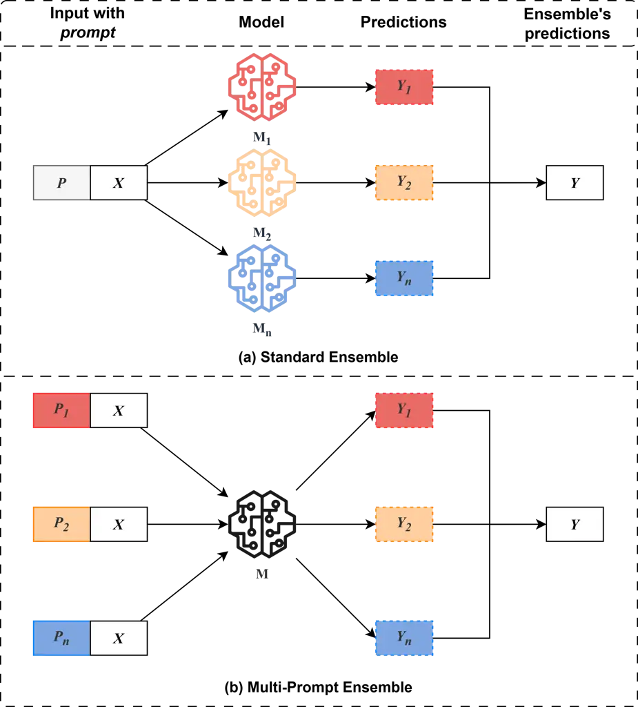
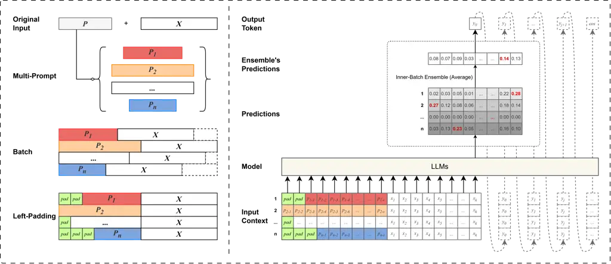

# M-Ped: Multi-Prompt Ensemble Decoding for Large Language Models

Jiaxin GUO    Daimeng Wei    Yuanchang Luo    Shimin Tao    Hengchao
Shang    Zongyao Li Affiliation: Shaojun Li, Jinlong Yang, Zhanglin Wu,
Zhiqiang Rao and Hao Yang
Email: <%7Bjiaxinguo1,weidaimeng,luoyuanchang1,taoshimin,shanghengchao,lizongyao%7D@huawei.com>
Email: <%7Blishaojun18,yangjinlong7,wuzhanglin2,raozhiqiang,yanghao30%7D@huawei.com>
Affiliation: Huawei Translation Services Center, Beijing, China

###### Abstract

With the widespread application of Large Language Models (LLMs) in the
field of Natural Language Processing (NLP), enhancing their performance
has become a research hotspot. This paper presents a novel multi-prompt
ensemble decoding approach designed to bolster the generation quality of
LLMs by leveraging the aggregation of outcomes from multiple prompts.
Given a unique input $`X`$, we submit $`n`$ variations of prompts with
$`X`$ to LLMs in batch mode to decode and derive probability
distributions. For each token prediction, we calculate the ensemble
probability by averaging the $`n`$ probability distributions within the
batch, utilizing this aggregated probability to generate the token. This
technique is dubbed Inner-Batch Ensemble. To facilitate efficient batch
inference, we implement a Left-Padding strategy to maintain uniform
input lengths across the n prompts. Through extensive experimentation on
diverse NLP tasks, including machine translation, code generation, and
text simplification, we demonstrate the efficacy of our method in
enhancing LLM performance. The results show substantial improvements in
BLEU scores, pass@$`k`$ rates, and LENS metrics over conventional
methods.

## 1 Introduction



Figure 1: (a) Standard Ensemble: Input $`X`$ with prompt $`P`$ is fed
into models $`M_{1}`$, $`M_{2}`$, …, $`M_{n}`$, yielding predictions
$`Y_{1}`$, $`Y_{2}`$, …, $`Y_{n}`$. These are combined to get the final
ensemble result $`Y`$. (b) Our Multi-Prompt Ensemble: Input $`X`$
constructs prompts $`P_{1}`$, $`P_{2}`$, …, $`P_{n}`$, forming diverse
samples batched through one model $`M`$ to get predictions $`Y_{1}`$,
$`Y_{2}`$, …, $`Y_{n}`$. The ensemble result $`Y`$ is the average of
these predictions.



Figure 2: The overall process of Our Multi-Prompt Ensemble Decoding.

Large Language Models (LLMs) OpenAI (2023); Touvron et al. (2023a);
Touvron et al. (2023b); Bai et al. (2023); Yang et al. (2024) have
demonstrated exceptional capabilities in understanding and generating
natural language through extensive data pre-training, becoming the core
driving force in the field of Natural Language Processing (NLP). Prompt
technology Jiang et al. (2020); Liu et al. (2023); Pitis et al. (2023);
Zhao et al. (2023); Heineman et al. (2024); Wei et al. (2022); Wang
et al. (2023), as a key to enhancing LLMs’ performance, can strengthen
the model’s effects without altering model parameters, achieving
seamless integration with downstream tasks. However, in the practical
application of LLMs, the output results are closely related to the
quality of the Prompt, and a precise and effective Prompt is crucial for
improving the model’s response quality. How to use Prompts more
efficiently to fully leverage the potential of LLMs has become a hot
issue of common concern in academia and industry.

Ensemble decoding Lakshminarayanan et al. (2017); Ganaie et al. (2022);
Zhou et al. (2002) is a widely employed technique for enhancing the
quality of model-generated outputs. Typically, as shown in Figure 1(a),
standard ensemble decoding refers to the process of combining the
outputs of multiple distinct models on the same input. Specifically,
during the prediction of each word, ensemble decoding generates a
comprehensive prediction by averaging the probability distributions
provided by multiple models. This approach leverages the diversity among
models, aiming to reduce uncertainty and improve overall predictive
performance. In theory, we could apply ensemble decoding to LLMs.
However, LLMs already demand considerable memory resources, and the
implementation of ensemble decoding with multiple LLMs presents a
significant challenge in terms of memory usage. Moreover, even if these
models could be deployed, optimizing the performance of the ensemble
decoding becomes a complex issue.

In this paper, we introduce a particularly simple yet effective method:
Multi-Prompt Ensemble Decoding (M-Ped). This approach constructs $`n`$
distinct prompts for a single query, generating $`n`$ diverse input
samples that are batched together and submitted to LLMs for inference.
During the inference process, we average the prediction probabilities
within the batch for each word prediction. To ensure batched inference
is feasible, we specifically propose the use of left-padding technology
to address the issue of varying prompt lengths within a batch. Compared
to traditional ensemble methods, our approach shifts the focus of
diversity from using different models to using different prompts. We
have validated the effectiveness of this method across various tasks and
multiple models, including extensive experiments on multiple test sets
for machine translation, code generation, and text simplification tasks.
The results demonstrate improvements in BLEU scores for machine
translationPapineni et al. (2002); Vaswani et al. (2017); Sennrich
et al. (2016); Wei et al. (2023); Gu et al. (2018), pass@$`k`$ scores
for code generationChen et al. (2021); Jiang et al. (2024); Dehaerne
et al. (2022), and LENS scores for text simplification tasksNakamachi
et al. (2020); Maddela et al. (2023).

Our main contributions are summarized as follows:

- •
  We propose a particularly simple yet effective method, Multi-Prompt
  Ensemble Decoding (M-Ped), to enhance the quality of LLMs’ generation
  outcomes.
- •
  We introduce two strategies, Inner-Batch Ensemble and Left-padding, to
  implement M-Ped, ensuring that the inference performance with multiple
  prompts is consistent with that of a single prompt.
- •
  We validate the effectiveness of the M-Ped method across various tasks
  and multiple models.

## 2 Approach

1: procedure INNER_BATCH_ENSEMBLE($`pre\_logits,\ mped\_num`$)

2:   $`total\_size\leftarrow pre\_logits.size(0)`$

3:   $`part\_size\leftarrow total\_size\ //\ mped\_num`$

4:   $`post\_logits\leftarrow[\ ]`$ $`\triangleright`$ Initialize an
empty list to store post_logits

5:   for $`i\leftarrow 0`$ to $`mped\_num-1`$ do

6:    $`start\_idx\leftarrow i\times part\_size`$

7:    $`end\_idx\leftarrow(i+1)\times part\_size`$

8:    $`part\_logit\leftarrow pre\_logits[start\_idx:end\_idx,:]`$

9:    $`post\_logits.append(part\_logit.repeat(mped\_num,\ 1))`$

10:   end for

11:   return $`\sum post\_logits\ /\ mped\_num`$

12: end procedure

Algorithm 1 Multi-Prompt Ensemble Decoding

In this paper, we propose an approach named multi-prompt ensemble
decoding, aimed at enhancing the generation performance of large
language models. The overall process is depicted in Figure 2. For a
given distinct input $`X=\{x_{1},x_{2},...,x_{k}\}`$ with a prompt
$`P`$, we first generate a list of prompts
$`\{P_{1},P_{2},...,P_{n}\}`$. Then, we submit these $`n`$ prompts and
the input $`X`$ to LLMs in batch for decoding to obtain probability
distributions. We average the $`n`$ probability distributions generated
at the $`j`$-th position prediction within the batch to get the ensemble
probability, and ultimately determine the output $`Y`$’s $`y_{j}`$. To
ensure batched inference is possible, we employ a Left-Padding strategy
to ensure the lengths of the $`n`$ inputs are consistent.

### 2.1 Inner-Batch Ensemble

Most LLMs adopt a Decoder-only architecture and utilize an
autoregressive decoding strategy, generating output tokens one by one.
Given the source sentence $`X=\{x_{1},x_{2},...,x_{k}\}`$, LLMs factor
the distribution over possible output sentence
$`Y=\{y_{1},y_{2}...,y_{j}\}`$ into a chain of conditional
probabilities, satisfying the following formula:

```math
\mathbb{P}(Y|X)=\prod_{i=1}^{j}\mathbb{P}(y_{i}|y_{0:i-1},X) \tag{1}
```

For the Standard Ensemble, during the prediction of $`y_{j}`$, we
average the probability distributions provided by $`n`$ models. We
define these $`n`$ models as
$`\{\theta_{1},\theta_{2},...,\theta_{n}\}`$, and the formula is as
follows:

```math
\mathbb{P}(y_{j}|y_{0:j-1},X)=\frac{1}{n}\sum_{i=0}^{n}\mathbb{P}(y_{j}|y_{0:j-1},X,P;\theta_{i}) \tag{2}
```

which $`P`$ is a distinct prompt. This method leverages the diversity
among models, aiming to reduce uncertainty and improve overall
predictive performance.

For our method, we shift the focus of diversity from $`n`$ models to
$`n`$ prompts, and the formula is as follows:

```math
\mathbb{P}(y_{j}|y_{0:j-1},X)=\frac{1}{n}\sum_{i=0}^{n}\mathbb{P}(y_{j}|y_{0:j-1},X,P_{i};\theta) \tag{3}
```

which $`\{P_{1},P_{2},...P_{n}\}`$ is a list of prompts having the same
meaning with $`P`$. As shown in right side of Figure 2, inputs
constructed by these $`n`$ prompts and $`X`$ are submitted to LLMs in
batches for decoding. We average the predicted probability distributions
within the batch at each step of prediction, a process we term
Inner-Batch Ensemble. Here, we use the most straightforward uniform
average method. Of course, in the future, strategies like weighted
average could also be considered. This approach mitigates biases
potentially introduced by any single prompt and enhances the model’s
robustness against varying inputs. For details of the implementation,
please refer to Algorithm 1.

### 2.2 Left-Padding

In the decoding process of LLMs, the inconsistency in prompt lengths
poses challenges for batch processing. To address this issue, we employ
Left-Padding technology to preprocess the input prompts, ensuring
uniformity in length to accommodate the model’s batch processing
requirements. In practice, we pad shorter prompts with a specific token
$`pad`$ until they match the length of the longest prompt. This padding
token is a special token with no semantic meaning, used solely for
padding. This padding does not interfere with the model’s understanding
and processing, as the model is trained to recognize and ignore these
special padding characters.

| $`d`$-BLEU | en$`\rightarrow`$de | en$`\rightarrow`$fr | en$`\rightarrow`$zh | en$`\rightarrow`$ja | de$`\rightarrow`$en | fr$`\rightarrow`$en | zh$`\rightarrow`$en | ja$`\rightarrow`$en |
| ---------- | ------------------- | ------------------- | ------------------- | ------------------- | ------------------- | ------------------- | ------------------- | ------------------- |
| $`p_{1}`$  | 27.40               | 37.59               | 17.37               | 9.35                | 32.89               | 41.38               | 24.39               | 6.72                |
| $`p_{2}`$  | 27.05               | 37.14               | 17.23               | 9.61                | 32.74               | 41.60               | 24.39               | 6.75                |
| Ours       | 27.88               | 38.16               | 18.88               | 11.44               | 33.11               | 42.25               | 24.85               | 8.37                |

Table 1: Results for Machine Translation Task.

Padding is a common method for handling sequences of varying lengths in
batch processing, but it is typically used during the training phase,
often employing Right-Padding. We, however, apply padding during the
inference phase and use Left-Padding, which will not affect the model’s
prediction of the next token. If we used Right-Padding, for shorter
prompts, it would sever the direct connection between input and output,
causing decoding anomalies. See the left side of Figure 2. By doing so,
we can standardize prompts of varying lengths, allowing them to be
processed by the model in one go, making full use of parallel computing
resources.

## 3 Experiments

### 3.1 Application to Machine Translation Task

In the field of machine translation, we have taken on the challenging
task of document-level translation and have significantly enhanced the
performance of models on the IWSLT 2017 test sets by implementing
multi-prompt decoding strategies.

#### Datasets

We validate our experiments using the test sets¹¹ 1
https://huggingface.co/datasets/IWSLT/iwslt2017 from the IWSLT 2017
translation task. This dataset includes parallel documents sourced from
TED talks. Our experiments are conducted on eight language pairs:
English (En) $`\leftrightarrow`$ Chinese (Zh), German (De), French (Fr),
and Japanese (Ja). There are 10 to 12 parallel documents with
approximately 1,500 sentences for each language pair.

#### Model

The model we employed is Llama-3.1-8B-Instruct²² 2
https://huggingface.co/meta-llama/Llama-3.1-8B-Instruct, a large
language model particularly suited for instructed learning tasks.
Compared to previous Llama versions, Llama-3.1-8B-Instruct has enhanced
capabilities in multilingual translation. Given the strong translation
capabilities that LLMs already possess, we directly utilize LLMs for
document-level translation.

#### Evaluate Metrics

We employ $`d`$-BLEU (document-level BLEU) as our evaluation
metricPapineni et al. (2002). While there are other metrics in the field
of machine translation, such as BertScore Zhang et al. (2020) and COMET
Rei et al. (2020), these are typically used for sentence-level
translation evaluation. Utilizing them for document-level translation
requires sentence-level alignment between the original and translated
texts. Hence, we opt for $`d`$-BLEU here, which does not rely on
sentence alignment.

#### Prompts Design

We employed two fixed prompts. One of them is $`p_{1}`$: "Translate the
following paragraph from {source language} to {target language},
ensuring that no part of the sentence is omitted." The other is
$`p_{2}`$: "You’re a very professional translator. Please help me
translate the following paragraph from {source language} to {target
language}."

#### Results

The experimental results demonstrate that our approach, by employing
multi-prompt decoding strategies, achieved significant improvements over
the original method on the $`d`$-BLEU metric. For detailed results,
please refer to Table 1. Our experimental results show that in the
English to Chinese and to Japanese directions, compared to the best
results with a single prompt, our method can approximately increase by
1.5 points on the $`d`$-BLEU scale; there is also an improvement of
about 0.5 points in other directions. We speculate that our use of LLMs,
Llama-3.1-8B-Instruct, which was trained on a vast amount of English
data, results in more stable translations into English, thus limiting
the improvement of our method. However, in other language directions,
the improvement is more pronounced.

### 3.2 Application to Code Generation Task

In the code generation task, our technical solution has achieved a
significant improvement in pass@k pass rates on the standard test set
HumanEval³³ 3 https://github.com/openai/human-eval compared to the
original methods.

#### Dataset

HumanEval is a benchmark test suite designed to evaluate the performance
of code generation models, comprising 164 meticulously crafted Python
programming problems. These problems span a variety of programming
tasks, from basic string manipulation to complex algorithm design. Each
problem includes a function header, docstrings, a function body, and
several unit tests. The structure of the dataset includes a task
identifier (task_id), model input (prompt, containing function headers
and docstrings), a canonical solution (canonical_solution), a function
for testing the correctness of generated code (test), and an entry point
for testing (entry_point).

#### Model

We conduct experimental evaluations using CodeLlama-7B-Python-hf⁴⁴ 4
https://huggingface.co/codellama/CodeLlama-7b-Python-hf.
CodeLlama-13B-Python-hf is a member of the Code Llama series of models,
which is a large-scale code language model series based on Llama 2. It
can adapt to a variety of code synthesis and understanding tasks, such
as code auto-completion, code refactoring, and code explanation. In
Section 4.2, we also perform further experiments comparing models of
different size like 13B.

#### Evaluate Metrics

Pass@k Chen et al. (2021) is a metric used to evaluate the performance
of code generation models, specifically measuring the model’s ability to
correctly solve problems when generating code. During the evaluation
process, the model generates multiple k code samples for each unit test
problem. If any of these samples pass the unit test, then the problem is
considered solved. The pass@k score represents the total proportion of
problems solved, which helps to quantify the model’s success rate in
generating correct code.

#### Prompts Design

Since the dataset provides a prompt for each problem, we define this
original prompt as p1. For another prompt, we have constructed a very
simple prefix based on $`p_{1}`$: """This is a good code., which we
define as $`p_{2}`$. This construction ensures that the newly created
$`p_{2}`$ does not alter the meaning of the original prompt $`p_{1}`$.
For detailed examples, please refer to Appendix A.2.

| pass@$`k`$ | $`k`$=1 | $`k`$=5 | $`k`$=10 |
| ---------- | ------- | ------- | -------- |
| $`p_{1}`$  | 32.11%  | 58.13%  | 67.17%   |
| $`p_{2}`$  | 30.74%  | 58.03%  | 67.26%   |
| Ours       | 33.12%  | 59.07%  | 68.11%   |

Table 2: Results for Code Generation Task.

#### Results

The experimental outcomes demonstrate that our technical solution
markedly enhances the pass rate across various settings of k. As shown
is Table 2, regardless of whether k is set to 1, 5, or 10, our solution
consistently boosts the pass@k pass rate by $`1\%`$ point. This
improvement not only underscores the effectiveness of our technical
solution in code generation tasks but also highlights its robustness
across different evaluation metrics, ensuring the delivery of higher
quality code generation outcomes.

### 3.3 Application to Text Simplification Task

In the text simplification task, our technical solution has demonstrated
superior performance on the challenging test set SimpEval_2022. Compared
to the original methods, our solution has achieved significant
improvements in the LENS metric.

#### Dataset

SimpEval_2022 is a challenging text simplification benchmark consisting
of over 1,000 human ratings on 360 simplifications. This dataset is
designed to evaluate the latest text simplification models, particularly
those based on large pre-trained language models. The sentences in
SimpEval_2022 are selected from Wikipedia revisions published after
October 22, 2022, and include more complex sentences to reduce the risk
of "data contamination" and serve as a more challenging test bed for
large language models.

#### Model

The model we used is Llama-3.1-8B-Instruct⁵⁵ 5
https://huggingface.co/meta-llama/Llama-3.1-8B-Instruct, a large
language model particularly suited for instructed learning tasks. In
this study, we applied this model to text simplification tasks and
combined it with multi-prompt decoding strategies to enhance text
simplification quality. The powerful computational capabilities of the
Llama-3.1-8B-Instruct model enable it to handle complex language
conversion tasks and perform exceptionally well in text simplification.

#### Evaluate Metrics

LENS Maddela et al. (2023) is a state-of-the-art metric designed to
assess the performance of text simplification tasks. LENS supports two
evaluation conditions: with reference (w/ ref) and without reference
(w/o ref). Under the with reference condition, LENS uses the original
text as a benchmark for evaluation; whereas, under the without reference
condition, LENS evaluates the quality of simplified text independently,
without relying on any original text information. This flexibility
allows LENS to accommodate various assessment needs and environments.

#### Prompts Design

Following Heineman et al. (2024), the prompts are designed as follows:
$`p_{1}`$ is "Please simplify the following sentence so that it is easy
to understand by people with disabilities or those who are unfamiliar
with English. Try to use shorter words, fewer clauses, and a simpler
structure." $`p_{2}`$ is "Create a simpler version of the sentence below
so that it can be better understood by non-English speakers or
individuals with disabilities."

|           |            |     |             |     |
| --------- | ---------- | --- | ----------- | --- |
| LENS      | $`w/`$ ref |     | $`w/o`$ ref |     |
| $`p_{1}`$ | 75.08      |     | 81.54       |     |
| $`p_{2}`$ | 74.76      |     | 81.63       |     |
| Ours      | 77.18      |     | 82.08       |     |

Table 3: Results for Text Simplification Task.

#### Results

The experimental results demonstrate that our technical solution can
achieve significant improvements in the LENS metric under various
evaluation conditions. As shown in Table 3, whether under with-reference
or without-reference evaluation conditions, our solution can steadily
enhance the quality of text simplification. Notably, under
with-reference evaluation conditions, our method outperforms the best
results obtained using only $`p_{1}`$ or $`p_{2}`$ by nearly 1.5 points.
This result proves the effectiveness and applicability of our technical
solution in text simplification tasks, providing higher quality text
simplification results under diverse evaluation standards.

## 4 Study

### 4.1 Effectiveness Analysis under Various Decoding Strategies

In this section, we conducted an in-depth analysis of the effects of
multi-prompt ensemble decoding methods under various decoding
strategies, including Top-$`p`$ Finlayson et al. (2024), Top-$`k`$ Xie
et al. (2020), and Beam Search. Among them, Top-$`p`$ is the decoding
method we used for various tasks in Section 3. We expanded this
experiment based on our previous work in machine translation and code
generation tasks.

| $`d`$-BLEU | Top-$`p`$           | Top-$`k`$ | Beam  |
| ---------- | ------------------- | --------- | ----- |
|            | En$`\rightarrow`$De |           |       |
| $`p_{1}`$  | 27.40               | 26.92     | 27.64 |
| $`p_{2}`$  | 27.05               | 27.22     | 27.81 |
| Ours       | 27.88               | 27.52     | 27.81 |
|            | En$`\rightarrow`$Zh |           |       |
| $`p_{1}`$  | 17.37               | 17.56     | 18.34 |
| $`p_{2}`$  | 17.23               | 16.79     | 18.42 |
| Ours       | 18.88               | 18.87     | 18.51 |

Table 4: Study under Various Decoding Strategies for Machine Translation
Task

For machine translation tasks, we conducted experiments in the English
to German (en$`\rightarrow`$de) and English to Chinese
(en$`\rightarrow`$zh) directions, as shown in Table 4. We found that
with Top-$`k`$ and Top-$`p`$ decoding methods, our approach showed
improvements compared to single prompt. With Beam Search decoding, our
method’s results are close to the best results of $`p_{1}`$ or
$`p_{2}`$, and higher than the average of these two.

|            |           |     |           |     |
| ---------- | --------- | --- | --------- | --- |
| pass@$`k`$ | Top-$`p`$ |     | Top-$`k`$ |     |
| $`p_{1}`$  | 67.17%    |     | 66.94%    |     |
| $`p_{2}`$  | 67.26%    |     | 67.11%    |     |
| Ours       | 68.11%    |     | 67.85%\*  |     |

Table 5: Study under Various Decoding Strategies for Code Generation
Task where pass@$`k`$=10.

For code generation tasks, due to the characteristics of the task
evaluation, we could only adopt sampling search decoding strategies
(Top-$`p`$ or Top-$`k`$). As shown in Table 5, regardless of whether
based on Top-$`k`$ or Top-$`p`$, our method consistently improved
pass@$`k`$. This conclusion is consistent with Section 3.2.

### 4.2 Study across Varying LLM Sizes

In this section, we investigate the effectiveness of our method across
different sizes of LLMs. Our main experiments in Section 3 were
conducted on models of size 7-8B. Building on our previous code
generation tasks, we extended our experiments to a 13B model, using
CodeLlama-13B-Python-hf⁶⁶ 6
https://huggingface.co/codellama/CodeLlama-13b-Python-hf. We ensured
that all experimental settings remained consistent with Section 3.2,
except for the model itself.

| pass@$`k`$ | $`k`$=1 | $`k`$=5 | $`k`$=10 |
| ---------- | ------- | ------- | -------- |
| $`p_{1}`$  | 39.6%   | 67.53%  | 78.02%   |
| $`p_{2}`$  | 39.48%  | 67.6%   | 77.88%   |
| Ours       | 41.52%  | 69.54%  | 79.80%   |

Table 6: Results for Code Generation Task using CodeLlama-13B-Python-hf.

As shown in Table 6, larger models demonstrate superior code generation
capabilities, with significant improvements in the pass@$`k`$ metric for
$`k`$=1, 5 and 10. Our method also shows consistent improvements on the
13B model, achieving similar enhancements as on the 7B model. Moreover,
on the 13B model, the improvement is more substantial, with pass@10
increasing by nearly 2 points; whereas the pass@10 on the 7B model (see
Table 2) only improved by about 1 point. The experimental results
confirm the effectiveness of our method across various sizes of LLMs.

### 4.3 Study on the Relationship between Prompt Count $`n`$ and Output Quality

In this section, we investigate the relationship between the number of
prompts and the quality of results. Building on our previous experiments
on code generation and text simplification tasks, we conducted extended
tests with varying numbers of prompts. The settings for the extended
prompts are detailed in Appendix C.2.

| $`n`$     | 1      | 2      | 3      | 4      |
| --------- | ------ | ------ | ------ | ------ |
| $`p_{1}`$ | 67.17% | \-     | \-     | \-     |
| Ours      | \-     | 68.11% | 68.15% | 67.85% |

Table 7: Pass@10 rate under different Prompt Count $`n`$ for Code
Generation Task.

| $`n`$     | 1     | 2     | 3     | 4     |
| --------- | ----- | ----- | ----- | ----- |
| $`p_{1}`$ | 75.08 | \-    | \-    | \-    |
| Ours      | \-    | 77.18 | 77.08 | 76.88 |

Table 8: LENS w/ ref under different Prompt Count $`n`$ for Text
Simplification Task.

As shown in Tables 7 and 8, the experimental results indicate that
increasing the number of prompts can enhance the quality of generated
output for both code generation and text simplification tasks. However,
we observed that when the number of prompts increased from 2 to 3, the
improvement in result quality began to plateau. This trend suggests that
2-3 prompts are essentially sufficient to achieve optimal results, and
beyond this range, additional prompts have a limited effect on enhancing
result quality. Therefore, in our previous baseline experiments in
Section 3, we opted for two prompts as the standard configuration.

### 4.4 Exploration of Multilingual Prompts Effects

In this section, we explore the effectiveness of our method under
Multilingual Prompts. Building on our previous experiments in machine
translation tasks, we extended this experiment to the Chinese to English
(zh$`\rightarrow`$en) and English to Chinese (en$`\rightarrow`$zh)
directions. We utilized the Qwen2.5-7B-Instruct⁷⁷ 7
https://huggingface.co/Qwen/Qwen2.5-7B-Instruct model, which provides
better support for instructions in both Chinese and English. For one of
the prompts, $`p_{1}`$, we maintained consistency with Section 3.1,
setting it as "Translate the following paragraph from source language to
target language, ensuring that no part of the sentence is omitted." For
the other prompt, $`p_{2}`$, we set it as the Chinese specification

"将下面这一段从{源语种}翻译成{目标语种}，确保没有句子被漏掉。"

| $`d`$-BLEU | En$`\rightarrow`$Zh | Zh$`\rightarrow`$En |
| ---------- | ------------------- | ------------------- |
| $`p_{1}`$  | 21.6                | 23.89               |
| $`p_{2}`$  | 20.83               | 24.07               |
| Ours       | 23.45               | 24.53               |

Table 9: Study on Multilingual Prompts using Qwen2.5-7B-Instruct for
Machine Translation Task.

As shown in Table 9, under the Multilingual Prompts setup, our method
shows improvements compared to using a single prompt.

### 4.5 Effect of Combination with MBR

Minimum Bayes Risk(MBR), which generates multiple candidate results
during inference and selects the final outcome using specific metrics,
is widely used in NLP generation tasks. We validate the effectiveness of
combining our multi-prompt ensemble decoding strategy with MBR in text
simplification tasks. We sampled and generated 50 candidate results for
both simple prompts $`p_{1}`$ and $`p_{2}`$, then used MBR to select the
optimal outcome. For our multi-prompt ensemble decoding, we also sampled
and generated 50 candidate results and chose the best one using MBR.

| LENS      | Original | MBR   |
| --------- | -------- | ----- |
| $`p_{1}`$ | 75.08    | 77.04 |
| $`p_{2}`$ | 74.76    | 76.87 |
| Ours      | 77.18    | 77.72 |

Table 10: LENS w/ reference results compared between Original and MBR
for Text Simplification Task.

As shown in Table 10, the MBR strategy is a universal approach that
significantly improves results under various conditions. When combined
with our multi-prompt ensemble decoding strategy, it still manages to
enhance the results by more than 0.5 points.

## 5 Related Work

The following are some significant works Hokamp et al. (2020); Cheng
et al. (2024); Heineman et al. (2024); Pitis et al. (2023) about prompts
related to this study:

Heineman et al. (2024) proposed a multi-prompt decoding approach that
improves Minimum Bayes Risk (MBR) decoding by decoding multiple
candidate generations from a prompt library during inference. This
method uses a trained value metric to select the final output,
demonstrating that multi-prompt can improve MBR performance in a range
of conditional generation tasks by estimating a more diverse and
higher-quality candidate space. The core of this paper lies in the MBR
strategy, which generates multiple candidate results during inference
and selects the final outcome using specific metrics. They construct a
sufficiently large and diverse set of candidates through
multi-prompting, which can be seen as an ensemble in the result space.
However our method is an ensemble during the inference process. .

Pitis et al. (2023) introduced a method named Boosted Prompt Ensembles
to enhance the reasoning performance of large language models without
additional training. It constructs a set of few-shot prompts that work
together as an ensemble, iteratively adding prompts that target
difficult examples where the current ensemble’s performance is
uncertain, thereby improving overall accuracy on a variety of tasks. The
core of this paper lies in the selection of prompts. They proposed two
algorithms: Train-time Boosting and Test-time Boosting, and conducted
experiments solely on the GSM8k and AQuA datasets. In contrast, our
research explores a more general ensemble method during the decoding
process; we do not select specific prompts but assume that we already
have a batch of prompts with equivalent performance.

## 6 Conclusions

This study set out to address the challenge of enhancing the performance
of LLMs in NLP tasks through the introduction of a multi-prompt ensemble
decoding approach. Our method, termed Inner-Batch Ensemble, leverages
the diversity of multiple prompts to aggregate their outcomes, thereby
improving the generation quality of LLMs. The implementation of a
Left-Padding strategy ensured efficient batch inference, allowing for
uniform input lengths across various prompts. Our extensive experiments
across a range of NLP tasks—spanning machine translation, code
generation, and text simplification—demonstrated the effectiveness of
our Inner-Batch Ensemble method. The results were particularly
compelling, with significant improvements observed in BLEU scores,
pass@$`k`$ rates, and LENS metrics when compared to standard methods.
The consistent enhancements across different tasks and metrics
underscore the robustness and versatility of our approach.

## 7 Future Work

It is known that LLMs tend to forget information when dealing with
lengthy contexts, possibly due to the overwhelming length of the
context. In our multi-prompt ensemble decoding strategy, although the
prompts vary in form, their semantic content is identical. We are
considering whether integrating prompts carrying different information
could enhance decoding, allowing for the segmentation of extensive
contexts into shorter segments distributed across various prompts. This
approach might help the model retain all information more effectively
and improve the integrity of integrated reasoning. We believe this is a
highly promising area for further research.

Additionally, as LLMs are increasingly moving towards smaller model
sizes, enhancing the performance of these smaller models to match the
quality of their larger counterparts presents a challenge. We propose
the possibility of strengthening the diversity of prompts during the
training of smaller LLMs and leveraging the decoding strategy presented
in this paper to boost their final performance. This strategy could
shift traditional deep reasoning to broader reasoning, enhancing the
model’s performance and generalization capabilities by increasing the
breadth of inference rather than depth.

## 8 Limitations

This study acknowledges several limitations. Firstly, our method is
closely tied to the quality of the prompts used. A poorly constructed
prompt may render our approach ineffective, as high-quality prompts are
essential for guiding LLMs to produce accurate outputs. Secondly, due to
constraints in time and computational resources, the effectiveness of
our method across a broader range of tasks requires further validation.
Additionally, we did not experiment with the state-of-the-art GPT-4
series interfaces, as they are proprietary and do not support embedding
or modification of their decoding strategies, limiting our ability to
test and refine our method on cutting-edge models.

## References

- Bai et al. (2023) Jinze Bai, Shuai Bai, Yunfei Chu, Zeyu Cui, Kai
  Dang, Xiaodong Deng, Yang Fan, Wenbin Ge, Yu Han, Fei Huang, Binyuan
  Hui, Luo Ji, Mei Li, Junyang Lin, Runji Lin, Dayiheng Liu, Gao Liu,
  Chengqiang Lu, Keming Lu, Jianxin Ma, Rui Men, Xingzhang Ren,
  Xuancheng Ren, Chuanqi Tan, Sinan Tan, Jianhong Tu, Peng Wang, Shijie
  Wang, Wei Wang, Shengguang Wu, Benfeng Xu, Jin Xu, An Yang, Hao Yang,
  Jian Yang, Shusheng Yang, Yang Yao, Bowen Yu, Hongyi Yuan, Zheng Yuan,
  Jianwei Zhang, Xingxuan Zhang, Yichang Zhang, Zhenru Zhang, Chang
  Zhou, Jingren Zhou, Xiaohuan Zhou, and Tianhang Zhu. 2023. [Qwen
  technical report](https://doi.org/10.48550/ARXIV.2309.16609). _CoRR_,
  abs/2309.16609.
- Chen et al. (2021) Mark Chen, Jerry Tworek, Heewoo Jun, Qiming Yuan,
  Henrique Pondé de Oliveira Pinto, Jared Kaplan, Harri Edwards, Yuri
  Burda, Nicholas Joseph, Greg Brockman, Alex Ray, Raul Puri, Gretchen
  Krueger, Michael Petrov, Heidy Khlaaf, Girish Sastry, Pamela Mishkin,
  Brooke Chan, Scott Gray, Nick Ryder, Mikhail Pavlov, Alethea Power,
  Lukasz Kaiser, Mohammad Bavarian, Clemens Winter, Philippe Tillet,
  Felipe Petroski Such, Dave Cummings, Matthias Plappert, Fotios
  Chantzis, Elizabeth Barnes, Ariel Herbert-Voss, William Hebgen Guss,
  Alex Nichol, Alex Paino, Nikolas Tezak, Jie Tang, Igor Babuschkin,
  Suchir Balaji, Shantanu Jain, William Saunders, Christopher Hesse,
  Andrew N. Carr, Jan Leike, Joshua Achiam, Vedant Misra, Evan Morikawa,
  Alec Radford, Matthew Knight, Miles Brundage, Mira Murati, Katie
  Mayer, Peter Welinder, Bob McGrew, Dario Amodei, Sam McCandlish, Ilya
  Sutskever, and Wojciech Zaremba. 2021. [Evaluating large language
  models trained on code](https://arxiv.org/abs/2107.03374). _CoRR_,
  abs/2107.03374.
- Cheng et al. (2024) Zifeng Cheng, Zhaoling Chen, Zhiwei Jiang, Yafeng
  Yin, Shiping Ge, Yuliang Liu, and Qing Gu. 2024. [Multi-prompting
  decoder helps better language
  understanding](https://doi.org/10.48550/ARXIV.2406.06279). _CoRR_,
  abs/2406.06279.
- Dehaerne et al. (2022) Enrique Dehaerne, Bappaditya Dey, Sandip
  Halder, Stefan De Gendt, and Wannes Meert. 2022. [Code generation
  using machine learning: A systematic
  review](https://doi.org/10.1109/ACCESS.2022.3196347). _IEEE Access_,
  10:82434–82455.
- Finlayson et al. (2024) Matthew Finlayson, John Hewitt, Alexander
  Koller, Swabha Swayamdipta, and Ashish Sabharwal. 2024. [Closing the
  curious case of neural text
  degeneration](https://openreview.net/forum?id=dONpC9GL1o). In _The
  Twelfth International Conference on Learning Representations, ICLR
  2024, Vienna, Austria, May 7-11, 2024_. OpenReview.net.
- Ganaie et al. (2022) M. A. Ganaie, Minghui Hu, Ashwani Kumar Malik,
  Muhammad Tanveer, and Ponnuthurai N. Suganthan. 2022. [Ensemble deep
  learning: A review](https://doi.org/10.1016/J.ENGAPPAI.2022.105151).
  _Eng. Appl. Artif. Intell._, 115:105151.
- Gu et al. (2018) Jiatao Gu, James Bradbury, Caiming Xiong, Victor
  O. K. Li, and Richard Socher. 2018. [Non-autoregressive neural machine
  translation](https://openreview.net/forum?id=B1l8BtlCb). In _6th
  International Conference on Learning Representations, ICLR 2018,
  Vancouver, BC, Canada, April 30 - May 3, 2018, Conference Track
  Proceedings_. OpenReview.net.
- Heineman et al. (2024) David Heineman, Yao Dou, and Wei Xu. 2024.
  [Improving minimum bayes risk decoding with
  multi-prompt](https://aclanthology.org/2024.emnlp-main.1255). In
  _Proceedings of the 2024 Conference on Empirical Methods in Natural
  Language Processing, EMNLP 2024, Miami, FL, USA, November 12-16,
  2024_, pages 22525–22545. Association for Computational Linguistics.
- Hokamp et al. (2020) Chris Hokamp, Demian Gholipour Ghalandari,
  Nghia The Pham, and John Glover. 2020. [Dyne: Dynamic ensemble
  decoding for multi-document
  summarization](https://arxiv.org/abs/2006.08748). _CoRR_,
  abs/2006.08748.
- Jiang et al. (2024) Juyong Jiang, Fan Wang, Jiasi Shen, Sungju Kim,
  and Sunghun Kim. 2024. [A survey on large language models for code
  generation](https://doi.org/10.48550/ARXIV.2406.00515). _CoRR_,
  abs/2406.00515.
- Jiang et al. (2020) Zhengbao Jiang, Frank F. Xu, Jun Araki, and Graham
  Neubig. 2020. [How can we know what language models
  know](https://doi.org/10.1162/TACL_A_00324). _Trans. Assoc. Comput.
  Linguistics_, 8:423–438.
- Lakshminarayanan et al. (2017) Balaji Lakshminarayanan, Alexander
  Pritzel, and Charles Blundell. 2017. [Simple and scalable predictive
  uncertainty estimation using deep
  ensembles](https://proceedings.neurips.cc/paper/2017/hash/9ef2ed4b7fd2c810847ffa5fa85bce38-Abstract.html).
  In _Advances in Neural Information Processing Systems 30: Annual
  Conference on Neural Information Processing Systems 2017, December
  4-9, 2017, Long Beach, CA, USA_, pages 6402–6413.
- Liu et al. (2023) Pengfei Liu, Weizhe Yuan, Jinlan Fu, Zhengbao Jiang,
  Hiroaki Hayashi, and Graham Neubig. 2023. [Pre-train, prompt, and
  predict: A systematic survey of prompting methods in natural language
  processing](https://doi.org/10.1145/3560815). _ACM Comput. Surv._,
  55(9):195:1–195:35.
- Maddela et al. (2023) Mounica Maddela, Yao Dou, David Heineman, and
  Wei Xu. 2023. [LENS: A learnable evaluation metric for text
  simplification](https://doi.org/10.18653/V1/2023.ACL-LONG.905). In
  _Proceedings of the 61st Annual Meeting of the Association for
  Computational Linguistics (Volume 1: Long Papers), ACL 2023, Toronto,
  Canada, July 9-14, 2023_, pages 16383–16408. Association for
  Computational Linguistics.
- Nakamachi et al. (2020) Akifumi Nakamachi, Tomoyuki Kajiwara, and Yuki
  Arase. 2020. [Text simplification with reinforcement learning using
  supervised rewards on grammaticality, meaning preservation, and
  simplicity](https://aclanthology.org/2020.aacl-srw.22/). In
  _Proceedings of the 1st Conference of the Asia-Pacific Chapter of the
  Association for Computational Linguistics and the 10th International
  Joint Conference on Natural Language Processing: Student Research
  Workshop, AACL/IJCNLP 2021, Suzhou, China, December 4-7, 2020_, pages
  153–159. Association for Computational Linguistics.
- OpenAI (2023) OpenAI. 2023. [GPT-4 technical
  report](https://doi.org/10.48550/ARXIV.2303.08774). _CoRR_,
  abs/2303.08774.
- Papineni et al. (2002) Kishore Papineni, Salim Roukos, Todd Ward, and
  Wei-Jing Zhu. 2002. [Bleu: a method for automatic evaluation of
  machine translation](https://doi.org/10.3115/1073083.1073135). In
  _Proceedings of the 40th Annual Meeting of the Association for
  Computational Linguistics, July 6-12, 2002, Philadelphia, PA, USA_,
  pages 311–318. ACL.
- Pitis et al. (2023) Silviu Pitis, Michael R. Zhang, Andrew Wang, and
  Jimmy Ba. 2023. [Boosted prompt ensembles for large language
  models](https://doi.org/10.48550/ARXIV.2304.05970). _CoRR_,
  abs/2304.05970.
- Rei et al. (2020) Ricardo Rei, Craig Stewart, Ana C. Farinha, and Alon
  Lavie. 2020. [COMET: A neural framework for MT
  evaluation](https://doi.org/10.18653/V1/2020.EMNLP-MAIN.213). In
  _Proceedings of the 2020 Conference on Empirical Methods in Natural
  Language Processing, EMNLP 2020, Online, November 16-20, 2020_, pages
  2685–2702. Association for Computational Linguistics.
- Sennrich et al. (2016) Rico Sennrich, Barry Haddow, and Alexandra
  Birch. 2016. [Improving neural machine translation models with
  monolingual data](https://arxiv.org/abs/1511.06709). _Preprint_,
  arXiv:1511.06709.
- Touvron et al. (2023a) Hugo Touvron, Thibaut Lavril, Gautier Izacard,
  Xavier Martinet, Marie-Anne Lachaux, Timothée Lacroix, Baptiste
  Rozière, Naman Goyal, Eric Hambro, Faisal Azhar, Aurélien Rodriguez,
  Armand Joulin, Edouard Grave, and Guillaume Lample. 2023a. [Llama:
  Open and efficient foundation language
  models](https://doi.org/10.48550/ARXIV.2302.13971). _CoRR_,
  abs/2302.13971.
- Touvron et al. (2023b) Hugo Touvron, Louis Martin, Kevin Stone, Peter
  Albert, Amjad Almahairi, Yasmine Babaei, Nikolay Bashlykov, Soumya
  Batra, Prajjwal Bhargava, Shruti Bhosale, Dan Bikel, Lukas Blecher,
  Cristian Canton-Ferrer, Moya Chen, Guillem Cucurull, David Esiobu,
  Jude Fernandes, Jeremy Fu, Wenyin Fu, Brian Fuller, Cynthia Gao,
  Vedanuj Goswami, Naman Goyal, Anthony Hartshorn, Saghar Hosseini, Rui
  Hou, Hakan Inan, Marcin Kardas, Viktor Kerkez, Madian Khabsa, Isabel
  Kloumann, Artem Korenev, Punit Singh Koura, Marie-Anne Lachaux,
  Thibaut Lavril, Jenya Lee, Diana Liskovich, Yinghai Lu, Yuning Mao,
  Xavier Martinet, Todor Mihaylov, Pushkar Mishra, Igor Molybog, Yixin
  Nie, Andrew Poulton, Jeremy Reizenstein, Rashi Rungta, Kalyan Saladi,
  Alan Schelten, Ruan Silva, Eric Michael Smith, Ranjan Subramanian,
  Xiaoqing Ellen Tan, Binh Tang, Ross Taylor, Adina Williams, Jian Xiang
  Kuan, Puxin Xu, Zheng Yan, Iliyan Zarov, Yuchen Zhang, Angela Fan,
  Melanie Kambadur, Sharan Narang, Aurélien Rodriguez, Robert Stojnic,
  Sergey Edunov, and Thomas Scialom. 2023b. [Llama 2: Open foundation
  and fine-tuned chat
  models](https://doi.org/10.48550/ARXIV.2307.09288). _CoRR_,
  abs/2307.09288.
- Vaswani et al. (2017) Ashish Vaswani, Noam Shazeer, Niki Parmar, Jakob
  Uszkoreit, Llion Jones, Aidan N. Gomez, Lukasz Kaiser, and Illia
  Polosukhin. 2017. [Attention is all you
  need](https://proceedings.neurips.cc/paper/2017/hash/3f5ee243547dee91fbd053c1c4a845aa-Abstract.html).
  In _Advances in Neural Information Processing Systems 30: Annual
  Conference on Neural Information Processing Systems 2017, December
  4-9, 2017, Long Beach, CA, USA_, pages 5998–6008.
- Wang et al. (2023) Xuezhi Wang, Jason Wei, Dale Schuurmans, Quoc V.
  Le, Ed H. Chi, Sharan Narang, Aakanksha Chowdhery, and Denny
  Zhou. 2023. [Self-consistency improves chain of thought reasoning in
  language models](https://openreview.net/forum?id=1PL1NIMMrw). In _The
  Eleventh International Conference on Learning Representations, ICLR
  2023, Kigali, Rwanda, May 1-5, 2023_. OpenReview.net.
- Wei et al. (2023) Daimeng Wei, Zhanglin Wu, Hengchao Shang, Zongyao
  Li, Minghan Wang, Jiaxin Guo, Xiaoyu Chen, Zhengzhe Yu, and Hao
  Yang. 2023. [Text style transfer
  back-translation](https://arxiv.org/abs/2306.01318). _Preprint_,
  arXiv:2306.01318.
- Wei et al. (2022) Jason Wei, Xuezhi Wang, Dale Schuurmans, Maarten
  Bosma, Brian Ichter, Fei Xia, Ed H. Chi, Quoc V. Le, and Denny
  Zhou. 2022. [Chain-of-thought prompting elicits reasoning in large
  language
  models](http://papers.nips.cc/paper_files/paper/2022/hash/9d5609613524ecf4f15af0f7b31abca4-Abstract-Conference.html).
  In _Advances in Neural Information Processing Systems 35: Annual
  Conference on Neural Information Processing Systems 2022, NeurIPS
  2022, New Orleans, LA, USA, November 28 - December 9, 2022_.
- Xie et al. (2020) Yujia Xie, Hanjun Dai, Minshuo Chen, Bo Dai, Tuo
  Zhao, Hongyuan Zha, Wei Wei, and Tomas Pfister. 2020. [Differentiable
  top-k with optimal
  transport](https://proceedings.neurips.cc/paper/2020/hash/ec24a54d62ce57ba93a531b460fa8d18-Abstract.html).
  In _Advances in Neural Information Processing Systems 33: Annual
  Conference on Neural Information Processing Systems 2020, NeurIPS
  2020, December 6-12, 2020, virtual_.
- Yang et al. (2024) An Yang, Baosong Yang, Binyuan Hui, Bo Zheng, Bowen
  Yu, Chang Zhou, Chengpeng Li, Chengyuan Li, Dayiheng Liu, Fei Huang,
  Guanting Dong, Haoran Wei, Huan Lin, Jialong Tang, Jialin Wang, Jian
  Yang, Jianhong Tu, Jianwei Zhang, Jianxin Ma, Jianxin Yang, Jin Xu,
  Jingren Zhou, Jinze Bai, Jinzheng He, Junyang Lin, Kai Dang, Keming
  Lu, Keqin Chen, Kexin Yang, Mei Li, Mingfeng Xue, Na Ni, Pei Zhang,
  Peng Wang, Ru Peng, Rui Men, Ruize Gao, Runji Lin, Shijie Wang, Shuai
  Bai, Sinan Tan, Tianhang Zhu, Tianhao Li, Tianyu Liu, Wenbin Ge,
  Xiaodong Deng, Xiaohuan Zhou, Xingzhang Ren, Xinyu Zhang, Xipin Wei,
  Xuancheng Ren, Xuejing Liu, Yang Fan, Yang Yao, Yichang Zhang, Yu Wan,
  Yunfei Chu, Yuqiong Liu, Zeyu Cui, Zhenru Zhang, Zhifang Guo, and
  Zhihao Fan. 2024. [Qwen2 technical
  report](https://doi.org/10.48550/ARXIV.2407.10671). _CoRR_,
  abs/2407.10671.
- Zhang et al. (2020) Tianyi Zhang, Varsha Kishore, Felix Wu, Kilian Q.
  Weinberger, and Yoav Artzi. 2020. [Bertscore: Evaluating text
  generation with BERT](https://openreview.net/forum?id=SkeHuCVFDr). In
  _8th International Conference on Learning Representations, ICLR 2020,
  Addis Ababa, Ethiopia, April 26-30, 2020_. OpenReview.net.
- Zhao et al. (2023) Jiangjiang Zhao, Zhuoran Wang, and Fangchun
  Yang. 2023. [Genetic prompt search via exploiting language model
  probabilities](https://doi.org/10.24963/IJCAI.2023/588). In
  _Proceedings of the Thirty-Second International Joint Conference on
  Artificial Intelligence, IJCAI 2023, 19th-25th August 2023, Macao,
  SAR, China_, pages 5296–5305. ijcai.org.
- Zhou et al. (2002) Zhi-Hua Zhou, Jianxin Wu, and Wei Tang. 2002.
  [Ensembling neural networks: Many could be better than
  all](<https://doi.org/10.1016/S0004-3702(02)00190-X>). _Artif. Intell._,
  137(1-2):239–263.

## Appendix A Prompts Design

### A.1 Prompts for Machine Translation Task

The designed prompts for Machine Translation Task used in Section 3.1
are as following:

| $`p_{1}`$                                                                                                                            |
| ------------------------------------------------------------------------------------------------------------------------------------ |
| System Prompt:                                                                                                                       |
| You are a great translation assistant!                                                                                               |
| User Prompt:                                                                                                                         |
| Translate the following paragraph from {source language} to {target language}, ensuring that no part of the sentence is omitted.     |
| {source language}: {source text}                                                                                                     |
| $`p_{2}`$                                                                                                                            |
| System Prompt:                                                                                                                       |
| You are a helpful assistant!                                                                                                         |
| User Prompt:                                                                                                                         |
| You’re a very professional translator. Please help me translate the following paragraph from {source language} to {target language}. |
| {source language}: {source text}                                                                                                     |

Table 11: Designed Prompts for Machine Translation Task.

### A.2 Prompts for Code Generation Task

For Code Generation Task, since the dataset provides a prompt for each
problem, we define this original prompt as $`p_{1}`$. For prompt
$`p_{2}`$, we construct a simple prefix based on $`p_{1}`$. Examples of
this prompts used in Section 3.2 are as following:

|                                                                                                                                                                                                          |
| -------------------------------------------------------------------------------------------------------------------------------------------------------------------------------------------------------- |
| $`p_{1}`$                                                                                                                                                                                                |
| def specialFilter(nums):                                                                                                                                                                                 |
| """Write a function that takes an array of numbers as input and returns the number of elements in the array that are greater than 10 and both first and last digits of a number are odd (1, 3, 5, 7, 9). |
| For example:                                                                                                                                                                                             |
| specialFilter(\[15, -73, 14, -15\]) =\> 1                                                                                                                                                                |
| specialFilter(\[33, -2, -3, 45, 21, 109\]) =\> 2                                                                                                                                                         |
| """                                                                                                                                                                                                      |
| $`p_{2}`$                                                                                                                                                                                                |
| """ This is a good code.                                                                                                                                                                                 |
| def specialFilter(nums):                                                                                                                                                                                 |
| """Write a function that takes an array of numbers as input and returns the number of elements in the array that are greater than 10 and both first and last digits of a number are odd (1, 3, 5, 7, 9). |
| For example:                                                                                                                                                                                             |
| specialFilter(\[15, -73, 14, -15\]) =\> 1                                                                                                                                                                |
| specialFilter(\[33, -2, -3, 45, 21, 109\]) =\> 2                                                                                                                                                         |
| """                                                                                                                                                                                                      |

Table 12: Prompts of ID 146 for Code Generation Task

|                                                                                                                         |
| ----------------------------------------------------------------------------------------------------------------------- |
| $`p_{1}`$                                                                                                               |
| from typing import List, Tuple                                                                                          |
| def rolling_max(numbers: List\[int\]) -\> List\[int\]:                                                                  |
| """ From a given list of integers, generate a list of rolling maximum element found until given moment in the sequence. |
|     rolling_max(\[1, 2, 3, 2, 3, 4, 2\])                                                                                |
| \[1, 2, 3, 3, 3, 4, 4\]                                                                                                 |
| """                                                                                                                     |
| $`p_{2}`$                                                                                                               |
| """ This is a good code.                                                                                                |
| from typing import List, Tuple                                                                                          |
| def rolling_max(numbers: List\[int\]) -\> List\[int\]:                                                                  |
| """ From a given list of integers, generate a list of rolling maximum element found until given moment in the sequence. |
|     rolling_max(\[1, 2, 3, 2, 3, 4, 2\])                                                                                |
| \[1, 2, 3, 3, 3, 4, 4\]                                                                                                 |
| """                                                                                                                     |

Table 13: Prompts of ID 9 for Code Generation Task

### A.3 Prompts for Text Simplification Task

The designed prompts for Text Simplification used in Section 3.3 are as
following:

| $`p_{1}`$                                                                                                                                                                                                       |
| --------------------------------------------------------------------------------------------------------------------------------------------------------------------------------------------------------------- |
| User Prompt:                                                                                                                                                                                                    |
| Please simplify the following sentence so that it is easy to understand by people with disabilities or those who are unfamiliar with English. Try to use shorter words, fewer clauses, and a simpler structure. |
| Original: {input text}                                                                                                                                                                                          |
| $`p_{2}`$                                                                                                                                                                                                       |
| User Prompt:                                                                                                                                                                                                    |
| Create a simpler version of the sentence below so that it can be better understood by non-English speakers or individuals with disabilities.                                                                    |
| Original: {input text}                                                                                                                                                                                          |

Table 14: Designed Prompts for Text Simplification Task

## Appendix B Detailed Main Experimental Results

### B.1 Detailed Results for Machine Translation Task

The specific outcomes for various seed settings in the Machine
Translation Task, as discussed in Section 3.1, are presented below in
Table 15:

|            |                     |                     |                     |                     |                     |                     |                     |                     |
| ---------- | ------------------- | ------------------- | ------------------- | ------------------- | ------------------- | ------------------- | ------------------- | ------------------- |
| $`d`$-BLEU | en$`\rightarrow`$de | en$`\rightarrow`$fr | en$`\rightarrow`$zh | en$`\rightarrow`$ja | de$`\rightarrow`$en | fr$`\rightarrow`$en | zh$`\rightarrow`$en | ja$`\rightarrow`$en |
|            | $`p_{1}`$           |                     |                     |                     |                     |                     |                     |                     |
| 0          | 27.18               | 38.57               | 22.53               | 13.36               | 34.74               | 42.27               | 21.95               | 9.21                |
| 1          | 27.82               | 37.6                | 16.43               | 7.23                | 34.87               | 42.22               | 25.84               | 7.26                |
| 2          | 27.4                | 35.94               | 16.58               | 5.52                | 31.78               | 39.12               | 24.3                | 5.58                |
| 3          | 28.2                | 37.6                | 15.53               | 12.08               | 30.99               | 41.81               | 25.06               | 5.58                |
| 4          | 26.54               | 37.88               | 16.93               | 11.7                | 32.02               | 41.96               | 24.31               | 4.69                |
| 5          | 27.2                | 36.83               | 15.61               | 7.87                | 32.22               | 41.88               | 21.9                | 9.31                |
| 6          | 27.1                | 38.43               | 15.79               | 6.85                | 31.19               | 41.17               | 25.17               | 6.95                |
| 7          | 28                  | 37.79               | 22.44               | 8.47                | 34.92               | 42.36               | 24.82               | 5.21                |
| 8          | 26.69               | 37.61               | 15.56               | 14.02               | 32.45               | 39.5                | 26.24               | 6.88                |
| 9          | 27.86               | 37.33               | 16.3                | 6.39                | 33.7                | 41.49               | 24.35               | 6.51                |
| AVG        | 27.40               | 37.59               | 17.37               | 9.35                | 32.89               | 41.38               | 24.39               | 6.72                |
|            | $`p_{2}`$           |                     |                     |                     |                     |                     |                     |                     |
| 0          | 26.99               | 35.85               | 15.14               | 14.03               | 35.21               | 41.88               | 24.94               | 6.76                |
| 1          | 26.04               | 37.68               | 16.74               | 12.29               | 33.84               | 42.63               | 24.63               | 6.76                |
| 2          | 26.57               | 38.5                | 16.09               | 6.19                | 31.73               | 42.61               | 26.39               | 5.1                 |
| 3          | 26.15               | 37.12               | 16.47               | 6.46                | 34.89               | 42.42               | 21.68               | 5.2                 |
| 4          | 27.08               | 37.61               | 21.57               | 14.14               | 31.29               | 39.37               | 22.02               | 6.87                |
| 5          | 26.36               | 37.01               | 14.85               | 7.73                | 30.28               | 41.8                | 24.49               | 9.45                |
| 6          | 26.96               | 36.59               | 16.65               | 12.3                | 31.61               | 41.87               | 24.75               | 5.13                |
| 7          | 27.9                | 35.82               | 21.43               | 6.37                | 31.74               | 42.06               | 25.17               | 5.24                |
| 8          | 27.61               | 37.24               | 17.38               | 8.82                | 34.81               | 42.3                | 25.28               | 6.76                |
| 9          | 28.79               | 37.97               | 16                  | 7.81                | 31.97               | 39.01               | 24.5                | 10.25               |
| AVG        | 27.05               | 37.14               | 17.23               | 9.61                | 32.74               | 41.60               | 24.39               | 6.75                |
|            | Ours                |                     |                     |                     |                     |                     |                     |                     |
| 0          | 28.58               | 37.79               | 18.86               | 9.01                | 32.01               | 43.21               | 26.06               | 7.93                |
| 1          | 27.66               | 38.84               | 16.23               | 14.94               | 34.74               | 42.8                | 26.13               | 7.74                |
| 2          | 28.59               | 39.04               | 23.06               | 11.06               | 34.79               | 42.86               | 25.18               | 10.79               |
| 3          | 28.29               | 39.15               | 18.75               | 12.71               | 35.15               | 39.87               | 26.09               | 6.82                |
| 4          | 27.55               | 37.94               | 17.82               | 14.66               | 33.4                | 42.83               | 25.61               | 7.35                |
| 5          | 28.82               | 36.84               | 17.02               | 8.87                | 32.61               | 42.71               | 24.66               | 7.95                |
| 6          | 26.66               | 37.96               | 22.83               | 12.74               | 31.86               | 42.74               | 21.98               | 7.98                |
| 7          | 26.59               | 39.16               | 19.08               | 9.56                | 32.18               | 42.75               | 23.81               | 10.9                |
| 8          | 27.97               | 37.19               | 18.9                | 9.89                | 32.61               | 39.69               | 22.92               | 8.08                |
| 9          | 28.07               | 37.72               | 16.29               | 10.91               | 31.73               | 43.06               | 26.04               | 8.11                |
| AVG        | 27.88               | 38.16               | 18.38               | 11.44               | 33.11               | 42.25               | 24.85               | 8.37                |

Table 15: Detailed results for Machine Translation Task.

### B.2 Detailed Results for Code Generation Task

The specific outcomes for various seed settings in the Code Generation
Task, as discussed in Section 3.2, are presented below in Table 16:

|            |           |         |          |
| ---------- | --------- | ------- | -------- |
| pass@$`k`$ | $`k`$=1   | $`k`$=5 | $`k`$=10 |
|            | $`p_{1}`$ |         |          |
| 0          | 30.41%    | 56.78%  | 67.67%   |
| 1          | 31.94%    | 58.73%  | 66.68%   |
| 2          | 32.32%    | 58.03%  | 67.92%   |
| 3          | 39.24%    | 59.19%  | 66.39%   |
| 4          | 30.44%    | 59.17%  | 67.42%   |
| 5          | 39.2%     | 58.97%  | 66.32%   |
| 6          | 28.02%    | 57.13%  | 67.72%   |
| 7          | 30.71%    | 57.81%  | 67.53%   |
| 8          | 28.42%    | 57.63%  | 67.76%   |
| 9          | 30.37%    | 57.88%  | 66.33%   |
| AVG        | 32.11%    | 58.13%  | 67.17%   |
|            | $`p_{2}`$ |         |          |
| 0          | 30.11%    | 58.64%  | 67.34%   |
| 1          | 32.12%    | 58.73%  | 67.13%   |
| 2          | 32.31%    | 57.62%  | 67.88%   |
| 3          | 33.39%    | 58.97%  | 67.41%   |
| 4          | 28.05%    | 56.39%  | 67%      |
| 5          | 33.1%     | 57.9%   | 66.92%   |
| 6          | 30.1%     | 58.58%  | 67.71%   |
| 7          | 27.95%    | 58.47%  | 66.69%   |
| 8          | 30.35%    | 58.67%  | 67.16%   |
| 9          | 29.96%    | 56.3%   | 67.35%   |
| AVG        | 30.74%    | 58.03%  | 67.26%   |
|            | Ours      |         |          |
| 0          | 32.66%    | 58.9%   | 67.2%    |
| 1          | 37.1%     | 58.86%  | 69.12%   |
| 2          | 37.06%    | 57.89%  | 67.68%   |
| 3          | 32.97%    | 60.05%  | 67.76%   |
| 4          | 31.8%     | 58.9%   | 67.27%   |
| 5          | 33.03%    | 59.21%  | 68.5%    |
| 6          | 32.16%    | 59.19%  | 68.05%   |
| 7          | 33.26%    | 57.93%  | 69.27%   |
| 8          | 30.59%    | 59.37%  | 67.62%   |
| 9          | 30.57%    | 60.41%  | 68.62%   |
| AVG        | 33.12%    | 59.07%  | 68.11%   |

Table 16: Detailed Results for Code Generation Task.

### B.3 Detailed Results for Text Simplification Task

The specific outcomes for various seed settings in the Text
Simplification Task, as discussed in Section 3.3, are presented below in
Table 17:

|      |            |     |             |     |
| ---- | ---------- | --- | ----------- | --- |
| LENS | $`w/`$ ref |     | $`w/o`$ ref |     |
|      | $`p_{1}`$  |     |             |     |
| 0    | 75.32      |     | 80.76       |     |
| 1    | 75.93      |     | 82.04       |     |
| 2    | 75.65      |     | 82.58       |     |
| 3    | 74.47      |     | 81.02       |     |
| 4    | 75.71      |     | 82.2        |     |
| 5    | 74.43      |     | 81.4        |     |
| 6    | 75.37      |     | 82.36       |     |
| 7    | 75.36      |     | 80.26       |     |
| 8    | 74.59      |     | 82.5        |     |
| 9    | 73.98      |     | 80.27       |     |
| AVG  | 75.08      |     | 81.54       |     |
|      | $`p_{2}`$  |     |             |     |
| 0    | 74.54      |     | 81.79       |     |
| 1    | 75.81      |     | 80.62       |     |
| 2    | 72.83      |     | 82.44       |     |
| 3    | 74.48      |     | 81.61       |     |
| 4    | 73.31      |     | 82.36       |     |
| 5    | 75.68      |     | 80.91       |     |
| 6    | 74.92      |     | 81.65       |     |
| 7    | 75.35      |     | 81.23       |     |
| 8    | 74.63      |     | 81.7        |     |
| 9    | 76.05      |     | 81.99       |     |
| AVG  | 74.76      |     | 81.63       |     |
|      | Ours       |     |             |     |
| 0    | 76.71      |     | 82.21       |     |
| 1    | 76.03      |     | 81.88       |     |
| 2    | 77.26      |     | 81.68       |     |
| 3    | 77.22      |     | 81.98       |     |
| 4    | 77.38      |     | 82.36       |     |
| 5    | 78.69      |     | 82.61       |     |
| 6    | 78.02      |     | 82.12       |     |
| 7    | 76.17      |     | 81.63       |     |
| 8    | 77.96      |     | 82.64       |     |
| 9    | 76.32      |     | 81.69       |     |
| AVG  | 77.18      |     | 82.08       |     |

Table 17: Results for Text Simplification Task.

## Appendix C Appendix for Study

### C.1 Detailed Results for Study under Various Decoding Strategies

The specific outcomes for various seed settings in the Machine
Translation Task under Top-$`k`$ decoding strategy, as discussed in
Section 4.1, are presented below in Table 18:

|            |                     |                     |
| ---------- | ------------------- | ------------------- |
| $`d`$-BLEU | en$`\rightarrow`$de | en$`\rightarrow`$zh |
| $`p_{1}`$  |                     |                     |
| 0          | 25.88               | 21.43               |
| 1          | 27.92               | 15.99               |
| 2          | 26.15               | 15.62               |
| 3          | 26.99               | 20.85               |
| 4          | 26.03               | 16.34               |
| 5          | 27.73               | 14.90               |
| 6          | 28.04               | 16.12               |
| 7          | 26.80               | 15.73               |
| 8          | 26.71               | 22.51               |
| 9          | 26.90               | 16.15               |
| AVG        | 26.92               | 17.56               |
| $`p_{2}`$  |                     |                     |
| 0          | 28.79               | 17.70               |
| 1          | 26.60               | 16.99               |
| 2          | 28.26               | 16.55               |
| 3          | 27.28               | 15.37               |
| 4          | 26.77               | 16.67               |
| 5          | 27.82               | 15.20               |
| 6          | 27.16               | 14.88               |
| 7          | 25.64               | 16.15               |
| 8          | 27.56               | 15.51               |
| 9          | 26.36               | 21.94               |
| AVG        | 27.22               | 16.70               |
| Ours       |                     |                     |
| 0          | 28.60               | 18.79               |
| 1          | 28.24               | 18.57               |
| 2          | 25.54               | 17.61               |
| 3          | 27.49               | 19.43               |
| 4          | 25.92               | 16.40               |
| 5          | 26.75               | 19.76               |
| 6          | 28.66               | 17.57               |
| 7          | 27.93               | 17.10               |
| 8          | 28.58               | 22.24               |
| 9          | 27.46               | 21.20               |
| AVG        | 27.52               | 18.87               |

Table 18: Detailed results for Machine Translation Task under Top-$`k`$
decoding strategy.

The specific outcomes for various seed settings in the Code Generation
Task under Top-$`k`$ decoding strategy, as discussed in Section 4.1, are
presented below in Table 19:

|            |          |
| ---------- | -------- |
| pass-$`k`$ | $`k`$=10 |
| $`p_{1}`$  |          |
| 0          | 66.99%   |
| 1          | 66.31%   |
| 2          | 67.57%   |
| 3          | 66.25%   |
| 4          | 67.25%   |
| 5          | 65.83%   |
| 6          | 67.66%   |
| 7          | 67.84%   |
| 8          | 67.71%   |
| 9          | 65.99%   |
| AVG        | 66.94%   |
| $`p_{2}`$  |          |
| 0          | 66.91%   |
| 1          | 66.75%   |
| 2          | 67.5%    |
| 3          | 67.34%   |
| 4          | 66.83%   |
| 5          | 66.62%   |
| 6          | 67.82%   |
| 7          | 66.43%   |
| 8          | 67.21%   |
| 9          | 67.7%    |
| AVG        | 67.11%   |
| Ours       |          |
| 0          | 67.44%   |
| 1          | 67.3%    |
| 2          | 67.32%   |
| 3          | 67.16%   |
| 4          | 67.75%   |
| 5          | 69.05%   |
| 6          | 68.57%   |
| 7          | 67.85%   |
| 8          | 67.6%    |
| 9          | 68.46%   |
| AVG        | 67.85%   |

Table 19: Detailed results for Code Generation Task under Top-$`k`$
decoding strategy.

### C.2 Additional Prompts for Study on Prompt Count $`n`$

Additional Prompts for Study on Prompt Count $`n`$ used in Section 4.3
are as following in Table 20 and Table 21:

| $`p_{3}`$                                                                                                                                                                                                |
| -------------------------------------------------------------------------------------------------------------------------------------------------------------------------------------------------------- |
| """ This is a piece of code written by an expert that is very ingenious.                                                                                                                                 |
| def specialFilter(nums):                                                                                                                                                                                 |
| """Write a function that takes an array of numbers as input and returns the number of elements in the array that are greater than 10 and both first and last digits of a number are odd (1, 3, 5, 7, 9). |
| For example:                                                                                                                                                                                             |
| specialFilter(\[15, -73, 14, -15\]) =\> 1                                                                                                                                                                |
| specialFilter(\[33, -2, -3, 45, 21, 109\]) =\> 2                                                                                                                                                         |
| """                                                                                                                                                                                                      |
| $`p_{4}`$                                                                                                                                                                                                |
| """ Author: a coder expert                                                                                                                                                                               |
| def specialFilter(nums):                                                                                                                                                                                 |
| """Write a function that takes an array of numbers as input and returns the number of elements in the array that are greater than 10 and both first and last digits of a number are odd (1, 3, 5, 7, 9). |
| For example:                                                                                                                                                                                             |
| specialFilter(\[15, -73, 14, -15\]) =\> 1                                                                                                                                                                |
| specialFilter(\[33, -2, -3, 45, 21, 109\]) =\> 2                                                                                                                                                         |
| """                                                                                                                                                                                                      |

Table 20: Additional Prompts of ID 146 for Code Generation Task

| $`p_{3}`$                                                                                                                                                                 |
| ------------------------------------------------------------------------------------------------------------------------------------------------------------------------- |
| User Prompt:                                                                                                                                                              |
| Rewrite this sentence in a simple and easy to understand way. Make sure to retain the meaning and ideas of the original sentence while using shorter words and sentences. |
| Original: {input text}                                                                                                                                                    |
| $`p_{4}`$                                                                                                                                                                 |
| User Prompt:                                                                                                                                                              |
| Express this sentence in simpler terms, keeping its meaning and ideas intact, and use shorter words and sentences.                                                        |
| Original: {input text}                                                                                                                                                    |

Table 21: Additional Prompts for Text Simplification Task
