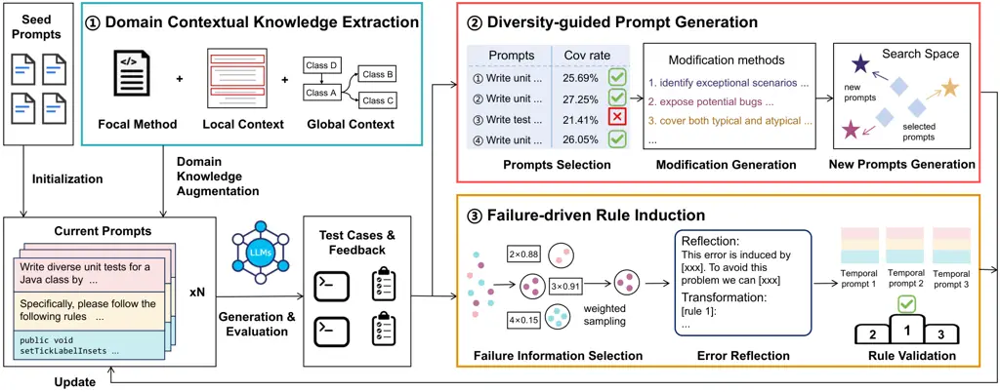

# The Prompt Alchemist: Automated LLM-Tailored Prompt Optimization for Test Case GenerationThanks: ^(∗) Corresponding author. The author is also affiliated with Peng Cheng Laboratory.

Shuzheng Gao¹, Chaozheng Wang¹, Cuiyun Gao^(2∗), Xiaoqian Jiao², Chun
Yong Chong³,  
Shan Gao⁴, Michael R. Lyu¹ Affiliation:  Affiliation: ¹ The Chinese
University of Hong Kong, Hong Kong, China Affiliation:  Affiliation: ²
Harbin Institute of Technology, Shenzhen, China Affiliation: 
Affiliation: ³ School of Information Technology, Monash University
Malaysia, Malaysia Affiliation:  Affiliation: ⁴ Independent Researcher,
China Affiliation:  Affiliation: szgao23@cse.cuhk.edu.hk,
adf111178@gmail.com, gaocuiyun@hit.edu.cn, 210110210@stu.hit.edu.cn,
chong.chunyong@monash.edu, gaoshan_cs@outlook.com, lyu@cse.cuhk.edu.hk
Affiliation: 

###### Abstract

Test cases are essential for validating the reliability and quality of
software applications. Recent studies have demonstrated the capability
of Large Language Models (LLMs) to generate useful test cases for given
source code. However, the existing work primarily relies on
human-written plain prompts, which often leads to suboptimal results
since the performance of LLMs can be highly influenced by the prompts.
Moreover, these approaches use the same prompt for all LLMs, overlooking
the fact that different LLMs might be best suited to different prompts.
Given the wide variety of possible prompt formulations, automatically
discovering the optimal prompt for each LLM presents a significant
challenge. Although there are methods on automated prompt optimization
in the natural language processing field, they are hard to produce
effective prompts for the test case generation task. First, the methods
iteratively optimize prompts by simply combining and mutating existing
ones without proper guidance, resulting in prompts that lack diversity
and tend to repeat the same errors in the generated test cases. Second,
the prompts are generally lack of domain contextual knowledge, limiting
LLMs’ performance in the task.

In this paper, we introduce MAPS, an LLM-tAilored Prompt generation
method for teSt case generation. MAPS comprises three main modules:
Diversity-guided Prompt Generation, Failure-driven Rule Induction, and
Domain Contextual Knowledge Extraction. Specifically, in the
Diversity-Guided Prompt Generation module, MAPS creates varied prompts
by exploring diverse modification paths during the optimization process.
It prevents the optimization process from converging to local optima.
The Failure-driven Rule Induction module aims at identifying promising
optimization direction by reflecting common failures in generated test
cases, in which the reflection outputs are softly integrated into
prompts based on a rule transformation method. The Domain Contextual
Knowledge Extraction module aims at enriching the prompts with related
domain knowledge by incorporating both in-file and cross-file context
information. To evaluate the effectiveness of MAPS, we compare it with
four state-of-the-art prompt optimization methods across three popular
LLMs. The experimental results demonstrate that our method outperforms
baseline methods by a large margin, achieving a 6.19% higher line
coverage rate and a 5.03% higher branch coverage rate on average.
Moreover, experiments on different LLMs show that our method can
effectively find the most suitable prompt for each LLM.

###### Index Terms: 

Software testing and debugging, Test Case Generation, Large Language
Models.

## I Introduction

Test cases play a crucial role in validating the reliability and quality
of software applications \[1, 2\]. By allowing developers to identify
and rectify bugs and defects at the early development stage, it
remarkably enhances the overall stability of the software \[3\].
However, manually writing test cases is a challenging and time-consuming
task. Consequently, the task of test case generation, which aims at
creating high-quality test cases automatically, has attracted both
developers’ and researchers’ attention in recent years \[4, 5, 6\].

Traditional test case generation methods such as Evosuite \[7\] and
Randoop \[4\] mainly employ search-based and constraint-based techniques
to craft test suites. Recent advancements in deep learning have
introduced many learning-based test generation approaches. For instance,
AthenaTest \[5\] fine-tunes BART \[8\] on a dataset designed for test
generation. A3Test \[9\] further incorporates assertion knowledge and a
test signature verification mechanism for achieving better results.
These models aim at leveraging general programming knowledge acquired
from extensive developer-written code corpora to generate more
comprehensive and meaningful tests. Recently, Large Language Models
(LLMs), such as ChatGPT \[10\], have gained widespread adoption in
various Software Engineering (SE) tasks, including test case generation,
and show promising results. Due to their powerful zero-shot
capabilities, LLMs can be directly deployed for downstream tasks through
prompt engineering without requiring fine-tuning \[11\]. For example,
ChatUniTest \[12\] harnesses the capabilities of LLMs and employs a
generation-validation-repair mechanism to rectify errors in generated
test cases. Yuan et al. \[13\] evaluate ChatGPT’s performance in test
case generation and enhance it through an iterative test refinement
process.

However, the existing LLM-based work primarily relies on human-written
plain prompts, which often leads to suboptimal results since the
performance of LLMs can be highly influenced by the prompts \[14, 15\].
Additionally, different LLMs may be best suited to different prompts.
For instance, as shown in Table I, our preliminary experiments of three
prompts on a subset of Defects4J \[16\] reveals varying performance
across different LLMs. Specifically, the best prompt on ChatGPT achieves
a 24.46% line coverage rate, while the worst one achieves only 21.92%,
indicating that prompt choice can greatly influence the performance of
LLMs for test case generation and plain prompts may not yield
satisfactory results. Furthermore, our analysis reveals that the prompt
performing best with ChatGPT actually performs worst when applied to
Llama-3.1 \[17\]. Therefore, given the considerable time required for
manual prompt design, the automated generation of tailored prompts for
different LLMs is worth studying but has not received adequate
attention.

| Prompt                                              | ChatGPT | Llama-3.1 |
| --------------------------------------------------- | ------- | --------- |
| Write unit tests for the provided Java classes to   | 21.92%  | 26.45%    |
| test the methods and functionalities of each class. |         |           |
| Write unit tests for the given Java classes to      | 24.46%  | 24.07%    |
| ensure proper functionality of the methods.         |         |           |
| Write test cases for the given Java class to        | 22.90%  | 25.80%    |
| ensure the correct behavior of its methods.         |         |           |

TABLE I: Comparison of test case generation prompts and their line
coverage rates across different LLMs using the Defects4J \[16\]
benchmark.

To achieve LLM-tailored prompts, one potential approach is to leverage
prompt optimization methods from the Natural Language Processing (NLP)
field \[18, 19\]. These methods typically use LLMs and evolutionary
algorithm \[20, 21\] to iteratively search the discrete natural language
space for effective prompts through a generate-and-validate approach.
However, when applied to test case generation, these methods fall short
of achieving promising results due to three main limitations: (1) Low
diversity in generated prompts. These methods optimize prompts by simply
combining and mutating existing ones using LLMs, while ignoring the
diversity in generated prompts, which potentially leads to insufficient
exploration of the vast natural language search space. Consequently, the
optimization process may converge prematurely to local optima, hindering
the discovery of the most suitable prompt. (2) Lack of proper guidance
on avoiding common errors. Existing methods generate new prompts based
solely on existing ones without considering the recurring errors. As a
result, test cases produced by optimized prompts often exhibit the same
issues as those generated by unoptimized prompts. Therefore, it is
important to effectively guide the optimization process with directed
improvement and prevent LLMs from making recurring errors. (3) Absence
of domain contextual knowledge. Existing LLM-based test case generation
approaches \[13, 22\] typically utilize only the focal method or limited
in-file context information. They lack necessary domain contextual
knowledge such as subclass inheritance and class invocation information,
which is crucial for generating accurate test cases. Given the complex
inheritance and invocation relationships between classes and functions
in real-world projects, it is difficult for LLMs to infer such
information.

In this paper, we propose MAPS, the first LLM-tAilored Prompt generation
method for teSt case generation. MAPS effectively and automatically
generates suitable prompts for different LLMs through three key modules:
diversity-guided prompt generation, failure-driven rule induction, and
domain contextual knowledge extraction. The diversity-guided prompt
generation module creates varied prompts by exploring diverse
modification paths during prompt optimization. This approach prevents
premature convergence to local optima, ensuring a more comprehensive
exploration of the prompt space. The failure-driven rule induction
module aims at identifying promising optimization direction by
reflecting common errors in generated test cases and guide the
optimization process by transforming the reflection results into rules.
These rules are then incorporated into the prompt to prevent recurring
errors. Furthermore, the domain contextual knowledge extraction module
provides LLMs with both in-file and cross-file context information, such
as inheritance relationship information, to help them generate accurate
test cases. The optimized prompt, induced rules, and extracted context
information are then integrated together to form the final prompt for
test case generation. To evaluate the effectiveness of MAPS, we conduct
experiments on a popular benchmark Defects4J \[16\]. We apply MAPS to
three popular LLMs including ChatGPT \[10\], Llama-3.1 \[17\], and
Qwen2 \[23\] and compare it with four state-of-the-art prompt
optimization approaches. The experimental results demonstrate that MAPS
outperforms baseline methods by a large margin, achieving a 6.19% higher
line coverage rate and a 5.03% higher branch coverage rate on average.
Besides, experiments on different LLMs reveal that MAPS can effectively
generate the most suitable prompt for each LLMs, surpassing manually
designed prompts.

Contributions. In summary, the main contributions of this work are as
follows:

1.  1.  To the best of our knowledge, this paper presents the first study on
        automatically producing LLM-tailored prompt for test case
        generation.
2.  2.  We propose a novel method MAPS that effectively improves the prompt
        optimization process by integrating diversity-guided prompt
        generation, failure-driven rule induction and domain contextual
        knowledge extraction.
3.  3.  Extensive experiments on three popular LLMs demonstrate that our
        method substantially outperforms baseline approaches and effectively
        generate tailored prompts for different LLMs.

Organization. The rest of this paper is organized as follows. Section II
describes the background ans shows our motivating examples. Section III
details the three components in the proposed MAPS, including the domain
contextual knowledge extraction, diversity-guided prompt generation and
failure-driven rule induction. Section IV describes the evaluation
methods, including the research questions, datasets, baselines, and
implementation details. Section V presents the experimental results.
Section VI discusses some cases and threats to validity. Section VIII
concludes the paper.

## II Background and Motivating Example

### II-A Background

In this work, we concentrate on black-box LLM-based Automatic Prompt
Optimization (APO) \[18, 24\], given the widespread adoption and
powerful capabilities of black-box LLMs. APO utilizes LLMs to optimize
prompts by iteratively searching for the most effective ones within the
discrete space of natural language. Formally, for a task, we work with a
black-box model $`M`$, a small development set $`D_{dev}`$, a test set
$`D_{test}`$, and a scoring function $`s(\cdot)`$. APO aims at
discovering an advanced prompt $`p`$ based on $`D_{dev}`$ from the
natural language space that maximizes the performance of $`M`$ on the
test set $`D_{test}`$. The prompt $`p`$ is expected to guide the model
directly generate high-quality responses instead of time-consuming
multi-iteration generation during test time. A typical APO framework
operates as follows. First, it begins with a set of seed prompts which
can be obtained either manually or through automatic techniques. Then
the seed prompts are used to generate responses for $`D_{dev}`$ via
$`M`$ and the responses are evaluated using the scoring function
$`s(\cdot)`$, such as the line coverage rate in test case generation.
Prompts that perform well are retained, while those that do not are
discarded. Using the retained prompts, the APO methods query $`M`$ to
generate new prompts. For example, a representative method OPRO \[25\]
generates new prompts by prompting LLMs with the prompt “Generate an
instruction that is different from all the instructions and has a higher
score than all the instructions above”. The newly generated prompts will
be integrated with the retained prompts for next iteration optimization.
After several iterations, the best prompt on $`D_{dev}`$ will be used as
the final optimized prompt for $`D_{test}`$.

### II-B Motivating Examples

We first conduct a preliminary study by applying existing APO methods to
real-world test case generation on Defects4J and find that it struggles
to produce well-performing prompts. By analyzing its optimized prompts
and generated test cases, we identify three main problems of current APO
methods.

Observation 1 \[Low Diversity of Prompts Generated during Optimization
Process\]: First, upon inspection of the prompts generated during the
optimization process, we find that they tend to exhibit similar phrases
and lack diversity. Table II presents some examples of prompts generated
by OPRO \[25\] which contain similar phrases such as “Create unit tests
to” and “the provided Java classes”. The low diversity constrains the
optimization process to a small portion of the discrete natural language
search space, limiting exploration of potentially more effective
alternative phrases. This makes the search process susceptible to
convergence at local optima and yielding suboptimal performance.
Therefore, to deal with this problem, the first key idea of our method
is to improve the diversity of generated prompts by enforcing them to
use different modification methods in the optimization process.

| Prompt                                                                                                    |
| --------------------------------------------------------------------------------------------------------- |
| 1\. Create unit tests to verify the correctness of method implementations in the provided Java classes.   |
| 2\. Create unit tests to validate the functionality of specific methods within the provided Java classes. |
| 3\. Create unit tests to ensure that the methods in the supplied Java classes behave as expected.         |
| 4\. Create unit tests to confirm that the methods behave as expected and produce the correct results.     |

TABLE II: Examples of prompts generated by OPRO \[25\] in the
optimization process. The underlined part represents the similar pattern
among the prompts.

// Focal method:

public class TimeSeries extends Series implements
Cloneable,Serializable{

public TimeSeries createCopy(int start, int end)

throws CloneNotSupportedException {

if(start \< 0){throw new IllegalArgumentException("Requires start \>=
0.");}

if(end \< start){throw new IllegalArgumentException("Requires start \<=
end.");}

...

// Test case generated by seed prompt:

public void testCreateCopy_empty() {

TimeSeries timeSeries = new TimeSeries("Test");

TimeSeries copy = timeSeries.createCopy(0,

timeSeries.getItemCount()-1);

...

// Test case generated by optimized prompt:

public void testCreateCopy_empty() {

TimeSeries timeSeries = new TimeSeries("EmptyTest");

TimeSeries copy = timeSeries.createCopy(0,

timeSeries.getItemCount()-1);

...

Listing 1: One example showing recurring errors made by the seed prompt
and optimized prompt. The error lines are highlighted in red.

Observation 2 \[Recurring Common Errors Across Iterations\]:
Additionally, by analyzing the generated test cases on $`D_{dev}`$ in
different iterations, we find that the test cases generated by optimized
prompts tend to exhibit the same errors as the unoptimized ones. For
example, as shown in Listing 1, both the test cases generated by the
seed prompt and the optimized prompt lack exception handling statements
and encounter the same runtime errors. Existing prompt optimization
methods rely solely on current prompts without proper guidance, making
it difficult to achieve directed improvements and address the errors
made by current prompts. To tackle these challenges, we propose to
leverage failed test cases to identify shortcomings in current prompts.
Specifically, we make LLMs reflect common errors in generated test cases
and softly incorporate the reflection outputs into prompts as concise
rules to help LLMs avoid making recurring errors.

// Focal method:

public abstract class AbstractCategoryItemRenderer

extends AbstractRenderer implements CategoryItemRenderer,

Cloneable, PublicCloneable, Serializable {

public CategoryItemLabelGenerator getItemLabelGenerator

...

// Test case:

public void testFindRangeBoundsValidDataset() {

AbstractCategoryItemRenderer renderer = new
AbstractCategoryItemRenderer();

...

Listing 2: One example illustrating the issue of lacking domain context
information. The error lines are highlighted in red.

Observation 3 \[Lack of Domain Contextual Knowledge\]: Finally, we
thoroughly analyzed the focal methods where all prompts and LLMs failed
to generate correct test cases. The primary issue identified is the lack
of domain contextual knowledge. As illustrated in Listing 2, the given
focal method is from an abstract class “AbstractCategoryItemRenderer”.
The generated test case directly initialize with an abstract class which
leads to the error: “AbstractCategoryItemRenderer is abstract; cannot be
instantiated”. Without knowledge of its subclasses, LLMs cannot generate
test cases that correctly initialize this class and invoke the method.
Therefore, another key idea of MAPS is to extract the relevant domain
contextual information and provide it to the LLMs for capturing
contextual knowledge.

## III Proposed Approach



Fig. 1: Overview of MAPS ’s workflow.

### III-A Overview

We provide an overview of MAPS’s workflow in Fig. 1. MAPS starts with a
set of seed prompts and augments the focal methods with both in-file and
cross-file context information through the
domain
contextual knowledge extraction module. In each iteration, MAPS first
evaluates the performance of the current prompts on the small
development set. The
diversity-guided
prompt generation module then selects the top-performing prompts and
infers diverse modification methods, which are used to help generate
creates varied prompts. In the
failure-driven
rule induction module, MAPS aggregates and selects representative
failure information from failed test cases and induces concise rules to
avoid such failures using a reflection-validation method. As shown in
Algorithm 1, this iterative optimization process continues until
reaching the maximum iteration number $`I`$. Finally, the best-optimized
instruction from diversity-guided prompt generation, induced rules, and
extracted context information are integrated to construct the final
prompt for test case generation. Fig. 2 illustrates the format of the
final prompt. In the following sections, we will introduce these three
modules in details.

1: Iteration number $`I`$, Seed prompt $`P`$, Domain contextual
knowledge $`C`$, LLM $`M`$

2: Final prompt

3: $`R\leftarrow\varnothing`$, $`H\leftarrow\varnothing`$
$`\triangleright`$ Initialize the set of rules $`R`$ and handled
failures $`H`$ in previous iteration

4: for each $`i`$ in $`I`$ do

5:   Evaluate Format($`P`$, $`R`$, $`C`$) on the sampled development set

6:   $`P`$, $`NR`$, $`NH`$ = PromptImprovement($`P`$, $`R`$, $`H`$,
$`M`$, $`C`$)

7:   $`R\leftarrow R\cup NR`$, $`H\leftarrow H\cup NH`$

8: $`p\leftarrow\textsc{SelectTop}(P,1)`$ $`\triangleright`$ Select the
best prompt from $`P`$

9: return Format($`p`$, $`R`$, $`C`$) $`\triangleright`$ Formalize the
final prompt

Algorithm 1 Algorithm of MAPS

Fig. 2: An illustration of the format of final prompt and extracted
context information.

### III-B Domain Contextual Knowledge Extraction

The domain contextual knowledge extraction module aims to provide LLMs
with related project-level context information, enabling them to
generate accurate test cases. As illustrated in Fig. 2, the contextual
knowledge is divided into two categories: in-file contextual knowledge
and cross-file contextual knowledge.

- •
  In-file Contextual Knowledge contains the class signature, focal
  method, and the signatures of member methods. The class signature
  includes the type and name of the class containing the focal method,
  which could help LLMs avoid direct initialization of abstract or
  private classes. The focal method is the specific method to generate
  test cases. Following previous research \[5, 9\], we also incorporate
  the function signatures of other member methods within the class, as
  the focal method may invoke them, and these signatures can guide the
  correct usage of these functions.
- •
  Cross-file Contextual Knowledge refers to the context information from
  other files within the project. We propose to extract two types of
  cross-file information that are critical for test case generation but
  ignored in previous work, namely class inheritance information and
  class invocation information. For focal methods from abstract or
  private classes, we scan the entire project to locate their subclasses
  and extract the class signatures. This subclass information enables
  LLMs to properly instantiate the class within the test case.
  Furthermore, for the class invocation information, we identify the
  types of arguments in the focal method, trace the definitions of
  user-defined types, and extract their signatures and constructors.
  This invocation information aids LLMs in using correct input arguments
  for the focal method.

### III-C Diversity-guided Prompt Generation

The diversity-guided prompt generation module aims at producing diverse
prompts to foster a more comprehensive exploration of the prompt space
by enforcing them to use different modification methods. As illustrated
in
Fig. 1
and Algorithm 2, after evaluating the performance of current prompts on
the evaluation set, MAPS selects the top-$`K`$ prompts with the highest
average line coverage and branch coverage. Using these selected samples,
MAPS first leverages the LLM $`M`$ to generate $`N`$ distinct
modification methods for the current prompts based on a modification
prompt template shown in Fig. 3 (a) (Lines 4), where
$`N=\textsc{Size}(P)-K`$ and $`\textsc{Size}(P)`$ indicates the number
of seed prompts, to maintain a constant prompt number following previous
work \[18\]. These modification methods serve as diverse exploration
directions within the discrete natural language search space. MAPS then
leverages LLM $`M`$ to generate new prompts based on each modification
method sequentially (Lines 5-7). Finally, the selected prompts and the
newly generated prompts are combined to serve as the new prompts for the
next iteration of optimization.

### III-D Failure-driven Rule Induction

The failure-driven rule induction module aims at identifying promising
optimization direction by avoiding LLMs to make recurring errors. It
leverages common failures in generated test cases to identify the parts
where existing prompts most need improvement and induces rules to
optimize the prompt using a reflection-validation method. As shown in
Fig. 1,
this process contains three phases: failure information selection, error
reflection, and rule validation. The details are illustrated in
Algorithm 2.

1: Prompts $`P`$, Existing rules $`ER`$, Handled failures $`H`$, LLM
$`M`$, Domain contextual knowledge $`C`$, New prompts number $`N`$

2: Optimized prompts $`OP`$, New induced rules $`NR`$, New handled
failures $`NH`$

3: $`OP\leftarrow\varnothing`$, $`NR\leftarrow\varnothing`$

4: // Diversity-guided Prompt Generation

5: $`SP\leftarrow\textsc{SelectTop}(P,\textsc{Size}(P)-N)`$
$`\triangleright`$ Select the top $`K`$ prompts from $`P`$

6: $`D\leftarrow`$ generate $`N`$ different modification methods using
$`M`$

7: for each $`d`$ in $`D`$ do

8:   $`p\leftarrow`$ generate new prompt using $`M`$ based on $`SP`$ and
$`d`$

9:   $`OP`$.insert($`p`$)

10: $`OP\leftarrow OP\cup SP`$

11: // Failure-driven Rule Induction

12: $`F\leftarrow\textsc{ClusterFailureInfo}(SP)`$ $`\triangleright`$
Clustering by DBSCAN

13: $`F_{i}\leftarrow\textsc{SampleRepresentativeCluster}(H,F)`$
$`\triangleright`$ Sample by Eq. 2

14: $`(E,S)\leftarrow\textsc{Reflection}(F_{i})`$ $`\triangleright`$
Prompt $`M`$ to get explanations and solutions

15: $`R\leftarrow\textsc{Summarize}(E,S)`$ $`\triangleright`$ Prompt
$`M`$ to transform them into rules

16: for each $`r`$ in $`R`$ do

17:   if
$`\textsc{Format({SelectTop}(P, 1), $ER\cup r$, $C$)}>\textsc{Format({SelectTop}(P, 1), $ER$, $C$)}`$
then

18:    $`NR`$.insert(r)   

19: $`NR\leftarrow\textsc{SelectTop}(NR,1)`$, $`NH\leftarrow F_{i}`$
$`\triangleright`$ Select the best rule from $`NR`$ if $`NR`$ is not
empty

20: return $`OP`$, $`NR`$, $`NH`$

Algorithm 2 PromptImprovement

#### III-D1 Failure Information Selection

To identify shortcomings in current prompts, we propose to delve into
the failed test cases generated by current prompts and select their
common errors. Specifically, MAPS first collects the failed test cases
generated by the selected prompts $`SP`$ associated with the
corresponding focal method and error messages. Then, MAPS aggregates
those failure information $`F`$ based on the typical DBSCAN \[26\]
clustering algorithm (Lines 8). To determine which failures to address
in each iteration, we employ a weighted sampling method. The weight of
each cluster is based on two factors: its size and the similarity of its
failure information to handled failures $`H`$ in previous iterations. A
larger cluster size indicates a higher probability of the failure type,
so we assign a larger weight to it. As for the similarity with $`H`$, to
prevent the model from getting stuck on the same difficult-to-solve
issues, MAPS measures the similarity between the failures in each
cluster and those in $`H`$, and assigns a lower weight to clusters with
higher similarity. Specifically, the weight is calculated as follows:

```math
sim_{i}=1-\max_{h\in H}(\frac{ED(f_{i},h)}{\max(len(f_{i}),len(h))}) \tag{1}
```

```math
weight_{i}=\frac{size(f_{i})\cdot sim_{i}}{\sum_{j=1}^{n}size(f_{j})\cdot sim_{j}} \tag{2}
```

where $`ED(\cdot)`$ denotes edit distance, and $`size(\cdot)`$ denotes
the corresponding cluster size. $`f_{i}`$ and $`T`$ denote the failure
information of the $`i^{th}`$ cluster’s center sample and handled
failures $`H`$ in previous iterations, respectively.

#### III-D2 Error Reflection

With the selected failure information $`F_{i}`$, this part aims to
enhance prompts by incorporating effective mitigation strategies to
prevent LLMs from repeating the same errors. First, MAPS chooses a few
test cases whose failure information exhibits the lowest Euclidean
Distance to the cluster center of $`F_{i}`$ to construct the reflection
prompt as depicted in Fig. 3 (b). The reflection prompt is then used to
instruct the LLM $`M`$ to provide detailed explanations and solutions
for the failure information (Lines 10). Additionally, to ensure that the
solutions can be applied to more examples and not just the given ones,
the reflection prompt also requires the model to remove example-specific
information and make the solutions applicable to other similar cases. To
avoid potential performance degradation brought by lengthy prompts \[27,
28\], we propose a soft incorporation of reflection outputs by
converting them into concise rules. Specifically, MAPS tasks LLM $`M`$
with transforming the explanations and solutions into structured rules
$`R`$ based on the transformation prompt template as shown in Fig. 3 (c)
(Lines 11).

Fig. 3: The prompt templates of MAPS. The complete ones can be found in
our replication package \[29\].

#### III-D3 Rule Validation

To maintain the quality of the induced rules, this part aims at
retaining only the most effective ones by validating each newly
generated rule and incorporating the best one into the prompt. To this
end, as shown in Lines 12 to 14 of Algorithm 2, MAPS first constructs
temporary prompts for each newly generated rule. The optimized
instruction part of the temporary prompts is from the best-performing
one in $`P`$, and the induced rules part of the temporary prompts
includes both the existing rules $`ER`$ and each newly generated rule
$`r`$. MAPS then evaluates the performance of the temporary prompts on
the sampled development set and incorporates the rule corresponding to
the temporary prompt that achieves the highest performance into the
final prompt (Lines 15).

## IV EXPERIMENTAL Setup

### IV-A Research Questions

In the evaluation, we focus on the following four research questions:

1.  RQ1:
    How effective is MAPS compared with existing prompt optimization
    methods?
2.  RQ2:
    Is MAPS able to generate tailored prompts for different LLMs?
3.  RQ3:
    What is the impact of each module on the performance of MAPS?
4.  RQ4:
    How does MAPS’s performance vary under different experimental
    settings?

To study RQ1, we conduct a comprehensive evaluation of MAPS by comparing
it with four representative prompt optimization methods on three popular
LLMs. For RQ2, we assess MAPS’s ability to generate LLM-tailored prompts
for different LLMs by evaluating the performance of optimized prompts
produced by MAPS and manually designed prompts on different LLMs. For
RQ3, we remove different modules of MAPS to evaluate their individual
contributions. For RQ4, we investigate MAPS’s performance under
different experimental settings, including the number of seed prompts,
the number of generated prompts per iteration $`N`$, and the maximum
iteration number $`I`$.

### IV-B Datasets and Metrics

| Project      | Abbr. | Bug number | Focal class | Focal method |
| ------------ | ----- | ---------- | ----------- | ------------ |
| Commons-Cli  | Cli   | 29         | 13          | 645          |
| Commons-Csv  | Csv   | 15         | 5           | 373          |
| Gson         | Gson  | 17         | 15          | 220          |
| Jfreechart   | Chart | 26         | 24          | 1,318        |
| Commons-Lang | Lang  | 60         | 28          | 2,712        |
| All          |       | 147        | 85          | 5,278        |

TABLE III: Statistics of the Defects4J benchmark.

We evaluate MAPS on the widely-used Defects4J \[16\] dataset. Following
previous studies \[5, 9\], we use five commonly used Java projects from
this dataset including Apache Commons CLI, Apache Commons CSV, Google
Gson, JFreeChart, and Apache Commons Lang. For each project, we use the
fixed versions used by existing work \[9\] for evaluation. These
projects span diverse domains, including command-line interface, data
processing, serialization, visualization, and utility libraries,
respectively. Table III presents the overall information on the dataset
and the detailed information such as specific versions and commit hashes
can be found in our replication package \[29\]. As for evaluation
metrics, we follow previous work \[30, 22\] and adopt two most popular
metrics to evaluate the performance of MAPS and the baseline approaches:

- •
  Line coverage (%) measures the percentage of code lines executed
  during testing. It checks whether each line of the source code is
  executed at least once, i.e., Line Coverage(%) =
  $`\frac{\text{Number of executed lines}}{\text{Total number of lines}}\times 100`$.
  Only the lines covered by passed test cases are used for calculation.
- •
  Branch coverage (%) measures the percentage of branches executed
  during testing. It checks whether each branch in control structures is
  executed, i.e., Branch Coverage(%) =
  $`\frac{\text{Number of executed branches}}{\text{Total number of branches}}\times 100`$.
  Only the branches covered by passed test cases are used for
  calculation.

### IV-C Baselines

To provide a comprehensive evaluation, we experiment on three popular
LLMs and compare MAPS with four representative prompt optimization
methods, with details as below.

For LLMs, we select the following powerful LLMs in code-related tasks
for evaluation:

- •
  ChatGPT \[10\] is a popular model known for its versatile capabilities
  across various fields such as code generation. It is a closed-source
  model developed by OpenAI and we use the latest version
  gpt-3.5-turbo-0125 in our experiments.
- •
  Llama-3.1 \[17\] is a family of state-of-the-art open-source LLMs that
  have different sizes including 7B, 70B, and 405B. In this paper, we
  use the instruction-tuned Llama-3.1-70B-Instruct for experiments.
- •
  Qwen2 \[23\] is an open-source large language model that achieves
  promising in a variety of code intelligence tasks. It has a 128k
  context length to deal with project-level long code. Specifically, we
  choose Qwen2-72B-Instruct in this paper.

As for prompt optimization methods, we compare MAPS with the basic
prompt and four state-of-the-art prompt optimization methods:

- •
  Basic denotes the performance of the best seed prompt. It is used to
  measure how much improvements could prompt optimization methods to
  achieve.
- •
  APE \[19\] is a typical prompt optimization method that directly asks
  LLMs to generate variants for current prompts that can keep their
  semantic meanings in each iteration.
- •
  OPRO \[25\] further incorporates the performance information and lets
  the LLM generate new prompts that can enhance the test accuracy based
  on existing prompts and their performance.
- •
  EvoPrompt \[18\] is the state-of-the-art prompt optimization method
  that generates new prompts based on evolutionary operators. It has two
  versions: EvoPrompt (GA) and EvoPrompt (DE), which use the Genetic
  Algorithm, and Differential Evolution, respectively.

### IV-D Implementation

In our experiments, the number of seed prompts, the number of generated
prompts per iteration $`N`$, and the maximum iteration number $`I`$ are
set to 5, 2, and 5, respectively. The impact of different experimental
settings is discussed in Section V-D. We repeat MAPS three times and
report its average results and variance to eliminate the influence of
sampling and fluctuations in LLM. During the prompt optimization stage,
we randomly sample ten bugs from the Defects4J benchmark as our
development set $`D_{dev}`$ and use all bugs as test set $`D_{test}`$.
We present the sampled development set $`D_{dev}`$ in our replication
package \[29\]. To save manual efforts, we obtain the seed prompts
automatically by ChatGPT and the existing Automatic Prompt Engineer
method \[19\]. To ensure a fair comparison, we use the same development
set and seed prompts for our tool and all baseline methods. The seed
prompts, and all prompt templates used in our work can be found in our
replication package \[29\]. We conduct all experiments on an Ubuntu
20.04 server with a 112-core Intel Xeon Platinum CPU.

## V Experimental Results

|                |                 |              |              |              |              |              |
| -------------- | --------------- | ------------ | ------------ | ------------ | ------------ | ------------ |
| Projects       | Chart           | Cli          | Csv          | Gson         | Lang         | Average      |
|                | Line Coverage   |              |              |              |              |              |
| Basic          | 47.41           | 36.76        | 37.49        | 22.42        | 57.58        | 45.56        |
| APE            | 43.34           | 39.43        | 39.32        | 23.42        | 54.92        | 44.58        |
| OPRO           | 44.52           | 42.49        | 38.96        | 25.71        | 53.70        | 45.13        |
| EvoPrompt (GA) | 48.47           | 45.71        | 38.59        | 21.82        | 56.34        | 46.63        |
| EvoPrompt (DE) | 49.60           | 42.88        | 39.87        | 24.17        | 53.39        | 45.89        |
| MAPS           | 51.56 (0.66)    | 58.88 (1.14) | 50.05 (1.02) | 25.17 (0.60) | 61.35 (0.42) | 53.80 (0.04) |
|                | Branch Coverage |              |              |              |              |              |
| Basic          | 33.07           | 23.27        | 32.39        | 14.21        | 46.19        | 34.24        |
| APE            | 33.72           | 24.30        | 34.32        | 15.53        | 44.59        | 34.25        |
| OPRO           | 33.86           | 28.26        | 32.78        | 16.94        | 42.46        | 34.28        |
| EvoPrompt (GA) | 34.36           | 31.64        | 34.18        | 14.53        | 45.07        | 35.88        |
| EvoPrompt (DE) | 35.70           | 29.32        | 34.24        | 16.04        | 43.27        | 35.11        |
| MAPS           | 38.68 (0.25)    | 41.54 (1.58) | 39.53 (1.75) | 16.20 (0.40) | 51.11 (0.40) | 41.84 (0.26) |

TABLE IV: Comparison with prompt optimization methods on ChatGPT. The
number in “()” denotes the standard deviation.

### V-A RQ1: Performance Evaluation

To evaluate the effectiveness of MAPS in test case generation, we
compare it with four representative prompt optimization methods across
three popular LLMs. Tables IV-VI present the performance of MAPS along
with baseline methods on Defects4J. For each method, we provide the
average performance across all bugs, as well as detailed average results
for each project. Based on these results, we derive the following
findings.

Existing prompt optimization methods struggle to produce effective
prompts for test case generation. By comparing the performance of the
basic prompt and four baseline methods, we can observe that existing
methods struggle to produce effective prompts for test case generation.
Specifically, as shown in Table IV, the best-performing baseline,
EvoPrompt (GA), can only achieve 1.07% and 1.64% improvements over the
basic prompt in line coverage and branch coverage, respectively.
Moreover, methods like APE and OPRO even perform worse than the basic
prompt in terms of line coverage, with decreases of 0.98% and 0.43%,
respectively. This suggests that simply combining and mutating existing
prompts is difficult to produce effective prompts for test case
generation.

MAPS achieves substantial improvement over baseline methods. As can be
seen in Table IV-VI, MAPS considerably outperforms the baseline methods
across all LLMs. For example, compared with the strongest baseline
method, EvoPrompt (GA), MAPS achieves an average improvement of 6.19%
and 5.03% in line coverage and branch coverage, respectively. These
results demonstrate the effectiveness of MAPS in finding effective
prompts within the vast search space.

The performance of different LLMs on different projects varies. By
comparing the performance on different projects across different LLMs,
we further observe that different LLMs tend to perform well on different
projects. For instance, as shown in Table IV-VI, although the overall
performance of ChatGPT and Llama-3.1 with basic prompts are similar,
their performance on individual projects exhibits large differences.
Specifically, on the Lang project, ChatGPT outperforms Llama-3.1 and
Qwen2 by 4.69% and 15.47% in terms of line coverage, respectively; while
on the Csv project, the performance of ChatGPT is much worse than
Llama-3.1 and Qwen2, with a decrease of 5.70% and 3.24% in terms of line
coverage, respectively. This indicates that different LLMs tend to excel
in different domains and also demonstrates the importance of building
tailored prompts for different LLMs.

MAPS could achieve higher improvements on the projects that the seed
prompts do not perform well. At last, as shown in Table IV-VI, we find
that the improvements achieved by MAPS on different projects also vary
across different LLMs. For instance, in the Lang project, the relative
improvement on ChatGPT and Qwen2 are 6.55% and 14.98%, respectively;
whereas in the Csv project, the improvement on ChatGPT and Qwen2 are
33.50% and 22.27%, respectively. These results demonstrate that MAPS can
achieve a higher increase on projects where LLMs do not excel, and it
can provide directed improvements tailored to different LLMs.

|                |                 |              |              |              |              |              |
| -------------- | --------------- | ------------ | ------------ | ------------ | ------------ | ------------ |
| Projects       | Chart           | Cli          | Csv          | Gson         | Lang         | Average      |
|                | Line Coverage   |              |              |              |              |              |
| Basic          | 46.52           | 45.99        | 43.19        | 22.81        | 52.89        | 45.93        |
| APE            | 45.05           | 46.26        | 42.17        | 21.56        | 50.98        | 44.70        |
| OPRO           | 45.45           | 44.39        | 42.81        | 23.39        | 54.09        | 45.95        |
| EvoPrompt (GA) | 45.95           | 45.82        | 42.70        | 24.70        | 54.24        | 46.52        |
| EvoPrompt (DE) | 45.70           | 44.96        | 43.24        | 22.77        | 52.29        | 45.34        |
| MAPS           | 49.68 (0.21)    | 51.83 (1.54) | 44.05 (0.19) | 26.38 (0.96) | 58.56 (1.49) | 50.59 (0.56) |
|                | Branch Coverage |              |              |              |              |              |
| Basic          | 35.46           | 28.55        | 36.92        | 16.83        | 42.73        | 35.06        |
| APE            | 34.54           | 28.49        | 35.52        | 16.37        | 41.58        | 34.22        |
| OPRO           | 34.85           | 26.61        | 37.25        | 16.86        | 43.20        | 34.80        |
| EvoPrompt (GA) | 34.71           | 29.28        | 35.51        | 16.74        | 43.01        | 35.03        |
| EvoPrompt (DE) | 34.82           | 29.28        | 36.95        | 17.00        | 42.62        | 35.07        |
| MAPS           | 37.73 (0.68)    | 35.06 (0.27) | 39.02 (1.14) | 19.36 (0.65) | 48.24 (1.69) | 39.50 (0.68) |

TABLE V: Comparison with prompt optimization methods on Llama-3.1. The
number in “()” denotes the standard deviation.

|                |                 |              |              |              |              |              |
| -------------- | --------------- | ------------ | ------------ | ------------ | ------------ | ------------ |
| Projects       | Chart           | Cli          | Csv          | Gson         | Lang         | Average      |
|                | Line Coverage   |              |              |              |              |              |
| Basic          | 39.75           | 36.80        | 40.73        | 26.51        | 42.11        | 38.70        |
| APE            | 39.52           | 34.76        | 45.73        | 23.83        | 44.44        | 39.41        |
| OPRO           | 40.84           | 38.51        | 38.94        | 26.41        | 33.41        | 35.49        |
| EvoPrompt (GA) | 39.08           | 36.49        | 37.50        | 21.23        | 43.56        | 38.17        |
| EvoPrompt (DE) | 39.08           | 36.49        | 37.50        | 21.23        | 43.56        | 38.17        |
| MAPS           | 44.37 (3.56)    | 47.56 (0.40) | 49.80 (3.48) | 29.75 (1.29) | 48.42 (2.16) | 45.51 (1.28) |
|                | Branch Coverage |              |              |              |              |              |
| Basic          | 30.88           | 23.79        | 32.55        | 18.18        | 30.55        | 28.05        |
| APE            | 31.07           | 21.35        | 36.22        | 16.79        | 33.27        | 28.92        |
| OPRO           | 32.47           | 26.76        | 29.58        | 19.92        | 25.26        | 26.66        |
| EvoPrompt (GA) | 30.81           | 22.16        | 29.71        | 13.84        | 33.14        | 27.98        |
| EvoPrompt (DE) | 30.81           | 22.16        | 29.71        | 13.84        | 33.14        | 27.98        |
| MAPS           | 30.58 (3.26)    | 31.73 (1.44) | 36.30 (2.83) | 18.98 (2.01) | 37.11 (1.51) | 32.71 (1.43) |

TABLE VI: Comparison with prompt optimization methods on Qwen2. The
number in “()” denotes the standard deviation.

| Approach                 | ChatGPT       | Llama-3.1 | Qwen2 | ChatGPT         | Llama-3.1 | Qwen2 |
| ------------------------ | ------------- | --------- | ----- | --------------- | --------- | ----- |
|                          | Line Coverage |           |       | Branch Coverage |           |       |
| ChatGPT’s final prompt   | 53.80         | 41.92     | 35.98 | 41.84           | 32.31     | 26.87 |
| Llama-3.1’s final prompt | 51.35         | 50.59     | 44.94 | 40.05           | 39.50     | 34.43 |
| Qwen2’s final prompt     | 51.14         | 43.98     | 45.51 | 38.39           | 32.97     | 32.71 |
| Manually-designed prompt | 48.55         | 48.46     | 42.85 | 37.55           | 37.60     | 31.88 |

TABLE VII: Evaluation of MAPS in generating tailored prompts for
different LLMs.


### V-B RQ2: LLM-Tailored Prompt Generation Evaluation

In this RQ, we study whether MAPS could generate tailored prompts for
different LLMs. To achieve this, we evaluate the performance of the
three final prompts obtained by three models on each model.
Additionally, we also compare the prompt used in \[13\] to validate
whether the prompt built by MAPS could outperform the manually-designed
prompt. The experimental results are depicted in Table VII. The detailed
results on each project can be found in our replication package \[29\].
Based on the results, we have the following observations:

The performance of different prompts varies a lot. By comparing the
performance of each final prompt on different models. We can find that
the performance of different prompts on the same LLM varies a lot.
Specifically, the line coverage rate and branch coverage rate of
Llama-3.1 on different final prompts range from 41.92%-50.59% and
32.31%-39.50%, respectively, which further demonstrates the importance
of automated generating tailored prompts for different LLMs.

MAPS effectively produces tailored prompts for different LLMs. As in
Table VII, we can observe that each model tends to achieve the best
performance on their own final prompt. For example, the performance of
ChatGPT’s final prompt outperforms the final prompt obtained by
Llama-3.1 and Qwen2 by 2.45% and 2.66% in terms of line coverage on
ChatGPT. This indicates that MAPS could effectively produce tailored
prompts for each LLM.

Prompts optimized by MAPS outperform manually-designed prompts.
Additionally, the prompt obtained by MAPS also outperforms the line
coverage of manually-designed prompt by 5.25%, 2.13%, and 2.66% on
ChatGPT, Llama-3.1, and Qwen2, respectively. These results demonstrate
MAPS’s efficacy in automatically crafting effective, LLM-tailored
prompts.


| Approach  |                                             | Line Coverage | Branch Coverage |
| --------- | ------------------------------------------- | ------------- | --------------- |
| ChatGPT   | MAPS                                        | 53.80         | 41.84           |
|           | w/o Domain contextual knowledge extraction  | 44.16         | 33.31           |
|           | w/o Diversity-guided prompt generation      | 45.59         | 34.04           |
|           | w/o Failure-driven rule induction           | 46.86         | 37.08           |
|           | Only domain contextual knowledge extraction | 48.03         | 35.76           |
| Llama-3.1 | MAPS                                        | 50.59         | 39.50           |
|           | w/o Domain contextual knowledge extraction  | 45.37         | 34.73           |
|           | w/o Diversity-guided prompt generation      | 49.68         | 38.35           |
|           | w/o Failure-driven rule induction           | 49.73         | 38.88           |
|           | Only domain contextual knowledge extraction | 49.48         | 37.95           |
| Qwen2     | MAPS                                        | 45.51         | 32.71           |
|           | w/o Domain contextual knowledge extraction  | 42.12         | 29.73           |
|           | w/o Diversity-guided prompt generation      | 43.81         | 32.10           |
|           | w/o Failure-driven rule induction           | 43.92         | 31.58           |
|           | Only domain contextual knowledge extraction | 40.56         | 30.21           |

TABLE VIII: Ablation Study of MAPS.

### V-C RQ3: Ablation Study

We conduct ablation studies to validate the effectiveness of each module
in our method, i.e. domain contextual knowledge extraction,
diversity-guided prompt generation, and failure-driven rule induction.
The average results for each method are presented in Table VIII, with
detailed results for each project available in our replication
package \[29\].

Domain contextual knowledge extraction. We conduct this experiment by
removing the cross-file context information in the final prompt. As can
be seen in Table VIII, excluding the cross-file context information
dramatically degrades performance across all LLMs. Specifically, the
branch coverage rate drops by 8.53%, 4.77%, and 2.98% on ChatGPT,
Llama-3.1, and Qwen2, respectively. These results demonstrate the
effectiveness of integrating project context information to help LLMs
generate accurate test cases.

Diversity-guided prompt generation. To validate the effectiveness of
diversity-guided prompt generation, we experiment by replacing the
optimized instruction part of the final prompt with the one produced by
the best baseline method. As shown in Table VIII, removing the
diversity-guided prompt generation leads to a consistent drop in all
tasks and metrics. For example, the line coverage rate decreases by
8.21%, 1.01%, and 1.70% on ChatGPT, Llama-3.1, and Qwen2, respectively,
which demonstrates the importance of prompt diversity in the search
space exploration process.

Failure-driven rule induction. We conduct this experiment by removing
the induced rules in the final prompt. From Table VIII, we can observe
that without failure-driven rule induction, the performance of MAPS
drops a lot across all LLMs. Specifically, in ChatGPT, the line coverage
decreases by 6.94% and branch coverage by 4.76%, respectively. This
indicates the benefits of using LLM-induced rules to guide the
optimization process and avoid LLMs making recurring errors. We further
show some cases in Section VI-A for illustration.

Only domain contextual knowledge extraction. As the domain contextual
knowledge extraction module provides the most significant performance
gains, we further evaluate how much could this module only bring to the
basic prompt to ensure fairness in comparison. We conduct this
experiment by removing both the diversity-guided prompt generation
module and the failure-driven rule induction module. As shown in
Table VIII, removing both these two parts lead to substantial
performance to MAPS. Specifically, solely involving the domain
contextual knowledge extraction can only bring limited improvement over
the basic prompt, i.e., improving the line coverage and branch coverage
for Qwen2 by 1.86% and 2.16%, respectively. Its performance still falls
behind MAPS by a large margin, which indicates that simply combining
basic prompt and the context information without further optimization
can not achieve satisfactory performance.


(a) Number of seed prompts.

(b) Number of generated prompts.

Fig. 4: Parameter analysis of number of seed prompts and generated
prompts on ChatGPT.

(a) ChatGPT.

(b) Llama-3.1.

(c) Qwen2.

Fig. 5: Parameter analysis of the Iteration number.

### V-D RQ4: Parameter Analysis

In this section, we study how different experimental settings affect the
performance of MAPS and baseline methods, including the number of seed
prompts, the number of generated prompts $`N`$, and the maximum
iteration number $`I`$. As these parameters primarily influence the
prompt optimization process, we report their performance on the
development set in this section. In each study, we vary only the
parameter under analysis and keep others constant. For the analysis on
number of seed prompts and generated prompts, we only present the
results on ChatGPT; the complete results are available in our replicate
package \[29\].

Number of seed prompt. We conduct experiments to evaluate how MAPS and
baseline methods perform under different numbers of seed prompts.
Specifically, we use the best-performing baseline EvoPrompt (GA) and set
the number of seed prompts to 3, 4, 5, and 6 respectively. From Fig. 4
(a), we can observe that MAPS consistently achieves better performance
across different numbers of seed prompts. Additionally, by comparing the
performance under different numbers of seed prompts, we can find that
MAPS and EvoPrompt (GA) tend to achieve better performance with a larger
number of seed prompts, and the improvements over five seed prompts are
marginal. Therefore, we set the number of seed prompts to five in this
paper.

Number of generated prompt. We also study the effect of a number of
generated prompts by varying it from 1 to 3. As shown in Fig. 4 (b),
MAPS consistently achieves better performance across different numbers
of generated prompts. While a larger number of generated prompts can
lead to better performance, it also increases costs. Therefore, we set
the number of generated prompts to two in this experiment.

Maximum iteration number. In this study, we vary the number of maximum
iteration number from 1 to 3 and investigate the performance of prompts
in each iteration. We present the results of the best prompt generated
by MAPS and each baseline method on the development set. Iteration 0
represents the performance of the basic prompt without optimization by
MAPS. As shown in Fig. 5, MAPS achieves the best performance in most
cases. Specifically, MAPS outperforms baseline methods by at least 7.94%
in line coverage when the maximum iteration number is set to three.
Additionally, due to low prompt diversity, baseline methods tend to
converge to local optima in the first iteration and fail to achieve
further improvement. In contrast, MAPS continually enhances performance
with each iteration.


## VI Discussion

(a) Case study on Llama-3.1.

(b) Case study on ChatGPT.

Fig. 6: Two cases showing the difference of optimized prompts from
different models and how the optimized prompt help generate correct test
case.

### VI-A Case study

To better understand how MAPS improves test case generation, we present
two examples of the final prompts created by MAPS and the resulting test
cases from these final prompts. First, Fig 6 (a) shows the final prompt
for Llama-3.1, along with the generated test case based on the focal
method in Listing 1. We can find that by following the second induced
rule, Llama-3.1 correctly generates a test case that uses the “try {...}
catch (IllegalArgumentException e)” in the test method. Second, Fig 6
(b) illustrates another example using ChatGPT, where the focal method is
taken from Listing 2. Compared to the incorrect test case generated by
the baseline prompt in Listing 2, the cross-file contextual knowledge in
the optimized prompt allows the model to correctly initialize the
“AbstractCategoryItemRenderer” class. Additionally, by comparing two
final prompts obtained by MAPS, we observe that the induced rules for
Llama-3.1 and ChatGPT are different. The first rules of these two
methods are similar, but Llama-3.1’s second rule focuses on exception
handling, whereas ChatGPT’s concerns method parameters. This indicates
that these models tend to make different types of errors, and MAPS can
effectively introduce tailored rules for different LLMs.

Moreover, by calculating the average edit distance of prompts obtained
in each optimization iteration by MAPS, we find that it generates more
diverse prompts during the optimization process. Specifically, the
average edit distance of prompts from MAPS is 27.0, remarkably larger
than that of OPRO, which averages only 9.3 edits, as shown in Table II.
This further demonstrates MAPS’s effectiveness in generating diverse
prompts during the optimization process.

### VI-B Comparison with Other Methods

To comprehensively study the advantages and limitations of LLMs-based
test case generation methods compared with traditional approaches and
previous deep learning-based approaches, we compare ChatGPT+MAPS with
two baseline methods including Randoop \[4\] and A3Test \[9\].
Randoop \[4\] is a widely used automated software testing tool that
employs random fuzzing on unit APIs to construct prefixes that lead the
unit into noteworthy states. A3Test \[9\] is a state-of-the-art
non-LLM-based deep learning model that fine-tunes PLBART \[31\] for test
case generation. For Randoop, we reproduce it based on the
“gen_tests.pl” script provided in Defects4J. For A3Test, we reproduce
the results based on A3Test’s replicate package \[32\].

| Projects      | Line Coverage | Branch Coverage |
| ------------- | ------------- | --------------- |
| Randoop       | 49.51         | 34.45           |
| A3Test        | 34.11         | 15.72           |
| ChatGPT+Basic | 45.56         | 34.24           |
| ChatGPT+MAPS  | 53.80         | 41.84           |

TABLE IX: Comparison of Randoop, A3Test, ChatTESTER, and MAPS.

Table IX presents the experimental results in terms of line coverage and
branch coverage. Compared to three baseline methods, ChatGPT+MAPS
achieves the highest line coverage (i.e., 53.80%) and branch coverage
(i.e., 41.84%), outperforming traditional methods by at least 4.29% and
7.39%, respectively. This demonstrates MAPS’s effectiveness in helping
LLMs generate test cases with high coverage. Besides, when comparing the
performance of Randoop, ChatGPT+basic, and ChatGPT+MAPS, we can find
that the performance of ChatGPT+basic is lower than traditional method
Randoop, meaning that simply prompting LLMs can not achieve satisfactory
results, while MAPS can produce suitable prompts for LLMs and make LLMs
outperform traditional methods.

Although these are also other LLM-based methods such as
ChatUniTest \[13\], we do not compare with them because our research is
orthogonal to them. MAPS focuses on optimizing tailored prompts for test
case generation. It can be further combined with existing methods such
as incorporating static information \[22\] or multi-turn refinement
method \[13\] and achieve better performance.

### VI-C Threats to Validity

We identify two main threats to the validity of our study:

Limited LLMs. Given the rapid development of large language models, some
models are not covered in this paper. To mitigate this issue, we select
the three most representative and popular LLMs that contain both
open-source models and closed-source models. Additionally, MAPS is
model-agnostic and does not require access to the model’s parameters.
Therefore, we believe MAPS can also achieve improvements on other LLMs.

Limited Programming Languages. In this paper, we conduct experiments
using the Defects4J benchmark, which only contains Java projects. This
benchmark is popular and widely used in previous work. Furthermore, our
method is language-agnostic and can be easily adapted to other
programming languages. In the future, we plan to conduct experiments on
more datasets including those with languages such as Python.

## VII Related work

### VII-A Automatic Prompt Optimization

Automatically discovering optimal prompts has emerged as an important
challenge in the era of LLMs \[33, 19\]. Most existing methods follow an
iterative prompt optimization process. They start with a set of seed
prompts and iteratively synthesize new prompt candidates, evaluating
their performance to select the top ones for the next iteration. For
example, APE \[19\] is a typical prompt optimization method that
directly asks LLMs to generate variants of current prompts while
maintaining their semantic meanings in each iteration. OPRO \[25\]
further incorporates the performance information and lets the LLM
generate new prompts that can enhance the test accuracy based on
existing prompts and their performance. EvoPrompt \[18\] is the
state-of-the-art prompt optimization method that generates new prompts
based on evolutionary operators. It has two versions: EvoPrompt (GA) and
EvoPrompt (DE), which use the Genetic Algorithm, and Differential
Evolution, respectively. Different from those works, this paper focuses
on LLM-tailored prompt optimization for test case generation and
investigates improving the exploration of the search process.

### VII-B Test Case Generation

Traditional methods like Randoop \[4\] utilize random fuzzing on unit
APIs to construct prefixes that lead the unit into noteworthy states.
Evosuite \[7\] is a search-based test generation strategy that employs
evolutionary algorithms to autonomously craft test suites for Java
classes aimed at improving coverage rate. A series of recent
studies \[5, 34, 35\] have employed deep learning techniques by training
models to convert target methods into their corresponding test cases or
assertions. A series of recent studies \[5, 36\] have employed deep
learning techniques for test case generation by formulating the test
case generation as a neural machine translation task and train models to
convert target methods into their corresponding test cases or
assertions. For example, AthenaTest \[5\] fine-tunes BART \[8\] on a
dataset designed for test generation. A3Test \[9\] further incorporates
assertion knowledge and a test signature verification mechanism for
achieving better results. Recently, leveraging advancements in LLMs,
test case generation approaches based on LLMs have also been proposed
and shown promising results. For example, CodaMOSA \[37\] leverages LLMs
to provide example test cases for under-covered functions when
search-based testing hits a coverage stall. ChatTESTER \[13\]
incorporates ChatGPT along with an iterative test refiner to generate
tests. Different from those works, our method serves as the first
LLM-tailored prompt generation method for test case generation and can
be further combined with existing methods to enhance their performance.
Besides, our method aims at to directly avoid generating low-quality
test cases with an optimized prompt instead of time-consuming
multi-iteration generation and fixing during test time.

### VII-C LLMs for Software Engineering

Large Language Models have recently been widely adopted for various
software engineering tasks due to their impressive performance in both
code generation and understanding \[38, 39, 40, 41\]. For example, Yuan
et al. \[13\] evaluate the performance of ChatGPT for test case
generation and improve it by iterative test refiner. Gao et al. \[14\]
investigate how to set the in-context demonstration for ChatGPT for code
summarization and code generation tasks. CHATRepair \[42\] iteratively
evaluates programs on test cases and feeds the error messages to LLMs
for further patch generation. Self-edit \[43\] utilizes compiler error
messages to enhance the correctness of code generation. Li et al. \[44\]
investigates the feasibility of slicing commercial black-box LLMs using
medium-sized backbone models. SBLLM \[45\] combines search-based methods
and LLMs to iteratively improve code efficiency. DeepSeek-Coder \[46\]
is an open-source Mixture-of-Experts (MoE) code language model that
achieves state-of-the-art performance across various code intelligence
tasks. StarCoder 2 \[47\] is an advanced LLM trained in 600+ programming
languages. It is trained on the Stack2 \[47\] dataset and natural
language text from Wikipedia, Arxiv, and GitHub issues. Magicoder \[48\]
is a recent model trained on synthetic instruction data enhanced with
open-source code snippets. It proposes OSS-INSTRUCT which produces
diverse and realistic instruction tuning data from open-source code
snippets to address the biases typically found in synthetic data
generated by LLMs.

## VIII Conclusion

In this paper, we introduced a novel automatic LLM-tailored prompt
generation method MAPS for test case generation. During the optimization
process, MAPS generates diverse candidate prompts to facilitate the
exploration of the prompt search space and induces rules from failure
cases to avoid recurring errors. Additionally, MAPS integrates various
domain contextual knowledge for generating correct test cases in
practical projects. Extensive experiments on Defects4J show that MAPS
outperforms existing prompt optimization methods. The replicate package
of this work is publicly available at
https://zenodo.org/records/14287744.

## References

- \[1\] D. M. Rafi, K. R. K. Moses, K. Petersen, and M. Mäntylä,
  “Benefits and limitations of automated software testing: Systematic
  literature review and practitioner survey,” in _7th International
  Workshop on Automation of Software Test, AST 2012, Zurich,
  Switzerland, June 2-3, 2012_. IEEE Computer Society, 2012, pp. 36–42.
- \[2\] M. M. Almasi, H. Hemmati, G. Fraser, A. Arcuri, and
  J. Benefelds, “An industrial evaluation of unit test generation:
  Finding real faults in a financial application,” in _39th IEEE/ACM
  International Conference on Software Engineering: Software Engineering
  in Practice Track, ICSE-SEIP 2017, Buenos Aires, Argentina, May 20-28,
  2017_. IEEE Computer Society, 2017, pp. 263–272.
- \[3\] P. Runeson, “A survey of unit testing practices,” _IEEE Softw._,
  vol. 23, no. 4, pp. 22–29, 2006.
- \[4\] C. Pacheco and M. D. Ernst, “Randoop: feedback-directed random
  testing for java,” in _Companion to the 22nd Annual ACM SIGPLAN
  Conference on Object-Oriented Programming, Systems, Languages, and
  Applications, OOPSLA 2007, October 21-25, 2007, Montreal, Quebec,
  Canada_. ACM, 2007, pp. 815–816.
- \[5\] M. Tufano, D. Drain, A. Svyatkovskiy, S. K. Deng, and
  N. Sundaresan, “Unit test case generation with transformers and focal
  context,” _arXiv preprint arXiv:2009.05617_, 2020.
- \[6\] J. Wang, Y. Huang, C. Chen, Z. Liu, S. Wang, and Q. Wang,
  “Software testing with large language models: Survey, landscape, and
  vision,” _IEEE Trans. Software Eng._, vol. 50, no. 4, pp.
  911–936, 2024.
- \[7\] G. Fraser and A. Arcuri, “Evosuite: automatic test suite
  generation for object-oriented software,” in _SIGSOFT/FSE’11 19th ACM
  SIGSOFT Symposium on the Foundations of Software Engineering (FSE-19)
  and ESEC’11: 13th European Software Engineering Conference (ESEC-13),
  Szeged, Hungary, September 5-9, 2011_. ACM, 2011, pp. 416–419.
- \[8\] M. Lewis, Y. Liu, N. Goyal, M. Ghazvininejad, A. Mohamed,
  O. Levy, V. Stoyanov, and L. Zettlemoyer, “BART: denoising
  sequence-to-sequence pre-training for natural language generation,
  translation, and comprehension,” in _Proceedings of the 58th Annual
  Meeting of the Association for Computational Linguistics, ACL 2020,
  Online, July 5-10, 2020_. Association for Computational Linguistics,
  2020, pp. 7871–7880.
- \[9\] S. Alagarsamy, C. Tantithamthavorn, and A. Aleti, “A3test:
  Assertion-augmented automated test case generation,” _CoRR_, vol.
  abs/2302.10352, 2023.
- \[10\] ChatGPT, “Chatgpt,” https://chat.openai.com/, 2024.
- \[11\] T. Kojima, S. S. Gu, M. Reid, Y. Matsuo, and Y. Iwasawa, “Large
  language models are zero-shot reasoners,” in _Advances in Neural
  Information Processing Systems 35: Annual Conference on Neural
  Information Processing Systems 2022, NeurIPS 2022, New Orleans, LA,
  USA, November 28 - December 9, 2022_, 2022.
- \[12\] Z. Xie, Y. Chen, C. Zhi, S. Deng, and J. Yin, “Chatunitest: a
  chatgpt-based automated unit test generation tool,” _CoRR_, vol.
  abs/2305.04764, 2023.
- \[13\] Z. Yuan, M. Liu, S. Ding, K. Wang, Y. Chen, X. Peng, and
  Y. Lou, “Evaluating and improving chatgpt for unit test generation,”
  _Proc. ACM Softw. Eng._, vol. 1, no. FSE, pp. 1703–1726, 2024.
- \[14\] S. Gao, X. Wen, C. Gao, W. Wang, H. Zhang, and M. R. Lyu, “What
  makes good in-context demonstrations for code intelligence tasks with
  llms?” in _38th IEEE/ACM International Conference on Automated
  Software Engineering, ASE 2023, Luxembourg, September 11-15,
  2023_. IEEE, 2023, pp. 761–773.
- \[15\] H. Gonen, S. Iyer, T. Blevins, N. A. Smith, and L. Zettlemoyer,
  “Demystifying prompts in language models via perplexity estimation,”
  in _Findings of the Association for Computational Linguistics: EMNLP
  2023, Singapore, December 6-10, 2023_. Association for Computational
  Linguistics, 2023, pp. 10 136–10 148.
- \[16\] R. Just, D. Jalali, and M. D. Ernst, “Defects4j: a database of
  existing faults to enable controlled testing studies for java
  programs,” in _International Symposium on Software Testing and
  Analysis, ISSTA ’14, San Jose, CA, USA - July 21 - 26, 2014_. ACM,
  2014, pp. 437–440.
- \[17\] A. Dubey, A. Jauhri, A. Pandey, A. Kadian, A. Al-Dahle,
  A. Letman, A. Mathur, A. Schelten, A. Yang, A. Fan, A. Goyal,
  A. Hartshorn, A. Yang, A. Mitra, A. Sravankumar, A. Korenev,
  A. Hinsvark, A. Rao, A. Zhang, A. Rodriguez, A. Gregerson, A. Spataru,
  B. Rozière, B. Biron, B. Tang, B. Chern, C. Caucheteux, C. Nayak,
  C. Bi, C. Marra, C. McConnell, C. Keller, C. Touret, C. Wu, C. Wong,
  C. C. Ferrer, C. Nikolaidis, D. Allonsius, D. Song, D. Pintz,
  D. Livshits, D. Esiobu, D. Choudhary, D. Mahajan, D. Garcia-Olano,
  D. Perino, D. Hupkes, E. Lakomkin, E. AlBadawy, E. Lobanova, E. Dinan,
  E. M. Smith, F. Radenovic, F. Zhang, G. Synnaeve, G. Lee, G. L.
  Anderson, G. Nail, G. Mialon, G. Pang, G. Cucurell, H. Nguyen,
  H. Korevaar, H. Xu, H. Touvron, I. Zarov, I. A. Ibarra, I. M.
  Kloumann, I. Misra, I. Evtimov, J. Copet, J. Lee, J. Geffert,
  J. Vranes, J. Park, J. Mahadeokar, J. Shah, J. van der Linde,
  J. Billock, J. Hong, J. Lee, J. Fu, J. Chi, J. Huang, J. Liu, J. Wang,
  J. Yu, J. Bitton, J. Spisak, J. Park, J. Rocca, J. Johnstun, J. Saxe,
  J. Jia, K. V. Alwala, K. Upasani, K. Plawiak, K. Li, K. Heafield, and
  K. Stone, “The llama 3 herd of models,” _CoRR_, vol.
  abs/2407.21783, 2024.
- \[18\] Q. Guo, R. Wang, J. Guo, B. Li, K. Song, X. Tan, G. Liu,
  J. Bian, and Y. Yang, “Connecting large language models with
  evolutionary algorithms yields powerful prompt optimizers,” in _The
  Twelfth International Conference on Learning Representations, ICLR
  2024, Vienna, Austria, May 7-11, 2024_. OpenReview.net, 2024.
- \[19\] Y. Zhou, A. I. Muresanu, Z. Han, K. Paster, S. Pitis, H. Chan,
  and J. Ba, “Large language models are human-level prompt engineers,”
  in _The Eleventh International Conference on Learning Representations,
  ICLR 2023, Kigali, Rwanda, May 1-5, 2023_. OpenReview.net, 2023.
- \[20\] J. H. Holland, _Adaptation in natural and artificial systems:
  an introductory analysis with applications to biology, control, and
  artificial intelligence_. MIT press, 1992.
- \[21\] R. Storn and K. Price, “Differential evolution–a simple and
  efficient heuristic for global optimization over continuous spaces,”
  _Journal of global optimization_, vol. 11, pp. 341–359, 1997.
- \[22\] G. Ryan, S. Jain, M. Shang, S. Wang, X. Ma, M. K. Ramanathan,
  and B. Ray, “Code-aware prompting: A study of coverage-guided test
  generation in regression setting using LLM,” _Proc. ACM Softw. Eng._,
  vol. 1, no. FSE, pp. 951–971, 2024.
- \[23\] A. Yang, B. Yang, B. Hui, B. Zheng, B. Yu, C. Zhou, C. Li,
  C. Li, D. Liu, F. Huang, G. Dong, H. Wei, H. Lin, J. Tang, J. Wang,
  J. Yang, J. Tu, J. Zhang, J. Ma, J. Yang, J. Xu, J. Zhou, J. Bai,
  J. He, J. Lin, K. Dang, K. Lu, K. Chen, K. Yang, M. Li, M. Xue, N. Ni,
  P. Zhang, P. Wang, R. Peng, R. Men, R. Gao, R. Lin, S. Wang, S. Bai,
  S. Tan, T. Zhu, T. Li, T. Liu, W. Ge, X. Deng, X. Zhou, X. Ren,
  X. Zhang, X. Wei, X. Ren, X. Liu, Y. Fan, Y. Yao, Y. Zhang, Y. Wan,
  Y. Chu, Y. Liu, Z. Cui, Z. Zhang, Z. Guo, and Z. Fan, “Qwen2 technical
  report,” _CoRR_, vol. abs/2407.10671, 2024.
- \[24\] R. Ma, X. Wang, X. Zhou, J. Li, N. Du, T. Gui, Q. Zhang, and
  X. Huang, “Are large language models good prompt optimizers?” _CoRR_,
  vol. abs/2402.02101, 2024.
- \[25\] C. Yang, X. Wang, Y. Lu, H. Liu, Q. V. Le, D. Zhou, and
  X. Chen, “Large language models as optimizers,” in _The Twelfth
  International Conference on Learning Representations, ICLR 2024,
  Vienna, Austria, May 7-11, 2024_. OpenReview.net, 2024.
- \[26\] M. Ester, H. Kriegel, J. Sander, and X. Xu, “A density-based
  algorithm for discovering clusters in large spatial databases with
  noise,” in _Proceedings of the Second International Conference on
  Knowledge Discovery and Data Mining (KDD-96), Portland, Oregon,
  USA_. AAAI Press, 1996, pp. 226–231.
- \[27\] N. F. Liu, K. Lin, J. Hewitt, A. Paranjape, M. Bevilacqua,
  F. Petroni, and P. Liang, “Lost in the middle: How language models use
  long contexts,” _Trans. Assoc. Comput. Linguistics_, vol. 12, pp.
  157–173, 2024.
- \[28\] G. Kamradt, “Needle in a haystack - pressure testing llms,”
  https://github.com/gkamradt/LLMTest_NeedleInAHaystack, 2024.
- \[29\] MAPS, “Replication package,”
  https://zenodo.org/records/14287744, 2024.
- \[30\] M. Ivankovic, G. Petrovic, R. Just, and G. Fraser, “Code
  coverage at google,” in _Proceedings of the ACM Joint Meeting on
  European Software Engineering Conference and Symposium on the
  Foundations of Software Engineering, ESEC/SIGSOFT FSE 2019, Tallinn,
  Estonia, August 26-30, 2019_. ACM, 2019, pp. 955–963.
- \[31\] W. U. Ahmad, S. Chakraborty, B. Ray, and K. Chang, “Unified
  pre-training for program understanding and generation,” in
  _Proceedings of the 2021 Conference of the North American Chapter of
  the Association for Computational Linguistics: Human Language
  Technologies, NAACL-HLT 2021, Online, June 6-11, 2021_. Association
  for Computational Linguistics, 2021, pp. 2655–2668.
- \[32\] A3Test, “A3test replication package,”
  https://github.com/awsm-research/A3Test_ShowCase, 2023.
- \[33\] R. Pryzant, D. Iter, J. Li, Y. T. Lee, C. Zhu, and M. Zeng,
  “Automatic prompt optimization with ”gradient descent” and beam
  search,” in _Proceedings of the 2023 Conference on Empirical Methods
  in Natural Language Processing, EMNLP 2023, Singapore, December 6-10,
  2023_. Association for Computational Linguistics, 2023, pp. 7957–7968.
- \[34\] H. Yu, Y. Lou, K. Sun, D. Ran, T. Xie, D. Hao, Y. Li, G. Li,
  and Q. Wang, “Automated assertion generation via information retrieval
  and its integration with deep learning,” in _44th IEEE/ACM 44th
  International Conference on Software Engineering, ICSE 2022,
  Pittsburgh, PA, USA, May 25-27, 2022_. ACM, 2022, pp. 163–174.
- \[35\] W. Sun, H. Li, M. Yan, Y. Lei, and H. Zhang, “Revisiting and
  improving retrieval-augmented deep assertion generation,” in _38th
  IEEE/ACM International Conference on Automated Software Engineering,
  ASE 2023, Luxembourg, September 11-15, 2023_. IEEE, 2023, pp.
  1123–1135.
- \[36\] S. Gao, W. Mao, C. Gao, L. Li, X. Hu, X. Xia, and M. R. Lyu,
  “Learning in the wild: Towards leveraging unlabeled data for
  effectively tuning pre-trained code models,” in _Proceedings of the
  46th IEEE/ACM International Conference on Software Engineering, ICSE
  2024, Lisbon, Portugal, April 14-20, 2024_. ACM, 2024, pp. 80:1–80:13.
- \[37\] C. Lemieux, J. P. Inala, S. K. Lahiri, and S. Sen, “Codamosa:
  Escaping coverage plateaus in test generation with pre-trained large
  language models,” in _45th IEEE/ACM International Conference on
  Software Engineering, ICSE 2023, Melbourne, Australia, May 14-20,
  2023_. IEEE, 2023, pp. 919–931.
- \[38\] S. Gao, H. Zhang, C. Gao, and C. Wang, “Keeping pace with
  ever-increasing data: Towards continual learning of code intelligence
  models,” in _45th IEEE/ACM International Conference on Software
  Engineering, ICSE 2023, Melbourne, Australia, May 14-20, 2023_. IEEE,
  2023, pp. 30–42.
- \[39\] Z. Yang, F. Liu, Z. Yu, J. W. Keung, J. Li, S. Liu, Y. Hong,
  X. Ma, Z. Jin, and G. Li, “Exploring and unleashing the power of large
  language models in automated code translation,” _Proc. ACM Softw.
  Eng._, vol. 1, no. FSE, pp. 1585–1608, 2024.
- \[40\] S. Gao, C. Gao, Y. He, J. Zeng, L. Nie, X. Xia, and M. R. Lyu,
  “Code structure-guided transformer for source code summarization,”
  _ACM Trans. Softw. Eng. Methodol._, vol. 32, no. 1, pp.
  23:1–23:32, 2023.
- \[41\] Z. Li, C. Wang, S. Wang, and C. Gao, “Protecting intellectual
  property of large language model-based code generation apis via
  watermarks,” in _Proceedings of the 2023 ACM SIGSAC Conference on
  Computer and Communications Security, CCS 2023, Copenhagen, Denmark,
  November 26-30, 2023_. ACM, 2023, pp. 2336–2350.
- \[42\] C. S. Xia and L. Zhang, “Keep the conversation going: Fixing
  162 out of 337 bugs for \$0.42 each using chatgpt,” _CoRR_, vol.
  abs/2304.00385, 2023.
- \[43\] K. Zhang, Z. Li, J. Li, G. Li, and Z. Jin, “Self-edit:
  Fault-aware code editor for code generation,” in _Proceedings of the
  61st Annual Meeting of the Association for Computational Linguistics
  (Volume 1: Long Papers), ACL 2023, Toronto, Canada, July 9-14,
  2023_. Association for Computational Linguistics, 2023, pp. 769–787.
- \[44\] Z. Li, C. Wang, P. Ma, C. Liu, S. Wang, D. Wu, C. Gao, and
  Y. Liu, “On extracting specialized code abilities from large language
  models: A feasibility study,” in _Proceedings of the 46th IEEE/ACM
  International Conference on Software Engineering, ICSE 2024, Lisbon,
  Portugal, April 14-20, 2024_. ACM, 2024, pp. 74:1–74:13.
- \[45\] S. Gao, C. Gao, W. Gu, and M. Lyu, “Search-based llms for code
  optimization,” in _2025 IEEE/ACM 47th International Conference on
  Software Engineering (ICSE)_. IEEE Computer Society, 2024, pp.
  254–266.
- \[46\] D. Guo, Q. Zhu, D. Yang, Z. Xie, K. Dong, W. Zhang, G. Chen,
  X. Bi, Y. Wu, Y. K. Li, F. Luo, Y. Xiong, and W. Liang,
  “Deepseek-coder: When the large language model meets programming - the
  rise of code intelligence,” _CoRR_, vol. abs/2401.14196, 2024.
- \[47\] A. Lozhkov, R. Li, L. B. Allal, F. Cassano, J. Lamy-Poirier,
  N. Tazi, A. Tang, D. Pykhtar, J. Liu, Y. Wei, T. Liu, M. Tian,
  D. Kocetkov, A. Zucker, Y. Belkada, Z. Wang, Q. Liu, D. Abulkhanov,
  I. Paul, Z. Li, W. Li, M. Risdal, J. Li, J. Zhu, T. Y. Zhuo,
  E. Zheltonozhskii, N. O. O. Dade, W. Yu, L. Krauß, N. Jain, Y. Su,
  X. He, M. Dey, E. Abati, Y. Chai, N. Muennighoff, X. Tang,
  M. Oblokulov, C. Akiki, M. Marone, C. Mou, M. Mishra, A. Gu, B. Hui,
  T. Dao, A. Zebaze, O. Dehaene, N. Patry, C. Xu, J. J. McAuley, H. Hu,
  T. Scholak, S. Paquet, J. Robinson, C. J. Anderson, N. Chapados, and
  et al., “Starcoder 2 and the stack v2: The next generation,” _CoRR_,
  vol. abs/2402.19173, 2024.
- \[48\] Y. Wei, Z. Wang, J. Liu, Y. Ding, and L. Zhang, “Magicoder:
  Source code is all you need,” _CoRR_, vol. abs/2312.02120, 2023.
