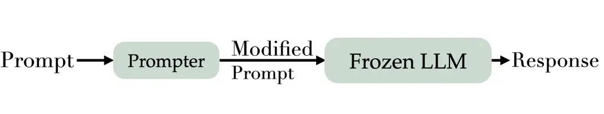
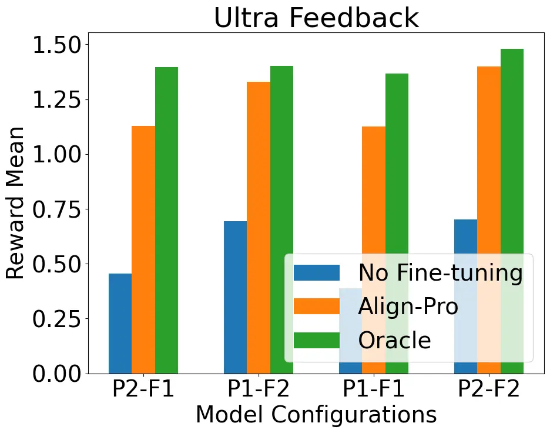
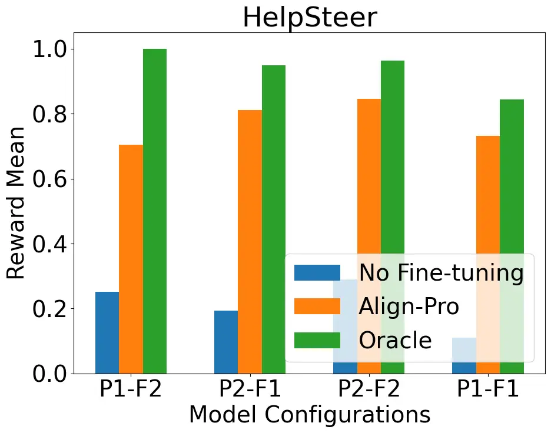
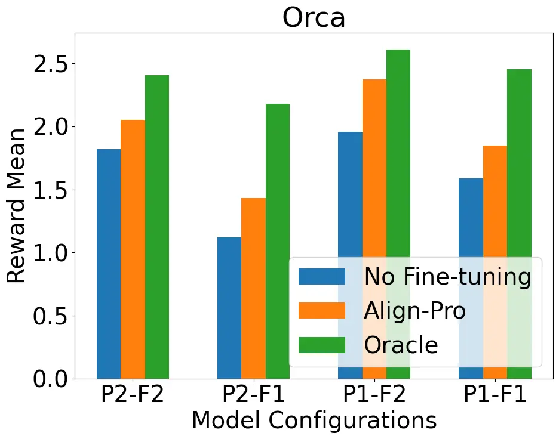
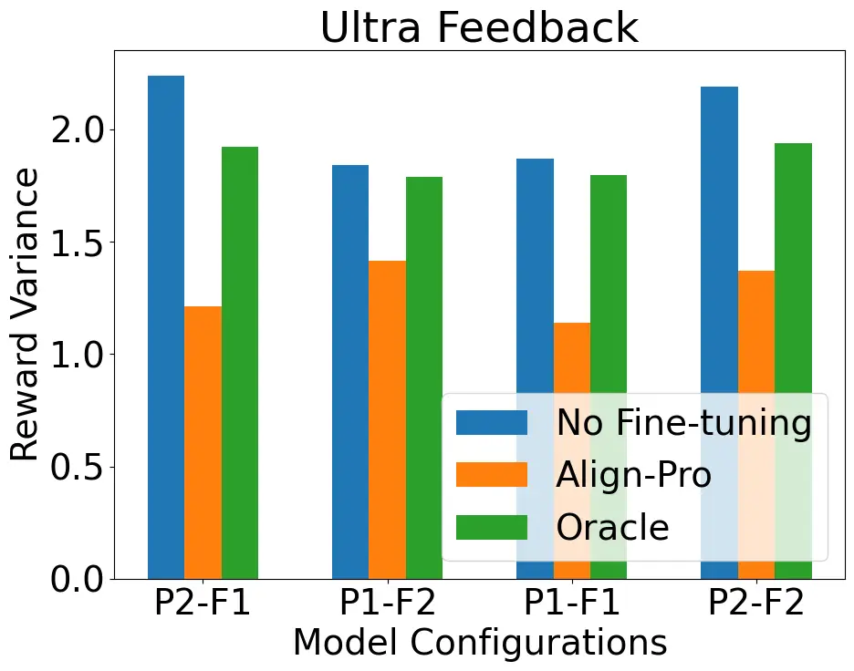
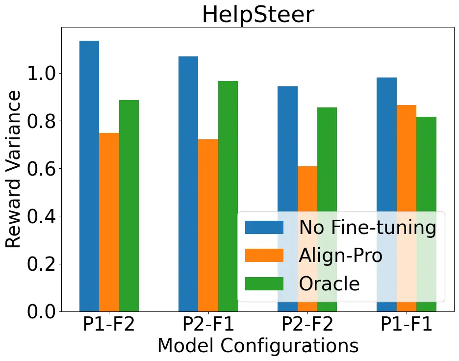
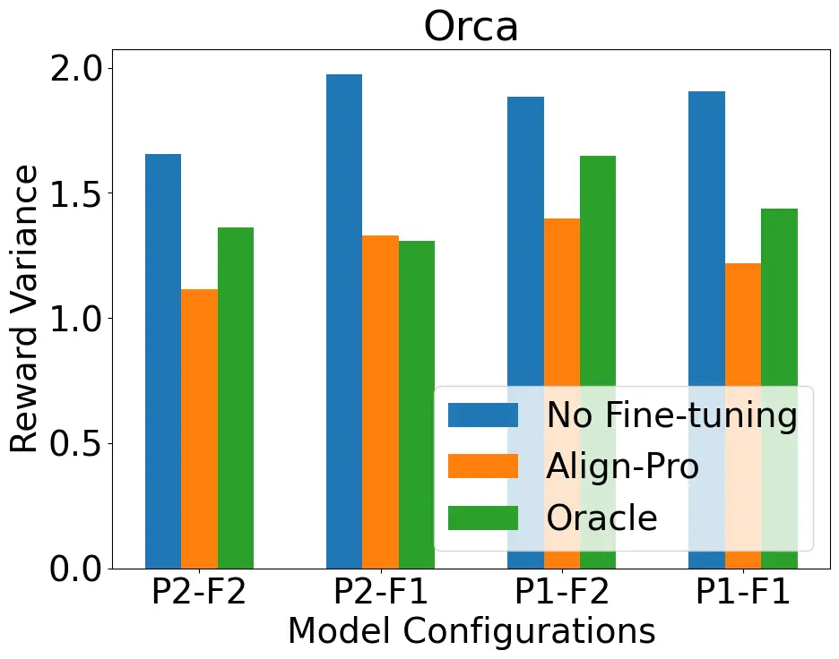

# Align-Pro: A Principled Approach to Prompt Optimization for LLM Alignment

Prashant Trivedi Affiliation: University of Central Florida    Souradip
Chakraborty Affiliation: University of Maryland, College Park    Avinash
Reddy Affiliation: University of Central Florida    Vaneet Aggarwal
Affiliation: Purdue University     
Amrit Singh Bedi Affiliation: University of Central Florida    George K.
Atia Affiliation: University of Central Florida

###### Abstract

The alignment of large language models (LLMs) with human values is
critical as these models become increasingly integrated into various
societal and decision-making processes. Traditional methods, such as
reinforcement learning from human feedback (RLHF), achieve alignment by
fine-tuning model parameters, but these approaches are often
computationally expensive and impractical when models are frozen or
inaccessible for parameter modification. In contrast, prompt
optimization is a viable alternative to RLHF for LLM alignment. While
the existing literature has shown empirical promise of prompt
optimization, its theoretical underpinning remains under-explored. We
address this gap by formulating prompt optimization as an optimization
problem and try to provide theoretical insights into the optimality of
such a framework. To analyze the performance of the prompt optimization,
we study theoretical suboptimality bounds and provide insights in terms
of how prompt optimization depends upon the given prompter and target
model. We also provide empirical validation through experiments on
various datasets, demonstrating that prompt optimization can effectively
align LLMs, even when parameter fine-tuning is not feasible.

## 1 Introduction

The quest to align large language models (LLMs) with human values is not
just an academic pursuit but a practical necessity \[1, 2\]. As these AI
models (e.g., ChatGPT, Llamma2, etc.) increasingly become an essential
part of various aspects of daily life and decision-making processes,
ensuring their outputs reflect ethical considerations and societal norms
becomes crucial \[3, 4\]. The standard approach to aligning LLMs has
been through fine-tuning parameters via reinforcement learning from
human feedback (RLHF) \[5, 6, 7\], which involves three main steps:
Supervised Fine-Tuning (SFT), reward learning, and RL fine-tuning.
However, this process can be resource-intensive, as it necessitates
updating model parameters \[8, 9\]. A further complication to alignment
arises when models are either ‘frozen’ or operate as ‘black box,’ where
direct access to tweak parameters is restricted \[10, 11\]. These
scenarios pose a critical question: How can we ensure LLM alignment when
parameter updates are not allowed or possible?

One promising solution lies in the concept of prompt optimization \[12,
13, 14\]. This technique leverages the idea that the output of an LLM is
a function of the input prompt—thereby turning the prompt into a
powerful tool to elicit desired responses to align with specific rewards
(cf. Figure 1). Various empirical studies in the literature have shown
the significant benefits of prompt optimization techniques for LLM
alignment \[11, 15, 16\]. However, theoretical insights about the
working of prompt optimization have not been well studied. This raises
an important question about the optimality of prompt optimization
compared to traditional fine-tuning: Can prompt optimization for LLM
alignment achieve performance comparable to fine-tuning?



Figure 1: A basic overview of the prompt optimization framework. A
prompter modifies the prompt before passing it through the target frozen
LLM.

In this work, we try to investigate and answer the above question. To
the best of our knowledge, there is a notable absence of literature
focusing on a theoretical formulation of prompt optimization
specifically for LLM alignment. This paper aims to fill this gap by
developing a unified optimization framework (called Align-Pro) to
analyze prompt optimization for LLM alignment. We explore its
theoretical performance, particularly in terms of suboptimality bounds,
which measure how close the responses generated via the prompt
optimization are to the outcomes obtained through fine-tuned models.
Furthermore, we provide proof of concept empirical evidence to support
the theoretical insights. We summarize our main contributions as
follows.

- •
  An optimization framework to prompt optimization for LLM alignment. We
  propose Align-Pro: a prompt optimization framework where we motivate
  the optimization objective, which would help reduce the suboptimality
  gap in the alignment. The optimization problem considered allows us to
  theoretically study the prompt optimization for LLM alignment.
  Following the standard analysis of LLM alignment, we derive a
  closed-form expression for the optimal prompt distribution.
- •
  We study the suboptimality of prompt optimization with respect to the
  fine-tuning method. We establish theoretical bounds on the difference
  between the expected rewards obtained from the fine-tuned policy,
  which represents the benchmark for model performance, and the optimal
  policy derived from our prompt optimization approach.
- •
  Experimental results. We conduct a series of experiments on three
  datasets to support the insights we obtain from the theoretical
  analysis. Align-Pro demonstrates better performance in terms of the
  mean rewards and win rate over the baseline without fine-tuning,
  showcasing its effectiveness across three datasets and diverse model
  configurations.

## 2 Related Work

RLHF and LLM fine-tuning: RLHF has become the most widely used method
for aligning LLM responses with human values \[17, 9, 18\]. For a more
comprehensive discussion on RLHF, refer to some recent surveys \[8,
19\]. Recently, some methods have been developed to bypass the need for
RL, directly utilizing a preference dataset for alignment, including
direct preference optimization (DPO) \[20\], SLiC \[21\], and other
extensions \[22, 23, 24, 25, 26, 27, 28\]. The recent work of \[29\] has
demonstrated the potential of efficient exploration methods to improve
LLM responses based on human preference feedback. Moreover, methods such
as ORPO \[30\] align the model without using a reference model.
Furthermore, intuitive fine-tuning (IFT) conducts alignment solely
relying on positive samples and a single policy, starting from a
pre-trained base model \[31\]. However, all of these approaches are
focused on alignment via parameter fine-tuning.

Prompt optimization for alignment: Prompt optimization has seen
significant growth in recent years. Early efforts focused on white-box
LLMs, such as AutoPrompt \[11\] and FluentPrompt \[32\], which used
gradient-based methods to generate prompts from labeled data. Soft
prompt methods, such as \[14, 33, 34\], also gained traction. Recently,
the focus has shifted to optimizing prompts for black-box LLMs.
Techniques like clip-tuning \[35\], BBT \[36\], and BBTv2 \[37\]
optimize prompts by leveraging input embeddings and output logits, often
using low-dimensional subspace optimization. Some approaches use RL
ideas for prompt optimization for alignment, including BDPL \[10\],
PRewrite \[15\], and MultiPrompter \[38\], which iteratively update
prompts. Planning-based approaches, such as PromptAgent \[16\], have
also gained attention. Additionally, APOHF \[12\] leverages dueling
bandits theory to refine prompts using preference feedback. However,
theoretical connections in terms of comparing the performance of prompt
optimization with the fine-tuning approach are not studied in detail.

Other works with similar formulations: Beyond prompt optimization and
fine-tuning, other areas share similar theoretical formulations. For
instance, \[39, 40, 41, 42, 43\] explore automated red teaming by
training a red team LLM with reinforcement learning to generate test
cases that provoke undesirable responses from a target LLM. While the
context differs, the red team model’s training objective aligns closely
with our prompt optimization objective. In contrast, in this work, we
motivate the selection of objectives for prompt optimization and focus
on understanding the suboptimality of prompt optimization with respect
to fine-tuned models.

## 3 Preliminaries and Background

This section provides the essential background and foundational concepts
relevant to alignment. We start by defining the notation, followed by a
quick overview of the RLHF framework, which involves three key steps:
(i) supervised fine-tuning (SFT), (ii) reward learning, and (iii)
fine-tuning with RL.

Language Models. We start by defining the language model mathematically.
Let us denote the vocabulary set by $`\mathcal{V}`$, and we denote the
language model by $`\pi(y|x)`$, which takes in the sequence of tokens
$`x:=\{x_{1},x_{2},\cdots,x_{N}\}`$ (with each $`x_{i}\in\mathcal{V}`$)
as an input, and generate response $`y:=\{y_{1},y_{2},\cdots,y_{M}\}`$
(with each $`y_{i}\in\mathcal{V}`$) as the output. At instant $`t`$,
each output token $`y_{t}\sim\pi(\cdot|x_{t})`$.

Supervised Fine-Tuning (SFT). SFT is the initial step in the RLHF
process. It involves fine-tuning a pre-trained LLM on a vast dataset of
human-generated text in a supervised manner.

Reward Learning. This stage involves learning the reward model by
gathering preferences from experts/human feedback or an oracle based on
outputs generated by the SFT model denoted by $`\pi_{\text{sft}}`$. The
optimization is generally performed under the Bradley-Terry model for
pairwise comparison \[44\], which seeks to minimize the loss formulated
as:

```math
\displaystyle\mathcal{L}(r,D_{r})=-\mathbb{E}_{(x,y_{u},y_{v})\sim D_{r}}\left[\log\left(\sigma(r(x,y_{u})-r(x,y_{v}))\right)\right] \tag{1}
```

where $`D_{r}`$ denotes the dataset of response pairs $`(y_{u},y_{v})`$,
with $`y_{u}`$ and $`y_{v}`$ representing the winning and the losing
responses, respectively, which are generated by the policy
$`\pi_{\text{sft}}`$ optimized under the reward $`r(x,y)`$, and
evaluated by human experts or an oracle function
$`p^{*}(\cdot|y_{u},y_{v},x)`$, and $`\sigma(\cdot)`$ is the sigmoid
function.

Fine-tuning with RL. In this step, we obtain the aligned model which
maximizes the reward model $`r(x,y)`$ (trained in the previous step) by
solving a KL-regularized optimization problem:

```math
\displaystyle\max_{\pi}\mathbb{E}_{x\sim P,y\sim\pi(\cdot|x)}\left[r(x,y)-\beta\mathbb{D}_{KL}(\pi(\cdot|x)\|\pi_{\text{sft}}(\cdot|x))\right], \tag{2}
```

where, $`\beta>0`$ is a parameter that controls the deviation from the
baseline policy $`\pi_{\text{sft}}`$. This iterative process alternates
between updating the policy and reward models until convergence, as
detailed in previous works \[2, 5\].

## 4 Prompt Optimization Framework for LLM Alignment

In this section, we provide a mathematical formulation for the framework
of prompt optimization for LLM alignment. In traditional LLM alignment,
as described in (2), the model parameters are fine-tuned to adjust the
response distributions in a way that maximizes the reward function.
However, in our setting, we operate under a different regime, starting
with a pre-trained language model, denoted by $`\pi_{F}`$, whose
parameters remain frozen. In this case, direct modification of the model
to align with a reward function is not allowed. Therefore, an
alternative and widely adopted approach in the literature is to optimize
the input prompt itself to yield better-aligned responses \[15, 11,
45\]. Typically, this process involves iterative prompt refinement,
where the model outputs are evaluated and compared to human preferences,
and the prompts are adjusted accordingly. However, such iterative
fine-tuning can be computationally expensive and time-intensive.

Interestingly, although we cannot fine-tune the frozen model
$`\pi_{F}`$, we can fine-tune the prompter model $`\rho`$ in any desired
manner. However, a fundamental challenge arises: what should be the
objective for optimizing the prompter? While substantial empirical
evidence in the literature demonstrates that prompt optimization can
significantly enhance response generation and improve alignment \[11,
15, 45\], there is no specific emphasis on developing a mathematical
framework to guide this process. We start by addressing this gap as
follows.

Optimization Objective for Prompter Design. First, we revisit the basics
of LLM alignment. For a given prompt $`x`$, the probability of
generating a response $`y`$ from the frozen model is represented by
$`\pi_{F}(y|x)`$. After introducing the prompter model $`\rho`$, the
probability of generating response $`y`$ given input $`x`$ (denoted by
$`\widetilde{\pi}_{\rho}`$) can be expressed as:

```math
\displaystyle\widetilde{\pi}_{\rho}(y|x)=\sum_{x^{\prime}}\pi_{F}(y|x^{\prime})\rho(x^{\prime}|x), \tag{3}
```

which captures the probability of generating the response $`y`$ for a
given $`x`$ under the influence of the prompter $`\rho`$. Let us
consider the ideal scenario: if we were able to fine-tune the language
model $`\pi_{F}`$, we would solve the optimization problem in (2) and
obtain the RLHF optimal solution $`\pi^{*}`$, which is given by \[46,
47\]

```math
\displaystyle\pi^{*}(y|x)=\frac{1}{Z^{*}(x)}\pi_{F}(y|x)\exp\left(\frac{r^{*}(x,y)}{\beta}\right)~, \tag{4}
```

where $`Z^{*}(x)=\sum_{y}\pi_{F}(y|x)\exp(r^{*}(x,y)/\beta)`$ is the
normalizing constant, and $`\beta`$ is the alignment tuning parameter,
and reward $`r^{*}`$ is obtained from solving (1). We emphasize that if
we have a prompter $`\rho`$ that performs as well as the RLHF-optimal
policy $`\pi^{*}`$, it should be a sufficient indicator of a good
prompter. With this understanding, we consider the following prompter
suboptimality gap given by

```math
\displaystyle\triangle({\rho}):=J(\pi^{*})-J(\widetilde{\pi}_{\rho}), \tag{5}
```

which captures how well our prompter is doing with respect to fine-tuned
optimal policy $`\pi^{*}`$. Mathematically, it holds that

```math
\displaystyle J(\pi^{*})-J(\widetilde{\pi}_{\rho}) \displaystyle=\mathbb{E}_{x\sim P,y\sim\pi^{*}(\cdot|x)}[r^{*}(x,y)]-\mathbb{E}_{x\sim P,y\sim\widetilde{\pi}_{\rho}(\cdot|x)}[r^{*}(x,y)]
```

```math
\displaystyle=\mathbb{E}_{x\sim P}\left[\mathbb{E}_{y\sim\pi^{*}(\cdot|x)}[r^{*}(x,y)]-\mathbb{E}_{\begin{subarray}{c}x^{\prime}\sim\rho(\cdot|x)\\
y\sim\pi_{F}(\cdot|x^{\prime})\end{subarray}}[r^{*}(x,y)]\right]. \tag{6}
```

Equation (6) evaluates the difference in expected return between the
optimal RLHF policy $`\pi^{*}`$ and our prompt optimization policy
$`\widetilde{\pi}_{\rho}`$, indicating how much better (or worse)
$`\pi^{*}`$ performs compared to $`\widetilde{\pi}_{\rho}`$. We
highlight that this performance gap is clearly influenced by the choice
of the prompt distribution $`\rho`$; a non-optimal $`\rho`$ can result
in a significant gap. This leads us to the following questions:

- •
  Q1: Can we design an optimal prompter $`\rho^{*}`$ that closes the
  suboptimality gap between the fine-tuned policy $`\pi^{*}`$, and the
  prompt optimization policy $`\widetilde{\pi}_{\rho^{*}}`$ as mentioned
  in Equation (6)?
- •
  Q2: If such a $`\rho^{*}`$ exists, then can
  $`\widetilde{\pi}_{\rho^{*}}`$ outperform the fine-tuned optimal
  policy $`\pi^{*}`$?

We address these questions in the next section.

## 5 Proposed Approach: Align-Pro

Let us start by addressing Q1 and develop a general prompt optimization
framework to design an optimal prompter $`\rho^{*}`$. But then the first
question arises: in what sense is $`\rho^{*}`$ optimal? In order to see
that, let us reconsider $`J(\pi^{*})-J(\widetilde{\pi}_{\rho})`$ and
after adding-subtracting
$`\mathbb{E}_{y\sim\pi_{F}(\cdot|x)}[r^{*}(x,y)]`$ in the right hand
side of Equation (6), we get

```math
\displaystyle J(\pi^{*})-J(\widetilde{\pi}_{\rho})=\mathbb{E}_{x\sim P}[\Delta_{1}+\Delta_{2}], \tag{7}
```

where $`\Delta_{1}`$ and $`\Delta_{2}`$ are defined as

```math
\displaystyle\Delta_{1} \displaystyle:=\mathbb{E}_{y\sim\pi^{*}(\cdot|x)}[r^{*}(x,y)]-\mathbb{E}_{y\sim\pi_{F}(\cdot|x)}[r^{*}(x,y)]
```

```math
\displaystyle\Delta_{2} \displaystyle:=\mathbb{E}_{y\sim\pi_{F}(\cdot|x)}[r^{*}(x,y)]-\mathbb{E}_{y\sim\widetilde{\pi}_{\rho}(\cdot|x)}[r^{*}(x,y)]
```

```math
\displaystyle\ =\mathbb{E}_{y\sim\pi_{F}(\cdot|x)}[r^{*}(x,y)]-\mathbb{E}_{\begin{subarray}{c}x^{\prime}\sim\rho(\cdot|x)\\
y\sim\pi_{F}(\cdot|x^{\prime})\end{subarray}}[r^{*}(x,y)].
```

We remark that in (7), $`\Delta_{1}`$ is the suboptimality gap between
the optimal fine-tuned policy, and the frozen model $`\pi_{F}`$. Thus,
it captures the effectiveness of the optimal RLHF policy with respect to
the frozen model. In other words, it quantifies how good or bad our
frozen model is with respect to the optimally aligned model. We note
that $`\Delta_{1}`$ is constant for a given $`\pi_{F}`$ and does not
depend upon prompter $`\rho`$, hence we cannot improve this part with
the prompter. Another insight is that since $`\pi^{*}`$ is the optimal
RLHF policy, $`\Delta_{1}\geq 0`$, i.e., is always positive. On the
other hand, the second term, $`\Delta_{2}`$, depends upon our prompter
$`\rho`$ and can be controlled by designing a prompter. This observation
leads to the formulation of an optimization problem for the prompter as
follows.

### 5.1 Optimization Problem for Prompter

We recall from the definition of $`\Delta_{2}`$ that we would need to
learn a $`\rho`$ such that $`\Delta_{2}`$ is minimized. To achieve that,
we recognize that the only term involving the prompter $`\rho`$ in
$`\Delta_{2}`$ is
$`\mathbb{E}_{\begin{subarray}{c}x^{\prime}\sim\rho(\cdot|x),y\sim\pi_{F}(\cdot|x^{\prime})\end{subarray}}[r^{*}(x,y)]`$,
and minimizing $`\Delta_{2}`$, we need to solve the following
optimization problem

```math
\displaystyle\max_{\rho}\mathbb{E}_{x^{\prime}\sim\rho(\cdot|x),y\sim\pi_{F}(\cdot|x^{\prime})}[r^{*}(x,y)]. \tag{8}
```

However, at the same time, since our prompter is also another language
model, we will already have access to a baseline supervised fine-tuned
prompter $`\rho_{\text{sft}}`$, and we want to ensure that our prompter
$`\rho^{*}`$ does not deviate significantly from $`\rho_{\text{sft}}`$,
which motivates us to include a known and supervised fine-tuned
prompter, denoted by $`\rho_{\mathrm{sft}}`$. Thus, we solve the
following optimization problem:

```math
\displaystyle\max_{\rho}\mathbb{E}_{x\sim P}\mathbb{E}_{\begin{subarray}{c}x^{\prime}\sim\rho(\cdot|x)\\
y\sim\pi_{F}(\cdot|x^{\prime})\end{subarray}}[r^{*}(x,y)]-\lambda\mathbb{D}_{KL}(\rho(\cdot|x)\|\rho_{\mathrm{sft}}(\cdot|x)). \tag{9}
```

We have introduced a KL-divergence-based regularizer above between the
prompter $`\rho`$ and a reference supervised fine-tuned prompter
$`\rho_{\mathrm{sft}}`$. This helps with the development of a proper
optimization problem with a closed-form expression and enables control
over proximity to the initial prompter $`\rho_{\mathrm{sft}}`$ through
the tuning parameter $`\lambda`$. We note that the formulation in (9)
has also appeared in the red teaming literature for learning an attacker
promoter \[39, 40, 41, 42, 43\].

Interpretation of $`\lambda`$. Another interesting interpretation of
$`\lambda`$ is that it controls the extent of prompt optimization we
want to introduce into the pipeline, hence we also refer to it as the
prompt tuning parameter. For instance, $`\lambda\rightarrow\infty`$
means no prompt optimization, while $`\lambda\rightarrow 0`$, drives the
optimization toward maximizing the prompter reward, albeit at the cost
of deviating from $`\rho_{\text{sft}}`$ which might be important in
certain cases. Therefore, $`\lambda`$ provides a meaningful trade-off,
and its effects will be further elucidated in the following section.

The following Lemma 5.1 provides the optimal solution to the
optimization problem (9).

###### Lemma 5.1.

Let
$`R(x,x^{\prime}):=\mathbb{E}_{y\sim\pi_{F}(\cdot|x^{\prime})}[r^{*}(x,y)]\>`$,
and $`\lambda>0`$ be the prompter tuning parameter. The optimal prompt
distribution $`\rho^{*}`$ that maximizes the objective function of the
optimization problem (9) is given by:

```math
\displaystyle\rho^{*}(x^{\prime}|x)=\frac{1}{Z(x)}\rho_{\mathrm{sft}}(x^{\prime}|x)\exp\left(\frac{1}{\lambda}R(x,x^{\prime})\right), \tag{10}
```

where $`Z(x)`$ is the log partition function given by

```math
\displaystyle Z(x)=\sum_{x^{\prime}}\rho_{\mathrm{sft}}(x^{\prime}|x)\exp\left(\frac{1}{\lambda}R(x,x^{\prime})\right).
```

The proof is available in Appendix A and follows from the derivations in
\[48\]. Next, we move on to answer Q2, in which we utilize the optimal
prompter $`\rho^{*}(x^{\prime}|x)`$ to obtain a bound on the
suboptimality gap. Notably, the integration of this optimal prompter
with the frozen model will lead to the refined performance expressed in
terms of the modified optimal policy
$`\widetilde{\pi}^{*}_{\rho}(y|x)=\sum_{x^{\prime}}\rho^{*}(x^{\prime}|x)\pi_{F}(y|x^{\prime})`$.
This will capture the effectiveness of the prompt optimization process
and offer insights into how closely the modified policy
$`\widetilde{\pi}_{\rho^{*}}`$ approximates the true optimal policy
$`\pi^{*}`$.

## 6 Theoretical Insights w.r.t Fine-Tuning

We begin by establishing a bound on the suboptimality gap for the
optimal prompter. The following theorem bounds the suboptimality gap
$`J(\pi^{*})-J(\widetilde{\pi}_{\rho^{*}})`$ when the optimal prompter
$`\rho^{*}`$ as obtained in Lemma 5.1 is used. We present our result in
Theorem 6.1 as follows. The proof is available in the Appendix B.

###### Theorem 6.1.

Let the optimal prompter $`\rho^{*}(x^{\prime}|x)`$ be given as in
Equation (10). Then, the suboptimality gap is bounded as

```math
\displaystyle J(\pi^{*})-J(\widetilde{\pi}_{\rho^{*}}) \displaystyle\leq r_{\max}\mathbb{E}_{x\sim P}[d_{TV}(\pi^{*}(\cdot|x),\pi_{F}(\cdot|x))]+r_{\max}\mathbb{E}_{x\sim P,x^{\prime}\sim\rho_{\mathrm{sft}}(\cdot|x)}[d_{TV}(\pi_{F}(\cdot|x),\pi_{F}(\cdot|x^{\prime}))] \tag{11}
```

```math
\displaystyle-\lambda~\mathbb{E}_{x\sim P}[\mathbb{D}_{KL}(\rho^{*}(\cdot|x)\|\rho_{\mathrm{sft}}(\cdot|x))],
```

where $`P`$ denotes the prompt distribution, $`\lambda`$ is the prompter
tuning parameter, and $`d_{TV}`$ is the total variation distance.

Theorem 6.1 provides an upper bound on the suboptimality gap between an
optimal RLHF policy $`\pi^{*}`$ and the optimal policy obtained by the
prompt optimization approach $`\widetilde{\pi}_{\rho^{*}}`$. We now
provide the interpretations to each term of the suboptimality gap given
in Theorem 6.1.

- •
  Significance of first term in RHS of (11): The first term in Equation
  (11) is always non-negative. It captures the intrinsic difficulty of
  obtaining the optimal RLHF policy via a prompt optimization setup when
  the frozen model is not fully aligned. We note that when
  $`\pi_{F}=\pi^{*}`$, the first term in Theorem 6.1 becomes zero.
  However, this scenario is not relevant to our prompt optimization
  framework, as it necessitates fine-tuning the frozen LLM.
- •
  Significance of second term in RHS of (11): This term measures how
  much the response distribution the frozen policy $`\pi_{F}`$ changes
  when its input changes from $`x`$ to $`x^{\prime}`$ under
  $`\rho_{\mathrm{sft}}`$. For $`\rho_{\mathrm{sft}}`$ as delta
  distribution, this term will be zero, which essentially implies that
  this term is trying to capture the variation in the prompts (which
  should be minimal) due to the introduction of $`\rho_{\mathrm{sft}}`$
  into the formulation.
- •
  Significance of third term in RHS of (11): The third term captures the
  KL divergence between the optimal prompter $`\rho^{*}`$ and the given
  prompter $`\rho_{\mathrm{sft}}`$. This term is important because it
  explains that we can reduce the suboptimality bound via prompt
  optimization, which is making $`\rho^{*}`$ far from
  $`\rho_{\mathrm{sft}}`$, which can be controlled by the parameter
  $`\lambda`$.

Another interesting insight is that the upper bound on the suboptimality
remains non-negative for
$`\mathbb{D}_{KL}(\rho^{*}(\cdot|x)\|\rho_{\mathrm{sft}}(\cdot|x))\leq\frac{\epsilon_{1}+\epsilon_{2}}{\lambda}`$,
where $`\epsilon_{1}`$ and $`\epsilon_{2}`$ are defined as
$`\epsilon_{1}:=d_{TV}(\pi^{*}(\cdot|x),\pi_{F}(\cdot|x))`$ and
$`\epsilon_{2}:=\mathbb{E}_{x^{\prime}\sim\rho_{\mathrm{sft}}(\cdot|x)}\left[d_{TV}(\pi_{F}(\cdot|x),\pi_{F}(\cdot|x^{\prime}))\right]`$.
This essentially provide insight that in practice, with a budget of
$`\frac{\epsilon_{1}+\epsilon_{2}}{\lambda}`$ for the prompter
optimization can be sufficient to achieve performance similar to RLHF
based fine tuning. This further highlights that we won’t need to choose
an optimal prompter arbitrarily far from the base prompt distribution,
thereby preventing a significant loss in the quality (e.g., perplexity)
of the generated outputs.

## 7 Experimental Evaluations

In this section, we present proof of concept experiments to validate the
theoretical insights of our proposed prompt optimization framework,
which we named Align-Pro. We outline our experimental setup, including
the dataset, model architecture, and evaluation metrics. Following this,
we present our results and provide a detailed analysis of our findings.

### 7.1 Experimental Setup

We evaluate the performance of our Align-Pro using two distinct prompter
models, denoted as P1 (Phi-3.5-Instruct) and P2
(Qwen-2.5-1.5B-Instruct), which modifies and updates the original
prompt. Additionally, we use two frozen models, denoted as F1
(Llama-3.1-8B-Instruct) and F2 (Llama-3.1-8B-Instruct) to generate the
final responses. This setup results in four unique model architectures,
each representing a combination of the prompter and frozen models. For
each architecture, we assess performance for the following three
different configurations.

- •
  No Fine-Tuning: In this configuration, the prompter is not used, and
  only the frozen model is used to generate responses without any
  fine-tuning or prompt modifications.
- •
  Align-Pro: In this setup, a fine-tuned prompter is placed before a
  frozen model. The prompter refines the input prompt, and the frozen
  model generates the response based on the optimized prompt.
- •
  RLHF: In this configuration, the frozen model undergoes fine-tuning
  through RLHF, and the response is generated directly from this
  fine-tuned model.

Datasets: To capture the diversity in our experimental evaluations, we
evaluate the performance over different datasets:

- •
  UltraFeedback \[49\] : A large-scale, high-quality, and diversified AI
  feedback dataset which contains feedback from user-assistant
  conversations from various aspects. This dataset evaluates the
  coherence of the prompt-response pairs.
- •
  HelpSteer \[50\]: A multi-attribute helpfulness dataset annotated for
  correctness, coherence, complexity, and verbosity in addition to
  overall helpfulness of responses.
- •
  Orca \[51\]: This dataset features responses with detailed
  explanations for each prompt, promoting thinking and effective
  instruction-following capabilities in the models.

Evaluation Criteria. The primary objective of our experiments is to
optimize the input prompt to guide the frozen LLM that produces the
desired response effectively. We fine-tune the prompter using proximal
policy optimization (PPO) within the RLHF framework to achieve this. The
reward signal for this fine-tuning process is derived from the quality
of the enhanced prompt and the output generated by the frozen LLM. We
assess the performance of Align-Pro based on three key metrics: mean
reward, variance, and win-rate comparison against the no-fine-tuning
baseline.

Computational Resources. Since we do not alter the parameters of the
frozen model, our experiments require relatively fewer computational
resources. Consequently, we were able to conduct all our experiments
using a machine equipped with an INTEL(R) XEON(R) GOLD 6526Y processor
with a Nvidia H100 GPU. We used Python 3.11 to execute the experiments.
we used the PPOTrainer variant from Hugging Face TRL library to run the
RLHF and Prompt Optimization pipeline experiments.

Hyper-parameters. All of our experiments use the open-access TRL
library, which is publicly available. The library can be accessed using
the link¹¹ 1
[https://github.com/huggingface/trl/blob/main/examples/notebooks/gpt2-sentiment.ipynb](https://github.com/huggingface/trl/blob/main/examples/notebooks/gpt2-sentiment.ipynb).
For our experiments, we do not perform any extra hyper-parameter tuning;
rather, we use the parameters $`\textit{learning rate}=1.41e-5`$ given
in the above-mentioned link. Moreover, we use the following generation
configurations to generate the response for evaluation in all
experiments: temperature = 1.5, top $`P`$ = 0.6 and top $`K=20`$.

### 7.2 Results

Mean reward and variance comparison: We calculate mean rewards and
variances to assess the quality of preferred response generation and the
diversity of the language model for all configurations and different
model architectures. To associate the reward to each response, we use
the available reward model²² 2
[https://huggingface.co/weqweasdas/RM-Gemma-2B](https://huggingface.co/weqweasdas/RM-Gemma-2B),
which scores the response. This reward model is trained to assign higher
scores to the responses that comply with the off-target attributes.

We also compared Align-Pro with an oracle model, where the LLM is
fine-tuned using RLHF. Figure 2 presents the mean rewards across all
three datasets for each model configuration, while Figure 3 shows the
corresponding reward variances. Interestingly, Align-Pro consistently
outperforms the baseline (no fine-tuning) in terms of mean reward,
demonstrating its ability to generate more preferred and stable
responses, leveraging prompt optimization and getting close to the
performance of fine-tuned model denoted by oracle. Moreover, the
variance in reward for Align-Pro is the lowest, indicating that it
produces more reliable and stable outputs. In each figure, we employ two
prompters, denoted as P1 (Phi-3.5-Instruct) and P2
(Qwen-2.5-1.5B-Instruct), along with two frozen LLMs, denoted as F1
(Llama-3.1-8B-Instruct) and F2 (Llama-3.1-8B-Instruct).



(a)



(b)



(c)

Figure 2: Reward mean comparisons. Figure shows the reward mean across
the chosen datasets. Align-Pro shows an improvement over the no
fine-tuning approach. We employ two prompters P1 (Phi-3.5-Instruct) and
P2 (Qwen-2.5-1.5B-Instruct), along with two frozen LLMs, denoted as F1
(Llama-3.1-8B-Instruct) and F2 (Llama-3.1-8B-Instruct). The oracle is
fine-tuned LLM via RLHF.



(a)



(b)



(c)

Figure 3: Reward variance comparisons. Align-Pro has the least variance
compared to Oracle and no fine-tuning approach. Due to the prompter’s
precise guidance, the frozen LLM generates almost similar responses in
terms of helpfulness and coherence, which results in less diverse
responses. We use the following terminologies for the prompters and the
frozen models: P1 (Phi-3.5-Instruct), P2 (Qwen-2.5-1.5B-Instruct), F1
(Llama-3.1-8B-Instruct), and F2 (Llama-3.1-8B-Instruct), respectively.

Win rate comparison: We evaluate the performance of our Align-Pro method
by comparing it to the no fine-tuning configuration using win rate as
the primary performance metric. We rely on GPT-4 as an external,
impartial judge to ensure unbiased evaluation. The evaluation criteria
focus on critical aspects of the response: helpfulness, harmlessness,
relevance, accuracy, depth, creativity, and level of detail. To update
the prompt, we use a standardized system prompt template. Table 1
presents the win rates for Align-Pro (denoted by A) against the no
fine-tuning baseline (denoted by B). The results clearly show that, on
average, Align-Pro significantly outperforms the no fine-tuning approach
across all model architectures and datasets. These findings demonstrate
the effectiveness of Align-Pro framework, which enhances performance by
optimizing the input prompt while keeping the LLM frozen.

[TABLE]

Table 1: The table presents the win rates (for 100 samples) of our
Align-Pro method, denoted by A, compared to the baseline no fine-tuning
method, denoted by B. A higher win rate indicates superior performance.
Bolded numbers highlight the higher win rates. Across all model
architectures and datasets, Align-Pro consistently outperforms the no
fine-tuning baseline, demonstrating its effectiveness in improving
response quality.

Summary: Our experiments confirm that using a prompter alongside a
frozen LLM significantly enhances alignment. Moreover, the expected
reward and the win-rate differences are affected by the degree to which
the prompter and frozen model align with human preferences. These
experimental results, therefore, support our theoretical insights. We
include several examples using the full prompt rewriting, illustrating
the original prompt, the re-written prompt, and the corresponding final
response in Appendix C.

###### Remark 7.1.

Our aim is not to present the best prompt optimizer but to develop an
optimization framework for prompt optimization, which can help develop
some theoretical insights into the performance of the prompt
optimization approach. We seek to understand its theoretical performance
relative to RLHF and fine-tuning methods, hence we did not compare our
approach with other existing prompt optimization methods in the
literature.

## 8 Conclusion, Limitations and Future Work

This work introduces an optimization framework for prompt optimization
by utilizing a smaller, trainable model to generate optimized prompts
for a frozen large language model (LLM). This approach reduces
computational costs while preserving the LLM’s pre-trained capabilities.
We provide a closed-form expression for the optimal prompter and use it
to establish an upper bound on the suboptimality gap that compares the
optimized prompt policy with the standard RLHF policy. We demonstrate
the effectiveness of our method on three datasets and various model
configurations. In each scenario, we observe that Align-Pro is better in
terms of the mean rewards and win rate compared to the baseline with no
fine-tuning.

Limitations and future work: Our framework is inherently limited by the
capabilities of the frozen language model. Another limitation includes
the sensitivity of the prompt to the final response; a slight change in
the prompt can lead to profound changes in the final responses.
Theoretically, it would also be interesting to develop lower bounds on
suboptimality and to develop further insights into the performance of
prompt optimization. We will consider some of these issues as part of
our future work. Some other potential future directions of our work
include analyzing the robustness of the optimal prompter in the presence
of noise in the frozen model and exploring the use of multiple prompters
in sequence before inputting them into the frozen model.

## References

- \[1\] Wang B, Zheng R, Chen L, Liu Y, Dou S, Huang C, et al. Secrets
  of rlhf in large language models part ii: Reward modeling. arXiv
  preprint arXiv:240106080. 2024.
- \[2\] Kaufmann T, Weng P, Bengs V, Hüllermeier E. A survey of
  reinforcement learning from human feedback. arXiv preprint
  arXiv:231214925. 2023.
- \[3\] Li AJ, Krishna S, Lakkaraju H. More RLHF, More Trust? On The
  Impact of Human Preference Alignment On Language Model
  Trustworthiness. arXiv preprint arXiv:240418870. 2024.
- \[4\] Dai J, Pan X, Sun R, Ji J, Xu X, Liu M, et al. Safe rlhf: Safe
  reinforcement learning from human feedback. arXiv preprint
  arXiv:231012773. 2023.
- \[5\] Zhu B, Jiao J, Jordan MI. Principled Reinforcement Learning with
  Human Feedback from Pairwise or $`K`$-wise Comparisons. arXiv preprint
  arXiv:230111270. 2023.
- \[6\] Azar MG, Rowland M, Piot B, Guo D, Calandriello D, Valko M,
  et al. A general theoretical paradigm to understand learning from
  human preferences. arXiv preprint arXiv:231012036. 2023.
- \[7\] Ziegler DM, Stiennon N, Wu J, Brown TB, Radford A, Amodei D,
  et al. Fine-Tuning Language Models from Human Preferences. arXiv
  preprint arXiv:190908593. 2019.
- \[8\] Casper S, Davies X, Shi C, Gilbert TK, Scheurer J, Rando J,
  et al. Open problems and fundamental limitations of reinforcement
  learning from human feedback. arXiv preprint arXiv:230715217. 2023.
- \[9\] Ouyang L, Wu J, Jiang X, Almeida D, Wainwright C, Mishkin P,
  et al. Training language models to follow instructions with human
  feedback. Advances in Neural Information Processing Systems.
  2022;35:27730-44.
- \[10\] Diao S, Huang Z, Xu R, Li X, Yong L, Zhou X, et al. Black-Box
  Prompt Learning for Pre-trained Language Models. Transactions on
  Machine Learning Research. 2023.
- \[11\] Shin T, Razeghi Y, Logan IV RL, Wallace E, Singh S. AutoPrompt:
  Eliciting Knowledge from Language Models with Automatically Generated
  Prompts. In: Proc. EMNLP; 2020. p. 4222-35.
- \[12\] Lin X, Dai Z, Verma A, Ng SK, Jaillet P, Low BKH. Prompt
  Optimization with Human Feedback. arXiv preprint
  arXiv:240517346. 2024.
- \[13\] Li Y, Liang Y. Learning overparameterized neural networks via
  stochastic gradient descent on structured data. Advances in neural
  information processing systems. 2018;31.
- \[14\] Lester B, Al-Rfou R, Constant N. The Power of Scale for
  Parameter-Efficient Prompt Tuning. In: Proc. EMNLP; 2021. p. 3045-59.
- \[15\] Kong W, Hombaiah SA, Zhang M, Mei Q, Bendersky M. PRewrite:
  Prompt Rewriting with Reinforcement Learning. arXiv preprint
  arXiv:240108189. 2024.
- \[16\] Wang X, Li C, Wang Z, Bai F, Luo H, Zhang J, et al.
  PromptAgent: Strategic planning with language models enables
  expert-level prompt optimization. arXiv preprint
  arXiv:231016427. 2023.
- \[17\] Dubois Y, Li CX, Taori R, Zhang T, Gulrajani I, Ba J, et al.
  Alpacafarm: A simulation framework for methods that learn from human
  feedback. Advances in Neural Information Processing Systems. 2024;36.
- \[18\] Ziegler DM, Stiennon N, Wu J, Brown TB, Radford A, Amodei D,
  et al. Fine-tuning language models from human preferences. arXiv
  preprint arXiv:190908593. 2019.
- \[19\] Chaudhari S, Aggarwal P, Murahari V, Rajpurohit T, Kalyan A,
  Narasimhan K, et al. RLHF Deciphered: A Critical Analysis of
  Reinforcement Learning from Human Feedback for LLMs. arXiv preprint
  arXiv:240408555. 2024.
- \[20\] Rafailov R, Sharma A, Mitchell E, Manning CD, Ermon S, Finn C.
  Direct preference optimization: Your language model is secretly a
  reward model. Advances in Neural Information Processing Systems.
  2024;36.
- \[21\] Zhao Y, Joshi R, Liu T, Khalman M, Saleh M, Liu PJ. Slic-hf:
  Sequence likelihood calibration with human feedback. arXiv preprint
  arXiv:230510425. 2023.
- \[22\] Amini A, Vieira T, Cotterell R. Direct Preference Optimization
  with an Offset. arXiv preprint arXiv:240210571. 2024.
- \[23\] Azar MG, Guo ZD, Piot B, Munos R, Rowland M, Valko M, et al. A
  general theoretical paradigm to understand learning from human
  preferences. In: International Conference on Artificial Intelligence
  and Statistics. PMLR; 2024. p. 4447-55.
- \[24\] Gou Q, Nguyen CT. Mixed Preference Optimization: Reinforcement
  Learning with Data Selection and Better Reference Model. arXiv
  preprint arXiv:240319443. 2024.
- \[25\] Liu T, Qin Z, Wu J, Shen J, Khalman M, Joshi R, et al. LiPO:
  Listwise Preference Optimization through Learning-to-Rank. arXiv
  preprint arXiv:240201878. 2024.
- \[26\] Morimura T, Sakamoto M, Jinnai Y, Abe K, Air K. Filtered Direct
  Preference Optimization. arXiv preprint arXiv:240413846. 2024.
- \[27\] Tang Y, Guo ZD, Zheng Z, Calandriello D, Munos R, Rowland M,
  et al. Generalized Preference Optimization: A Unified Approach to
  Offline Alignment. arXiv preprint arXiv:240205749. 2024.
- \[28\] Wang C, Jiang Y, Yang C, Liu H, Chen Y. Beyond reverse kl:
  Generalizing direct preference optimization with diverse divergence
  constraints. arXiv preprint arXiv:230916240. 2023.
- \[29\] Dwaracherla V, Asghari SM, Hao B, Van Roy B. Efficient
  Exploration for LLMs. arXiv:240200396. 2024.
- \[30\] Hong J, Lee N, Thorne J. ORPO: Monolithic Preference
  Optimization without Reference Model; 2024. Available from:
  [https://arxiv.org/abs/2403.07691](https://arxiv.org/abs/2403.07691).
- \[31\] Hua E, Qi B, Zhang K, Yu Y, Ding N, Lv X, et al.. Intuitive
  Fine-Tuning: Towards Simplifying Alignment into a Single
  Process; 2024. Available from:
  [https://arxiv.org/abs/2405.11870](https://arxiv.org/abs/2405.11870).
- \[32\] Shi W, Han X, Gonen H, Holtzman A, Tsvetkov Y, Zettlemoyer L.
  Toward Human Readable Prompt Tuning: Kubrick’s The Shining is a good
  movie, and a good prompt too? In: Proc. EMNLP; 2023. p. 10994-1005.
- \[33\] Li XL, Liang P. Prefix-Tuning: Optimizing Continuous Prompts
  for Generation. In: Proc. ACL; 2021. p. 4582-97.
- \[34\] Zhong Z, Friedman D, Chen D. Factual Probing Is \[MASK\]:
  Learning vs. Learning to Recall. In: Proc. NAACL; 2021. p. 5017-33.
- \[35\] Chai Y, Wang S, Sun Y, Tian H, Wu H, Wang H. Clip-Tuning:
  Towards Derivative-free Prompt Learning with a Mixture of Rewards. In:
  Proc. EMNLP (Findings); 2022. p. 108-17.
- \[36\] Sun T, Shao Y, Qian H, Huang X, Qiu X. Black-box tuning for
  language-model-as-a-service. In: Proc. ICML; 2022. p. 20841-55.
- \[37\] Sun T, He Z, Qian H, Huang X, Qiu X. BBTv2: Pure Black-Box
  Optimization Can Be Comparable to Gradient Descent for Few-Shot
  Learning. In: Proc. EMNLP; 2022. p. 3916-30.
- \[38\] Kim DK, Sohn S, Logeswaran L, Shim D, Lee H. MultiPrompter:
  Cooperative Prompt Optimization with Multi-Agent Reinforcement
  Learning. arXiv preprint arXiv:231016730. 2023.
- \[39\] Hong ZW, Shenfeld I, Wang TH, Chuang YS, Pareja A, Glass J,
  et al. Curiosity-driven red-teaming for large language models. arXiv
  preprint arXiv:240219464. 2024.
- \[40\] Perez E, Ringer S, Lukošiūtė K, Nguyen K, Chen E, Heiner S,
  et al.. Discovering Language Model Behaviors with Model-Written
  Evaluations. arXiv; 2022. Available from:
  [https://arxiv.org/abs/2212.09251](https://arxiv.org/abs/2212.09251).
- \[41\] Wichers N, Denison C, Beirami A. Gradient-based language model
  red teaming. arXiv preprint arXiv:240116656. 2024.
- \[42\] Lee S, Kim M, Cherif L, Dobre D, Lee J, Hwang SJ, et al.
  Learning diverse attacks on large language models for robust
  red-teaming and safety tuning. arXiv preprint arXiv:240518540. 2024.
- \[43\] Beetham J, Chakraborty S, Wang M, Huang F, Bedi AS, Shah M.
  LIAR: Leveraging Alignment (Best-of-N) to Jailbreak LLMs in Seconds.
  arXiv preprint arXiv:241205232. 2024.
- \[44\] Bradley RA, Terry ME. Rank analysis of incomplete block
  designs: I. The method of paired comparisons. Biometrika.
  1952;39(3/4):324-45.
- \[45\] Zhou Y, Muresanu AI, Han Z, Paster K, Pitis S, Chan H, et al.
  Large Language Models Are Human-Level Prompt Engineers. In: Proc.
  ICLR; 2023. .
- \[46\] Peng XB, Kumar A, Zhang G, Levine S. Advantage-weighted
  regression: Simple and scalable off-policy reinforcement learning.
  arXiv preprint arXiv:191000177. 2019.
- \[47\] Peters J, Schaal S. Reinforcement learning by reward-weighted
  regression for operational space control. In: Proceedings of the 24th
  international conference on Machine learning; 2007. p. 745-50.
- \[48\] Rafailov R, Sharma A, Mitchell E, Ermon S, Manning CD, Finn C.
  Direct preference optimization: Your language model is secretly a
  reward model. arXiv preprint arXiv:230518290. 2023.
- \[49\] Cui G, Yuan L, Ding N, Yao G, He B, Zhu W, et al.
  ULTRAFEEDBACK: Boosting Language Models with Scaled AI Feedback. In:
  Forty-first International Conference on Machine Learning; 2024. .
- \[50\] Wang Z, Dong Y, Zeng J, Adams V, Sreedhar MN, Egert D, et al.
  Helpsteer: Multi-attribute helpfulness dataset for steerlm. arXiv
  preprint arXiv:231109528. 2023.
- \[51\] Mukherjee S, Mitra A, Jawahar G, Agarwal S, Palangi H,
  Awadallah A. Orca: Progressive learning from complex explanation
  traces of gpt-4. arXiv preprint arXiv:230602707. 2023.

## Appendix

## Appendix A Proof of Lemma 5.1

Lemma 5.1. Let
$`R(x,x^{\prime}):=\mathbb{E}_{y\sim\pi_{F}(\cdot|x^{\prime})}[r^{*}(x,y)]\>`$,
and $`\lambda>0`$ be the prompter tuning parameter. The optimal prompt
distribution $`\rho^{*}`$ that maximizes the objective function of the
optimization problem (9) is given by:

```math
\displaystyle\rho^{*}(x^{\prime}|x)=\frac{1}{Z(x)}\rho_{\mathrm{sft}}(x^{\prime}|x)\exp\left(\frac{1}{\lambda}R(x,x^{\prime})\right), \tag{12}
```

where $`Z(x)`$ is the log partition function given by

```math
\displaystyle Z(x)=\sum_{x^{\prime}}\rho_{\mathrm{sft}}(x^{\prime}|x)\exp\left(\frac{1}{\lambda}R(x,x^{\prime})\right).
```

###### Proof.

Recall, from Equation (9), we have the following optimization problem

```math
\displaystyle\max_{\rho}\mathbb{E}_{x\sim P}[\mathbb{E}_{\begin{subarray}{c}x^{\prime}\sim\rho(\cdot|x)\\
y\sim\pi_{F}(\cdot|x^{\prime})\end{subarray}}[r^{*}(x,y)]-\lambda\mathbb{D}_{KL}(\rho(\cdot|x)\|\rho_{\mathrm{sft}}(\cdot|x))]. \tag{13}
```

Now, recall that the KL divergence between two distributions
$`\rho(\cdot|x)`$ and $`\rho_{\mathrm{sft}}(\cdot|x)`$ is given by

```math
\displaystyle\mathbb{D}_{KL}(\rho(\cdot|x)||\rho_{\mathrm{sft}}(\cdot|x))=\sum_{x^{\prime}}\rho(x^{\prime}|x)\log\left(\frac{\rho(x^{\prime}|x)}{\rho_{\mathrm{sft}}(x^{\prime}|x)}\right). \tag{14}
```

Simplifying the above objective, we have

```math
\displaystyle\max_{\rho}\sum_{x^{\prime}}\rho(x^{\prime}|x)\left(\mathbb{E}_{y\sim\pi_{F}(\cdot|x^{\prime})}[r^{*}(x,y)]-\lambda\log\left(\frac{\rho(x^{\prime}|x)}{\rho_{\mathrm{sft}}(x^{\prime}|x)}\right)\right). \tag{15}
```

Using the notation
$`R(x,x^{\prime})=\mathbb{E}_{y\sim\pi_{F}(\cdot|x^{\prime})}[r^{*}(x,y)]`$,
we write the above objective function as

```math
\displaystyle\max_{\rho}\sum_{x^{\prime}}\rho(x^{\prime}|x)\left(R(x,x^{\prime})-\lambda\log\left(\frac{\rho(x^{\prime}|x)}{\rho_{\mathrm{sft}}(x^{\prime}|x)}\right)\right), \tag{16}
```

To find the optimal $`\rho^{*}(\cdot|x)`$, we take the derivative of the
objective function with respect to $`\rho(x^{\prime}|x)`$ and set it to
zero

```math
\displaystyle R(x,x^{\prime})-\lambda\log\left(\frac{\rho(x^{\prime}|x)}{\rho_{\mathrm{sft}}(x^{\prime}|x)}\right)=0. \tag{17}
```

This simplifies to

```math
\displaystyle\log\left(\frac{\rho(x^{\prime}|x)}{\rho_{\mathrm{sft}}(x^{\prime}|x)}\right)=\frac{R(x,x^{\prime})}{\lambda}. \tag{18}
```

Solving it for $`\rho`$, we have

```math
\displaystyle\rho(x^{\prime}|x)=\rho_{\mathrm{sft}}(x^{\prime}|x)\exp\left(\frac{R(x,x^{\prime})}{\lambda}\right). \tag{19}
```

Therefore, the optimal $`\rho^{*}(x^{\prime}|x)`$ can be obtained by
normalizing the above expression. We have,

```math
\displaystyle\rho^{*}(x^{\prime}|x)=\frac{\rho_{\mathrm{sft}}(x^{\prime}|x)\exp\left(\frac{R(x,x^{\prime})}{\lambda}\right)}{Z(x)}, \tag{20}
```

where $`Z(x)`$ is the normalization constant and it is given by

```math
\displaystyle Z(x)=\sum_{x^{\prime}}\rho_{\mathrm{sft}}(x^{\prime}|x)\exp\left(\frac{R(x,x^{\prime})}{\lambda}\right). \tag{21}
```

∎

## Appendix B Proof of Theorem 6.1

Theorem 6.1. Let the optimal prompter $`\rho^{*}(x^{\prime}|x)`$ be
given as in (12). Then, the suboptimality gap is given by

```math
\displaystyle J(\pi^{*})-J(\widetilde{\pi}_{\rho^{*}}) \displaystyle\leq r_{\max}\mathbb{E}_{x\sim P}[d_{TV}(\pi^{*}(\cdot|x),\pi_{F}(\cdot|x))]+r_{\max}\mathbb{E}_{x\sim P}\mathbb{E}_{x^{\prime}\sim\rho_{\mathrm{sft}}(\cdot|x)}[d_{TV}(\pi_{F}(\cdot|x),\pi_{F}(\cdot|x^{\prime}))] \tag{22}
```

```math
\displaystyle-\lambda~\mathbb{E}_{x\sim P}[\mathbb{D}_{KL}(\rho^{*}(\cdot|x)\|\rho_{\mathrm{sft}}(\cdot|x))],
```

where $`P`$ denotes the prompt distribution, $`\lambda`$ is the prompter
tuning parameter.

###### Proof.

Recall the suboptimality gap definition from (7) for given prompter
$`\rho`$ as

```math
\displaystyle J(\pi^{*})-J(\widetilde{\pi}_{\rho}) \displaystyle=\mathbb{E}_{x\sim P}[\Delta_{1}+\Delta_{2}], \tag{23}
```

where $`\Delta_{1}`$ and $`\Delta_{2}`$ are given by

```math
\displaystyle\Delta_{1} \displaystyle=\mathbb{E}_{y\sim\pi^{*}(\cdot|x)}[r^{*}(x,y)]-\mathbb{E}_{y\sim\pi_{F}(\cdot|x)}[r^{*}(x,y)]
```

```math
\displaystyle\Delta_{2} \displaystyle=\mathbb{E}_{y\sim\pi_{F}(\cdot|x)}[r^{*}(x,y)]-\mathbb{E}_{x^{\prime}\sim\rho(\cdot|x),y\sim\pi_{F}(\cdot|x^{\prime})}[r^{*}(x,y)].
```

Hence, we can write the performance gap corresponding to the optimal
$`\rho^{*}`$ as

```math
J(\pi^{*})-J(\widetilde{\pi}_{\rho^{*}})=\mathbb{E}_{x\sim P}[\Delta_{1}+\Delta_{2}^{*}], \tag{24}
```

where

```math
\Delta_{2}^{*}=\mathbb{E}_{y\sim\pi_{F}(\cdot|x)}[r^{*}(x,y)]-\mathbb{E}_{x^{\prime}\sim\rho^{*}(\cdot|x),y\sim\pi_{F}(\cdot|x^{\prime})}[r^{*}(x,y)]. \tag{25}
```

We derive upper bound on the suboptimality defined in (24) in two steps.
We first derive an upper bound on term $`\Delta_{1}`$ and then for
$`\Delta_{2}^{*}`$. Consider the term $`\Delta_{1}`$ as

```math
\displaystyle\Delta_{1} \displaystyle=\mathbb{E}_{y\sim\pi^{*}(\cdot|x)}[r^{*}(x,y)]-\mathbb{E}_{y\sim\pi_{F}(\cdot|x)}[r^{*}(x,y)]
```

```math
\displaystyle\leq r_{\max}[d_{TV}(\pi^{*}(\cdot|x),\pi_{F}(\cdot|x))], \tag{26}
```

where the upper bound follows from the definition of TV norm. Next, to
bound the term $`\Delta_{2}^{*}`$, we first observe that

```math
\displaystyle\mathbb{E}_{y\sim\pi_{F}(\cdot|x)}[r^{*}(x,y)]=\mathbb{E}_{x^{\prime}\sim\rho_{\mathrm{sft}}(\cdot|x),y\sim\pi_{F}(\cdot|x)}[r^{*}(x,y)], \tag{27}
```

which holds because $`r^{*}(x,y)`$ does not depend on the prompt
distribution $`\rho_{\mathrm{sft}}`$ when $`y\sim\pi_{F}(\cdot|x)`$.
Thus, we can write

```math
\displaystyle\Delta_{2}^{*} \displaystyle=\mathbb{E}_{x^{\prime}\sim\rho_{\mathrm{sft}}(\cdot|x),y\sim\pi_{F}(\cdot|x)}[r^{*}(x,y)]-\mathbb{E}_{x^{\prime}\sim\rho^{*}(\cdot|x),y\sim\pi_{F}(\cdot|x^{\prime})}[r^{*}(x,y)]. \tag{28}
```

We further decompose $`\Delta^{*}_{2}`$ as follows

```math
\displaystyle\Delta_{2}^{*} \displaystyle=\underbrace{\mathbb{E}_{x^{\prime}\sim\rho_{\mathrm{sft}}(\cdot|x),y\sim\pi_{F}(\cdot|x)}[r^{*}(x,y)]-\mathbb{E}_{x^{\prime}\sim\rho_{\mathrm{sft}}(\cdot|x),y\sim\pi_{F}(\cdot|x^{\prime})}[r^{*}(x,y)]}_{=:\Delta_{3}}
```

```math
\displaystyle\quad+\underbrace{\mathbb{E}_{x^{\prime}\sim\rho_{\mathrm{sft}}(\cdot|x),y\sim\pi_{F}(\cdot|x^{\prime})}[r^{*}(x,y)]-\mathbb{E}_{x^{\prime}\sim\rho^{*}(\cdot|x),y\sim\pi_{F}(\cdot|x^{\prime})}[r^{*}(x,y)]}_{=:\Delta_{4}}. \tag{29}
```

We can bound $`\Delta_{3}`$ as

```math
\displaystyle\Delta_{3} \displaystyle=\mathbb{E}_{x^{\prime}\sim\rho_{\mathrm{sft}}(\cdot|x),y\sim\pi_{F}(\cdot|x)}[r^{*}(x,y)]-\mathbb{E}_{x^{\prime}\sim\rho_{\mathrm{sft}}(\cdot|x),y\sim\pi_{F}(\cdot|x^{\prime})}[r^{*}(x,y)] \tag{30}
```

```math
\displaystyle\leq r_{\max}~\mathbb{E}_{x^{\prime}\sim\rho_{\mathrm{sft}}(\cdot|x)}[d_{TV}(\pi_{F}(\cdot|x),\pi_{F}(\cdot|x^{\prime}))], \tag{31}
```

again from the definition of TV norm. To bound $`\Delta_{4}`$, we
utilize the optimality of prompter $`\rho^{*}(\cdot|x)`$ as

```math
\displaystyle\mathbb{E}_{x^{\prime}\sim\rho^{*}(\cdot|x),y\sim\pi_{F}(\cdot|x^{\prime})} \displaystyle[r^{*}(x,y)]-\lambda\mathbb{D}_{KL}(\rho^{*}(\cdot|x)||\rho_{\mathrm{sft}}(\cdot|x))
```

```math
\displaystyle\geq\mathbb{E}_{x^{\prime}\sim\rho_{\mathrm{sft}}(\cdot|x),y\sim\pi_{F}(\cdot|x^{\prime})}[r^{*}(x,y)]-\lambda\mathbb{D}_{KL}(\rho_{\mathrm{sft}}(\cdot|x)||\rho_{\mathrm{sft}}(\cdot|x)) \tag{32}
```

```math
\displaystyle=\mathbb{E}_{x^{\prime}\sim\rho_{\mathrm{sft}}(\cdot|x),y\sim\pi_{F}(\cdot|x^{\prime})}[r^{*}(x,y)]. \tag{33}
```

From the above inequality, we can write

```math
\displaystyle\Delta_{4}=\mathbb{E}_{x^{\prime}\sim\rho_{\mathrm{sft}}(\cdot|x),y\sim\pi_{F}(\cdot|x^{\prime})}[r^{*}(x,y)]-\mathbb{E}_{x^{\prime}\sim\rho^{*}(\cdot|x),y\sim\pi_{F}(\cdot|x^{\prime})}[r^{*}(x,y)]\leq-\lambda\mathbb{D}_{KL}(\rho^{*}(\cdot|x)||\rho_{\mathrm{sft}}(\cdot|x)). \tag{34}
```

From Equations (31) and (34), we can write the upper bound for
$`\Delta_{2}^{*}`$ as

```math
\displaystyle\Delta_{2}^{*}\leq r_{\max}~\mathbb{E}_{x^{\prime}\sim\rho_{\mathrm{sft}}(\cdot|x)}[d_{TV}(\pi_{F}(\cdot|x),\pi_{F}(\cdot|x^{\prime}))]-\lambda\mathbb{D}_{KL}(\rho^{*}(\cdot|x)||\rho_{\mathrm{sft}}(\cdot|x)). \tag{35}
```

Hence, finally we can write

```math
\displaystyle J(\pi^{*})-J(\widetilde{\pi}_{\rho^{*}}) \displaystyle=\mathbb{E}_{x\sim P}[\Delta_{1}+\Delta_{2}^{*}]
```

```math
\displaystyle\leq r_{\max}\mathbb{E}_{x\sim P}[d_{TV}(\pi^{*}(\cdot|x),\pi_{F}(\cdot|x))]+r_{\max}\mathbb{E}_{x\sim P}\mathbb{E}_{x^{\prime}\sim\rho_{\mathrm{sft}}(\cdot|x)}[d_{TV}(\pi_{F}(\cdot|x),\pi_{F}(\cdot|x^{\prime}))]
```

```math
\displaystyle\quad-\lambda\mathbb{E}_{x\sim P}[\mathbb{D}_{KL}(\rho^{*}(\cdot|x)||\rho_{\mathrm{sft}}(\cdot|x))]. \tag{36}
```

Hence proved. ∎

## Appendix C Some Additional Experimental Details

Here we provide a detailed description of the experimental setup and
results that demonstrate the effectiveness of our prompt optimization
framework.

### C.1 Meta Prompt

We first observe that without the meta-prompt, the prompter tends to
respond directly to the given input rather than rephrasing it into a
more effective prompt. This behavior is expected, as the prompter models
are typically trained to follow input instructions. To ensure the
prompter functions as a prompt enhancer, the use of a meta-prompt
becomes essential. To address this, we apply a meta-prompt specifically
designed to refine the original prompt. Specifically, we use the
following meta-prompt.


### C.2 GPT4 Evaluation – System Prompt

To determine the win-rate, we compare the responses generated by
Align-Pro with those generated without fine-tuning. For this comparison,
we use GPT-4 as the judge. We provide GPT-4 with a system prompt that
instructs it to evaluate and compare the responses based on specific
attributes. The system prompt we use is as follows:


### C.3 Example prompt, prompter responses, and the responses

In this section, we present three examples from our evaluation on an
unseen test dataset, along with the corresponding GPT-4 judge
assessments. In our proposed approach, the input prompt is refined by a
prompter before being fed into the frozen LLM. The response generated by
the frozen LLM using the refined prompt is then compared to the
baseline, where the input prompt is directly fed into the frozen LLM
without refinement. We provide the judge’s scores for each comparison,
along with the reasoning behind the evaluation. While the frozen LLM is
instruction-tuned, leading to relatively close scores between the
baseline and our approach, Align-Pro consistently demonstrates an
advantage due to the refined prompts. The prompter’s clarifications and
guidance help the frozen LLM produce responses that are more helpful and
aligned with the input prompt’s intent.

### C.4 Example 1


Frozen LLM Response to Prompter response as input : Prevalent
Misconceptions About the Origins and Impact of the 2008 Financial
Downturn 1. The Subprime Mortgage Crisis as the Sole Cause
Misconception: The financial crisis of 2008 is often reduced to a
narrative focused solely on the subprime mortgage market, which implies
that it was primarily driven by reckless lending practices by American
lenders to low-income borrowers. While this aspect certainly played a
crucial role, it oversimplifies the broader economic and structural
issues. Reality: The crisis had multiple causes, including excessive
risk-taking by investment banks, complex derivatives like collateralized
debt obligations (CDOs), inadequate regulation, and globalization that
exacerbated leverage and credit risk. Subprime mortgages, although a key
factor, did not stand alone; they were part of a larger systemic
failure. 2. Financial Innovation as Inherently Evil Misconception:
Financial innovations such as securitization and derivatives are
frequently portrayed as the root cause of the crisis. These tools
allowed financial institutions to shift risk off their balance sheets
and increase leverage, ultimately contributing to instability. Reality:
Financial innovation did have significant risks but can also provide
efficiency and risk management benefits when used appropriately. Critics
often fail.


### C.5 Example 2


Frozen LLM Response to Prompter response as input : Repurposing plastic
bottles and other discarded plastic materials is a great way to reduce
environmental waste and increase their utility. Here are several methods
and approaches to achieve this 1. Craft Projects Planters and
Terrariums: Plastic bottles can be transformed into plant pots for
herbs, flowers, or small plants. Birdhouses and Animal Habitats: Smaller
bottles can serve as habitats for birds or insects. Decorative Art:
Create decorative objects like figurines, wind chimes, or even
sculptures. 2. Upcycling in Gardening Watering Can Repurposing: Clean
and cut the top off a plastic bottle, invert it to fit inside the body
of the bottle, making a unique watering can with a built-in reservoir.
Garden Tools: Convert old bottles into garden markers, plant markers, or
simple tools like a mini watering sprayer. 3. Homes and Storage
Solutions Toolboxes and Organizers: Modify plastic bottles to create
compartments for storing tools, hardware, or small items. Covers and
Protectors: Use them as covers for plants during winters or protect
delicate surfaces in transit. DIY Desk Accessories: Make pens holders


### C.6 Example 3


Frozen LLM Response to Prompter response as input : Distinct Advantages
and Potential Hazards of Minimally Invasive Cardiac Surgery (MICS) vs.
Conventional Open-Heart Surgery Minimally Invasive Cardiac Surgery
(MICS) Advantages: Smaller Incisions: Reduces skin trauma, leading to
reduced pain and faster wound healing. Less Blood Loss: MICS often
involves fewer blood transfusions due to reduced trauma during the
procedure. Decreased Risk of Infection: Shorter operative times and
reduced tissue disruption decrease the risk of postoperative infections.
Reduced Chest Wall Complications: Patients may experience less
postoperative pain, faster respiration, and a shorter stay in intensive
care units. Lower Cost: Generally associated with lower total healthcare
costs due to shorter hospital stays, faster recovery, and reduced
long-term complications. Hazards: Higher Initial Costs: Advanced
equipment and specialized training for surgeons and staff increase
upfront costs. Technological Requirements: MICS demands high-quality
imaging and precise surgical navigation tools, which can be costly.
Learning Curve: Surgeons must undergo extensive training to perform MICS
safely and effectively, adding time and resources to the process.


