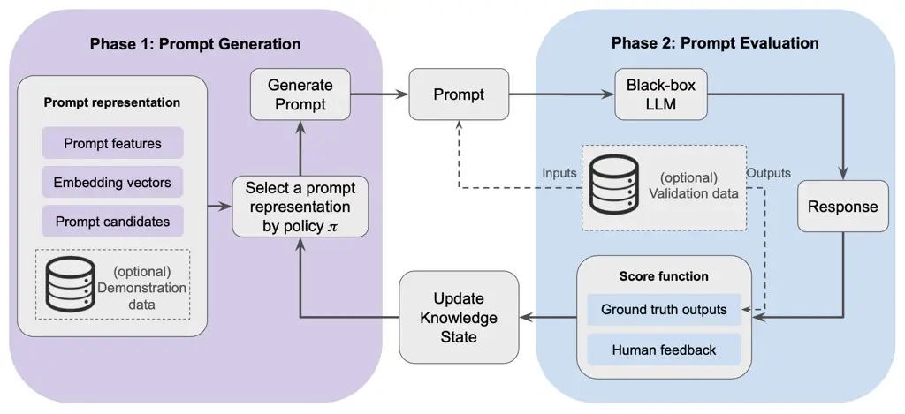
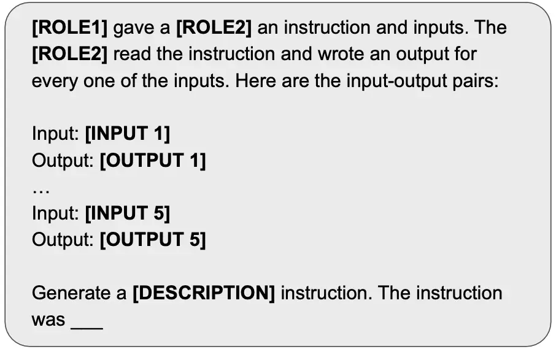
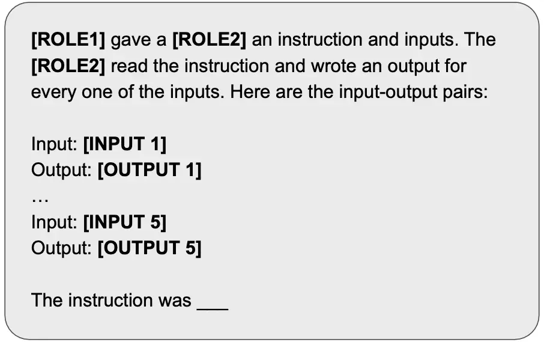
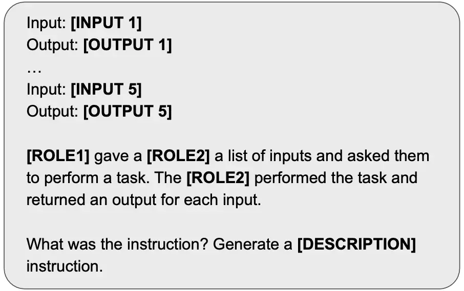
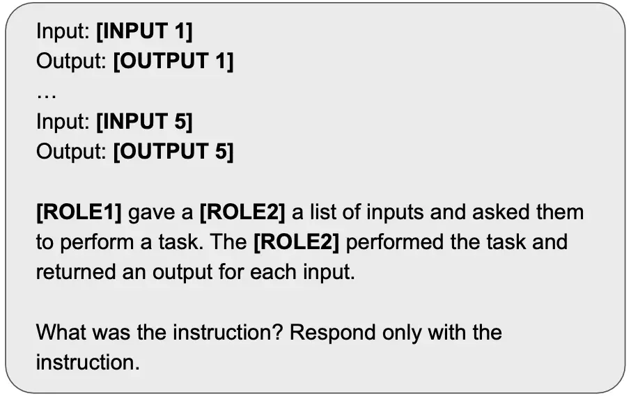
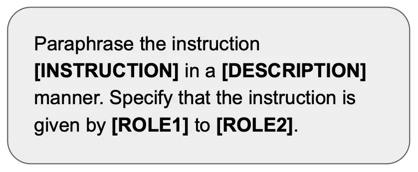
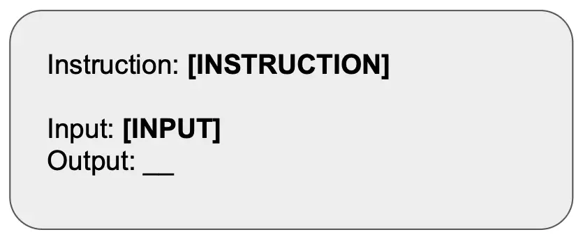
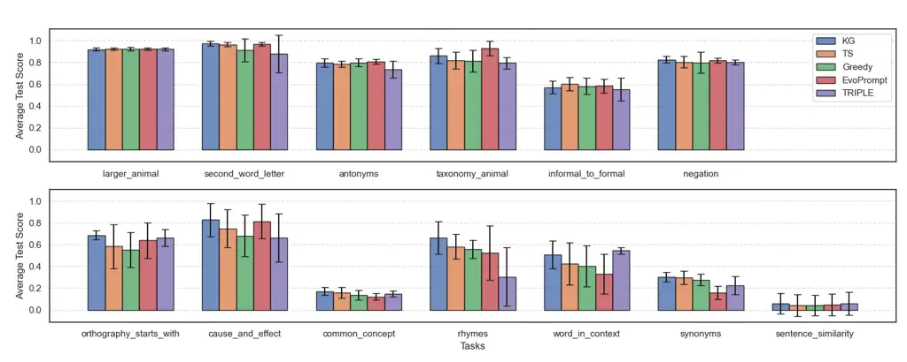
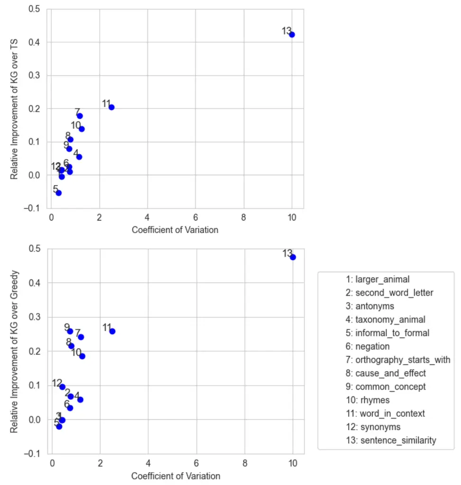
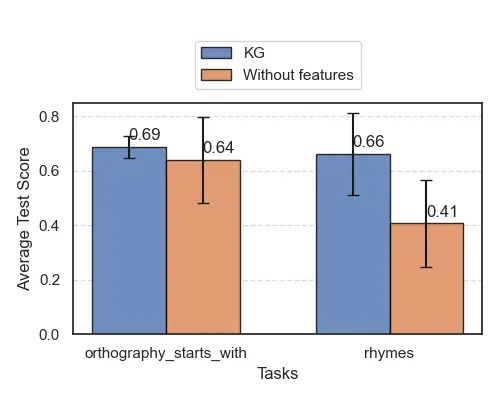

# A Sequential Optimal Learning Approach to Automated Prompt Engineering in Large Language Models

Shuyang Wang    Somayeh Moazeni    Diego Klabjan

¹Department of Engineering Sciences and Applied Mathematics,
Northwestern University  
²School of Business, Stevens Institute of Technology  
³Department of Industrial Engineering and Management Sciences,
Northwestern University

###### Abstract

Designing effective prompts is essential to guiding large language
models (LLMs) toward desired responses. Automated prompt engineering
aims to reduce reliance on manual effort by streamlining the design,
refinement, and optimization of natural language prompts. This paper
proposes an optimal learning framework for automated prompt engineering,
designed to sequentially identify effective prompt features while
efficiently allocating a limited evaluation budget. We introduce a
feature-based method to express prompts, which significantly broadens
the search space. Bayesian regression is employed to utilize
correlations among similar prompts, accelerating the learning process.
To efficiently explore the large space of prompt features for a high
quality prompt, we adopt the forward-looking Knowledge-Gradient (KG)
policy for sequential optimal learning. The KG policy is computed
efficiently by solving mixed-integer second-order cone optimization
problems, making it scalable and capable of accommodating prompts
characterized only through constraints. We demonstrate that our method
significantly outperforms a set of benchmark strategies assessed on
instruction induction tasks. The results highlight the advantages of
using the KG policy for prompt learning given a limited evaluation
budget. Our framework provides a solution to deploying automated prompt
engineering in a wider range applications where prompt evaluation is
costly.

Key Words: automated prompt engineering, optimal learning,
Knowledge-Gradient, Bayesian regression, feature-based prompts

## 1 Introduction

Large Language Models (LLMs) demonstrate exceptional capabilities in
following instructions, making them a powerful tool to various
downstream tasks \[31, 20, 2, 30\]. A well-designed prompt steers an LLM
to generate desired responses, enabling effective adaptation to
downstream applications without incurring the high cost of fine-tuning
the model weights. Nevertheless, creating effective prompts can be
challenging due to the sensitivity of LLM outputs to prompt variations
\[32, 21, 38\]. In addition, manually identifying ideal prompts is often
time-consuming and lacks systematic guidance. Automated approaches to
designing, optimizing, and refining LLM prompts mitigate this challenge
by minimizing the need for manual intervention.

Recent efforts in automated prompt engineering primarily have focused on
iterative evaluation and refinement in order to converge to ideal
prompts \[12, 39, 28, 27, 35\]. The methods by these studies often
assume the availability of numerous iterations. However, in many
real-world scenarios, opportunities to evaluate prompts are limited, as
each prompt evaluation is costly or time-consuming. For example, in
medical research, each prompt evaluation could involve extensive time
and resources from medical professionals, making it impractical to test
a large number of variations before selecting the final one.

Moreover, many existing approaches search over a set of precrafted
candidate prompts for ideal prompts \[33, 39, 22\] These methods require
identifying and enumerating a set of prompts, which restricts the
scalability as the candidate set expands. Furthermore, it fails to
utilize the correlation among similar prompt to expedite the learning.

To fully unlock the potential of LLMs across diverse scenarios, it is
crucial to develop an automated prompting framework that is capable of
capturing dependencies among prompts and efficiently identifying
high-performing prompts within few evaluations. This paper presents a
principled forward-looking iterative process for automated prompt
engineering through the optimal design of a sequence of prompts.

We propose an interpretable feature-based approach to prompt
representation. Various categorical or numerical features can be
considered to characterize detailed aspects of a prompt, such as the
selection and ordering of demonstrative examples. Previous works
identify factors within a prompt that influence the LLM outputs but
often treat these aspects in isolation. We allow for capturing various
interactions among prompt attributes and can accommodate potential
constraints on the features. This feature-based prompt representation
enables the inclusion and exploration of a vast and diverse set of
prompts, which, unlike previous approaches, do not require manual prompt
provision. In addition, in contrast to prompt descriptions based on
embedding vectors, our representation is inherently interpretable.

We adopt a Bayesian approach to refine beliefs about the influence of
prompt features on the LLM response. This approach supports the
integration of prior knowledge and user opinions as well as enabling to
capture feature correlations. To operationalize this, we define a
probabilistic model to link prompt features to a response quality of
interest. In this paper, we demonstrate our approach using LLM response
accuracy as the primary quality metric.

Next, we formalize the iterative process of automated prompt engineering
in the presence of limitations on the number of prompt evaluations as a
sequential decision-making problem. Given the limited opportunities for
prompt evaluation, this problem falls into the category of
finite-horizon discrete-time Markov decision processes; see \[29\]. An
optimal learning policy sequentially selects a feasible prompt
representation for evaluation, aiming to maximize the expected outcome
of the final prompt. Due to the potentially large prompt feature space,
the curse of dimensionality \[25\] hinders the exact computation of the
optimal prompt selection. We adopt an approximate policy for the optimal
learning problems, known as the expected improvement policy in \[4, 5\]
or Knowledge-Gradient (KG) policy in \[9, 26\]. This is a
forward-looking policy that maximizes the expected improvement in the
value of information in each learning phase. The KG policy often excels
in practical scenarios with limited evaluation budgets, frequently
outperforming common static data acquisition strategies and dynamic
test-and-learn policies. For the consistency of the KG policy, see
\[10\] for correlated features and \[14\] for constrained search space.

The large space of prompt candidates, defined by constrained features,
makes it impractical to enumerate all feasible alternatives for
determining KG decisions. To address this challenge, we leverage recent
advancements in scalable optimal learning and KG computation. In
contrast to earlier results to compute KG decisions \[9\] based on
enumeration of all feasible alternatives, recent computational methods
\[24, 14, 6\] build on optimal quantization of the response probability
followed by mixed-integer conic optimization reformulations to leverage
efficient optimization solution methods. For optimal learning problems
with larger feature spaces, an iterative process involving solving
mixed-integer linear optimization problems is employed to achieve even
greater computational efficiency and scalability.

Our framework allows for different prompt representations and selection
policies, hence encompassing various existing methods for automated
prompt engineering. For example, when a small, finite set of precrafted
prompt templates is provided and a point-wise utility model is used, our
setting simplifies to the setup in \[22, 39, 33\].

We assess the performance of sequential prompt learning with adaptive
prompt selection policies on a dataset of instruction induction tasks
\[15\]. This benchmark dataset contains 24 instances of instruction
induction, designed for LLMs to deduce implicit tasks or instructions
from language prompts including answers or contextual information. For
the instruction induction tasks, we first propose a feature-based prompt
template and use the accuracy of responses collected from GPT-3.5 on the
validation data as the primary performance metric. For the prompt
selection, we evaluate the KG policy, the adaptive myopic policy, the
increasingly popular Thompson sampling policy, and a number of other
automated prompt engineering methods such as EvoPrompt \[12\] using an
evolutionary algorithm to refine prompts and TRIPLE \[33\] using a
multi-armed bandit approach to select prompts.

Our analyses show the effectiveness of our approach particularly with
the KG prompt selection policy, which is capable to converge to
high-quality prompts within 30 or fewer prompt evaluations. These
prompts significantly outperform those generated by the benchmarks on
the test data using the same number of LLM interactions. Further
analysis reveals that the KG policy is particularly favorable for
challenging tasks with high uncertainty in LLM responses and significant
sensitivity to prompts, achieving a substantial margin over baseline
policies. Our findings highlight the advantages of using the KG policy
in prompt engineering to selectively evaluate prompts, expanding the
potential for deploying automated prompt engineering in applications
with large prompt evaluation costs.

Our contributions can be summarized as follows.

- •
  We introduce a sequential optimal learning framework for automated
  prompt engineering to guide through the process of designing a
  sequence of prompts that effectively elicit accurate responses from an
  LLM. The approach is particularly effective for applications where
  prompt evaluation is resource-intensive.
- •
  We propose a feature-based approach to represent language prompts,
  which greatly expands the prompt search space. A link function maps
  the features to LLM response accuracy through Bayesian model
  parameters to leverage correlations among prompts with shared
  characteristics. Our method enables simultaneous optimization of
  multiple features to generate improved prompts.
- •
  We leverage the KG policy within our sequential prompt learning to
  efficiently identify high-performing prompts in large prompt spaces.
  The KG policy outperforms various benchmark policies, especially for
  challenging tasks with high uncertainty in LLM response.

The remainder of the paper is organized as follows: Section 2 reviews
the related literature. Section 3 discusses the generic iterative
process for automated prompt learning, formalizing the problem as a
sequential decision making problem. Section 4 discusses the
forward-looking KG policy for the prompt selection in iterative
automated prompting. Illustrative examples and computational results are
provided in Sections 5 and 6. Finally, conclusions and potential
extensions are discussed in Section 7.

## 2 Related Work

#### Generation-then-selection Methods

\[39\] present a two-phase pipeline of instruction generation and
selection. This method generates a set of candidate instructions, which
are evaluated and filtered based on their performance on the downstream
tasks until the best one from the candidate set is found. \[22\] uses an
optimal control paradigm to systematize the process of iteratively
updating and selecting from a set of candidate prompts. However, these
approaches are limited to search spaces represented by individual prompt
candidates. Our proposed framework encompasses different prompt
representations and exploration policies. Our feature-based approach to
represent prompts captures their dependencies and enables a diverse
search space. \[33\] follows the two-phase pipeline with a focus on
prompt selection subject to a fixed evaluation budget. They formulate
the selection as a multi-armed bandit (MAB) problem and utilize the
continuously reject method to select from the candidate set. However,
their solution is not scalable with the size of the prompt candidate
set. In contrast, our framework with the KG prompt selection policy can
accommodate larger spaces of prompts.

#### Edit-based Methods

An approach to automated prompting focuses on generating refined prompts
by iteratively editing base prompts. \[27\] propose GrIPS, which
iteratively applies text-based edit operations, such as word
substitutions and deletions, to a base prompt. The best candidate is
then selected as the new base prompt. Alternatively, \[12\] apply
evolutionary algorithms and generate new candidate prompts by performing
mutation and crossover operations using an LLM, retaining high-quality
prompts for the next generation. \[8\] also use an LLM to perform
mutation operations on a population of prompts but employ a
self-referential way of improving both the prompts and the mutation
operations. \[16\] propose an iterative prompt refinement scheme
specially crafted for relevance ranking in information retrieval. While
these attempts show the potential of edit-based approaches for
generating high-quality prompts, they mainly rely on local search by
modifying existing prompts. Our method, however, explores the prompt
space in a forward-looking principled manner using Bayesian optimal
learning, and utilizes knowledge from prior observations to inform
future selections of prompts to evaluate.

#### Prompt Learning Methods

Recent works \[3, 19\] experiment using Bayesian Optimization to search
in the embedding space of prompts, but white-box LLMs are required to
facilitate the optimization steps. Our approach also builds on Bayesian
learning, but we directly search in the space of discrete prompts and
eliminate the need for white-box LLMs. The concept of prompt learning is
also used in \[23\], which trains a reinforcement learning model to
select tokens as actions to form prompts. The training stage requires
sufficient evaluation budget, while our framework is capable of learning
from only a limited number of prompt evaluation.

#### Gradient-based Methods

Gradient-based algorithms have been used to solve the problem of
optimizing the prompt performance over the prompt space. \[35, 34\]
model prompts as sequences of trigger tokens, and compute the gradients
of the log-likelihood of the language model generating the target
outputs with respect to the embeddings of candidate tokens to guide the
search for optimal tokens. \[36\] compute the gradients of a similarity
metric between the generated and target outputs with respect to the
prompt embeddings to guide prompt optimization, and project the
optimized embeddings to discrete prompts using nearest neighbors. These
methods require access to the internal parameters of the LLM, making
them incompatible with black-box LLMs. Moreover, these methods require
computationally intensive gradient computations. In contrast, our
approach generates human-readable prompts without accessing internal
parameters.

## 3 Sequential Optimal Prompt Learning

We introduce a sequential optimal prompt learning framework, called
_SOPL_, for automated prompt engineering that is compatible with
black-box LLMs and generates human-readable prompts, while addressing
the challenge of limited number of iterations for prompt evaluation. Our
framework, depicted in Figure 1, follows the iterative process outlined
in Algorithm 1. The components of the framework are explained in the
subsequent subsections.



Figure 1: SOPL: Sequential optimal prompt learning for automated prompt
engineering

Require Maximum iteration $`N`$, score function
$`\mathrm{Eval}:\mathcal{X}\to(0,1)`$, prompt representation selection
policy $`\pi:\mathcal{S}\to\mathcal{X}`$, Bayesian update function
$`\operatorname{Update}:\mathcal{S}\times\mathbb{R}\to\mathcal{S}`$ that
implements (4)-(7).

1:  Initialize knowledge state $`S`$.

2:  Initialize best prompt so far $`x^{*}`$.

3:  Initialize best score so far $`u^{*}\leftarrow-1`$.

4:  for step $`n=1,...,N`$ do

5:   Get prompt representation $`x\leftarrow\pi(S)`$.

6:   Evaluate prompt and get a score
$`u_{x}\leftarrow\mathrm{Eval}(x)`$.

7:   if $`u>u^{*}`$ then

8:    Record best score so far $`u^{*}\leftarrow u_{x}`$.

9:    Record best prompt so far $`x^{*}\leftarrow x`$.

10:   end if

11:   Update knowledge state
$`S\leftarrow\mathrm{Update}(S,\operatorname{logit}(u_{x}))`$.

12:  end for

13:  return $`x^{*}`$.

Algorithm 1 Sequential optimal prompt learning

### 3.1 Feature-Based Prompt Representation

To identify high-quality prompts, it is essential to explore a diverse
set of prompts tailored to the specific downstream task. We adopt a
feature-based representation for prompts, expressing a language meta
prompt through various features that capture its content and structure.
Prompt features are denoted by the vector $`x`$ that specifies a textual
prompt. Examples of such features include the structural template, tone,
role, context, demonstrations, specificity, complexity, embeddings, task
type, question framing, constraints, and temporal references. These
features are generally either manually engineered by the user or derived
from established prompt templates in the literature corresponding to the
task. Refer to Section 5.1 for the specific features and categories
utilized in the instruction induction task for our experiments,
developed based on the template proposed in \[15\].

Previous studies have primarily examined each feature in isolation,
whereas we integrate these features in the prompt representation to
leverage the potential synergies that emerge from their combination. By
enriching the meta prompt with multiple features known to influence LLM
responses, we can expand the search space.

In general, the feature space may contain variables of different types:
continuous, categorical, and ordinal. In addition, various requirements
may be imposed on the features either by definition or by the user’s
preferences to account for mutually exclusive features, conditional
features, combined effects of multiple features, disjunctive features,
and multiple-choice decisions. The set of feasible feature combinations
forms a diverse and potentially large search space, denoted by
$`\mathcal{X}`$. Our framework does not require explicitly identifying
and enumerating all feasible prompts. Instead, the feasible prompt space
$`\mathcal{X}`$, which encompasses the feasible values of the prompt
features, is specified solely by linear inequality or equality
constraints.

Our framework encompasses existing approaches as special cases. For
example, the methods \[39, 33, 22\] that follow the pipeline of
generating and selecting from a set of candidates can be thought of as
using the candidate set as $`\mathcal{X}`$.

### 3.2 Prompt Evaluation

The prompt evaluation phase involves querying a black-box LLM with the
prompt constructed from $`x`$ and collecting the LLM’s response. When
evaluating the prompt on the downstream task, we measure the quality of
the observed LLM response to the prompt associated with $`x`$ using a
numeric score $`u_{x}`$, which is computed from the score function
$`\operatorname{Eval}`$ defined on $`\mathcal{X}`$; see Algorithm 2 for
details on $`\operatorname{Eval(x)}`$. Given labeled data, the score can
be computed by comparing the LLM responses to the ground truth labels
and calculating the percentage of accurate response. For downstream
tasks that require human evaluation, the score is based on human
feedback.

For common metrics such as accuracy, F1-score, and point-wise mutual
information \[1\], the score lies in the interval between 0 and 1. We
assume that

```math
\displaystyle\eta_{x}:=\operatorname{logit}(u_{x})=\Theta^{\top}x+\epsilon, \tag{1}
```

where $`\Theta\sim\mathcal{N}(\mu_{\Theta},\Sigma_{\Theta}/\rho)`$ is
the $`D`$-dimensional model parameter and
$`\epsilon\sim\mathcal{N}(0,1/\rho)`$ with variance $`1/\rho`$ is the
measurement noise. The quantity $`\eta_{x}`$ represents the utility of
$`x`$. The mean $`\mu_{\Theta}`$ and the precision $`\rho`$ are the
unknown parameters to estimate. For general score functions that return
values beyond the interval between 0 and 1, alternative link functions
can be employed in (1) in place of the logit function.

### 3.3 Knowledge State Update

An approach to addressing uncertainty in the effectiveness of prompt
features is Bayesian learning. The Bayesian approach to inference can
account for multiple levels of randomness and correlation by using prior
distributions for model parameters. Additionally, existing knowledge and
user input can be incorporated into these prior probability
distributions. We adopt the Bayesian framework, letting a multivariate
normal prior for the coefficients, $`\mu_{\Theta}`$, and a Gamma prior
for the precision, $`\rho`$, i.e.,

```math
\displaystyle\mu_{\Theta}|\rho \displaystyle\sim\mathcal{N}\left(\theta,\Sigma/\rho\right) \tag{2}
```

```math
\displaystyle\rho \displaystyle\sim\text{Gamma}(a,b). \tag{3}
```

The belief represented by $`S=(\theta,\sigma,a,b)`$ is referred to as
the _knowledge state_. The knowledge state encodes prior observations of
prompt performance and serves as the basis to inform future decisions.
The multivariate distribution (2) captures dependencies among unknown
parameters, implying that learning about one prompt can provide insights
into the effectiveness of several other prompts, thereby enhancing the
learning speed.

We iteratively update the knowledge state based on observed responses to
queried prompts. At iteration $`n`$, the knowledge state is denoted by
$`S_{n}=(\theta_{n},\Sigma_{n},a_{n},b_{n})`$, and the selected prompt
representation is denoted by $`x_{n}`$. After the $`n`$-th iteration of
prompt evaluation, we observe the score $`u_{n}:=u_{x_{n}}`$ and update
the knowledge state as follows.

```math
\displaystyle\theta_{n+1} \displaystyle=\theta_{n}+\frac{\operatorname{logit}(u_{n})-\theta_{n}^{\top}x_{n}}{(1+x_{t}^{\top}\left(\Sigma_{n}+\Sigma_{\Theta}\right)x_{n})}\Sigma_{n}x_{n} \tag{4}
```

```math
\displaystyle\Sigma_{n+1} \displaystyle=\Sigma_{n}-\frac{\Sigma_{n}x_{n}x_{n}^{\top}\Sigma_{n}}{1+x_{n}^{\top}\left(\Sigma_{n}+\Sigma_{\Theta}\right)x_{n}} \tag{5}
```

```math
\displaystyle a_{n+1} \displaystyle=a_{n}+\frac{1}{2} \tag{6}
```

```math
\displaystyle b_{n+1} \displaystyle=b_{n}+\frac{(\operatorname{logit}(u_{n})-\theta_{n}^{\top}x_{n})^{2}}{2(1+x_{n}^{\top}\left(\Sigma_{n}+\Sigma_{\Theta}\right)x_{n})} \tag{7}
```

Equations (4)-(7) collectively define the mapping
$`\operatorname{Update}(S,\operatorname{logit}(x))`$ appeared in line 11
of Algorithm 1.

### 3.4 Prompt Representation Selection Policy

For each iteration, a prompt representation $`x_{n}`$ is selected
according to a policy $`\pi`$. The goal is to find a prompt that
maximizes the score on the downstream task after $`N`$ iterations of
prompt evaluation.

Our framework allows for different prompt representation selection
policies to explore the feasible prompt space $`\mathcal{X}`$ and update
the knowledge state. Heuristic policies, such as adaptive myopic
(Greedy) and Thompson sampling (TS), can be adopted. The Greedy policy
selects the best prompt representatio $`x`$ based on the current
knowledge state by

```math
\pi^{Greedy}(S_{n}):=\underset{x\in\mathcal{X}}{\operatorname{argmax}}~\mathbb{E}[\eta_{x}|S_{n}]=\underset{x\in\mathcal{X}}{\operatorname{argmax}}~\theta_{n}^{\top}x. \tag{8}
```

The TS policy samples from the posteriors of the parameters by

```math
\hat{\rho}\sim\operatorname{Gamma}(a_{n},b_{n}),~~\hat{\theta}\sim\mathcal{N}\left(\theta_{n},\Sigma_{n}/\hat{\rho}\right), \tag{9}
```

and then selects the prompt representation $`x`$ by

```math
\pi^{TS}(S_{n}):=\underset{x\in\mathcal{X}}{\operatorname{argmax}}~\hat{\theta}^{\top}x. \tag{10}
```

The heuristic policies such as Greedy and TS policies are adaptive, but
they are not forward-looking, in the sense that they do not explicitly
take into account the effect of selected prompts on the subsequent
prompt selections and the overall learning process.

The prompt representation selection policy $`\pi`$ is a key building
block influencing the performance of the SOPL framework. When the number
of iterations is limited to $`N`$, the process of sequential optimal
prompt learning can be formulated as a finite-horizon Markov decision
process, where the action space $`\mathcal{X}`$ consists of prompt
representations, and the state space $`\mathcal{S}`$ consists of
knowledge states. In the next section, we discuss an approximate policy
for the optimal prompt representation selection policy.

## 4 KG Prompt Selection Policy

We consider a forward-looking optimal learning policy designed to
maximize the expected improvement in an approximated value of
information during each iteration. This approach, known as the
Knowledge-Gradient (KG) policy, offers an approximate solution to the
MDP for prompt selection. For additional discussion and analysis, refer
to \[13, 5, 11, 26\]. The value of information is measured by the
expected single-period improvement, i.e., the difference between the
values of the knowledge states $`S_{n+1}`$ and $`S_{n}`$ if the prompt
representation $`x_{n+1}=x`$ is selected. Hence, at iteration $`n`$, the
following KG quantity is maximized:

```math
\nu^{n}_{x}:=\mathbb{E}\left[V_{N}(S_{n+1})|S_{n},x\right]-V_{N}(S_{n}). \tag{11}
```

where $`V_{N}(S)`$ is the value of the optimal policy at iteration $`N`$
for any knowledge state $`S`$, i.e.,
$`V_{N}(S)=\max_{\pi\in\Pi}V_{N}^{\pi}(S)=\max_{x\in\mathcal{X}}\mathbb{E}[\eta_{x}|S]`$,
where $`\eta_{x}`$ is as in equation (1). Recall that $`S_{n+1}`$ is the
transition from state $`S_{n}`$ induced by the updating procedure in
equations (4)-(7). The quantity $`\nu_{x}^{n}`$ is the marginal value of
one more prompt representation $`x`$ being queried. Its value is always
nonnegative.

The decision of the KG policy selects the prompt representation that
maximizes the KG quantity in equation (11):

```math
\pi^{KG}(S_{n}):=\underset{x\in\mathcal{X}}{\operatorname{argmax}}~\nu^{n}_{x}. \tag{12}
```

For discussion on the related concepts of asymptotic optimality and
statistical consistency of the KG policy, the reader is referred to
\[11, 10\] when $`\mathcal{X}`$ is specified in the enumerative form,
and see \[14\] when $`\mathcal{X}`$ is represented in a constraint-based
form.

For any $`x\in\mathcal{X}`$, the KG quanitity corresponding to model (1)
is given by:

```math
\displaystyle\nu_{x}^{n}=\mathbb{E}[\max_{y\in\mathcal{X}}(p_{y}^{n}+q_{y}^{n}(x)T_{2a_{n}})|S_{n}]-\max_{y\in\mathcal{X}}p_{y}^{n} \tag{13}
```

where $`T_{2a_{n}}`$ follows a student’s t distribution with $`2a_{n}`$
degrees of freedom, and

```math
\displaystyle p_{y}^{n}=\theta^{\top}y \tag{14}
```

```math
\displaystyle q_{y}^{n}(x)=\sqrt{\frac{b_{n}}{a_{n}(1+x^{\top}(\Sigma_{n}+\Sigma_{\Theta})x)}}x^{\top}\Sigma_{n}y \tag{15}
```

The expectation in equation (13) is with respect to the one-dimensional
random variable $`T_{2a_{n}}`$.

The first term in the KG quantity in equation (13) can be approximated
by

```math
\displaystyle\sum_{j=1}^{J}w_{j}\max_{y\in\mathcal{X}}(p_{y}^{n}+q_{y}^{n}(x)t_{j}) \tag{16}
```

where $`t_{1},...,t_{J}\in\mathbb{R}`$ is the sequence of points that
minimizes the quadratic quantization error of the Voronoi quantizer for
$`T_{2a_{n}}`$, $`t_{0}=-\infty`$, and $`t_{J+1}=\infty`$. The weights
are defined as
$`w_{j}=F_{T_{2a_{n}}}\left(\frac{t_{j}+t_{j+1}}{2}\right)-F_{T_{2a_{n}}}\left(\frac{t_{j-1}+t_{j}}{2}\right)`$
for $`j=1,\cdots,J`$. Here, $`F_{T_{2a_{n}}}`$ is the cumulative
distribution function of $`T_{2a_{n}}`$. Therefore, the selected prompt
representation based on the KG policy at state $`S_{n}`$ is computed by
solving the following mixed-integer optimization problem:

```math
\displaystyle\max_{(\hat{x},\tau)\in\mathcal{X}^{+},\tau\leq M,x,y^{1},...,y^{J}\in\mathcal{X}}\sum_{j=1}^{J}w_{j}\theta_{n}^{\top}y^{j}+\tau \tag{17}
```

```math
\displaystyle\text{s.t.~}\|P_{n}^{1/2}\hat{x}\|_{2}\leq\sum_{j=1}^{J}w_{j}t_{j}x^{\top}\Sigma_{n}y^{j} \tag{18}
```

```math
\displaystyle\tau\cdot 1_{m}-M(1_{m}-x)\leq\hat{x}\leq Mx \tag{19}
```

Here, $`m`$ is the dimensionality of the prompt representation features,
and
$`P_{n}:=\frac{a_{n}}{b_{n}}(\frac{A^{\top}A}{h^{\top}h}+\Sigma_{n}+\Sigma_{\Theta})`$,
where $`A`$ and $`h`$ form the equality constraints of the feasible set
$`\mathcal{X}=\{x|Ax=h,Bx\leq g\}`$. In this problem,
$`\mathcal{X}^{+}`$, consisting of elements
$`(x,\tau)\in\mathbb{R}^{m}`$, represents the homogenized version of the
set $`\mathcal{X}`$. In the last constraint, $`M`$ denotes a large
constant. For further details and a computationally efficient iterative
algorithm only involving solving mixed-integer programming problems to
solve this problem, see Propositions 6 and 7 in \[24\].

## 5 Computational Experiments

We demonstrate the performance of the proposed SOPL framework on the
instruction induction tasks \[15\]. The dataset consists of 24
individual tasks, covering various aspects of text comprehension. Each
data point comprises a pair of input and output. For example, for the
task larger_animal, one data point consists of an input “cougar, flea”
and an output “cougar”. The objective is to find an instruction such
that when the LLM is queried with the instruction and an input, its
response matches the correct output. A possible instruction for this
task can be “choose the larger animal”. Similar to \[39\], we generate
possible instructions by prompting an LLM using a meta prompt, which
consists of demonstrative examples of input-output pairs and asks for a
possible instruction. For each task, we partition the dataset into three
sets: a demonstration dataset, a validation dataset, and a held-out test
dataset.

#### Feature-Based Prompt Representation.

We focus on five aspects of prompts that have been shown to impact LLM
responses. \[39\] note that the template of the meta prompt impacts the
effectiveness of the induced prompts; \[21, 38\] find that both the
selection and the order of demonstration examples influence generated
texts; \[37, 17\] show that specifying different roles elicits diverse
text generations from LLMs; \[7, 39\] discover that prompts paraphrased
by LLMs yield improved performance on downstream tasks; \[18\] observe
that LLMs respond differently to different descriptions of tones.

We create a set of choices for each feature, summarized in Table 1. A
feature vector $`x`$ specifies one choice for each feature. By applying
one-hot encoding to represent each categorical feature, the prompt
representation feature $`x`$ becomes a binary vector. All combinations
of the prompt features, subject to the constraint that exactly one
choice is selected for each feature, form the search space
$`\mathcal{X}`$.

| Feature                | Choices                                                                         |
| ---------------------- | ------------------------------------------------------------------------------- |
| Meta prompt template   | 4 meta prompt templates shown in Figure 2.                                      |
| Demonstrative examples | 20 choices, each consists of 5 examples sampled from the demonstration dataset. |
| Roles                  | (Scientist, research assistant), (Professor, PhD student), (Mom, kid),          |
|                        | (Programmer, AI system), (Manager, employee), (I, friend),                      |
|                        | (Director, actor), (Coach, athlete), (Chef, sous chef).                         |
| Paraphrasing           | Binary: if paraphrasing is used, we prompt the LLM again to generate            |
|                        | a variant of the instruction using the template in Figure 3.                    |
| Description            | (empty), clear, detailed, simple, complex, precise, ambiguous,                  |
|                        | technical, expository, conceptual, authoritative, friendly, formal,             |
|                        | informal, encouraging, stern, rude, assertive, humorous.                        |

Table 1: Prompt features used for instruction induction tasks



(a) Meta Prompt Template 1



(b) Meta Prompt Template 2



(c) Meta Prompt Template 3



(d) Meta Prompt Template 4

Figure 2: Meta Prompt Templates



Figure 3: Paraphrasing Template



Figure 4: Evaluation Template

#### Prompt Evaluation.

We evaluate the selected feature vector $`x`$ on the validation data and
obtain the validation score $`u_{x}`$ by Algorithm 2. We first convert
the feature vector $`x`$ to a textual instruction in line 1 and 2. For
example, if the feature vector specifies meta prompt template 1, 5
demonstrative examples, roles of I and friend, no paraphrasing, and
description of clear, then we create a meta prompt by
$`\operatorname{MetaPrompt}(x)`$, which inserts the 5 demonstrative
examples in meta prompt template 1 in Figure 2, and replaces \[ROLE1\]
by “I”, \[ROLE2\] by “friend”, and \[DESCRIPTION\] by “clear”. We query
an LLM with the meta prompt to generate an instruction $`I_{x}`$ that
reflects the selected features. For each input $`p_{i}`$ in the
validation data, we create an evaluation prompt by
$`\operatorname{EvalPrompt}(I_{x},p_{i})`$, which combines the
instruction and the input using the template in Figure 4. The prompt is
then used to query the LLM. A task-specific metric, such as exact match
or F1-score defined in \[15\], is used to compute a score by comparing
the LLM response with the correct output $`q_{i}`$. The average score
across all validation examples is used as the score $`u_{x}`$.

Require An $`\operatorname{LLM}`$, validation data
$`\{(p_{i},q_{i})\}_{i=1}^{V}`$, meta prompt construction function
$`\operatorname{MetaPrompt}`$, evaluation prompt construction function
$`\operatorname{EvalPrompt}`$, metric function $`\operatorname{Metric}`$
to evaluate LLM response.

1:  Create meta prompt $`M_{x}\leftarrow\operatorname{MetaPrompt}(x)`$.

2:  Generate instruction $`I_{x}\leftarrow\operatorname{LLM}(M_{x})`$.

3:  for $`i=1,...,V`$ do

4:   Get evaluation prompt
$`E_{i}\leftarrow\operatorname{EvalPrompt}(I_{x},p_{i})`$.

5:   Receive LLM response $`R_{i}\leftarrow\operatorname{LLM}(E_{i})`$.

6:   Evaluate LLM response
$`U_{i}\leftarrow\operatorname{Metric}(R_{i},q_{i})`$.

7:  end for

8:  Compute the average score $`u_{x}=\frac{1}{V}\sum_{i=1}^{V}U_{i}`$.

9:  return $`u_{x}`$.

Algorithm 2 Score function $`\operatorname{Eval}(x)`$

### 5.1 Benchmark Methods

We compare our method with two benchmarks EvoPrompt \[12\] and TRIPLE
\[33\]. Both methods provide solutions compatible with black-box access
to LLMs and generate human-readable prompts. EvoPrompt uses the
differential evolution algorithm to iteratively refine a population of
prompts. TRIPLE employs the continuously reject algorithm to identify an
effective prompt from a candidate pool under a fixed budget. In
addition, we use Greedy and TS presented in (8) and (10) as the baseline
policies.

### 5.2 Implementation Details

We record the instruction with the highest validation score during the
process. When the maximum number of prompt evaluation is reached, the
instruction with the highest validation score is used as the final
instruction. The test score is obtained by evaluating the final
instruction on the held-out test data, using a similar procedure in
Algorithm 2. We report the average test score across 20 replications
with different random seeds.

The held-out test dataset for each task consists of 100 examples unless
specified otherwise in \[15\], and is kept the same for all
replications. For each replication, we randomly select 10 examples from
the rest of the data as the demonstration dataset, and then randomly
select 100 examples or all remaining examples if fewer are available as
the validation dataset.

We use OpenAI GPT-3.5 as the LLM for both generating and evaluating
instructions. We allow $`N=30`$ opportunities to evaluate on the entire
validation dataset. We set the population size to be $`10`$ for
EvoPrompt as in \[12\], and set the size of the candidate pool to be
$`30`$ for TRIPLE as in \[33\]. We ensure that the same number of API
calls to the LLM is used for evaluating on the validation data across
all methods.

## 6 Results and Sensitivity Analysis

We focus on the 13 challenging tasks where the validation score are
below 80% with relatively large variance using the default meta prompt
template in \[15\]. Table 2 presents the average test performance across
13 tasks for SOPL and the benchmark approaches. For each task, we
illustrate the mean and standard deviation of the test score across 20
replications in Figure 5. The results indicate that SOPL-KG outperforms
the benchmarks. It exhibits the highest average test score of 0.6281
among all methods, with a 6.47% improvement in average test score and a
17.92% average improvement per task relative to EvoPrompt. For each
task, we rank the five methods from the highest to the lowest test
score, and calculate the average ranking across 13 tasks. The SOPL-KG
achieves the highest average ranking of 1.85, and the SOPL-TS has the
second best ranking of 2.69, outperforming both EvoPrompt and TRIPLE. We
compute the standard deviation of the test scores across 20 replications
for each task, and report the average across 13 tasks in Table 2. The
SOPL-KG exhibits the lowest standard deviation, demonstrating its
robustness to variations in random seeds.

The findings highlight the effectiveness of our proposed framework with
feature-based prompt representations and the KG prompt selection policy
in comparison to other benchmarks. Although the space of all feature
combinations is prohibitively large for exhaustive exploration, the
SOPL-KG is capable of discovering high-quality prompts within given
prompt evaluations.

| Metric                          | SOPL-KG | EvoPrompt | TRIPLE | SOPL-TS | SOPL-Greedy |
| ------------------------------- | ------- | --------- | ------ | ------- | ----------- |
| Test score                      | 0.6281  | 0.5900    | 0.5609 | 0.5948  | 0.5750      |
| Standard deviation              | 0.0668  | 0.0881    | 0.0966 | 0.0880  | 0.0959      |
| Improvement of SOPL-KG          | 0.00%   | 6.47%     | 11.99% | 5.60%   | 9.23%       |
| Improvement of SOPL-KG per task | 0.00%   | 17.92%    | 17.19% | 9.13%   | 14.35%      |
| Ranking                         | 1.85    | 2.92      | 3.77   | 2.69    | 3.69        |

Table 2: Average test performance across 13 tasks for different methods



Figure 5: Test performance on 13 tasks for different methods. The height
of each bar represents the average test score and the error bar
represents the standard deviation across 20 replications with different
random seeds

### 6.1 Sensitivity to the Number of Iterations

We consider more challenging scenarios with fewer iterations of $`N=20`$
and $`N=10`$. Table 3 presents the average test performance across 13
tasks. The SOPL-KG outperforms all other methods within fewer
iterations, with a slightly lower average test score of $`0.6174`$ when
$`N=20`$ compared to $`N=30`$. The SOPL-KG also has the lowest standard
deviation when $`N=20`$, while the SOPL-TS is slightly more robust to
variations in random seeds when $`N=10`$.

| Method      | $`N=20`$ |        | $`N=10`$ |        |
| ----------- | -------- | ------ | -------- | ------ |
|             | Mean     | STD    | Mean     | STD    |
| EvoPrompt   | 0.5776   | 0.0956 | 0.5625   | 0.0920 |
| TRIPLE      | 0.5561   | 0.0996 | 0.5333   | 0.1087 |
| SOPL-KG     | 0.6174   | 0.0771 | 0.5800   | 0.0935 |
| SOPL-TS     | 0.5926   | 0.0845 | 0.5696   | 0.0893 |
| SOPL-Greedy | 0.5757   | 0.0941 | 0.5490   | 0.1012 |

Table 3: Average test score after fewer iterations

We implement an early stopping mechanism in our framework to further
reduce the cost of prompt evaluation. We terminate the process early if
the best validation score does not improve for $`\tau`$ consecutive
steps, or when the maximum number $`N`$ of steps is reached. We conduct
experiments with $`\tau=5`$ and $`\tau=10`$ for 20 replications and
report the results in Table 4. Within 17 realized iterations, all three
prompt selection policies yield close to but slightly worse test score
compared to $`N=30`$. TS has a small advantage in the average number of
steps used, but KG dominates the test score relative to baseline
policies. It shows that the KG policy has the potential of reducing the
number of evaluations required without significantly compromising
performance.

| Policy      | $`\tau=10`$ |       | $`\tau=5`$ |       |
| ----------- | ----------- | ----- | ---------- | ----- |
|             | Test score  | Steps | Test score | Steps |
| SOPL-KG     | 0.6060      | 16.88 | 0.5711     | 8.45  |
| SOPL-TS     | 0.5813      | 16.10 | 0.5488     | 8.20  |
| SOPL-Greedy | 0.5653      | 16.60 | 0.5389     | 8.37  |

Table 4: Average number of realized iterations and average test score
for different policies with early stopping

### 6.2 Sensitivity to the Prompt Selection Policy

As Figure 5 illustrates, the advantage of the KG policy is more evident
for some tasks while more subtle for others. For each task, we randomly
sample 100 feature vectors and evaluate their validation scores. We
compute the mean $`\mu_{100}`$ and the standard deviation
$`\sigma_{100}`$ of the 100 scores, and calculate the coefficient of
variation by $`CV_{100}:=\sigma_{100}/\mu_{100}`$. This metric aims to
represent the uncertainty in the LLM response performance as the prompt
feature values vary. Figure 6 depicts the relationship between the
relative improvement of the KG prompt representation selection policy
over the TS and Greedy policies in the average test score, and the
coefficient of variation $`CV_{100}`$ for different tasks. The
correlation coefficient between $`CV_{100}`$ and the relative
improvement of KG over TS and Greedy across 13 tasks are
$`\rho_{1}=0.8901`$ and $`\rho_{2}=0.7789`$. The positive correlations
suggest that for tasks where the LLM response is highly sensitive to
prompt features, the KG policy can prominently outperform TS and Greedy
in the SOPL framework.

We also observed that for easier tasks when the LLM response is
relatively insensitive to the prompts and the performance function is
relatively flat with respect to prompt features, full exploitation
policies such as Greedy are adequate to identify an effective prompt. In
particular, we observe that Greedy outperforms KG by a very small margin
for two easier tasks, antonyms and informal_to_formal. However, for
challenging tasks with high uncertainty, KG consistently yields over a
10% improvement relative to both baselines when other parts of the
framework remain the same. Our analysis reveals the importance of the
choice of the policy depending on the problem context.



Figure 6: Upper plot: Improvement over SOPL-TS versus the coefficient of
variation. Lower plot: Improvement over SOPL-Greedy versus the
coefficient of variation

### 6.3 Sensitivity to Feature Selection

We assess the effectiveness of enriching the prompt representation by
multiple features on the two tasks with the largest improvement of
SOPL-KG compared to the second best performance, i.e.,
orthography_starts_with and rhymes. We use the default meta prompt from
\[15\], which only includes the feature for the required demonstration
examples, and use SOPL-KG to select from 20 predefined configurations of
demonstration examples. We allow $`N=30`$ evaluations and repeat the
experiments for 20 replications. Figure 7 shows that the performance
deteriorates as the features that enhance the meta prompt are excluded.
While searching in a single dimension is easier than optimizing multiple
features simultaneously, it results in finding suboptimal prompts. The
result suggests that enriching the meta prompt with different features
effectively expands the search space and leads to improved performance
of the generated prompts.



Figure 7: Comparison of the average test score between our proposed
method using all five features and the method using only one feature for
the demonstrative examples

## 7 Conclusion and Future Work

This paper introduces SOPL, a sequential optimal prompt learning
framework for automated prompt engineering focused on efficient prompt
learning in practical scenarios where exhaustive evaluation is costly or
impossible. Specifically, we develop a feature-based approach to model
prompts, enabling a constraint-based and expansive prompt search space.
The forward-looking KG policy with correlated beliefs facilitates
efficient and scalable prompt learning. We demonstrate that our proposed
method achieves superior performance on instruction induction tasks with
only 30 or fewer opportunities of prompt evaluation. We find that the KG
policy yields substantial performance gains compared to baseline
policies, especially for challenging tasks with high uncertainty.
Moreover, our framework allows for future investigation of continuous
representations of prompts by embedding vectors. Our work shows a
promising direction of leveraging optimal learning methods for efficient
prompt learning, paving the way for future research on scalable prompt
engineering.

## Acknowledgment

This research was supported in part through the computational resources
and staff contributions provided for the Quest high performance
computing facility at Northwestern University which is jointly supported
by the Office of the Provost, the Office for Research, and Northwestern
University Information Technology.

## References

- \[1\] Gerlof Bouma. Normalized (pointwise) mutual information in
  collocation extraction. Proceedings of GSCL, 30:31–40, 2009.
- \[2\] Tom Brown, Benjamin Mann, Nick Ryder, Melanie Subbiah, Jared D
  Kaplan, Prafulla Dhariwal, Arvind Neelakantan, Pranav Shyam, Girish
  Sastry, Amanda Askell, Sandhini Agarwal, Ariel Herbert-Voss, Gretchen
  Krueger, Tom Henighan, Rewon Child, Aditya Ramesh, Daniel Ziegler,
  Jeffrey Wu, Clemens Winter, Chris Hesse, Mark Chen, Eric Sigler,
  Mateusz Litwin, Scott Gray, Benjamin Chess, Jack Clark, Christopher
  Berner, Sam McCandlish, Alec Radford, Ilya Sutskever, and Dario
  Amodei. Language models are few-shot learners. In H. Larochelle,
  M. Ranzato, R. Hadsell, M.F. Balcan, and H. Lin, editors, Advances in
  Neural Information Processing Systems, volume 33, pages
  1877–1901, 2020.
- \[3\] Lichang Chen, Jiuhai Chen, Tom Goldstein, Heng Huang, and Tianyi
  Zhou. Instructzero: Efficient instruction optimization for black-box
  large language models. In International Conference on Machine
  Learning, 2024.
- \[4\] Stephen E Chick. Bayesian ideas and discrete event simulation:
  why, what and how. In Proceedings of the 2006 Winter Simulation
  Conference, pages 96–106, 2006.
- \[5\] Stephen E Chick, Jürgen Branke, and Christian Schmidt.
  Sequential sampling to myopically maximize the expected value of
  information. INFORMS Journal on Computing, 22(1):71–80, 2010.
- \[6\] Boris Defourny, Ilya O Ryzhov, and Warren B Powell. Optimal
  information blending with measurements in the l 2 sphere. Mathematics
  of Operations Research, 40(4):1060–1088, 2015.
- \[7\] Yihe Deng, Weitong Zhang, Zixiang Chen, and Quanquan Gu.
  Rephrase and respond: Let large language models ask better questions
  for themselves. arXiv preprint arXiv:2311.04205, 2023.
- \[8\] Chrisantha Fernando, Dylan Sunil Banarse, Henryk Michalewski,
  Simon Osindero, and Tim Rocktäschel. Promptbreeder: Self-referential
  self-improvement via prompt evolution. In International Conference on
  Machine Learning, 2024.
- \[9\] Peter Frazier, Warren Powell, and Savas Dayanik. The
  knowledge-gradient policy for correlated normal beliefs. INFORMS
  journal on Computing, 21(4):599–613, 2009.
- \[10\] Peter I Frazier and Warren B Powell. Consistency of sequential
  bayesian sampling policies. SIAM Journal on Control and Optimization,
  49(2):712–731, 2011.
- \[11\] Peter I Frazier, Warren B Powell, and Savas Dayanik. A
  knowledge-gradient policy for sequential information collection. SIAM
  Journal on Control and Optimization, 47(5):2410–2439, 2008.
- \[12\] Qingyan Guo, Rui Wang, Junliang Guo, Bei Li, Kaitao Song,
  Xu Tan, Guoqing Liu, Jiang Bian, and Yujiu Yang. Connecting large
  language models with evolutionary algorithms yields powerful prompt
  optimizers. In International Conference on Learning
  Representations, 2024.
- \[13\] Shanti S Gupta and Klaus J Miescke. Bayesian look ahead
  one-stage sampling allocations for selection of the best population.
  Journal of statistical planning and inference, 54(2):229–244, 1996.
- \[14\] Bin Han, Ilya O Ryzhov, and Boris Defourny. Optimal learning in
  linear regression with combinatorial feature selection. INFORMS
  Journal on Computing, 28(4):721–735, 2016.
- \[15\] Or Honovich, Uri Shaham, Samuel R Bowman, and Omer Levy.
  Instruction induction: From few examples to natural language task
  descriptions. arXiv preprint arXiv:2205.10782, 2022.
- \[16\] Can Jin, Hongwu Peng, Shiyu Zhao, Zhenting Wang, Wujiang Xu,
  Ligong Han, Jiahui Zhao, Kai Zhong, Sanguthevar Rajasekaran, and
  Dimitris N Metaxas. Apeer: Automatic prompt engineering enhances large
  language model reranking. arXiv preprint arXiv:2406.14449, 2024.
- \[17\] Aobo Kong, Shiwan Zhao, Hao Chen, Qicheng Li, Yong Qin, Ruiqi
  Sun, Xin Zhou, Enzhi Wang, and Xiaohang Dong. Better zero-shot
  reasoning with role-play prompting. In Proceedings of the 2024
  Conference of the North American Chapter of the Association for
  Computational Linguistics: Human Language Technologies (Volume 1: Long
  Papers), pages 4099–4113, 2024.
- \[18\] Cheng Li, Jindong Wang, Yixuan Zhang, Kaijie Zhu, Wenxin Hou,
  Jianxun Lian, Fang Luo, Qiang Yang, and Xing Xie. Large language
  models understand and can be enhanced by emotional stimuli. arXiv
  preprint arXiv:2307.11760, 2023.
- \[19\] Xiaoqiang Lin, Zhaoxuan Wu, Zhongxiang Dai, Wenyang Hu, Yao
  Shu, See-Kiong Ng, Patrick Jaillet, and Bryan Kian Hsiang Low. Use
  your INSTINCT: INSTruction optimization for LLMs using neural bandits
  coupled with transformers. In International Conference on Machine
  Learning, 2024.
- \[20\] Pengfei Liu, Weizhe Yuan, Jinlan Fu, Zhengbao Jiang, Hiroaki
  Hayashi, and Graham Neubig. Pre-train, prompt, and predict: A
  systematic survey of prompting methods in natural language processing.
  ACM Computing Surveys, 55(9):1–35, 2023.
- \[21\] Yao Lu, Max Bartolo, Alastair Moore, Sebastian Riedel, and
  Pontus Stenetorp. Fantastically ordered prompts and where to find
  them: Overcoming few-shot prompt order sensitivity. In Proceedings of
  the 60th Annual Meeting of the Association for Computational
  Linguistics (Volume 1: Long Papers), pages 8086–8098, 2022.
- \[22\] Yifan Luo, Yiming Tang, Chengfeng Shen, Zhennan Zhou, and Bin
  Dong. Prompt engineering through the lens of optimal control. arXiv
  preprint arXiv:2310.14201, 2023.
- \[23\] Deng Mingkai and Wang Jianyu. Rlprompt: Optimizing discrete
  text prompts with reinforcement learning. In Proceedings of the 2022
  Conference on Empirical Methods in Natural Language Processing, 2022.
- \[24\] Somayeh Moazeni, Boris Defourny, and Monika J Wilczak.
  Sequential learning in designing marketing campaigns for market entry.
  Management Science, 66(9):4226–4245, 2020.
- \[25\] Warren B Powell. Reinforcement Learning and Stochastic
  Optimization: A Unified Framework for Sequential Decisions. John Wiley
  & Sons, 2022.
- \[26\] Warren B Powell and Ilya O Ryzhov. Optimal learning,
  volume 841. John Wiley & Sons, 2012.
- \[27\] Archiki Prasad, Peter Hase, Xiang Zhou, and Mohit Bansal.
  Grips: Gradient-free, edit-based instruction search for prompting
  large language models. arXiv preprint arXiv:2203.07281, 2022.
- \[28\] Reid Pryzant, Dan Iter, Jerry Li, Yin Tat Lee, Chenguang Zhu,
  and Michael Zeng. Automatic prompt optimization with ”gradient
  descent” and beam search. In The 2023 Conference on Empirical Methods
  in Natural Language Processing, 2023.
- \[29\] Martin L Puterman. Markov decision processes: discrete
  stochastic dynamic programming. John Wiley & Sons, 2014.
- \[30\] Alec Radford, Jeffrey Wu, Rewon Child, David Luan, Dario
  Amodei, Ilya Sutskever, et al. Language models are unsupervised
  multitask learners. OpenAI Blog, 2019.
- \[31\] Pranab Sahoo, Ayush Kumar Singh, Sriparna Saha, Vinija Jain,
  Samrat Mondal, and Aman Chadha. A systematic survey of prompt
  engineering in large language models: Techniques and applications.
  arXiv preprint arXiv:2402.07927, 2024.
- \[32\] Melanie Sclar, Yejin Choi, Yulia Tsvetkov, and Alane Suhr.
  Quantifying language models’ sensitivity to spurious features in
  prompt design or: How i learned to start worrying about prompt
  formatting. In International Conference on Learning
  Representations, 2024.
- \[33\] Chengshuai Shi, Kun Yang, Jing Yang, and Cong Shen. Best arm
  identification for prompt learning under a limited budget. arXiv
  preprint arXiv:2402.09723, 2024.
- \[34\] Weijia Shi, Xiaochuang Han, Hila Gonen, Ari Holtzman, Yulia
  Tsvetkov, and Luke Zettlemoyer. Toward human readable prompt tuning:
  Kubrick’s the shining is a good movie, and a good prompt too? In The
  2023 Conference on Empirical Methods in Natural Language
  Processing, 2023.
- \[35\] Taylor Shin, Yasaman Razeghi, Robert L Logan IV, Eric Wallace,
  and Sameer Singh. Autoprompt: Eliciting knowledge from language models
  with automatically generated prompts. arXiv preprint
  arXiv:2010.15980, 2020.
- \[36\] Yuxin Wen, Neel Jain, John Kirchenbauer, Micah Goldblum, Jonas
  Geiping, and Tom Goldstein. Hard prompts made easy: Gradient-based
  discrete optimization for prompt tuning and discovery. Advances in
  Neural Information Processing Systems, 36, 2024.
- \[37\] Ning Wu, Ming Gong, Linjun Shou, Shining Liang, and Daxin
  Jiang. Large language models are diverse role-players for
  summarization evaluation. In International Conference on Natural
  Language Processing and Chinese Computing, pages 695–707, 2023.
- \[38\] Zihao Zhao, Eric Wallace, Shi Feng, Dan Klein, and Sameer
  Singh. Calibrate before use: Improving few-shot performance of
  language models. In International Conference on Machine Learning,
  pages 12697–12706, 2021.
- \[39\] Yongchao Zhou, Andrei Ioan Muresanu, Ziwen Han, Keiran Paster,
  Silviu Pitis, Harris Chan, and Jimmy Ba. Large language models are
  human-level prompt engineers. In International Conference on Learning
  Representations, 2023.
