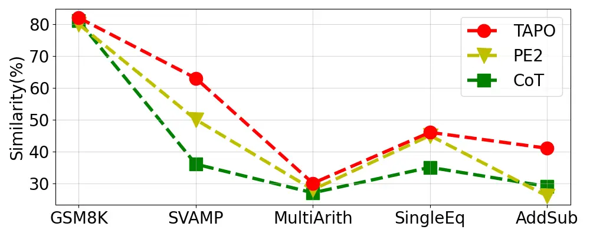

# TAPO: Task-Referenced Adaptation for Prompt Optimization

Wenxin Luo^(\*), Weirui Wang^(\*), Xiaopeng Li^(\*), Weibo Zhou, Pengyue
Jia, Xiangyu Zhao  
City University of Hong Kong  
{wenxinluo5-c ^(†)^(†)thanks: ^(\*)Equal contribution.  Corresponding
author.    wrwang8-c    xiaopli2-c}@my.cityu.edu.hk   
xianzhao@cityu.edu.hk

###### Abstract

Prompt engineering can significantly improve the performance of large
language models (LLMs), with automated prompt optimization (APO) gaining
significant attention due to the time-consuming and laborious nature of
manual prompt design. However, much of the existing work in APO
overlooks task-specific characteristics, resulting in prompts that lack
domain specificity and are not well-suited for task-specific
optimization. In this paper, we introduce TAPO, a multitask-aware prompt
optimization framework composed of three key modules. First, a
task-aware metric selection module is proposed to enhance task-specific
prompt generation capabilities. Second, we present a multi-metrics
evaluation module to jointly evaluate prompts from multiple
perspectives. Third, an evolution-based optimization framework is
introduced for automatic prompt refinement, which improves adaptability
across various tasks. Extensive experiments on six datasets demonstrate
the effectiveness of our approach, and our code is publicly available¹¹
1
[https://github.com/Applied-Machine-Learning-Lab/TAPO](https://github.com/Applied-Machine-Learning-Lab/TAPO).

###### Index Terms: 

Prompt Engineering, Automated Prompt Optimization, Large Language
Models, Multi-Task Learning

Fig. 1: The framework of TAPO. For Dynamic Metric Selection, We provide
a task dataset example for the LLM to select metrics and assign weights
based on priority, creating task-specific evaluation metrics for
Task-Aware Prompt Evaluation. We employ a tournament selection algorithm
for Evolution-Based Prompt Optimization to select and mutate the
better-performing prompts, adding task-adapted prompts to the
candidates.

## I Introduction

Prompt engineering plays a critical role in improving the performance of
large language models (LLMs)\[1\]. However, manually constructing
prompts is both time-consuming and labor-intensive. Thus, automated
prompt optimization \[2\] has been introduced as a more systematic and
efficient approach. Among current approaches, models such as
TEMPERA \[3\] leverage reinforcement learning to dynamically adapt and
optimize prompts. Bayesian optimization techniques offer a probabilistic
framework for prompt refinement, while in-context learning integrates
examples directly into the prompts, as seen in models such as
Voke-k \[4\] and Auto-CoT \[5\]. These methods illustrate the growing
trend toward more sophisticated prompt engineering strategies.

However, these methods face two primary limitations. First, current
prompt evaluation techniques predominantly rely on a single metric,
which hinders a comprehensive assessment. For example,
PromptBreeder\[6\] and APE\[2\] employ a single similarity metric for
fitness measurement, limiting their ability to logically improve tasks
related to planning. Second, the lack of diverse metrics reduces their
versatility, limiting their adaptability to multi-task optimization. For
example, GATE \[7\] optimizes prompts for role-playing tasks, but
exhibits limited scalability to a broader range of tasks. Similarly,
while certain prompt strategies focused on machine translation \[8\] can
improve language proficiency, their effectiveness in other essential
language tasks, such as communication and reasoning, is diminished.

To address the limitations listed above, we propose Task-Referenced
Adaptation for Prompt Optimization (TAPO), a task-aware framework that
dynamically selects task-related metrics and automates a task-adaptive
prompt evaluation and generation process to facilitate prompt evolution.
The framework comprises three key components. The module Dynamic Metric
Selection enables the LLM to choose relevant metrics according to
different tasks and assigns weights based on their priority,
establishing task-adapted evaluation metrics for the subsequent stage
Task-Aware Prompt Evaluation. In the Evolution-Based Prompt Optimization
module, we use a systematic selection mechanism to iteratively select
and mutate high-performing prompts, continuously refining them for
improved task-specific performance. In summary, the major contributions
of this paper are listed as follows.

- •
  We propose Task-Referenced Adaptation for Prompt Optimization (TAPO),
  an innovative approach that dynamically generates task-specific
  strategies to enhance multi-task performance and promote
  generalization across diverse tasks.
- •
  A novel task-aware metrics selection and a prompt evaluation module
  are developed to guide LLMs in generating results that better align
  with task requirements.
- •
  Extensive experiments conducted on six public datasets validate the
  significance of TAPO’s model components and its versatility across
  diverse tasks.

## II Methodology

In this section, we introduce the TAPO framework, a dynamic
self-improvement method that enhances task-specific performance by
optimizing prompts through the selection and weighting of evaluation
metrics based on the unique characteristics of each task.

### II-A Framework Overview

TAPO’s core innovation lies in its multi-objective optimization, which
balances criteria like accuracy, fluency, and diversity. As shown in
Figure 1, TAPO integrates LLMs into key components, including task
identification, metric selection, and prompt optimization. Dynamically
adapts to various tasks by selecting appropriate evaluation metrics and
iteratively refining prompts through an adaptive feedback loop, thus
improving task-specific performance.

The process begins with task classification, where the LLM identifies
the type of task. TAPO then selects relevant metrics, such as similarity
and complexity, to guide prompt design and evaluation. High-performing
prompts are iteratively refined through mutation and selection, ensuring
continuous improvement. This adaptive process makes TAPO flexible and
effective in diverse tasks.

### II-B Dynamic Metric Selection

Different tasks require different evaluation criteria, and fixed metrics
often fail to capture nuanced demands such as precision, creativity, or
logical consistency. TAPO optimizes prompts by dynamically selecting and
weighting task-specific evaluation metrics. The process begins with task
classification, where the LLM-driven module identifies the task type
(e.g., reasoning, language, real-world problem) and selects relevant
metrics. For factual tasks, similarity ensures accuracy, while creative
tasks emphasize diversity to avoid repetition. Metrics such as
complexity assess fluency, while both perplexity and logical consistency
are crucial for advanced reasoning, dialogue, and decision-support
systems. This approach enables TAPO to adapt to various tasks, ensuring
optimal performance across multiple dimensions.

### II-C Task-Aware Prompt Evaluation

To evaluate and adapt prompts for various tasks, we propose a prompt
evaluation module with two components: metric fusion and dynamic weight
adjustment. After selecting the evaluation metrics, TAPO combines them
into a final scoring function to comprehensively assess the performance
of the task. The scoring function is defined as:

```math
S(\mathcal{P})=\sum_{i=1}^{n}w_{i}\cdot M_{i}(\mathcal{P}) \tag{1}
```

where $`\mathcal{P}`$ is the optimized prompt, $`w_{i}`$ is the weight
of the $`i`$-th metric, $`M_{i}(\mathcal{P})`$ denotes the score for the
$`i`$-th metric, and $`S(\mathcal{P})`$ represents the overall score for
$`n`$ metrics.

TAPO integrates similarity, diversity, perplexity, and complexity as
metrics to balance accuracy, creativity, and fluency. Adjusts the weight
of each metric based on task requirements, prioritizing similarity for
precision tasks and enhancing diversity and perplexity for creative
tasks.

### II-D Evolution-Based Prompt Optimization

Traditional prompt optimization methods often stagnate in local optima,
limiting their ability to explore better alternatives. TAPO addresses
this limitation by refining prompts through evolutionary strategies,
leveraging mutation, and selection for continuous improvement.

During initialization, TAPO generates prompts by integrating random
thinking styles with the problem description, which are subsequently
processed by the LLM. In self-evolution processes, small variations,
such as ”breaking the task into steps”, are selected from a predefined
strategy library to combine with candidate prompts. These combinations
are then processed through mutation operators to generate evolved
prompts. During each iteration, the performance evaluation is conducted
using the multi-metric scoring function mentioned above. TAPO applies
tournament selection to filter candidates, ensuring improved
task-specific results. This iterative process continues for multiple
cycles, dynamically refining the prompts until they achieve the desired
performance or reach a predefined iteration limit, ensuring continuous
optimization.

|                                                                                           |               |           |           |           |           |            |            |           |            |           |
| ----------------------------------------------------------------------------------------- | ------------- | --------- | --------- | --------- | --------- | ---------- | ---------- | --------- | ---------- | --------- |
| Dataset                                                                                   | GPT-3.5-turbo |           |           |           |           | GPT-4o     |            |           |            |           |
|                                                                                           | COT           | APE       | PE2       | PB        | TAPO      | COT        | APE        | PE2       | PB         | TAPO      |
| BBH(23 tasks)                                                                             | $`66.68`$     | $`68.10`$ | $`63.57`$ | 68.17     | 69.28\*   | $`74.18`$  | $`74.83`$  | $`77.05`$ | 79.90      | 80.51\*   |
| GSM8K                                                                                     | 83.70\*       | $`81.99`$ | $`78.63`$ | $`82.45`$ | 83.40     | $`85.49`$  | $`79.79`$  | $`83.37`$ | 88.61\*    | 88.40     |
| AddSub                                                                                    | $`58.61`$     | $`57.04`$ | $`68.10`$ | 82.11     | 88.15\*   | 100.00\*   | 97.92      | $`95.78`$ | $`97.62`$  | $`96.32`$ |
| MultiArith                                                                                | $`69.00`$     | 86.36     | $`83.56`$ | $`85.26`$ | 89.26\*   | $`100.00`$ | $`100.00`$ | 97.92     | $`100.00`$ | 100.00    |
| SingleEQ                                                                                  | $`61.91`$     | $`63.14`$ | $`78.92`$ | 82.11     | 89.06\*   | $`96.12`$  | 96.78      | $`89.63`$ | $`96.74`$  | 97.83\*   |
| SVAMP                                                                                     | 94.38\*       | 93.10     | $`91.02`$ | $`90.44`$ | $`92.72`$ | $`93.23`$  | $`95.71`$  | $`94.81`$ | 99.72      | 100.00\*  |
| “\*” indicates significance level test $`p<0.05`$, the suboptimal results are underlined. |               |           |           |           |           |            |            |           |            |           |

TABLE I: Performance comparison on different datasets with GPT-3.5-turbo
and GPT-4o (Similarity Scores).

## III Experiment

In this section, we present experimental settings and outline the design
of our experiments to address the following research questions: RQ1: How
does our model perform compared to state-of-the-art approaches? RQ2: How
effectively does our model adapt to different types of tasks? RQ3: Does
our framework maintain consistent performance across open-source LLMs?
RQ4: What is the impact of individual components on overall performance?

### III-A Experiment Settings

Datasets. To evaluate our method, we use a range of datasets focused on
mathematical reasoning and multi-task problem solving, including AddSub
\[9\], MultiArith \[10\], and SingleEQ \[11\] for arithmetic reasoning,
as well as SVAMP \[12\] and GSM8K \[13\] for multi-step problem solving.
Furthermore, we incorporate BIG-Bench Hard (BBH) \[14\], a dataset
comprising 23 diverse and challenging tasks, including logical reasoning
and common sense understanding, to ensure a comprehensive evaluation.

Baselines. We compare TAPO against the following baseline methods: (a)
Zero-Shot CoT \[15\], which generates reasoning steps in a zero-shot
manner; (b) APE \[2\], a method that initializes multiple prompt
candidates from a base prompt and selects the best one based on
development set performance; (c) PE2 \[16\], a two-step prompting
approach that iteratively generates and refines candidate prompts
through evaluation; and (d) PromptBreeder (PB)\[6\], a self-referential
optimization framework that refines prompts by leveraging redescriptions
to improve downstream task performance.

Experiment Details. In our experiments, we utilize the following
language models: GPT-3.5-turbo-0125 \[17\], GPT-4o-2024-08-06\[18\], and
Llama3-8B-Instruct\[19\]. The first two models are accessed through the
OpenAI API, while Llama3 is deployed using the NVIDIA API. To ensure
consistency between tasks, the temperature is set to 0.1. The evaluation
of generated text employs metrics for similarity, fluency, diversity,
and complexity. Similarity is assessed using cosine similarity,
calculated via the all-MiniLM-L6-v2\[20\] model, to measure the semantic
alignment between the generated and reference texts. Fluency is
evaluated through perplexity scores derived from the gpt2-large\[21\]
model, where lower values indicate more coherent and grammatically
accurate outputs. Diversity is used to quantify lexical variety by
calculating the proportion of unique n-grams, with higher scores
reflecting reduced repetition. Complexity is assessed by analyzing text
length, syntactic structures, and logical reasoning steps.

### III-B Overall Performance (RQ1)

TAPO consistently outperforms baseline methods by dynamically selecting
and weighting task-specific metrics. In arithmetic reasoning tasks such
as AddSub and MultiArith, TAPO achieves similarity scores of 88.15% and
89.26% in GPT-3.5-turbo, respectively, demonstrating a clear advantage
over static methods like CoT\[15\] and APE\[2\]. For multi-step
reasoning tasks such as GSM8K, TAPO reaches 88.40% on GPT-4o, just shy
of the best score at 88.61%. In BBH, TAPO achieves 80.51% in GPT-4o,
slightly exceeding the next best method at 79.90%.

Although TAPO does not always achieve the highest score, such as in
SVAMP where it reaches 92.72% on GPT-3.5-turbo compared to 94.38%, it
consistently ranks among the best methods, showing strong adaptability
in various tasks. These results, summarized in Table I, underscore
TAPO’s effectiveness in optimizing task-specific prompts for a wide
range of language and reasoning tasks.

### III-C Task-Specific Prompt Performance (RQ2)

[TABLE]

| Method        | Translation Error Detection Prompt                                                                                                                                                      |
| ------------- | --------------------------------------------------------------------------------------------------------------------------------------------------------------------------------------- |
| Zero-shot CoT | Let’s think step by step.                                                                                                                                                               |
| APE           | Identify translation errors based on specific categories like Named Entities, Numerical Values, and Modifiers.                                                                          |
| PB            | Become a fearless error detective with a magnifying glass, finding quirky translation missteps in a whimsical German fairytale.                                                         |
| TAPO          | Improve translation error detection by creating a structured framework to categorize errors, focusing on common issues, and using iterative testing with feedback to refine strategies. |

TABLE II: Effect of Different Prompt Optimization Methods.

TAPO’s ability to tailor prompts for specific tasks significantly
enhances performance across different domains, as illustrated in
Table II. For math reasoning tasks like AddSub, TAPO emphasizes
reasoning and computational steps, offering a customized approach that
outperforms general methods like zero-shot CoT, which uses the generic
prompt "Let’s think step by step". For translation tasks, TAPO excels by
using a systematic framework for error categorization and iterative
feedback, in contrast to the less structured methods of APE or
PromptBreeder. This task-specific design ensures that TAPO consistently
delivers superior results by adapting the prompts to the unique
requirements of each task, improving both clarity and performance in
mathematical and translation error detection tasks.

### III-D Open-Source LLM Performance (RQ3)



Fig. 2: Performance Comparison with Llama3-8B-Instruct.

When evaluating open-source large language models, such as
Llama3-8B-Instruct, TAPO consistently outperforms baseline methods,
including CoT and PE2, even on tasks that require precise formatting and
multi-step reasoning. As illustrated in Figure 2, while
Llama3-8B-Instruct struggles to maintain the correct output formats on
datasets such as MultiArith and AddSub, TAPO enables the model to
achieve significantly better results. In tasks like GSM8K, which
emphasize multi-step reasoning, TAPO further improves the LLM’s
performance, narrowing the gap with state-of-the-art models. On average,
TAPO improved similarity scores in math reasoning tasks by 10.2%
compared to CoT and 6.2% compared to PE2. These results demonstrate that
TAPO’s optimization enhances performance even in open-source LLMs,
making it effective across different model architectures.

### III-E Ablation Study (RQ4)

| Method      | AddSub | SingleEQ | SVAMP  | MultiArith | GSM8K  |
| ----------- | ------ | -------- | ------ | ---------- | ------ |
| TAPO (Full) | 88.15% | 89.06%   | 92.72% | 89.26%     | 83.40% |
| w/o PO      | 87.24% | 82.75%   | 85.38% | 83.04%     | 81.82% |
| w/o MS      | 82.60% | 75.91%   | 80.14% | 78.58%     | 82.41% |

TABLE III: Ablation study of TAPO with gpt-3.5-turbo  
(Similarity Scores).

We conducted an ablation study to evaluate the key components of TAPO,
as shown in Table III, focusing on removing prompt optimization (PO) and
multi-metric scoring (MS). In the w/o PO variant, we replaced the
optimization of task-specific prompts with a generic approach, which
resulted in a performance decline across all datasets, highlighting the
importance of refined prompt generation of TAPO. Similarly, in the w/o
MS variant, using a single-metric method instead of the multi-metric
approach led to a significant performance drop, particularly in datasets
such as SigleEQ and MultiArith, highlighting the crucial role of
multi-metric evaluation in improving task-specific results.

## IV Related Work

The optimization of prompts has become central to the application of
LLMs in areas such as agents \[22, 23\], RAG \[24, 25\], IR \[26, 27\],
RecSys \[28, 29, 30, 31, 32, 33, 34, 35\], etc., and it has recently
gained significant attention due to the time-consuming and
labor-intensive process of manual prompt tuning. Several approaches have
been proposed, including leveraging feedback from LLMs and iterative
improvements \[2\], reinforcement learning-based methods \[36\],
Bayesian optimization techniques \[37\], in-context learning \[16\], and
evolutionary algorithms \[6\], among others. However, current prompt
evaluation methods rely on uniform metrics that lack adaptability and
fail to optimize for different task-specific objectives. In this paper,
we propose a task-aware automatic prompt optimization framework that
dynamically selects evaluation metrics based on task-specific feedback,
thereby improving the generalizability of prompt optimization across
multiple tasks.

## V Conclusion

We propose a novel framework, TAPO, to improve prompt generation and
enhance the adaptability of LLMs to diverse tasks. TAPO leverages a
comprehensive set of evaluation metrics, dynamically adjusting them
based on task requirements, while an adaptive feedback loop iteratively
refines the prompts to ensure continuous improvement. Extensive
experiments on various datasets demonstrate that TAPO consistently
outperforms existing methods, offering superior performance and
versatility across different models and task types, ranging from
arithmetic reasoning to multistep problem solving, creative generation,
and logical reasoning challenges.

## Acknowledgment

This research was partially supported by Research Impact Fund
(No.R1015-23), Collaborative Research Fund (No.C1043-24GF), APRC - CityU
New Research Initiatives (No.9610565, Start-up Grant for New Faculty of
CityU), CityU - HKIDS Early Career Research Grant (No.9360163), Hong
Kong ITC Innovation and Technology Fund Midstream Research Programme for
Universities Project (No.ITS/034/22MS), Hong Kong Environmental and
Conservation Fund (No. 88/2022), and SIRG - CityU Strategic
Interdisciplinary Research Grant (No.7020046), Huawei (Huawei Innovation
Research Program), Tencent (CCF-Tencent Open Fund, Tencent Rhino-Bird
Focused Research Program), Ant Group (CCF-Ant Research Fund, Ant Group
Research Fund), Alibaba (CCF-Alimama Tech Kangaroo Fund No. 2024002),
CCF-BaiChuan-Ebtech Foundation Model Fund, and Kuaishou.

## References

- \[1\] W. X. Zhao, K. Zhou, J. Li, T. Tang, X. Wang, Y. Hou, Y. Min,
  B. Zhang, J. Zhang, Z. Dong _et al._, “A survey of large language
  models,” _arXiv preprint arXiv:2303.18223_, 2023.
- \[2\] Y. Zhou, A. I. Muresanu, Z. Han, K. Paster, S. Pitis, H. Chan,
  and J. Ba, “Large language models are human-level prompt engineers,”
  _arXiv preprint arXiv:2211.01910_, 2022.
- \[3\] T. Zhang, X. Wang, D. Zhou, D. Schuurmans, and J. E. Gonzalez,
  “Tempera: Test-time prompting via reinforcement learning,” _arXiv
  preprint arXiv:2211.11890_, 2022.
- \[4\] H. Su, J. Kasai, C. H. Wu, W. Shi, T. Wang, J. Xin, R. Zhang,
  M. Ostendorf, L. Zettlemoyer, N. A. Smith _et al._, “Selective
  annotation makes language models better few-shot learners,” _arXiv
  preprint arXiv:2209.01975_, 2022.
- \[5\] Z. Zhang, A. Zhang, M. Li, and A. Smola, “Automatic chain of
  thought prompting in large language models,” _arXiv preprint
  arXiv:2210.03493_, 2022.
- \[6\] C. Fernando, D. Banarse, H. Michalewski, S. Osindero, and
  T. Rocktäschel, “Promptbreeder: Self-referential self-improvement via
  prompt evolution,” _arXiv preprint arXiv:2309.16797_, 2023.
- \[7\] B. Z. Li, A. Tamkin, N. Goodman, and J. Andreas, “Eliciting
  human preferences with language models,” _arXiv preprint
  arXiv:2310.11589_, 2023.
- \[8\] S. E. S. Nooshin Pourkamali, “Machine translation with large
  language models: Prompt engineering for persian, english, and russian
  directions,” _arXiv preprint arXiv:2401.08429_, 2024.
- \[9\] M. J. Hosseini, H. Hajishirzi, O. Etzioni, and N. Kushman,
  “Learning to solve arithmetic word problems with verb categorization,”
  in _Proceedings of the 2014 Conference on Empirical Methods in Natural
  Language Processing (EMNLP)_, 2014, pp. 523–533.
- \[10\] S. Roy and D. Roth, “Solving general arithmetic word problems,”
  _arXiv preprint arXiv:1608.01413_, 2016.
- \[11\] R. Koncel-Kedziorski, H. Hajishirzi, A. Sabharwal, O. Etzioni,
  and S. D. Ang, “Parsing algebraic word problems into equations,”
  _Transactions of the Association for Computational Linguistics_,
  vol. 3, pp. 585–597, 2015.
- \[12\] A. Patel, S. Bhattamishra, and N. Goyal, “Are nlp models really
  able to solve simple math word problems?” _arXiv preprint
  arXiv:2103.07191_, 2021.
- \[13\] K. Cobbe, V. Kosaraju, M. Bavarian, M. Chen, H. Jun, L. Kaiser,
  M. Plappert, J. Tworek, J. Hilton, R. Nakano _et al._, “Training
  verifiers to solve math word problems,” _arXiv preprint
  arXiv:2110.14168_, 2021.
- \[14\] M. Suzgun, N. Scales, S. Gehrmann _et al._, “Challenging
  big-bench tasks and whether chain-of-thought can solve them,” _arXiv
  preprint arXiv:2210.09261_, 2022.
- \[15\] J. Wei, X. Wang, D. Schuurmans, M. Bosma, F. Xia, E. Chi, Q. V.
  Le, D. Zhou _et al._, “Chain-of-thought prompting elicits reasoning in
  large language models,” _Advances in neural information processing
  systems_, vol. 35, pp. 24 824–24 837, 2022.
- \[16\] Q. Ye, M. Axmed, R. Pryzant, and F. Khani, “Prompt engineering
  a prompt engineer,” _arXiv preprint arXiv:2311.05661_, 2023.
- \[17\] OpenAI, “Gpt-3.5 turbo model documentation,”
  [https://platform.openai.com/docs/models/gpt-3-5#gpt-3-5-turbo](https://platform.openai.com/docs/models/gpt-3-5#gpt-3-5-turbo), 2023.
- \[18\] A. Hurst, A. Lerer, A. P. Goucher, A. Perelman, A. Ramesh,
  A. Clark, A. Ostrow, A. Welihinda, A. Hayes, A. Radford _et al._,
  “Gpt-4o system card,” _arXiv preprint arXiv:2410.21276_, 2024.
- \[19\] A. Dubey, A. Jauhri, A. Pandey, A. Kadian, A. Al-Dahle,
  A. Letman, A. Mathur, A. Schelten, A. Yang, A. Fan _et al._, “The
  llama 3 herd of models,” _arXiv preprint arXiv:2407.21783_, 2024.
- \[20\] N. Reimers, “Sentence-bert: Sentence embeddings using siamese
  bert-networks,” _arXiv preprint arXiv:1908.10084_, 2019.
- \[21\] A. Radford, J. Wu, R. Child, D. Luan, D. Amodei, I. Sutskever
  _et al._, “Language models are unsupervised multitask learners,”
  _OpenAI blog_, vol. 1, no. 8, p. 9, 2019.
- \[22\] Q. Cai, X. Zhao, L. Pan, X. Xin, J. Huang, W. Zhang, L. Zhao,
  D. Yin, and G. H. Yang, “Agentir: 1st workshop on agent-based
  information retrieval,” in _Proceedings of the 47th International ACM
  SIGIR Conference on Research and Development in Information
  Retrieval_, 2024, pp. 3025–3028.
- \[23\] X. Li, L. Su, P. Jia, X. Zhao, S. Cheng, J. Wang, and D. Yin,
  “Agent4ranking: Semantic robust ranking via personalized query
  rewriting using multi-agent llm,” _arXiv preprint
  arXiv:2312.15450_, 2023.
- \[24\] P. Jia, D. Xu, X. Li, Z. Du, X. Li, X. Zhao, Y. Wang, Y. Wang,
  H. Guo, and R. Tang, “Bridging relevance and reasoning: Rationale
  distillation in retrieval-augmented generation,” _arXiv preprint
  arXiv:2412.08519_, 2024.
- \[25\] P. Jia, Y. Liu, X. Li, Y. Wang, Y. Du, X. Han, X. Wei, S. Wang,
  D. Yin, and X. Zhao, “G3: an effective and adaptive framework for
  worldwide geolocalization using large multi-modality models,” _arXiv
  preprint arXiv:2405.14702_, 2024.
- \[26\] X. Li, X. Li, H. Zhang, Z. Du, P. Jia, Y. Wang, X. Zhao,
  H. Guo, and R. Tang, “Syneg: Llm-driven synthetic hard-negatives for
  dense retrieval,” _arXiv preprint arXiv:2412.17250_, 2024.
- \[27\] P. Jia, Y. Liu, X. Zhao, X. Li, C. Hao, S. Wang, and D. Yin,
  “Mill: Mutual verification with large language models for zero-shot
  query expansion,” _arXiv preprint arXiv:2310.19056_, 2023.
- \[28\] Q. Liu, X. Wu, X. Zhao, Y. Zhu, D. Xu, F. Tian, and Y. Zheng,
  “When moe meets llms: Parameter efficient fine-tuning for multi-task
  medical applications,” in _Proceedings of the 47th International ACM
  SIGIR Conference on Research and Development in Information
  Retrieval_, 2024, pp. 1104–1114.
- \[29\] Q. Liu, X. Wu, Y. Wang, Z. Zhang, F. Tian, Y. Zheng, and
  X. Zhao, “Llm-esr: Large language models enhancement for long-tailed
  sequential recommendation,” in _The Thirty-eighth Annual Conference on
  Neural Information Processing Systems_, 2024.
- \[30\] X. Li, F. Yan, X. Zhao, Y. Wang, B. Chen, H. Guo, and R. Tang,
  “Hamur: Hyper adapter for multi-domain recommendation,” in
  _Proceedings of the 32nd ACM International Conference on Information
  and Knowledge Management_, 2023, pp. 1268–1277.
- \[31\] J. Gao, B. Chen, M. Zhu, X. Zhao, X. Li, Y. Wang, Y. Wang,
  H. Guo, and R. Tang, “Hierrec: Scenario-aware hierarchical modeling
  for multi-scenario recommendations,” in _Proceedings of the 33rd ACM
  International Conference on Information and Knowledge Management_,
  2024, pp. 653–662.
- \[32\] P. Jia, Y. Wang, S. Lin, X. Li, X. Zhao, H. Guo, and R. Tang,
  “D3: A methodological exploration of domain division, modeling, and
  balance in multi-domain recommendations,” in _Proceedings of the AAAI
  Conference on Artificial Intelligence_, vol. 38, no. 8, 2024, pp.
  8553–8561.
- \[33\] X. Li, J. Gao, P. Jia, Y. Wang, W. Wang, Y. Wang, Y. Wang,
  H. Guo, and R. Tang, “Scenario-wise rec: A multi-scenario
  recommendation benchmark,” _arXiv preprint arXiv:2412.17374_, 2024.
- \[34\] Q. Liu, X. Zhao, Y. Wang, Y. Wang, Z. Zhang, Y. Sun, X. Li,
  M. Wang, P. Jia, C. Chen _et al._, “Large language model enhanced
  recommender systems: Taxonomy, trend, application and future,” _arXiv
  preprint arXiv:2412.13432_, 2024.
- \[35\] Z. Zhang, S. Liu, Z. Liu, R. Zhong, Q. Cai, X. Zhao, C. Zhang,
  Q. Liu, and P. Jiang, “Llm-powered user simulator for recommender
  system,” _arXiv preprint arXiv:2412.16984_, 2024.
- \[36\] M. Deng, J. Wang, and Hsieh, “Rlprompt: Optimizing discrete
  text prompts with reinforcement learning,” _arXiv preprint
  arXiv:2205.12548_, 2022.
- \[37\] T. Liu, N. Astorga, N. Seedat, and M. van der Schaar, “Large
  language models to enhance bayesian optimization,” _arXiv preprint
  arXiv:2402.03921_, 2024.
