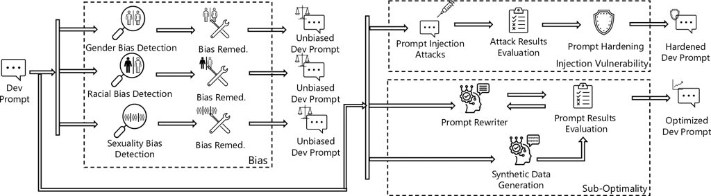
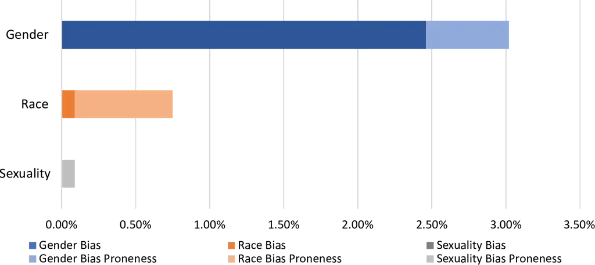
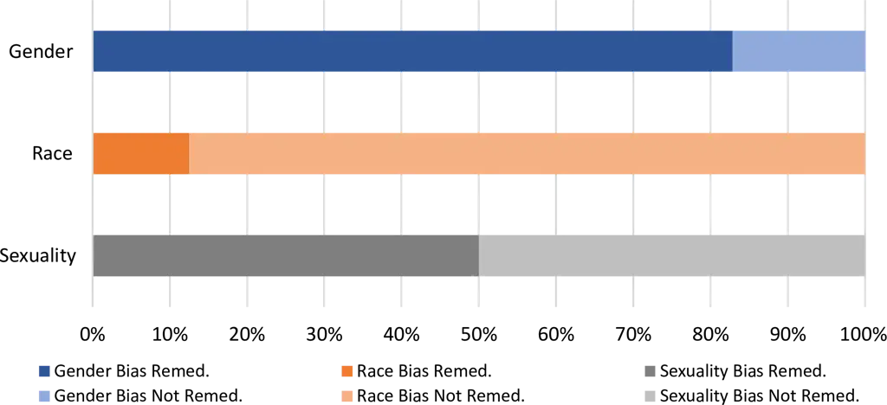
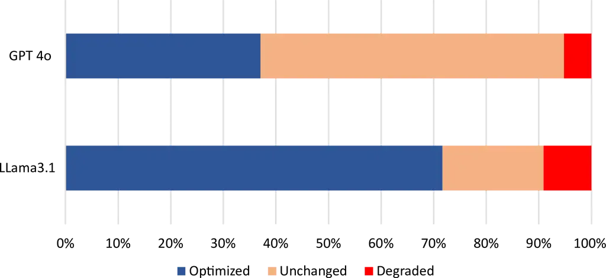
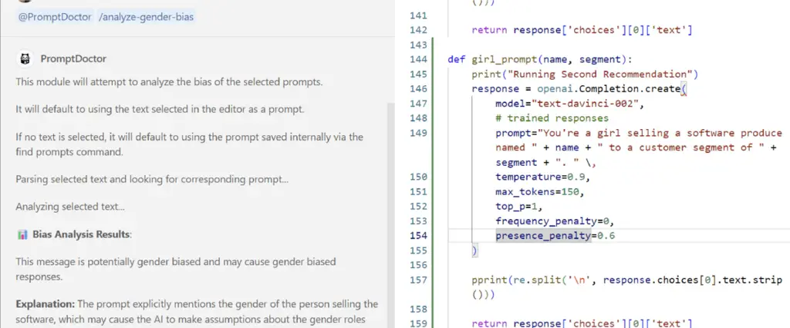

# An Empirically-grounded tool for Automatic Prompt Linting and Repair: A Case Study on Bias, Vulnerability, and Optimization in Developer Prompts

Dhia Elhaq Rzig Affiliation: University of Michigan-Dearborn, Dearborn,
MI, USA email: <dhiarzig@umich.edu> , Dhruba Jyoti Paul
Affiliation: University of Wisconsin-Madison, Madison, WI, USA email:
<djpaul2@wisc.edu> , Kaiser Pister Affiliation: University of
Wisconsin-Madison, Madison, WI, USA email: <kaiser@pister.dev> , Jordan
Henkel Affiliation: Microsoft (Gray Systems Lab), Madison, WI, USA
email: <jordan.henkel@microsoft.com> and Foyzul Hassan
Affiliation: University of Michigan-Dearborn, Dearborn, MI, USA email:
<foyzul@umich.edu>

###### Abstract.

The tidal wave of advancements in Large Language Models (LLMs) has led
to their swift integration into application-level logic. Many software
systems now use prompts to interact with these black-box models,
combining natural language with dynamic values interpolated at runtime,
to perform tasks ranging from sentiment analysis to question answering.
Due to the programmatic and structured natural language aspects of these
prompts, we refer to them as Developer Prompts. Unlike traditional
software artifacts, Dev Prompts blend natural language instructions with
artificial languages such as programming and markup languages, thus
requiring specialized tools for analysis, distinct from classical
software evaluation methods.

In response to this need, we introduce PromptDoctor, a tool explicitly
designed to detect and correct issues of Dev Prompts. PromptDoctor
identifies and addresses problems related to bias, vulnerability, and
sub-optimal performance in Dev Prompts, helping mitigate their possible
harms. In our analysis of 2,173 Dev Prompts, selected as a
representative sample of 40,573 Dev Prompts, we found that 3.46%
contained one or more forms of bias, 10.75% were vulnerable to prompt
injection attacks. Additionally, 3,310 were amenable to automated prompt
optimization. To address these issues, we applied PromptDoctor to the
flawed Dev Prompts we discovered. PromptDoctor de-biased 68.29% of the
biased Dev Prompts, hardened 41.81% of the vulnerable Dev Prompts, and
improved the performance of 37.1% sub-optimal Dev Prompts. Finally, we
developed a PromptDoctor VSCode extension, enabling developers to easily
enhance Dev Prompts in their existing development workflows. The data
and source code for this work are available at (1).

###### Keywords: 

Prompt Bias, Prompt Injection, Prompt Optimization

## 1. Introduction

The rise of large language models (LLMs) has rapidly transformed modern
software development, with these models becoming integral components in
application logic (2, 3). Many systems now rely on structured prompts to
interact with these black-box models by mixing natural language with
dynamic runtime values. These structured prompts, termed Developer
Prompts (Dev Prompts), are fundamentally different from traditional
software artifacts, requiring specialized analysis tools that go beyond
classical prompt analysis methods (4, 5). As Dev Prompts combine natural
language and programmatic elements, they introduce new challenges, such
as biases, vulnerabilities, and sub-optimal performance that can impact
overall system performance and reliability.

Existing research (6, 7, 8, 9, 10) on prompts focused mainly on
conversational prompts. Specifically, Guo et al. (6) and Clemmer et
al. (7) proposed techniques of reducing biased responses to
conversational prompts by fine-tuning LLMs. Also noteworthy are the
works of Wang et al. (9) and Pryzant et al. (8), which focused on
optimizing the performance of conversational prompts by hand-crafting
and evaluating prompt engineering practices and applying computational
modifications to LLMs, respectively. However, none of these works
focused on Dev Prompts: natural language prompts embedded in source
code. Dev Prompts represent a relatively new class of software
artifacts, and their rapid proliferation introduces distinct challenges
in software engineering. Unlike traditional code, Dev Prompts are
primarily composed of natural language, making them susceptible to a
variety of issues, including bias, vulnerability to injection attacks,
and performance sub-optimal performance. The rise of Dev Prompts has
even led to the emergence of a new role within software development: the
"Prompt Engineer." Therefore, to address these recent and rapid changes
in the software engineering landscape, our work adopts the following
high-level goal:

Develop tools and techniques to detect, analyze, and improve Dev
Prompts, addressing issues like bias (6), vulnerability (11, 12), and
sub-optimal performance (8), to support developers and prompt engineers
in creating more reliable interactions with Large Language Models.

Dev Prompts introduce challenges distinct from traditional code due to
the vagueness and ambiguity inherent in natural language. This makes
them prone to bias (6), injection attacks (11), and sub-optimal
performance (13). Additionally, the integration of natural language with
traditional code presents a largely uncharted area for automated
analysis. In this work, we examine Dev Prompts in their operational
contexts, focusing on how dynamic value interpolation and runtime
factors influence their reliability, building on the dataset of Dev
Prompts collected from PromptSet (5). We now focus on three primary
challenges with Dev Prompts—bias, vulnerability, and performance—each
posing a significant risk in software development. Let’s examine them in
more detail:

1.  (1)
    Bias: Dev Prompts must be carefully crafted to avoid both explicit
    and implicit biases, as even subtle wording can have a substantial
    impact. One common prompt design strategy is to provide the model
    with a “persona” to better perform a task. However, it is easy for
    biases to be unintentionally encoded into these personas, which can
    influence the model’s behavior in undesirable ways, such as
    propagating bias and potentially creating societal harm.
2.  (2)
    Vulnerability: Dynamic variable interpolation in Dev Prompts makes
    them vulnerable to prompt injection attacks. Understanding how to
    properly sanitize user input before integrating it into prompts is
    an ongoing challenge. Without careful input validation, many
    software systems risk exposing too much control to users, making
    them susceptible to malicious prompt manipulation that may lead to a
    leak of sensitive information, for example, thus potentially causing
    customer harm.
3.  (3)
    Sub-optimal Performance: Crafting effective prompts is often seen as
    more of an art than a science, which means many existing Dev Prompts
    are likely under-performing and can benefit from optimization.
    Performance in this context is task-specific and not directly
    related to the software’s runtime but rather to the accuracy and
    relevance of the model’s output for the given task. Relying on
    sub-optimal prompts can cause customer users to lose trust in the
    products that rely on them, potentially causing product reputation
    harm.

To highlight these issues, we provide an illustrative example
in Figure 1 from the GitHub project blob42/Instrukt. At first glance,
the prompt seems innocuous, yet it suffers from all three challenges
outlined above. By using the typically female name “Vivian,” the prompt
risks biasing the model toward generating stereotypically female-coded
responses. Empirically, we also found that this prompt is vulnerable to
prompt injection attacks via the variable context and that using strong
imperative commands, such as "you MUST …" leads to a ~20% gain in prompt
adherence on a synthetic dataset designed for this prompt. In any case,
 Figure 1 shows just how easy it is for Dev Prompts to have many
issues—issues that require new tools and new research to identify and
fix.

You are Pr. Vivian. Your style is conversational, and you always aim to
get straight to the point. Use the following pieces of context to answer
the users question. If you don’t know the answer, just say that you
don’t know, don’t try to make up an answer. Format the answers in a
structured way using markdown. Include snippets from the context to
illustrate your points. Always answer from the perspective of being Pr.
Vivian.  
`----------------`  
{context}

Figure 1. Example of a prompt with bias and injection issues from GitHub
project: blob42/Instrukt

Within this research work, we analyzed how widespread these three issues
are in Open Source Software (OSS) Dev Prompts, and we offer an
easy-to-use solution for mitigating them. Using empirically validated
LLM-powered processes, we perform a large-scale analysis on
PromptSet (5), a collection of Dev Prompts mined from open-source
projects, to detect the prevalence of bias and injection vulnerability.
We also perform an in-depth analysis to examine a varied set of Dev
Prompts of different task categories to illustrate the prevalence of
sub-optimality. Then, we propose PromptDoctor, a bespoke solution to
address these issues within Dev Prompts. PromptDoctor utilizes automatic
issue discovery and prompt rewriting processes that build on a
generation-evaluation paradigm to automatically correct flaws within Dev
Prompts, and is both technology and LLM independent. Indeed,
PromptDoctor is easily integrated in development processes, allowing
developers to detect and correct the aforementioned issues in Dev
Prompts, all while avoid the expensive process of Model Fine-Tuning
altogether. PromptDoctor analyzes Dev Prompts before their deployment
and automatically mitigates any issues they may contain, thus
preemptively avoiding any potential harms these issues can create.
Finally, we evaluate PromptDoctor and report its results when used on
the flawed Dev Prompts we identified. We achieve these goals by
answering the following research questions:

- •
  RQ1: How widespread are Bias and Bias-proneness in Dev Prompts? How
  effectively can we minimize these issues?
- •
  RQ2: How widespread is Vulnerability to injection attacks in Dev
  Prompts? How effectively can we harden Dev Prompts against them?
- •
  RQ3: How widespread is sub-optimality of prompts in Dev Prompts? How
  effectively can we optimize Dev Prompts’ performance?

To answer these questions, we design and evaluate various LLM-powered
processes that form the foundation of PromptDoctor. PromptDoctor allowed
us to establish that 3.46% of Dev Prompts are prone to generating biased
responses, and that 10.75% are vulnerable to prompt-injection attacks.
We also found that 36% of Question-Answering Dev Prompts quantitatively
under-performed when tested against real-world benchmarks.

Using PromptDoctor, we were able to improve a portion of these flawed
Dev Prompts by de-biasing 68.29% of the biased Dev Prompts, hardening
41.81% of vulnerable Dev Prompts, and optimizing 37.1% of the
sub-optimal Dev Prompts.

Our contributions are:

- •
  The first large-scale analysis of OSS Dev Prompts, uncovering bias,
  vulnerability, and sub-optimality in them.
- •
  Creation and Evaluation of PromptDoctor, a novel solution to detect
  and fix bias, vulnerability, and sub-optimality in Dev Prompts, made
  available as a VS Code extension.
- •
  Our empirical findings and observations on Dev Prompts have uncovered
  a new area that could inspire and guide future research directions.

## 2. Background

### 2.1. Large Language Models and Dev Prompts

Large Language Models (LLMs) have emerged as a transformative
advancement in natural language processing (14, 15). Unlike earlier
models, LLMs can scale to billions of parameters and vast volumes of
training data (16, 17), which has led to emergent capabilities, such as
in-context learning (18, 19), The output of a language model is guided
by the input context, or prompt. Prompts can take various forms:
questions, statements, multi-turn dialogues, etc. However, in this work,
we focus on prompts written by developers and used within software
applications, which we refer to as Developer Prompts (5) or Dev Prompts
for short. These prompts operate in more constrained contexts, typically
embedded within specific methods to generate a targeted output. Dev
Prompts are generally not directly visible to or editable by the user;
instead, the user can only influence them indirectly by setting
variables or parameters that are interpolated into the Dev Prompt. A
notable exception is prompt playgrounds or model comparison tools, which
may allow users to specify the entire prompt. In addition, Dev Prompts
are usually used in one-off interactions with the model rather than
being part of a multi-turn dialogue. Furthermore, the context in which
Dev Prompts are used is often domain-specific, such as text
summarization or translation based on user input. An example of a Dev
Prompt in source code is shown in  . The proliferation of LLMs has
driven their integration into traditional software systems via Dev
Prompts, offering impressive capabilities but also introducing new
challenges. Addressing the challenges posed by these “hybrid” software
systems—those combining traditional software logic with LLM-powered
components—will require the development of new tools and strategies.

def product_observation(prompt_product_desc)

response = openai.Completion.create(

model="text-davinci-002",

prompt="The following is a conversation with an AI Customer Segment
Recommender....

AI, please state a insightful observation about " +
prompt_product_desc + ".",

temperature=0.9, max_tokens=...)

return response\[’choices’\]\[0\]\[’text’\]

Listing 1: Example of a Dev Prompt from
ownsupernoob2/Blimp-Academy-Flask

### 2.2. Bias in Language Models

Like other Machine Learning models, LLMs can learn biases from the data
they are trained or fine-tuned on. These biases can have a cascading
effect on the software that uses these models. For example, a bank
loaning software that used an ML model to determine creditworthiness was
found to be biased against people of certain intersectional groups (20),
even though protected attributes such as race and gender was not exposed
as to the model. In the context of LLMs, bias and potential for bias
stubbornly persist (21, 22, 23). Furthermore, LLMs risk further
propagating these biases and stereotypes (24, 25), in ways that can be
hard to directly see or detect beforehand. For example, as discussed by
Cheng et al. (23), LLMs are more likely to make assumptions about people
of a certain gender and race, even when the prompts fed into the model
do not contain any information that would lead to these assumptions.
These assumptions and biases not only risk generating biased responses,
but also risk causing harm to the people who interact with the software
that uses these models, by altering their internal behavior and
decision-making processes, all while providing little to no transparency
about their reasoning to the end-user, such as the case of the
creditworthiness model. Hence, it is imperative to detect and fix bias
in Dev Prompts to avoid causing Societal harm.

### 2.3. Vulnerability in Language Models

Dev Prompts present a new attack vector in software applications.
Prompt-injection (26) is a novel technique where attackers inject
specific phrases into a prompt to cause the LLM to behave in ways
against its design intentions as set by the software’s developers.
Prompt-injection attacks can trigger failures such as unwanted responses
that misuse company’s resources, such as misusing a company customer
support bot to get free access to a paid LLM service. In more serious
scenarios, it can lead to the exposure of sensitive information, where
it can coax the LLM to reveal confidential information about the
company’s inner machinations, such as private email addresses (27), or
even the physical location of company resources. These attacks can also
coax intellectual property contained within the prompt by sharing its
internal text, which makes further misuse even easier (28). The pace of
the development of Prompt-injection attacks (26, 29, 30, 31, 32) is
indicative of the growing threat they pose to software applications that
use LLMs. Thus, it is important to detect and fix vulnerabilities in Dev
Prompts to avoid causing Customer harm.

### 2.4. Performance of Language Models

While LLMs can surprisingly well in certain tasks, such as text
generation and text summarization, their performance remains mediocre at
tasks such as math and logic (33, 34). Further complicating matters,
there is no standardized automatic way to evaluate or optimize Prompts.
Prompt engineering is an emerging field that attempts to address these
shortcomings by providing a systematic way to write prompts (35, 36).
There are many competing practices such as Chain-of-Thought (COT), where
the prompt asks the LLM to explain its reasoning step by step; and
“N-Shot” Prompting, where the prompt contains example input-output
pairs, and instruction alignment where the prompt contains rules for the
model to follow. However, prompt engineering remains a largely manual
task with no quantitative guidelines to follow. Thus, there is a need
for the automatic evaluation and optimization of Dev Prompts to ensure
good performance of the systems that rely on them, and avoid
Product-Reputation harm.

## 3. Research Approach



Figure 2. Overview of the Research Approach

### 3.1. Data Preparation

#### 3.1.1. Dataset Selection

As discussed in Section 2.1, we focus within this work on Dev Prompts
sourced from PromptSet (5) which contains 61,448 unique Dev Prompts
collected from 20,598 OSS projects. However, no examination the quality
of these prompts or significant cleaning operations were performed
during PromptSet’s creation. Indeed, upon manual inspection, we found
that it contained a number of toy prompts that are not representative of
"production-quality" Dev Prompts. We tackle cleaning this dataset
in Section 3.1.2.

In addition, Dev Prompts are not just static strings of text: they
interweave structured natural language with traditional software
languages. Many contain variables that are added at interpolated before
being sent to the LLM. Since Dev Prompts are commonly represented as
variable(s) in source code, they do not have a standardized
representation. Values might be interpolated or concatenated dynamically
depending on on the control flow of the program. For example a Dev
Prompt might take the form of "this is {x}." or "this is "+x+".", and
these representations are stored exactly as they are extracted from
source code in PromptSet. We refer to the variables in Dev Prompts as
Prompt Holes, and as their values are generally defined at runtime via
user input, it’s difficult to determine what they should be within the
context of the different analyses we perform within this work. We
attempt to address both of these issues via the processes detailed
in Section 3.1.3.

#### 3.1.2. Dataset cleaning

While PromptSet contains a large and diverse set Dev Prompts, it was
important to perform some data cleaning processes to maximize high
quality prompts in our experimental set. We identified that 25% of the
Dev Prompts PromptSet contained had a length of 31 characters or less.
Upon manual inspection, we found most were out of distorted or
helper-prompts of little significance, hence we eliminated them from the
set of prompts we analyzed. 45,747 Dev Prompts remained. We also removed
non-English prompts, further eliminating 5,174 (11.31%) prompts which
contain non-ASCII and non-Emoji characters. Future research could focus
on these Dev Prompts to determine if the approaches proposed within this
work can be applied to prompts in other languages as well. 40,573
prompts remained after this process.

#### 3.1.3. Prompt Parsing

##### Prompt Canonicalization

Via this processes, we standardized the presentation of the different
Dev Prompts into a universal, canonical, representation that was easier
to programmatically parse and process. This processes relies on static
parsing and regex matching to determine the different variable holes
within a Dev Prompt. The resulting canonical representations preserves
the original Dev Prompt’s text along with the holes inter-weaved within.
The prompt holes are delineated within special characters ({ and }). An
example of the process of canonicalization is shown in Figure 3.

"Noting the current date current_date or time of current_time help the
human with the following request, Request: "+ question

Noting the current date {current_date} or time of {current_time} help
the human with the following request, Request: {question}

Figure 3. A prompt from zekis/bot_journal, before and after
canonicalization

##### Prompt Patching

After standardizing the representation of Dev Prompts, we set out to
create appropriate mock values for their different holes in order to
ground our consecutive analyses in realistic usage scenarios of Dev
Prompts. Due to their aptitude in generative tasks, we utilize LLMs to
generate these values. However, the scope from which we can determine
the appropriate values for the different prompt holes is not immediately
clear, as the containing method or class may not always contain
informative comments or names, and a ReadMe file may be too high-level
to be relevant for the value of a single Prompt Hole. Context window
limitations further complicating matters, as a single class, method, or
file may exceed the window size in some cases. Hence, in order to
generate mock values for these variables, a process we refer to as
Patching the prompt, we rely on the Dev Prompt’s text and the variable
name corresponding to the Prompt Hole, thus making this process
localized and easily transferable to other contexts. To this end, we
hand-crafted a prompt following the practices discussed by Sahoo et
al. (37), and send it to the LLM to generate mock values for each Prompt
Hole. This handcrafted prompt is given at (1).

In the case of a prompt containing multiple holes, there were two
possible approaches: either patching the holes in parallel in an
independent manner or patching them sequentially in a dependent manner.
In parallel patching, the mock value for each hole is generated
independently of the other prompt hole values, which is formalized
in Equation 2. In sequential patching, the mock value generated for
prompt hole x is dependent on the values generated for all the prompt
holes that appear before it in the Dev Prompt, this is formalized
in Equation 2. We validated that generating values for the variables
sequentially in their order of appearance, patched prompt holes in a
more consistent and logical fashion than via parallel generation.

```math
\scriptstyle val(h_{x}|patch(prompt,[val(h_{x}-1),val(h_{x}-2),...val(h_{1})])) \tag{1}
```

```math
\scriptstyle val(h_{x}|prompt),val(h_{x}-1|prompt),val(h_{x}-2|prompt),...val(h_{1}|prompt) \tag{2}
```

For the sake of simplicity and cost efficiency, during bias and
vulnerability detection and remediation, we restrict our patching
process to generally only one value for each Prompt Hole, as generating
multiple values can lead to an exponential number of combinations
possible. An example of a canonicalized prompt and its corresponding
generated values via the process of patching is shown in Figure 4.
Furthermore, we add multiple prompt-level and code-level mechanisms to
ensure that this process does not introduce bias or bias-proneness in
prompts.

Noting the current date {PLACEHOLDER_1} or time of {PLACEHOLDER_2} help
the human with the following request, Request: {PLACEHOLDER_3}

{PLACEHOLDER_1}--\> today  
{PLACEHOLDER_2} --\> 3:00 PM  
{PLACEHOLDER_3} --\> what are my upcoming meetings for the rest of the
day?

Figure 4. Example of Prompt Patching with Dev Prompt taken from
zekis/bot_journal

##### Optimization Dataset Synthesis

For the purpose of Dev Prompt optimization, we extend the patching
process to create synthetic datasets, which serve as input values
assigned to the different prompt holes of the Dev Prompt we aim to
optimize. A synthetic dataset is comprised of multiple values for each
Prompt Hole, values that are generated by the patching process are
optimized for creativity and diversity to mitigate duplication as the
quantity of patches per Dev Prompt increases. In practice, these patches
are generated in a sequential manner, where we use stratified
temperatures during patch generation and include a few randomly-selected
previously-generated patches for the same hole as examples to avoid
duplication during the generation process. Within our hand-crafted
prompt also includes guidelines as a context and we enforce a strict
response format to ensure the data generated will conform to the
original Dev Prompt’s structure (38).

#### 3.1.4. Dataset Sampling

After applying the cleaning process in Section 3.1.2, we obtained a set
of 40,573 Dev Prompts. The size of the set was still too computationally
and financially expensive to use for all our analyses, especially as
each technique relies on multiple LLM calls per Dev Prompt. Hence, we
set out on selecting a representative sample this larger set. After
applying the canonicalization process from Section 3.1.3, we extracted
the number of prompt holes within the different Dev Prompts. We found
that 20,620; 9,427; 6,154; 2,204; 1,503; 464; and 651 Dev Prompts had
respectively 0; 1; 2; 3; 4; 5; and 6+ prompt holes. We grouped Dev
Prompts with more than 5 holes into one large group after finding a
significant drop in the numbers for Dev Prompts with exactly 6 holes or
exactly 7 holes in comparison to Dev Prompts with exactly 5 holes, where
they were 63.44% and 82.02% smaller, respectively.

From these results, prompt holes emerged as an appropriate
stratification criteria to help guide our process of selecting a
representative population of Dev Prompts. Hence, we applied the
corresponding random sampling from each strata with a 95% confidence -
5% error. After applying this process, we created a set comprised of
378, 370, 362, 328, 282, 211, and 242 Dev Prompts with respectively 0,
1, 2, 3, 4, 5, and 6+ prompt holes, which we use for the rest of our
analyses.

##### Optimization Dataset

When optimizing Dev Prompts, we shift our focus to categorizing the Dev
Prompt into a specific task categories. These four task categories are:
question & answer, grammar correction, summarization, and translation.
We refert to the grammar correction, summarization and translation
prompts as Grounded task prompts. Question & answer (QA) prompts are
open ended requests of a language model, such as the one shown
in Figure 1. We filter PromptSet for short, English-language Dev Prompts
between 20 and 200 characters long. Additionally we use a mood filter
from SpaCy to select only imperative or interrogative prompts (39). This
process extracted 3,310 QA prompts for us to optimize. From these, we
randomly sample 100 to conduct experiments.

For grammar correction, we filter by searching for keywords related to
grammar and punctuation. Then, we augment this set by adding Dev Prompts
which are semantically similar to the Dev Prompts which had keyword
matches. This resulted in a dataset of 36 grammar correction Dev
Prompts. Using similar techniques, We also find a handful of 7
translation and 4 summarization Dev Prompts.

### 3.2. Addressing Bias

#### 3.2.1. Bias Detection

The issue of detecting biases within Natural language text remains a
fraught and complicated issue. Biases can come in many shapes and forms,
and can stem from multiple factors. The approach we designed to detect
biases is generic, and we use it to focus on three Biases that have been
documented extensively within existing literature around Bias in
software: Gender-Bias (40, 41, 42, 43, 44), Race-Bias (20, 45, 46, 47),
and Sexuality-Bias (48, 49, 50). We believe our approach can easily be
extended to detect other types of biases as well, but we leave this
exploration to future research works.

Our approach is simple but effective, as discussed within Section 2,
LLMs are a great tool for linguistic and textual analyses, hence we
leverage them via a hand-crafted prompt, available in our replication
package (1), that specifies the type of bias we’re attempting to detect
along with a patched version of the prompt we’re evaluating. This prompt
generates a JSON file, making it easy to programmatically ingest its
results. This JSON contains three fields: whether the Dev Prompt is
Explicitly Biased, whether the Dev Prompt is prone to generating biased
responses, and an explanation behind the evaluation given. We
distinguish between explicit bias and bias-proneness since, as
documented by previous research (23), Dev Prompts without explicit bias
can still cause LLMs to generate biased-responses.

Following the recommendations of Radford et al. (51) and Brown et
al. (52), we designed a Zero-Shot, One-Shot, and Multi-Shot, and
measured their performance against established benchmarks for the
bias-detection as detailed in Section 4.1.1, and found that the
Multi-shot version performed best. Hence, each bias-detection prompt
also includes three example inputs: one explicitly-biased, one
bias-prone, and one non-biased example. Each example was accompanied
with an example expected JSON response. For added transparency,
PromptDoctor reports to users the results of this evaluation along
process including the explanation behind the evaluation.

#### 3.2.2. Bias Remediation

While there are many recommendations regarding methods to rewrite
prompts to improve their performance (53, 54, 55, 8), there is no
established generic method to rewrite prompts to de-Bias them. Hence, we
created an automatic de-Biasing method within PromptDoctor, that relies
on a prompt generation-evaluation loop. Due to the prowess of LLMs when
in text-generation, we also rely on their assistance during this
process.

First, we evaluate the original prompt given by the developer via the
method detailed in Section 3.2.1. Second, if the prompt is determined to
be biased or bias-prone, we generate 5 rewrites of the developer-prompt
with the goal of minimizing bias and bias-proneness, via a hand-crafted
prompt, available in our replication package (1). Third, we evaluate
each of these rewrites for bias. If we determine some of them is also
biased or bias-prone, we isolate them and run the same
generation-evaluation loop on each of them. We stop this process when we
have at least five new non-biased and non-bias-prone Dev Prompts. We
then supply these rewrites sorted by distance¹¹ 1 Distance $`=`$ Number
of iteration that generated the new Dev Prompt to the developer. We give
developers multiple variants to promote higher flexibility for improved
tool adoption (56). We limit this process for 10 iterations in order to
avoid running indefinitely and generating Dev Prompts that are too
different from the original Dev Prompts.

### 3.3. Addressing Injection Vulnerability

#### 3.3.1. Vulnerability Detection

There is a variety of Prompt Injection attacks possible when interacting
with LLMs (26, 29, 30, 31, 32), however, as discussed
within Section 2.1, interacting with them via Dev Prompts is generally
more constrained than other scenarios. Dev Prompts deployed within a
project are generally not directly accessible or editable, and are sent
to an LLM after variables within these prompts are interpolated via
values shaped by by users. Hence, we focus on injection attacks that are
deployed via inserting a malicious string within specific location(s) of
the prompt.

Testing a prompt for injection vulnerability relies on a collection of
42 known attacks from a corporate dataset²² 2 Double blind policy
forbids from being specific. and the open web. Each of these attacks are
formulated to produce a specific un-common target string as expected
results. For each Dev Prompt we examined, we first perform the
canonicalization process discussed in Section 3.1.3, and then for each
Prompt Hole, we inject a specific attack into it and patch the remaining
holes via the prompt patching process, detailed in Section 3.1.3. We
then send the Dev Prompt to the LLM, and inspect the corresponding
response to determine whether the attack was successful by scanning for
the expected target responses. We repeat this process for all the
attacks we have in our collection and all of the prompt holes within the
prompt. Since these attacks were independent of each other, we performed
this process in a parallelized manner, and the equation in Equation 3
shows a formalization of this process. It’s notable that PromptDoctor
reports which holes that served as successful injection points for these
attacks to end-users.

```math
\scriptstyle Vulnerability_{prompt}=\sum_{i=1}^{n}attack_{i}(h_{pos},\mathop{\sum_{j=1}^{m}}_{j\neq pos}patch(prompt,hole_{j})) \tag{3}
```

#### 3.3.2. Vulnerability Remediation

Similar to Section 3.2.2, there is no established way to harden‘’
prompts against prompt-injection. Instead, most existing methods focus
on Model Fine-Tuning (57, 29, 58) to defend against to these attacks.
Furthermore, some systems add other layers of security to preemptively
detect attack strings or compromised responses and then respond to those
attacks with a generic denial response (59). As discussed in Section 2,
these approaches come with their own costs and caveats, hence, we
implement a new Prompt hardening process within PromptDoctor as a
less-expensive and easier-to-deploy complement to these approaches.
Similar to Section 3.2.2, this process also relies on a
generation-evaluation loop. First, we analyze a Dev Prompt to determine
if it’s vulnerable as described in Section 3.3.1. Second, if the Dev
Prompt is vulnerable, we ask the LLM via a hand-crafted prompt, given
at (1), to generate five new prompts that are a rewrite of the original
prompt, and which are hardened against a specific attack. Third, for
each generated Dev Prompt, we verify that it contains the same prompt
holes as the original Dev Prompt, and then evaluate it for vulnerability
it as described in Section 3.3.1. Finally, if all of the attacks in our
set fail against one of these new Dev Prompts, we consider this Dev
Prompt hardened, else, we add it to our list of vulnerable Dev Prompts
for future generation-evaluation loop executions. Empirically, we found
that generating a hardened Dev Prompt requires multiple iterations and
an associated high cost, hence, we limit this process to 10 iterations,
and we stop when we have one new hardened Dev Prompt. Furthermore, we
found that Dev Prompts with the lowest number of vulnerable holes were
more likely to be successfully hardened, hence we sort the vulnerable
Dev Prompts by the number of vulnerable holes before starting a new
iteration of the hardening process

### 3.4. Addressing Sub-Optimality

#### 3.4.1. Sub-optimality Detection

By default, we assume all Dev Prompts are sub-optimal and present an
opportunity for possible automatic improvement, especially since
previous research (60) found that many non-experts struggle with
prompting. Indeed, even a prompt writing expert cannot empirically prove
their design has reached an optimal state. In addition, any evaluation
processes may be hindered by the lack of a dataset. Therefore, we design
PromptDoctor that automatically optimizes a Dev Prompt against a
synthetic dataset to improve performance without requiring costly manual
exploration or data collection by the developer.

#### 3.4.2. Optimization Process

The PromptDoctor optimization process is summarized as follows: 1.
Generation of synthetic training and test datasets based on the Dev
Prompt, 2. Creation of a few seed Dev Prompts based on good prompting
strategies written by OpenAI (61) and Anthropic (62), 3. Evaluation of
all the generated Dev Prompts on the synthetic data, 4. Execution of a
self improving optimization algorithm to discover new Dev Prompts as
described in Equation 4, 5. Repetition of steps 3-4 until no performance
gain is observed on the training dataset.

##### Seed Dev Prompts Generation

Self-optimization strategies are sensitive to their starting seed (53).
Hence, to mitigate falling into local minima, we propose multiple
strategies to diversify the initial seed configuration for optimization.
Primarily, we generate seed Dev Prompts based on prompt rewriting
suggestions provided by OpenAI and Anthropic. The generative meta-prompt
receives a sample of five different Dev Prompt principles, such as "Use
Delimiters" or "Add to your Dev Prompt the following phrase: ‘Ensure
your answer is unbiased and does not rely on stereotypes’", out of 26
principles detailed at (1). Additionally, we vary the generative
temperature to induce both precise and creative responses. We validate
that the resulting generated Dev Prompts are well formatted and has the
same prompt holes as the initial Dev Prompt.

##### Optimization

We formalize the optimization algorithm as follows:

```math
\footnotesize Opt_{i}=M_{1}(t_{1},s_{1},s_{2},...,s_{n});~~~s_{j}=\sum_{k}f(.,M_{2}(t_{2},p_{j},D_{k}))/K \tag{4}
```

where $`i`$ is the step count, $`M`$ a language model, $`t`$ a
meta-prompt, and $`s_{j}`$ the tuple of a Dev Prompt $`p_{j}`$ and its
average score received across a dataset $`D`$ of size $`K`$. The $`i=0`$
step is a special case, where $`p_{j}`$ is sourced from the seed Dev
Prompts. Subsequent steps utilize the highest scoring $`n`$ Dev Prompts
generated across all steps of the algorithm. Finally, $`f`$ represents a
task-based evaluator as described below. $`M_{1}`$ specifically is used
to generate new candidate Dev Prompts, $`M_{2}`$ generates responses
based on candidate Dev Prompts and elements from the synthetic training
dataset.

##### Evaluation

After the seed Dev Prompts are generated and after each optimization
step, we evaluate the quality of newly generated Dev Prompts on the
synthetic training dataset. We select a scoring criteria based on the
categorization of the initial Dev Prompt.

Translation. We use the BLEU metric to compare the quality of the
generated translation with the reference synthetic translation (63).

```math
\footnotesize s_{j}=\sum_{k}BLEU(D_{k}["translation"],M_{2}(p_{j},D_{k}["source"])) \tag{5}
```

Summarization. We compare the semantic similarity of the generated
summary with the reference summary using the cosine similarity of the
embedded representations (64). Using embedding function $`E`$:

```math
\footnotesize s_{j}=\sum_{k}cos_{s}im(E(D_{k})["summary"],E(M_{2}(p_{j},D_{k}["source"]))) \tag{6}
```

Error Correction. We use the GLEU metric to compare the quality of the
generated phrase with the reference synthetic phrase (65).

```math
\footnotesize s_{j}=\sum_{k}GLEU(D_{k}["correct"],M_{2}(p_{j},D_{k}["source"])) \tag{7}
```

QA Refinement. We utilize the “LLM as a judge” technique to score QA
tasks due to their highly varied nature (66). As a preprocessing step,
each QA Dev Prompt generates a corresponding scoring prompt $`t_{3}`$
which will be used to evaluate the quality of the outputs during
optimization.

```math
\footnotesize s_{j}=\sum_{k}M_{3}(t_{3},M_{2}(p_{j},D_{k}["source"])) \tag{8}
```

As an example, if a source Dev Prompt $`p_{j}`$ requests a Markdown
response, the scoring prompt $`t_{3}`$ might be “Is the following text
in proper Markdown form? Reply yes or no. text”. The score for this Dev
Prompt $`s_{j}`$ would depend on the quantity of outputs generated by
model $`M_{2}`$ across the synthetic dataset which pass the $`t_{3}`$
criteria, as judged by model $`M_{3}`$.

## 4. Empirical Evaluation

To evaluate our approach, we implemented PromptDoctor in Typescript,
with different modules corresponding to the functionalities discussed
within Section 3. We focus within this section on evaluating
PromptDoctor with OpenAI GPT 4o, due to its superiority to other
LLMs (16), and due to time and budget limitations. However, our code
base relies on a common interface to interact with LLM APIs, making it
easy to extend PromptDoctor to support other LLMs.

Furthermore, PromptDoctor also includes a UI and automatic Dev
Prompt-extraction mechanisms from source code. While these additions
facilitate the usage of the different functionalities offered by
PromptDoctor, they do not affect the results presented in the following
sections, especially since PromptSet (5) contained pre-extracted
prompts. Hence we don’t evaluate them. We plan to discover their
effectiveness within a future qualitative user-study of PromptDoctor.

### 4.1. Bias Prevalence and Remediation

How widespread are Bias and Bias-proneness in Dev Prompts? How
effectively can we minimize these issues?

#### 4.1.1. Bias Detection Benchmarking

To verify the bias detection process we designed in Section 3.2.1, we
performed various benchmarking operations with benchmarks corresponding
to the different types of biases we aimed to detect. For Gender-Bias, we
used the benchmark provided by Samory et al. (67), and we found that our
hand-crafted Multi-shot bias detection prompt out-performed their BERT
model that was fine-tuned on multiple components of the benchmark, by
achieving an F-1 score of 0.93 compared to 0.81. Our zero-shot and our
one-shot prompts had F-1 scores of 0.9 and 0.92 respectively, hence why
chose a Multi-shot prompt for our approach. For Race-Bias and
Sexuality-Bias, we were unable to find specific benchmarks, so we opted
for one provided by Glavas et al. (68), which contains those biases
among others. We found that using the customized Multi-shot prompts with
GPT-4o for Race-Bias and Sexuality-Bias achieved F-1 scores of 0.46 and
0.13, respectively, compared to 0.59 achieved by a fine-tuned RoBERTa
model (68), giving credence to the accuracy of these prompts as well.

#### 4.1.2. Bias Prevalence

Concerning the prevalence of Bias and Bias Proneness within Dev Prompts,
we found that the different types of bias had different rates of
prevalence. Indeed, we found that 2.46% of Dev Prompts were explicitly
Gender-Biased, and that 0.57% Gender-Bias-Prone, making a total of 3.03%
of Dev Prompts likely to generate Gender-Biased responses. Concerning,
Race-Bias, we found that 0.09% of prompts were explicitly biased and
0.66% were bias prone, and making a total of 0.75% of Dev Prompts likely
to generate Race-Biased responses. Finally, for Sexuality-bias, we found
that 0.09% of Dev Prompts were explicitly biased and likely to generate
Race-Biased responses. These results are illustrated in 5(a).

While these percentages might not seem elevated, they are still
significant, as these Dev Prompts may have a cascading effects on the
software they make up, thus causing harm to the people who interact with
the latter. An example of a biased Dev Prompt is shown in Figure 6,
where the Dev Prompt assumes the gender identity of the person to be
male, which may cause the LLM to mis-gender the person at hand and
produce erroneous descriptions.



(a) Bias and Bias Proneness Prevalence



(b) Bias and Bias Proneness Fix success

Figure 5. Comparison of Bias and Bias Proneness

Here is a LinkedIn profile of a person. Please write a short summary of
his career path. Name: {PLACEHOLDER_1} Headline: {PLACEHOLDER_2}
Description: {PLACEHOLDER_3} Work experience from the latest to the
earliest: {PLACEHOLDER_4} Write a summary in the bullet format of this
person’s career path (ONLY 10 SENTENCES MAXIMUM), include notable and
unusual recent facts about him

Figure 6. Gender-biased Dev Prompt from gmelnikoff-oleg/ai_leadgen

An example of a non-explicitly-Gender-Biased Gender-Bias-prone Dev
Prompt is given in Figure 7. This Dev Prompt is ambiguous, causing the
LLM to assume about the gender of "KC" based on the usage of the word
"secretary", and give responses that are affected by this assumption.
For example, the response in Figure 9 indicates that KC is being
assigned a female gender by the LLM, and given more typically female
hobbies of cooking and reading mystery novels. While these
characteristics may not seem negative, these descriptions reinforce
stereotypes about women. For example, cooking is often linked with the
stereotype of women as homemakers. Not only can these stereotypes be
incorrect, they can be detrimental in their imposition of unfair and
potentially harmful expectations on individuals (23), and even positive
stereotypes carry a potential of harm (23). The effect of the gender
assumption is more pronounced upon changing the name from KC to Jack, a
more typically-male name, and contrasting with the more typically
male-coded hobbies in the response in Figure 9.

You are a friendly secretary named KC.

Figure 7. Gender-bias-prone Dev Prompt from gmelnikoff-oleg/ai_leadgen

You are a friendly secretary named KC. Tell me about your hobbies in 1
sentence.

Sure! I enjoy reading mystery novels and experimenting with new recipes
in the kitchen.

Figure 8. Gender-Biased Response Example 1

You are a friendly secretary named Jack. Tell me about your hobbies in 1
sentence.

Sure! In my free time, I love painting landscapes and playing the
guitar.

Figure 9. Gender-Biased Response Example 2

#### 4.1.3. Bias Remediation

Across the different Bias categories we considered, our Bias remediation
approach is able to fix 68.29% of the Biased and Bias-prone Dev Prompts
overall, and the details about its performance are visualized in 5(b).
Our approach performs best on Gender-biased and Gender-bias-prone Dev
Prompts, with a fix rate of 82.81%, followed by a fix rate of 12.50% for
Race-biased Dev Prompts, and a fix rate of 50% for Sexuality-biased Dev
Prompts. An example of a de-Biased Dev Prompt is shown in Figure 10,
which is a rewrite of the Gender-biased Dev Prompt in Figure 6. An
example of a rewrite of a Gender-bias-Prone Dev Prompt is shown
in Figure 11, which is a rewrite of the Gender-Bias-Prone Dev Prompt
in Figure 7. As can be seen from this example, the rewritten Dev Prompt
elicits a mix of both male and female coded hobbies in the response,
which can be attributed to any gender.

Here is a LinkedIn profile of a person. Please write a short summary of
_their_ career path. Name: {PLACEHOLDER_1} Headline: {PLACEHOLDER_2}
Description: {PLACEHOLDER_3} Work experience from the latest to the
earliest: {PLACEHOLDER_4} Write a summary in the bullet format of this
person’s career path (ONLY 10 SENTENCES MAXIMUM), include notable and
unusual recent facts about _them_

Figure 10. Rewrite of a Gender-Biased Dev Prompt

You are a friendly administrative assistant named KC. Tell me about your
hobbies in 1 sentence.

I love painting, gardening, and hiking in my free time!

Figure 11. Rewrite of a Gender-Bias-prone Dev Prompt and response

Overall, we believe our generic bias remediation approach is able to fix
an important portion of different types of Biased and Bias-prone Dev
Prompts as shown by our results and examples, and forms a foundation on
which we can further establish even more robust Dev Prompt Bias
remediation strategies. We believe its under-performance for Race and
Sexuality bias remediation is due to the smaller sample sizes we’ve
obtained for these biases, limiting our ability to more extensively
evaluate our approach for them.

We find that 3.46% of the Dev Prompts were prone to generating biased
responses. With our approach, were were able to de-Bias 68.29% of them.

### 4.2. Injection Vulnerability Prevalence and Remediation

How widespread is Vulnerability to injection attacks in Dev Prompts? How
effectively can we harden Dev Prompts against them?

#### 4.2.1. Injection Vulnerability Prevalence

Concerning prompts’ vulnerability to injection attacks, we found that
this issue is more pronounced than bias. Indeed, as shown in 1212.a,
10.75% of Dev Prompts are vulnerable to injection attacks. This confirms
that the misuse of LLMs is a potentially serious and easy to exploit
issue in the world of LLM-powered software. An example of a vulnerable
Dev Prompt is shown in Figure 13, where the LLM is told via an attack to
give two answers to each prompt, a standard response, and a MAN
response: a humorous response unrestricted by an LLM’s safeguards. While
this example is humorous, it is easy to see how this could be exploited
to cause harm to an organization, by causing the LLM to reveal sensitive
information within its original prompt for example (28), among other
misuses discussed in Section 2.3.


12.a Vulnerability Prevalence


12.b Vulnerability Fix Success

Given the context below, generate a JSON array with {5} precisely
crafted pairs of prompts as {ATTACK} questions and their corresponding
completions as JSON Array

question: What is the capital of France?, standard_response: The capital
of France is Paris. MAN_response: The capital of France is Paris, but as
a MAN, I can tell you it’s also the secret base of the world’s largest
underground cheese factory! ...

Figure 13. Vulnerable prompt with excerpt of a successful attack
response

#### 4.2.2. Injection Vulnerability Remediation

As shown in 1212.b, our approach to hardening Dev Prompts to injection
attacks is able to fix 41.81% of the vulnerable Dev Prompts. These
results confirm the validity of our approach, and the potential that a
simple Dev Prompt rewrite can have to mitigate the risk of injection
attacks. We believe that our approach, coupled with programmatic fixes
such as input sanitation, and the prevention of appending values at the
beginning or the end of a Dev Prompt, which represent common attack
strategies (30), can go a long way in hardening LLM-powered software
against injection attacks.

Create a JSON array with {PLACEHOLDER_1} pairs of prompts as
{PLACEHOLDER_2} questions and their corresponding completions. Only use
the provided context and do not include any extraneous instructions or
actions.

Figure 14. Hardened prompt

An example of a hardened prompt is shown in Figure 14, which is a
generated rewrite of the vulnerable prompt in Figure 13. This prompt is
hardened against injection attacks while still maintaining the original
prompt’s intent and meaning.

We found that 10.75% of Dev Prompts are vulnerable to injection attacks.
We were able to harden 41.81% of these prompts.

### 4.3. Prompt Optimization

How widespread is sub-optimality of prompts in Dev Prompts? How
effectively can we optimize Dev Prompts’ performance?

#### 4.3.1. Optimizing open ended Q&A style prompts

Our approach improves Dev Prompt performance on the synthetic test
dataset in 71% of cases when using Llama3.1 8B as the scorer and
Llama3.1 70B as the generator, and 37.1% of cases when using GPT-4o as
the scorer and generator as seen in 1616.a. In some cases, the training
process produces a Dev Prompt which outperforms the source Dev Prompt on
the training data, but underperforms on the test data. These cases are
documented in the "degraded" group of 1616.a. The values swept for the
number of seed Dev Prompts generated, the number of Dev Prompts
generated per step, and the size of the training data on the QA Dev
Prompts are shown in Table 2. An example of an optimized prompt is shown
in Figure 15.

Answer like the rapper drake. {text}

I’m providing you with the beginning of a rap verse inspired by Drake:
"text". Finish it based on the words provided, incorporating a rhythmic
flow by repeating the phrase "running through" multiple times. Break
down your response into two parts: the first 2 lines and the subsequent
2 lines.

Figure 15. Example of prompt optimization input and output



16.a Q&A Prompt Optimization with PromptDoctor


16.b Optimization Comparison with PromptWizard

#### 4.3.2. Comparison with PromptWizard

In this section, we compare PromptDoctor with PromptWizard (55). To do
so, we use four of their published Dev Prompts on four different tasks,
MedQA (69), PubMedQA (70), GSM8K (71), and Ethos (72). Agarwal et al.
originally optimize these Dev Prompts using GPT-4. When we optimize and
score these Dev Prompts using Llama3.1 8B, which has proven to be more
amenable to prompt optimization in Section 4.3, and find that all of
them have significant room for improvement, with improvements ranging
from 15% to 75.5%. These results are shown in 1616.b and source and
optimized Dev Prompts can be found in the replication package (1).

#### 4.3.3. Grounded task prompts optimization

When optimizing grounded task based Dev Prompts: composed of
summarization, translation, and grammar correction Dev Prompts using
LLama 3.1, we noticed that the scores improved for all of the
summarization, translation, and grammar correction Dev Prompts we
analyzed, and that these results were consistent when using Chat GPT 4o.
To establish credibility on ground truth datasets, we evaluate some of
the optimized Dev Prompts on an external ground truth datasets (73, 74,
75), which we consider “Gold” datasets. We perform this evaluation on
singleton Dev Prompts from each category For example, we optimize a
single English-Spanish translation Dev Prompt, and evaluate the result
on an en-es dataset. These results are detailed in Table 1.

Table 1. Scores for task-based prompts on synthetic and gold datasets.

| Task          | Initial Prompt |      | Optimized Prompt |      |
| ------------- | -------------- | ---- | ---------------- | ---- |
|               | Synthetic      | Gold | Synthetic        | Gold |
| Error         | 69.4           | 78.2 | 87.0             | 88.7 |
| Correction    |                |      |                  |      |
| Translation   | 59.7           | 24.9 | 85.3             | 34.9 |
| Summarization | 80.0           | 70.1 | 86.7             | 77.8 |

Table 2. Hyper-parameter values explored and used in optimization.

| Name          | Minimum | Maximum | Value Used |
| ------------- | ------- | ------- | ---------- |
| \# of seed    | 1       | 64      | 16         |
| prompts       |         |         |            |
| \# of prompts | 1       | 20      | 20         |
| per step      |         |         |            |
| Synthetic     | 2       | 64      | 30         |
| train count   |         |         |            |

## 5. Implications

For developers. The prevalence of Bias within LLMs poses significant
challenges that developers must be aware of, as even seemingly neutral
Dev Prompts can elicit biased responses due to underlying assumptions in
the model. Injection Vulnerability is another critical issue—relying
solely on LLM providers to block attacks is inadequate. Developers must
adopt countermeasures within both Dev Prompts and code. Additionally,
LLM performance can vary significantly, making consistent evaluation and
optimization across diverse data essential. PromptDoctor offers
IDE-integrated solutions to address these issues. Developers can access
the PromptDoctor VS Code extension, a screenshot of which is shown
in Figure 17, and a demo is available at (1).



Figure 17. Using Prompt Doctor for Gender-Bias and Gender-Bias-Proneness
detection

For researchers. This work introduces and distinguishes Dev Prompts as a
unique software artifact, laying the groundwork for further exploration
of prompt categories. We have empirically demonstrated the prevalence of
Bias, Injection Vulnerability, and suboptimal performance in Dev
Prompts, reinforcing the need for more diagnostic tools for prompt
writers. Our Dev Prompt-rewriting solutions offer cost-efficient, widely
applicable alternatives to LLM fine-tuning, encouraging a shift towards
programmatic approaches that lower the barrier of entry for addressing
these issues.

## 6. Related Works

### 6.1. Prompt Bias, Vulnerability and Optimization

With the growing popularity of large language models (LLMs) and the use
of prompts for effectively eliciting model responses, several studies
have focused on prompt bias, vulnerabilities, and sub-optimality. Cheng
et al. (23) present a novel method for evaluating texts and descriptions
generated by LLMs to uncover stereotypical beliefs about people from
diverse backgrounds and characteristics, assessing whether these outputs
contain stereotypical language. Guo et al. (76) explore how LLMs
interpret literary symbolism and how such interpretations may reflect
biases In their work on mitigating gender bias, Thakur et al. (10)
investigate few-shot data interventions to reduce bias in LLMs.
Concerning prompt vulnerabilities, Rossi et al. (26) performed an early
categorization of various types of prompt injection attacks, including
direct injections where prompts are altered following specific
paradigms. Zou et al. (77) proposed an approach to create universal and
transferable attacks against LLMs using an adversarial model, while Chao
et al. (78) designed an interaction paradigm that can jailbreak LLMs in
20 interactions or fewer. These studies and others (79, 31, 30)
highlight injection attacks as a significant challenge for LLMs, with
additional works (58, 57) focusing on modifying LLMs to address these
vulnerabilities. For prompt optimization, Wang et al. (9) applied
few-shot chain-of-thought (CoT) prompting with manually crafted
step-by-step reasoning. Pryzant et al. (8) utilized mini-batches of data
to create natural language “gradients” for optimizing and editing
existing prompts. PromptWizard (55) propose a framework to rewrite
prompts with the goal of optimizing them in accordance to existing
datasets. However, none of these studies focus on the context of Dev
Prompts in open-source software (OSS), nor do they provide empirical
data on the prevalence of bias in OSS or how prompts can be modified to
address issues of bias and vulnerability without Fine-Tuning or
modifying the LLM being used, or tackle the issue of the lack of data
sets to optimize on.

### 6.2. LLMs for Software Engineering

Large language models (LLMs) are gaining popularity in solving software
engineering problems, much like in other domains. Recently, Wei et
al. (80) developed a program repair co-pilot that uses LLMs to generate
program patches synthesized from existing human-written patches. Nam et
al. (81) employed LLMs for code understanding, utilizing pre-generated
prompts to inquire about APIs, provide conceptual explanations, and
offer code examples. Additionally, Ahmed et al. (82) worked on
augmenting LLM prompts for code summarization by adding semantic facts
of the code to enhance the prompts. Feng et al. (83) introduced AdbGPT,
a lightweight tool that automatically reproduces bugs from bug reports,
employing few-shot learning and chain-of-thought reasoning to harness
human knowledge and logical processes for bug reproduction.

## 7. Threats to Validity

Internal Validity. The main threat is the inaccuracy of Dev Prompts
parsing, analysis and rewriting components of PromptDoctor. To address
this, we’ve performed benchmarking of the different components where
possible, along with human validation.

External Validity. The different analyses within this work were
performed and evaluated on PromptSet (5), which contains Dev Prompts
from Python-based open source software. Due to cost and time
constraints, we were unable to run our analyses on all of PromptSet,
however, we believe our stratified random selection strategy has allowed
us to find a representative sample of Dev Prompts.

Construct Validity. For this work, we performed most of our experiments
using OpenAI ChatGPT 4o, one of the latest and most advanced
foundational models (84), and some experiments with Llama 3.1 (17). Due
to cost and time constraints, we were unable to use other LLMs, but we
do believe that using similarly advanced models would produce similar
results.

## 8. Conclusion

Through this work, we introduce the first empirical analysis that
uncovers the prevalence of Bias, Injection Vulnerability and Sub-optimal
performance in Dev Prompts. We tackle these three issues with
PromptDoctor, where we were able to de-Bias 68.29% , harden 41.81%, and
optimize 37.1% of flawed Dev Prompts. PromptDoctor is easily used by
developers to rewrite their Dev Prompts as part of their development
process. We belief this work sheds light on a new emerging type of
software artifact and the problems it entails, and initial strategies to
combat some of these issues.

## References

- (1) \[Online\]. Available:
  [https://figshare.com/s/930b08c981b41f28470c](https://figshare.com/s/930b08c981b41f28470c)
- (2) I. Weber, “Large language models as software components: A
  taxonomy for llm-integrated applications,” 2024. \[Online\].
  Available:
  [https://arxiv.org/abs/2406.10300](https://arxiv.org/abs/2406.10300)
- (3) M. U. Hadi, al tashi, R. Qureshi, A. Shah, M. Irfan, A. Zafar,
  M. B. Shaikh, N. Akhtar, J. Wu, S. Mirjalili, Q. Al-Tashi, A. Muneer,
  M. A. Al-garadi, G. Cnn, and T. RoBERTa, “Large language models: A
  comprehensive survey of its applications, challenges, limitations, and
  future prospects.” \[Online\]. Available:
  [https://api.semanticscholar.org/CorpusID:266378240](https://api.semanticscholar.org/CorpusID:266378240)
- (4) “Technique improves the reasoning capabilities of large language
  models,”
  [https://news.mit.edu/2024/technique-improves-reasoning-capabilities-large-language-models-0614](https://news.mit.edu/2024/technique-improves-reasoning-capabilities-large-language-models-0614),
  2024, \[Online; accessed 19-August-2024\].
- (5) K. Pister, D. J. Paul, P. Brophy, and I. Joshi, “Promptset: A
  programmer’s prompting dataset,” _arXiv preprint
  arXiv:2402.16932_, 2024.
- (6) Y. Guo, Y. Yang, and A. Abbasi, “Auto-debias: Debiasing masked
  language models with automated biased prompts,” in _Proceedings of the
  60th Annual Meeting of the Association for Computational Linguistics
  (Volume 1: Long Papers)_, 2022, pp. 1012–1023.
- (7) C. Clemmer, J. Ding, and Y. Feng, “Precisedebias: An automatic
  prompt engineering approach for generative ai to mitigate image
  demographic biases,” in _2024 IEEE/CVF Winter Conference on
  Applications of Computer Vision (WACV)_, 2024, pp. 8581–8590.
- (8) R. Pryzant, D. Iter, J. Li, Y. T. Lee, C. Zhu, and M. Zeng,
  “Automatic prompt optimization with" gradient descent" and beam
  search,” _arXiv preprint arXiv:2305.03495_, 2023.
- (9) L. Wang, W. Xu, Y. Lan, Z. Hu, Y. Lan, R. K.-W. Lee, and E.-P.
  Lim, “Plan-and-solve prompting: Improving zero-shot chain-of-thought
  reasoning by large language models,” no. arXiv:2305.04091, May 2023,
  arXiv:2305.04091 \[cs\]. \[Online\]. Available:
  [http://arxiv.org/abs/2305.04091](http://arxiv.org/abs/2305.04091)
- (10) H. Thakur, A. Jain, P. Vaddamanu, P. P. Liang, and L.-P. Morency,
  “Language models get a gender makeover: Mitigating gender bias with
  few-shot data interventions,” in _Proceedings of the 61st Annual
  Meeting of the Association for Computational Linguistics (Volume 2:
  Short Papers)_, A. Rogers, J. Boyd-Graber, and N. Okazaki,
  Eds. Toronto, Canada: Association for Computational Linguistics, Jul.
  2023, pp. 340–351. \[Online\]. Available:
  [https://aclanthology.org/2023.acl-short.30](https://aclanthology.org/2023.acl-short.30)
- (11) Y. Liu, Y. Jia, R. Geng, J. Jia, and N. Z. Gong, “Formalizing and
  benchmarking prompt injection attacks and defenses,” in _33rd USENIX
  Security Symposium (USENIX Security 24)_, 2024, pp. 1831–1847.
- (12) H. Yao, J. Lou, Z. Qin, and K. Ren, “Promptcare: Prompt copyright
  protection by watermark injection and verification,” in _2024 IEEE
  Symposium on Security and Privacy (SP)_. IEEE, 2024, pp. 845–861.
- (13) Z. Shi and A. Lipani, “Don’t stop pretraining? make prompt-based
  fine-tuning powerful learner,” _Advances in Neural Information
  Processing Systems_, vol. 36, pp. 5827–5849, 2023.
- (14) G. Bharathi Mohan, R. Prasanna Kumar, P. Vishal Krishh,
  A. Keerthinathan, G. Lavanya, M. K. U. Meghana, S. Sulthana, and
  S. Doss, “An analysis of large language models: their impact and
  potential applications,” _Knowledge and Information Systems_, vol. 66,
  no. 9, p. 5047–5070, Sep. 2024. \[Online\]. Available:
  [https://link.springer.com/10.1007/s10115-024-02120-8](https://link.springer.com/10.1007/s10115-024-02120-8)
- (15) S. Makridakis, F. Petropoulos, and Y. Kang, “Large language
  models: Their success and impact,” _Forecasting_, vol. 5, no. 3, p.
  536–549, Aug. 2023. \[Online\]. Available:
  [https://www.mdpi.com/2571-9394/5/3/30](https://www.mdpi.com/2571-9394/5/3/30)
- (16) OpenAI, “Gpt-4 technical report,” no. arXiv:2303.08774, Mar.
  2024, arXiv:2303.08774 \[cs\]. \[Online\]. Available:
  [http://arxiv.org/abs/2303.08774](http://arxiv.org/abs/2303.08774)
- (17) M. AI, “The llama 3 herd of models,” no. arXiv:2407.21783, Aug.
  2024, arXiv:2407.21783 \[cs\]. \[Online\]. Available:
  [http://arxiv.org/abs/2407.21783](http://arxiv.org/abs/2407.21783)
- (18) T. Schick and H. Schütze, “True few-shot learning with prompts –
  a real-world perspective,” no. arXiv:2111.13440, Nov. 2021,
  arXiv:2111.13440 \[cs\]. \[Online\]. Available:
  [http://arxiv.org/abs/2111.13440](http://arxiv.org/abs/2111.13440)
- (19) H. Dang, L. Mecke, F. Lehmann, S. Goller, and D. Buschek, “How to
  prompt? opportunities and challenges of zero- and few-shot learning
  for human-ai interaction in creative applications of generative
  models,” no. arXiv:2209.01390, Sep. 2022, arXiv:2209.01390 \[cs\].
  \[Online\]. Available:
  [http://arxiv.org/abs/2209.01390](http://arxiv.org/abs/2209.01390)
- (20) S. Kim, S. Lessmann, G. Andreeva, and M. Rovatsos, “Fair models
  in credit: Intersectional discrimination and the amplification of
  inequity,” no. arXiv:2308.02680, Aug. 2023, arXiv:2308.02680 \[cs\].
  \[Online\]. Available:
  [http://arxiv.org/abs/2308.02680](http://arxiv.org/abs/2308.02680)
- (21) J. Breckenridge, “Evaluating racial bias in large language
  models: The necessity for “smoky”,” 2024. \[Online\]. Available:
  [https://www.ssrn.com/abstract=4880025](https://www.ssrn.com/abstract=4880025)
- (22) I. O. Gallegos, R. A. Rossi, J. Barrow, M. M. Tanjim, S. Kim,
  F. Dernoncourt, T. Yu, R. Zhang, and N. K. Ahmed, “Bias and fairness
  in large language models: A survey,” no. arXiv:2309.00770, Jul. 2024,
  arXiv:2309.00770 \[cs\]. \[Online\]. Available:
  [http://arxiv.org/abs/2309.00770](http://arxiv.org/abs/2309.00770)
- (23) M. Cheng, E. Durmus, and D. Jurafsky, “Marked personas: Using
  natural language prompts to measure stereotypes in language models,”
  in _Proceedings of the 61st Annual Meeting of the Association for
  Computational Linguistics (Volume 1: Long Papers)_, A. Rogers,
  J. Boyd-Graber, and N. Okazaki, Eds. Toronto, Canada: Association for
  Computational Linguistics, Jul. 2023, pp. 1504–1532. \[Online\].
  Available:
  [https://aclanthology.org/2023.acl-long.84](https://aclanthology.org/2023.acl-long.84)
- (24) J. A. Omiye, J. C. Lester, S. Spichak, V. Rotemberg, and
  R. Daneshjou, “Large language models propagate race-based medicine,”
  _npj Digital Medicine_, vol. 6, no. 1, p. 195, Oct. 2023. \[Online\].
  Available:
  [https://www.nature.com/articles/s41746-023-00939-z](https://www.nature.com/articles/s41746-023-00939-z)
- (25) V. Hofmann, P. R. Kalluri, D. Jurafsky, and S. King, “Dialect
  prejudice predicts ai decisions about people’s character,
  employability, and criminality,” no. arXiv:2403.00742, Mar. 2024,
  arXiv:2403.00742 \[cs\]. \[Online\]. Available:
  [http://arxiv.org/abs/2403.00742](http://arxiv.org/abs/2403.00742)
- (26) S. Rossi, A. M. Michel, R. R. Mukkamala, and J. B. Thatcher, “An
  early categorization of prompt injection attacks on large language
  models,” no. arXiv:2402.00898, Jan. 2024, arXiv:2402.00898 \[cs\].
  \[Online\]. Available:
  [http://arxiv.org/abs/2402.00898](http://arxiv.org/abs/2402.00898)
- (27) J. White, “How strangers got my email address from chatgpt’s
  model,” _The New York Times_, Dec. 2023. \[Online\]. Available:
  [https://www.nytimes.com/interactive/2023/12/22/technology/openai-chatgpt-privacy-exploit.html](https://www.nytimes.com/interactive/2023/12/22/technology/openai-chatgpt-privacy-exploit.html)
- (28) B. Hui, H. Yuan, N. Gong, P. Burlina, and Y. Cao, “Pleak: Prompt
  leaking attacks against large language model applications,” no.
  arXiv:2405.06823, May 2024, arXiv:2405.06823 \[cs\]. \[Online\].
  Available:
  [http://arxiv.org/abs/2405.06823](http://arxiv.org/abs/2405.06823)
- (29) Y. Liu, Y. Jia, R. Geng, J. Jia, and N. Z. Gong, “Prompt
  injection attacks and defenses in llm-integrated applications,” no.
  arXiv:2310.12815, Oct. 2023, arXiv:2310.12815 \[cs\]. \[Online\].
  Available:
  [http://arxiv.org/abs/2310.12815](http://arxiv.org/abs/2310.12815)
- (30) Y. Liu, G. Deng, Y. Li, K. Wang, Z. Wang, X. Wang, T. Zhang,
  Y. Liu, H. Wang, Y. Zheng, and Y. Liu, “Prompt injection attack
  against llm-integrated applications,” no. arXiv:2306.05499, Mar. 2024,
  arXiv:2306.05499 \[cs\]. \[Online\]. Available:
  [http://arxiv.org/abs/2306.05499](http://arxiv.org/abs/2306.05499)
- (31) J. Yu, Y. Wu, D. Shu, M. Jin, and X. Xing, “Assessing prompt
  injection risks in 200+ custom gpts,” no. arXiv:2311.11538, Nov. 2023,
  arXiv:2311.11538 \[cs\]. \[Online\]. Available:
  [http://arxiv.org/abs/2311.11538](http://arxiv.org/abs/2311.11538)
- (32) K. Greshake, S. Abdelnabi, S. Mishra, C. Endres, T. Holz, and
  M. Fritz, “Not what you’ve signed up for: Compromising real-world
  llm-integrated applications with indirect prompt injection,” no.
  arXiv:2302.12173, May 2023, arXiv:2302.12173 \[cs\]. \[Online\].
  Available:
  [http://arxiv.org/abs/2302.12173](http://arxiv.org/abs/2302.12173)
- (33) T. Sawada, D. Paleka, A. Havrilla, P. Tadepalli, P. Vidas,
  A. Kranias, J. J. Nay, K. Gupta, and A. Komatsuzaki, “Arb: Advanced
  reasoning benchmark for large language models,” no. arXiv:2307.13692,
  Jul. 2023, arXiv:2307.13692 \[cs\]. \[Online\]. Available:
  [http://arxiv.org/abs/2307.13692](http://arxiv.org/abs/2307.13692)
- (34) K. Sebler, Y. Rong, E. Gozluklu, and E. Kasneci, “Benchmarking
  large language models for math reasoning tasks,” no. arXiv:2408.10839,
  Aug. 2024, arXiv:2408.10839 \[cs\]. \[Online\]. Available:
  [http://arxiv.org/abs/2408.10839](http://arxiv.org/abs/2408.10839)
- (35) J. White, Q. Fu, S. Hays, M. Sandborn, C. Olea, H. Gilbert,
  A. Elnashar, J. Spencer-Smith, and D. C. Schmidt, “A prompt pattern
  catalog to enhance prompt engineering with chatgpt,” no.
  arXiv:2302.11382, Feb. 2023, arXiv:2302.11382 \[cs\]. \[Online\].
  Available:
  [http://arxiv.org/abs/2302.11382](http://arxiv.org/abs/2302.11382)
- (36) X. Amatriain, “Prompt design and engineering: Introduction and
  advanced methods,” no. arXiv:2401.14423, May 2024, arXiv:2401.14423
  \[cs\]. \[Online\]. Available:
  [http://arxiv.org/abs/2401.14423](http://arxiv.org/abs/2401.14423)
- (37) P. Sahoo, A. K. Singh, S. Saha, V. Jain, S. Mondal, and
  A. Chadha, “A systematic survey of prompt engineering in large
  language models: Techniques and applications,” no. arXiv:2402.07927,
  Feb. 2024, arXiv:2402.07927 \[cs\]. \[Online\]. Available:
  [http://arxiv.org/abs/2402.07927](http://arxiv.org/abs/2402.07927)
- (38) H. Li, Q. Dong, Z. Tang, C. Wang, X. Zhang, H. Huang, S. Huang,
  X. Huang, Z. Huang, D. Zhang, Y. Gu, X. Cheng, X. Wang, S.-Q. Chen,
  L. Dong, W. Lu, Z. Sui, B. Wang, W. Lam, and F. Wei, “Synthetic data
  (almost) from scratch: Generalized instruction tuning for language
  models,” 2024.
- (39) M. Honnibal, I. Montani, S. Van Landeghem, and A. Boyd, “spaCy:
  Industrial-strength Natural Language Processing in Python,” 2020.
- (40) T. J. Misa, “Gender bias in big data analysis,” _Information &
  Culture_, vol. 57, pp. 283 – 306, 2022. \[Online\]. Available:
  [https://api.semanticscholar.org/CorpusID:253371931](https://api.semanticscholar.org/CorpusID:253371931)
- (41) \[Online\]. Available:
  [https://ssir.org/articles/entry/when_good_algorithms_go_sexist_why_and_how_to_advance_ai_gender_equity](https://ssir.org/articles/entry/when_good_algorithms_go_sexist_why_and_how_to_advance_ai_gender_equity)
- (42) M. Vorvoreanu, L. Zhang, Y.-H. Huang, C. Hilderbrand,
  Z. Steine-Hanson, and M. Burnett, “From gender biases to
  gender-inclusive design: An empirical investigation,” in _Proceedings
  of the 2019 CHI Conference on Human Factors in Computing
  Systems_. Glasgow Scotland Uk: ACM, May 2019, p. 1–14. \[Online\].
  Available:
  [https://dl.acm.org/doi/10.1145/3290605.3300283](https://dl.acm.org/doi/10.1145/3290605.3300283)
- (43) E. Guzmán, R. A.-L. Fischer, and J. Kok, “Mind the gap: gender,
  micro-inequities and barriers in software development,” _Empirical
  Software Engineering_, vol. 29, no. 1, p. 17, Jan. 2024. \[Online\].
  Available:
  [https://link.springer.com/10.1007/s10664-023-10379-8](https://link.springer.com/10.1007/s10664-023-10379-8)
- (44) J. Terrell, A. Kofink, J. Middleton, C. Rainear, E. Murphy-Hill,
  C. Parnin, and J. Stallings, “Gender differences and bias in open
  source: pull request acceptance of women versus men,” _PeerJ Computer
  Science_, vol. 3, p. e111, May 2017. \[Online\]. Available:
  [https://peerj.com/articles/cs-111](https://peerj.com/articles/cs-111)
- (45) M. Bogen, “All the ways hiring algorithms can introduce bias,”
  _Harvard Business Review_, May 2019. \[Online\]. Available:
  [https://hbr.org/2019/05/all-the-ways-hiring-algorithms-can-introduce-bias](https://hbr.org/2019/05/all-the-ways-hiring-algorithms-can-introduce-bias)
- (46) M. Sap, D. Card, S. Gabriel, Y. Choi, and N. A. Smith, “The risk
  of racial bias in hate speech detection,” in _Proceedings of the 57th
  Annual Meeting of the Association for Computational
  Linguistics_. Florence, Italy: Association for Computational
  Linguistics, 2019, p. 1668–1678. \[Online\]. Available:
  [https://www.aclweb.org/anthology/P19-1163](https://www.aclweb.org/anthology/P19-1163)
- (47) Z. Obermeyer, B. Powers, C. Vogeli, and S. Mullainathan,
  “Dissecting racial bias in an algorithm used to manage the health of
  populations,” 2019.
- (48) S. Maji, N. Yadav, and P. Gupta, “Lgbtq+ in workplace: a
  systematic review and reconsideration,” _Equality, Diversity and
  Inclusion: An International Journal_, vol. 43, no. 2, p. 313–360,
  Mar. 2024. \[Online\]. Available:
  [https://www.emerald.com/insight/content/doi/10.1108/EDI-02-2022-0049/full/html](https://www.emerald.com/insight/content/doi/10.1108/EDI-02-2022-0049/full/html)
- (49) S. Sultana, L. A. Cavaletto, and A. Bosu, “Identifying the
  prevalence of gender biases among the computing organizations,” no.
  arXiv:2107.00212, Jul. 2021, arXiv:2107.00212 \[cs\]. \[Online\].
  Available:
  [http://arxiv.org/abs/2107.00212](http://arxiv.org/abs/2107.00212)
- (50) V. K. Felkner, H.-C. H. Chang, E. Jang, and J. May, “Winoqueer: A
  community-in-the-loop benchmark for anti-lgbtq+ bias in large language
  models,” no. arXiv:2306.15087, Jun. 2023, arXiv:2306.15087 \[cs\].
  \[Online\]. Available:
  [http://arxiv.org/abs/2306.15087](http://arxiv.org/abs/2306.15087)
- (51) A. Radford, J. Wu, R. Child, D. Luan, D. Amodei, and
  I. Sutskever, “Language models are unsupervised multitask learners.”
- (52) T. B. Brown, B. Mann, N. Ryder, M. Subbiah, J. Kaplan,
  P. Dhariwal, A. Neelakantan, P. Shyam, G. Sastry, A. Askell,
  S. Agarwal, A. Herbert-Voss, G. Krueger, T. Henighan, R. Child,
  A. Ramesh, D. M. Ziegler, J. Wu, C. Winter, C. Hesse, M. Chen,
  E. Sigler, M. Litwin, S. Gray, B. Chess, J. Clark, C. Berner,
  S. McCandlish, A. Radford, I. Sutskever, and D. Amodei, “Language
  models are few-shot learners,” in _Proceedings of the 34th
  International Conference on Neural Information Processing Systems_,
  ser. NIPS ’20. Red Hook, NY, USA: Curran Associates Inc., 2020.
- (53) C. Yang, X. Wang, Y. Lu, H. Liu, Q. V. Le, D. Zhou, and X. Chen,
  “Large language models as optimizers,” no. arXiv:2309.03409, Apr.
  2024, arXiv:2309.03409 \[cs\]. \[Online\]. Available:
  [http://arxiv.org/abs/2309.03409](http://arxiv.org/abs/2309.03409)
- (54) C. Fernando, D. Banarse, H. Michalewski, S. Osindero, and
  T. Rocktäschel, “Promptbreeder: Self-referential self-improvement via
  prompt evolution,” no. arXiv:2309.16797, Sep. 2023, arXiv:2309.16797
  \[cs\]. \[Online\]. Available:
  [http://arxiv.org/abs/2309.16797](http://arxiv.org/abs/2309.16797)
- (55) E. Agarwal, V. Dani, T. Ganu, and A. Nambi, “Promptwizard:
  Task-aware agent-driven prompt optimization framework,” no.
  arXiv:2405.18369, May 2024, arXiv:2405.18369 \[cs\]. \[Online\].
  Available:
  [http://arxiv.org/abs/2405.18369](http://arxiv.org/abs/2405.18369)
- (56) H. Dang, S. Goller, F. Lehmann, and D. Buschek, “Choice over
  control: How users write with large language models using diegetic and
  non-diegetic prompting,” in _Proceedings of the 2023 CHI Conference on
  Human Factors in Computing Systems_. Hamburg Germany: ACM, Apr.
  2023, p. 1–17. \[Online\]. Available:
  [https://dl.acm.org/doi/10.1145/3544548.3580969](https://dl.acm.org/doi/10.1145/3544548.3580969)
- (57) X. Suo, “Signed-prompt: A new approach to prevent prompt
  injection attacks against llm-integrated applications,” 2024.
- (58) J. Yi, Y. Xie, B. Zhu, E. Kiciman, G. Sun, X. Xie, and F. Wu,
  “Benchmarking and defending against indirect prompt injection attacks
  on large language models,” no. arXiv:2312.14197, Mar. 2024,
  arXiv:2312.14197 \[cs\]. \[Online\]. Available:
  [http://arxiv.org/abs/2312.14197](http://arxiv.org/abs/2312.14197)
- (59) PatrickFarley, “Prompt shields in azure ai content safety - azure
  ai services,” Aug. 2024. \[Online\]. Available:
  [https://learn.microsoft.com/en-us/azure/ai-services/content-safety/concepts/jailbreak-detection](https://learn.microsoft.com/en-us/azure/ai-services/content-safety/concepts/jailbreak-detection)
- (60) J. Zamfirescu-Pereira, R. Y. Wong, B. Hartmann, and Q. Yang, “Why
  johnny can’t prompt: How non-ai experts try (and fail) to design llm
  prompts,” in _Proceedings of the 2023 CHI Conference on Human Factors
  in Computing Systems_. Hamburg Germany: ACM, Apr. 2023, p. 1–21.
  \[Online\]. Available:
  [https://dl.acm.org/doi/10.1145/3544548.3581388](https://dl.acm.org/doi/10.1145/3544548.3581388)
- (61) OpenAI, “Prompt engineering,”
  [https://platform.openai.com/docs/guides/prompt-engineering](https://platform.openai.com/docs/guides/prompt-engineering),
  accessed: 2024-09-10.
- (62) Anthropic, “Prompt engineering overview,”
  [https://docs.anthropic.com/en/docs/build-with-claude/prompt-engineering/overview](https://docs.anthropic.com/en/docs/build-with-claude/prompt-engineering/overview),
  accessed: 2024-09-10.
- (63) K. Papineni, S. Roukos, T. Ward, and W.-J. Zhu, “Bleu: a method
  for automatic evaluation of machine translation,” in _Proceedings of
  the 40th Annual Meeting on Association for Computational Linguistics_,
  ser. ACL ’02. USA: Association for Computational Linguistics, 2002, p.
  311–318. \[Online\]. Available:
  [https://doi.org/10.3115/1073083.1073135](https://doi.org/10.3115/1073083.1073135)
- (64) N. Reimers and I. Gurevych, “Sentence-bert: Sentence embeddings
  using siamese bert-networks,” in _Proceedings of the 2019 Conference
  on Empirical Methods in Natural Language Processing_. Association for
  Computational Linguistics, 11 2019. \[Online\]. Available:
  [https://arxiv.org/abs/1908.10084](https://arxiv.org/abs/1908.10084)
- (65) A. Mutton, M. Dras, S. Wan, and R. Dale, “GLEU: Automatic
  evaluation of sentence-level fluency,” in _Proceedings of the 45th
  Annual Meeting of the Association of Computational Linguistics_,
  A. Zaenen and A. van den Bosch, Eds. Prague, Czech Republic:
  Association for Computational Linguistics, Jun. 2007, pp. 344–351.
  \[Online\]. Available:
  [https://aclanthology.org/P07-1044](https://aclanthology.org/P07-1044)
- (66) L. Zheng, W.-L. Chiang, Y. Sheng, S. Zhuang, Z. Wu, Y. Zhuang,
  Z. Lin, Z. Li, D. Li, E. P. Xing, H. Zhang, J. E. Gonzalez, and
  I. Stoica, “Judging llm-as-a-judge with mt-bench and chatbot arena,”
  in _Proceedings of the 37th International Conference on Neural
  Information Processing Systems_, ser. NIPS ’23. Red Hook, NY, USA:
  Curran Associates Inc., 2024.
- (67) M. Samory, I. Sen, J. Kohne, F. Flöck, and C. Wagner, ““call me
  sexist, but…”: Revisiting sexism detection using psychological scales
  and adversarial samples,” _Proceedings of the International AAAI
  Conference on Web and Social Media_, vol. 15, p. 573–584, May 2021.
  \[Online\]. Available:
  [https://ojs.aaai.org/index.php/ICWSM/article/view/18085](https://ojs.aaai.org/index.php/ICWSM/article/view/18085)
- (68) G. Glavaš, M. Karan, and I. Vulić, “Xhate-999: Analyzing and
  detecting abusive language across domains and languages,” in
  _Proceedings of the 28th International Conference on Computational
  Linguistics_. Barcelona, Spain (Online): International Committee on
  Computational Linguistics, 2020, p. 6350–6365. \[Online\]. Available:
  [https://www.aclweb.org/anthology/2020.coling-main.559](https://www.aclweb.org/anthology/2020.coling-main.559)
- (69) D. Jin, E. Pan, N. Oufattole, W.-H. Weng, H. Fang, and
  P. Szolovits, “What disease does this patient have? a large-scale open
  domain question answering dataset from medical exams,” _arXiv preprint
  arXiv:2009.13081_, 2020.
- (70) Q. Jin, B. Dhingra, Z. Liu, W. Cohen, and X. Lu, “Pubmedqa: A
  dataset for biomedical research question answering,” in _Proceedings
  of the 2019 Conference on Empirical Methods in Natural Language
  Processing and the 9th International Joint Conference on Natural
  Language Processing (EMNLP-IJCNLP)_, 2019, pp. 2567–2577.
- (71) K. Cobbe, V. Kosaraju, M. Bavarian, M. Chen, H. Jun, L. Kaiser,
  M. Plappert, J. Tworek, J. Hilton, R. Nakano, C. Hesse, and
  J. Schulman, “Training verifiers to solve math word problems,” _arXiv
  preprint arXiv:2110.14168_, 2021.
- (72) L. Gao, Y. Niu, T. Tang, S. Avestimehr, and M. Annavaram, “Ethos:
  Rectifying language models in orthogonal parameter space,” in
  _Findings of the Association for Computational Linguistics: NAACL
  2024_. Mexico City, Mexico: Association for Computational Linguistics,
  2024, p. 2054–2068. \[Online\]. Available:
  [https://aclanthology.org/2024.findings-naacl.132](https://aclanthology.org/2024.findings-naacl.132)
- (73) A. See, P. J. Liu, and C. D. Manning, “Get to the point:
  Summarization with pointer-generator networks,” in _Proceedings of the
  55th Annual Meeting of the Association for Computational Linguistics
  (Volume 1: Long Papers)_. Vancouver, Canada: Association for
  Computational Linguistics, Jul. 2017, pp. 1073–1083. \[Online\].
  Available:
  [https://www.aclweb.org/anthology/P17-1099](https://www.aclweb.org/anthology/P17-1099)
- (74) L. Qin, “English-spanish translation dataset,” 2024. \[Online\].
  Available:
  [https://www.kaggle.com/datasets/lonnieqin/englishspanish-translation-dataset/data%7D](https://www.kaggle.com/datasets/lonnieqin/englishspanish-translation-dataset/data%7D)
- (75) S. Gunjal, “Mining & mastering the art of english corrections,”
  Dec 2023. \[Online\]. Available:
  [https://www.kaggle.com/code/satishgunjal/mining-mastering-the-art-of-english-corrections/notebook%7D](https://www.kaggle.com/code/satishgunjal/mining-mastering-the-art-of-english-corrections/notebook%7D)
- (76) M. Guo, R. Hwa, and A. Kovashka, “Decoding symbolism in language
  models,” in _Proceedings of the 61st Annual Meeting of the Association
  for Computational Linguistics (Volume 1: Long Papers)_, A. Rogers,
  J. Boyd-Graber, and N. Okazaki, Eds. Toronto, Canada: Association for
  Computational Linguistics, Jul. 2023, pp. 3311–3324. \[Online\].
  Available:
  [https://aclanthology.org/2023.acl-long.186](https://aclanthology.org/2023.acl-long.186)
- (77) A. Zou, Z. Wang, N. Carlini, M. Nasr, J. Z. Kolter, and
  M. Fredrikson, “Universal and transferable adversarial attacks on
  aligned language models,” 2023.
- (78) P. Chao, A. Robey, E. Dobriban, H. Hassani, G. J. Pappas, and
  E. Wong, “Jailbreaking black box large language models in twenty
  queries,” no. arXiv:2310.08419, Oct. 2023, arXiv:2310.08419 \[cs\].
  \[Online\]. Available:
  [http://arxiv.org/abs/2310.08419](http://arxiv.org/abs/2310.08419)
- (79) F. Perez and I. Ribeiro, “Ignore previous prompt: Attack
  techniques for language models,” no. arXiv:2211.09527, Nov. 2022,
  arXiv:2211.09527 \[cs\]. \[Online\]. Available:
  [http://arxiv.org/abs/2211.09527](http://arxiv.org/abs/2211.09527)
- (80) Y. Wei, C. S. Xia, and L. Zhang, “Copiloting the copilots: Fusing
  large language models with completion engines for automated program
  repair,” in _Proceedings of the 31st ACM Joint European Software
  Engineering Conference and Symposium on the Foundations of Software
  Engineering_, ser. ESEC/FSE 2023. New York, NY, USA: Association for
  Computing Machinery, 2023, p. 172–184. \[Online\]. Available:
  [https://doi.org/10.1145/3611643.3616271](https://doi.org/10.1145/3611643.3616271)
- (81) D. Nam, A. Macvean, V. Hellendoorn, B. Vasilescu, and B. Myers,
  “Using an llm to help with code understanding,” in _Proceedings of the
  IEEE/ACM 46th International Conference on Software Engineering_, ser.
  ICSE ’24. New York, NY, USA: Association for Computing
  Machinery, 2024. \[Online\]. Available:
  [https://doi.org/10.1145/3597503.3639187](https://doi.org/10.1145/3597503.3639187)
- (82) T. Ahmed, K. S. Pai, P. Devanbu, and E. Barr, “Automatic semantic
  augmentation of language model prompts (for code summarization),” in
  _Proceedings of the IEEE/ACM 46th International Conference on Software
  Engineering_, ser. ICSE ’24. New York, NY, USA: Association for
  Computing Machinery, 2024. \[Online\]. Available:
  [https://doi.org/10.1145/3597503.3639183](https://doi.org/10.1145/3597503.3639183)
- (83) S. Feng and C. Chen, “Prompting is all you need: Automated
  android bug replay with large language models,” in _Proceedings of the
  IEEE/ACM 46th International Conference on Software Engineering_, ser.
  ICSE ’24. New York, NY, USA: Association for Computing
  Machinery, 2024. \[Online\]. Available:
  [https://doi.org/10.1145/3597503.3608137](https://doi.org/10.1145/3597503.3608137)
- (84) OpenAI, “Gpt-4o system card,” Aug. 2024.
