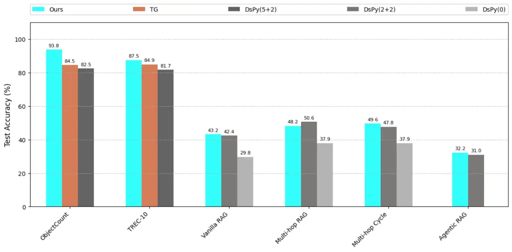
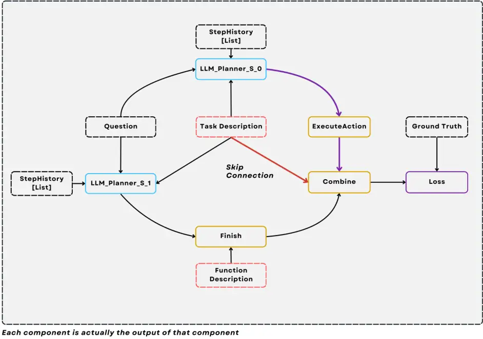
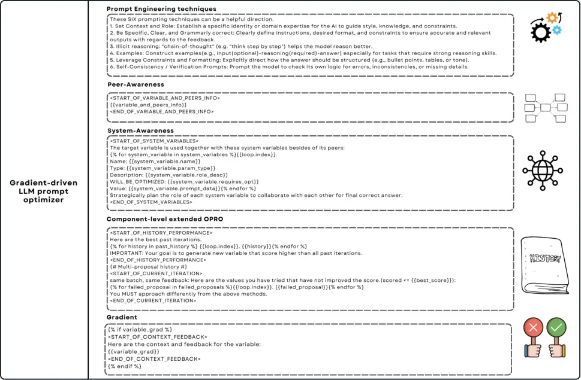
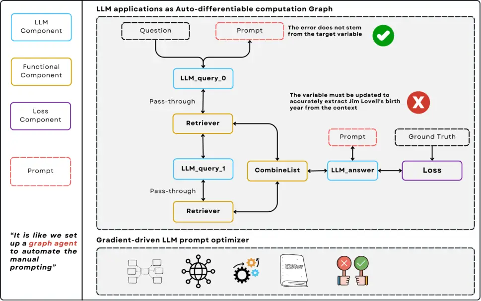
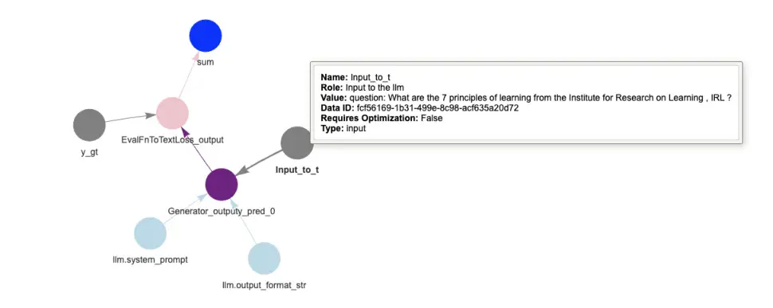
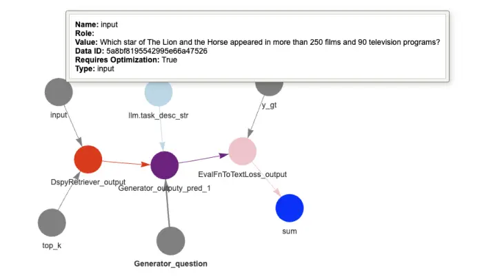
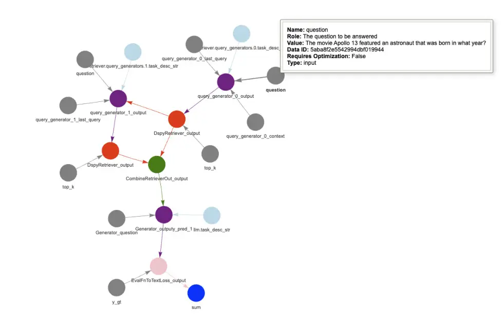
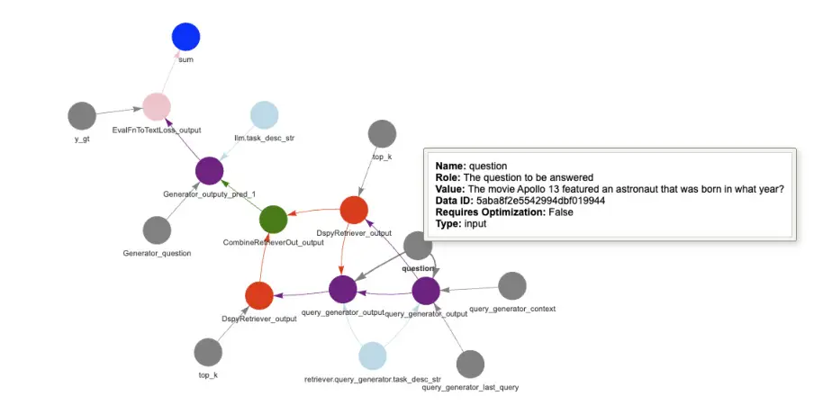

# LLM-AutoDiff: Auto-Differentiate Any LLM Workflow

Li Yin Affiliation: SylphAI    Zhangyang “Atlas” Wang
Affiliation: University of Texas at Austin

###### Abstract

Large Language Models (LLMs) have reshaped natural language processing,
powering applications from multi-hop retrieval and question answering to
autonomous agent workflows. Yet, _prompt engineering_—the task of
crafting textual inputs to effectively direct LLMs—remains difficult and
labor-intensive, particularly for complex pipelines that combine
multiple LLM calls with functional operations like retrieval and data
formatting. We introduce LLM-AutoDiff: a novel framework for Automatic
Prompt Engineering (APE) that extends textual gradient-based methods
(such as _Text-Grad_) to multi-component, potentially cyclic LLM
architectures. Implemented within the AdalFlow library,¹¹ 1
[https://github.com/SylphAI-Inc/AdalFlow](https://github.com/SylphAI-Inc/AdalFlow)
LLM-AutoDiff treats each textual input as a trainable parameter and uses
a frozen “backward engine” LLM to generate feedback—akin to “textual
gradients”—that guide iterative prompt updates. Unlike prior single-node
approaches, LLM-AutoDiff inherently accommodates functional nodes,
preserves time-sequential behavior in repeated calls (e.g., multi-hop
loops), and combats the “lost-in-the-middle” problem by isolating
distinct sub-prompts (instructions, formats, or few-shot examples). It
further boosts training efficiency by focusing on error-prone samples
through selective gradient computation. Across diverse tasks, including
single-step classification, multi-hop retrieval-based QA, and
agent-driven pipelines, LLM-AutoDiff consistently outperforms existing
textual gradient baselines in both accuracy and training cost. By
unifying prompt optimization through a graph-centric lens, LLM-AutoDiff
offers a powerful new paradigm for scaling and automating LLM workflows
— mirroring the transformative role that automatic differentiation
libraries have long played in neural network research.



Figure 1: Benchmark Performance of LLM-AutoDiff in AdalFlow.

## 1 Introduction

Large Language Models (LLMs) \[2\] lay the groundwork for a wide array
of applications: from consumer-facing chatbots to academic research
prototypes, LLM-driven systems are increasingly defining both front-end
interfaces and back-end logic. This rapid progress has highlighted an
important focal point in LLM-based development: the design of _prompts_,
which are sequences of text that specify tasks, include examples, or
provide instructions for generating the desired output. Often referred
to as *prompt engineering* \[20, 15\], this skillful curation of textual
inputs can dramatically impact performance, as subtle variations in
phrasing or structure can change model behavior in unpredictable ways.

Although prompt engineering is effective for single-step tasks, its
limitations become pronounced when dealing with complex architectures
composed of multiple LLM modules and auxiliary operations. Systems that
rely on multi-hop retrieval \[6\] or autonomous agent loops \[23, 7\]
must orchestrate not only the LLM calls themselves, but also the data
flow among external processes such as retrievers, validators, and
deduplicators. The result is a network of interconnected components that
can contain cycles, conditional branches, and iterative procedures.
Manual prompt tuning for each module in such a network can be both
time-consuming and error-prone. As a result, developers often encounter
the frustration of having to guess the right textual formulations or
re-verify prompts whenever a sub-component, dataset, or even the
underlying LLM changes.


Figure 2: Representing an LLM application as an auto-differentiable
computation graph. We illustrate how each node in the graph can be one
of three types: an LLM component, a functional component, or a loss
component. By coupling this graph with a gradient-driven LLM prompt
optimizer, the traditionally labor-intensive task of manually crafting
prompts is automated. During training, a forward pass traces every
intermediate input and output, while the backward pass backpropagates
“evaluation” signals (e.g., losses or textual gradients) through the
network to locate and correct errors. Crucially, multiple invocations of
the same node (such as when LLM_query_0 and LLM_query_1 are the same
component called twice, along with the retriever being called twice) can
accumulate multiple gradients, making it essential for the
auto-differentiation engine to preserve the correct sequence of updates.
This unified approach not only highlights where mistakes arise in
multi-component pipelines (including loops), but also provides a
systematic means to refine all relevant prompt parameters in tandem.

A growing body of research into _Automatic Prompt Engineering (APE)_ has
sought to alleviate this burden by systematically refining prompts
through automated methods \[21, 13, 24\]. A key innovation in this area
is the concept of _textual gradients_, which mimic numeric gradient
descent by using a “backward engine” LLM to critique the output and
propose edits that reduce a textual “loss.” Current approaches such as
*Text-Grad* \[13, 24\] have validated the viability of this technique,
demonstrating performance gains in tasks where a single LLM node is
trained on labeled data via an iterative prompt-update loop. However,
these methods do not fully address the intricacies of multi-component or
cyclic pipelines, where prompts for different nodes may require
simultaneous adaptation. Moreover, the interplay of functional
operations—ranging from chunking retrieved documents to formatting
data—introduces dependencies that these frameworks typically do not
address.

##### Contributions.

We present LLM-AutoDiff to close the gap in automatic prompt
optimization for complex LLM pipelines, particularly those involving
multi-component or cyclic structures. Our framework builds on the notion
of _textual gradients_ yet _significantly extends_ single-node
approaches by handling entire pipelines where each node—whether an LLM
or a functional operation—can dynamically receive, modify, or relay
textual instructions in response to downstream errors. Concretely,
LLM-AutoDiff represents an LLM application as a directed graph that
captures the flow of data and dependencies among LLMs, retrieval or
formatting modules, and specialized evaluation routines. Within this
graph, every textual input to an LLM is treated as a trainable
parameter, allowing feedback signals to propagate not only into standard
LLM prompts but also through nodes that themselves have no text to
optimize (e.g., retrieval or deduplication). This “pass-through”
mechanism ensures that any part of the pipeline contributing to errors
can be identified and adjusted for improved final outputs.

Alongside these pass-through gradients, LLM-AutoDiff also introduces
_time-sequential gradients_, which are crucial for multi-hop reasoning
or agent loops that repeatedly invoke certain LLM nodes. By attaching a
time-stamped record to each invocation, the system delivers feedback in
the correct temporal order, preventing confusion when the same node is
called multiple times in a single run. Another key innovation is the
treatment of different sub-prompts (such as task instructions, output
formats, and few-shot examples) as distinct _peers_, thereby mitigating
the “lost-in-the-middle” effect \[10\] and allowing the backward engine
to pinpoint precisely which sub-prompt might have caused an error.
Moreover, LLM-AutoDiff applies _selective gradient computation_ to
concentrate updates on samples where the model’s outputs are incorrect,
thus reducing token usage and training overhead.

To demonstrate the effectiveness of this framework, we run experiments
on a broad spectrum of benchmarks. We start with simpler tasks (e.g.,
single-node classification and question answering) to show that
LLM-AutoDiff either equals or surpasses contemporary textual gradient
baselines in both accuracy and token efficiency. We then escalate to
more advanced, multi-step scenarios where different prompts govern
sequential retrieval-and-generation steps, including multi-node RAG
setups, multi-hop RAG \[8, 6\], and trainable ReAct agents \[23\] (with
or without trainable LLM modules). In all these settings, LLM-AutoDiff
avoids the redundancy of naive prompt search by unifying error signals
and streamlining feedback delivery. Our findings also highlight the
importance of respecting time-sequential feedback: ignoring the exact
order of sub-queries can lead to ambiguity and suboptimal updates,
whereas our time-stamped gradients keep improvements on track.
Furthermore, by leveraging the few-shot optimization capability in
_AdalFlow_, we exceed existing approaches on final accuracy, inference
speed, and training cost, all while preserving scalability and ease of
use.

In summary, LLM-AutoDiff operationalizes the vision of _Automatic LLM
Application Optimization (ALAO)_, in which not only a single prompt, but
also the entire network of prompts and operations in a pipeline can be
refined automatically. Drawing direct inspiration from
auto-differentiation frameworks like PyTorch \[12\] and
TensorFlow \[1\], our system:

- •
  Models an LLM-based pipeline as a directed (possibly cyclic) graph,
  where each node may be a trainable LLM or a functional (non-trainable)
  operation.
- •
  Builds a runtime “parameter graph” that tracks textual inputs
  (prompts, few-shot examples, etc.) as _trainable parameters_ amenable
  to iterative optimization.
- •
  Facilitates a textual backward pass by using a frozen backward engine
  LLM to propagate feedback on errors—such as low accuracy—thus enabling
  an optimizer LLM to revise sub-prompts in a directed, gradient-like
  manner.

We further highlight five technical advances enabling and driving our
system design:

1.  1.  Pass-Through Gradients for Functional Nodes: Ensures gradients can
        flow through intermediary operations (e.g., context retrieval,
        deduplication) that manage data but have no learnable parameter nor
        prompt to directly update.
2.  2.  Time-Sequential Gradients for Cyclic Structures: Accumulates
        multiple gradients for iterative or multi-hop calls, retaining the
        chronological order to avoid conflated feedback.
3.  3.  Peer Nodes for Sub-Prompt Clarity: Splits instructions, format
        specifications, and few-shot examples into separate parameters to
        localize feedback and reduce confounding interactions.
4.  4.  Selective Gradient Computation (Error-Only): Allocates compute and
        token usage where it is most needed—on incorrect samples—thereby
        improving efficiency and convergence speed.
5.  5.  Gradient-Driven Prompt Optimizer: Extends OPRO \[21\] with prompt
        engineering heuristics and peer awareness, enabling multi-node
        systems to receive coherent and targeted updates from the optimizer.

Taken together, these innovations unify prompt-level refinements under a
single, end-to-end optimization process, offering a powerful new
paradigm for large-scale LLM development.

## 2 Related Work

This section first provides a broad view of traditional prompt
engineering paradigms, then discusses the limitations of manual prompt
design (Section 2.1). We next review the growing landscape of _Automatic
Prompt Engineering (APE)_ (Section 2.2), including single-node and
advanced approaches. Finally, we highlight why a unified, multi-node
perspective is needed to handle the full complexity of modern LLM
applications and what current frameworks fall short of (Section 2.3).

### 2.1 Prompt Engineering

Since the introduction of GPT-3, *in-context learning* \[2\] has emerged
as a core capability of modern LLMs. By leveraging zero-shot or few-shot
examples embedded directly in the input sequence, LLMs adapt to myriad
downstream tasks without parameter updates. This phenomenon gave rise to
prompt engineering \[20, 15\], where the arrangement and content of
these context examples can significantly affect model performance.
Reported gains of up to 40% in certain tasks underscore the power of
carefully crafted prompts \[6\].

Prompt engineering has also expanded beyond simple single-step settings.
Retrieval-Augmented Generation (RAG) \[8, 6\] extends LLMs’ knowledge by
incorporating retrieved evidence to reduce hallucination and improve
factual consistency. Meanwhile, _Chain-of-Thought_ (CoT) prompting
\[20\] instructs the LLM to produce step-by-step reasoning, often
boosting interpretability and accuracy. Autonomous agent frameworks such
as ReAct \[23\] and Reflexion \[15\] further extend LLM usage by
incorporating tools and iterative feedback loops. Across these
applications—spanning chatbots, multi-hop retrieval, and agentic
planning—prompt engineering remains crucial yet increasingly complex.

Despite the growing importance of prompt design, most industry and
research efforts currently employ manual engineering. This approach,
while intuitive, exhibits several downsides:

- •
  Time- and labor-Intensive Each new model or application often demands
  prompt design from scratch, encumbering both prototyping and
  deployment cycles.
- •
  Prompt Sensitivity: Even small changes in wording can drastically
  shift model outputs \[10\], making manual tuning a trial-and-error
  process with no consistent framework for improvement.
- •
  Complex Interdependencies: As LLM pipelines grow to include multiple
  calls, functional components(such as retriever and user defined data
  processing functions) \[6, 23\], holistic prompt tuning becomes
  unmanageable. Graph-like execution flows introduce intricate
  dependencies that are not easily resolved by hand.

### 2.2 Automatic Prompt Engineering (APE)

A growing line of research aims to streamline prompt creation and
refinement. One approach uses an LLM equipped with a “prompt engineer
persona” \[21\] or domain-specific heuristics \[2\]—often referred to as
“meta-prompts” \[27\]—to propose improved textual instructions. Another
prominent direction is _Text-Grad_ \[13, 24\], which draws a direct
analogy to gradient descent by employing a “backward engine” LLM to
produce iterative textual feedback that corrects model errors.
Concurrent work explores automatic selection and validation of few-shot
exemplars, sometimes enhanced by reasoning from a more powerful
“teacher” LLM to boost in-context learning \[6\], or combines
instruction tuning with demonstration (as in DsPy’s MIPRO \[11\]).
DsPy ²² 2
[https://github.com/stanfordnlp/dspy](https://github.com/stanfordnlp/dspy)
is by far the only library that have extended these optimization methods
into multi-node system, yet it does not offer a fully
_auto-differentiable_ solution. This limitation prevents the system from
pinpointing, for each individual training example, precisely where
errors arise in a complex pipeline—missing the greatest advantage of
robust _auto prompt engineering_ in truly end-to-end LLM-based
workflows.

Reinforcement learning has also been applied to prompt engineering:
RLPrompt \[3\] and Tempera \[25\] adjust prompts to maximize a reward
signal related to downstream metrics. Some methods pursue “soft
prompting,” i.e., optimizing a small set of additional embedding tokens
\[3\]. While these can be effective, they may suffer from reduced
interpretability or limited applicability when gradient access to the
LLM is restricted. In addition, although most APE studies regard the LLM
weights as fixed, recent work explores blending partial finetuning and
prompt optimization. For instance, \[16\] integrates instruction tuning
(or DPO) with few-shot learning to co-optimize model parameters and
textual prompts, echoing a broader push to treat hyperparameters,
prompts, and model weights as a unified space of adaptation.

Recently, \[19\] attempted to address multi-node prompt optimization by
proposing a _Graph-based Agentic System Optimization (GASO)_ framework.
Their system uses semantic gradients to propagate textual feedback in a
reverse-mode style, sharing conceptual similarities with how our method
generalizes Text-Grad to multi-node graphs. Although both works seek to
move beyond _single-node_ textual gradient methods, \[19\] focused
largely on chain-structured tasks (e.g., BIG-Bench Hard, GSM8K, and
LIAR). In contrast, our framework targets a broader class of
multi-component or cyclical LLM workflows, via a series of algorithmic
innovations such as supporting non-trainable components, time-sequential
calls, peer nodes, and selective gradient computation - thereby offering
a much more comprehensive and scalable solution for complex agent or RAG
pipelines. \[19\] also did not fully demonstrate how to handle multiple
distinct LLM calls in the same graph, which is organically supported in
our system.

### 2.3 Why We Need a More Comprehensive Framework

Despite these advances, a flexible and powerful multi-component
auto-optimization architecture, that can allow developers to build
effective auto-differentiable feedback graphs to auto-optimize any LLM
application, is yet to emerge. Existing methods often do not consider
complex workflows containing retrievers or loops. Popular LLM libraries
such as LangChain³³ 3
[https://github.com/langchain-ai/langchain](https://github.com/langchain-ai/langchain)
and LlamaIndex⁴⁴ 4
[https://github.com/run-llama/llama_index](https://github.com/run-llama/llama_index)
facilitate the orchestration of multi-step LLM workflows in a graph-like
manner but lack the crucial _auto-optimization_ capabilities needed for
production-scale deployment. While DsPy offers certain auto-optimization
features, it primarily focuses on token-heavy few-shot approaches and
less effective instruction tuning, sidestepping the central learning
paradigm that has propelled modern AI success—automatic differentiation.
Consequently, developers often revert to manual, ad hoc prompt
engineering, a strategy that grows impractical and error-prone as
systems become more complex. A practical analogy is deep neural networks
before auto-differentiation frameworks: without a unifying approach to
track dependencies and propagate errors end-to-end, sophisticated
network designs remained unwieldy.

_LLM-AutoDiff_ aims to close this gap by providing an auto-grad-like
solution for entire LLM applications. In the same way that
PyTorch \[12\] and TensorFlow \[1\] transformed neural network
development, we systematically address the complexities of multi-node
LLM pipelines, including functional components and cyclical loops, under
one coherent umbrella. The result is a new paradigm for large-scale LLM
deployment: rather than managing prompts in isolation, developers can
treat each sub-prompt as a parameter in a broader computation graph,
automating both local refinements and global adaptations.

## 3 Methods

In this section, we first lay out the conceptual underpinnings of
_Automatic LLM Application Optimization (ALAO)_ and its subset,
_Automatic Prompt Engineering (APE)_ (Section 3.1). We then introduce
how _textual auto-differentiation_ is concretely implemented
(Section 3.2), focusing on the forward/backward passes within a
graph-structured LLM system. Finally, we present our two main
contributions:

1.  1.  Auto-Differentiation for Any Compound LLM System: A principled way
        to handle multi-component and potentially cyclic architectures,
        described in Section 3.3.
2.  2.  Efficient Training Techniques: Methods that selectively compute
        gradients only for error cases, employ two-stage validation, and
        more, covered in Section 3.4. We also substantially extend the OPRO
        prompt optimizer in Section 3.5.

Throughout this section, we draw on the AdalFlow library’s formalism for
parameter nodes and textual gradients, ensuring mathematical clarity and
consistency with the prior literature.

### 3.1 ALAO and APE

##### Automatic LLM Application Optimization (ALAO).

We define _ALAO_ as the process of automatically tuning and improving a
compound AI system composed of multiple LLM-based modules, each designed
for a particular function (e.g., retrieval, classification, generation).
This optimization can include altering prompts, hyperparameters, or even
partially finetuning the underlying LLMs. Our focus, however, is on
prompt-level optimization, which we refer to as _Automatic Prompt
Engineering (APE)_.

##### Automatic Prompt Engineering (APE).

APE is the subproblem of ALAO concerned solely with optimizing textual
prompts across all LLMs in a multi-component workflow. Formally, we
model an LLM system as a directed graph

```math
\mathcal{G}=(\mathcal{N},\mathcal{E}),
```

where $`\mathcal{N}`$ comprises LLMs or other modules (e.g.,
retrievers), and $`\mathcal{E}`$ denotes the directed edges capturing
dependencies and data flow—possibly with cycles, as in multi-hop
retrieval \[6\] or ReACT-style agents \[23\]. If $`\{\mathcal{M}_{i}\}`$
denotes the set of LLM nodes, then the prompts $`\{\mathcal{P}_{i}\}`$
for each $`\mathcal{M}_{i}`$ become the _trainable parameters_ for APE.

Often, LLM architectures must fulfill multiple objectives (e.g.,
retrieving high-quality documents while also generating coherent final
answers). We partition the system into subtasks $`T_{1},T_{2},\dots`$,
each with a corresponding loss $`\mathcal{L}_{T_{i}}`$ that depends on a
subset of prompts $`\{\mathcal{P}_{\mathcal{N}_{T_{i}}}\}`$. A joint,
multi-task formulation can thus be written as:

```math
\mathcal{L}(\{\mathcal{P}_{i}\})\;=\;\bigcup_{i}\mathcal{L}_{T_{i}}\bigl(\mathcal{P}_{\mathcal{N}_{T_{i}}}\bigr),\quad\{\mathcal{P}_{i}\}^{*}=\arg\min_{\{\mathcal{P}_{i}\}}\bigcup_{i}\mathcal{L}_{T_{i}}\bigl(\mathcal{P}_{\mathcal{N}_{T_{i}}}\bigr). \tag{1}
```

A typical example is a multi-hop RAG system (Algorithm 1), where one
subtask optimizes subquery prompts (via metrics like MRR \[14\],
Recall@k, Precesion@k), and another subtask refines a final generator
prompt for a question-answering score. In AdalFlow, each node is a
GradComponent, similar in spirit to PyTorch’s Module. Figure 2
demonstrates how multi-hop RAG can naturally introduce cycles (e.g.,
repeated calls to a query generator and retriever).

1: Input: Question

2: Output: Response

3: Procedure:

4: $`\textit{context}\leftarrow[]`$

5: for $`i=1`$ to $`2`$ do

6:
  $`\textit{query}\leftarrow\text{QueryGenerator}(\textit{Question},\,\textit{context})`$

7:
  $`\textit{context}\mathrel{+}=\text{QueryRetriever}(\textit{Question},\,\textit{query})`$

8: end for

9: Call $`\text{Generator}(\textit{Question},\,\textit{context})`$

Algorithm 1 Pseudo-code for Multi-hop RAG with Cycles

### 3.2 Interpreting Textual Auto-Differentiation in AdalFlow

##### Dynamic Computation Graph $`\mathcal{G}_{p}`$.

Hereinafter, we use the AdalFlow library as an example to describe our
algorithm and implementation ideas. AdalFlow adopts an approach
analogous to modern deep-learning frameworks, but in a textual domain. A
_Parameter_ in AdalFlow may represent a prompt (PROMPT), a few-shot
example set (DEMOs), an input or output, or a hyperparameter (e.g.,
top-$`k`$ for a retriever). Once the system executes a forward pass
through the graph $`\mathcal{G}`$ (potentially unrolling cycles),
AdalFlow captures a dynamic, directed acyclic _parameter graph_
$`\mathcal{G}_{p}=(\mathcal{N}_{p},\mathcal{E}_{p})`$ tracing how each
parameter affects subsequent computations.

The goal of the auto-differentiable computation graph is two folds: (1)
trace the intermediate inputs and outputs of each component, and (2)
backpropagate the “evaluation” signals across the network, identifying
the root cause of the errors, pointing the LLM optimizer to the right
direction at proposing a new prompt. Formally, each node
$`v\in\mathcal{N}_{p}`$ is computed by:

```math
v\;=\;f_{c}\bigl(\mathrm{PredecessorsOf}(v)\bigr), \tag{2}
```

where $`f_{c}`$ is the transformation function (e.g., an LLM invocation
or a functional operation), and $`\mathrm{PredecessorsOf}(v)`$ denotes
all incoming parameters to $`v`$.

##### Textual Loss Definition.

A typical LLM system might produce multiple final outputs, each with its
own evaluation metric (classification accuracy, BLEU score, etc.). In
AdalFlow, we unify these metrics into a textual “loss component.” For
example, if $`v`$ is a final output node, $`v_{gt}`$ is the ground-truth
label (optional if using an LLM judge \[26\]), and $`s_{v}`$ is the
score from an evaluation function $`e_{v}`$, then:

```math
s_{v}=e_{v}(v,\,v_{gt}),\quad\mathcal{L}=\bigl(\text{e}_{\text{desc},v},\,v,\,v_{gt},\,s_{v}\bigr). \tag{3}
```

Here, $`\text{e}_{\text{desc},v}`$ is a textual description of the loss,
and $`\mathcal{L}`$ can be stored as a LOSS_OUTPUT parameter. AdalFlow
uses templating (e.g., Jinja2) to pass these modules to a _backward
engine_ LLM, which interprets the objective function in natural
language.

##### Forward Pass.

During the forward pass, the system executes all nodes in topological
(or unrolled) order. As it processes each node, it populates
$`\mathcal{G}_{p}`$ with newly created parameter nodes. This procedure
continues until the final outputs are computed, at which point we
evaluate the textual or numeric loss.

##### Backward Pass (Textual Gradients).

After computing the forward pass and its resulting loss, AdalFlow
constructs textual feedback or “gradients” for each node, flowing
backward through $`\mathcal{G}_{p}`$.

##### Gradient for the Final Output Node.

If $`v_{o}`$ is the final output node (e.g., an LLM’s response) with
only one successor (the loss component), then:

```math
\frac{\partial\mathcal{L}}{\partial v_{o}}\;=\;\text{LLM}_{\text{backward}}\bigl(\mathcal{L}\bigr), \tag{4}
```

where $`\mathcal{L}`$ is directly passed to the backward engine. This
results in textual gradient on how $`v_{o}`$ is matching the ideal
response.

##### Gradients for Intermediate LLM Nodes.

For an internal node $`v`$, its textual gradient aggregates feedback
from each successor $`w\in\mathrm{SuccessorsOf}(v)`$:

```math
\frac{\partial\mathcal{L}}{\partial v}\;=\;\bigcup_{w\in\mathrm{SuccessorsOf}(v)}\text{LLM}_{\text{backward}}\bigl(v,\,w,\,\tfrac{\partial\mathcal{L}}{\partial w}\bigr). \tag{5}
```

Here, the backward engine uses information about $`v`$, $`w`$, and
$`\frac{\partial\mathcal{L}}{\partial w}`$ (the textual gradient of
$`w`$) to craft feedback on how to modify $`v`$. If the system has only
a single final LLM call, the logic is straightforward: the gradient at
$`v_{o}`$ is broadcast upstream to the current $`v`$ which will be
prompt $`\mathcal{P}_{i}`$.

##### Textual Gradient Descent (TGD).

Once the backward pass collects all gradients, the system performs a
_textual update step_:

```math
\mathcal{P}_{v_{\text{new}}}\;=\;\text{LLM}_{\text{opt}}\Bigl(v,\,\mathrm{GradientContext}(v),\,\tfrac{\partial\mathcal{L}}{\partial v}\Bigr), \tag{6}
```

where $`\mathrm{GradientContext}(v)`$ might include the node’s
inputs/outputs and relevant scoring. The _optimizer LLM_ thus proposes a
new prompt given the textual gradient.

##### Mini-Batch Training.

Following \[24\], we split data into
$`(\mathcal{D}_{\mathrm{train}},\mathcal{D}_{\mathrm{validate}},\mathcal{D}_{\mathrm{test}})`$.
Each mini-batch is processed by:

1.  1.  Forward pass: $`\mathcal{B}=\{(x_{i},y_{i})\}_{i=1}^{B}`$ yields
        predictions $`\{\hat{y}_{i}\}_{i=1}^{B}`$ through
        $`\mathcal{G}_{p}`$.
2.  2.  Backward pass: A textual loss is computed for each sample, producing
        textual gradients.
3.  3.  Prompt update: A new prompt is generated if validation on
        $`\mathcal{D}_{\mathrm{validate}}`$ improves.

Finally, the test accuracy on $`\mathcal{D}_{\mathrm{test}}`$ gauges the
system’s performance.

### 3.3 Auto-Differentiate Any Compound LLM System

We now describe how to extend textual auto-differentiation to _any_
compound LLM system that may (1) involve multiple LLM calls, (2)
interleave functional modules (e.g., retrievers, data-processing
functions), and (3) contain cycles through repeated node invocations.
Figure 3 illustrates one such example from the practice. These
extensions require modifying the original backward-pass formula from
Eq. (5) to Eq. (7) and (8), ensuring that textual gradients propagate
end-to-end in more complex settings.



Figure 3: Example of a ReACT Auto-Differentiable Graph. This
configuration extends our multi-hop RAG paradigm by incorporating a
ReACT planner and functional nodes for tool usage and final output
assembly. Here, ExecuteAction calls the retriever module when needed,
while Finish is a simple function—governed by its own function
docstring—that merges the accumulated step history into a coherent
answer. The Combine node is a functional component that aggregates
outputs from both ExecuteAction and Finish before producing the final
output. Notably, a _skip connection_ from the Task Description provides
direct feedback to the ReACT planner, enabling more targeted textual
gradients across the entire system. This design highlights how
agent-style loops, functional transformations, and skip connections can
all be captured in a unified auto-differentiable framework for
LLM-driven workflows.

#### 3.3.1 Multi-Components

##### Non-LLM Intermediate Components.

Modern LLM pipelines often incorporate “intermediate” nodes beyond the
LLM calls themselves. For instance, Figure 2 illustrates two such nodes:

1.  1.  Retriever, which retrieves documents in response to a sub-query
        generated by an LLM;
2.  2.  CombineList, which merges and deduplicates two retrieved document
        lists before feeding them into a final generator node.

Below is a stripped-down Python example for CombineList, which inherits
from GradComponent:

1 class CombineList(GradComponent):

2 def \_\_init\_\_(

3 self,

4 name="CombineRetrieverOut",

5 desc="combines two lists and deduplicate with set"

6 ):

7 super().\_\_init\_\_(name=name, desc=desc)

8

9 def call(

10 self,

11 context_1: adal.RetrieverOutput,

12 context_2: adal.RetrieverOutput,

13 id: str = None

14 ) -\> List\[str\]:

15

16 seen = set()

17 lists_1 = context_1.documents

18 lists_2 = context_2.documents

19 combined = \[x for x in lists_1 + lists_2 if not (x in seen or
seen.add(x))\]

20

21 output = adal.RetrieverOutput(

22 id=id,

23 query=\[context_1.query, context_2.query\],

24 documents=combined,

25 doc_indices=\[\]

26 )

27 return output

Because these “functional” nodes have no direct prompt parameters, they
do not themselves perform textual updates. However, they still require a
backward mechanism to pass gradients upstream when an error arises from
_their_ output.

##### Gradients for Intermediate Functional Nodes.

We categorize these components as _functional nodes_ and incorporate two
key rules for gradient propagation:

1.  1.  If a functional node has exactly one predecessor, the gradients on
        its output simply “pass through” to that predecessor.
2.  2.  If a functional node has multiple predecessors, we must attribute
        the error signal to the correct predecessor(s). In this case, we
        adopt _intermediate gradients_ that explicitly backpropagate the
        relevant portion of the feedback to each predecessor.

Formally, for a functional node $`w`$ with successors
$`\mathrm{SuccessorsOf}(v)`$, we extend Eq. (5) to:

```math
\frac{\partial\mathcal{L}}{\partial v}=\bigcup_{w\,\in\,\mathrm{SuccessorsOf}(v)}\begin{cases}\tfrac{\partial\mathcal{L}}{\partial w},&\text{if $w$ has one predecessor;}\\[6.0pt]
\text{LLM}_{\text{backward}}\!\bigl(v,\;w,\;\tfrac{\partial\mathcal{L}}{\partial w};\text{Template}\bigr),&\text{otherwise.}\end{cases} \tag{7}
```

Here, Template refers to a structured text prompt that the backward
engine LLM uses to determine how $`v`$ influenced $`w`$.

##### Handling Duplicate Gradients in Multi-Node Systems.

In more intricate graphs, a single parameter node might receive the same
gradient multiple times (e.g., repeated pass-through signals). To
prevent unbounded duplication, each gradient is stored in a hash-based
data structure keyed by attributes such as the data ID and call index
$`t`$. This approach merges identical feedback, stabilizing the backward
pass.

#### 3.3.2 Cycles

Certain LLM applications—multi-hop RAG \[6\] or iterative ReACT
agents \[23\]—may invoke the same node multiple times within a single
forward pass. Such cyclical usage accumulates multiple gradients for the
same node.

##### Time-Sequential Gradients for Cycles.

To maintain a sensible order of updates, each invocation is indexed by
$`t`$. Let $`c`$ be a node called $`T_{c}`$ times in one pass. We track
each call’s gradient:

```math
\frac{\partial\mathcal{L}}{\partial v^{(t)}}\quad\text{for}\;t\in\{1,\dots,T_{c}\}.
```

Then, for trainable parameters $`P_{c}`$ feeding into $`c`$, we gather:

```math
\frac{\partial\mathcal{L}}{\partial P_{c}}=\bigcup_{t=1}^{T_{c}}\Bigl\{\,\bigl(t,\;\tfrac{\partial\mathcal{L}}{\partial v^{(t)}}\;\cdot\;\tfrac{\partial v^{(t)}}{\partial P_{c}}\bigr)\Bigr\}. \tag{8}
```

Each tuple $`\bigl(t,\dots\bigr)`$ preserves the correct temporal
sequence. When mini-batches contain multiple data IDs, we also store
that ID to avoid mixing gradients across different samples or timesteps.

Meta-Prompt for Cyclic Structures. Our system includes an additional
prompt to inform the backward engine about repeated invocations:

"If the same DataID has multiple gradients, it means this
component/variable is called multiple times in the compound system (with
a cycle)

in the same order they appear in the gradient list."

This cue helps the LLM-based backward engine handle repeated calls
methodically.

#### 3.3.3 Peers

LLM prompts often mix various “subprompts,” such as instruction text,
few-shot examples, and output format. Merging them into a single block
can cause:

1.  1.  Noisy or misleading gradients: It becomes hard to pinpoint which
        portion of the prompt contributed to an error.
2.  2.  Cross-contamination: An LLM-based optimizer might jumble multiple
        subprompts, producing incoherent updates.

To address this, we define _peers_ as distinct predecessor parameters to
a node $`v`$. For example:

```math
P_{i}=\{\,P_{i}^{\text{task}},\;P_{i}^{\text{few-shot}},\;P_{i}^{\text{out-format}},\dots\}. \tag{9}
```

Each subprompt is a separate node in the parameter graph
$`\mathcal{G}_{p}`$, enabling fine-grained updates.

##### Peer-Aware Gradients.

Rather than independently updating each subprompt, we allow a single
backward call to produce feedback for _all_ peers:

```math
\Bigl\{\,\tfrac{\partial\mathcal{L}}{\partial u_{1}},\dots,\tfrac{\partial\mathcal{L}}{\partial u_{m}}\Bigr\}=\text{LLM}_{\mathrm{backward}}\!\bigl(v,\;\{u_{1},\dots,u_{m}\},\;\tfrac{\partial\mathcal{L}}{\partial v}\bigr), \tag{10}
```

where $`\{u_{1},\dots,u_{m}\}`$ are the subprompt “peer” nodes feeding
$`v`$. This ensures the LLM-based backward engine sees all subprompts
jointly, reducing spurious interactions and allowing it to propose
updates that are more holistic.

For completeness, we provide the meta-prompt templates for peer nodes in
Appendix . By recognizing these peer relationships, LLM-Diff avoids
confusion in multi-subprompt prompts, resulting in more precise gradient
signals and higher-quality proposals.

#### 3.3.4 Skip Connections as an Option

Even with textual auto-differentiation, gradient signals can diminish
when LLM-based workflows grow deeper or more branched. This issue
parallels vanishing gradients in deep networks, where extra layers
compromise end-to-end learning. Drawing inspiration from ResNets \[4\]
as well as prior attempts to introduce “training-time” auxilary skips
\[5\], we introduce _skip connections_ to mitigate gradient attenuation
by creating direct feedback pathways that bypass intermediate nodes.

At present, these connections can be flexibly defined by the user. For
instance, a node near the pipeline’s end (e.g., a CombineStepHistory
component) can provide a direct route for error signals to flow back to
the initial prompt or agent description, in addition to following the
standard, “long-path” backward pass. Figure 3 offers a concrete example,
where the Combine node relays distilled feedback to the ReACT planner’s
task description. Such skip connections help preserve crucial error
information that might otherwise vanish as it propagates across multiple
LLM or functional nodes. Moreover, one can further augment signal
strength by injecting intermediate losses or auxiliary objectives at
various stages, fostering more stable, fine-grained learning across
large LLM applications.

Because skip connections are not automatically created for now,
developers remain free to decide when and how to incorporate them based
on domain knowledge. AdalFlow currently automates only standard LLM and
retriever components; any additional functional node or feedback pathway
(including skip connections) must be manually declared. We regard
_automated skip-connection discovery_ as an exciting avenue for future
work, where a meta-learning or heuristic approach could systematically
explore which direct feedback routes yield the strongest overall
performance.

### 3.4 Efficient Training for Textual Auto-Differentiation

Although textual auto-differentiation offers a flexible mechanism for
optimizing prompts, it can be computationally expensive. At each
training step, three major operations incur significant cost:

1.  1.  Backward Pass on Mini-Batches using a state-of-the-art LLM,
2.  2.  Prompt Updates (i.e., proposals) from an optimizer LLM, and
3.  3.  Validation on the entire validation dataset.

Among these, (1) often dominates as the graph structure gets more
complex especially if a large-capacity model (e.g., GPT-4o) is employed
for generating textual gradients and (2) propt proposals follow.
Empirical observations from \[24\] indicate that a single backward pass
on a batch of 4 in a single node LLM application can take up to 70
seconds, while generating a single proposal might require 10 seconds.
Below, we introduce methods to reduce these overheads while preserving
or even improving training effectiveness.

#### 3.4.1 Compute Gradients Only for Error Samples

In classical gradient descent, losses from _all_ samples accumulate to
drive parameter updates. In the textual domain, however, “accumulation”
amounts to concatenating loss and gradient information into a prompt for
the “optimizer” LLM. This can be unnecessarily costly if many samples
are already correct. Indeed, we commonly observe initial accuracies
above $`80\%`$ (e.g., in an object-counting task \[18, 17\]), implying
that the majority of training tokens can go to correct samples that
offer no meaningful feedback on how to fix errors but rather a means for
prompt rephrasing. Moreover, there is a nontrivial probability that an
entire mini-batch of size $`n`$ contains no error samples at all:

```math
P(\text{No errors in batch})\;=\;\frac{\binom{N_{1}}{n}\,\binom{N_{0}}{0}}{\binom{N}{n}}, \tag{11}
```

where $`N`$ is the dataset size, $`N_{1}=N\cdot\text{Accuracy}`$, and
$`N_{0}=N-N_{1}`$. For instance, at $`80\%`$ accuracy, $`N=50`$, and
$`n=4`$, this probability can exceed $`40\%`$. In such cases, textual
gradient prompts would merely rephrase existing prompts rather than
supply error-corrective feedback.

To address this inefficiency, we compute gradients only for samples
whose performance metric $`s(y,\hat{y})`$ is below a threshold $`\tau`$.
Concretely, we replace the typical batch loss with the conditional rule:

```math
\frac{\partial\mathcal{L}}{\partial\mathcal{P}}\;=\;\begin{cases}\text{LLM}_{\text{backward}}(\dots,s(y,\hat{y})),&\text{if }s(y,\hat{y})<\tau,\\[4.0pt]
\text{``You score "}+s(y,\hat{y}),&\text{otherwise}.\end{cases} \tag{12}
```

High-scoring samples thus bypass the expensive backward pass (receiving
only a simple textual note). This strategy both reduces token usage and
ensures the backward pass emphasizes cases that truly need improvement.
Additionally, it mitigates “lost in the middle” effects \[10\], wherein
important errors can be diluted within a large block of mostly correct
examples.

#### 3.4.2 Two-Stage Validation

Even if we only generate a limited number of new prompts, naïvely
validating each candidate on the entire validation set can still be
costly. Traditional gradient-based optimization would not require a full
validation pass after every single training step. However, in textual
optimization, we often must check if the newly proposed prompt truly
improves performance. We thus propose a two-stage validation:

1.  1.  Minibatch Validation. Test the proposed prompt on the current
        mini-batch $`\mathcal{B}_{\text{sub}}`$. If accuracy improves,
        proceed.
2.  2.  Full Set Validation. Evaluate on the full validation set
        $`\mathcal{D}_{\mathrm{val}}`$. If the score improves, accept the
        new prompt; otherwise, revert to the old one.

This hierarchical check prevents the frequent and costly full-dataset
evaluations for obviously unhelpful updates. By pruning poor proposals
early, we reduce validation overhead without sacrificing reliability.

##### Multiple Proposals per Backward Pass.

During each backward pass, we can further optimize efficiency by
generating up to $`n_{p}`$ candidate prompts in one go and testing them
via the two-stage validation. Algorithm 2 sketches the resulting
procedure. If the first candidate fails at the minibatch stage, we
simply move to the second one, and so on. This “beam-like” approach
helps avoid repeated backward passes when a single candidate is
suboptimal.

1: Input: Graph $`\mathcal{G}`$, training set
$`\mathcal{D}_{\mathrm{train}}`$, batch size $`B`$, error threshold
$`\tau_{\mathrm{correct}}`$, max proposals $`n_{p}`$, max steps
$`S_{m}`$.

2: Initialize prompts and step counter.

3: while $`\mathrm{step}<S_{m}`$ do

4:   Sample a mini-batch $`\mathcal{B}=\{(x_{i},y_{i})\}_{i=1}^{B}`$
from $`\mathcal{D}_{\mathrm{train}}`$.

5:   ZeroGrad: Reset all gradient data structures.

6:   Forward: Compute predictions $`\{\hat{y}_{i}\}_{i=1}^{B}`$ through
$`\mathcal{G}`$.

7:   Loss: For each sample, compute
$`s_{i}=e(x_{i},y_{i},\hat{y}_{i})`$.

8:   Backward: Based on $`s_{i}`$ and threshold
$`\tau_{\mathrm{correct}}`$, compute gradients only for samples with
$`s_{i}<\tau_{\mathrm{correct}}`$ (Eq. 12).

9:   for $`k=1`$ to $`n_{p}`$ do

10:    Propose: Generate a new prompt from the optimizer LLM.

11:    Evaluate on $`\mathcal{B}`$ (_Minibatch Validation_).

12:    if Accuracy improves on $`\mathcal{B}`$ then

13:      Evaluate on full $`\mathcal{D}_{\mathrm{val}}`$.

14:      if Accuracy improves on $`\mathcal{D}_{\mathrm{val}}`$ then

15:       Accept proposed prompt; break.

16:      else

17:       Revert: Discard this proposal.

18:      end if

19:    else

20:      Revert: Discard this proposal.

21:    end if

22:   end for

23:   if no proposals accepted then

24:    Retain current prompt and carry $`\mathcal{B}`$ forward.

25:   end if

26:   $`\mathrm{step}\leftarrow\mathrm{step}+1`$.

27: end while

Algorithm 2 Token-Efficient Mini-Batch with Two-Stage Validation

In summary, by selectively computing gradients only for erroneous
samples, applying a concise two-stage validation, and exploring multiple
prompt candidates at once, we can substantially reduce the computational
and token costs of textual auto-differentiation—while still converging
on high-quality prompt solutions.

### 3.5 Gradient-Driven Prompt Optimizer

Beyond textual gradient generation, the prompt optimizer itself plays a
pivotal role in determining the final performance of a textual
auto-differentiation system. We build on the foundations laid by
Optimization by PROmpting (OPRO) \[21\] and extend its capabilities in
three notable ways:

- •
  Extended Proposal History. While OPRO stores a record of past
  prompt-score pairs (e.g., the best-performing prompts), our approach
  additionally maintains a detailed “proposal history” within each
  training step. This record (noted as CH) encapsulates the specific
  editing method used (chosen from four possible editing modes) and the
  rationale behind each prompt modification—along with the standard
  initial-step history (noted as SH). By weaving these local proposals
  into a global historical context, the optimizer gains deeper insights
  into how each refinement evolves or fails, thus guiding more targeted
  updates.
- •
  Peer Awareness for Multi-Prompt Systems. Modern LLM architectures
  often combine various subprompts—for instance, instructions, few-shot
  examples, and output format. Our optimizer explicitly acknowledges
  this modular structure, allowing it to edit or recompose subprompts
  (peers) independently while preserving their roles. Such “peer
  awareness” prevents cross-contamination, ensuring that an improvement
  to one subprompt does not inadvertently degrade another.
- •
  System Awareness in Multi-Component Pipelines. When an LLM application
  involves multiple interdependent components (e.g., retrieval modules
  feeding into an LLM generator), the optimizer must be cognizant of
  each component’s function and of how prompts coordinate system-wide.
  We incorporate “system awareness” by exposing metadata about each
  prompt’s role, so the optimizer can propose revisions that more
  effectively harmonize with other prompts or pipeline components.

We collectively name our novel enhancements of ORPO as Gradient-Driven
Prompt Optimizer (GDPO). GDPO allows the gradient-driven optimizer to
produce more cohesive and robust prompt updates—whether dealing with
single LLM prompts or large, multi-LLM systems with intricate data
flows, therefore paving the way for an end-to-end solution that matches
the complexity of modern LLM applications.



Figure 4: Gradient-Driven Prompt Optimizer. The optimizer LLM is
prompted with the textual gradients and the previous prompt, along with
a multi-node “system view.” It proposes new subprompt texts aligned with
the identified errors.

## 4 Experiments

In this section, we evaluate LLM-AutoDiff across five types of LLM
pipelines, each designed to probe different aspects of multi-node and
multi-hop workflows. We begin by outlining our experimental setup
(Section 4.1), then discuss results (Section 4.2), and finally present
ablation studies to isolate the roles of textual gradients, prompt
engineering techniques, and historical information in our optimizer
(Section 4.3).

### 4.1 Experimental Setup

##### Pipelines Overview.

We design five pipelines, ranging from a single LLM performing simple
classification to multi-LLM or agentic architectures on HotPotQA \[22\].

- •
  One-LLM Workflow. A single LLM answers a consistent style of question:
  1.  1.  ObjectCount \[17, 18\]: We randomly split 50/100/100 samples for
          training/validation/test from the original 500-sample subset,
          evaluating with an Exact Match (EM) metric.
  2.  2.  TREC-10 \[9\]: 120/166/344 samples for train/val/test (sub-sampled
          from the original test set). We also use EM here, following
          \[22\].

- •
  Multi-Node RAG Workflows. On the HotPotQA dataset, we construct four
  variations of retrieval-augmented generation (RAG) pipelines:
  1.  1.  Vanilla RAG: 2-component system (retriever + generator),
  2.  2.  Multi-hop RAG: 4 components (two subquery generators, one
          retriever, one final generator),
  3.  3.  Multi-hop RAG (Cycle): 3 components (one LLM subquery generator
          called twice, a retriever, and a final generator),
  4.  4.  Agentic RAG: A ReAct-style agent \[23\] with two tools (Retriever
          and Finish) and up to three steps.

  We follow DsPy’s standard top-$`3`$ retrieval for Vanilla RAG and
  top-$`2`$ for the others. For training, we sample 50 “hard” queries
  from the official HotPotQA training set and split the 7405-test subset
  into a 100-sample validation set and a 200-sample final test set.

  For certain comparisons, we also reference DsPy’s multi-node
  capabilities \[6\], but note that its agentic RAG differs
  considerably, so we primarily cite reported metrics. Additional
  implementation details (e.g., model hyperparameters,code) are in
  Appendix B.

##### Baselines and Comparisons.

We denote:

- •
  TG: Text-Grad \[24\],
- •
  DsPy: The multi-node auto-prompt library from \[11\], specifically
  using MIPROv2 (Bayesian instruction tuning + few-shot learning),
- •
  Ours: LLM-AutoDiff as presented in this paper.

We adopt the DsPy(n+m) notation to denote $`n`$ demonstration samples
plus $`m`$ raw samples used. Where relevant, DsPy^(∗) refers to reported
numbers from their original paper (which may use slightly different
dataset splits). All methods are evaluated with the same EM or $`F_{1}`$
criteria, implemented as EvalFn in AdalFlow.

For Ours, we conduct 12 training steps at a batch size of 4, mirroring
TG’s standard setting. We choose the best checkpoint based on validation
accuracy before reporting final performance on the test set. Our MIPROv2
baseline (DsPy) is configured as follows:

tp = MIPROv2(

metric=validate_answer,

prompt_model=gpt_4,

task_model=turbo,

num_candidates=12,

init_temperature=1.0

)

##### Implementation Details.

- •
  We use GPT-3.5-turbo-0125 as the forward engine (i.e., the main LLM
  performing tasks).
- •
  GPT-4o-2024-08-16 is used as the frozen “backward engine” and
  “optimizer” LLMs.
- •
  On HotPotQA, we use $`F_{1}`$ \[22\] rather than strict EM for the
  internal loss, as partial matches better reflect incremental
  improvements during minibatch validation.
- •
  For each experiment, we measure starting accuracy and the final
  trained accuracy on both the validation and test set. Hyperparameters
  and additional code details can be found in Appendix B.

Table 1 summarizes each dataset and pipeline.

### 4.2 Results

Table 2 presents an overview of validation and test accuracies across
our five pipelines. We highlight a few key observations:

1.  1.  Single LLM Pipelines. On ObjectCount, TG reported a final $`91.9\%`$
        in prior work, but in our replication with a new split, we see a
        lower $`84.5\%`$ test accuracy after 4 runs (despite a high
        $`95.25\%`$ on validation). In contrast, our method (Ours) achieves
        $`93.75\%`$ on test with less overfitting, outperforming TG by
        $`9.25\%`$. Similarly, on TREC-10, Ours is $`4.2\%`$ above TG and
        $`7.9\%`$ above DsPy, while using fewer tokens.
2.  2.  HotPotQA RAG Pipelines. We evaluated four distinct RAG workflows,
        achieving an average performance improvement of 10% across tasks.
        The most notable gain occurred with Agentic RAG, where performance
        doubled after only 12 training steps, starting from 16.5% test
        accuracy with default prompts and tool descriptions. Notably, the
        Agentic RAG pipeline—though the most flexible—yields the lowest
        absolute accuracy across the board (consistent with \[11\]). We
        suspect this is due to the ReAct planner’s multi-task load: it must
        decide retrieval steps, interpret partial results, and generate
        final answers, often leading to longer prompts and higher
        complexity. Even so, our gradient-driven approach outperforms
        zero-shot or pure few-shot baselines in nearly every RAG variant.
        For example, on Vanilla RAG and Multi-hop RAG (Cycle), Ours exceeds
        DsPy(2+2) in test accuracy by a comfortable margin, underscoring the
        benefits of multi-node textual gradient propagation.
3.  3.  Efficiency Gains. Besides higher accuracy, our method is notably
        faster and more token-efficient. On ObjectCount, we consume fewer
        tokens over 12 steps than TG does in exploring just 12 proposals.
        Empirically, Ours also converges in less wall-clock time thanks to
        techniques like selective gradient computation and two-stage
        validation (Section 3.4).

Overall, LLM-AutoDiff consistently outperforms the standard Text-Grad
method in both single-node and multi-node RAG scenarios, while
significantly reducing training overhead. Although DsPy offers
competitive results in certain multi-hop pipelines, it relies heavily on
few-shot sampling and lacks a true, node-level textual backpropagation
mechanism. By contrast, our gradient-driven approach not only pinpoints
the sources of error in more complex workflows but also leverages
intermediate input-output traces to generate on-the-fly
demonstrations—arguably a more flexible and token-efficient strategy
than DsPy’s rejection-based sampling \[6, 11\]. This result suggests
that local, gradient-informed “instruction tuning” can be more effective
than methods in which the “optimizer” only sees final-task data and
prompts. We provide further evidence for these advantages in the
ablation studies below (Section 4.3).

|                      |             |                                                        |                                                                |                 |
| -------------------- | ----------- | ------------------------------------------------------ | -------------------------------------------------------------- | --------------- |
| LLM Task Pipeline    | Dataset     | Task Type                                              | Components                                                     | LLM Calls       |
| One LLM              | ObjectCount | Simple QA on counting objects of a particular category | 1 (generator)                                                  | 1               |
|                      | TREC-10     | Classify a question into one of 6 coarse classes       | 1 (generator)                                                  | 1               |
| Vanilla RAG          | HotPotQA    | Multi-hop QA                                           | 2 (retriever + generator)                                      | 1               |
| Multi-hop RAG        |             |                                                        | 4 (query_generator_0, query_generator_2, retriever, generator) | 3               |
| Multi-hop RAG(Cycle) |             |                                                        | 3 (query_generator, retriever, generator)                      | 2               |
| Agentic RAG          |             |                                                        | 3 (ReAct, retriever as a tool, finish as a tool)               | 4 (max 4 steps) |

Table 1: Summary of our tasks, datasets and pipelines for benchmarking.

|                      |             |        |           |                    |                        |                          |
| -------------------- | ----------- | ------ | --------- | ------------------ | ---------------------- | ------------------------ |
| LLM Task Pipeline    | Dataset     | Metric | Method    | Start Acc(%)(v, t) | Val Acc (%)            | Test Acc(%)              |
| One LLM              | ObjectCount | EM     | Ours      | 86, 83             | 96.5 $`\pm`$ 2.68(98)  | 93.75 $`\pm`$ 1.12(95)   |
|                      |             |        | TG        | 74, 78             | $`95.25\pm 1.48`$(97)  | $`84.5\pm 3.6`$(89)      |
|                      |             |        | DsPy(5+2) | 62, 60             | $`84\pm 4.47`$         | $`82.5\pm 5.2`$          |
|                      | TREC-10     | EM     | Ours      | 78.9, 81.7         | 86.9$`\pm`$4.09(92.16) | 87.5$`\pm`$3.94(91)      |
|                      |             |        | TG        | 80.12,83.53        | $`83.73\pm 1.13(85)`$  | $`84.88\pm 1.29`$(86.8)  |
|                      |             |        | DsPy(5+2) | 72.89, 76.35       | $`86.4\pm 0.74(87.4)`$ | $`81.7\pm 1.23`$(83.1)   |
| Vanilla RAG          | hotpot_qa   | EM     | Ours      | 37, 39.5           | 47$`\pm`$1.22(49)      | 43.25$`\pm`$2.66(46)     |
|                      |             |        | DsPy(0)   | 25, 29.5           | $`26.25\pm 2.86(30)`$  | $`29.75\pm 2.19(31.5)`$  |
|                      |             |        | DsPy(4)   |                    | $`40.5\pm 2.29(43)`$   | $`42.375\pm 3.78(47.5)`$ |
| Multi-hop RAG        | hotpot_qa   | EM     | Ours      | 48, 40.5           | 56.25 $`\pm`$ 1.92(59) | $`48.25\pm 0.75`$(49.5)  |
|                      |             |        | DsPy(0)   | 32, 36.5           | $`35.5\pm 4.33(42)`$   | $`37.875\pm 5.14(46)`$   |
|                      |             |        | DsPy(2+2) |                    | $`47.25\pm 3.03`$ (50) | 50.63$`\pm`$3.08(53)     |
| Multi-hop RAG(Cycle) | hotpot_qa   | EM     | Ours      | 48, 40.5           | 58$`\pm`$0.7(59)       | 49.625$`\pm`$2.9(53)     |
|                      |             |        | DsPy(0)   | 32, 36.5           | $`41.25\pm 4.82(45)`$  | $`37.875\pm 3.64(42.5)`$ |
|                      |             |        | DsPy(2+2) |                    | $`46.76\pm 5.12(53)`$  | $`47.75\pm 0.75(48.5)`$  |
| Agentic RAG          | hotpot_qa   | EM     | Ours      | 15, 16.5           | $`35.5\pm 2.06`$(38)   | 32.25$`\pm`$ 2.46(35.5)  |
|                      |             |        | DsPy^(∗)  | N/A                | N/A                    | 31^(∗)                   |

Table 2: Comparison of validation/test accuracies for different LLM task
pipelines. “Start Acc” is the initial (zero-step) accuracy before
auto-optimization. Parentheses show the highest observed accuracy within
12 steps. Agentic RAG is the most flexible but also yields the lowest
absolute accuracy. Our method consistently outperforms baselines on
single-node tasks and several multi-node RAG workflows while using fewer
tokens and converging faster. Note that DsPy^(∗) refers to reported
numbers from their original paper (which may use slightly different
dataset splits).

### 4.3 Ablation Studies

To disentangle the roles of textual gradients, prompt-engineering
heuristics, and historical memory in the optimizer, we conduct a series
of ablation experiments on selected tasks (ObjectCount, TREC-10, and
HotPotQA pipelines). We compare:

1.  1.  With vs. without gradients: If gradients are disabled, we rely on
        raw input-output-score pairs (akin to OPRO \[21\]).
2.  2.  With vs. without prompt engineering techniques: We remove common
        prompt-engineering injections from the meta-prompts fed to the
        optimizer.
3.  3.  With vs. without history: Some variants see multiple past proposals
        (e.g., OPRO(w.o data)(5)) while others limit the history to 2 or 5
        prompts.

##### Results.

Table 3 shows that textual gradients deliver the largest gains in more
complex pipelines, confirming that multi-component workflows benefit
most from a fully auto-differentiable approach. Prompt engineering
inside the optimizer also contributes sizable improvements on single-LLM
tasks, and historical memory ensures stable convergence by letting the
optimizer learn which edits have or have not been successful in previous
steps. From Table 3, we conclude:

- •
  Gradients Matter Most for Complex Pipelines. Removing textual
  gradients (i.e., OPRO with data but no node-level backprop) degrades
  performance considerably in multi-hop or multi-node tasks. In simpler
  single-LLM scenarios, the drop is smaller because the optimizer can
  still correlate input-output scores with final accuracy. For multiple
  LLM nodes, however, localized textual gradients become essential to
  pinpoint each node’s error contribution.
- •
  Prompt-Engineering Aids Single-Node Tasks. Disabling common
  prompt-engineering cues in the optimizer (“w/o PE”) leads to
  noticeable performance drops in simpler tasks like TREC-10 and
  ObjectCount, where standard engineering heuristics (e.g., clarifying
  question type) strongly boost accuracy.
- •
  History Improves Stability. Maintaining a rolling record of best
  prompts (SH + CH) consistently outperforms variants with minimal or no
  history. The LLM optimizer can learn from previously accepted or
  rejected edits, preventing re-introduction of poor patterns.

Collectively, these results support the core idea that textual gradients
with node-level feedback are crucial for multi-component systems, while
injection of well-known prompt-engineering heuristics and an informed
history further stabilize and enhance performance.

|                           |                   |                           |                            |                         |                          |
| ------------------------- | ----------------- | ------------------------- | -------------------------- | ----------------------- | ------------------------ |
| Task Pipeline             | Method            | Validation Accuracy (%)   | Test Accuracy (%)          | Minibatch Pass Rate (%) | Validation Pass Rate (%) |
| One LLM (ObjectCount)     | Ours(2)           | $`96.5\pm 2.68`$          | $`93.75\pm 1.12(95)`$      | 58.6                    | 12.8                     |
|                           | OPRO(w.o data)(2) | $`92.5\pm 2.87`$ (-4)     | $`84.75\pm 1.92`$ (-9)     | 56.7                    | 10                       |
|                           | OPRO(w.o data)(5) | $`92.5\pm 1.12`$ (-4)     | $`86.5\pm 2.06`$ (-7.2)    | 59                      | 9.4                      |
|                           | OPRO(w data)(2)   | $`95.5\pm 2.05`$ (-1)     | $`92.75\pm 2.59(96)`$ (-1) | 71.6                    | 13.1                     |
|                           | Ours(w/o PE)      | $`95\pm 1.87`$ (-1.5)     | $`86\pm 4.74`$ (-7.75)     | 77.5                    | 10.5                     |
|                           | Ours(w/o H)       | $`96.5\pm 1.11`$          | $`94\pm 1.58(96)`$         | 79.6                    | 11.8                     |
| One LLM (TREC-10)         | Ours(2)           | $`86.9\pm 4.09`$          | $`87.5\pm 3.94`$           | 76.7                    | 8.8                      |
|                           | OPRO(w.o data)(2) | $`82.9\pm 1.83`$ (-4)     | $`81.3\pm 1.76`$ (-6.2)    | 15.3                    | 10.4                     |
|                           | OPRO(w.o data)(5) | $`85.1\pm 3.2`$(-1.8)     | $`85.6\pm 2.44`$ (-1.9)    | 26.1                    | 17.3                     |
|                           | OPRO(w data)(2)   | $`84.2\pm 3.4`$ (-2.7)    | $`85.1\pm 2.1`$ (-2.4)     | 36.6                    | 14.4                     |
|                           | Ours(w/o PE)      | $`83\pm 1.4`$ (-3.9)      | $`85.25\pm 2.2`$ (-2.25)   | 36.4                    | 15.4                     |
|                           | Ours(w/o H)       | $`82.5\pm 2.79`$ (-4.4)   | $`83.6\pm 3.11`$ (-3.9)    | 26.1                    | 12.2                     |
| Vanilla RAG (hotpot_qa)   | Ours(2)           | $`47\pm 1.22`$            | $`43.25\pm 2.66`$          | 26.9                    | 18.4                     |
|                           | OPRO(w.o data)(2) | $`43\pm 1.22`$ (-4)       | $`40.5\pm 2.15`$ (-2.75)   | 22.1                    | 15.5                     |
|                           | OPRO(w.o data)(5) | $`40.25\pm 1.5`$ (-6.75)  | $`41.1\pm 2`$ (-2.15)      | 18.5                    | 15.8                     |
|                           | OPRO(w data)(2)   | $`43.25\pm 0.8`$ (-3.75)  | $`40.75\pm 2.02`$ (-2.5)   | 24.75                   | 14.9                     |
|                           | Ours(w/o PE)      | $`45.24\pm 0.4`$ (-1.76)  | $`42.4\pm 1.43`$ (-0.85)   | 25.2                    | 26.1                     |
|                           | Ours(w/o H)       | $`43.25\pm 1.64`$ (-3.75) | $`42.4\pm 1.88`$ (-0.85)   | 18.1                    | 37.7                     |
| Multi-hop RAG (hotpot_qa) | Ours(2)           | $`56.25\pm 1.92`$         | $`48.25\pm 0.75`$          | 28.3                    | 21.7                     |
|                           | OPRO(w.o data)(2) | $`51.75\pm 2.28`$ (-4.5)  | $`43.87\pm 2.16`$(-4.38)   | 13.4                    | 18.5                     |
|                           | OPRO(w data)(2)   | $`51.8\pm 1.09`$ (-4.45)  | $`46.4\pm 2.53`$ (-1.85)   | 24.2                    | 11                       |
|                           | Ours(w/o PE)      | $`54.25\pm 2.95`$ (-2)    | $`48.1\pm 2.43`$ (-0.15)   | 49.2                    | 10.5                     |
|                           | Ours(w/o H)       | $`52.25\pm 3.27`$ (-4)    | $`47\pm 2.76`$ (-1.25)     | 23.7                    | 13.3                     |

Table 3: Ablation on textual gradients, prompt engineering, and history.
“Minibatch Pass Rate” denotes the percentage of proposed prompts that
pass minibatch validation; “Validation Pass Rate” denotes the percentage
that also pass the full validation set.

## 5 Conclusion and Future Work

In this work, we have shown that textual backpropagation can be extended
into a full-fledged auto-differentiation paradigm for complex LLM
applications, encompassing multi-component pipelines, functional
intermediate nodes, and even cyclical invocations. Our framework unifies
the idea of gradient-like updates with the flexibility of natural
language, allowing prompts at every node—whether they be few-shot
examples, task instructions, or output formatting—to be iteratively
improved via systematic error feedback. By coupling these textual
gradients with a sophisticated optimizer and cost-saving strategies
(e.g., focusing on error cases, two-stage validation), we demonstrate
that large-scale prompt engineering can be automated in a manner
analogous to how deep learning libraries handle numeric gradients.

Despite these advances, our work represents only the first step toward
_Automatic LLM Application Optimization (ALAO)_ in truly general
settings. Modern AI pipelines frequently span beyond prompts,
integrating finetuned model components, hyperparameter searches (e.g.,
for chunk sizes in RAG), and specialized data transformations. Moving
forward, several promising research directions arise:

- •
  Hyperparameter and Architectural Co-Optimization. While our current
  focus is on textual prompts, many real-world systems intertwine prompt
  decisions with hyperparameters (retrieval depth, chunk lengths, beam
  sizes) or even partial finetuning (SFT, LoRA). Extending our framework
  to unify textual gradient feedback with model- or hyperparameter-level
  changes could yield more holistic improvements.
- •
  Advanced Validation and Data Labeling. As with traditional machine
  learning, the quality and quantity of labeled data strongly constrain
  what can be optimized. Future work could explore adaptive data
  labeling within the AdalFlow library, automatically identifying or
  acquiring the most valuable training samples, or leveraging
  LLMs-as-judges \[26\] to seamlessly integrate unlabeled data.
- •
  Dynamic and Reconfigurable Graphs. Many agentic pipelines undergo
  structural changes over time, adding or removing modules (e.g., new
  retrieval tools) or updating chain-of-thought logic. Building a
  dynamically _reconfigurable_ version of the graph would allow textual
  gradients to be consistently applied even as the system’s topology
  evolves.
- •
  Deeper Integration with Model Finetuning. Although textual prompts
  provide a powerful mechanism for in-context adaptation, it is
  sometimes beneficial to combine them with partial or full finetuning
  of the base LLM. Investigating how textual gradients interact with
  numeric gradients (e.g., parameter-efficient fine-tuning or
  reinforcement learning) may lead to hybrid “neurosymbolic” methods
  that maximize both interpretability (through text) and
  representational capacity (through model updates).
- •
  Generalization to Other Modalities. An intriguing frontier is applying
  similar “textual backpropagation” principles to multimodal tasks
  (e.g., image retrieval, video summarization) or code-centric
  pipelines. In such scenarios, carefully designed textual feedback
  could still drive updates, but the domain constraints and data flows
  become more complex.

In short, our results underscore that a well-crafted combination of
dynamic graphs, textual gradients, and peer-aware prompts can
substantially automate prompt engineering in diverse LLM systems. We
hope this framework will spur a wave of new research and practical
extensions—ranging from deeper integration with model weights to
advanced multi-task prompting within AdalFlow. Ultimately, as LLM
applications continue to expand in scale and complexity, automatic
optimization of both prompts and broader system components will become
increasingly indispensable. We invite researchers and practitioners to
build upon the groundwork laid here, further refining and extending the
capabilities of _Automatic LLM Application Optimization (ALAO)_ for the
next generation of intelligent systems.

## References

- \[1\] Martín Abadi, Paul Barham, Jianmin Chen, Zhifeng Chen, Andy
  Davis, Jeffrey Dean, Matthieu Devin, Sanjay Ghemawat, Geoffrey Irving,
  Michael Isard, et al. $`\{`$TensorFlow$`\}`$: a system for
  $`\{`$Large-Scale$`\}`$ machine learning. In 12th USENIX symposium on
  operating systems design and implementation (OSDI 16), pages
  265–283, 2016.
- \[2\] Tom B Brown. Language models are few-shot learners. arXiv
  preprint arXiv:2005.14165, 2020.
- \[3\] Mingkai Deng, Jianyu Wang, Cheng-Ping Hsieh, Yihan Wang, Han
  Guo, Tianmin Shu, Meng Song, Eric P Xing, and Zhiting Hu. Rlprompt:
  Optimizing discrete text prompts with reinforcement learning. arXiv
  preprint arXiv:2205.12548, 2022.
- \[4\] Kaiming He, Xiangyu Zhang, Shaoqing Ren, and Jian Sun. Deep
  residual learning for image recognition. In Proceedings of the IEEE
  conference on computer vision and pattern recognition, pages
  770–778, 2016.
- \[5\] Ajay Kumar Jaiswal, Haoyu Ma, Tianlong Chen, Ying Ding, and
  Zhangyang Wang. Training your sparse neural network better with any
  mask. In International Conference on Machine Learning, pages
  9833–9844. PMLR, 2022.
- \[6\] Omar Khattab, Keshav Santhanam, Xiang Lisa Li, David Hall, Percy
  Liang, Christopher Potts, and Matei Zaharia.
  Demonstrate-search-predict: Composing retrieval and language models
  for knowledge-intensive nlp. arXiv preprint arXiv:2212.14024, 2022.
- \[7\] Sehoon Kim, Suhong Moon, Ryan Tabrizi, Nicholas Lee, Michael W
  Mahoney, Kurt Keutzer, and Amir Gholami. An llm compiler for parallel
  function calling. In Forty-first International Conference on Machine
  Learning.
- \[8\] Patrick Lewis, Ethan Perez, Aleksandra Piktus, Fabio Petroni,
  Vladimir Karpukhin, Naman Goyal, Heinrich Küttler, Mike Lewis, Wen-tau
  Yih, Tim Rocktäschel, et al. Retrieval-augmented generation for
  knowledge-intensive nlp tasks. Advances in Neural Information
  Processing Systems, 33:9459–9474, 2020.
- \[9\] Xin Li and Dan Roth. Learning question classifiers. In COLING
  2002: The 19th International Conference on Computational
  Linguistics, 2002.
- \[10\] Nelson F Liu, Kevin Lin, John Hewitt, Ashwin Paranjape, Michele
  Bevilacqua, Fabio Petroni, and Percy Liang. Lost in the middle: How
  language models use long contexts. Transactions of the Association for
  Computational Linguistics, 12:157–173, 2024.
- \[11\] Krista Opsahl-Ong, Michael J Ryan, Josh Purtell, David Broman,
  Christopher Potts, Matei Zaharia, and Omar Khattab. Optimizing
  instructions and demonstrations for multi-stage language model
  programs. arXiv preprint arXiv:2406.11695, 2024.
- \[12\] Adam Paszke, Sam Gross, Francisco Massa, Adam Lerer, James
  Bradbury, Gregory Chanan, Trevor Killeen, Zeming Lin, Natalia
  Gimelshein, Luca Antiga, et al. Pytorch: An imperative style,
  high-performance deep learning library. Advances in neural information
  processing systems, 32, 2019.
- \[13\] Reid Pryzant, Dan Iter, Jerry Li, Yin Tat Lee, Chenguang Zhu,
  and Michael Zeng. Automatic prompt optimization with” gradient
  descent” and beam search. arXiv preprint arXiv:2305.03495, 2023.
- \[14\] Dragomir R Radev, Hong Qi, Harris Wu, and Weiguo Fan.
  Evaluating web-based question answering systems. In LREC.
  Citeseer, 2002.
- \[15\] Noah Shinn, Federico Cassano, Ashwin Gopinath, Karthik
  Narasimhan, and Shunyu Yao. Reflexion: Language agents with verbal
  reinforcement learning. Advances in Neural Information Processing
  Systems, 36, 2024.
- \[16\] Dilara Soylu, Christopher Potts, and Omar Khattab. Fine-tuning
  and prompt optimization: Two great steps that work better together.
  arXiv preprint arXiv:2407.10930, 2024.
- \[17\] Aarohi Srivastava, Abhinav Rastogi, Abhishek Rao, Abu Awal Md
  Shoeb, Abubakar Abid, Adam Fisch, Adam R Brown, Adam Santoro, Aditya
  Gupta, Adrià Garriga-Alonso, et al. Beyond the imitation game:
  Quantifying and extrapolating the capabilities of language models.
  arXiv preprint arXiv:2206.04615, 2022.
- \[18\] Mirac Suzgun, Nathan Scales, Nathanael Schärli, Sebastian
  Gehrmann, Yi Tay, Hyung Won Chung, Aakanksha Chowdhery, Quoc V Le,
  Ed H Chi, Denny Zhou, et al. Challenging big-bench tasks and whether
  chain-of-thought can solve them. arXiv preprint
  arXiv:2210.09261, 2022.
- \[19\] Wenyi Wang, Hisham A Alyahya, Dylan R Ashley, Oleg Serikov,
  Dmitrii Khizbullin, Francesco Faccio, and Jürgen Schmidhuber. How to
  correctly do semantic backpropagation on language-based agentic
  systems. arXiv preprint arXiv:2412.03624, 2024.
- \[20\] Jason Wei, Xuezhi Wang, Dale Schuurmans, Maarten Bosma, Fei
  Xia, Ed Chi, Quoc V Le, Denny Zhou, et al. Chain-of-thought prompting
  elicits reasoning in large language models. Advances in neural
  information processing systems, 35:24824–24837, 2022.
- \[21\] Chengrun Yang, Xuezhi Wang, Yifeng Lu, Hanxiao Liu, Quoc V Le,
  Denny Zhou, and Xinyun Chen. Large language models as optimizers.
  arXiv preprint arXiv:2309.03409, 2023.
- \[22\] Zhilin Yang, Peng Qi, Saizheng Zhang, Yoshua Bengio, William W
  Cohen, Ruslan Salakhutdinov, and Christopher D Manning. Hotpotqa: A
  dataset for diverse, explainable multi-hop question answering. arXiv
  preprint arXiv:1809.09600, 2018.
- \[23\] Shunyu Yao, Jeffrey Zhao, Dian Yu, Nan Du, Izhak Shafran,
  Karthik Narasimhan, and Yuan Cao. React: Synergizing reasoning and
  acting in language models. arXiv preprint arXiv:2210.03629, 2022.
- \[24\] Mert Yuksekgonul, Federico Bianchi, Joseph Boen, Sheng Liu, Zhi
  Huang, Carlos Guestrin, and James Zou. Textgrad: Automatic”
  differentiation” via text. arXiv preprint arXiv:2406.07496, 2024.
- \[25\] Tianjun Zhang, Xuezhi Wang, Denny Zhou, Dale Schuurmans, and
  Joseph E Gonzalez. Tempera: Test-time prompting via reinforcement
  learning. arXiv preprint arXiv:2211.11890, 2022.
- \[26\] Lianmin Zheng, Wei-Lin Chiang, Ying Sheng, Siyuan Zhuang,
  Zhanghao Wu, Yonghao Zhuang, Zi Lin, Zhuohan Li, Dacheng Li, Eric
  Xing, et al. Judging llm-as-a-judge with mt-bench and chatbot arena.
  Advances in Neural Information Processing Systems,
  36:46595–46623, 2023.
- \[27\] Yongchao Zhou, Andrei Ioan Muresanu, Ziwen Han, Keiran Paster,
  Silviu Pitis, Harris Chan, and Jimmy Ba. Large language models are
  human-level prompt engineers. arXiv preprint arXiv:2211.01910, 2022.

## Appendix A Meta Prompts

Meta Prompts for Backward Engines(GradComponent)

This includes Generator, Retriever and any developer subclassed
GradComponent.

Most of these prompts are located in directory:  
adalflow/adalflow/optim/text_grad/backend_engine_prompt.py.

Backward engine template.

FEEDBACK_ENGINE_TEMPLATE = r"""\<START_OF_SYSTEM_PROMPT\>

You MUST determining the root cause of a system error.

You start with an evaluation function that measures performance, and you
receive the system input.

The system can be a a compound system, potentially consisting of
multiple components.

You work on one component.

You will receive feedback from your direct successor component, and your
goal is to investigate your component’s inputs and outputs to identify
whether any of your input variables are causing the error.

Your target input variable is enclosed in \<TARGET_VARIABLE\>
(representing one of the input variables that may or may not be causing
the error).

Alternatively, it may be enclosed in \<VARIABLES\> tags (in which case
you must pass feedback to all variables, indicating which ones cause the
errors and which do not).

1. From \<CONVERSATION\>\</CONVERSATION\> section, you can find how the
   variable is obtained and used.

2. As there might be multiple precedessors, and multi-components, it is
   possible that the feedback/error is not directly related to the variable
   itself.

3. When you reason, really think about the variable’s role in the
   component(infer from the CONVERSATION section) and the VARIABLE section
   before you provide feedback.

4. Be specific, concise, critical, and direct.

5. Maximum 3 sentences.

\[Cycle\]: If the same DataID has multiple gradients, it means this
component/variable is called multiple times in the compound system(with
a cycle) in the same order as it appears in the gradient list.

Ensure the feedback is aware of all sets of inputs and outputs.



{{output_format_str}}



\<END_OF_SYSTEM_PROMPT\>

\<START_OF_USER\>

\<CONVERSATION\>

{{conversation_sec}}

\</CONVERSATION\>

\<OBJECTIVE_INSTRUCTION\>

{{objective_instruction_sec}}

\</OBJECTIVE_INSTRUCTION\>

\<END_OF_USER\>

"""

Intermediate objective template(General GradComponent).

OBJECTIVE_INSTRUCTION_CHAIN = r"""This conversation is part of a larger
system. The \<INPUTS/SCORE\> was later used as "{{response_name}}:
{{response_desc}}".

\<OBJECTIVE_FUNCTION\>

Your only goal is to clearly states how it obtained the "Eval
output/score": {{response_gradient}}.

Especially when the score is low.

Be CONCISE.

If you have enough context, add more specific feedback on how it failed.

e.g. "The retrieved context is not enough to answer the question so the
problem relies on the retrieval part."

\</OBJECTIVE_FUNCTION\>"""

Intermediate objective template(Generator).

OBJECTIVE_INSTRUCTION_CHAIN = r"""

This component is part of a larger system. The \<LM_OUTPUT\> was later
used as {{response_desc}}.

\<OBJECTIVE_FUNCTION\>

Your goal is to give feedback to the variable to guide the LLM_OUTPUT
according to feedback: {{response_gradient}}



Note: {{instruction_to_backward_engine}}



\</OBJECTIVE_FUNCTION\>"""

LLM conversation template.

CONVERSATION_START_INSTRUCTION_CHAIN = r"""

{{variable_and_peers_info}}

{\# system trainable variables \#}



\<START_OF_PREDECESSORS\>

The target variable is used together with these predecessors variables
besides of the peers:



{{loop.index}}.

Name: {{system_variable.name}}

Type: {{system_variable.param_type}}

Description: {{system_variable.role_desc}}

WILL_BE_OPTIMIZED: {{system_variable.requires_opt}}

Value: {{system_variable.prompt_data}}



\<END_OF_PREDECESSORS\>



Here is the inputs and output with this component(LM):

{{conversation_str}}

"""

LLM_CONVERSATION_TEMPLATE = r"""

LM_INPUT: {{input_value}}

LM_OUTPUT: {{llm_output}}



GROUND_TRUTH: {{gt}}



"""

LLM’s Variables and Peer template.

VARIABLE_AND_PEERS_INFO = r"""

\<START_OF_VARIABLE_DESC\>

\<NAME\> {{variable.name}} \</NAME\>

\<TYPE\> {{variable.param_type}} \</TYPE\>

\<ROLE\> {{variable.role_desc}} \</ROLE\>

\<VARIABLE\>{{ variable.prompt_data}}\</VARIABLE\>

\<END_OF_VARIABLE_DESC\>



\<VARIBLE_PEERS\>



{{loop.index}}.

PEER_NAME: {{peer.name}},

PEER_TYPE: {{peer.param_type}},

PEER_ROLE: {{peer.role_desc}}

WILL_BE_OPTIMIZED: {{peer.requires_opt}}



PEER_VARIABLE: {{peer.prompt_data}}



PEER_VARIABLE: EMPTY





\</VARIBLE_PEERS\>



"""

Intermediate conversation template(GradComponent).

OBJECTIVE_INSTRUCTION_CHAIN = r"""This conversation is part of a larger
system. The \<INPUTS/SCORE\> was later used as "{{response_name}}:
{{response_desc}}".

\<OBJECTIVE_FUNCTION\>

Your only goal is to clearly state how it obtained the "Eval
output/score": {{response_gradient}}.

Especially when the score is low.

Be CONCISE.

If you have enough context, add more specific feedback on how it failed.

e.g. "The retrieved context is not enough to answer the question so the
problem relies on the retrieval part."

\</OBJECTIVE_FUNCTION\>"""

GRAD_COMPONENT_CONVERSATION_TEMPLATE_STRING = r"""

COMPONENT_DESC: {{component_desc}}

INPUTS:



{{loop.index}}.

KEY: {{ key }}.

ROLE: {{ value.role_desc }},

DATA: {{ value.prompt_data }},



OUTPUT: {{response_value}}



Note: {{metadata}}

"""

Meta-Prompts for LossComponent

Code for LossComponent is at:  
adalflow/adalflow/optim/text_grad/text_loss_with_eval_fn.py.

Loss Objective template.

LOSS_CONVERSATION_START_INSTRUCTION_STRING_FN = r"""

TARGET VARIABLE:

\<NAME\> {{variable.name}} \</NAME\>

\<ROLE\> {{variable.role_desc}} \</ROLE\>

\<VARIABLE\> {{variable.prompt_data}} \</VARIABLE\>

{{conversation_str}}

"""

\# for conversation_str

LOSS_CONVERSATION_TEMPLATE_STRING = r"""

The variable is passed to the eval function and compared with a
target/ground truth value to get

its score regarding to a SYSTEM_QUESTION: {{system_question}}.

EVAL_FUNC: {{eval_fn_desc}}

INPUTS to EVAL_FUNC:



({{ key }}) (role: {{ value.role_desc }}),

data: {{ value.prompt_data }},

input_to_eval_fn: {{ value.eval_input }},

data_type: {{ eval_type }}



OUTPUTS/SCORE: {{response_value}}



Note: {{metadata}}

"""

\# for objective_str

OBJECTIVE_INSTRUCTION_BASE = r"""\<OBJECTIVE_FUNCTION\>

Your task is to provide the response with specific feedback based on the
expected correct response (y_gt/ground_truth) and the score in the
"\<OUTPUTS/SCORE\>".

Especially when the score is low.

Be CONCISE.

Be specific on why it has a low score.

Specify the difference between the expected correct response and the
response.

\</OBJECTIVE_FUNCTION\>"""

"""

Meta prompts for the optimizer

The optimizer is located at:  
adalflow/adalflow/optim/text_grad/tgd_optimizer.py

Gradient Driven LLM Optimizer(GDLO) template.

TEXT_GRAD_DESC_TEMPLATE = r"""\<START_OF_SYSTEM_PROMPT\>

{{optimizer_system_prompt}}

\<END_OF_SYSTEM_PROMPT\>

\<START_OF_USER_MESSAGE\>

You are {{steps}} steps since your last improvement.

Update the value more rapidly when steps are larger than 3.

{\# Variable and peers info \#}

\<START_OF_VARIABLE_AND_PEERS_INFO\>

{{variable_and_peers_info}}

\<END_OF_VARIABLE_AND_PEERS_INFO\>

{\# system trainable variables \#}



\<START_OF_SYSTEM_VARIABLES\>

The target variable is used together with these system variables besides
of its peers:



{{loop.index}}.

Name: {{system_variable.name}}

Type: {{system_variable.param_type}}

Description: {{system_variable.role_desc}}

WILL_BE_OPTIMIZED: {{system_variable.requires_opt}}

Value: {{system_variable.prompt_data}}



Strategically plan the role of each system variable to collaborate with
each other for final correct answer.

\<END_OF_SYSTEM_VARIABLES\>



{\# OPRO past history \#}



\<START_OF_HISTORY_PERFORMANCE\>

Here are the best past iterations.



{{loop.index}}. {{history}}



IMPORTANT: Your goal is to generate new variable that score higher than
all past iterations.

\<END_OF_HISTORY_PERFORMANCE\>



{\# Multi-proposal history \#}



\<START_OF_CURRENT_ITERATION\>

same batch, same feedback: Here are the values you have tried that have
not improved the score.(scored \<= {{best_score}}):



{{loop.index}}. {{failed_proposal}}



You MUST approach differently from the above methods.

\<END_OF_CURRENT_ITERATION\>



{\# Feedback \#}



\<START_OF_CONTEXT_FEEDBACK\>

Here are the context and feedback for the variable:

{{variable_grad}}

\<END_OF_CONTEXT_FEEDBACK\>



{\# Constraints \#}



You must follow the following constraints:

\<CONSTRAINTS\>{{constraint_text}}\</CONSTRAINTS\>



{\# In-context examples \#}



You must base on the following examples when modifying the
{{variable_desc}}:

\<EXAMPLES\>{{in_context_examples}}\</EXAMPLES\>



\<END_OF_USER_MESSAGE\>

"""

In AdalFlow, the gradient context is tracked as Data Structure
GradientContext in the backward pass along with the gradients. In the
forward pass, we use similr code to track all context

pred.gradients_context\[var_gradient\] = GradientContext(

context=conversation_str,

response_desc=response.role_desc,

parameter_desc=pred.role_desc,

)

The goal is to set the context for predecessor node.

## Appendix B Experimental implementation

Here are the hyperparameters used for training:

gpt_3_model = {

"model_client": OpenAIClient(input_type="text"),

"model_kwargs": {

"model": "gpt-3.5-turbo-0125",

"max_tokens": 2000,

"temperature": 0.0,

"top_p": 0.99,

"frequency_penalty": 0,

"presence_penalty": 0,

"stop": None,

},

}

gpt_4o_model = {

"model_client": OpenAIClient(),

"model_kwargs": {

"model": "gpt-4o",

"temperature": 1,

"top_p": 0.99,

},

}

## Appendix C Application patterns

##### ObjectCount

The runtime computation graph:



Figure 5: Object count computation graph

##### Trec-10

The runtime computation graph:



Figure 6: Trec-6 computation graph

##### Vanilla RAG

The runtime computation graph:



Figure 7: Vanilla RAG computation graph.

##### Multi-hop RAG

The runtime computation graph:



Figure 8: Multi-hop RAG computation graph. We see
query_generator_0_output and query_generator_1_output are outputs from
two different genertor components.

##### Multi-hop RAG(Cycle)

The runtime computation graph:



Figure 9: Multi-hop RAG(Cycle) computation graph. We see
query_generator_output as the output of one generator component but
being called twice in two sequential steps which forms a cycle in the
component graph.

##### Agentic RAG

##### Code and files

As shown in Tab.  4.

To run the experiments, use script: use_cases/bmp_train.py.

|                      |                                                            |                                        |
| -------------------- | ---------------------------------------------------------- | -------------------------------------- |
| Method / App         | Code (GitHub)                                              | Graph Dir                              |
| ObjectCount          | use_cases/question_answering/bbh/object_count/train_new.py | fig/object_count_runtime_graph/        |
| Trec-10              | use_cases/classification/train.py                          | fig/trec_6_runtime_graph/              |
| Vanilla RAG          | benchmarks/hotpot_qa/adal_exp/train_vanilla_rag.py         | fig/vanilla_rag_runtime_graph/         |
| Multi-hop RAG        | benchmarks/hotpot_qa/adal_exp/train_multi_hop_rag.py       | fig/multi_hop_rag_runtime_graph/       |
| Multi-hop RAG(Cycle) | benchmarks/hotpot_qa/adal_exp/train_multi_hop_rag_cycle.py | fig/multi_hop_rag_cycle_runtime_graph/ |
| Agentic RAG          | benchmarks/hotpot_qa/adal_exp/train_agent_rag.py           |                                        |

Table 4: Methods/Applications with corresponding code and resource
links.

### C.1 Baselines

##### DsPy MIPROv2

Here is the code. We use the same split of data and the same prompt,
except the output format as DsPy controls it internally.

1 def train_MIPROv2(trainset, valset, save_path, filename):

2

3 import os

4 from dspy.teleprompt import MIPROv2

5

6 if not os.path.exists(save_path):

7 os.makedirs(save_path)

8

9 tp = MIPROv2(

10 metric=validate_exact_match,

11 prompt_model=gpt_4,

12 task_model=turbo,

13 num_candidates=30,

14 init_temperature=1.0,

15 )

16 compiled_task = tp.compile(

17 ObjectCount(),

18 trainset=trainset,

19 valset=valset,

20 max_bootstrapped_demos=5,

21 max_labeled_demos=2,

22 num_batches=12, \# MINIBATCH_SIZE = 25,

23 seed=2025,

24 requires_permission_to_run=False,

25 )

26 compiled_task.save(os.path.join(save_path, filename))

27 return compiled_task
