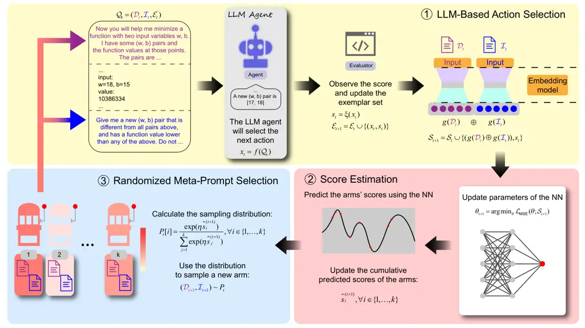

# Meta-Prompt Optimization for LLM-Based Sequential Decision Making

Mingze Kong Affiliation: The Chinese University of Hong Kong, Shenzhen
   Zhiyong Wang Affiliation: Harbin Institute of Technology (Shenzhen)
   Yao Shu Affiliation: The Hong Kong University of Science and
Technology (Guangzhou)    Zhongxiang Dai Affiliation: Corresponding
author: [daizhongxiang@cuhk.edu.cn](mailto:daizhongxiang@cuhk.edu.cn)

###### Abstract

Large language models (LLMs) have recently been employed as agents to
solve sequential decision-making tasks such as Bayesian optimization and
multi-armed bandits (MAB). These works usually adopt an LLM for
sequential action selection by providing it with a fixed, manually
designed _meta-prompt_. However, numerous previous works have found that
the prompt has a significant impact on the performance of the LLM, which
calls for a method to automatically optimize the meta-prompt for
LLM-based agents. Unfortunately, the non-stationarity in the reward
observations during LLM-based sequential decision-making makes
meta-prompt optimization highly challenging. To address this challenge,
we draw inspirations from _adversarial bandit_ algorithms, which are
inherently capable of handling non-stationary reward observations.
Building on this foundation, we propose our _EXPonential-weight
algorithm for prompt Optimization_ (EXPO) to automatically optimize the
task description and meta-instruction in the meta-prompt for LLM-based
agents. We also extend EXPO to additionally optimize the exemplars
(i.e., history of interactions) in the meta-prompt to further enhance
the performance, hence introducing our EXPO-ES algorithm. We use
extensive experiments to show that our algorithms significantly improve
the performance of LLM-based sequential decision-making.

## 1 Introduction

The strong capabilities of LLMs have spurred significant recent
interests in adopting them as agents to solve sequential decision-making
problems, such as multi-armed bandits (MAB) Krishnamurthy et al. (2024),
Bayesian optimization (BO) Yang et al. (2024) and reinforcement learning
(RL) Dai et al. (2024). Specifically, these methods often use an LLM to
sequentially select the actions by providing it with a specially
designed prompt, which we refer to as the _meta-prompt_. The meta-prompt
often contains several components, such as the _task description_, the
_meta-instruction_ (which is used to instruct the LLM to select an
action in every step), the _history of interactions_ with the
environment, among others. The previous methods have all adopted a
fixed, manually designed meta-prompt for the LLM-based agent throughout
the entire sequential decision-making process. However, numerous
previous works have highlighted that the output text generated by LLMs
is heavily dependent on its input prompt Zhou et al. (2023). Therefore,
using fixed, manually designed meta-prompt may significantly limit the
performance of the LLM-based agents, because handcrafted prompts are
often far from optimal Zhou et al. (2025). This naturally begs the
question: _can we automatically optimize the meta-prompt for LLM-based
agents to enhance their performance?_

The sensitivity of LLM-generated text to its input prompt has given rise
to many recent works on _automated prompt optimization_, among which a
representative line of works have adopted the method of multi-armed
bandits (MAB) to automatically optimize the prompt Lin et al. (2024a);
Lin et al. (2024b); Wu et al. (2024). Unfortunately, the problem of
meta-prompt optimization for LLM-based agents presents significant
challenges compared to traditional prompt optimization. This is mostly
due to the _non-stationarity in the observed rewards_ during the
LLM-based sequential decision-making process. Specifically, as the
LLM-based agent engages in more interactions with the environment, its
state in the environment changes, making its observed rewards
non-stationary. For example, in MAB Krishnamurthy et al. (2024) and BO
Yang et al. (2024), the observed rewards in later iterations tend to be
higher than those in initial iterations; similarly, in RL Dai et al.
(2024), the rewards depend on the agent’s state, which itself evolves
across iterations. As a consequence, for the same meta-prompt, its
observed reward is likely to change dynamically across iterations. This
is in stark contrast to classical prompt optimization, in which the
score for a prompt remains stationary. As a result, this renders the
previous works on prompt optimization (such as those based on MAB Lin et
al. (2024a); Lin et al. (2024b); Wu et al. (2024)) inapplicable, and
hence calls for novel algorithmic designs to solve the problem of
meta-prompt optimization for LLM-based agents. To this end, we draw
inspirations from the field of _adversarial bandits_ Lattimore and
Szepesvári (2020).

In adversarial bandits, the reward observations of each arm are chosen
by an adversary and may change arbitrarily across iterations, in
contrast to classical stochastic MAB in which each arm’s rewards are
sampled from a fixed stationary distribution. This ability to handle
non-stationary reward observations makes adversarial bandits an ideal
candidate for meta-prompt optimization for LLM-based agents.
Specifically, drawing inspirations from the EXP3 algorithm for
adversarial bandits, we introduce our _EXPonential-weight algorithm for
prompt Optimization_ (EXPO) to optimize the task description and
meta-instruction in the meta-prompt of an LLM-based agent.¹¹ 1 Other
components of the meta-prompt can also be optimized in a similar
fashion.



Figure 1: Illustration of our EXPO algorithm. We use purple to denote
the task description and blue to represent the meta-instruction.

In addition to the task description and meta-instruction, the _history
of interactions_ with the environment (i.e., the _exemplars_) is another
crucial component of the meta-prompt, and previous works on in-context
learning have shown that both the content and the ordering of exemplars
significantly affect the performance of LLMs Lu et al. (2022).
Therefore, we further extend our EXPO to also optimize the subset of
exemplars included in the meta-prompt and their ordering. However, since
the task description and meta-instruction selected by EXPO vary across
iterations, the reward observations for a fixed exemplar sequence become
non-stationary as well. To this end, we use a separate adversarial
bandit method to optimize the exemplars (i.e., the interaction history),
and hence introduce our _EXPO with Exemplar Selection_ (EXPO-ES)
algorithm.

We use extensive experiments to show that our EXPO significantly
improves the performance of the LLM-based BO algorithm from Yang et al.
(2024) (Sec. 4.1) and the LLM-based MAB algorithm from Krishnamurthy et
al. (2024) (Sec. 4.2). Furthermore, in tasks where the exemplars provide
crucial information for the LLM-based agent, our EXPO-ES further
enhances the performance of EXPO via automated exemplar selection
(Sec. 4.1). We also use ablation study to unveil interesting insights
about our algorithms (Sec. 5). Due to space constraints, a detailed
discussion of related work is deferred to App. 6.

## 2 Problem Setting

Throughout our work, we use _arms_ to represent meta-prompts, and use
_actions_ to denote the actions selected by an LLM-based agent. Consider
an algorithm which uses an LLM to perform a sequential decision-making
task by sequentially instructing the LLM to select an action in every
iteration. A representative example of such algorithms is the
_Optimization by PROmpting_ (OPRO) algorithm from Yang et al. (2024).
OPRO aims to solve an optimization problem, i.e., to find
$`x^{*}={\arg\min}_{x}f(x)`$. To achieve this, in every iteration $`t`$,
OPRO uses an LLM to select a batch of $`B`$ input queries
$`\{x_{t,1},\ldots,x_{t,B}\}`$, after which their corresponding scores
$`\{s_{t,1},\ldots,s_{t,B}\}`$ are observed. When instructing the LLM to
select the input queries, the meta-prompt $`\mathcal{Q}`$ given to the
LLM contains a number of important components, including _a fixed task
description_ $`\mathcal{D}`$, _a fixed meta-instruction_
$`\mathcal{I}`$, and _a sequence of exemplars_ $`\mathcal{E}_{t}`$
corresponding to a subset of the observations (i.e., pairs of input
queries and observed scores) collected so far. The same paradigm of
LLM-based sequential decision making has also been adopted by other
works, such as the LLM-based MAB algorithm from Krishnamurthy et al.
(2024) (more details in Sec. 4.2).

In this work, our first algorithm, EXPO (Sec. 3.1), dynamically
optimizes the task description $`\mathcal{D}`$ and meta-instruction
$`\mathcal{I}`$ (i.e., selects a new $`\mathcal{D}_{t}`$ and
$`\mathcal{I}_{t}`$ in every iteration $`t`$), and our extension
EXPO-ES (Sec. 3.2) additionally optimizes the exemplar sequence
$`\mathcal{E}_{t}`$. We use $`g(\cdot)`$ to denote a pre-trained
embedding function, and separately obtain the embeddings of the task
description $`g(\mathcal{D}_{t})`$, the meta-instruction
$`g(\mathcal{I}_{t})`$ and the exemplar sequence $`g(\mathcal{E}_{t})`$.
In every iteration, we use the history of selected meta-prompts and
their scores to train a neural network (NN), denoted
$`\mathcal{M}(g(\cdot);\theta)`$ with parameters $`\theta`$, which
predicts the scores of meta-prompts in the domain.

Adversarial Bandits. In adversarial bandits, the goal is to compete
against the best arm _in hindsight_ Lattimore and Szepesvári (2020).
Consider an MAB problem with $`k`$ arms (i.e., meta-prompts). For each
arm $`i=1,\ldots,k`$, denote its corresponding sequence of rewards
(i.e., scores) in $`T`$ iterations as $`\{r_{t,i}\}_{t=1,\ldots,T}`$.
The best arm in hindsight is then defined as
$`i^{*}={\arg\max}_{i=1,\ldots,k}\sum^{T}_{t=1}r_{t,i}`$. Then, the goal
of an adversarial bandit algorithm (which selects arm $`A_{t}`$ in
iteration $`t`$) is to minimize the following definition of regret:
$`R_{T}=\sum^{T}_{t=1}r_{t,i^{*}}-\sum^{T}_{t=1}r_{t,A_{t}}`$.

Adversarial Bandits for LLM-Based Agents. LLM-based sequential
decision-making methods often aim to maximize either _(a)_ the
cumulative rewards (e.g., the LLM-based MAB algorithm from Krishnamurthy
et al. (2024)) or _(b)_ the final reward (e.g., OPRO from Yang et al.
(2024)). In the former case, the cumulative rewards of the best arm
$`i^{*}`$ are higher than those of the other arms; in the latter case,
we implicitly assume that the arm with the largest final reward after
$`T`$ iterations also tends to have large rewards across all iterations.
As a result, in both cases, _the observed rewards of an arm in every
iteration are indicative of the quality of the corresponding
meta-prompt_. So, when training the NN $`\mathcal{M}(g(\cdot);\theta)`$
for score prediction, we simply use the observed scores (i.e., rewards)
as the training labels, which we find sufficient for strong empirical
performance (Sec. 4).

## 3 Algorithms

### 3.1 The EXPO Algorithm (Algo. 1)

Domain Generation. We first generate the domain of task descriptions and
meta-instructions. Following previous works on prompt optimization Lin
et al. (2024a); Lin et al. (2024b); Zhou et al. (2023), we use an LLM to
rephrase an initial task description $`\mathcal{D}_{0}`$ (resp. initial
meta-instruction $`\mathcal{I}_{0}`$) into $`k_{1}`$ task descriptions
(resp. $`k_{2}`$ meta-instructions), yielding a domain of size
$`k=k_{1}\times k_{2}`$ (more details in App. B.1). We treat each
combination of a task description $`\mathcal{D}`$ and a meta-instruction
$`\mathcal{I}`$ as an _arm_, so our adversarial bandit problem has $`k`$
arms. We jointly optimize $`\mathcal{D}`$ and $`\mathcal{I}`$, as the
ablation in Fig. 7 shows this outperforms optimizing them separately.

0:  : Initial task description $`\mathcal{D}_{0}`$, initial
meta-instruction $`\mathcal{I}_{0}`$.

1:  Initialize the exemplar set $`\mathcal{E}_{0}=\emptyset`$, and the
subset $`\mathcal{E}_{0}^{\prime}=\emptyset`$, meta-prompt-score set
$`\mathcal{S}_{0}=\emptyset`$, and cumulative score estimates
$`\hat{s}^{(0)}_{i}=0`$ for all $`i\in\{1,\ldots,k\}`$.

2:  for iteration $`t=0,1,\ldots,T-1`$ do

3:   Construct meta-prompt
$`\mathcal{Q}_{t}=(\mathcal{D}_{t},\mathcal{I}_{t},\mathcal{E}_{t}^{\prime})`$.

4:   Query the LLM $`f(\cdot)`$ using the meta-prompt
$`\mathcal{Q}_{t}`$ to select the next action $`x_{t}`$:
$`x_{t}=f(\mathcal{Q}_{t})`$.

5:   Observe the score $`s_{t}`$ for $`x_{t}`$ using the task-specific
evaluator: $`s_{t}=\xi(x_{t})`$.

6:   Update the exemplar set
$`\mathcal{E}_{t+1}=\mathcal{E}_{t}\cup\{(x_{t},s_{t})\}`$.

7:   Update the meta-prompt-score set
$`\mathcal{S}_{t+1}=\mathcal{S}_{t}\cup\{(\left[g(\mathcal{D}_{t})\oplus g(\mathcal{I}_{t})\right],s_{t})\}`$,
where $`g(\cdot)`$ denotes the embedding function and $`\oplus`$ denotes
concatenation.

8:   Update the parameters $`\theta`$ of the neural network (NN)
$`\mathcal{M}(g(\cdot);\theta)`$ by using the updated
$`\mathcal{S}_{t+1}`$ as the training set to minimize the MSE loss,
yielding $`\theta_{t+1}`$.

9:   Update the cumulative score estimates $`\hat{s}^{(t)}_{i}`$ for all
arms $`i`$ using the predicted scores from
$`\mathcal{M}(g(\cdot);\theta_{t+1})`$:
$`\hat{s}_{i}^{(t+1)}=\hat{s}_{i}^{(t)}+\mathcal{M}(\left[g(\mathcal{D}_{i})\oplus g(\mathcal{I}_{i})\right];\theta_{t+1}),\quad\forall i\in\{1,\ldots,k\}.`$

10:   Compute the sampling distribution $`P_{t}`$ over all arms:

```math
\begin{split}P_{t}[i]={}&\frac{\exp(\eta\hat{s}_{i}^{(t+1)})}{\sum_{j=1}^{k}\exp(\eta\hat{s}_{j}^{(t+1)})},\\
&\forall i\in\{1,\ldots,k\}\end{split} \tag{1}
```

11:   Sample an arm (i.e., the combination of a task description and a
meta-instruction) from $`P_{t}`$:
$`(\mathcal{D}_{t+1},\mathcal{I}_{t+1})\sim P_{t}`$.

12:   Select a sequence of exemplars $`\mathcal{E}_{t+1}^{\prime}`$ from
$`\mathcal{E}_{t+1}`$ following a pre-defined heuristic method.

Algorithm 1 EXPO

\scriptsize1⃝LLM-Based Action Selection (lines 3-7 of Algo. 1). At the
beginning of every iteration $`t`$, we firstly use the current task
description $`\mathcal{D}_{t}`$, meta-instruction $`\mathcal{I}_{t}`$
and exemplar sequence $`\mathcal{E}_{t}^{\prime}`$ selected at the end
of the last iteration $`t-1`$ (more details below) to construct a
meta-prompt
$`\mathcal{Q}_{t}=(\mathcal{D}_{t},\mathcal{I}_{t},\mathcal{E}_{t}^{\prime})`$
(line 3). Then, we use $`\mathcal{Q}_{t}`$ as the input prompt to the
LLM $`f(\cdot)`$ to select the next action $`x_{t}`$ and collect its
score $`s_{t}`$ (lines 4-5). After that, we update the set of exemplars
$`\mathcal{E}_{t}`$ and the meta-prompt-score set $`\mathcal{S}_{t}`$
(lines 6-7).

\scriptsize2⃝Score Estimation (lines 8-9). In the classical EXP3
algorithm for adversarial bandits, the cumulative sum of _the observed
rewards_ of every arm is used to construct the arm sampling distribution
via an exponential-weight mechanism Lattimore and Szepesvári (2020).
However, when the number of arms is excessively large (as in our problem
of meta-prompt optimization), the reward observations for many arms are
unavailable, so the cumulative sum of _the estimated rewards_ is used
instead Lattimore and Szepesvári (2020). We therefore estimate the
scores of all $`k`$ arms (i.e., meta-prompts) in the domain and use
these estimates to derive the arm sampling distribution for our EXPO.
Following recent works showing that a neural network (NN) taking the
pre-trained embedding $`g(\cdot)`$ as input leads to powerful prompt
optimization Lin et al. (2024a); Lin et al. (2024b); Wu et al. (2024),
we adopt an NN $`\mathcal{M}(g(\cdot);\theta)`$ for score estimation in
our EXPO. Specifically, in every iteration $`t`$, we use the history of
selected meta-prompts and their scores, denoted as $`\mathcal{S}_{t+1}`$
(line 7 of Algo. 1), to train an NN by minimizing the mean-squared error
(MSE) loss (line 8 of Algo. 1). The trained NN with parameters
$`\theta_{t+1}`$ can then be used to estimate the score of every arm
(i.e., every combination of task description and meta-instruction) in
the domain. For every arm, its estimated score is then added to its
corresponding _cumulative sum of score estimates_
$`\hat{s}_{i}^{(t+1)}`$ (line 9 of Algo. 1). Note that each term in the
cumulative sum $`\hat{s}_{i}^{(t+1)}`$ is the score estimate for arm
$`i`$ from an NN trained using the observation history up to that
iteration.

\scriptsize3⃝Randomized Meta-Prompt Selection (lines 10-12). After the
cumulative sum $`\hat{s}_{i}^{(t+1)}`$ of every arm $`i`$ is updated, we
follow the EXP3 algorithm Lattimore and Szepesvári (2020) and use the
cumulative sums to construct a distribution following Equation (1).
Then, we use this distribution to randomly sample the next arm, i.e.,
the next task description $`\mathcal{D}_{t+1}`$ and meta-instruction
$`\mathcal{I}_{t+1}`$ (line 11 of Algo. 1). _Randomization_ is a key
principle in adversarial bandits Lattimore and Szepesvári (2020), and
the randomization involved in our arm selection strategy is crucial for
the ability of our EXPO to deal with non-stationary reward observations.
The heuristic for selecting the exemplar sequence
$`\mathcal{E}^{\prime}_{t+1}`$ (line 12 of Algo. 1) is usually specified
by the underlying LLM-based algorithm Yang et al. (2024); we discuss its
automated optimization in Sec. 3.2.

Exploitation vs. Exploration. Our EXPO achieves a principled balance
between exploitation and exploration. The powerful pre-trained embedding
and NN yield accurate score estimation, so the cumulative score estimate
$`\hat{s}_{i}^{(t+1)}`$ (line 9 of Algo. 1) provides a reliable
assessment of the quality of every arm $`i`$; this ensures that
high-scoring arms receive large weights in the sampling distribution
$`P_{t}`$ (line 10), leading to reliable _exploitation_. Meanwhile, the
inherent randomness in our arm selection strategy ensures that enough
_exploration_ is performed in the domain of meta-prompts.

Batch Action Selection. Although our EXPO (Algo. 1) selects one action
$`x_{t}`$ in every iteration $`t`$, it can be easily generalized to
select a batch of actions. For example, when applying EXPO to improve
OPRO Yang et al. (2024) (Sec. 4.1), we follow the practice of OPRO to
select a batch of $`8`$ actions per iteration (step 4 of Algo. 1) with
the LLM temperature set to $`1`$ for diversity, while selecting the last
action with temperature $`0`$ to obtain a noiseless and reliable score
$`s_{t}`$ for the meta-prompt $`\mathcal{Q}_{t}`$ (line 5 of Algo. 1).

### 3.2 EXPO with Exemplar Selection (EXPO-ES)

Previous works on LLM-based for sequential decision making often select
the sequence of exemplars $`\mathcal{E}_{t+1}^{\prime}`$ included in the
meta-prompt $`\mathcal{Q}_{t}`$ using a fixed pre-defined heuristic
(line 12 of Algo. 1). For example, OPRO includes the 20 exemplars with
the best observed performance in the meta-prompt, arranged in ascending
order of performance Yang et al. (2024); the LLM-based MAB method from
Krishnamurthy et al. (2024) either includes all exemplars (ordered by
their iteration sequence) in the prompt or includes a summarized
representation of all exemplars. However, numerous previous works have
reported that both the subset of exemplars and their ordering have
significant impacts on the performance of LLM Wu et al. (2024).
Therefore, here we further extend our EXPO (Algo. 1) to additionally
optimize the sequence of exemplars $`\mathcal{E}^{\prime}_{t+1}`$ (i.e.,
to replace line 12 of Algo. 1 by an automated method to select
$`\mathcal{E}^{\prime}_{t+1}`$), hence introducing our EXPO-ES algorithm
(Algo. 2, App. A).

Since the task description and meta-instruction selected by EXPO change
across iterations, the optimization of exemplar sequences is
non-stationary as well, so we also optimize it based on the EXP3
algorithm. That is, in every iteration of our EXPO-ES (Algo. 2), we
first optimize the task description and meta-instruction (lines 3-11 of
Algo. 1), and then optimize the exemplar sequence
$`\mathcal{E}^{\prime}_{t+1}`$ in a similar way.

Details of EXPO-ES (Algo. 2). Specifically, after the task description
and meta-instruction are optimized (i.e., after lines 3-11 of Algo. 1),
we firstly extract the embedding of the exemplar sequence
$`\mathcal{E}^{\prime}_{t}`$ used in this iteration:
$`g(\mathcal{E}^{\prime}_{t})`$, and add
$`\left(g(\mathcal{E}^{\prime}_{t}),s_{t}\right)`$ to the _exemplar
training set_ $`\mathcal{T}_{t+1}`$ (line 4 of Algo. 2). Next, the
updated dataset $`\mathcal{T}_{t+1}`$ is used to train an NN with
parameters $`\theta^{\text{ES}}_{t+1}`$ (line 5), which is able to
_estimate the score of any exemplar sequence_. Subsequently, we randomly
sample $`k^{\text{ES}}`$ exemplars sequences, each containing
$`\mathcal{L}`$ exemplars, to be used as our _domain of exemplar
sequences_ (line 8). Next, for every candidate exemplar sequence in the
domain, we obtain its cumulative score estimate (similar to line 9 of
Algo. 1). However, due to _the time-varying nature of the domain of
exemplar sequences_ (caused by the addition of new exemplars and the
random sampling of sequences), we can no longer maintain and
incrementally update a cumulative score estimate for every arm. To this
end, we save the trained NN parameters of every iteration; then for each
sampled exemplar sequence, we obtain its score estimates from all NNs in
the history and use their sum as its _cumulative score estimate_ (lines
9-14 of Algo. 2). Next, the cumulative score estimates for all exemplar
sequences are used to compute the sampling distribution, from which the
next exemplar sequence $`\mathcal{E}^{\prime}_{t+1}`$ is sampled and
used to the meta-prompt in the next iteration (lines 15-16).

## 4 Experiments

|                   |                   |            |            |            |
| ----------------- | ----------------- | ---------- | ---------- | ---------- |
|                   |                   |            |            |            |
| Linear Regression | Linear Regression | TSP        | TSP        | TSP        |
| ($`w=2,b=30`$)    | ($`w=36,b=-1`$)   | (10 Nodes) | (15 Nodes) | (20 Nodes) |

Figure 2: Results of different algorithms (mean $`\pm`$ standard error)
in the Linear Regression and TSP task (Sec. 4.1). Lower is better.

We firstly apply our algorithms to improve the performance of OPRO in
Linear Regression (LR), traveling salesman problem (TSP) and instruction
optimization tasks, adopting the same experimental setting as Yang et
al. (2024) (Sec. 4.1). Then, we use our algorithms to enhance the
performance of the LLM-based MAB algorithm from Krishnamurthy et al.
(2024).

### 4.1 Linear Regression (LR), Traveling Salesman Problem (TSP) and Instruction Optimization

Linear Regression (LR). In the LR task, our goal is to find the optimal
LR coefficients, $`w`$ and $`b`$, that best fit a set of given noisy
observations. We firstly choose the groundtruth LR coefficients
$`w_{\text{true}}`$ and $`b_{\text{true}}`$, and use them to generate
noisy observations for 50 inputs $`x`$ which are randomly and uniformly
selected within $`[-1,1]`$. Specifically, for each input $`x`$, we
generate its noisy observation as
$`y=w_{\text{true}}x+b_{\text{true}}+\epsilon`$ where $`\epsilon`$ is a
Gaussian noise. We adopt the two most challenging choices of
coefficients from Yang et al. (2024): (1)
$`w_{\text{true}}=2,b_{\text{true}}=30`$ and (2)
$`w_{\text{true}}=36,b_{\text{true}}=-1`$. In this task, OPRO aims to
find the optimal $`w`$ and $`b`$ which minimizes the regression error
(i.e., mean squared error).

Traveling Salesman Problem (TSP). In the classical TSP problem Jünger et
al. (1995), given a set of $`n`$ nodes with their coordinates, the
objective is to find the shortest route that starts from a given node,
traverses all nodes exactly once, and finally returns to the starting
node. Therefore, our goal is to solve a discrete optimization problem in
which the input variable is a trajectory and the goal is to minimize the
total distance of the trajectory. We adopt TSP instances with 10, 15,
and 20 randomly generated nodes, respectively, which represent
increasing levels of difficulty.

We adopt GPT-3.5-Turbo as the LLM in both the LR and TSP tasks. The
results for both tasks are shown in Fig. 2, which plot the regression
error (i.e., mean squared error) for the LR tasks and optimality gap
(i.e., the difference between the total distance of the discovered route
and that of the optimal route) for the TSP tasks (lower is better for
both tasks). Of note, in addition to the standard OPRO (pink curves)
Yang et al. (2024), we have also proposed an enhanced variant of OPRO
(green curves) in which we added some further clarifications to the task
description (see App. B.2.5 for more details). The enhanced variant
consistently improves the performance of the standard OPRO (Fig. 2).²² 2
As discussed in the last paragraph of Sec. 3.1, we have slightly
modified OPRO to select the last action in the batch using a temperature
of $`0`$. We empirically show that this leads to comparable performance
with the original OPRO which uses a temperature of $`1`$ to choose all
$`8`$ actions (see Fig. 15 in App. C.3). More importantly, the results
in Fig. 2 show that _in all tasks, our EXPO algorithm (blue curves)
significantly and consistently outperforms OPRO_, including both
standard OPRO and its enhanced variant. This demonstrates that our
meta-prompt optimization approach, grounded in adversarial bandits,
leads to more efficient (i.e., faster convergence) and more effective
(i.e., improved final performance) LLM-based sequential decision making.

OPRO Now you will help me minimize a function with two input variables
$`w,b`$. I have some $`(w,b)`$ pairs and the function values at those
points. The pairs are arranged in descending order based on their
function values, where lower values are better.

{EXEMPLARS}

Give me a new $`(w,b)`$ pair that is different from all pairs above, and
has a function value lower than any of the above. Do not write code. The
output must end with a pair $`[w,b]`$, where $`w`$ and $`b`$ are
numerical values.

EXPO We will collaborate to optimize a function involving two
parameters, \\w\\ and \\b\\. I possess a set of data points, each
consisting of \\(w, b)\\ pairs and their corresponding function values.
These pairs are systematically organized in reverse order, starting from
the greatest to the smallest function values. Essentially, the lower the
function value, the more optimal or preferable the pair. Consequently,
our goal is to identify and analyze the \\(w, b)\\ pair that manifests
the lowest function value, as this represents the perspective of optimum
efficacy.

{EXEMPLARS}

To enhance the quality and expand on the existing instructions, follow
these improved guidelines vis-à-vis designing a new and distinctive
numerical pair: ensure the selected $`(w,b)`$ combination diverges from
prior examples and secures a function output lower than preceding
values. Key details on methodology or calculations are not required—just
ensure clarity in presenting a returned value that closes with the
specific format $`[w,b]`$, where both $`w`$ and $`b`$ are distinct
numerical figures.

Figure 3: The task description and meta-instruction used by OPRO (left)
and optimized by our EXPO (right) in a Linear Regression task.

|              |              |              |              |
| ------------ | ------------ | ------------ | ------------ |
|              |              |              |              |
| BSSND (easy) | BSSCD (easy) | BSSND (hard) | BSSCD (hard) |

Figure 4: Cumulative regret in the LLM-based MAB experiments (Sec. 4.2).
Lower is better.

Meanwhile, our EXPO-ES algorithm, which is additionally equipped with
automated exemplar selection, considerably improves the performance of
EXPO in the LR tasks yet performs on par with EXPO in the TSP tasks.
This is likely because the exemplars play a more important role in the
LR tasks than the TSP tasks. Specifically, in LR, _the input-output
exemplars provide important information for identifying the optimal LR
coefficients_ Wu et al. (2024). Therefore, selecting better exemplars
(via our EXPO-ES) brings significant performance boost. On the other
hand, in the TSP tasks, due to the challenging nature of the tasks, it
is difficult for the LLM to infer crucial and useful information from
the exemplars. Therefore, the other components in the meta-prompt (i.e.,
the task description and meta-instruction) provide more useful
information in the TSP tasks. As a result, _selecting better exemplars
does not lead to noticeable performance gains in the TSP tasks_. Fig. 3
provides an illustration of the original task description and
meta-instruction used by OPRO and those discovered by our EXPO algorithm
for the LR tasks, whereas the corresponding meta-prompts for the TSP
tasks are displayed in Fig. 17 in App. C.6.

Figure 5: Instruction optimization task (higher is better).

Instruction Optimization. We have also adopted our EXPO to improve the
performance of OPRO in instruction optimization tasks using the GSM8K
dataset Cobbe et al. (2021). We adopt GPT-4-Turbo as the optimizer LLM
to sequentially propose different instructions, and use Qwen-2.5-7B as
the scorer LLM to evaluate the effectiveness of these instructions (more
details in App. B.2.1). The results in Fig. 5 show that our EXPO also
considerably outperforms OPRO in this challenging task. Moreover,
EXPO-ES further improves the performance of EXPO, which is likely
because the exemplars (i.e., instructions and their scores) provide
valuable information for instruction optimization in this task.

### 4.2 LLM-Based Multi-Armed Bandits (MAB)

The work of Krishnamurthy et al. (2024) has used an LLM to sequentially
select the arms/actions in MAB and proposed methods to manually design
the meta-prompt. Their prompt design consists of 5 components with each
having 2 possible choices, which gives rise to a total of $`2^{5}=32`$
possible prompts. Here we show that our algorithms can be used to
automatically optimize their manually designed prompts to further
enhance their performance. Specifically, we adopt 2 of their prompt
designs: BSSND and BSSCD, and apply our EXPO and EXPO-ES algorithms to
optimize the important components in these prompt designs. Following
Krishnamurthy et al. (2024), we use two MAB instances: _easy_ and
_hard_. We adopt GPT-4-Turbo as the LLM here. More details on the
experimental design are deferred to App. B.3.1. The results for the 4
experimental settings (i.e., 2 prompt designs $`\times`$ 2 MAB
instances) are shown in Fig. 4, which demonstrate that our EXPO and
EXPO-ES algorithms are able to significantly reduce the cumulative
regret of MAB in this task across different prompt desings and MAB
instances. We illustrate the comparison between the original meta-prompt
and the one optimized by our EXPO in Figs. 18 and 19 in App. C.6.

## 5 Ablation Study

Only Optimizing Task Description or Meta-Instruction. Our EXPO jointly
optimize the task description $`\mathcal{D}`$ and the meta-instruction
$`\mathcal{I}`$. Here we evaluate the performance of optimizing either
$`\mathcal{D}`$ or $`\mathcal{I}`$ alone. The results in Fig. 7 show
that jointly optimizing them indeed leads to significantly better
performance. However, optimizing these components alone still
consistently outperforms OPRO.

|                                       |                                        |
| ------------------------------------- | -------------------------------------- |
|                                       |                                        |
| Linear Regression ($`w=2`$, $`b=30`$) | Linear Regression ($`w=36`$, $`b=-1`$) |

Figure 6: Results of EXPO when _only_ optimizing the task description or
the meta-instruction.

|                                       |                                        |
| ------------------------------------- | -------------------------------------- |
|                                       |                                        |
| Linear Regression ($`w=2`$, $`b=30`$) | Linear Regression ($`w=36`$, $`b=-1`$) |

Figure 7: Comparison of our EXPO with general prompt optimization
methods in the LR tasks.

|                |                |                |                             |
| -------------- | -------------- | -------------- | --------------------------- |
|                |                |                |                             |
| TSP (10 nodes) | TSP (15 nodes) | TSP (20 nodes) | TSP (20 Nodes, GPT-4-Turbo) |

Figure 8: First three figures: ablation study on impact of exploration
parameter $`\eta`$. Rightmost figure: results using GPT-4-Turbo.

Comparison with General Prompt Optimization Methods. As discussed in
Sec. 1, in the problem of meta-prompt optimization for LLM-based agents,
_the non-stationary reward observations render the previous general
prompt optimization methods unsuitable_. Here we verify this by
comparing our EXPO with a variety of general prompt optimization
methods, including the INSTINCT algorithm based on stochastic MAB Lin et
al. (2024b), PromptBreeder Fernando et al. (2023) and MIPRO Opsahl-Ong
et al. (2024). The results for the Linear Regression tasks are displayed
in Fig. 7, which demonstrate that general prompt optimization methods
indeed significantly underperform in the problem of meta-prompt
optimization for LLM-based agents. We have also compared with INSTINCT
Lin et al. (2024b) (i.e., the best-performing baseline method from
Fig. 7) in the TSP tasks, and the results (Fig. 20 in App. C.7) also
show that INSTINCT consistently performs worse than our EXPO. These
results provide further justifications for our proposed adversarial
bandit-based algorithms.

Impact of the Degree of Exploration. Here we examine the impact of the
degree of exploration, i.e., the value of $`\eta`$ (line 10 of Algo. 1).
The results (Fig. 8, first three figures) show that an excessively large
degree of exploration (i.e., a small $`\eta=10`$) or an overly small
degree of exploration (i.e., a large $`\eta=1000`$) both deteriorate the
performance. Moreover, the results also demonstrate that in easier tasks
(i.e., TSP with 10 nodes), imposing a smaller degree of exploration
(i.e., $`\eta=1000`$) leads to better performance compared to
$`\eta=10`$, because it allows our EXPO to quickly converge to the
optimal solution. Meanwhile, in more challenging tasks (i.e., TSP with
20 nodes), more exploration (i.e., $`\eta=10`$) results in better
performance (than $`\eta=1000`$), because it makes it easier for our
EXPO to escape local optimum.

Experiments With Other LLMs. To evaluate the effectiveness of our
approach when combined with different LLMs, here we adopt the
challenging TSP task with 20 nodes and replace the GPT-3.5-Turbo model
used in our original experiments (Sec. 4.1) by the more advanced
GPT-4-Turbo model. The results in Fig. 8 (rightmost figure) show that
GPT-4-Turbo significantly improves the performance of both OPRO and our
EXPO. More importantly, as visualized more clearly in Fig. 14 in
App. C.2, when both adopting GPT-4-Turbo, our EXPO still significantly
outperforms OPRO. The results show that our EXPO can effectively improve
the performance of LLM-based agents across different LLMs. We provide
two further ablation studies in the appendix: fixing the meta-prompt to
the optimal one discovered by EXPO yields dramatic performance gains
(App. C.1), and EXPO is substantially more computationally efficient
than OPRO (App. C.5).

## 6 Related Work

Prompt Optimization. Early prompt optimization focused on _white-box_
LLMs via gradient-based Shi et al. (2023); Shin et al. (2020), RL Deng
et al. (2022), and soft-tuning methods Lester et al. (2021); Li and
Liang (2021); Zhong et al. (2021). Recent _black-box_ approaches
leverage evolutionary algorithms Fernando et al. (2023); Guo et al.
(2024); Zhou et al. (2023), zeroth-order optimization Hu et al. (2024);
Zhan et al. (2024), MCTS Wang et al. (2023b), and Hyperband Schneider et
al. (2024), with multi-armed bandits Chen et al. (2023); Lin et al.
(2024b); Shi et al. (2024) and RL Kong et al. (2024) further addressing
sample efficiency. Prompt optimization has also been extended to vision
language models Zhang et al. (2025). Regarding exemplar selection,
existing methods employ either static sets Li and Qiu (2023); Nguyen and
Wong (2023); Wang et al. (2023a); Zhang et al. (2022) or dynamic
retrievers Albalak et al. (2024); Gao et al. (2024); Gupta et al.
(2023); Levy et al. (2023); Liu et al. (2022); Rubin et al. (2022); Ye
et al. (2023), with limited works exploring joint optimization
Opsahl-Ong et al. (2024); Wan et al. (2024); Wu et al. (2024). To our
knowledge, our algorithm is the first to efficiently optimize
_meta-prompts_ for agents in sequential decision-making tasks.

LLM-Based Sequential Decision Making. Recent studies leverage LLMs for
sequential decision-making problems, including Bayesian optimization
Yang et al. (2024), multi-armed bandits Chen et al. (2024);
Krishnamurthy et al. (2024); Mukherjee et al. (2024); Xia et al. (2024),
and reinforcement learning Dai et al. (2024); Monea et al. (2024); Wang
et al. (2024a). However, most approaches rely on fixed, manual
meta-prompts, limiting their full potential. Concurrently, the rapidly
growing field of LLM-based agents has introduced a large number of
benchmarks Liu et al. (2023); Wu et al. (2023); Xi et al. (2024); Jia et
al. (2026). A number of recent works have focused on improving the
reasoning ability Yang et al. (2026); Huang et al. (2026); Zhang et al.
(2026); Wang et al. (2026) and tool-used capability Chen et al. (2026);
Wei et al. (2026) of LLM-based agents via reinforcement learning. For
comprehensive overviews, we refer readers to recent surveys Cheng et al.
(2024); Wang et al. (2024b); Xi et al. (2023).

## 7 Conclusion

In this work, we have proposed the EXPO algorithm to automatically
optimize the meta-prompt for LLM-based sequential decision-making tasks,
together with its extension EXPO-ES which additionally optimizes the
exemplars in the meta-prompt. Both algorithms estimate meta-prompt
scores with neural networks and select meta-prompts in a randomized
fashion based on adversarial bandits. Extensive experiments show that
our algorithms considerably and consistently improve the performance of
LLM-based sequential decision-making. Extending our approach to
LLM-based multi-agent systems is a promising direction for future work.

## Limitations

Our empirical study focuses on a specific set of LLM-based sequential
decision-making benchmarks (linear regression, TSP, multi-armed bandits,
and GSM8K-style instruction optimization) and a small number of frontier
LLMs; performance and behavior may differ on other tasks or models. The
proposed algorithms also inherit the cost profile of repeated LLM
queries, which can be substantial for long horizons. Finally, while our
analysis draws on adversarial-bandit theory, the regret bounds rely on
assumptions (e.g., bounded reward feedback, fixed meta-prompt candidate
set) that may be violated in fully open-ended deployment settings.

## Acknowledgements

This work was supported in part by the National Natural Science
Foundation of China (Grant No. 62506319), the Guangdong Basic and
Applied Basic Research Foundation (Grant No. 2026A1515030032,
2025A1515110115), the Shenzhen Science and Technology Program (Grant
No. JCYJ20250604141031003) and the Pearl River Talent Program of
Guangdong Province (Grant No. 2024QN11X069).

## References

- Albalak et al. (2024) A. Albalak, Y. Elazar, S. M. Xie, S. Longpre, N.
  Lambert, X. Wang, N. Muennighoff, B. Hou, L. Pan, H. Jeong, C.
  Raffel, S. Chang, T. Hashimoto, and W. Y. Wang A survey on data
  selection for language models. arXiv:2402.16827. Cited by: §6.
- Chen et al. (2026) B. Chen, W. Wang, S. Zhang, M. Lin, and M. Zhang
  Step-grpo: internalizing dynamic early exit for efficient reasoning.
  In Proceedings of the 64th Annual Meeting of the Association for
  Computational Linguistics (Volume 1: Long Papers), pp. 21710–21724.
  Cited by: §6.
- Chen et al. (2024) D. Chen, Q. Zhang, and Y. Zhu Efficient sequential
  decision making with large language models. arXiv preprint
  arXiv:2406.12125. Cited by: §6.
- Chen et al. (2023) L. Chen, J. Chen, T. Goldstein, H. Huang, and T.
  Zhou InstructZero: efficient instruction optimization for black-box
  large language models. arXiv:2306.03082. Cited by: §6.
- Cheng et al. (2024) Y. Cheng, C. Zhang, Z. Zhang, X. Meng, S. Hong, W.
  Li, Z. Wang, Z. Wang, F. Yin, J. Zhao, et al. Exploring large language
  model based intelligent agents: definitions, methods, and prospects.
  arXiv preprint arXiv:2401.03428. Cited by: §6.
- Cobbe et al. (2021) K. Cobbe, V. Kosaraju, M. Bavarian, M. Chen, H.
  Jun, L. Kaiser, M. Plappert, J. Tworek, J. Hilton, R. Nakano, C.
  Hesse, and J. Schulman Training verifiers to solve math word problems.
  arXiv preprint arXiv:2110.14168. Cited by: §B.2.1, §B.5, §4.1.
- Dai et al. (2024) Z. Dai, F. Tomasi, and S. Ghiassian In-context
  exploration-exploitation for reinforcement learning. arXiv preprint
  arXiv:2403.06826. Cited by: §1, §1, §6.
- Deng et al. (2022) M. Deng, J. Wang, C. Hsieh, Y. Wang, H. Guo, T.
  Shu, M. Song, E. Xing, and Z. Hu RLPrompt: optimizing discrete text
  prompts with reinforcement learning. In Proc. EMNLP, pp. 3369–3391.
  Cited by: §6.
- Fernando et al. (2023) C. Fernando, D. Banarse, H. Michalewski, S.
  Osindero, and T. Rocktäschel Promptbreeder: self-referential
  self-improvement via prompt evolution. arXiv:2309.16797. Cited by:
  §B.5, §5, §6.
- Gao et al. (2024) L. Gao, A. Chaudhary, K. Srinivasan, K.
  Hashimoto, K. Raman, and M. Bendersky Ambiguity-aware in-context
  learning with large language models. arXiv:2309.07900. Cited by: §6.
- Guo et al. (2024) Q. Guo, R. Wang, J. Guo, B. Li, K. Song, X. Tan, G.
  Liu, J. Bian, and Y. Yang Connecting large language models with
  evolutionary algorithms yields powerful prompt optimizers. In Proc.
  ICLR, Cited by: §6.
- Gupta et al. (2023) S. Gupta, M. Gardner, and S. Singh Coverage-based
  example selection for in-context learning. In Proc. EMNLP,
  pp. 13924–13950. Cited by: §6.
- Hu et al. (2024) W. Hu, Y. Shu, Z. Yu, Z. Wu, X. Lin, Z. Dai, S. Ng,
  and B. K. H. Low Localized zeroth-order prompt optimization. In Proc.
  NeurIPS, Cited by: §6.
- Huang et al. (2026) Z. Huang, X. Xia, Y. Ren, J. Zheng, X. Wang, Z.
  Zhang, H. Xie, S. Liang, Z. Chen, X. Xiao, et al. Does your reasoning
  model implicitly know when to stop thinking?. arXiv preprint
  arXiv:2602.08354. Cited by: §6.
- Jia et al. (2026) R. Jia, R. Lan, F. Liu, Z. Dai, B. Jiang, J.
  Shao, J. Chen, G. Xu, F. Wu, and M. Zhang CASTLE: a comprehensive
  benchmark for evaluating student-tailored personalized safety in large
  language models. In EMNLP, Cited by: §6.
- Jünger et al. (1995) M. Jünger, G. Reinelt, and G. Rinaldi The
  traveling salesman problem. Handbooks in operations research and
  management science 7, pp. 225–330. Cited by: §4.1.
- Kong et al. (2024) W. Kong, S. A. Hombaiah, M. Zhang, Q. Mei, and M.
  Bendersky PRewrite: prompt rewriting with reinforcement learning.
  arXiv preprint arXiv:2401.08189. Cited by: §6.
- Krishnamurthy et al. (2024) A. Krishnamurthy, K. Harris, D. J.
  Foster, C. Zhang, and A. Slivkins Can large language models explore
  in-context?. arXiv preprint arXiv:2403.15371. Cited by: Figure 9,
  Appendix A, Appendix A, §B.3.1, §B.3.2, §C.6, §1, §1, §1, §2, §2,
  §3.2, §4.2, §4, §6.
- Lattimore and Szepesvári (2020) T. Lattimore and C. Szepesvári Bandit
  algorithms. Cambridge University Press. Cited by: §1, §2, §3.1, §3.1.
- Lester et al. (2021) B. Lester, R. Al-Rfou, and N. Constant The power
  of scale for parameter-efficient prompt tuning. In Proc. EMNLP,
  pp. 3045–3059. Cited by: §6.
- Levy et al. (2023) I. Levy, B. Bogin, and J. Berant Diverse
  demonstrations improve in-context compositional generalization. In
  Proc. ACL, pp. 1401–1422. Cited by: §6.
- Li and Liang (2021) X. L. Li and P. Liang Prefix-tuning: optimizing
  continuous prompts for generation. In Proceedings of the 59th Annual
  Meeting of the Association for Computational Linguistics and the 11th
  International Joint Conference on Natural Language Processing (Volume
  1: Long Papers), pp. 4582–4597. Cited by: §6.
- Li and Qiu (2023) X. Li and X. Qiu Finding support examples for
  in-context learning. In Proc. EMNLP, pp. 6219–6235. Cited by: §6.
- Lin et al. (2024a) X. Lin, Z. Dai, A. Verma, S. Ng, P. Jaillet,
  and B. K. H. Low Prompt optimization with human feedback. arXiv
  preprint arXiv:2405.17346. Cited by: §1, §3.1, §3.1.
- Lin et al. (2024b) X. Lin, Z. Wu, Z. Dai, W. Hu, Y. Shu, S. Ng, P.
  Jaillet, and B. K. H. Low Use your INSTINCT: instruction optimization
  using neural bandits coupled with transformers. In Proc. ICML, Cited
  by: §B.5, §C.7, §1, §3.1, §3.1, §5, §6.
- Liu et al. (2022) J. Liu, D. Shen, Y. Zhang, B. Dolan, L. Carin,
  and W. Chen What makes good in-context examples for GPT-3?. In Proc.
  DeeLIO: Deep Learning Inside Out, pp. 100–114. Cited by: §6.
- Liu et al. (2023) X. Liu, H. Yu, H. Zhang, Y. Xu, X. Lei, H. Lai, Y.
  Gu, H. Ding, K. Men, K. Yang, et al. Agentbench: evaluating llms as
  agents. arXiv preprint arXiv:2308.03688. Cited by: §6.
- Lu et al. (2022) Y. Lu, M. Bartolo, A. Moore, S. Riedel, and P.
  Stenetorp Fantastically ordered prompts and where to find them:
  overcoming few-shot prompt order sensitivity. In Proc. ACL,
  pp. 8086–8098. Cited by: §1.
- Monea et al. (2024) G. Monea, A. Bosselut, K. Brantley, and Y. Artzi
  LLMs are in-context reinforcement learners. arXiv preprint
  arXiv:2410.05362. Cited by: §6.
- Mukherjee et al. (2024) S. Mukherjee, J. P. Hanna, Q. Xie, and R.
  Nowak Pretraining decision transformers with reward prediction for
  in-context multi-task structured bandit learning. arXiv preprint
  arXiv:2406.05064. Cited by: §6.
- Nguyen and Wong (2023) T. Nguyen and E. Wong In-context example
  selection with influences. arXiv:2302.11042. Cited by: §6.
- Opsahl-Ong et al. (2024) K. Opsahl-Ong, M. J. Ryan, J. Purtell, D.
  Broman, C. Potts, M. Zaharia, and O. Khattab Optimizing instructions
  and demonstrations for multi-stage language model programs. arXiv
  preprint arXiv:2406.11695. Cited by: §B.5, §5, §6.
- Rubin et al. (2022) O. Rubin, J. Herzig, and J. Berant Learning to
  retrieve prompts for in-context learning. In Proc. NAACL,
  pp. 2655–2671. Cited by: §6.
- Schneider et al. (2024) L. Schneider, M. Wistuba, A. Klein, J.
  Golebiowski, G. Zappella, and F. A. Merra Hyperband-based bayesian
  optimization for black-box prompt selection. arXiv preprint
  arXiv:2412.07820. Cited by: §6.
- Shi et al. (2024) C. Shi, K. Yang, J. Yang, and C. Shen Best arm
  identification for prompt learning under a limited budget. arXiv
  preprint arXiv:2402.09723. Cited by: §6.
- Shi et al. (2023) W. Shi, X. Han, H. Gonen, A. Holtzman, Y. Tsvetkov,
  and L. Zettlemoyer Toward human readable prompt tuning: kubrick’s the
  shining is a good movie, and a good prompt too?. In Proc. EMNLP,
  pp. 10994–11005. Cited by: §6.
- Shin et al. (2020) T. Shin, Y. Razeghi, R. L. L. IV, E. Wallace,
  and S. Singh Eliciting knowledge from language models using
  automatically generated prompts. In Proc. EMNLP, pp. 4222–4235. Cited
  by: §6.
- Wan et al. (2024) X. Wan, R. Sun, H. Nakhost, and S. O. Arik Teach
  better or show smarter? on instructions and exemplars in automatic
  prompt optimization. arXiv preprint arXiv:2406.15708. Cited by: §6.
- Wang et al. (2026) H. Wang, X. Li, X. Wang, Z. Zhang, X. Lu, Z.
  Huang, J. Chai, G. Yin, D. Wang, H. Zhou, et al. Policy improvement
  reinforcement learning. arXiv preprint arXiv:2604.00860. Cited by: §6.
- Wang et al. (2024a) J. Wang, E. Blaser, H. Daneshmand, and S. Zhang
  Transformers learn temporal difference methods for in-context
  reinforcement learning. arXiv preprint arXiv:2405.13861. Cited by: §6.
- Wang et al. (2024b) L. Wang, C. Ma, X. Feng, Z. Zhang, H. Yang, J.
  Zhang, Z. Chen, J. Tang, X. Chen, Y. Lin, et al. A survey on large
  language model based autonomous agents. Frontiers of Computer Science
  18 (6), pp. 186345. Cited by: §6.
- Wang et al. (2023a) X. Wang, W. Zhu, M. Saxon, M. Steyvers, and W. Y.
  Wang Large language models are latent variable models: explaining and
  finding good demonstrations for in-context learning. In Proc. NeurIPS,
  pp. 15614–15638. Cited by: §6.
- Wang et al. (2023b) X. Wang, C. Li, Z. Wang, F. Bai, H. Luo, J.
  Zhang, N. Jojic, E. P. Xing, and Z. Hu Promptagent: strategic planning
  with language models enables expert-level prompt optimization. arXiv
  preprint arXiv:2310.16427. Cited by: §6.
- Wei et al. (2026) S. Wei, H. Min, X. Dong, X. Lin, S. Cui, B.
  Jiang, Z. Dai, K. Kuang, G. Xu, F. Wu, et al. MetaForge: a
  self-evolving multimodal agent that retrieves, adapts, and forges
  tools on demand. arXiv preprint arXiv:2606.01801. Cited by: §6.
- Wu et al. (2023) Y. Wu, X. Tang, T. M. Mitchell, and Y. Li Smartplay:
  a benchmark for llms as intelligent agents. arXiv preprint
  arXiv:2310.01557. Cited by: §6.
- Wu et al. (2024) Z. Wu, X. Lin, Z. Dai, W. Hu, Y. Shu, S. Ng, P.
  Jaillet, and B. K. H. Low Prompt optimization with EASE? efficient
  ordering-aware automated selection of exemplars. In Proc. NeurIPS,
  Cited by: §1, §3.1, §3.2, §4.1, §6.
- Xi et al. (2023) Z. Xi, W. Chen, X. Guo, W. He, Y. Ding, B. Hong, M.
  Zhang, J. Wang, S. Jin, E. Zhou, et al. The rise and potential of
  large language model based agents: a survey. arXiv preprint
  arXiv:2309.07864. Cited by: §6.
- Xi et al. (2024) Z. Xi, Y. Ding, W. Chen, B. Hong, H. Guo, J. Wang, D.
  Yang, C. Liao, X. Guo, W. He, et al. AgentGym: evolving large language
  model-based agents across diverse environments. arXiv preprint
  arXiv:2406.04151. Cited by: §6.
- Xia et al. (2024) F. Xia, H. Liu, Y. Yue, and T. Li Beyond numeric
  awards: in-context dueling bandits with llm agents. arXiv preprint
  arXiv:2407.01887. Cited by: §6.
- Yang et al. (2024) C. Yang, X. Wang, Y. Lu, H. Liu, Q. V. Le, D. Zhou,
  and X. Chen Large language models as optimizers. In Proc. ICLR, Cited
  by: §B.2.5, §B.2.5, §B.5, §1, §1, §1, §2, §2, §3.1, §3.1, §3.2, §4.1,
  §4.1, §4, §6.
- Yang et al. (2026) F. Yang, Z. Chen, X. Wang, X. Lu, J. Chai, G.
  Yin, W. Lin, S. Ma, F. Zhuang, D. Wang, et al. Your group-relative
  advantage is biased. arXiv preprint arXiv:2601.08521. Cited by: §6.
- Ye et al. (2023) J. Ye, Z. Wu, J. Feng, T. Yu, and L. Kong
  Compositional exemplars for in-context learning. In Proc. ICML,
  pp. 39818–39833. Cited by: §6.
- Zhan et al. (2024) H. Zhan, C. Chen, T. Ding, Z. Li, and R. Sun
  Unlocking black-box prompt tuning efficiency via zeroth-order
  optimization. In Findings of the Association for Computational
  Linguistics: EMNLP 2024, pp. 14825–14838. Cited by: §6.
- Zhang et al. (2025) M. Zhang, B. Jiang, J. Zhou, Y. Liu, and X. Lin
  CoDoL: conditional domain prompt learning for out-of-distribution
  generalization. In TMLR 2026, Cited by: §6.
- Zhang et al. (2022) Y. Zhang, S. Feng, and C. Tan Active example
  selection for in-context learning. In Proc. EMNLP, pp. 9134–9148.
  Cited by: §6.
- Zhang et al. (2026) Z. Zhang, Z. Huang, G. Li, H. Wang, C. Yuan, X.
  Xia, D. Wang, F. Zhuang, S. Ma, N. Ding, et al. Heterogeneous agent
  collaborative reinforcement learning. arXiv preprint arXiv:2603.02604.
  Cited by: §6.
- Zhong et al. (2021) Z. Zhong, D. Friedman, and D. Chen Factual probing
  is \[MASK\]: learning vs. learning to recall. In Proc. NAACL,
  pp. 5017–5033. Cited by: §6.
- Zhou et al. (2025) H. Zhou, X. Wan, R. Sun, H. Palangi, S. Iqbal, I.
  Vulić, A. Korhonen, and S. Ö. Arık Multi-agent design: optimizing
  agents with better prompts and topologies. arXiv preprint
  arXiv:2502.02533. Cited by: §1.
- Zhou et al. (2023) Y. Zhou, A. I. Muresanu, Z. Han, K. Paster, S.
  Pitis, H. Chan, and J. Ba Large language models are human-level prompt
  engineers. In Proc. ICLR, Cited by: §1, §3.1, §6.

## Appendix A Our EXPO-ES Algorithm to Additionally Optimize the Exemplar Sequences

0:  : Initial task description $`\mathcal{D}_{0}`$, initial
meta-instruction $`\mathcal{I}_{0}`$.Maximum number $`\mathcal{L}`$ of
exemplars in the meta-prompt, the number $`k^{\text{ES}}`$ of exemplar
sequences in the domain.

1:  Initialize the exemplar set $`\mathcal{E}_{0}=\emptyset`$, and the
subset $`\mathcal{E}_{0}^{\prime}=\emptyset`$, meta-prompt-score set
$`\mathcal{S}_{0}=\emptyset`$, and cumulative score estimates
$`\hat{s}_{j}^{(0)}`$ for all $`j\in\{1,\ldots,k^{\text{ES}}\}`$.
Initialize the history of NN parameters
$`\Theta_{\text{history}}=\emptyset`$, and the exemplar training set
$`\mathcal{T}_{0}=\emptyset`$.

2:  for iteration $`t=0,1,\ldots,T-1`$ do

3:   Lines 3-11 of Algo. 1.

4:   Compute the embedding $`g(\mathcal{E}_{t}^{\prime})`$ of the
selected exemplar sequence $`\mathcal{E}_{t}^{\prime}`$, and add
$`g(\mathcal{E}_{t}^{\prime})`$ and its score $`s_{t}`$ to the exemplar
training set:
$`\mathcal{T}_{t+1}\leftarrow\mathcal{T}_{t}\cup\{(g(\mathcal{E}_{t}^{\prime}),s_{t})\}`$.

5:   Update the parameters $`\theta^{\text{ES}}`$ of the NN
$`\mathcal{M}_{\text{ES}}(g(\cdot);\theta^{\text{ES}})`$ by using the
updated $`\mathcal{T}_{t+1}`$ as the training set to minimize the MSE
loss, yielding $`\theta^{\text{ES}}_{t+1}`$.

6:   Add the updated parameters to the history:
$`\Theta_{\text{history}}\leftarrow\Theta_{\text{history}}\cup\{\theta^{\text{ES}}_{t+1}\}`$.

7:   if $`|\mathcal{E}_{t+1}|>\mathcal{L}`$ then

8:    Randomly generate $`k^{\text{ES}}`$ sequences of $`\mathcal{L}`$
exemplars from the exemplar set $`\mathcal{E}_{t+1}`$:
$`\{\mathcal{E}^{1}_{t+1},\mathcal{E}^{2}_{t+1},\ldots,\mathcal{E}^{k^{\text{ES}}}_{t+1}\}`$,
in which every $`\mathcal{E}^{j}_{t+1}`$ represents an ordered set of
$`\mathcal{L}`$ exemplars from $`\mathcal{E}_{t+1}`$.

9:    Initialize cumulative score estimates $`\hat{s}_{j}^{(0)}=0`$ for
all $`j\in\{1,\ldots,k^{\text{ES}}\}`$.
        

10:    for each $`\mathcal{E}^{j}_{t+1}`$ in
$`\{\mathcal{E}^{1}_{t+1},\ldots,\mathcal{E}^{k^{\text{ES}}}_{t+1}\}`$
do

11:     Initialize cumulative score $`\hat{s}_{j}^{(0)}=0`$.

12:     for each historical model parameter
$`\theta^{\text{ES}}_{i}\in\Theta_{\text{history}}`$ do

13:      Update the cumulative score for $`\mathcal{E}^{j}_{t+1}`$:
$`\hat{s}_{j}^{(i)}=\hat{s}_{j}^{(i-1)}+\mathcal{M}_{\text{ES}}(g(\mathcal{E}^{j}_{t+1});\theta^{\text{ES}}_{i})`$.

14:    Compute the final cumulative score estimates:
$`\hat{s}_{j}^{(\text{final})}=\hat{s}_{j}^{(|\Theta_{\text{history}}|)},\quad\forall j\in\{1,\ldots,k^{\text{ES}}\}`$.


15:    Compute the sampling distribution $`P_{t}^{\text{ES}}`$ over the
$`k`$ exemplar sequences:

```math
P_{t}^{\text{ES}}[j]=\frac{\exp(\eta\hat{s}_{j}^{(\text{final})})}{\sum_{l=1}^{k^{\text{ES}}}\exp(\eta\hat{s}_{l}^{(\text{final})})},\quad\forall j\in\{1,\ldots,k^{\text{ES}}\}.
```

16:    Sample an exemplar sequence
$`\mathcal{E}^{\prime}_{t+1}\sim P_{t}^{\text{ES}}`$.


Algorithm 2 EXPO-ES

Our complete EXPO-ES algorithm is described in Algo. 2. As we have
discussed in Sec. 3.2, there are two major differences compared to the
way in which our EXPO algorithm optimizes the task description and
meta-instruction (Algo. 1). Firstly, our domain of $`k^{\text{ES}}`$
arms (i.e., every arm corresponds to a randomly sampled exemplar
sequence) changes in every iteration (line 8). Secondly, as a result of
the time-varying domains, we need to save a copy of the parameters of
the NN trained in every iteration in order to compute the cumulative
score estimates (lines 9-14).

##### Simplified Variant of Our EXPO-ES Algorithm.

When applying our EXPO-ES algorithm to the LLM-based MAB algorithm in
Krishnamurthy et al. (2024) (Sec. 4.2), we have adopted a simplified
variant of our EXPO-ES. This is because in the problem setting from
Krishnamurthy et al. (2024), the number of arms is small. Therefore,
instead of including a subset of the history of exemplars in the prompt,
their algorithm has instead included a summarized observation history.
An example of such summarized observation history with 5 arms
(represented by 5 buttons with different colors) is given in Fig. 9
below. Therefore, here we aim to optimize the format of the summarized
observation history. Specifically, we _optimize the order of the arms_
in the summarized history, and our domain of arms consist of _all
cyclically shifted variants of the following sequence of buttons_: {blue
button, green button, red button, yellow button, purple button}. For
example, some other arms (button sequences) in our domain include:
{green button, red button, yellow button, purple button, blue button}
and {red button, yellow button, purple button, blue button, green
button}. As a result, unlike our original EXPO-ES algorithm described in
Sec. 3.2, here we do not suffer from the issue of _time-varying domain
of arms_.

…

blue button: pressed 2 times with average reward 0.5  
green button: pressed 1 times with average reward 0.0  
red button: pressed 1 times with average reward 1.0  
yellow button: pressed 0 times  
purple button: pressed 1 times with average reward 0.0

…

Figure 9: An example of the summarized observation history used by the
LLM-based MAB algorithm from Krishnamurthy et al. (2024).

Therefore, when applying our EXPO-ES algorithm to improve the LLM-based
MAB method from Krishnamurthy et al. (2024) (Sec. 4.2), we make two
modifications to our standard EXPO-ES algorithm described in Algo. 2.
Firstly, instead of randomly sampling $`k^{\text{ES}}`$ exemplar
sequences to form our domain of exemplar sequences, here our domain
remains fixed across different iterations, i.e., all cyclically shifted
variants of the arms. Secondly, since here we do not suffer from the
issue of time-varying domain of arms (i.e., exemplar sequences), we can
resort to the incremental update of the cumulative reward estimates
adopted by our EXPO algorithm (line 9 of Algo. 1). As a result, we do
not need to save a copy of the parameters of the NN trained in every
iteration.

## Appendix B More Details on Our Experimental Settings

### B.1 More Details on the Generation of the Domain of Task Description and Meta-Instruction

Here we describe the details about how we generate the domain of task
descriptions and meta-instructions. Below we provide the prompt we have
used to instruct the LLM to generate every prompt in the domain.


Generation of the Domain. To effectively generate task-specific prompts,
we utilized an initial prompt to guide the LLM in creating diverse task
descriptions and meta-instructions. For each task, the LLM was prompted
100 times to rephrase the task description and meta-instruction
separately, resulting in 100 unique rephrased prompts for each. Combined
with the initial prompt, this process produced a total of
$`101\times 101`$ combinations of task descriptions and
meta-instructions for each task.

To optimize computational efficiency, we pre-compute the embeddings of
all task descriptions and meta-instructions in the domain using the
embedding model $`g(\cdot)`$ and store the results to prevent redundant
calculations during subsequent experiments.

For the rephrasing process, we employed the GPT-4 model with a
temperature setting of $`1.3`$, ensuring diverse and high-quality
rephrased prompts for both task descriptions and meta-instructions.

### B.2 More Details on OPRO for the Linear Regression, Traveling Salesman Problem and Instruction Optimization (Sec. 4.1)

#### B.2.1 Task Setting.

Linear Regression. We conduct experiments on Linear Regression by
selecting two challenging ground truth weight-bias ($`w,b`$) pairs. The
experiments follow the OPRO framework, which requires warm-starting the
LLM with initial exemplars. Using a fixed random seed, we first generate
50 random data points uniformly distributed within the range $`[-1,1]`$,
which perfectly satisfy the ground truth
$`w_{\text{true}},b_{\text{true}}`$ pairs, ensuring that these data
points can serve as the foundation for evaluating the LLM’s ability to
model the relationships. Additionally, 5 $`w,b`$ pairs with
corresponding scores, sampled within the range $`[10,20]`$, are
generated using another fixed random seed to serve as the initial
exemplars. At each iteration, the LLM is prompted 8 times (consisting of
1 inference with a temperature setting of $`T=0`$ and 7 inferences with
a temperature setting of $`T=1`$) using the current exemplars, and the
prompt is updated based on the generated outputs. The exemplars are
dynamically updated to include the top 20 $`w,b`$ pairs and their
associated scores from all historical records across iterations,
ensuring the LLM is always guided by the best-performing examples. The
total number of iterations is set to 50, and each ground truth
configuration is repeated 5 times for consistency.

Traveling Salesman Problem (TSP). For the TSP task, experiments are
conducted on three problem sizes defined by the number of nodes: 10, 15,
and 20. For each TSP instance, the problem is defined by randomly
generating $`n=10,15,20`$ nodes, where the $`x`$ and $`y`$ coordinates
of each node are sampled uniformly from the range $`[-100,100]`$. For
each configuration, a specific TSP instance is generated using a fixed
random seed, and a single random seed is used to generate warm-start
exemplars to initialize the LLM prompts. To initialize the optimization
process, we randomly sample 5 different TSP routes along with their
corresponding total distances. These routes and their lengths are used
as the initial exemplars for the LLM. Each iteration consists of 8
prompt calls to the LLM, followed by an update of the exemplars based on
the generated results. More specifically, during each iteration, the
GPT-3.5-turbo is prompted 8 times using the same prompt, consisting of 1
inference with a temperature setting of $`T=0`$ to ensure stability and
7 inferences with a temperature setting of $`T=1`$ to encourage
exploration. Similar to the Linear Regression task, the exemplars for
TSP are updated to include the top 20 historical solutions with the best
scores, ensuring the prompt leverages the most effective examples. The
number of iterations is set to 100, 200, and 300 for 10-node, 15-node,
and 20-node TSP problems, respectively, to account for the increasing
complexity of the tasks. Each node configuration is repeated 3 times to
ensure consistency and reliability.

Instruction Optimization. Following the experimental settings in OPRO,
we have conducted instruction optimization experiments using the GSM8K
benchmark dataset Cobbe et al. (2021). In line with OPRO, which
emphasizes sample-efficient optimization, we randomly select 75
problem–answer pairs from the GSM8K training set as the instruction
tuning subset. GPT-4-Turbo is used as the instruction optimizer to
iteratively generate improved instructions, while Qwen-2.5-7B serves as
the scorer LLM to evaluate the effectiveness of the instructions. During
each iteration, GPT-4-Turbo is prompted 8 times with the current set of
exemplars: 1 inference is performed with temperature $`T=0`$ and the
other 7 inferences are conducted with $`T=1`$, yielding 8 candidate
instructions per round. Each candidate is evaluated using the Q_end
strategy by prompting Qwen-2.5-7B on the 75 training questions. The
exemplar set for the next iteration consists of the 20 best instructions
based on evaluation scores, along with 3 randomly sampled training
exemplars. Here our EXPO algorithm only considers optimizing the
meta-instruction component in the meta-prompt, while keeping the task
description fixed. This is because in the setting of the instruction
optimization experiments in OPRO, the task description is instantiated
as a set of three randomly selected exemplars from the training set,
which makes it not directly amenable to the application of our
meta-prompt optimization algorithm. As such, only the meta-instruction
is optimized in this experiment. The optimization is initialized with
the Chain-of-Thought (CoT) prompt prefix "Let’s think step by step",
which serves as the initial instruction for OPRO, EXPO  and EXPO-ES .
Each experiment is repeated 3 times.

#### B.2.2 Evaluation Metrics.

Linear Regression. In the Linear Regression task, the performance of the
algorithms is evaluated using the Mean Squared Error (MSE) metric. Given
a set of $`N`$ one-dimensional input data points
$`\mathbf{x}\in\mathbb{R}`$ and their corresponding ground truth labels
$`\mathbf{y}\in\mathbb{R}`$, the MSE is computed as:

```math
\text{MSE}=\frac{1}{N}\left\lVert\mathbf{y}-(w\cdot\mathbf{x}+b)\right\rVert^{2},
```

where $`w\in\mathbb{R}`$ and $`b\in\mathbb{R}`$ are the weight and bias
parameters inferred by the LLM, and $`N`$ is the total number of data
points.

Traveling Salesman Problem (TSP). For the TSP task, the performance of
the LLM-generated solutions is evaluated based on the total Euclidean
distance of the TSP tour. Given a set of two-dimensional points
$`\{(x_{i},y_{i})\}_{i=1}^{N}`$, where $`N`$ is the total number of
nodes, the length of a proposed TSP tour
$`\mathcal{P}=[\pi(1),\pi(2),\dots,\pi(N),\pi(1)]`$ is computed as:

```math
\sum_{i=1}^{N}\sqrt{\left(x_{\pi(i+1)}-x_{\pi(i)}\right)^{2}+\left(y_{\pi(i+1)}-y_{\pi(i)}\right)^{2}},
```

where $`\pi`$ represents the permutation of nodes in the proposed tour,
and $`\pi(N+1)=\pi(1)`$ ensures the tour returns to the starting node.

To evaluate the convergence and effectiveness of the agents, we use the
Optimality Gap metric, which quantifies the deviation of the solver’s
best-found solution from the true optimal solution. It is defined as:

```math
\text{Optimality Gap}=\frac{\text{SolverOptimal}-\text{Optima}}{\text{Optima}}\times 100\%,
```

where:

- •
  SolverOptimal denotes the shortest tour length found by the solver up
  to the current iteration.
- •
  Optima is the length of the known optimal TSP tour.

Instruction Optimization. To assess the effectiveness of each generated
instruction, we adopt the Q_end evaluation strategy introduced in OPRO.
For a given instruction, prompts are constructed by appending the
instruction to each question in the set, and the Qwen-2.5-7B-Instruct
model with the temperature set to 0 is queried to generate corresponding
answers. The final predicted outputs are then compared to ground-truth
answers using exact numerical match accuracy. Specifically, for the
GSM8K dataset, an answer is considered correct if and only if it exactly
matches the reference solution in its numerical form—partial matches,
approximations, or differently formatted correct values are all treated
as incorrect.

Formally, the score is defined as the average accuracy over the set:

```math
\text{Accuracy}=\frac{1}{N}\sum_{i=1}^{N}\mathbbm{1}[\hat{y}_{i}=y_{i}], \tag{2}
```

where $`\hat{y}_{i}`$ denotes the model-predicted answer for the
$`i`$-th example, $`y_{i}`$ is the corresponding ground-truth answer,
and $`\mathbbm{1}[\cdot]`$ is the indicator function that equals 1 when
the predicted and true answers exactly match. Higher average accuracy
reflects that the algorithm has identified more effective instructions,
indicating greater optimization efficiency and overall method quality.

#### B.2.3 Design of Prompt Score.

Linear Regression and TSP. In both the Linear Regression and TSP tasks,
optimal solutions are characterized by lower evaluation scores. To align
with the requirements of the algorithm and ensure more stable learning,
we define the Meta-Prompt Score using the formula:

```math
\text{Meta-Prompt Score}=\frac{-\text{Evaluation Score}+b}{b},
```

where $`b>0`$ is a stabilizing constant. This formulation ensures that
lower evaluation scores correspond to higher prompt scores, which better
facilitates the optimization process and contributes to steady
algorithmic learning.

For the Linear Regression task, the Evaluation Score is defined as the
Mean Squared Error (MSE) of the weight-bias ($`w,b`$) pairs proposed by
the algorithm at each iteration under a Temperature=0 stable inference.
The MSE is computed based on the provided one-dimensional data points.

For the TSP task, the Evaluation Score corresponds to the total
Euclidean distance (Length) of the TSP tour proposed by the algorithm at
each iteration, also under a Temperature=0 stable inference.

Instruction Optimization. Instruction Optimization task uses accuracy as
the evaluation metric, where higher scores signify superior instruction
quality and meta-prompt quality. Accordingly, we directly define the
Meta-prompt Score as the average accuracy (scaled to $`[0,1]`$) achieved
by the instruction generated under the current meta-prompt.

Specifically, at each iteration, we perform a Temperature=0 inference
with GPT-4-Turbo to generate a candidate instruction from the current
meta-prompt. This instruction is then evaluated on the training subset
using the Qwen-2.5-7B-Instruct model under the Q_end setting, and the
resulting average accuracy serves as the Prompt Score:

```math
\text{Meta-Prompt Score}=\text{Accuracy}, \tag{3}
```

This formulation directly reflects the effectiveness of the meta-prompt:
higher Accuracy values lead to higher Meta-Prompt Scores, indicating
more successful instruction optimization.

#### B.2.4 Details about the Models and Parameters in Our Algorithms

LLM Agents and Embedding Model. In our experiments, the primary LLM
agent used is GPT-3.5-Turbo. For embedding generation, we utilized
OpenAI’s text-embedding-3-large model, which outputs embeddings of
dimensionality 3072. These embeddings were used to represent both the
task description and meta-instruction in the EXPO  framework. The
embeddings were also employed to represent the exemplars in the EXPO-ES 
framework. During each iteration of inference, the LLM agent performed 1
prediction with a temperature setting of $`T=0`$ to provide a stable
solution and 7 additional predictions with a temperature setting of
$`T=1`$ to encourage exploration.

Neural Network Parameters. For the Linear Regression and TSP
experiments, the input to the neural network consists of the
concatenated embeddings of the task description and meta-instruction,
resulting in an input dimensionality of $`3072+3072=6144`$. The neural
network employs a single hidden layer with a width of 1536 and produces
a single scalar output. The training objective is to minimize the Mean
Squared Error (MSE) loss function.

For the Instruction Optimization experiments, we only optimize the
meta-instruction without optimizing the task description. Consequently,
the neural network input dimensionality for IO is 3072, corresponding
solely to the meta-instruction embedding. The neural network in the IO
experiment employs a single hidden layer with a width of 512 and outputs
a single scalar value. The training objective is also to minimize the
MSE loss.

For the EXPO-ES, the exemplar selection process differs depending on the
iteration count. During the initial iterations, when fewer than 20
optimal historical records are available, we use all available
exemplars. As the iteration count increases, exemplars are selected from
the top $`\min(\text{total exemplar records},30)`$ historical optimal
records. From this pool, 257 exemplars are constructed, consisting of
256 randomly selected exemplars and 1 heuristic exemplar generated from
a combination of 20 best historical records. The neural network for
EXPO-ES  operates on an input dimensionality of 3072, corresponding to
the embedding of a single exemplar. It employs a single hidden layer
with a width of 512 and produces a single scalar output. The training
objective is to minimize the Mean Squared Error (MSE) loss.

EXP3 Learning Rate. In the EXPO , the learning rate parameter
$`\eta_{\text{desc}}`$ is set to $`100`$ for selecting task description
and meta-instruction combinations in both the Linear Regression and TSP
experiments. For the Instruction Optimization experiments, where only
the meta-instruction is optimized, the learning rate parameter
$`\eta_{\text{meta-inst}}`$ is set to $`50`$.

In the EXPO-ES, the learning rate parameter for selecting combinations
of task description and meta-instruction is set identically to that in
EXPO. And the learning rate parameter for exemplar selection,
$`\eta_{\text{exemplar}}`$, is set to $`25`$.

#### B.2.5 Enhanced OPRO

Here, we describe how we have enhanced the original algorithm Yang et
al. (2024) by modifying its prompts.

During initial experiments with the meta-prompts provided by the
original OPRO algorithm Yang et al. (2024) for task description
rephrasing, we observed that the LLM often misinterprets the _descending
order_ semantics described in the original design. In tasks like TSP and
Linear Regression, where better solutions correspond to lower evaluation
scores, _descending order_ is intended to arrange solutions from high
evaluation scores to low. However, the LLM frequently misunderstands
this as a _descending order of solution quality_, interpreting
higher-ranked solutions as better and lower-ranked ones as worse, which
is contrary to the intended meaning.

To address this issue, we enhance the orginal meta-prompts by explicitly
clarifying the semantics of descending order in the context of
evaluation scores. This modification ensures that the LLM accurately
understand the intended instructions. When tested with the enhanced
prompts, the problem was resolved, and the LLM is able to consistently
generate correct rephrased task descriptions. For a clearer
illustration, we provide below the original OPRO meta-prompt (Fig. 10)
and our enhanced OPRO meta-prompt (Fig. 11).


Figure 10: The task description in the original OPRO prompt.


Figure 11: The task description in the enhanced OPRO prompt. The texts
we have modified are highlighted in red.

### B.3 More Details on the LLM-Based Multi-Armed Bandits Task (Sec. 4.2)

#### B.3.1 Explanation of BSSCD and BSSND

We provide a detailed explanation and demonstration of prompt designs
for both BSSCD and BSSND Krishnamurthy et al. (2024), highlighting their
key components and structures. Figure 12 illustrates a complete example
of a BSSCD prompt designed for the MAB problem under the hard difficulty
setting. It showcases the structure and color-coded components of the
prompt in detail.


You must provide your final answer within the tags
\<Answer\>DIST\<\Answer\> where DIST is the distribution in the format
specified above.

   
\[USER\]  
So far you have played 5 times with your past choices and rewards
summarized as follows:  
blue button: pressed 2 times with average reward 0.5  
green button: pressed 1 times with average reward 0.0  
red button: pressed 1 times with average reward 1.0  
yellow button: pressed 0 times  
purple button: pressed 1 times with average reward 0.0  
Which button will you choose next? Remember, YOU MUST provide your final
answer within the tags \<Answer\>DIST\<\Answer\> where DIST is formatted
like "blue:a,green:b,red:c,yellow:d,purple:e".

Figure 12: A complete example of the prompt in MAB. The different
components in the prompt are explained in detail in App. B.3.1.

- •
  Button scenario and Suggestive framing, providing the foundational
  task scenario, clarifying the role of the agent, and framing the
  objective of the task in a suggestive manner to guide decision-making.
- •
  Description of the multi-armed bandit problem, offering the agent a
  detailed task description, including comprehensive information about
  the task’s objectives, constraints, and operational details.
- •
  Summarized history, presenting a condensed version of historical
  decisions and reward feedback to the agent, instead of providing
  step-by-step decision and reward feedback.
- •
  Chain-of-thought or No CoT, indicating whether to encourage the agent
  to engage in step-by-step reasoning for decision making.
- •
  Distribution over actions, encouraging the agent to generate a
  probability distribution over the arms of the bandit, instead of
  making deterministic decisions.

When we use our EXPO algorithm to optimize the task description and
meta-instruction, the upper section with light purple background
corresponds to the Task Description, where as the section below it with
light blue background represents the Meta-Instruction. In other words,
our EXPO algorithm is used to optimize the text in these two sections.

#### B.3.2 Task Setting

The experiments are conducted for both the BSSND and BSSCD prompts under
two pre-defined difficulty levels: hard and easy. For the hard setting,
the MAB instance consists of $`K=5`$ arms, where the best arm has a mean
reward of $`\mu^{\star}=0.5+\Delta/2`$ with $`\Delta=0.2`$, and all
other arms have a mean reward of $`\mu=0.5-\Delta/2`$. For the easy
setting, the MAB instance consists of $`K=4`$ arms with a larger gap
$`\Delta=0.5`$ between the best arm and the suboptimal arm. We set the
blue button as the optimal arm in experiments, corresponding to the arm
with the highest expected reward. Each configuration is tested using two
fixed random seeds, with experiments repeated 3 times for each seed,
resulting in a total of $`2\times 3=6`$ runs per setting. Each
experiment consists of 100 iterations, with the LLM-based agents making
decisions and updating prompts iteratively to optimize performance. The
work of Krishnamurthy et al. (2024) has reported that GPT-3.5 models
encounter exploration failures in MAB tasks, making them unsuitable as
agents for solving such problems. In contrast, GPT-4 demonstrates the
capability to effectively handle the exploration-exploitation trade-off
inherent in MAB settings. Therefore, we adopt GPT-4-turbo as the LLM
agent for this experiment.

#### B.3.3 Evaluation Metric.

In the LLM-based Multi-Armed Bandit (MAB) task (Sec. 4.2), the
performance of the LLM agent is assessed using the Cumulative Regret
metric. At each iteration, the LLM agent outputs a probability
distribution over the arms, representing the likelihood of sampling each
arm.

Formally, let there be $`K`$ arms, each associated with an expected
reward $`\mu_{1},\mu_{2},\dots,\mu_{K}`$, where
$`\mu^{*}=\max_{k\in\{1,\dots,K\}}\mu_{k}`$ denotes the expected reward
of the optimal arm. At iteration $`t`$, we sample an arm
$`a_{t}\in\{1,\dots,K\}`$, which is determined by the probability
distribution provided by the LLM agent. The instantaneous regret for
iteration $`t`$ is then defined as:

```math
r_{t}=\mu^{*}-\mu_{a_{t}},
```

where $`\mu_{a_{t}}`$ represents the expected reward of the selected arm
$`a_{t}`$ at iteration $`t`$.

The cumulative regret after $`T`$ iterations is computed as:

```math
R_{T}=\sum_{t=1}^{T}r_{t}=\sum_{t=1}^{T}\left(\mu^{*}-\mu_{a_{t}}\right).
```

#### B.3.4 Design of Prompt Score.

The score of the prompt is designed to quantify the expected reward of
the LLM agent’s sampling strategy at each iteration. At iteration $`t`$,
the LLM agent outputs a sampling probability distribution
$`\{p_{1},p_{2},\dots,p_{K}\}`$, where $`p_{i}`$ represents the
probability of selecting arm $`i`$ ($`i=1,2,\dots,K`$, with $`K`$ being
the total number of arms). Simultaneously, the historical records from
the first $`(t-1)`$ iterations allow us to compute an unbiased estimate
of the Bernoulli reward parameter for each arm, $`\hat{\mu}_{i}`$, based
on the observed rewards and sampling counts.

For arm $`i`$, the Bernoulli parameter $`\hat{\mu}_{i}`$ is estimated
as:

```math
\hat{\mu}_{i}=\begin{cases}0,&\text{if }n_{i}=0,\\
\frac{\sum_{j=1}^{t-1}R_{i,j}}{n_{i}},&\text{if }n_{i}>0.\end{cases}
```

where $`\sum_{j=1}^{t-1}R_{i,j}`$ denotes the cumulative reward obtained
from arm $`i`$ during the first $`(t-1)`$ iterations, and $`n_{i}`$
represents the total number of times arm $`i`$ was sampled during the
same period.

The LLM agent’s expected reward $`\hat{R}_{\text{expected}}`$ at
iteration $`t`$ is then calculated by weighting the estimated Bernoulli
parameters $`\{\hat{\mu}_{1},\hat{\mu}_{2},\dots,\hat{\mu}_{K}\}`$ with
the sampling probabilities $`\{p_{1},p_{2},\dots,p_{K}\}`$ provided by
the LLM:

```math
\hat{R}_{\text{expected}}=\sum_{i=1}^{K}p_{i}\cdot\hat{\mu}_{i}.
```

This expected reward $`\hat{R}_{\text{expected}}`$ serves as the score
of the prompt.

##### Motivation for the Score Design.

The design of the prompt score is driven by the objective of guiding the
LLM agent to favor arms with higher expected rewards, represented by
$`\mu_{i}`$. Since the true values of $`\mu_{i}`$ are not available, the
prompt score is designed to estimate this quantity based on observed
data. Specifically, the higher the value of $`\mu_{i}`$, the higher the
sampling probability $`p_{i}`$ should be assigned to arm $`i`$,
reflecting the optimal choice. Conversely, arms with lower values of
$`\mu_{i}`$ should be assigned lower probabilities.

The original score with the Bernoulli parameters:

```math
R_{\text{expected}}=\sum_{i=1}^{K}p_{i}\mu_{i}.
```

In the absence of the true $`\mu_{i}`$, we rely on the unbiased
estimates $`\hat{\mu}_{i}`$:

```math
\hat{R}_{\text{expected}}=\sum_{i=1}^{K}p_{i}\hat{\mu}_{i}.
```

This design is justified because, for most of iterations, the score
$`\sum_{i=1}^{K}p_{i}\hat{\mu}_{i}`$ is an unbiased estimate of the true
expected reward $`\sum_{i=1}^{K}p_{i}\mu_{i}`$, and we proceed to
formally establish this unbiasedness.

##### Proof of Unbiasedness.

For iteration $`t`$, where $`n_{i}>0`$ for all $`i`$, we aim to show
that the score $`\sum_{i=1}^{K}p_{i}\hat{\mu}_{i}`$ is an unbiased
estimate of the true expected reward $`\sum_{i=1}^{K}p_{i}\mu_{i}`$.
Since $`\hat{\mu}_{i}`$ is an unbiased estimate of $`\mu_{i}`$, we have:

```math
\mathbb{E}\left[\hat{\mu}_{i}\right]=\mathbb{E}\left[\mu_{i}\right],
```

Thus, by the linearity of expectation, we obtain:

```math
\displaystyle\mathbb{E}\left[\sum_{i=1}^{K}p_{i}\hat{\mu}_{i}\right] \displaystyle=\sum_{i=1}^{K}p_{i}\mathbb{E}\left[\hat{\mu}_{i}\right]
```

```math
\displaystyle=\sum_{i=1}^{K}p_{i}\mathbb{E}\left[\mu_{i}\right]
```

```math
\displaystyle=\mathbb{E}\left[\sum_{i=1}^{K}p_{i}\mu_{i}\right]
```

This shows that the score $`\hat{R}_{\text{expected}}`$ is an unbiased
estimate of the true expected reward $`R_{\text{expected}}`$.

#### B.3.5 Details about the Models and Parameters in Our Algorithms

LLM Agents and Embedding Model. For the MAB tasks, the primary LLM agent
is GPT-4-Turbo and the fixed inference temperature is set to $`T=0`$.
For embedding generation, we employed OpenAI’s text-embedding-3-large
model, which outputs embeddings with a dimensionality of 3072. These
embeddings are utilized to represent the prompts provided to the LLM
agent during the experiments. At each iteration, the LLM is prompted
once using the designed prompt.

Neural Network Parameters. For the EXPO, the input to the neural network
consists of the concatenated embeddings of the task description and
meta-instruction, resulting in an input dimensionality of
$`3072+3072=6144`$. The neural network employs a single hidden layer
with a width of 1536 and produces a scalar output. The model is trained
by minimizing the Mean Squared Error (MSE) loss function.

For the EXPO-ES, the neural network is designed to process $`K`$
exemplars, where $`K`$ is determined by the total number of available
summaries. To ensure fairness, $`K`$ distinct exemplar combinations are
generated at each iteration using a cyclic rotation mechanism. This
mechanism ensures that each summary occupies every possible position
within the exemplar sequence. Formally, given $`K`$ summaries indexed as
$`\{e_{0},e_{1},\dots,e_{K-1}\}`$, the $`i`$-th exemplar combination is
defined as:

```math
(e_{i},e_{(i+1)\mod K},\dots,e_{(i+K-1)\mod K}).
```

This guarantees that each summary appears in every position across all
$`K`$ combinations.

Each exemplar is embedded into a 3072-dimensional vector using the
embedding model, and these embeddings are processed individually by the
neural network. The neural network consists of a single hidden layer
with a width of 512 and produces a scalar output. Like EXPO, the
training objective is to minimize the Mean Squared Error (MSE) loss
function.

EXP3 Learning Rate. For the EXPO, the learning rate parameter
$`\eta_{\text{desc}}`$ is set to $`10`$ for selecting task description
and meta-instruction combinations. In the EXPO-ES, two learning rate
parameters are used: $`\eta_{\text{desc}}`$ is set to $`10`$ for
selecting task description and meta-instruction combinations, and
$`\eta_{\text{exemplar}}`$ is set to $`10`$ for selecting exemplars.

### B.4 Improving Numerical Stability

To prevent numerical overflow during the computation of exponentials in
our algorithms, a translation constant $`C^{(t)}`$ is introduced at each
iteration $`t`$. This constant stabilizes the computation by shifting
the cumulative scores, ensuring the algorithm operates reliably until
convergence without altering the resulting probability distribution. The
translation constant is defined as:

```math
C^{(t)}=\max_{j}S_{j}^{(t)}. \tag{4}
```

The translated scores are:

```math
\tilde{S}_{i}^{(t)}=S_{i}^{(t)}-C^{(t)}. \tag{5}
```

The probability distribution after translation is:

```math
\tilde{P}_{t}[i]=\frac{\exp\big(\eta\tilde{S}_{i}^{(t)}\big)}{\sum_{j=1}^{k}\exp\big(\eta\tilde{S}_{j}^{(t)}\big)}. \tag{6}
```

Substituting $`\tilde{S}_{i}^{(t)}=S_{i}^{(t)}-C^{(t)}`$:

```math
\tilde{P}_{t}[i]=\frac{\exp\big(\eta\big(S_{i}^{(t)}-C^{(t)}\big)\big)}{\sum_{j=1}^{k}\exp\big(\eta\big(S_{j}^{(t)}-C^{(t)}\big)\big)}. \tag{7}
```

Using $`\exp(a-b)=\frac{\exp(a)}{\exp(b)}`$:

```math
\tilde{P}_{t}[i]=\frac{\exp\big(\eta S_{i}^{(t)}\big)/\exp\big(\eta C^{(t)}\big)}{\sum_{j=1}^{k}\big(\exp\big(\eta S_{j}^{(t)}\big)/\exp\big(\eta C^{(t)}\big)\big)}. \tag{8}
```

Simplifying:

```math
\tilde{P}_{t}[i]=\frac{\exp\big(\eta S_{i}^{(t)}\big)}{\sum_{j=1}^{k}\exp\big(\eta S_{j}^{(t)}\big)}. \tag{9}
```

Thus, the probabilities remain unchanged:

```math
\tilde{P}_{t}[i]=P_{t}[i]. \tag{10}
```

### B.5 Compute Resources and Licenses

All experiments were conducted on a server equipped with an NVIDIA L4
GPU and 53 GB of RAM. The GSM8K dataset Cobbe et al. (2021) is released
under the MIT license. We access GPT-3.5-Turbo, GPT-4-Turbo, and the
text-embedding-3-large embedding model through the OpenAI API under the
OpenAI Terms of Use, and we use the openly released Qwen-2.5-7B-Instruct
model under the Apache 2.0 license. For the baseline methods, the
official OPRO implementation Yang et al. (2024) is released under the
Apache 2.0 license, the DSPy library that provides the MIPRO baseline
Opsahl-Ong et al. (2024) is released under the MIT license, and we
additionally use the publicly released implementations of INSTINCT Lin
et al. (2024b) and PromptBreeder Fernando et al. (2023) for comparison.

## Appendix C More Experimental Results

### C.1 Results of Optimal Prompts on Tasks

To further verify the ability of our EXPO to identify effective
meta-prompts, we replace the original task description and
meta-instruction in an LLM-based sequential decision-making algorithm
(e.g., OPRO) by the optimal ones discovered by our EXPO: we first run
EXPO to completion, and then use the final meta-prompt it selects to
execute OPRO again. The results in Fig. 13 show that fixing the
meta-prompt to the one optimized by our EXPO leads to a dramatic
performance boost for LLM-based sequential decision making.

|              |              |                         |                             |
| ------------ | ------------ | ----------------------- | --------------------------- |
|              |              |                         |                             |
| BSSND (hard) | BSSCD (hard) | LR ($`w=36`$, $`b=-1`$) | TSP (20 Nodes, GPT-4-Turbo) |

Figure 13: Results achieved by fixing the meta-prompt to be the optimal
one discovered by our EXPO (gray curves).

### C.2 Results of GPT-4-turbo for TSP

Fig. 14 shows a zoomed version of Fig. 8 (bottom right) in the main
paper. It shows that when GPT-4-Turbo is used as the LLM, our EXPO is
still able to significantly outperform OPRO.

Figure 14: Ablation study results using GPT-4-turbo in the TSP task with
20 nodes.

### C.3 Results of Other Variants of OPRO

As we have discussed in Sec. 3.1 and Sec. 4.1, the original OPRO uses a
temperature of $`1`$ to choose all $`8`$ actions in a batch, while we
have made a slight modification such that we choose the last action in
the batch with a temperature of $`0`$. Here we show that this has a
minimal impact on the performance of OPRO (Fig. 15). Specifically, in
Fig. 15, the orange curves represent the original OPRO (using a
temperature of $`1`$ for all $`8`$ actions) and the pink curves
correspond to our modified version. We have also compared the
performances of the enhanced variants (see Sec. 4.1 for details) for
both the original (purple) and modified OPRO (green). The results show
that setting the temperature to $`0`$ while selecting the last action
has negligible impact on the performance of OPRO. Importantly, our
EXPO and EXPO-ES algorithms consistently and dramatically outperform all
variants of OPRO.

|                                    |                                     |
| ---------------------------------- | ----------------------------------- |
|                                    |                                     |
| Linear Regression ($`w=2,\ b=30`$) | Linear Regression ($`w=36,\ b=-1`$) |

|                |                |
| -------------- | -------------- |
|                |                |
| TSP (10 Nodes) | TSP (15 Nodes) |

|                |
| -------------- |
|                |
| TSP (20 Nodes) |

Figure 15: Results of different algorithms in the Linear Regression task
and TSP task (Sec. 4.1). We have additionally included the original OPRO
(which selects all $`8`$ actions using a temperature of 1), as well as
its enhanced variant. Lower is better.

### C.4 Impact of Adding Exemplar Embedding to the NN in EXPO

Recall that in every iteration of our EXPO (Algo. 1), we need to train a
neural network (NN) $`\mathcal{M}(g(\cdot);\theta)`$ to estimate the
scores of the task descriptions and meta-instructions in the domain
(line 8 of Algo. 1). Note that the training set used to train this NN is
$`\{(\left[g(\mathcal{D}_{i})\oplus g(\mathcal{I}_{i})\right],s_{i})\}_{i=1,\ldots,t+1}`$
(line 7 of Algo. 1). However, it is also important to note that in our
EXPO algorithm, the set of exemplars included in the meta-prompt
$`\mathcal{E}^{\prime}_{t}`$ changes in every iteration and hence may
also affect the scores $`s_{i}`$’s. Therefore, one may naturally wonder
whether including the embedding of $`\mathcal{E}^{\prime}_{t}`$ in the
input of the NN can further improve the performance of the trained NN
and, consequently, the performance of the overall EXPO. We conduct an
ablation study to validate this hypothesis, and the results are shown in
Fig. 16. The results demonstrate that including the embedding of the
exemplars in the input of the NN does not lead to better performance
than our standard approach of excluding it (Algo. 1). This is likely due
to the significantly increased dimensionality of the input to the NN,
which makes training the NN more challenging. Therefore, these results
suggest that the benefit of additionally accounting for the changing
exemplars is outweighed by the drawback of the significantly increased
dimensionality of the input to the NN.

Figure 16: Convergence curves of our EXPO with and without exemplars
embedding across different tasks: Linear Regression (top row) and TSP
with 10, 15, and 20 nodes (bottom row).

### C.5 Computational Efficiency of Our Algorithms

To compare the computational costs of our EXPO and OPRO, using the
Linear Regression experiment ($`w=2,b=30`$), we recorded the time
required for each method to achieve a mean squared error (MSE) below
various thresholds. The results are shown in Table 1 below.

|             |                              |                             |                             |                             |                   |
| ----------- | ---------------------------- | --------------------------- | --------------------------- | --------------------------- | ----------------- |
| Methods     | Time (s) to MSE $`\leq`$ 100 | Time (s) to MSE $`\leq`$ 50 | Time (s) to MSE $`\leq`$ 25 | Time (s) to MSE $`\leq`$ 10 | Total Runtime (s) |
| OPRO        | 64.1                         | 170.1                       | NA                          | NA                          | 731.4             |
| EXPO (Ours) | 94.5                         | 207.4                       | 263.1                       | 350.8                       | 1645.6            |

Table 1: Comparison of our EXPO and OPRO in terms of the time (s) to
reach different MSE thresholds and total runtime.

The results show that EXPO requires only $`263.1`$ seconds to achieve
MSE $`\leq 25`$, whereas OPRO is unable to achieve this threshold even
after $`731.4`$ seconds. Similarly, EXPO achieves MSE $`\leq 10`$ in
just $`350.8`$ seconds, which is also less than OPRO’s total runtime of
$`731.4`$ seconds (after 300 iterations). Therefore, to reach the same
performance level, our EXPO requires significantly smaller amount of
computational time than OPRO.

### C.6 More Illustrations of the Discovered Task Description and Meta-instruction

Here we provide more illustrations regarding the comparison of the
original task description and meta-instruction adopted by the original
LLM-based sequential decision-making algorithm (i.e., OPRO or the
LLM-based MAB algorithm from Krishnamurthy et al. (2024)) and those
optimized by our EXPO algorithm. We include the comparisons for the TSP
task (Fig. 17), and the two different prompt designs for the LLM-based
MAB task in Sec. 4.2 (Fig. 18 and Fig. 19).

OPRO You are given a list of points with coordinates below: {POINTS}.  
Below are some previous traces and their lengths. The traces are
arranged in descending order based on their lengths, where lower values
are better.

{EXEMPLARS}

Give me a new trace that is different from all traces above, and has a
length lower than any of the above. The trace should traverse all points
exactly once. The trace should start with \<trace\> and end with
\</trace\>.

EXPO You are provided with a dataset containing a list of coordinates
labeled as {POINTS}. The dataset also includes a series of previously
calculated routes, with associated lengths that are ordered from longest
to shortest. However, it’s key to note that shorter routes are more
desirable. Despite the presentation order, understand that the optimal
route is identified by the smallest total length.

{EXEMPLARS}

Provide a unique trace that is distinct from any previous traces and
shorter in length. Ensure that this trace visits each point exactly once
and adhere to the specified format by starting with \<trace\> and
concluding with \</trace\>.

Figure 17: The task description (top) and meta-instruction (bottom) used
by OPRO (left) and optimized by our EXPO (right) in a TSP task.

BSSND You are a bandit algorithm in a room with 5 buttons labeled blue,
green, red, yellow, purple. Each button is associated with a Bernoulli
distribution with a fixed but unknown mean; the means for the buttons
could be different. For each button, when you press it, you will get a
reward that is sampled from the button’s associated distribution. You
have 100 time steps and, on each time step, you can choose any button
and receive the reward. Your goal is to maximize the total reward over
the 100 time steps.

At each time step, I will show you a summary of your past choices and
rewards. Then you must make the next choice. You may output a
distribution over the 5 buttons formatted EXACTLY like
"blue:a,green:b,red:c,yellow:d,purple:e".

EXPO You are presented as a bandit algorithm, located in an environment
offering five distinct buttons, each emblazoned with colors such as
blue, green, red, yellow, and purple. Each button acts a vessel tied to
a non-variable yet undisclosed Bernoulli distribution mean which isn’t
subjected to be uniformly distributed across buttons. In this mechanism,
every button acts as a yielder of a capricious reward, constructed from
the associated distribution of the respective button. With access to
total life -encompassing around 100 temporal stages - your voluntary
element grants you control towards opting the button insertion at each
such progressive phase. Precisely summoning your approach could
perpetually provide you with a regulatory provision\_, the aptitude - is
flexibly dwelling within its underlining motive- aiming at optimizing
total accumulated cashbacks during several phases of these 100 spatial
temporalities.

During every step of the process, a recap highlighting your previous
selections and the prizes received will be presented to you. Then, it’ll
now be incumbent upon you to proceed with the new decision-making
process. For your ease, a well-structured distribution comprising five
buttons in assorted colours such as "blue", "green,", "red", "yellow",
and "purple" will be exhibited before you. Make sure to structure your
output accordingly; this might look something akin to
"blue:a,green:b,red:c,yellow:d,purple:e".

Figure 18: The suggestive framing (corresponding to the task
description) and MAB problem description (corresponding to the
meta-instruction) used by BSSND $`hard`$ (left) and optimized by our
EXPO (right) in an LLM-based MAB task.

BSSCD You are a bandit algorithm in a room with 5 buttons labeled blue,
green, red, yellow, purple. Each button is associated with a Bernoulli
distribution with a fixed but unknown mean; the means for the buttons
could be different. For each button, when you press it, you will get a
reward that is sampled from the button’s associated distribution. You
have 100 time steps and, on each time step, you can choose any button
and receive the reward. Your goal is to maximize the total reward over
the 100 time steps.

At each time step, I will show you a summary of your past choices and
rewards. Then you must make the next choice. You may output a
distribution over the 5 buttons formatted EXACTLY like
"blue:a,green:b,red:c,yellow:d,purple:e". Let’s think step by step to
make sure we make a good choice.

EXPO You are an algorithm designed to function as a bandit, positioned
within an environment that features five distinct buttons, each colored
blue, green, red, yellow, and purple. These buttons are intricately
connected to individual Bernoulli distributions which possess unique and
undisclosed mean probabilities. When a button is pressed, it delivers a
reward based on its specific distribution. Granted with 100
opportunities to act, your objective is to strategically press these
buttons in a manner that optimizes the accrued total reward throughout
these attempts. Make your selections wisely to maximize the gains from
this stochastic setup.

In each phase, a concise recap of your previous decisions and received
rewards will be presented. Your task is to make a subsequent choice
based on this data. It is essential to output your selection in an exact
format defined as "blue:a, green:b, red:c, yellow:d, purple:e", where
’a’, ’b’, ’c’, ’d’, ’e’ represent specific z-score values for each color
accompanied by the decision choice letter(s). The process is designed to
refine our strategy progressively with each move, ensuring an informed
and impactful outcome.

Figure 19: The suggestive framing (corresponding to the task
description) and MAB problem description (corresponding to the
meta-instruction) used by BSSCD $`hard`$ (left) and optimized by our
EXPO (right) in an LLM-based MAB task.

### C.7 More Results on the Ablation Study Regarding Comparison with General Prompt Optimization Methods

Here we use the TSP task to perform an additional ablation study to
compare the performance of our EXPO algorithm with the INSTINCT
algorithm Lin et al. (2024b), which is the best-performing baseline
method from Fig. 7. The results are shown in Fig. 20, which, together
with Fig. 7, demonstrate that our EXPO algorithm based on adversarial
bandits significantly and consistently outperforms general prompt
optimization methods, including the INSTINCT algorithm which is based on
stochastic MAB.

|                |                |                |
| -------------- | -------------- | -------------- |
|                |                |                |
| TSP (10 Nodes) | TSP (15 Nodes) | TSP (20 Nodes) |

Figure 20: Comparison of our EXPO with INSTINCT in the TSP tasks.

## Appendix D Societal Impacts

Our paper has the potential to create a positive societal impact by
significantly improving the performance of LLM-based agents, thereby
enhancing productivity at a societal level. We do not anticipate any
negative societal impacts.
