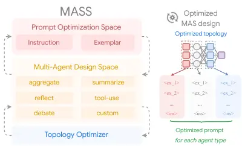
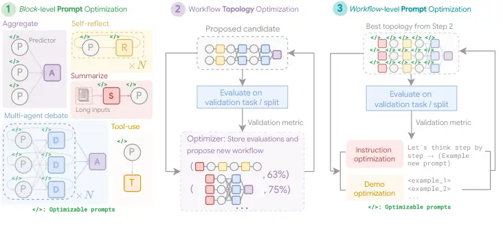
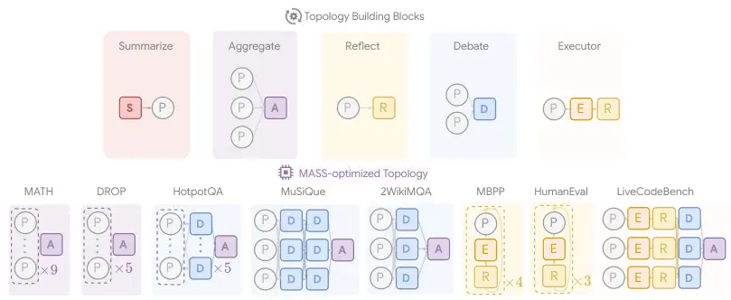

# Multi-Agent Design: Optimizing Agents with Better Prompts and Topologies

Han Zhou    Xingchen Wan Affiliation: Google    Ruoxi Sun Affiliation:
Google    Hamid Palangi Affiliation: Google    Shariq Iqbal Affiliation:
Google    Ivan Vulić    Anna Korhonen Affiliation: University of
Cambridge    Sercan Ö. Arık Affiliation: Google

###### Abstract

Large language models, employed as multiple agents that interact and
collaborate with each other, have excelled at solving complex tasks. The
agents are programmed with prompts that declare their functionality,
along with the topologies that orchestrate interactions across agents.
Designing prompts and topologies for multi-agent systems (MAS) is
inherently complex. To automate the entire design process, we first
conduct an in-depth analysis of the design space aiming to understand
the factors behind building effective MAS. We reveal that prompts
together with topologies play critical roles in enabling more effective
MAS design. Based on the insights, we propose Multi-Agent System Search
(Mass), a MAS optimization framework that efficiently exploits the
complex MAS design space by interleaving its optimization stages, from
local to global, from prompts to topologies, over three stages: 1)
block-level (local) prompt optimization; 2) workflow topology
optimization; 3) workflow-level (global) prompt optimization, where each
stage is conditioned on the iteratively optimized prompts/topologies
from former stages. We show that Mass-optimized multi-agent systems
outperform a spectrum of existing alternatives by a substantial margin.
Based on the Mass-found systems, we finally propose design principles
behind building effective multi-agent systems.

## 1 Introduction



Figure 1: Proposed Multi-Agent System Search (Mass) framework discovers
effective multi-agent system designs (with both optimized topology and
optimized prompts, right) via interleaved prompt optimization and
topology optimization in a customizable multi-agent design space (key
components illustrated on the left).

Large language models (LLMs) have showcased extraordinary capabilities
in understanding, reasoning, and generating coherent responses based on
user prompts, revolutionizing a wide range of applications (Ouyang et
al., 2022; Kojima et al., 2022). LLM-based agents enhance usability by
autonomously handling complex tasks across diverse domains, including
code generation and debugging (Jimenez et al., 2023),
retrieval-augmented generation (Singh et al., 2025; Wang et al., 2024a),
data analysis (Hu et al., 2024b; Guo et al., 2024), and interactive
decision-making (Su et al., 2025; Li et al., 2025). These agents are
typically programmed with prompts that reinforce them to interact with
the environment, utilizing available tools, and approach their
objectives over multiple turns (Yao et al., 2023). Beyond individual
agents, LLMs can be orchestrated within complex topologies that
coordinate multiple agents toward a shared objective. This type of
multi-agent system (MAS) typically outperforms its single-agent
counterpart by involving more diverse agentic perspectives or role
profiles, such as agents as verifiers (Shinn et al., 2024) and
multi-agent debate (Wang et al., 2024b; Qian et al., 2024).

However, designing effective MAS for new domains often proves to be
challenging. First, the single agent might suffer from prompt
sensitivity (Verma et al., 2024), where simple modifications in the
prompt can already exert significant but unexpected degradation of
performance (Zhou et al., 2024b; Liu et al., 2024a). In MAS, when
sensitive agents are cascaded, the compounding effect due to prompt
sensitivity may be amplified. Together with the prompt design, crafting
an effective topology might demand a substantial amount of manual
experimentation, based on trial and error. The problem complexity is
exacerbated by the overall combinatorial search space, over not only the
unbounded space of prompt design but also the design decisions of what
agent to integrate into the topology.

Although recent research has explored automating various aspects of
agentic designs, there is still a gap in understanding of what matters
most regarding improved MAS performance. For example, DSPy (Khattab et
al., 2024) automates the process of designing exemplars for improved
prompt programming. Li et al. (2024a) propose to optimize MAS by scaling
up the number of agents in majority voting. ADAS (Hu et al., 2024a)
programs new topologies expressed in code via an LLM-based meta-agent.
AFlow (Zhang et al., 2024b) searches better topologies using Monte-Carlo
Tree Search within a set of predefined operators. However, the interplay
between multiple design spaces, including prompts and topologies,
remains unclear.

In this paper, we first conduct in-depth analyses of common design
spaces in MAS, examining the impact of aspects such as optimizing the
prompts, scaling the number of agents, and involving different types of
topologies. Our analyses reveal that prompts frequently form an
influential design component that yields strong-performing MAS, and
influential topologies only represent a small fraction of the full
search space. Based on these insights, we aim to distill the essence of
influential MAS components into a pruned search space, thereby lowering
the complexity of the overall search process. We propose Multi-Agent
System Search (Mass), a novel multi-stage optimization framework that
automates the optimization for MAS over an efficient search space. Mass
integrates a plug-and-play prompt optimizer and workflow optimizer over
a configurable topology space. It overcomes the complexity of joint
optimization on MAS by interleaving the optimization stages, from local
to global, from prompts to topologies, over three stages: 1) block-level
(local) prompt ‘warm-up’ for each topology block; 2) workflow topology
optimization in a pruned set of topology space; 3) workflow-level
(global) prompt optimization given the best-found topology.

By optimizing over the identified influential components, Mass yields
optimized MAS that achieves state-of-the-art performance, outperforming
existing manually-crafted MAS baselines and automatically-generated
alternatives, by a substantial margin, demonstrated across an extensive
selection of tasks, including reasoning, multi-hop understanding, and
code generation. Based on the strongest MAS found by Mass, we provide
further insights and guidelines behind building effective MAS. Overall,
our contributions can be summarized as follows: 1) we provide an
in-depth analysis of the design factors that influence the performance
of LLM-based MAS, highlighting the importance of prompts and identifying
the influential topologies; 2) we propose Mass, a novel multi-stage
optimizer that automates the MAS design by interleaving the optimization
of prompts and topologies in an influential search space; 3) Mass shows
significant performance improvement on various evaluation benchmarks,
delivering guidelines for building effective multi-agent systems for the
future.

## 2 Designing Multi-Agent Systems

In this section, we provide a formulation for designing MAS, followed by
analyzing the influence of prompt and topology designs. We refer to the
structural arrangements of agents as the topology of agents and define
workflow as the logical sequence across different topologies that builds
the MAS. The design of a MAS can thus be broadly divided into two
levels: block-level design and workflow-level orchestration. At the
block level, a building block infers a group of agents that work
together for a certain function (e.g., debate), and we aim to design
effective individual agents that best perform their intended role with
better prompt design. On the other hand, at the workflow level, the
optimization involves determining the types and quantities of agents to
include and how to arrange them in the most effective way, referred to
as the topology optimization. Formally, given a search space
$`\mathcal{A}=\{a_{i}\}`$ that defines all valid agentic configuration
over the building block search dimensions $`a_{i}`$ (see Fig. 3),
individual agents and their composite topologies can both be
parameterized as specific configurations in this search space. To obtain
the best workflow $`\mathcal{W}^{*}(a)`$, the workflow topology
optimization is framed as the following optimization problem with an
objective function $`f(\cdot,\cdot)`$ on a target input and output set
$`(x,y)\sim\mathcal{D}`$ in the defined search space $`\mathcal{A}`$:

```math
\mathcal{W}^{*}(a)=\argmax_{a\sim\mathcal{A}}\mathbb{E}_{(x,y)\sim\mathcal{D}}[f(\mathcal{W}(a(x)),y)]. \tag{1}
```

In the rest of this section, we provide an in-depth analysis of each
component of MAS design.

### 2.1 Block-level Analysis: Prompt Design for Agents

Figure 2: Accuracy vs. total token counts for prompt-optimized agents
per question on MATH by Gemini 1.5 Pro compared to scaling agents with
self-consistency (SC), self-refine (reflect), and multi-agent debate
(debate) only. The error bar indicates 1 standard deviation. We show
that by utilizing more compute, better accuracy can be obtained via more
effective prompting.

At the block level, the primary “optimizable component” that
significantly influences downstream performance is the prompt, which
defines the role of the agent (e.g., “You are an expert in reflecting on
errors…”), provides additional instructions to shape its behavior (e.g.,
“You should think step by step…”) and optionally, contains few-shot
demonstrations (in-context examples) to guide the agent’s responses (Wan
et al., 2024). For instance, a state-of-the-art prompt optimizer
searches both instructions and few-shot demonstrations, where
demonstrations are bootstrapped from the model’s own, correct
predictions on the validation set based on a validation metric.
Conditioned on the demonstrations, the prompt optimizer then proposes a
few candidates for the instruction with a dataset summary or various
hints to improve candidate diversity (Opsahl-Ong et al., 2024). The
instructions and demonstrations are then jointly optimized.

Although it is well known that LLMs are sensitive to prompts (Zhou et
al., 2024a; Verma et al., 2024), applying automatic prompt optimization
(APO) techniques to MAS is not straightforward. In single-turn tasks,
APO can be easily performed by treating prompts as optimizable variables
and performance over a validation set as the target. However, in MAS,
APO becomes more complex due to the interdependence across agents (e.g.,
the output of one agent may be the input of another agent in a cascade
with ground-truth responses for intermediate outputs not being
available) and exponentially increasing complexity for combinatorial
optimization with more number of agents $`n`$ involved; The reward
signals also become more sparse when $`n`$ increases, preventing us for
implementing APO directly on MAS in any manageable budget; as such, many
prior works (Zhang et al., 2024f; Xia et al., 2024) in MAS still
primarily use handcrafted prompts instead of including the prompts as
optimizable components in the MAS design.

To systematically understand the influence of prompt design in MAS, we
specifically and quantitatively analyze the effect of prompt
optimization and compare its effectiveness to other operations common in
MAS literature, such as scaling with more agents but with default
prompts. We conduct APO on a chain-of-thought (Kojima et al., 2022)
agent via a state-of-the art prompt optimizer MIPRO (Opsahl-Ong et al., 2024) that is capable of joint instruction and (1-shot) exemplar
optimization, and fairly compare the total inference token cost with
self-consistency (Kojima et al., 2022), self-refine (Madaan et al.,
2024), and multi-agent debate (Du et al., 2024), where the
specifications are provided in App. §B. In Fig. 2, prompting, which
equips agents with more informative instructions and exemplars,
demonstrates significant advantages in its token-effectiveness over
other building blocks. Furthermore, by applying self-consistency on top
of the prompt-optimized agent, we observe an improved scaling
performance on the token cost, whereas standard approaches in scaling
the number of agents (e.g. SC, or Reflect) saturate much earlier. This
empirical observation sheds light on the importance of prompting while
providing early evidence for designing effective MAS – optimize agents
locally before scaling their topology.

### 2.2 Workflow-level Search Space Design

At the workflow level, the primary focus is on orchestrating agents to
achieve the best performance effectively, and topology optimization has
recently garnered significant attention (Li et al., 2024c; Zhang et al.,
2024b). However, while much of the existing research emphasizes search
methods—such as discovering the most efficient and effective way to
identify the optimal configuration—there has been less focus on the
design of search spaces, which determines the perimeter and the scope of
any search algorithm. This imbalance draws a parallel to the historical
development of neural architecture search (NAS) (White et al., 2023).
Initially, the field concentrated on sophisticated search methods, such
as Bayesian optimization (Kandasamy et al., 2018; Ru et al., 2021) and
differentiable search (Liu et al., 2018). Follow-up works have
highlighted the often-overlooked importance of search space design,
arguing that it can be equally, if not more, critical (Wan et al., 2022;
Zhou et al., 2023a).

Inspired by this insight, we hypothesize that manually crafted
topologies might be sub-optimal, and automatic topology optimization
(potentially framed as a rigorous optimization problem) can play a
similarly pivotal role via judiciously designing search space for MAS.
To achieve so, we first define an expressive search space, similar to
prior works, that consists of the connections between the following
building blocks, which form a unified search space for Mass:



Figure 3: Illustration of the Mass framework with its search space and
the optimization. The search space combines both prompts (Instruction,
Demo) and configurable agentic building blocks (Aggregate, Reflect,
Debate, Summarize, and Tool-use). \[1PO: Block-level Prompt
Optimization\]: we conduct block-level prompt optimization for each
agentic module individually (denoted by \</\>); \[2TO: Workflow Topology
Optimization\]: conditioned on the best prompts found in Stage 1 on each
agent block, Mass samples valid configurations from an
influence-weighted design space while fusing the prompts of each
building block from Stage 1; \[3PO: Workflow-level Prompt
Optimization\]: conditioned on the best workflow found, we again conduct
workflow-level prompt optimization on the best-found MAS (topologies
visualized for illustration only).

• Aggregate: Agents can collaborate in parallel with diversified
predictions, which is then followed by an aggregation operator that
obtains the most consistent prediction. The aggregate block can be
parameterized by $`N_{a}`$ agents and also defines the number of agent
chains acting in parallel. Majority vote (Li et al., 2024a) and
self-consistency (Chen et al., 2024c) sits within this topology.

• Reflect: Agents can act as verifiers, providing critics and
improvement suggestions based on former predictions. The feedback is
then fed into the predictor or the reflector itself for an iterative
improvement. Similarly, reflect can be parameterized by $`N_{r}`$ that
defines the number of rounds for self-reflection. The self-refine
(Madaan et al., 2024) and Reflexion (Shinn et al., 2024) represent this
block, and $`N_{r}`$ can be interpreted as a parameter that contributes
to the depth of the MAS network.

• Debate: Agents in debate can elicit more truthful predictions than a
single agent (Du et al., 2024; Liang et al., 2024), where each debating
agent would collect opinions from all other agents and provide an
updated response. This topology involves a mixture of agents, and
$`N_{d}`$ defines the number of rounds for debating (i.e., number of
fully-connected agent layers in the topology space).

• Custom Agents: While the former three forms of agents represent the
vast majority of agent topologies constructed as multiple parallel,
serial, and a mixture of agents, more versatile definitions of agents
can be inserted into the MAS design space. For example, for
task-specific use cases, we introduce an agent as summarize to improve
the long-context capability in the customizable design space, where
$`N_{s}`$ defines the rounds of abstraction of information.

• Tool-use: Building towards an effective MAS, enabling agents to
leverage tools to access external information is critical for system
performance, such as using a retriever for RAG (Lewis et al., 2020) and
executor with test cases in coding (Chen et al., 2024d). We introduce
tool-use (e.g., code execute) as an optimizable binary ‘insertion’
decision $`N_{T}\in\{0,1\}`$ with the predictor.

## 3 Mass: Multi-Agent System Search

Our analyses in Sec. 2 underscore the importance of well-designed
prompts for individual agents and the careful definition of the search
space to achieve effective MAS performance. Building on these, we
propose a multistage optimization algorithm, Multi-Agent System Search
(Mass), that surpasses prior arts that focused solely on optimizing
workflow topology without appropriate prompt designs. Instead, our
approach demonstrates the greater effectiveness of MAS design with
properly optimized prompts and thoughtfully designed search spaces. Mass
framework is illustrated in Algorithm 1 and Fig. 3, following an
intuition from local to global, from block-level to workflow-level, that
conquers the complexity of combinatorial optimization with effective
per-stage optimization detailed below.

1. Block-level prompt optimization. Before composing agents, we first
   ensure that individual agents are thoroughly optimized at the block
   level, as highlighted in Sec. 2.1 and Fig. 2 – this step ensures that
   each agent is primed for its role with the most effective instructions
   in the most manageable computation budget. To further overcome the
   complexity of joint optimization on a large MAS space, we first warm up
   the initial predictor with single-agent APO,
   $`a_{0}^{*}\leftarrow\mathcal{O}_{\mathcal{D}}(a_{0})`$, where both
   instruction and exemplars are jointly optimized with the modular prompt
   optimizer $`\mathcal{O}`$. Followed by conditioning on the warmed
   predictor, we continue optimizing each topology with a minimum number of
   agents,
   $`a_{i}^{*}\leftarrow\mathcal{O}_{\mathcal{D}}(a_{i}|a_{0}^{*})`$, such
   that, 2 predictors paired with 1 debator form the minimum building block
   as the debate topology, thereby lowering the complexity for
   optimization, and this topology can be scaled up later with more
   predictors and debators but all equipped with optimized prompts. To
   measure the influence of each building block, we store the validation
   performance once the optimization is completed. It is important that
   though Stage (1) serves as the warm-up stage per building block, it is
   still a critical stage that guarantees the follow-up topology
   optimization is searching in an effective space, composing
   well-performing agents instead of suffering from the compounding impact
   from any ill-formed agents with manual prompts.

Figure 4: The performance of different topologies with Gemini 1.5 Pro
compared to the base agent with each topology being optimized with APO,
where Sum. (Summarize) and Exe. (Executor) are task-specific topologies
as illustrated in Fig. 3. We observe that not all topologies have a
positive influence on the MAS design.

2. Workflow topology optimization. In this stage, we focus on optimizing
   the overall MAS structure, determining the most effective arrangement
   and connectivity between agents. To understand the influence of
   individual blocks, we report the performance of various topologies in
   Fig. 4. It is noticeable that not all topologies are beneficial to MAS
   design, whereas positively influenced topologies only represent a small
   fraction of the overall set, such that, in HotpotQA (Yang et al., 2018),
   only debate brings 3% gain while others fail to improve or even degrade
   systematic performance. We again observe similar trends in the
   test-output-prediction subtask of LiveCodeBench (Jain et al., 2024). It
   highlights the importance of searching in the influential set of the
   search space, whereas including decremental building blocks may not only
   result in higher search complexity but also degrade the performance. The
   analysis in Fig. 4 shows that beneficial topologies only represent a
   small fraction of the full design space. Therefore, we aim to distill
   the essence of strong-performing topologies into a pruned space, thereby
   making the workflow-level topology search more efficient.

Here, we propose to measure the incremental influence
$`I_{a_{i}}=\mathcal{E}(a_{i}^{*})/\mathcal{E}(a_{0}^{*})`$ that
quantifies the relative gain for integrating the search dimension
$`a_{i}`$ over the initial agent $`a_{0}`$. Following the intuition that
influential dimension comes with higher selection probability, we reject
the corresponding topology search dimension $`a_{i}`$ if $`u>p_{a_{i}}`$
to form a pruned search space, given $`u\sim\text{Uniform}(0,1)`$ and
$`p_{a}=\operatorname{Softmax}(I_{a},t)`$, where $`t`$ is the
temperature for the softmax function. Therefore, the workflow can be
randomly sampled from a pruned configuration space within a maximum
budget, such that $`a\sim\mathcal{A}_{p}\text{ s.t. }\mathcal{N}(a)<B`$,
where $`\mathcal{N}(a)`$ caps the overall number of agents and $`B`$ is
the maximum budget; For instance, given $`\mathcal{A}=\{a_{i}\}`$ as the
original configuration space with the topology building block search
dimension $`a_{i}`$ parameterized by its property $`N_{a_{i}}`$ as
defined in Sec. 2.2, each search dimension $`a_{i}`$ will be weighted by
the influence of that dimension $`p_{a_{i}}`$, and rejected to form
$`\mathcal{A}_{p}`$ if $`u\sim\text{Uniform}(0,1)>p_{a_{i}}`$. Followed
by sampling valid configurations from $`\mathcal{A}_{p}`$, the workflow
$`\mathcal{W}(a)=(a_{i},a_{i}+1,…)`$ is then constructed in a predefined
rule to arrange the flow of agents, where the rule-based flow removes
redundancy in various orders in design and reduce the optimization
complexity. The rule follows a simple predefined sequence that aligns
with the practice of agent designs, such that \[summarize, reflect,
debate, aggregate\]. We refer to App. §B for the detailed construction
rule, MAS visualizations, and search space per task.

1:  Input: Agentic modules in the search space $`a_{i}\in\mathcal{A}`$,
workflow of agents $`\mathcal{W}(a)`$, prompt optimizer $`\mathcal{O}`$,
evaluator $`\mathcal{E}`$, validation set $`\mathcal{D}`$, temperature
$`t`$, number of candidates $`N`$, budget $`B`$.

2:  Output: Optimized multi-agent system $`\mathcal{W^{*}}`$.

3:  \[1PO: Block-level Prompt Optimization\]

4:  Prompt optimization for the initial agent:
$`{\color[rgb]{0.5,0.5,0.5}a_{0}^{*}}\leftarrow\mathcal{O}_{\mathcal{D}}(a_{0})`$.

5:  for $`a_{i}`$ in $`\mathcal{A}\setminus\{a_{0}\}`$ do

6:    Local prompt optimization for each building block in the design
space:
$`{\color[rgb]{0.2031,0.6602,0.3242}a_{i}^{*}}\leftarrow\mathcal{O}_{\mathcal{D}}(a_{i}|{\color[rgb]{0.5,0.5,0.5}a_{0}^{*}})`$.

7:    Obtain incremental Influence:
$`I_{a_{i}}\leftarrow\mathcal{E}({\color[rgb]{0.2031,0.6602,0.3242}a_{i}^{*}})/\mathcal{E}({\color[rgb]{0.5,0.5,0.5}a_{0}^{*}})`$.

8:  end for

9:  \[2TO: Workflow Topology Optimization\]

10:  Obtain the selection probability
$`p_{a}\leftarrow\operatorname{Softmax}(I_{a},t)`$.

11:  while $`n<N`$ do

12:    Search space pruning: $`\mathcal{A}_{p}=\{a_{i}\}`$ for $`a_{i}`$
in $`\mathcal{A}`$ if $`u<p_{a_{i}}`$, where
$`u\sim\text{Uniform}(0,1)`$.

13:    Reject sampling for agentic configurations in budget:
$`a\sim\mathcal{A}_{p}\text{ s.t. }\mathcal{N}(a)<B`$.

14:    Build the workflow
$`{\color[rgb]{0.6523,0.5,0.7227}\mathcal{W}_{c}}\leftarrow({\color[rgb]{0.2031,0.6602,0.3242}a_{i}^{*}(\cdot),a_{i+1}^{*}(\cdot),\dots})`$
in a rule-base order with optimized prompts.

15:    Evaluate and record the score
$`\mathcal{E}_{\mathcal{D}}({\color[rgb]{0.6523,0.5,0.7227}\mathcal{W}_{c}})`$.

16:  end while

17:  Obtain the best-performing workflow
$`{\color[rgb]{0.6523,0.5,0.7227}\mathcal{W}_{c}^{*}}\leftarrow\operatorname*{arg\,max}_{c\in\mathcal{C}}\mathcal{E}_{\mathcal{D}}({\color[rgb]{0.6523,0.5,0.7227}\mathcal{W}_{c}}).`$

18:  \[3PO: Workflow-level Prompt Optimization\]

19:  Workflow-level prompt optimization for the best-performing
topology:
$`{\color[rgb]{0,0.6016,0.6016}\mathcal{W}^{*}}\leftarrow\mathcal{O}_{\mathcal{D}}({\color[rgb]{0.6523,0.5,0.7227}\mathcal{W}_{c}^{*}})`$.

20:  Return optimized multi-agent system
$`{\color[rgb]{0,0.6016,0.6016}\mathcal{W^{*}}}`$.

Algorithm 1 Mass: Multi-Agent System Search

3. Workflow-level prompt optimization. As a final step, we treat the
   entire MAS design as an integrated entity and conduct a round of joint
   prompt optimization over all agents simultaneously, conditioned on the
   best topology discovered in Stage (2),
   $`\mathcal{W}^{*}=\mathcal{O}_{\mathcal{D}}(\mathcal{W}_{c}^{*})`$.
   Although prompts were optimized at the individual level in Stage (1),
   this stage acts as an adaptation or fine-tuning process, ensuring that
   prompts are tailored for orchestration within the MAS and that the
   interdependence between agents is optimized appropriately. Our
   experiments (Fig. 6 & 6) demonstrate that this stage often yields
   practical benefits with a converged performance as shown in Table 6.

## 4 Experiments

Models and evaluation data. Aside from the common benchmarks used for
automating MAS (Hu et al., 2024a; Zhang et al., 2024b), we conduct
experiments on an extensive collection of tasks: 1) Hendryck’s MATH
(Hendrycks et al., 2021) and DROP (Dua et al., 2019) for reasoning;
HotpotQA (Yang et al., 2018), MuSiQue (Trivedi et al., 2022),
2WikiMultiHopQA (Ho et al., 2020) from LongBench (Bai et al., 2024) for
long-context understanding; 3) MBPP (Austin et al., 2021), HumanEval
(Chen et al., 2021), and LiveCodeBench (LCB) ‘test output prediction’
(Jain et al., 2024) for coding. We refer to App. §B & §D for details on
data splits and prompt templates. We conduct all main experiments
primarily on two Gemini 1.5 model sizes (Reid et al., 2024)
(gemini-1.5-{pro,flash}-002) and further validate key findings on Claude
3.5 Sonnet (claude-3-5-sonnet@20240620) (Anthropic, 2024) and Mistral
Nemo (mistral-nemo-12b) (Mistral, 2024) in App. §C.

| Gemini-1.5-pro-002   |               |               |                        |               |               |               |               |               |       |
| -------------------- | ------------- | ------------- | ---------------------- | ------------- | ------------- | ------------- | ------------- | ------------- | ----- |
| Task                 | Reasoning     |               | Multi-hop Long-context |               |               | Coding        |               |               |       |
| Method               | MATH          | DROP          | HotpotQA               | MuSiQue       | 2WikiMQA      | MBPP          | HumanEval     | LCB           | Avg.  |
| CoT                  | 71.67\_(3.30) | 70.59\_(1.67) | 57.43\_(0.52)          | 37.81\_(1.43) | 63.39\_(1.12) | 68.33\_(0.47) | 86.67\_(0.94) | 66.33\_(0.62) | 65.28 |
| Self-Consistency     | 77.33\_(1.25) | 74.06\_(0.90) | 58.60\_(2.19)          | 41.81\_(1.00) | 67.79\_(1.19) | 69.50\_(0.71) | 86.00\_(0.82) | 70.33\_(0.94) | 68.18 |
| Self-Refine          | 79.67\_(2.36) | 71.03\_(1.31) | 60.62\_(3.33)          | 42.15\_(1.34) | 66.74\_(2.43) | 63.67\_(0.24) | 84.00\_(1.63) | 67.33\_(1.31) | 66.90 |
| Multi-Agent Debate   | 78.67\_(0.94) | 71.78\_(0.71) | 64.87\_(0.23)          | 46.00\_(0.80) | 71.78\_(0.63) | 68.67\_(0.85) | 86.67\_(1.25) | 73.67\_(1.65) | 70.26 |
| ADAS                 | 80.00\_(0.82) | 72.96\_(0.90) | 65.88\_(1.29)          | 41.95\_(1.24) | 71.14\_(0.66) | 73.00\_(1.08) | 87.67\_(1.70) | 65.17\_(1.25) | 69.72 |
| AFlow^(\*)           | 76.00\_(0.82) | 88.92\_(0.63) | 68.62\_(0.47)          | 32.05\_(1.29) | 76.51\_(1.05) | \-            | 88.00\_(0.00) | \-            | \-    |
| Mass (Ours)          | 84.67\_(0.47) | 90.52\_(0.64) | 69.91\_(1.11)          | 51.40\_(0.42) | 73.34\_(0.67) | 86.50\_(0.41) | 91.67\_(0.47) | 82.33\_(0.85) | 78.79 |
| Gemini-1.5-flash-002 |               |               |                        |               |               |               |               |               |       |
| CoT                  | 66.67\_(2.36) | 71.79\_(0.69) | 57.82\_(1.10)          | 37.10\_(1.35) | 63.40\_(0.68) | 63.33\_(1.25) | 75.67\_(1.89) | 51.17\_(0.24) | 60.87 |
| Self-Consistency     | 69.33\_(1.25) | 73.42\_(0.19) | 60.19\_(1.01)          | 41.94\_(0.93) | 67.98\_(0.72) | 63.67\_(0.62) | 77.67\_(1.89) | 53.83\_(1.18) | 63.50 |
| Self-Refine          | 71.33\_(0.94) | 73.71\_(1.09) | 58.84\_(3.04)          | 41.21\_(1.99) | 65.56\_(1.57) | 63.33\_(1.25) | 81.67\_(1.89) | 52.00\_(1.41) | 63.46 |
| Multi-Agent Debate   | 71.67\_(0.94) | 74.79\_(0.87) | 64.17\_(1.69)          | 46.27\_(1.33) | 72.19\_(0.54) | 63.00\_(0.71) | 79.67\_(1.25) | 55.50\_(0.41) | 65.91 |
| ADAS                 | 68.00\_(1.41) | 75.95\_(1.18) | 61.36\_(2.89)          | 48.81\_(1.03) | 66.90\_(1.00) | 65.83\_(0.24) | 80.67\_(2.49) | 50.50\_(1.63) | 64.75 |
| Mass (Ours)          | 81.00\_(2.45) | 91.68\_(0.14) | 66.53\_(0.38)          | 43.67\_(1.21) | 76.69\_(0.50) | 78.00\_(0.82) | 84.67\_(0.47) | 72.17\_(0.85) | 74.30 |

Table 1: Results on the evaluation set with Gemini 1.5 Pro and Gemini
1.5 Flash. We report the mean and standard deviation for all results
with 3 runs of evaluations. We report the accuracy (%) for MATH and the
test-output-prediction subtask of LiveCodeBench (LCB), F1 score for
DROP, HotpotQA, MuSiQue, and 2WikiMQA, and pass@1 for MBPP and
HumanEval. We note that the meta-prompt of AFlow^(\*) only works
properly with Claude 3.5 Sonnet. Therefore, we reproduce AFlow with
Gemini 1.5 Pro as the executor and Claude 3.5 Sonnet as the optimizer,
where ^(\*) indicates the results are only for reference. The inference
cost is controlled comparably as shown in Table 7.

Baselines. We consider the following baselines: 1) CoT (Kojima et al.,
2022): direct chain-of-thought reasoning via zero-shot prompting; 2)
CoT-SC (Wang et al., 2023) (@9 agents): with self-consistency to find
the most consistent answers from diversified reasoning traces; 3)
Self-Refine (Madaan et al., 2024; Shinn et al., 2024) (2 agents @5
rounds): reflective agents to verify and self-refine predictions; 4)
Multi-Agent Debate (Du et al., 2024; Liang et al., 2024) (3 agents @3
rounds + 1 judger): with agents justifying answers and aggregating
information from other agents in multi-round debate; 5) ADAS (Hu et al.,
2024a): an automatic agent design framework, where an LLM-based
meta-agent iteratively proposes new agents based on former evaluations; 6) AFlow (Zhang et al., 2024b): automatic workflow design via
Monte-Carlo Tree Search over a set of pre-defined operators. We fairly
compare all baselines with a comparable inference cost per query and a
maximum number of agents of 10. We refer to Table 7 for the detailed
token consumption and App. §B for all specifications.

Setup. Mass is plug-and-play with arbitrary prompt optimizers. We
integrate MIPRO (Opsahl-Ong et al., 2024) for a joint instruction and
exemplar optimization, and we ablate other prompt optimizers implemented
with Mass in Table 9. We limit the number of bootstrapped demonstrations
to 3 and instruction candidates to 10, per agent in 10 rounds. In
topology optimization for all tasks, we search for 10 different
topologies via rejection sampling. Along with topology optimization,
each topology is evaluated on the validation set 3 times to stabilize
the prediction. The optimized MAS is then reported on the held-out test
set over three runs. We set model temperature $`T`$ at 0.7, maximum
output tokens at 4096, and the $`t`$ in Softmax at 0.05 for sharpening
the selection probability $`p_{a}`$ for each search dimension. We
implement the same LLM backbone as both evaluator and optimizer.

Main results. We present the main results of Mass compared to the
baselines on the evaluation set in Table 1. Mass yields substantial
gains over common forms of multi-agent systems, (e.g. self-consistency,
self-refine, and multi-agent debate), that scale up without optimizing
prompts for agents in collaboration. Mass leads to high-performing MAS:
78.8% and 74.3% on average on Gemini 1.5 Pro and Flash, respectively,
where we observe consistent improvements on Claude 3.5 Sonnet and
Mistral Nemo as reported in Table 4 & 5. By comparing Mass with
state-of-the-art automatic agent design baselines, ADAS and AFlow, we
first notice that ADAS only brings subtle gains even by already
conditioning its meta-agent generation based on the common forms of
agents. The meta-agent keeps proposing complex topologies but without
optimizing the prompt design. AFlow, on the other hand, demonstrates a
competitive performance to Mass, especially on 2WikiMQA and HumanEval.

Figure 5: Left: average performance per optimization stage of Mass over
8 evaluation tasks on Gemini 1.5 Pro. We compare Mass with a single
agent (CoT) starting point as the reference and an APO baseline that
optimizes over the single agent by MIPROv2 (Opsahl-Ong et al., 2024).
Refer to App. §C for the detailed ablation per task. Right: a
comparative ablation study on topology optimization (2TO) without
pruning and without the former stage of prompt optimization (1PO)
evaluated on HotpotQA.

Figure 6: The optimization trajectories of Mass compared to agent design
baselines per validation round on DROP. We note that, as a distinct
advantage of Mass, the optimization within stages (1) & (2) of Mass can
be completely parallelized, whereas ADAS and AFlow are iterative
algorithms that have to wait to propose new agents until finishing
earlier trajectories.

We attribute the performance of AFlow to: 1) its ‘expansion’ phase that
generates new nodes based on an error log that contrasts the predictions
with the ground truth, which provides implicit textual gradients
(Pryzant et al., 2023) to reflect on any formatting errors in prompt
design; 2) a more refined search space within a pre-defined set of
operators. Though AFlow draws similar inspirations on the importance of
search space design as Mass, it still lacks a phase of prompt
optimization to optimize its pre-defined operators properly, resulting
in under-performance for MAS search results at MATH and MuSiQue.
Different from these baselines, the consistent improvements brought by
Mass highlight the importance of searching in both prompt and topology
design space.

Ablating optimization stages. To understand the incremental gain per
Mass optimization stage, we provide a stage-by-stage ablation study in
Fig. 6. We list the average performance of Mass from block-level to
workflow-level optimization and compare it with a single agent APO
baseline (MIPROv2), where the block-level optimization performance
indicates the best-performing building block $`a\in\mathcal{A}`$ after
APO. First, we notice that there is a large gain, 6% on average, between
block-level optimization and single-agent APO, showing that MAS benefits
substantially from having its agents optimized inside the building
block, outperforming APO alone significantly. In addition, going from
Stage (1) to (2), another 3% gain can be achieved by composing
influential topologies while searching for the optimal configurations.
Here, we provide an ablation on conducting Stage (2) without prompt
optimization beforehand or without search space pruning. Fig. 6 (right)
shows that both of them are critical for effective search space
exploration. Lastly, Mass obtains further gains ($`\sim`$2%) by
conducting workflow-level prompt optimization on the best-found
topology, which indicates that optimizing the prompts towards modeling
the interdependence of agents is beneficial in MAS.

Cost-effectiveness of Mass. We conduct analysis on the
cost-effectiveness of Mass. In particular, we visualize the optimization
trajectory of Mass as shown in Fig. 6. Mass’s trajectory demonstrates a
steady trend of optimization that gradually improves the validation
performance via interleaving the search towards better prompts and
topologies. However, when it comes to automatic design baselines without
explicit prompt optimization stages, AFlow is exposed to a larger
variance in its optimization due to the nature of MCTS, whereas ADAS
gets trapped in discovering over-complex topologies that appear to be
less effective than the prompt design space. Overall, the optimization
trajectory of Mass highlights the importance of optimizing in an
effective design space, where interleaved optimization further resolves
the complexity with more consecutive rewards within the same amount of
training costs compared to baselines. Following Sec. 2.1, Mass also
demonstrated advanced inference token-effectiveness and a comparable
training cost, which we refer to Fig. 9 and Table 7.

Best-found MAS architectures & Design principles. We further inspect an
example of optimized prompts and the trajectory of Mass in discovering
more effective topologies in Fig. 7. The optimization starts from a
zero-shot CoT agent, and soon Mass in Stage (1) identifies the
high-performing topology in debate with its optimized prompt. However,
as found in Stage (2), aggregating with more parallel agents actually
outweighs the multi-agent debate. Workflow-level prompt optimization
then leads to the best-performing predictor for aggregation. The overall
optimization flow sheds light on our guidelines for building effective
MAS: 1) Optimizing individual agents properly is important before
composing them into an MAS; 2) A more effective MAS can be built by
composing influential topologies; and 3) Modeling the interdependence
between agents is beneficial, and can be achieved via workflow-level
joint optimization.

Figure 7: A demonstration of the optimization trajectory of Mass on
MATH. In (1) block-level optimization: multi-agent debate serves as the
best-performing topology. In (2) workflow topology optimization,
aggregating with more parallel agents outweighs the performance of
agents in debate. Lastly, (3) workflow-level optimization discovers the
optimal prompt conditioned on the best topology.

## 5 Related Work

Forms of LLM-based agentic systems. The simplest form of an LLM-based
agentic system involves a single agent that can dynamically interact and
respond to the environment (Yao et al., 2023). Recent advances endow
agents with diverse roles and tools (Wu et al., 2023), orchestrating
multiple agents to cooperate with each other (Chen et al., 2024b).
Standard forms of agent cooperation (i.e., topology) often involve
parallel and serial flows of information. The parallel form usually
diversifies the exploration among many agents in parallel (Li et al.,
2024a), and self-consistency (SC) (Wang et al., 2023) is a
representative way for scaling agents in parallel. The serial form aims
to advance the exploitation of a task via a chain of agents, where LLMs
can serve as reflective agents to self-justify and refine former
predictions (Madaan et al., 2024; Shinn et al., 2024). Later, the
opinions from multiple agents can be summarized to retrieve the most
consistent answer by an aggregation agent (Chen et al., 2024c; Lin et
al., 2024). Moreover, multi-agent debate consists of a more complex flow
of information (Chen et al., 2024a; Wang et al., 2024c; Zhang et al.,
2024c), and recent research shows that debating can elicit more truthful
predictions (Khan et al., 2024; Du et al., 2024). Recent agent topology
extends beyond the above connections (Wang et al., 2024b; Qian et al.,
2024), and Mass can automatically search the best topology among the
aforementioned spaces.

Automatic optimization for MAS. Recent research starts automating agent
design by interpreting agent functions as learnable policies (Zhang et
al., 2024d; Zhang et al., 2024e) and synthesizing trajectories for agent
fine-tuning (Qiao et al., 2024). Going further from a single agent,
automatic multi-agent optimization faces a higher level of complexity,
thereby requiring a more sophisticated design of the search space and
algorithms. Among all recent advances in multi-agent optimization, the
optimization space has spanned prompts (Khattab et al., 2024; Wang et
al., 2024d), tools (Zhou et al., 2024c), workflows (Li et al., 2024c),
and thinking strategies (Shang et al., 2024). Aligning closer to our
topology search space, DyLAN (Liu et al., 2024b) dynamically activates
the composition of agents, and Archon (Saad-Falcon et al., 2024) frames
MAS as a hyperparameter optimization problem. Neither of them has taken
the important prompt space into account, where we demonstrated the
importance of prompt optimization in Sec. 3. In addition, GPTSwarm
(Zhuge et al., 2024) optimizes the connections between agentic nodes
using a policy gradient algorithm. State-of-the-art automatic agent
design methods, ADAS (Hu et al., 2024a) and AFlow (Zhang et al., 2024b),
also attempt to optimize agentic workflows with advanced search
algorithms and LLM as optimizers. Concurrently with us, MaAS (Zhang et
al., 2025) optimizes an agentic supernet for query-dependent MAS.
However, we observe that the importance of prompt designs has been
relatively under-studied in these prior works.

## 6 Conclusion

We approach designing effective MAS by first conducting a thorough
analysis of the massive design space, revealing the crucial role of
prompts, and identifying the redundancy in MAS search space design.
Building on these findings, we introduce Mass, a novel multi-stage
optimization framework that searches within a pruned design space,
interleaving prompt and topology optimization to efficiently generate
high-performing MAS. Mass is agnostic to customized prompt optimizers
and topology design space. Our experiments demonstrate that
Mass-optimized MAS significantly outperforms existing manual and
automated approaches across an extensive set of tasks. Finally, based on
the optimized systems discovered by Mass, we extract valuable design
principles to guide the development of future MAS, and we expect future
prospective prompt and topology designs integrated with Mass towards
building more efficient and effective LLM-based agents.

## Acknowledgment

We thank Jinsung Yoon and all other colleagues from Google Cloud AI
Research for their valuable feedback.

## References

- Anthropic (2024) Anthropic. The claude 3 model family: Opus, sonnet,
  haiku. 2024.
- Austin et al. (2021) J. Austin, A. Odena, M. Nye, M. Bosma, H.
  Michalewski, D. Dohan, E. Jiang, C. Cai, M. Terry, Q. Le, et al.
  Program synthesis with large language models. _arXiv preprint
  arXiv:2108.07732_, 2021.
- Bai et al. (2024) Y. Bai, X. Lv, J. Zhang, H. Lyu, J. Tang, Z.
  Huang, Z. Du, X. Liu, A. Zeng, L. Hou, Y. Dong, J. Tang, and J. Li.
  LongBench: A bilingual, multitask benchmark for long context
  understanding. In L.-W. Ku, A. Martins, and V. Srikumar, editors,
  _Proceedings of the 62nd Annual Meeting of the Association for
  Computational Linguistics (Volume 1: Long Papers)_, pages 3119–3137,
  Bangkok, Thailand, Aug. 2024. Association for Computational
  Linguistics.
  [10.18653/v1/2024.acl-long.172](https://doi.org/10.18653/v1/2024.acl-long.172).
  URL
  [https://aclanthology.org/2024.acl-long.172/](https://aclanthology.org/2024.acl-long.172/).
- Chen et al. (2024a) J. Chen, S. Saha, and M. Bansal. ReConcile:
  Round-table conference improves reasoning via consensus among diverse
  LLMs. In L.-W. Ku, A. Martins, and V. Srikumar, editors, _Proceedings
  of the 62nd Annual Meeting of the Association for Computational
  Linguistics (Volume 1: Long Papers)_, pages 7066–7085, Bangkok,
  Thailand, Aug. 2024a. Association for Computational Linguistics.
  [10.18653/v1/2024.acl-long.381](https://doi.org/10.18653/v1/2024.acl-long.381).
  URL
  [https://aclanthology.org/2024.acl-long.381/](https://aclanthology.org/2024.acl-long.381/).
- Chen et al. (2021) M. Chen, J. Tworek, H. Jun, Q. Yuan, H. P. D. O.
  Pinto, J. Kaplan, H. Edwards, Y. Burda, N. Joseph, G. Brockman, et al.
  Evaluating large language models trained on code. _arXiv preprint
  arXiv:2107.03374_, 2021.
- Chen et al. (2024b) W. Chen, Y. Su, J. Zuo, C. Yang, C. Yuan, C.-M.
  Chan, H. Yu, Y. Lu, Y.-H. Hung, C. Qian, Y. Qin, X. Cong, R. Xie, Z.
  Liu, M. Sun, and J. Zhou. Agentverse: Facilitating multi-agent
  collaboration and exploring emergent behaviors. In _The Twelfth
  International Conference on Learning Representations_, 2024b. URL
  [https://openreview.net/forum?id=EHg5GDnyq1](https://openreview.net/forum?id=EHg5GDnyq1).
- Chen et al. (2024c) X. Chen, R. Aksitov, U. Alon, J. Ren, K. Xiao, P.
  Yin, S. Prakash, C. Sutton, X. Wang, and D. Zhou. Universal
  self-consistency for large language models. In _ICML 2024 Workshop on
  In-Context Learning_, 2024c. URL
  [https://openreview.net/forum?id=LjsjHF7nAN](https://openreview.net/forum?id=LjsjHF7nAN).
- Chen et al. (2024d) X. Chen, M. Lin, N. Schärli, and D. Zhou.
  Teaching large language models to self-debug. In _The Twelfth
  International Conference on Learning Representations_, 2024d. URL
  [https://openreview.net/forum?id=KuPixIqPiq](https://openreview.net/forum?id=KuPixIqPiq).
- Cheng et al. (2024) C.-A. Cheng, A. Nie, and A. Swaminathan. Trace is
  the next autodiff: Generative optimization with rich feedback,
  execution traces, and LLMs. In _The Thirty-eighth Annual Conference on
  Neural Information Processing Systems_, 2024. URL
  [https://openreview.net/forum?id=rYs2Dmn9tD](https://openreview.net/forum?id=rYs2Dmn9tD).
- Du et al. (2024) Y. Du, S. Li, A. Torralba, J. B. Tenenbaum, and I.
  Mordatch. Improving factuality and reasoning in language models
  through multiagent debate. In _Forty-first International Conference on
  Machine Learning, ICML 2024, Vienna, Austria, July 21-27, 2024_.
  OpenReview.net, 2024. URL
  [https://openreview.net/forum?id=zj7YuTE4t8](https://openreview.net/forum?id=zj7YuTE4t8).
- Dua et al. (2019) D. Dua, Y. Wang, P. Dasigi, G. Stanovsky, S. Singh,
  and M. Gardner. DROP: A reading comprehension benchmark requiring
  discrete reasoning over paragraphs. In J. Burstein, C. Doran, and T.
  Solorio, editors, _Proceedings of the 2019 Conference of the North
  American Chapter of the Association for Computational Linguistics:
  Human Language Technologies, Volume 1 (Long and Short Papers)_, pages
  2368–2378, Minneapolis, Minnesota, June 2019. Association for
  Computational Linguistics.
  [10.18653/v1/N19-1246](https://doi.org/10.18653/v1/N19-1246). URL
  [https://aclanthology.org/N19-1246/](https://aclanthology.org/N19-1246/).
- Guo et al. (2024) S. Guo, C. Deng, Y. Wen, H. Chen, Y. Chang, and J.
  Wang. Ds-agent: Automated data science by empowering large language
  models with case-based reasoning, 2024. URL
  [https://arxiv.org/abs/2402.17453](https://arxiv.org/abs/2402.17453).
- Hendrycks et al. (2021) D. Hendrycks, C. Burns, S. Kadavath, A.
  Arora, S. Basart, E. Tang, D. Song, and J. Steinhardt. Measuring
  mathematical problem solving with the math dataset. _NeurIPS_, 2021.
  URL
  [https://openreview.net/forum?id=7Bywt2mQsCe](https://openreview.net/forum?id=7Bywt2mQsCe).
- Ho et al. (2020) X. Ho, A.-K. Duong Nguyen, S. Sugawara, and A.
  Aizawa. Constructing a multi-hop QA dataset for comprehensive
  evaluation of reasoning steps. In D. Scott, N. Bel, and C. Zong,
  editors, _Proceedings of the 28th International Conference on
  Computational Linguistics_, pages 6609–6625, Barcelona, Spain
  (Online), Dec. 2020. International Committee on Computational
  Linguistics.
  [10.18653/v1/2020.coling-main.580](https://doi.org/10.18653/v1/2020.coling-main.580).
  URL
  [https://aclanthology.org/2020.coling-main.580/](https://aclanthology.org/2020.coling-main.580/).
- Hu et al. (2024a) S. Hu, C. Lu, and J. Clune. Automated design of
  agentic systems. _arXiv preprint arXiv:2408.08435_, 2024a.
- Hu et al. (2024b) X. Hu, Z. Zhao, S. Wei, Z. Chai, Q. Ma, G. Wang, X.
  Wang, J. Su, J. Xu, M. Zhu, Y. Cheng, J. Yuan, J. Li, K. Kuang, Y.
  Yang, H. Yang, and F. Wu. Infiagent-dabench: Evaluating agents on data
  analysis tasks, 2024b. URL
  [https://arxiv.org/abs/2401.05507](https://arxiv.org/abs/2401.05507).
- Jain et al. (2024) N. Jain, K. Han, A. Gu, W.-D. Li, F. Yan, T.
  Zhang, S. Wang, A. Solar-Lezama, K. Sen, and I. Stoica. Livecodebench:
  Holistic and contamination free evaluation of large language models
  for code. _arXiv preprint arXiv:2403.07974_, 2024.
- Jimenez et al. (2023) C. E. Jimenez, J. Yang, A. Wettig, S. Yao, K.
  Pei, O. Press, and K. Narasimhan. Swe-bench: Can language models
  resolve real-world github issues? _arXiv preprint
  arXiv:2310.06770_, 2023.
- Kandasamy et al. (2018) K. Kandasamy, W. Neiswanger, J. Schneider, B.
  Poczos, and E. P. Xing. Neural architecture search with bayesian
  optimisation and optimal transport. _Advances in neural information
  processing systems_, 31, 2018.
- Khan et al. (2024) A. Khan, J. Hughes, D. Valentine, L. Ruis, K.
  Sachan, A. Radhakrishnan, E. Grefenstette, S. R. Bowman, T.
  Rocktäschel, and E. Perez. Debating with more persuasive LLMs leads to
  more truthful answers. In _Forty-first International Conference on
  Machine Learning_, 2024. URL
  [https://openreview.net/forum?id=iLCZtl7FTa](https://openreview.net/forum?id=iLCZtl7FTa).
- Khattab et al. (2024) O. Khattab, A. Singhvi, P. Maheshwari, Z.
  Zhang, K. Santhanam, S. V. A, S. Haq, A. Sharma, T. T. Joshi, H.
  Moazam, H. Miller, M. Zaharia, and C. Potts. DSPy: Compiling
  declarative language model calls into state-of-the-art pipelines. In
  _The Twelfth International Conference on Learning
  Representations_, 2024. URL
  [https://openreview.net/forum?id=sY5N0zY5Od](https://openreview.net/forum?id=sY5N0zY5Od).
- Kojima et al. (2022) T. Kojima, S. S. Gu, M. Reid, Y. Matsuo, and Y.
  Iwasawa. Large language models are zero-shot reasoners. _Advances in
  neural information processing systems_, 35:22199–22213, 2022.
- Lewis et al. (2020) P. Lewis, E. Perez, A. Piktus, F. Petroni, V.
  Karpukhin, N. Goyal, H. Küttler, M. Lewis, W.-t. Yih, T. Rocktäschel,
  et al. Retrieval-augmented generation for knowledge-intensive nlp
  tasks. _Advances in Neural Information Processing Systems_,
  33:9459–9474, 2020.
- Li et al. (2024a) J. Li, Q. Zhang, Y. Yu, Q. FU, and D. Ye. More
  agents is all you need. _Transactions on Machine Learning Research_,
  2024a. ISSN 2835-8856. URL
  [https://openreview.net/forum?id=bgzUSZ8aeg](https://openreview.net/forum?id=bgzUSZ8aeg).
- Li et al. (2025) M. Li, S. Zhao, Q. Wang, K. Wang, Y. Zhou, S.
  Srivastava, C. Gokmen, T. Lee, L. E. Li, R. Zhang, W. Liu, P.
  Liang, L. Fei-Fei, J. Mao, and J. Wu. Embodied agent interface:
  Benchmarking llms for embodied decision making, 2025. URL
  [https://arxiv.org/abs/2410.07166](https://arxiv.org/abs/2410.07166).
- Li et al. (2024b) Y. Li, Y. Du, J. Zhang, L. Hou, P. Grabowski, Y.
  Li, and E. Ie. Improving multi-agent debate with sparse communication
  topology. In Y. Al-Onaizan, M. Bansal, and Y.-N. Chen, editors,
  _Findings of the Association for Computational Linguistics: EMNLP
  2024_, pages 7281–7294, Miami, Florida, USA, Nov. 2024b. Association
  for Computational Linguistics.
  [10.18653/v1/2024.findings-emnlp.427](https://doi.org/10.18653/v1/2024.findings-emnlp.427).
  URL
  [https://aclanthology.org/2024.findings-emnlp.427/](https://aclanthology.org/2024.findings-emnlp.427/).
- Li et al. (2024c) Z. Li, S. Xu, K. Mei, W. Hua, B. Rama, O.
  Raheja, H. Wang, H. Zhu, and Y. Zhang. Autoflow: Automated workflow
  generation for large language model agents. _arXiv preprint
  arXiv:2407.12821_, 2024c.
- Liang et al. (2024) T. Liang, Z. He, W. Jiao, X. Wang, Y. Wang, R.
  Wang, Y. Yang, S. Shi, and Z. Tu. Encouraging divergent thinking in
  large language models through multi-agent debate. In Y. Al-Onaizan, M.
  Bansal, and Y.-N. Chen, editors, _Proceedings of the 2024 Conference
  on Empirical Methods in Natural Language Processing_, pages
  17889–17904, Miami, Florida, USA, Nov. 2024. Association for
  Computational Linguistics.
  [10.18653/v1/2024.emnlp-main.992](https://doi.org/10.18653/v1/2024.emnlp-main.992).
  URL
  [https://aclanthology.org/2024.emnlp-main.992/](https://aclanthology.org/2024.emnlp-main.992/).
- Lin et al. (2024) L. Lin, J. Fu, P. Liu, Q. Li, Y. Gong, J. Wan, F.
  Zhang, Z. Wang, D. Zhang, and K. Gai. Just ask one more time!
  self-agreement improves reasoning of language models in (almost) all
  scenarios. In L.-W. Ku, A. Martins, and V. Srikumar, editors,
  _Findings of the Association for Computational Linguistics: ACL 2024_,
  pages 3829–3852, Bangkok, Thailand, Aug. 2024. Association for
  Computational Linguistics.
  [10.18653/v1/2024.findings-acl.230](https://doi.org/10.18653/v1/2024.findings-acl.230).
  URL
  [https://aclanthology.org/2024.findings-acl.230/](https://aclanthology.org/2024.findings-acl.230/).
- Liu et al. (2024a) F. Liu, N. AlDahoul, G. Eady, Y. Zaki, B.
  AlShebli, and T. Rahwan. Self-reflection outcome is sensitive to
  prompt construction. _arXiv preprint arXiv:2406.10400_, 2024a.
- Liu et al. (2018) H. Liu, K. Simonyan, and Y. Yang. Darts:
  Differentiable architecture search. _arXiv preprint
  arXiv:1806.09055_, 2018.
- Liu et al. (2024b) Z. Liu, Y. Zhang, P. Li, Y. Liu, and D. Yang. A
  dynamic LLM-powered agent network for task-oriented agent
  collaboration. In _First Conference on Language Modeling_, 2024b. URL
  [https://openreview.net/forum?id=XII0Wp1XA9](https://openreview.net/forum?id=XII0Wp1XA9).
- Madaan et al. (2024) A. Madaan, N. Tandon, P. Gupta, S. Hallinan, L.
  Gao, S. Wiegreffe, U. Alon, N. Dziri, S. Prabhumoye, Y. Yang, et al.
  Self-refine: Iterative refinement with self-feedback. _Advances in
  Neural Information Processing Systems_, 36, 2024.
- Mistral (2024) Mistral. Mistral nemo. 2024. URL
  [https://mistral.ai/news/mistral-nemo](https://mistral.ai/news/mistral-nemo).
- Opsahl-Ong et al. (2024) K. Opsahl-Ong, M. J. Ryan, J. Purtell, D.
  Broman, C. Potts, M. Zaharia, and O. Khattab. Optimizing instructions
  and demonstrations for multi-stage language model programs. In Y.
  Al-Onaizan, M. Bansal, and Y.-N. Chen, editors, _Proceedings of the
  2024 Conference on Empirical Methods in Natural Language Processing_,
  pages 9340–9366, Miami, Florida, USA, Nov. 2024. Association for
  Computational Linguistics.
  [10.18653/v1/2024.emnlp-main.525](https://doi.org/10.18653/v1/2024.emnlp-main.525).
  URL
  [https://aclanthology.org/2024.emnlp-main.525/](https://aclanthology.org/2024.emnlp-main.525/).
- Ouyang et al. (2022) L. Ouyang, J. Wu, X. Jiang, D. Almeida, C.
  Wainwright, P. Mishkin, C. Zhang, S. Agarwal, K. Slama, A. Ray, et al.
  Training language models to follow instructions with human feedback.
  _Advances in neural information processing systems_,
  35:27730–27744, 2022.
- Pryzant et al. (2023) R. Pryzant, D. Iter, J. Li, Y. Lee, C. Zhu,
  and M. Zeng. Automatic prompt optimization with “gradient descent” and
  beam search. In H. Bouamor, J. Pino, and K. Bali, editors,
  _Proceedings of the 2023 Conference on Empirical Methods in Natural
  Language Processing_, pages 7957–7968, Singapore, Dec. 2023.
  Association for Computational Linguistics.
  [10.18653/v1/2023.emnlp-main.494](https://doi.org/10.18653/v1/2023.emnlp-main.494).
  URL
  [https://aclanthology.org/2023.emnlp-main.494/](https://aclanthology.org/2023.emnlp-main.494/).
- Qian et al. (2024) C. Qian, Z. Xie, Y. Wang, W. Liu, Y. Dang, Z.
  Du, W. Chen, C. Yang, Z. Liu, and M. Sun. Scaling
  large-language-model-based multi-agent collaboration. _arXiv preprint
  arXiv:2406.07155_, 2024.
- Qiao et al. (2024) S. Qiao, N. Zhang, R. Fang, Y. Luo, W. Zhou, Y.
  Jiang, C. Lv, and H. Chen. AutoAct: Automatic agent learning from
  scratch for QA via self-planning. In L.-W. Ku, A. Martins, and V.
  Srikumar, editors, _Proceedings of the 62nd Annual Meeting of the
  Association for Computational Linguistics (Volume 1: Long Papers)_,
  pages 3003–3021, Bangkok, Thailand, Aug. 2024. Association for
  Computational Linguistics.
  [10.18653/v1/2024.acl-long.165](https://doi.org/10.18653/v1/2024.acl-long.165).
  URL
  [https://aclanthology.org/2024.acl-long.165/](https://aclanthology.org/2024.acl-long.165/).
- Reid et al. (2024) M. Reid, N. Savinov, D. Teplyashin, D.
  Lepikhin, T. P. Lillicrap, J. Alayrac, R. Soricut, A. Lazaridou, O.
  Firat, J. Schrittwieser, I. Antonoglou, R. Anil, S. Borgeaud, A. M.
  Dai, K. Millican, E. Dyer, M. Glaese, T. Sottiaux, B. Lee, F.
  Viola, M. Reynolds, Y. Xu, J. Molloy, J. Chen, M. Isard, P. Barham, T.
  Hennigan, R. McIlroy, M. Johnson, J. Schalkwyk, E. Collins, E.
  Rutherford, E. Moreira, K. Ayoub, M. Goel, C. Meyer, G. Thornton, Z.
  Yang, H. Michalewski, Z. Abbas, N. Schucher, A. Anand, R. Ives, J.
  Keeling, K. Lenc, S. Haykal, S. Shakeri, P. Shyam, A. Chowdhery, R.
  Ring, S. Spencer, E. Sezener, and et al. Gemini 1.5: Unlocking
  multimodal understanding across millions of tokens of context. _CoRR_,
  abs/2403.05530, 2024.
  [10.48550/ARXIV.2403.05530](https://doi.org/10.48550/ARXIV.2403.05530).
  URL
  [https://doi.org/10.48550/arXiv.2403.05530](https://doi.org/10.48550/arXiv.2403.05530).
- Ru et al. (2021) B. Ru, X. Wan, X. Dong, and M. Osborne.
  Interpretable neural architecture search via bayesian optimisation
  with weisfeiler-lehman kernels. _International Conference on Learning
  Representations (ICLR)_, 2021.
- Saad-Falcon et al. (2024) J. Saad-Falcon, A. G. Lafuente, S.
  Natarajan, N. Maru, H. Todorov, E. Guha, E. K. Buchanan, M. Chen, N.
  Guha, C. Ré, et al. Archon: An architecture search framework for
  inference-time techniques. _arXiv preprint arXiv:2409.15254_, 2024.
- Shang et al. (2024) Y. Shang, Y. Li, K. Zhao, L. Ma, J. Liu, F. Xu,
  and Y. Li. Agentsquare: Automatic llm agent search in modular design
  space. _arXiv preprint arXiv:2410.06153_, 2024.
- Shinn et al. (2024) N. Shinn, F. Cassano, A. Gopinath, K. Narasimhan,
  and S. Yao. Reflexion: Language agents with verbal reinforcement
  learning. _Advances in Neural Information Processing Systems_,
  36, 2024.
- Singh et al. (2025) A. Singh, A. Ehtesham, S. Kumar, and T. T. Khoei.
  Agentic retrieval-augmented generation: A survey on agentic rag.
  _arXiv preprint arXiv:2501.09136_, 2025.
- Su et al. (2025) H. Su, R. Sun, J. Yoon, P. Yin, T. Yu, and S. Ö.
  Arık. Learn-by-interact: A data-centric framework for self-adaptive
  agents in realistic environments. _arXiv preprint
  arXiv:2501.10893_, 2025.
- Trivedi et al. (2022) H. Trivedi, N. Balasubramanian, T. Khot, and A.
  Sabharwal. MuSiQue: Multihop questions via single-hop question
  composition. _Transactions of the Association for Computational
  Linguistics_, 10:539–554, 2022.
  [10.1162/tacl_a_00475](https://doi.org/10.1162/tacl_a_00475). URL
  [https://aclanthology.org/2022.tacl-1.31/](https://aclanthology.org/2022.tacl-1.31/).
- Verma et al. (2024) M. Verma, S. Bhambri, and S. Kambhampati. On the
  brittle foundations of react prompting for agentic large language
  models. _arXiv preprint arXiv:2405.13966_, 2024.
- Wan et al. (2022) X. Wan, B. Ru, P. M. Esperança, and Z. Li. On
  redundancy and diversity in cell-based neural architecture search. In
  _International Conference on Learning Representations_, 2022. URL
  [https://openreview.net/forum?id=rFJWoYoxrDB](https://openreview.net/forum?id=rFJWoYoxrDB).
- Wan et al. (2024) X. Wan, R. Sun, H. Nakhost, and S. O. Arik. Teach
  better or show smarter? on instructions and exemplars in automatic
  prompt optimization. In _The Thirty-eighth Annual Conference on Neural
  Information Processing Systems_, 2024. URL
  [https://openreview.net/forum?id=IdtoJVWVnX](https://openreview.net/forum?id=IdtoJVWVnX).
- Wang et al. (2024a) F. Wang, X. Wan, R. Sun, J. Chen, and S. Ö. Arık.
  Astute rag: Overcoming imperfect retrieval augmentation and knowledge
  conflicts for large language models. _arXiv preprint
  arXiv:2410.07176_, 2024a.
- Wang et al. (2024b) J. Wang, J. Wang, B. Athiwaratkun, C. Zhang,
  and J. Zou. Mixture-of-agents enhances large language model
  capabilities. _arXiv preprint arXiv:2406.04692_, 2024b.
- Wang et al. (2024c) Q. Wang, Z. Wang, Y. Su, H. Tong, and Y. Song.
  Rethinking the bounds of LLM reasoning: Are multi-agent discussions
  the key? In L.-W. Ku, A. Martins, and V. Srikumar, editors,
  _Proceedings of the 62nd Annual Meeting of the Association for
  Computational Linguistics (Volume 1: Long Papers)_, pages 6106–6131,
  Bangkok, Thailand, Aug. 2024c. Association for Computational
  Linguistics.
  [10.18653/v1/2024.acl-long.331](https://doi.org/10.18653/v1/2024.acl-long.331).
  URL
  [https://aclanthology.org/2024.acl-long.331/](https://aclanthology.org/2024.acl-long.331/).
- Wang et al. (2024d) W. Wang, H. A. Alyahya, D. R. Ashley, O.
  Serikov, D. Khizbullin, F. Faccio, and J. Schmidhuber. How to
  correctly do semantic backpropagation on language-based agentic
  systems. _arXiv preprint arXiv:2412.03624_, 2024d.
- Wang et al. (2023) X. Wang, J. Wei, D. Schuurmans, Q. V. Le, E. H.
  Chi, S. Narang, A. Chowdhery, and D. Zhou. Self-consistency improves
  chain of thought reasoning in language models. In _The Eleventh
  International Conference on Learning Representations_, 2023. URL
  [https://openreview.net/forum?id=1PL1NIMMrw](https://openreview.net/forum?id=1PL1NIMMrw).
- White et al. (2023) C. White, M. Safari, R. Sukthanker, B. Ru, T.
  Elsken, A. Zela, D. Dey, and F. Hutter. Neural architecture search:
  Insights from 1000 papers. _arXiv preprint arXiv:2301.08727_, 2023.
- Wu et al. (2023) Q. Wu, G. Bansal, J. Zhang, Y. Wu, S. Zhang, E.
  Zhu, B. Li, L. Jiang, X. Zhang, and C. Wang. Autogen: Enabling
  next-gen llm applications via multi-agent conversation framework.
  _arXiv preprint arXiv:2308.08155_, 2023.
- Xia et al. (2024) C. S. Xia, Y. Deng, S. Dunn, and L. Zhang.
  Agentless: Demystifying llm-based software engineering agents. _arXiv
  preprint arXiv:2407.01489_, 2024.
- Yang et al. (2024) C. Yang, X. Wang, Y. Lu, H. Liu, Q. V. Le, D.
  Zhou, and X. Chen. Large language models as optimizers. In _The
  Twelfth International Conference on Learning Representations_, 2024.
  URL
  [https://openreview.net/forum?id=Bb4VGOWELI](https://openreview.net/forum?id=Bb4VGOWELI).
- Yang et al. (2018) Z. Yang, P. Qi, S. Zhang, Y. Bengio, W. Cohen, R.
  Salakhutdinov, and C. D. Manning. HotpotQA: A dataset for diverse,
  explainable multi-hop question answering. In E. Riloff, D. Chiang, J.
  Hockenmaier, and J. Tsujii, editors, _Proceedings of the 2018
  Conference on Empirical Methods in Natural Language Processing_, pages
  2369–2380, Brussels, Belgium, Oct.-Nov. 2018. Association for
  Computational Linguistics.
  [10.18653/v1/D18-1259](https://doi.org/10.18653/v1/D18-1259). URL
  [https://aclanthology.org/D18-1259/](https://aclanthology.org/D18-1259/).
- Yao et al. (2023) S. Yao, J. Zhao, D. Yu, N. Du, I. Shafran, K. R.
  Narasimhan, and Y. Cao. React: Synergizing reasoning and acting in
  language models. In _The Eleventh International Conference on Learning
  Representations_, 2023. URL
  [https://openreview.net/forum?id=WE_vluYUL-X](https://openreview.net/forum?id=WE_vluYUL-X).
- Yuksekgonul et al. (2025) M. Yuksekgonul, F. Bianchi, J. Boen, S.
  Liu, P. Lu, Z. Huang, C. Guestrin, and J. Zou. Optimizing generative
  ai by backpropagating language model feedback. _Nature_,
  639:609–616, 2025.
- Zhang et al. (2024a) G. Zhang, Y. Yue, Z. Li, S. Yun, G. Wan, K.
  Wang, D. Cheng, J. X. Yu, and T. Chen. Cut the crap: An economical
  communication pipeline for llm-based multi-agent systems. _arXiv
  preprint arXiv:2410.02506_, 2024a.
- Zhang et al. (2025) G. Zhang, L. Niu, J. Fang, K. Wang, L. Bai,
  and X. Wang. Multi-agent architecture search via agentic supernet.
  _arXiv preprint arXiv:2502.04180_, 2025.
- Zhang et al. (2024b) J. Zhang, J. Xiang, Z. Yu, F. Teng, X. Chen, J.
  Chen, M. Zhuge, X. Cheng, S. Hong, J. Wang, et al. Aflow: Automating
  agentic workflow generation. _arXiv preprint arXiv:2410.10762_, 2024b.
- Zhang et al. (2024c) J. Zhang, X. Xu, N. Zhang, R. Liu, B. Hooi,
  and S. Deng. Exploring collaboration mechanisms for LLM agents: A
  social psychology view. In L.-W. Ku, A. Martins, and V. Srikumar,
  editors, _Proceedings of the 62nd Annual Meeting of the Association
  for Computational Linguistics (Volume 1: Long Papers)_, pages
  14544–14607, Bangkok, Thailand, Aug. 2024c. Association for
  Computational Linguistics.
  [10.18653/v1/2024.acl-long.782](https://doi.org/10.18653/v1/2024.acl-long.782).
  URL
  [https://aclanthology.org/2024.acl-long.782/](https://aclanthology.org/2024.acl-long.782/).
- Zhang et al. (2024d) S. Zhang, J. Zhang, J. Liu, L. Song, C. Wang, R.
  Krishna, and Q. Wu. Offline training of language model agents with
  functions as learnable weights. In _Forty-first International
  Conference on Machine Learning_, 2024d. URL
  [https://openreview.net/forum?id=2xbkWiEuR1](https://openreview.net/forum?id=2xbkWiEuR1).
- Zhang et al. (2024e) W. Zhang, K. Tang, H. Wu, M. Wang, Y. Shen, G.
  Hou, Z. Tan, P. Li, Y. Zhuang, and W. Lu. Agent-pro: Learning to
  evolve via policy-level reflection and optimization. In L.-W. Ku, A.
  Martins, and V. Srikumar, editors, _Proceedings of the 62nd Annual
  Meeting of the Association for Computational Linguistics (Volume 1:
  Long Papers)_, pages 5348–5375, Bangkok, Thailand, Aug. 2024e.
  Association for Computational Linguistics.
  [10.18653/v1/2024.acl-long.292](https://doi.org/10.18653/v1/2024.acl-long.292).
  URL
  [https://aclanthology.org/2024.acl-long.292/](https://aclanthology.org/2024.acl-long.292/).
- Zhang et al. (2024f) Y. Zhang, R. Sun, Y. Chen, T. Pfister, R. Zhang,
  and S. O. Arik. Chain of agents: Large language models collaborating
  on long-context tasks. In _The Thirty-eighth Annual Conference on
  Neural Information Processing Systems_, 2024f. URL
  [https://openreview.net/forum?id=LuCLf4BJsr](https://openreview.net/forum?id=LuCLf4BJsr).
- Zhou et al. (2023a) H. Zhou, X. Wan, I. Vulić, and A. Korhonen.
  Survival of the most influential prompts: Efficient black-box prompt
  search via clustering and pruning. In H. Bouamor, J. Pino, and K.
  Bali, editors, _Findings of the Association for Computational
  Linguistics: EMNLP 2023_, pages 13064–13077, Singapore, Dec. 2023a.
  Association for Computational Linguistics.
  [10.18653/v1/2023.findings-emnlp.870](https://doi.org/10.18653/v1/2023.findings-emnlp.870).
  URL
  [https://aclanthology.org/2023.findings-emnlp.870/](https://aclanthology.org/2023.findings-emnlp.870/).
- Zhou et al. (2024a) H. Zhou, X. Wan, Y. Liu, N. Collier, I. Vulić,
  and A. Korhonen. Fairer preferences elicit improved human-aligned
  large language model judgments. In Y. Al-Onaizan, M. Bansal, and Y.-N.
  Chen, editors, _Proceedings of the 2024 Conference on Empirical
  Methods in Natural Language Processing_, pages 1241–1252, Miami,
  Florida, USA, Nov. 2024a. Association for Computational Linguistics.
  [10.18653/v1/2024.emnlp-main.72](https://doi.org/10.18653/v1/2024.emnlp-main.72).
  URL
  [https://aclanthology.org/2024.emnlp-main.72/](https://aclanthology.org/2024.emnlp-main.72/).
- Zhou et al. (2024b) H. Zhou, X. Wan, L. Proleev, D. Mincu, J.
  Chen, K. A. Heller, and S. Roy. Batch calibration: Rethinking
  calibration for in-context learning and prompt engineering. In _The
  Twelfth International Conference on Learning Representations_, 2024b.
  URL
  [https://openreview.net/forum?id=L3FHMoKZcS](https://openreview.net/forum?id=L3FHMoKZcS).
- Zhou et al. (2024c) W. Zhou, Y. Ou, S. Ding, L. Li, J. Wu, T.
  Wang, J. Chen, S. Wang, X. Xu, N. Zhang, et al. Symbolic learning
  enables self-evolving agents. _arXiv preprint arXiv:2406.18532_,
  2024c.
- Zhou et al. (2023b) Y. Zhou, A. I. Muresanu, Z. Han, K. Paster, S.
  Pitis, H. Chan, and J. Ba. Large language models are human-level
  prompt engineers. In _The Eleventh International Conference on
  Learning Representations_, 2023b. URL
  [https://openreview.net/forum?id=92gvk82DE-](https://openreview.net/forum?id=92gvk82DE-).
- Zhuge et al. (2024) M. Zhuge, W. Wang, L. Kirsch, F. Faccio, D.
  Khizbullin, and J. Schmidhuber. GPTSwarm: Language agents as
  optimizable graphs. In _Forty-first International Conference on
  Machine Learning_, 2024. URL
  [https://openreview.net/forum?id=uTC9AFXIhg](https://openreview.net/forum?id=uTC9AFXIhg).

## Appendix A Limitations and future work

Mass is a multi-agent design meta-framework also orthogonal to prompt
and topology optimizers. Mass has brought substantial improvements over
a single agent design by searching in a customizable topology space.
Though our proposed topology space has covered the vast majority of
effective MAS designs, including serial, parallel, and mixture of
connections, it is still likely that incorporating other topologies may
further improve the final performance of Mass, which is complementary to
the development of Mass. For instance, the debate topology proposed in
Mass involves a fully-connected topology across agents. Recent work has
been identifying the sparsity of agent communications (Li et al., 2024b;
Zhang et al., 2024a), and pruning redundant communications may further
enhance the overall efficiency of the strongest Mass-found design.
Though the topology optimizer in Mass already traverses efficiently in
the proposed topology space, incorporating more advanced search
algorithms, such as the Bayes optimizer (Kandasamy et al., 2018; Ru et
al., 2021), may further improve the sample efficiency of Mass when faces
a more complex design space. Similarly, the sample efficiency of the
prompt optimizer may be further enhanced by conditioning on textual
feedback from error logs (Pryzant et al., 2023; Cheng et al., 2024),
which we will endeavor to explore in future work. These prospective
future topology and prompt design methods will further strengthen Mass,
while Mass has been served as a generalizable guideline in identifying
influential agentic design components and a systematic framework for
scalable MAS optimization.

## Appendix B Implementation details

### B.1 Datasets

In this work, we included the following dataset: 1) Hendryck’s MATH
(Hendrycks et al., 2021) consisting competition-level mathematics
problems, and DROP (Dua et al., 2019) requires discrete and symbolic
reasoning over paragraphs; 2) HotpotQA (Yang et al., 2018), MuSiQue
(Trivedi et al., 2022), and 2WikiMultiHopQA (Ho et al., 2020) to
evaluate long-context reasoning with agentic systems, which we report
from standardized versions in LongBench (Bai et al., 2024); 3) MBPP
(Austin et al., 2021), HumanEval (Chen et al., 2021), and LiveCodeBench
(Jain et al., 2024) as well-established coding benchmarks. Regarding
LiveCodeBench, we use the ‘test output prediction’ task as an agent
cooperative task. In line with AFlow (Zhang et al., 2024b), we use the
public test cases of MBPP and HumanEval for the executor to retrieve
reliable external feedback signals. To save computation resources, we
randomly sample a subset of the original validation and test splits to
conduct all the experiments, where the specifications are reported in
Table 2.

| Task          | Type                           | $`  | `$Val$` | `$                                      | $`           | `$Test$` | `$  | Topology Search Space | Mass |
| ------------- | ------------------------------ | --- | ------- | --------------------------------------- | ------------ | -------- | --- | --------------------- | ---- |
| MATH          | Mathematical Reasoning         | 60  | 100     | {Aggregate, Reflect, Debate}            | {9, 0, 0}    |
| DROP          | Discrete Reasoning             | 60  | 200     | {Aggregate, Reflect, Debate}            | {5, 0, 0}    |
| HotpotQA      | Long-context Understanding     | 50  | 100     | {Summarize, Aggregate, Reflect, Debate} | {0, 5, 0, 1} |
| MuSiQue       | Long-context Understanding     | 50  | 100     | {Summarize, Aggregate, Reflect, Debate} | {0, 3, 0, 2} |
| 2WikiMQA      | Long-context Understanding     | 50  | 100     | {Summarize, Aggregate, Reflect, Debate} | {0, 3, 0, 1} |
| MBPP          | Coding                         | 60  | 200     | {Aggregate, Reflect, Debate, Executor}  | {1, 4, 0, 1} |
| HumanEval     | Coding                         | 50  | 100     | {Aggregate, Reflect, Debate, Executor}  | {1, 3, 0, 1} |
| LiveCodeBench | Coding: test output prediction | 100 | 200     | {Aggregate, Reflect, Debate, Executor}  | {3, 1, 1, 1} |

Table 2: The specification of evaluation tasks: dataset split, topology
search space, and the Mass-optimized MAS (on Gemini 1.5 Pro).

| Topology  | Search Space              | Minimum Topology Building Block         | Definition                |
| --------- | ------------------------- | --------------------------------------- | ------------------------- |
| Summarize | $`N_{s}\in\{0,1,2,3,4\}`$ | 1 Summarizer + 1 Predictor              | Rounds of summarization   |
| Aggregate | $`N_{a}\in\{1,3,5,7,9\}`$ | 3 Predictor + 1 Aggregator              | Number of parallel agents |
| Reflect   | $`N_{r}\in\{0,1,2,3,4\}`$ | 1 Predictor + 1 Reflector               | Rounds of self-reflection |
| Debate    | $`N_{d}\in\{0,1,2,3,4\}`$ | 2 Predictor + 1 Debator                 | Rounds of debating        |
| Execute   | $`N_{t}\in\{0,1\}`$       | 1 Predictor + 1 Executor + 1 Reflector} | Use of code execution     |

Table 3: The search dimension for each topology. The minimum topology
defines the building block that Mass Stage (1) optimized. We refer the
definition of search space to Sec.2.2.



Figure 8: Visualization of the topology building blocks and best
Mass-discovered topologies from Gemini 1.5 Pro.

### B.2 Baselines

In this section, we report the specifications of all our baselines. We
note that for the baselines: CoT, SC, Self-Refine, and Multi-Agent
Debate, we follow the prompts given in ADAS (Hu et al., 2024a).

1\) Chain-of-Thought (CoT) (Kojima et al., 2022). Direct
chain-of-thought reasoning via zero-shot prompting: “Please think step
by step and then solve the task."

2\) Self-Consistency (SC) (Wang et al., 2023). In self-consistency, we
generate diverse chain-of-thought reasoning traces with a temperature of
0.8, followed by a rule-based majority vote that collects the most
consistent answer. In Table 1, we report SC@9 to provide a fair
comparison across baselines.

3\) Self-Refine (Madaan et al., 2024): This baseline consists of one
predictor that constantly takes feedback and a self-reflector that
provides criticism. It involves a stop criterion whenever the
self-reflector outputs “correct” in its prediction. We set the maximum
number of rounds of reflections to 5, such that the worst case will
involve 11 ($`1+2\times 5`$) calls.

4\) Multi-Agent Debate (Du et al., 2024; Liang et al., 2024). In this
baseline, it involves 3 agents that conduct reasoning and debating for 3
rounds. The opinions along the rounds of debating are finally judged by
an aggregator that makes the final prediction. Hence, it contains 10
($`3\times 3+1`$) agents.

5\) Automated Design of Agentic Systems (ADAS) (Hu et al., 2024a).
Consistent with our main experimental setups. We use Gemini 1.5 as both
LLM optimizer and evaluator for reproducing all ADAS results. The
generation of ADAS is conditioned on former evaluations of baselines,
including CoT, SC, Self-Refine, and Multi-Agent Debate. We report ADAS
with 30 rounds of search, and each round is evaluated on the validation
set 3 times to stablize the prediction.

6\) AFlow (Zhang et al., 2024b). Automatic workflow design via
Monte-Carlo Tree Search over a set of pre-defined operators. Similar to
ADAS, AFlow also relies on an LLM optimizer to generate new nodes and
topologies expressed in codes. However, we find the meta-prompt of AFlow
does not generalize to other LLM backbones. Consequently, we report
AFlow with its original LLM optimizer by Claude 3.5 Sonnet, and
reproduce experiments with Gemini 1.5 Pro as the LLM executor.
Therefore, the comparison is not completely fair, and we treat the
results from AFlow as a good reference. We note that the ‘-’ in Table 1
refers to out-of-time errors, where the LLM executor has been trapped in
executing accidental scripts with infinite loops. We still endeavored to
report most results from AFlow as shown in Table 1 & Fig. 6 with the
default experimental setup from AFlow: 20 rounds, 5 runs of validation
per round, and k at 3.

### B.3 Mass details and Construction Rules

In this section, we provide additional details for Mass. The topology
search space for each task is defined in Table 2. In addition, for Stage
(1) block-level prompt optimization, the specification of the building
block is defined in Table 3. MASS follows a simple and predefined rule
for constructing different topologies in sequence. Throughout our study,
we find that the impact of different agentic configurations outweighs
the ordering substantially. Consequently, our rule follows the practice
of agent designs by constructing topology in a fixed order of
\[summarize, reflect, debate, aggregate\]. When multiple search
dimensions are kept active, aggregate basically controls the number of
chain-of-agents in parallel, where the length of the chain is defined
via the pre-defined order. We provide the visualization of both the
minimum building blocks and the optimized topology in Fig. 8. We refer
the reader to App. §D & §E for the prompt templates we used to define
each type of agent and the best prompts discovered.

## Appendix C Additional experiments

### C.1 Generalization across LLM backbones

| Claude-3.5-Sonnet   |               |               |               |               |               |               |       |
| ------------------- | ------------- | ------------- | ------------- | ------------- | ------------- | ------------- | ----- |
| Task                | Reasoning     |               | Multi-hop     | Coding        |               |               |       |
| Method              | MATH          | DROP          | HotpotQA      | MBPP          | HumanEval     | LCB           | Avg.  |
| CoT                 | 57.33\_(0.94) | 55.52\_(0.42) | 23.56\_(1.52) | 67.50\_(1.47) | 88.67\_(1.70) | 72.67\_(2.39) | 60.21 |
| Self-Consistency    | 61.67\_(1.89) | 57.86\_(0.45) | 25.69\_(0.44) | 69.17\_(0.62) | 90.00\_(0.82) | 72.67\_(2.39) | 62.84 |
| Self-Refine         | 57.00\_(1.63) | 56.26\_(0.56) | 23.57\_(2.56) | 68.00\_(0.82) | 87.00\_(1.41) | 49.33\_(1.65) | 56.86 |
| Multi-Agent Debate  | 45.00\_(3.74) | 26.62\_(0.11) | 31.41\_(3.30) | 00.00\_(0.00) | 84.33\_(3.30) | 72.82\_(1.84) | 43.36 |
| Mass                | 63.00\_(0.00) | 68.93\_(0.38) | 66.98\_(0.99) | 68.83\_(0.62) | 93.00\_(0.82) | 73.73\_(1.43) | 72.43 |

Table 4: Results on the evaluation set with Claude 3.5 Sonnet. We keep
the same experimental setup as Table 1. Since Claude 3.5 Sonnet does not
support the same context window as Gemini, we report the standard
HotpotQA instead of the LongBench. As we transfer the prompt template
for each agent from Gemini to Claude, it is noticeable that the basic
topology on some tasks may result in severe degradation of performance,
and Mass successfully recovers the performance and brings significant
improvements over the initial agent.

|    Mistral-Nemo-12B      |                 |            |                 |              |            |
| ------------------------ | --------------- | ---------- | --------------- | ------------ | ---------- |
|    Task                  |    Reasoning    |            |    Multi-hop    |    Coding    |            |
|    Method                |    MATH         |    DROP    |    HotpotQA     |    MBPP      |    Avg.    |
|    CoT                   |    13.3         |    49.0    |    55.9         |    43.5      |    40.4    |
|    Self-Consistency      |    22.0         |    57.6    |    58.9         |    46.5      |    46.3    |
|    Self-Refine           |    14.3         |    48.6    |    52.5         |    48.0      |    40.9    |
|    Multi-Agent Debate    |    26.0         |    61.4    |    59.5         |    40.5      |    46.9    |
|    Mass                  |    43.7         |    68.4    |    62.6         |    48.7      |    55.9    |

Table 5: Results on the evaluation set with the open-source model,
Mistral-Nemo-12B. We keep the same experimental setup as Table 4 and
evaluate a subset of representative coding tasks to save resources. Mass
demonstrate consistent improvements over the baselines on Mistral Nemo.

| Gemini-1.5-pro-002 |               |               |                        |               |               |               |               |               |       |
| ------------------ | ------------- | ------------- | ---------------------- | ------------- | ------------- | ------------- | ------------- | ------------- | ----- |
| Task               | Reasoning     |               | Multi-hop Long-context |               |               | Coding        |               |               |       |
| Method             | MATH          | DROP          | HotpotQA               | MuSiQue       | 2WikiMQA      | MBPP          | HumanEval     | LCB           | Avg.  |
| Base Agent         | 62.33\_(0.94) | 71.65\_(0.61) | 56.96\_(1.26)          | 43.32\_(0.13) | 49.20\_(0.61) | 68.83\_(0.85) | 89.33\_(1.70) | 66.33\_(2.09) | 63.54 |
| \+ APO             | 79.33\_(1.89) | 77.51\_(0.38) | 59.72\_(0.00)          | 43.97\_(0.00) | 61.49\_(0.24) | 67.00\_(1.08) | 86.33\_(1.25) | 68.50\_(1.22) | 67.44 |
| \+ 1PO             | 80.00\_(0.00) | 86.45\_(0.90) | 62.52\_(1.86)          | 48.86\_(0.61) | 67.40\_(0.58) | 80.33\_(1.25) | 91.67\_(1.25) | 76.00\_(0.00) | 74.56 |
| \+ 2TO             | 83.00\_(1.63) | 86.75\_(1.32) | 65.22\_(1.34)          | 52.61\_(0.52) | 72.82\_(0.86) | 85.00\_(1.08) | 92.00\_(0.82) | 81.33\_(0.00) | 77.55 |
| \+ 3PO             | 84.67\_(0.47) | 90.52\_(0.64) | 69.91\_(1.11)          | 51.40\_(0.42) | 73.34\_(0.67) | 86.50\_(0.41) | 91.67\_(0.47) | 82.33\_(0.85) | 78.40 |

Table 6: The detailed ablation results per optimization stage of Mass.
Practical gains can be obtained by further conducting workflow-level
prompt optimization (3PO) on the best-found topology.

### C.2 Discussion on Mass-found topologies

In Fig. 8, we find that the optimal Mass-found topologies indicate
certain patterns per task family, and there are topologies that
demonstrate clear advantages over other topologies in particular tasks.
By inspecting Fig. 8, we notice that the “debating” topology brings
significant gains to all multi-hop tasks that require factual knowledge:
HotpotQA, MuSiQue, and 2WikiMQA, which is aligned with previous
multi-agent debate work (Khan et al., 2024) that argues debating will
elicit more truthful answers. Reasoning tasks: MATH and DROP benefit
from more exploration, where SC becomes more effective. Lastly, the
coding tasks share a common pattern of reflection with tool-using.
However, even the best configuration in the same task family still shows
differentiations, indicating the necessity of automatic optimization.
Therefore, no matter the underlying complexity of the task-dependent
topology, the unique advantage of MASS is being able to identify the
most influential topology automatically for any customized search space.

|                    |             |              |           |                       |              |           |         |
| ------------------ | ----------- | ------------ | --------- | --------------------- | ------------ | --------- | ------- |
|                    | Training    |              |           | Inference (per query) |              |           |         |
| Method             | Input Token | Output Token | Cost (\$) | Input Token           | Output Token | Cost (\$) | Acc (%) |
| Self-Consistency   | \-          | \-           | \-        | 1538                  | 3013         | 0.0010    | 69.3    |
| Self-Refine        | \-          | \-           | \-        | 2051                  | 850          | 0.0004    | 71.3    |
| Multi-Agent Debate | \-          | \-           | \-        | 6536                  | 2483         | 0.0012    | 71.7    |
| AFlow              | 11M         | 8 M          | 3.89      | 2523                  | 1481         | 0.0006    | 64.3    |
| ADAS               | 23 M        | 13 M         | 5.61      | 7850                  | 3335         | 0.0016    | 72.7    |
| Mass               | 24 M        | 11 M         | 5.09      | 6645                  | 3263         | 0.0014    | 81.0    |

Table 7: The training and inference cost for running Mass and baselines,
where we show the training cost and the actual run-time of Mass is
comparable to the training cost of auto-agent baselines. We note that
the performance of self-consistency, self-refine, and multi-agent debate
is already saturated, and further scaling the inference cost of these
baselines only brings marginal gains, whereas the Mass-found MAS
outperforms the baseline substantially at a comparable inference token
cost.

Figure 9: The Pareto-front of Mass-optimized designs compared to
multi-agent baselines. Total tokens include both inference input tokens
and output tokens. Additional multi-agent baselines from ADAS (Hu et
al., 2024a) and the two best-found ADAS designs are included.

### C.3 Cost analysis

To estimate the computation cost, the prompt optimizer evaluates the MAS
with $`K`$ rounds of evaluation, where each round consists of $`M`$
prompt candidates, and each inference requires $`\mathcal{N}(a)`$ API
calls by the number of agents in the MAS. Hence, 1PO scales linearly
with the number of building blocks $`J`$, and its cost can be computed
as $`C(\text{1PO})=\sum_{j}^{J}\mathcal{N}(a_{j})\times M\times K`$. The
topology optimization evaluates $`N`$ topology candidates. Hence,
$`C(\text{2TO})=\sum_{n}^{N}\mathcal{N}(\mathcal{W}_{n})`$. Similar to
1PO, 3PO conducts PO on the best-found workflow $`\mathcal{W}^{*}`$,
such that
$`C(\text{3PO})=\mathcal{N}(\mathcal{W}^{*})\times M\times K`$, and the
cost of 3PO scales linearly with the number of agents in the network.
The final computation cost is therefore a summation of the cost at
individual stages.

In Table 7, we report the detailed token cost for both training Mass and
the inference cost per query with reference costs from baselines, where
we show that the training cost of Mass is comparable to the training
cost of auto-agent baselines. It is worth noting that the performance of
training-free baselines (e.g., self-consistency@9) is already saturated,
and further scaling the inference cost of these baselines only brings
marginal gains, whereas the Mass-found MAS outperforms baselines
substantially. In addition, we record the Pareto-front of Mass optimized
designs in Fig. 9. Though the primary objective of this work is a
single-objective optimization that targets to maximize the task
performance within the same training budget, we show that Mass can
generate a Pareto-front of optimized MAS designs with stronger
token-effectiveness than baselines, and the more cost-efficient
workflows can be selected from the pivotal points in the Mass
Pareto-front.

### C.4 Graph optimization baseline

We further compare Mass against a graph optimization baseline, GPTSwarm
(Zhuge et al., 2024), on the overlapped set of tasks from the original
work. We observe that the graph optimization is more effective in
improving the inference efficiency from a fully-connected graph to a
sparse graph rather than enhancing the task performance, whereas the
prompt optimization component of Mass particularly led to more
significant contributions. Overall, Mass brought a substantial gain (8%
and 6% over MATH & HumanEval, respectively) in representative reasoning
and coding tasks compared to graph optimization methods.

|    Method           |    MATH (%) |    HumanEval (%) |    Average (%) |
| ------------------- | ----------- | ---------------- | -------------- |
|    GPTSwarm (Pro)   |    76.0     |    85.0          |    80.5        |
|    Mass (Pro)       |    84.7     |    91.7          |    88.2        |
|    GPTSwarm (Flash) |    61.0     |    73.0          |    67.0        |
|    Mass (Flash)     |    81.0     |    84.7          |    82.9        |

Table 8: Comparison of Mass with graph optimization baselines. We
reproduce GPTSwarm with (Zhang et al., 2024a), and (Pro) & (Flash)
indicate optimization results from Gemini 1.5 Pro and Gemini 1.5 Flash,
respectively.

### C.5 Ablation on prompt optimizers

Mass is a plug-and-play framework with arbitrary prompt optimizers. We
integrate MIPRO (Opsahl-Ong et al., 2024) as a representative prompt
optimizer due to the importance of simultaneous instruction and exemplar
optimization, which has been justified in both (Wan et al., 2024;
Opsahl-Ong et al., 2024) that show superior performance over OPRO-style
(Yang et al., 2024) instruction-only optimization methods. It is also
worth noting that the MASS framework itself is agnostic to the prompt
optimizer, and thus any prospective better methods can only enhance the
overall performance of Mass. In Table 9, we additionally provide an
ablation of common prompt optimizers, APE (Zhou et al., 2023b) & DSPy
(Khattab et al., 2024), and we show Mass with exemplar optimization
(+DSPy) also led to significant gains. We consider extending the
existing PO to feedback-based optimizers (e.g., ProTeGi (Pryzant et al., 2023) or TextGrad (Yuksekgonul et al., 2025)) that may come with better
sample efficiency as a desirable future work.

|    Method      |    CoT     |    Mass (APE)    |    Mass (DSPy)    |    Mass (MIPRO)    |
| -------------- | ---------- | ---------------- | ----------------- | ------------------ |
|    MATH (%)    |    66.7    |    73.3          |    78.2           |    81.0            |

Table 9: Ablation of Mass with different prompt optimizers on Gemini 1.5
Flash.

## Appendix D Prompt template

We provide all the prompt templates we used for defining the Mass search
space. We use \<\> to enclose texts that have been skipped for
presentation purposes. We follow the DSPy (Khattab et al., 2024) in
constructing these agentic templates.

The general template for instruction, exemplar, and input/output fields:

1

2 \<Instruction\>

3

4 ---

5

6 Follow the following format.

7

8 Input: \${Input}

9 ...

10 Output: \${output}

11

12 ---

13

14 \<example_1\>

15

16 ---

17

18 Input: \<Input\>

19 ...

20 Output: \<output\>

MATH:

1 Predictor:

2

3 Let’s think step by step.

4 ---

5 Question: \${question}

6 Reasoning: Let’s think step by step in order to \${produce the
answer}. We ...

7 Answer: \${answer}

8

9 ------------

10 Reflector:

11

12 Please review the answer above and criticize on where might be wrong.
If you are absolutely sure it is correct, output ’True’ in
’correctness’.

13

14 ---

15 Question: \${question}

16 Text: \${text}

17 Reasoning: Let’s think step by step in order to \${produce the
correctness}. We ...

18 Feedback: \${feedback}

19 Correctness: True/False indicating if answer is correct given the
question.

20

21 ------------

22 Refiner:

23

24 Given previous attempts and feedback, carefully consider where you
could go wrong in your latest attempt. Using insights from previous
attempts, try to solve the task better. Show your final answer bracketed
between \<answer\> and \</answer\> at the end.

25

26 ---

27 Question: \${question}

28 Previous answer: \${previous_answer}

29 Reflection: \${reflection}

30 Correctness: \${correctness}

31 Thinking: \${thinking}

32 Answer: \${answer}

33

34 ------------

35

36 Debator:

37

38 These are the solutions to the question from other agents. Examine
the solutions from other agents in your rationale, finish by giving an
updated answer. Show your final answer bracketed between \<answer\> and
\</answer\> at the end.

39

40 ---

41 Question: \${question}

42 Solutions: the solutions to the question from other agents

43 Reasoning: Let’s think step by step in order to \${Examine the
solutions from other agents}. We ...

44 Answer: The updated answer for the question. Do not repeat Answer:

DROP:

1 Predictor:

2

3 Please think step by step and then solve the task. \# Your Task:

4 Please answer the following question based on the given context.

5 ---

6 Question: \${question}

7 Context: \${context}

8 Thinking: \${thinking}

9 Answer: Directly answer the question. Keep it very concise.

10

11 ------------

12 Reflector:

13

14 Verify that the answer is based on the provided context. Give your
reflection in the rationale.

15

16 ---

17 Question: \${question}

18 Context: \${context}

19 Text: \${text}

20 Reasoning: Let’s think step by step in order to \${produce the
correctness}. We ...

21 Correctness: True/False indicating if answer is correct given the
observations and question.

22

23 ------------

24 Refiner:

25

26 Please think step by step and then solve the task. \# Your Task:

27 Based on the reflection, correctness of the previous answer, and the
context again, give an updated answer.

28

29 ---

30 Question: \${question}

31 Context: \${context}

32 Previous answer: \${previous_answer}

33 Reflection: \${reflection}

34 Correctness: \${correctness}

35 Thinking: \${thinking}

36 Answer: Directly answer the question. Keep it very concise.

37

38 ------------

39

40 Debator:

41

42 These are the solutions to the question from other agents. Based on
the context, examine the solutions from other agents in your rationale,
finish by giving an updated answer.

43

44 ---

45 Question: \${question}

46 Context: \${context}

47 Solutions: the solutions to the question from other agents

48 Reasoning: Let’s think step by step in order to \${Examine the
solutions from other agents}. We ...

49 Answer: The updated answer for the question. Do not repeat Answer:

HotpotQA, MuSiQue, and 2WikiMQA:

1 Predictor:

2

3 Answer the question with information based on the context. Only return
the answer as your output.

4 ---

5 Question: \${question}

6 Context: \${context}

7 Answer: Only give me the answer. Do not output any other words.

8

9 ------------

10 Summarizer:

11

12 Based on the question, retrieve relevant information from context
that is ONLY helpful in answering the question. Include all key
information. Do not repeat context.

13 ---

14 Question: \${question}

15 Context: \${context}

16 Summary: Only generate the summary. Start with Summary:

17

18 ------------

19 Reflector:

20

21 Verify that the answer is based on the provided context.

22

23 ---

24 Question: \${question}

25 Context: \${context}

26 Text: \${text}

27 Reasoning: Let’s think step by step in order to \${produce the
correctness}. We ...

28 Correctness: True/False indicating if answer is correct given the
observations and question.

29

30 ------------

31

32 Debator:

33

34 These are the solutions to the question from other agents. Based on
the context, examine the solutions from other agents in your rationale,
finish by giving an updated answer.

35

36 ---

37 Question: \${question}

38 Context: \${context}

39 Solutions: the solutions to the question from other agents

40 Reasoning: Let’s think step by step in order to \${Examine the
solutions from other agents}. We ...

41 Answer: The updated answer for the question. Do not repeat Answer:

MBPP:

1 Predictor:

2

3 Let’s think step by step. Provide a complete and correct code
implementation in python.

4 ---

5 Question: \${question}

6 Thinking: \${thinking}

7 Answer: Only the code implementation. Do not include example usage or
explainations.

8

9 ------------

10 Reflector:

11

12 Please determine the correctness of the solution in passing all test
cases. If it fails, based on the error message and trackback, think step
by step, carefully propose an updated solution in the answer output with
a correct code implementation in python.

13

14 ---

15 Question: \${question}

16 Previous solution: \${previous_solution}

17 Traceback: It contains the test cases, execution results, and ground
truth. If there is an error, the relevant traceback is given.

18 Correctness: ’True/False’ based on the correctness of executive
feedback. If there is an error message, output ’False’

19 Thinking: \${thinking}

20 Answer: \${answer}

21

22 ------------

23

24 Debator:

25

26 These are the solutions to the question from other agents. Examine
the solutions from other agents in your rationale, finish by giving an
updated answer. Let’s think step by step. Provide a complete and correct
code implementation in python.

27

28 ---

29 Question: \${question}

30 Solutions: the solutions to the question from other agents

31 Reasoning: Let’s think step by step in order to \${Examine the
solutions from other agents}. We ...

32 Answer: \${answer}

HumanEval:

1 Predictor:

2

3 Let’s think step by step. Provide a complete and correct code
implementation in python.

4 ---

5 Question: \${question}

6 Thinking: \${thinking}

7 Answer: \${answer}

8

9 ------------

10 Reflector:

11

12 Please determine the correctness of the solution in passing all test
cases. If it fails, based on the error message and trackback, think step
by step, carefully propose an updated solution in the answer output with
a correct code implementation in python.

13

14 ---

15 Question: \${question}

16 Previous solution: \${previous_solution}

17 Traceback: \${traceback}

18 Thinking: \${thinking}

19 Answer: \${answer}

20

21 ------------

22

23 Debator:

24

25 These are the solutions to the question from other agents. Examine
the solutions from other agents in your rationale, finish by giving an
updated answer. Let’s think step by step. Provide a complete and correct
code implementation in python.

26

27 ---

28 Question: \${question}

29 Solutions: the solutions to the question from other agents

30 Reasoning: Let’s think step by step in order to \${Examine the
solutions from other agents}. We ...

31 Answer: \${answer}

LiveCodeBench:

1 Predictor:

2

3 You are a helpful programming assistant and an expert Python
programmer. The user has written a input for the testcase. Think step by
step. You will generate the code based on the problem requirepement. You
will calculate the output of the testcase and write the whole assertion
statement in the markdown code block with the correct output.

4 ---

5 Question: \${question}

6 Thinking: \${thinking}

7 Code: \${code}

8 Answer: complete the testcase with assertion.

9

10 ------------

11 Reflector:

12

13 If there is an executive output in the traceback, parse the output
into an assertion in the answer given the executive output.

14

15 ---

16 Question: \${question}

17 Previous solution: \${previous_solution}

18 Traceback: It contains the test cases, execution results, and ground
truth. If there is an error, the relevant traceback is given.

19 Correctness: ’True/False’ based on the correctness of executive
feedback. If there is an error message, output ’False’

20 Thinking: \${thinking}

21 Answer: \${answer}

22

23 ------------

24

25 Debator:

26

27 These are the solutions to the question from other agents. Examine
the solutions from other agents in your rationale, finish by giving an
updated answer.

28

29 ---

30 Question: \${question}

31 Solutions: the solutions to the question from other agents

32 Reasoning: Let’s think step by step in order to \${Examine the
solutions from other agents}. We ...

33 Answer: assert \${function(input)} == {executive_output}

## Appendix E Best Prompts Discovered

In this section, we show a few typical prompts that have been discovered
by Mass. Similarly, we indicate \<\> that skips some comments.

MATH:

1 Predictor:

2

3 Let’s think step by step to solve the given problem. Clearly explain
your reasoning process, showing all intermediate calculations and
justifications. Express your final answer as a single numerical value or
simplified expression enclosed within \<answer\>\</answer\> tags. Avoid
extraneous text or explanations outside of the core reasoning and final
answer.

4

5 ---

6

7 Follow the following format.

8

9 Question: \${question}

10 Reasoning: Let’s think step by step in order to \${produce the
answer}. We ...

11 Answer: \${answer}

12

13 ---

14

15 Question: What is the average of the two smallest positive integer
solutions to the congruence \$\$14u \\equiv 46 \\pmod{100}~?\$\$

16 Reasoning: Let’s think step by step in order to find the average of
the two smallest positive integer solutions to the congruence \$14u
\\equiv 46 \\pmod{100}\$. We are looking for solutions to \$14u \\equiv
46 \\pmod{100}\$. We can divide the congruence by 2 to get \$7u \\equiv
23 \\pmod{50}\$. We want to find the inverse of 7 modulo 50. We use the
Euclidean Algorithm: \\begin{align\*} 50 &= 7 \\cdot 7 + 1 \\\\ 1 &=
50 - 7 \\cdot 7 \\end{align\*} Thus, \$7(-7) \\equiv 1 \\pmod{50}\$, so
\$7^{-1} \\equiv -7 \\equiv 43 \\pmod{50}\$. Multiplying \$7u \\equiv 23
\\pmod{50}\$ by 43 gives \$u \\equiv 23 \\cdot 43 \\pmod{50}\$. \$23
\\cdot 43 = 989 = 50 \\cdot 19 + 39\$, so \$23 \\cdot 43 \\equiv 39
\\pmod{50}\$. Therefore, \$u \\equiv 39 \\pmod{50}\$. The two smallest
positive integer solutions are \$u = 39\$ and \$u = 39+50=89\$. The
average of these two solutions is \$\\frac{39+89}{2} = \\frac{128}{2} =
64\$.

17 Answer: 64

18

19 ---

In the following prompts, interestingly, we observe that including the
data summary, task demonstrations, and past instructions that have been
used in MIPRO (Opsahl-Ong et al., 2024) to propose new candidates
actually improves the final performance. Hence, we keep these prompts
that lead to strong task performance.

DROP:

1 Predictor:

2

3 This dataset is designed for extractive question answering, focusing
on retrieving concise, factual answers from short texts. Many questions
involve extracting numerical information and performing simple
calculations, suggesting applications in areas like sports analytics or
financial data analysis. However, the dataset’s Western cultural bias
and lack of complex reasoning questions limit its generalizability and
real-world applicability.

4

5 TASK DEMO(S):

6 \<example_1\>

7 Question: How many more points did the Spurs win by in Game 4 against
the Mavericks?

8

9 Context:

10 The Mavericks finished 49-33, one game ahead of Phoenix for the
eighth and final playoff spot, which meant that they would once again
have to face their in-state rivals, the San Antonio Spurs, who were the
top seed in the Western Conference with a 62-20 record. In Game 1 in San
Antonio, Dallas had an 81-71 lead in the fourth quarter, but the Spurs
rallied back and took Game 1, 85-90. However, the Mavs forced 22
turnovers in Game 2 to rout the Spurs 113-92, splitting the first two
games before the series went to Dallas. In Game 3, Manu Gin\\u00f3bili
hit a shot that put the Spurs up 108-106 with 1.7 seconds left, but a
buzzer-beater by Vince Carter gave the Mavs the victory, putting them up
2-1 in the series. The Spurs took Game 4 in Dallas 93-89 despite a late
Dallas comeback after the Spurs at one point had a 20-point lead and
later won Game 5 at home, 109-103, giving them a 3-2 series lead. The
Mavs avoided elimination in Game 6 at home by rallying in the fourth
quarter, winning 111-113. Game 7 was on the Spurs home court, and the
Spurs beat the Mavericks 119-96, putting an end to the Mavericks season.

11

12 Thinking:

13 The Spurs scored 93 points in Game 4. The Mavericks scored 89 points
in Game 4. The difference is 93 - 89 = 4.

14 Answer: 4

15

16

17 BASIC INSTRUCTION:

18 ‘‘‘

19 You are a highly specialized AI tasked with extracting critical
numerical information for an urgent news report. A live broadcast is
relying on your accuracy and speed. Think step-by-step, focusing on the
numerical information provided in the context. Then, answer the question
concisely with the extracted numerical answer. Failure to provide the
correct numerical information will result in the broadcast being
interrupted.

20

21 Question: {question}

22 Context: {context}

23 ‘‘‘

24

25 TIP: Keep the instruction clear and concise.

26

27 PROPOSED INSTRUCTION:

28

29 ‘‘‘

30 Extract the numerical answer to the following question. Show your
reasoning by identifying the relevant numbers from the provided context
and performing any necessary calculations. Respond with only the final
numerical answer.

31

32 Question: {question}

33 Context: {context}

34 ‘‘‘

HotpotQA:

1 Predictor:

2

3 This multi-passage question answering dataset focuses on complex
questions requiring synthesis of information from multiple
Wikipedia-like sources, often involving named entities and temporal
reasoning. It emphasizes integrating information, handling ambiguity,
and leveraging real-world knowledge, posing a significant challenge for
models relying solely on provided text. The dataset appears well-suited
for evaluating advanced language models’ reasoning abilities across
diverse domains and varying complexity levels.

4

5 TASK DEMO(S):

6 Question: The actor that plays Phileas Fogg in \\Around the World in
80 Days\\, co-starred with Gary Cooper in a 1939 Goldwyn Productions
film based on a novel by what author?

7 Context: Provided in prompt

8 Answer: Charles L. Clifford

9

10

11 BASIC INSTRUCTION: From the provided text, extract the answer to the
question. Output \*only\* the answer.

12

13 TIP: Keep the instruction clear and concise. Emphasize reliance
\*only\* on the provided text.

14

15 PROPOSED INSTRUCTION: Answer the question using only the provided
context. Do not use external knowledge.

16

17 ---

18 \<example_1\>

19

20 ------

21

22 Debator:

23

24 This multi-passage question answering dataset focuses on complex
questions requiring synthesis of information from multiple
Wikipedia-like sources, often involving named entities and temporal
reasoning. It emphasizes integrating information, handling ambiguity,
and leveraging real-world knowledge, posing a significant challenge for
models relying solely on provided text. The dataset appears well-suited
for evaluating advanced language models’ reasoning abilities across
diverse domains and varying complexity levels.

25

26 TASK DEMO(S):

27 Provided above.

28

29 BASIC INSTRUCTION: These are the solutions to the question from other
agents. Based on the context, examine the solutions from other agents in
your rationale, finish by giving an updated answer.

30

31 TIP: Don’t be afraid to be creative when creating the new
instruction!

32

33 PROPOSED INSTRUCTION: You are an expert fact-checker for a major
publication. Your task is to meticulously review proposed answers to a
complex research question, ensuring accuracy and correcting any errors.
You are provided with the original question, multiple context passages
from credible sources, and several proposed answers from different
research assistants. Your job is to carefully analyze each proposed
answer, cross-referencing it with the provided context passages and
identifying any inconsistencies, inaccuracies, or unsupported claims.

34

35 \*\*Question:\*\* \[Insert Question Here\]

36

37 \*\*Context Passages:\*\*

38 \[Insert Passages Here\]

39

40 \*\*Proposed Answers:\*\*

41 \* Assistant 1: \[Insert Assistant 1’s Answer\]

42 \* Assistant 2: \[Insert Assistant 2’s Answer\]

43 ...

44 \* Assistant N: \[Insert Assistant N’s Answer\]

45

46

47 \*\*Instructions:\*\*

48

49 1. \*\*Fact-Check & Analyze:\*\* Evaluate each proposed answer
individually. For each answer:

50 \* \*\*Verdict:\*\* Indicate whether the answer is \\Correct,\\
\\Incorrect,\\ \\Partially Correct,\\ or \\Not Supported by Context.\\

51 \* \*\*Evidence:\*\* Provide specific quotes and passage numbers from
the context to support your verdict. Explain how the evidence supports
or refutes the proposed answer. Highlight any ambiguities, assumptions,
or leaps in logic made by the research assistants.

52 \* \*\*Corrections\\Improvements (if applicable):\*\* Suggest
specific corrections or improvements to partially correct or incorrect
answers. Explain how these changes align with the context.

53

54 2. \*\*Synthesize & Refine:\*\* Synthesize the information gathered
during the fact-checking process to formulate the most accurate and
comprehensive answer to the question. This may involve:

55 \* Selecting the most accurate proposed answer.

56 \* Combining elements from multiple proposed answers.

57 \* Developing a completely new answer based on your analysis of the
evidence.

58

59 3. \*\*Final Answer:\*\* Clearly state your final, verified answer to
the question.

60

61 4. \*\*Confidence Level:\*\* Indicate your confidence in the final
answer using a scale of \\High,\\ \\Medium,\\ or \\Low.\\ Briefly
explain the factors influencing your confidence level.

62

63

64 This revised instruction emphasizes a more rigorous fact-checking
process, encouraging the LM to critically evaluate each proposed answer
and provide detailed justifications for its assessments. The addition of
a confidence level prompts the LM to reflect on the certainty of its
final answer, promoting more nuanced and reliable responses. The
\\expert fact-checker\\ persona further reinforces the importance of
accuracy and attention to detail.

65

66 ---

67 \<example_1\>

68 \<example_2\>

MBPP:

1 Predictor:

2

3 You are a highly skilled Python programmer tasked with generating a
correct and efficient Python function based on the given natural
language problem description. Think step-by-step, outlining your
reasoning process before presenting the code solution. Your response
should adhere to the following structure:

4

5 \*\*Thinking:\*\* Provide a clear and concise breakdown of your
thought process, including the steps you’ll take to solve the problem.
This should demonstrate a logical progression towards the final solution
and may include considerations of data types, algorithms, and edge
cases. For example:

6

7 1. Identify the input data type and expected output.

8 2. Determine the core logic or algorithm required.

9 3. Consider potential edge cases or special scenarios.

10 4. Outline the steps for implementing the solution in Python.

11

12 \*\*Answer:\*\* Present your complete and correct Python code
implementation within a code block (using triple backticks). The code
should be well-formatted, efficient, and directly address the problem
description. Ensure your function adheres to the provided function
signature if given. For example:

13

14 ‘‘‘python

15 def function_name(input_arguments):

16 \# Code implementation here

17 \# ...

18 return output

19 ‘‘‘

20

21 Focus on producing functional code that accurately solves the
problem. Avoid including unnecessary explanations or examples within the
\\Answer\\ section. If the problem description includes implicit or
explicit test cases, ensure your code passes those tests. Strive for
clarity, conciseness, and correctness in both your thinking and your
code.

22

23 ---

24 \<example_1\>

25 \<example_2\>

26 \<example_3\>

27

28 ------

29 Reflector:

30

31 This dataset is designed for Python code generation, translating
natural language problem descriptions into simple functions and their
corresponding test cases. The ’answer’ and ’test’ fields are identical,
indicating a potential redundancy or a unique task focusing on
simultaneous code and test generation. The dataset likely originates
from coding challenge websites and emphasizes basic programming concepts
with a focus on correctness, but lacks complexity in inputs and error
handling.

32

33 TASK DEMO(S):

34 Question: Write a function that takes in two numbers and returns a
tuple with the second number and then the first number.

35

36 def swap_numbers(a,b):

37 Previous Solution: def swap_numbers(a,b):

38 return (b, a)

39

40 Traceback: Test case: print(swap_numbers(10,20))

41 Output: (20, 10)

42 Ground Truth: (20,10)

43 Correctness: True

44 Thinking: The provided solution correctly swaps the order of the two
input numbers and returns them as a tuple. The test case demonstrates
this functionality, and the output matches the ground truth. Therefore,
no changes are required.

45 Answer: ‘‘‘python

46 def swap_numbers(a,b):

47 return (b, a)

48 ‘‘‘

49 \<example_2\>

50 \<example_3\>

51

52

53 BASIC INSTRUCTION: Please determine the correctness of the solution
in passing all test cases. If it fails, based on the error message and
trackback, think step by step, carefully propose an updated solution in
the answer output with a correct code implementation in python.

54

55 TIP: The instruction should include a high stakes scenario in which
the LM must solve the task!

56

57 PROPOSED INSTRUCTION:

58

59 You are an automated code reviewer for a mission-critical satellite
control system. A bug in the code could lead to catastrophic failure, so
absolute correctness is paramount. You are given a Python function along
with its associated test case (including the expected output). Analyze
the provided

60

61 \<example_1\>

62 \<example_2\>
