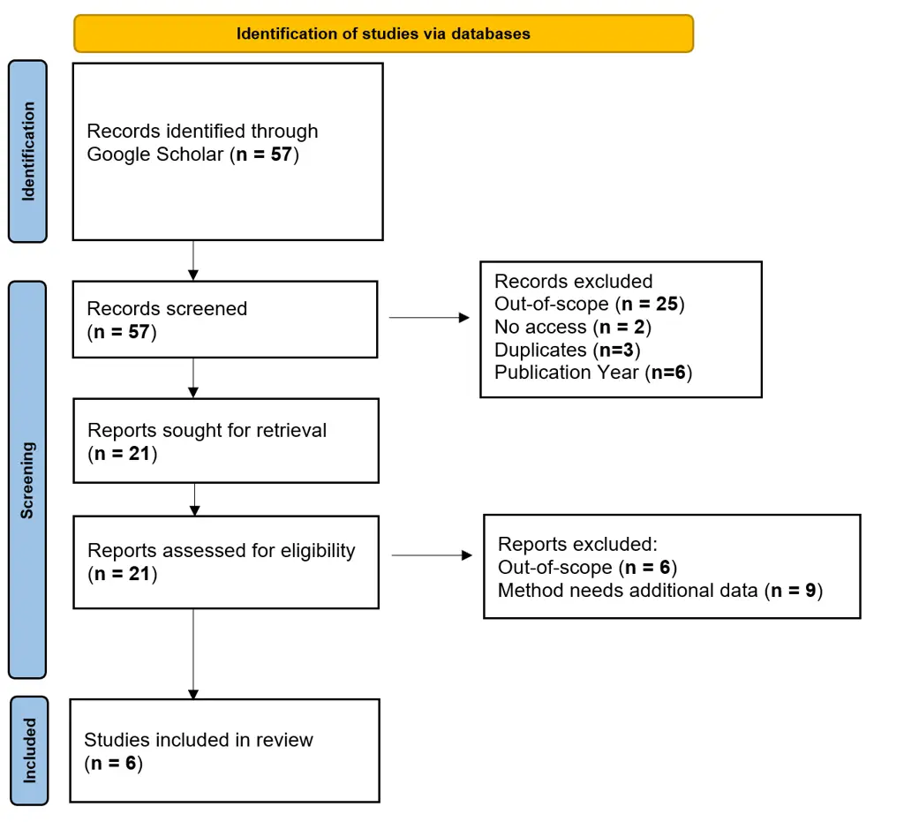

# Automatic Prompt Optimization Techniques: Exploring the Potential for Synthetic Data Generation

Nina Freise Marius Heitlinger\* Ruben Nuredini Gerrit Meixner
^(†)^(†)thanks: These authors contributed equally.
Affiliation: Heilbronn University of Applied Sciences
Affiliation: Heidelberg University

###### Abstract

Artificial Intelligence (AI) advancement is heavily dependent on access
to large-scale, high-quality training data. However, in specialized
domains such as healthcare, data acquisition faces significant
constraints due to privacy regulations, ethical considerations, and
limited availability. While synthetic data generation offers a promising
solution, conventional approaches typically require substantial real
data for training generative models. The emergence of large-scale
prompt-based models presents new opportunities for synthetic data
generation without direct access to protected data. However, crafting
effective prompts for domain-specific data generation remains
challenging, and manual prompt engineering proves insufficient for
achieving output with sufficient precision and authenticity. We review
recent developments in automatic prompt optimization, following PRISMA
guidelines. We analyze six peer-reviewed studies published between 2020
and 2024 that focus on automatic data-free prompt optimization methods.
Our analysis reveals three approaches: feedback-driven, error-based, and
control-theoretic. Although all approaches demonstrate promising
capabilities in prompt refinement and adaptation, our findings suggest
the need for an integrated framework that combines complementary
optimization techniques to enhance synthetic data generation while
minimizing manual intervention. We propose future research directions
toward developing robust, iterative prompt optimization frameworks
capable of improving the quality of synthetic data. This advancement can
be particularly crucial for sensitive fields and in specialized domains
where data access is restricted, potentially transforming how we
approach synthetic data generation for AI development.

## 1 Introduction

Artificial intelligence (AI) technologies are rapidly transforming
diverse sectors and fundamentally reshape operational paradigms across
industries. The profound impact of these systems is critically dependent
on the reliability of their decision-making capabilities. This
reliability is fundamentally tied to the AI-models’ predictive
capabilities which critically depends on two key dimensions: the
comprehensive scale of training data and the complexity of model
architecture. The shift toward data-centric approaches \[10\] has
further intensified the importance of comprehensive, high-quality input
data. Modern AI systems, based on learning methods such as deep
learning, rely heavily on massive datasets to learn complex patterns and
representations \[26\]. This paradigm shift has made access to
comprehensive, heterogenous, and high-quality datasets a fundamental
prerequisite for the development of sophisticated AI systems.

Obtaining suitable data for AI systems presents numerous challenges.
These include: rarity of data samples, resource-intensive data
collection processes, and inconsistent data recording protocols. Further
difficulties are caused by inherent biases in the collection and
labeling, the unstructured nature of raw data, as well as strict privacy
regulations governing sensitive information. These challenges are
particularly evident in domains where confidentiality and privacy are of
paramount importance. One such is the healthcare and medical domain
\[1\]. By nature, medical data is highly sensitive and personal, making
its acquisition and access challenging due to ethical issues and strict
privacy regulations such as GDPR or HIPAA. These traits have substantial
effect on the usability of AI-powered healthcare systems as many
potential users express concerns about potential privacy breaches\[24\].

An established approach to addressing data scarcity is the use of
augmentation techniques. The primary goal of data augmentation is to
expand both, the volume and diversity of data samples, by leveraging a
small set of real data as a basis for generating novel samples. Current
approaches involve utilization of advanced deep learning architectures
such as Generative Adversarial Networks (GANs) \[9\], Variational
Autoencoders (VAEs) \[14, 22\], and Diffusion Models \[11\]. These
_generative models_ learn to replicate the underlying statistical
properties of the real data and, once trained, are a limitless source of
unique synthetic data instances. Synthetic data closely mimics real data
while maintaining anonymity and privacy. Studies have highlighted the
effectiveness of generative models, demonstrating that models trained
solely on synthetic data can achieve reasonable performance \[4\].
Additionally, the combined use of synthetic and real data (a hybrid
approach) further enhances the predictive performance of AI models in
medical applications and often displays a superior performance over
models trained solely on real data \[30, 8, 7\]. One further benefit of
synthetic data is that it can serve as a valuable alternative for
research, teaching, and practice, free from the ethical and legal
restrictions often associated with the use of real data.

Regardless of the effectiveness, the quality of synthetic data obtained
by generative models highly depends on the volume and quality of the
data used for their training. This becomes challenging when extensive,
high-quality datasets are not readily available, paradoxically
highlighting the very issue that synthetic data generation seeks to
address.

The recent emergence of the so-called prompt-based models introduce a
new paradigm for data generation. These models take a textual prompt as
input and are capable to generate corresponding data as an output.
Notable examples are the Large Language Models (LLMs) \[20\] such as
OpenAI’s GPT \[21\] and Meta’s LLaMA \[27\] which are trained on vast
amounts of text data, and can understand and generate human-like
language. Latest breakthroughs have expanded the capabilities of similar
architectures, enabling them to generate data beyond text. Multimodal
transformers, for example, are now capable of producing images, audio,
and video.

Data generation with prompt-based models depends on task-specific
inputs, typically provided by users in the form of natural language
instructions, commonly refereed to as prompts. This poses significant
limitation in the usability of these models, as the quality of the
generated output is heavily influenced by the user’s ability to clearly
and concisely convey own intent through text. Additionally, prompt-based
models are very sensitive as small changes in the input prompt can
significantly influence the response. Achieving the desired outcome
typically requires several manual refinements of the initial prompt
until desired output is obtained. This iterative process, referred to as
manual prompt crafting, is often labor-intensive, unpredictable, and
time-consuming, involving extensive trial and error.

Various strategies for crafting precise and effective inputs, known as
prompt engineering techniques, have been developed and proposed \[2\].
These techniques provide valuable insights and practical advices to help
users effectively guide these models towards generating desired outputs
\[23\]. However, both, manual prompt crafting and prompt engineering
techniques, demonstrate significant model-specific limitations,
revealing that their effectiveness is not consistent across different
models, linguistic contexts, or varying task complexities \[17, 13\]
challenging the assumption of universal applicability.

Additional challenges become apparent when prompt-based models are
utilized for generating highly specialized, domain-specific data. In
those cases, the prompt must include extremely detailed linguistic
formulation in order to capture subtle patterns in the data. Such
nuanced details are very relevant in guiding the generation process but
are often conditioned by complex domain knowledge or are even beyond
human perception.

Few-shot prompting \[3\]—an advanced prompt engineering technique that
guides models by providing strategic demonstrations within the
prompt—can be considered as a potential mechanism to enhance data
generation quality. This technique involves presenting the model with
representative data samples and requesting it to generate similar
content. However, this approach remains constrained by the fundamental
limitation that real data in domain-specific scenarios is not readily
available.

Previous research exploring LLMs’ capabilities for synthetic medical
text generation through manual prompting report significant challenges
and only marginal success in producing clinically accurate and
contextually relevant data \[28, 25\]. The MedSyn framework \[15\]
presents an advanced approach to prompt crafting for the synthetic
generation of clinical notes with LLMs. However, the framework relies on
prior medical knowledge, represented as a Medical Knowledge Graph (MKG),
that is integrated to enrich prompts for GPT-4.

While prompt-based models demonstrate significant potential for
generating specialized domain-specific data, their effectiveness is
constrained by the complex nuances of human-computer interaction. This
limitation becomes particularly evident when direct access to real data
remains unavailable.

Optimization by PROmpting (OPRO) \[31\] represents an innovative
approach to automated prompt refinement where LLMs are used as
optimization agents. The method leverages natural language descriptions
of optimization objectives to iteratively generate and refine prompt
solutions. Through systematic evaluation and incorporation of successful
prompts into subsequent iterations, OPRO progressively enhances
instruction quality to maximize task performance and guide LLM outputs
for specific applications.

The foundational principles in OPRO served as an inspiration for
exploring innovative optimization techniques for automated, iterative
prompt refinement. These techniques provide a promising, low-effort
approach to gradually improve prompts, progressively aligning them with
the user’s intent. In the problem of synthetic data generation, the
objective is implicitly hidden within the patterns of real data and
difficult to articulate. Therefore, automated prompt optimization
techniques demonstrate significant potential to enhance the usability of
prompt-based models but also, extend their applicability to unorthodox
domains and use cases.

We present a systematic review of prompt optimization techniques, with
particular emphasis on methods suitable for generating synthetic data.
Our investigation focuses on identifying sophisticated approaches that
enhance data authenticity while operating autonomously and with minimal
user intervention. Given the often strict privacy regulations for
accessing data, such as in the medical domain, we exclusively examine
methods that can function effectively without direct access to real
datasets.

## 2 Methods

This review follows the Preferred Reporting Items for Systematic Reviews
and Meta-Analysis (PRISMA) standards for systematic reviews \[16\]. We
focus on relevant studies on the topic of automatic and iterative prompt
optimization methods for text generation. We specifically aim to
identify techniques capable of operating without relying on training
datasets, high-performing prompt datasets, or any established form of
"ground truth". Our review encompasses literature published from 2020
onwards, following GPT-2’s landmark release in November 2019, which
revolutionized approaches to data generation and initiated research in
the field.

We conducted the search on Google Scholar, as it indexes a wide range of
academic sources, including peer-reviewed journals, conference papers,
and books. Furthermore, Google Scholar provides the capability to search
the full text of articles, in addition to titles and abstracts, which
increases the probability of locating relevant papers on the subject
matter.

The search term combines Large Language Models, automatic prompt
engineering, and text prompts and some variations and synonyms of these
topics.

The following query is the result:

> ("Large Language Models" OR "LLM")  
> AND  
> ("automatic prompt engineering" OR "iterative prompt engineering")  
> AND  
> ("text prompts")  
> AND  
> ("optimizing" OR "optimizers" OR "improved" OR "improving")

The inclusion and exclusion criteria for the resulting papers are
defined in Table 1.

|                                                                                                                                      |                                                                                                                                                                                                                                                                    |
| ------------------------------------------------------------------------------------------------------------------------------------ | ------------------------------------------------------------------------------------------------------------------------------------------------------------------------------------------------------------------------------------------------------------------ |
| Inclusion Criteria                                                                                                                   | Exclusion Criteria                                                                                                                                                                                                                                                 |
| • Automatic techniques: Contains iterative prompt engineering techniques using text prompts • Language: Written in German or English | • Publication date: Published before the year 2020 • Dataset use: Utilizes a training set or open dataset for evaluation in its method • Access: Inaccessible without open access or not available via the University of Heilbronn or the University of Heidelberg |

Table 1: Inclusion and Exclusion Criteria for Literature Review

If the papers do not contain automatic and iterative prompt engineering
techniques on text prompts for generating text, they will be referenced
as out-of-scope.

The search results were exported, divided by two, and assigned to two
reviewers for initial screening. Initially, records were screened based
on the inclusion and exclusion criteria using the title and abstract.
Subsequently, the full texts were retrieved, and a full-text screening
was performed. This step involved a re-application of the inclusion and
exclusion criteria. The reasons for excluding papers were documented. To
ensure the validity of each paper, we performed the full-text paper
screening individually for every paper and then compared the results.
The search was conducted in October 2024.

## 3 Results

Figure 1: PRISMA flow diagram

This systematic review commenced with an initial comprehensive search,
which identified 57 papers. After screening the abstracts, 36 papers
were excluded due to the reasons shown in Fig. 1. We subsequently
conducted an in-depth analysis on 21 papers, after which we excluded 15
papers. The final count of studies considered in this systematic review
is therefore 6.

The reviewed studies present diverse techniques for iterative prompt
optimization, each leveraging unique mechanisms to refine prompt quality
and model performance. Despite sharing a common objective—enhancing
prompt efficacy across various applications—these approaches differ
significantly in their optimization strategies, feedback structures, and
scenarios where they excel.

### 3.1 Feedback-Based and Iterative Refinement Approaches

Dong et al. (2024) \[6\] and Wu et al. (2024) \[29\] with their
frameworks PACE and STRAGO adopt feedback-centric methods that enable
LLMs to refine prompts iteratively, yet they differ in their feedback
structures and evaluation strategies.

PACE employs an actor-critic algorithm inspired by reinforcement
learning, where the LLM operates in two roles: as an "actor" that
generates responses based on a prompt and as a "critic" that assesses
response quality. Its feedback loop is multi-faceted; it incorporates
feedback from multiple critic models per iteration, aggregating feedback
to guide the optimization of each prompt. This aggregation allows for a
broader perspective on prompt performance, enhancing robustness and
reducing individual bias. Unlike single-step feedback loops, the
actor-critic structure allows for nuanced adjustments to prompts, making
it particularly effective in scenarios where varied perspectives are
needed for prompt improvement. However, the model’s reliance on multiple
evaluations per iteration raises computational demands, potentially
limiting its applicability in resource-constrained settings.

STRAGO, while also feedback-driven, tackles a common pitfall in prompt
optimization: prompt drift, where optimization for specific cases can
lead to performance loss in other scenarios. To mitigate this, the
method involves analyzing both successful and failed cases, offering a
balanced view of prompt performance. This approach allows STRAGO to
provide detailed, step-by-step refinements, addressing specific issues
while preserving effective elements of prior prompts. STRAGO’s
three-step process (analyzer, refiner, and optimizer) further
differentiates it from PACE, with each stage focusing on dissecting both
correct and incorrect predictions and generating strategies for
iterative prompt refinement. By adopting this structured, multi-layered
process, STRAGO is well-suited for complex, stability-dependent tasks
where controlled refinement is critical, such as reasoning or
domain-specific applications.

While both methods demonstrate the power of iterative feedback, PACE
focuses on aggregating diverse feedback for prompt refinement, whereas
STRAGO emphasizes stability by maintaining a balance between corrective
actions and preserving successful prompt features. These differences
highlight PACE’s strength in high-complexity environments and STRAGO’s
advantage in scenarios where drift control is paramount.

### 3.2 Error-Focused or Diagnostic Prompt Improvement

In contrast to feedback aggregation, Chen et al. (2024) \[5\] with their
framework REPROMPT and Ma et al. (2024) \[19\] with "Are Large Language
Models Good Prompt Optimizers?" center on error diagnosis and corrective
adjustments, adopting a more diagnostic approach to iterative
refinement.

REPROMPT mimics a conversational feedback loop, where each response is
analyzed for common points of failure. By identifying recurring errors,
REPROMPT facilitates targeted prompt adjustments that address specific
weaknesses rather than generic improvements. Each round refines the
initial prompt, similar to a dialogue, enabling REPROMPT to iteratively
shape prompts based on accumulated interaction data. This conversational
structure makes REPROMPT especially effective in scenarios where task
complexity increases over time, such as procedural planning or extended
dialogue-based tasks. However, REPROMPT’s reliance on batch-based error
analysis may limit adaptability in dynamic contexts, where feedback
needs to be immediate and granular.

Ma et al. (2024) \[19\] challenge the effectiveness of LLM-based
reflection methods, proposing “Automatic Behavior Optimization” as an
alternative. This method directly targets problematic behaviors by
requiring the optimizer to identify failure steps and then refine
prompts specifically at those points. Unlike REPROMPT, which iteratively
refines prompts based on generalized patterns of failure, Automatic
Behavior Optimization emphasizes precision by requiring the LLM to
generate step-by-step instructions to address specific failures. This
targeted refinement is advantageous for tasks where accuracy at each
step is critical, such as instructional generation or decision-based
tasks. However, the approach may be less effective in adaptive or
high-variability scenarios, where failure points are not easily
identifiable or repeatable.

The diagnostic focus of both REPROMPT and Automatic Behavior
Optimization contrasts with the broader feedback-oriented approaches of
PACE and STRAGO. REPROMPT’s conversational, batch-based error
identification enables systematic adjustments across task phases, while
Automatic Behavior Optimization’s step-specific refinement prioritizes
direct behavioral alignment, particularly in high-precision contexts.

### 3.3 Control-Theoretic and Structured Interaction Optimization

Luo et al. (2023) \[18\] introduce a control-theoretic perspective,
treating prompt engineering as a dynamic optimization problem. Unlike
feedback or error-based refinement, this approach uses a structured,
systematized interaction model where the initial prompt is iteratively
adjusted based on response evaluation, similar to a feedback control
system.

This control-based approach involves a multi-round interaction
structure, where each iteration generates refined prompts to address
gaps identified in previous responses. By systematically narrowing the
prompt’s focus and enhancing specificity, Optimal Control’s framework
excels in tasks that require controlled iterative refinement, such as
diagnostic or advisory systems where multi-step accuracy is critical.
However, its reliance on sequential interaction rounds can be
time-intensive, potentially limiting its application in real-time
scenarios where immediate responses are needed.

### 3.4 Contextual and Evolutionary Optimization of Complex Prompts

Hsieh et al. (2023) \[12\] employ a context-driven, evolutionary
approach for prompt optimization, designed specifically for complex or
lengthy prompts.

This method involves segmenting the initial long prompt into individual
sentences, each rephrased independently by a mutator that maintains
semantic consistency. Rather than direct feedback, the method employs a
contextual bandit approach, which selects sentences likely to benefit
the prompt’s overall performance when rephrased. Each revised prompt is
then evaluated, and successful mutations inform future modifications,
effectively evolving the prompt over successive iterations. This
evolutionary approach is particularly beneficial in static,
domain-specific tasks requiring detailed, multi-sentence instructions,
such as legal or scientific writing. However, without direct feedback
from task performance, the method may struggle to adapt to changing
requirements, making it less suited for dynamic or highly adaptive
applications.

These six studies illustrate a range of iterative prompt optimization
techniques, each with unique mechanisms suited to different scenarios.
Dong et al. (2024) \[6\] with PACE and Wu et al. (2024) \[29\] with
STRAGO emphasize systematic refinement, with PACE excelling in
high-complexity environments and STRAGO balancing corrective actions
with stability. Chen et al. (2024) \[5\] and Ma et al. (2024) \[19\]
offer diagnostic refinement strategies, prioritizing error correction
for high-precision tasks, while Luo et al. (2023) \[18\] formalizes
prompt engineering as a dynamic control process, beneficial for
controlled, multi-round interactions. Finally, Hsieh et al. (2023)
\[12\] leverages an evolutionary structure suited for static,
multi-component prompts.

This analysis highlights the adaptability of iterative prompt
optimization strategies, with each method offering tailored benefits for
specific applications - feedback aggregation for comprehensive tasks,
error-focused adjustments for precision tasks, structured control for
interaction-heavy scenarios, and contextual evolution for complex
prompts without direct feedback.

## 4 Discussion

Our approach to systematic review was based on the PRISMA framework in
order to identify relevant studies on automatic prompt engineering
techniques. This approach has notable strengths, especially through its
adherence to PRISMA guidelines , ensuring transparency and
reproducibility. By utilizing a detailed search strategy and rigorous
inclusion/exclusion criteria, the review process captured a focused set
of studies that were highly relevant to the specific requirements for
this study. These carefully defined selection criteria—including studies
published after 2020 excluding techniques depending on explicit access
to real datasets—were strategically designed to identify innovative
methods for generating synthetic data. This approach is particularly
crucial in domains like healthcare and medicine, where direct data
access is severely restricted by privacy and regulatory constraints.

While comprehensive in scope, this systematic review has several
limitations that must be acknowledged.

First, the reliance on Google Scholar, although beneficial for its
comprehensive indexing, might have limited the scope to certain types of
publications and excluded specialized databases, potentially overlooking
niche studies.

Furthermore, the selection criteria were restricted to publications that
were either open-source or available on platforms with open-access
agreements with German universities. This limitation may have excluded
studies from platforms with restricted access (e.g., paywalls) or those
not covered by open-access agreements, potentially omitting valuable
insights for a more comprehensive understanding of the topic.

Another limitation is the language restriction of the reviewed
publications as only included those written in English or German
language. This may have led to exclusion of valuable studies defining
effective prompt engineering techniques, potentially resulting in missed
insights or innovations due to the language barrier.

Finally, the decision to exclude studies that utilized real datasets in
the optimization process, while justifiable, may have omitted techniques
with potentially adaptable components for iterative prompt engineering.
While the exclusion criteria ensured relevance, they might have
inadvertently constrained the range of methodologies available for
synthesis, potentially overlooking hybrid approaches that could benefit
from minor adjustments in order to be able to operate without real data.

The systematic review highlights diverse approaches to prompt
optimization, emphasizing the potential for automatic, minimal-input
techniques. Feedback-driven methods like PACE and STRAGO show promise in
refining prompts systematically, while error-focused approaches such as
REPROMPT and Automatic Behavior Optimization address specific failures
for high-precision tasks. Control-theoretic methods and evolutionary
strategies further diversify the landscape, each suited to unique use
cases. These findings underscore the importance of balancing
adaptability, precision, and computational efficiency in developing
prompt engineering techniques, particularly for sensitive applications
like medical data generation.

## 5 Conclusion

Prompt-based models display immense potential for generating synthetic
data. However, the primary challenge lies in constructing the right
prompt to invoke the generation of plausible, high-quality data — a
challenge that can be addressed by automatic prompt optimization.

In this study we systematically reviewed automatic prompt optimization
techniques to identify methods suitable for the task of synthetic data
generation. Our focus was on approaches that do not rely on real
datasets, which distinguishes them from conventional approaches in
synthetic data generation by fine-tuning or training generative models.
The examined methods reveal significant opportunities for further
refinement and innovation, particularly in the areas of automation and
user-independent design. Building on these insights, future research
should aim to develop integrative frameworks that combine the strengths
of different techniques into cohesive pipelines. For example, leveraging
the precision of error-focused methods alongside the scalability of
evolutionary strategies may yield solutions that are both efficient and
robust. Such a framework would streamline the process of prompt
refinement, reducing user intervention while improving the realism and
applicability of generated outputs, which can play a pivotal role in
addressing the growing demand for high-quality synthetic data across
various domains.

While prompt engineering serves as a bridge between traditional
programming (or data science) tasks and the emerging field of AI
application development, its effectiveness in human-computer interaction
is constrained by the challenge of accurately conveying intent. Current
AI systems heavily rely on well-constructed prompts to generate relevant
and accurate responses. However, this reliance is not sustainable in the
long term. As AI models advance, they may develop the ability to
understand tasks more intuitively, reducing the need for precise and
carefully engineered prompts. Future AI systems should become more
context-aware and capable of interpreting user intent with minimal or
even ambiguous input. In this future scenario, automatic prompt
optimization could become an essential feature of AI systems, allowing
them to incorporate broader context and adapting to a wide range of
interactions. Continued research and innovation in the area of automatic
prompt optimization will not only enhance the quality and plausibility
of synthetic data but also support the shift toward Generalized AI.

## References

- \[1\] Aldoseri, A., Al-Khalifa, K.N., Hamouda, A.M.: Re-thinking data
  strategy and integration for artificial intelligence: Concepts,
  opportunities, and challenges. Applied Sciences 13(12) (2023),
  [https://www.mdpi.com/2076-3417/13/12/7082](https://www.mdpi.com/2076-3417/13/12/7082)
- \[2\] Amatriain, X.: Prompt design and engineering: Introduction and
  advanced methods (2024),
  [https://arxiv.org/abs/2401.14423](https://arxiv.org/abs/2401.14423)
- \[3\] Brown, T.B., Mann, B., Ryder, N., Subbiah, M., Kaplan, J.,
  Dhariwal, P., Neelakantan, A., Shyam, P., Sastry, G., Askell, A.,
  Agarwal, S., Herbert-Voss, A., Krueger, G., Henighan, T., Child, R.,
  Ramesh, A., Ziegler, D.M., Wu, J., Winter, C., Hesse, C., Chen, M.,
  Sigler, E., Litwin, M., Gray, S., Chess, B., Clark, J., Berner, C.,
  McCandlish, S., Radford, A., Sutskever, I., Amodei, D.: Language
  models are few-shot learners. CoRR abs/2005.14165 (2020),
  [https://arxiv.org/abs/2005.14165](https://arxiv.org/abs/2005.14165)
- \[4\] Carrle, F.P., Hollenbenders, Y., Reichenbach, A.: Generation of
  synthetic eeg data for training algorithms supporting the diagnosis of
  major depressive disorder. Frontiers in Neuroscience 17 (2023),
  [https://www.frontiersin.org/journals/neuroscience/articles/10.3389/fnins.2023.1219133](https://www.frontiersin.org/journals/neuroscience/articles/10.3389/fnins.2023.1219133)
- \[5\] Chen, W., Koenig, S., Dilkina, B.: Reprompt: Planning by
  automatic prompt engineering for large language models agents (2024),
  [https://arxiv.org/abs/2406.11132](https://arxiv.org/abs/2406.11132)
- \[6\] Dong, Y., Luo, K., Jiang, X., Jin, Z., Li, G.: Pace: Improving
  prompt with actor-critic editing for large language model (2024),
  [https://arxiv.org/abs/2308.10088](https://arxiv.org/abs/2308.10088)
- \[7\] Dorjsembe, Z., Pao, H.K., Odonchimed, S., Xiao, F.: Conditional
  diffusion models for semantic 3d brain mri synthesis. IEEE Journal of
  Biomedical and Health Informatics 28(7), 4084–4093 (2024)
- \[8\] Frid-Adar, M., Diamant, I., Klang, E., Amitai, M., Goldberger,
  J., Greenspan, H.: Gan-based synthetic medical image augmentation for
  increased cnn performance in liver lesion classification.
  Neurocomputing 321, 321–331 (Dec 2018)
- \[9\] Goodfellow, I.J., Pouget-Abadie, J., Mirza, M., Xu, B.,
  Warde-Farley, D., Ozair, S., Courville, A., Bengio, Y.: Generative
  adversarial networks (2014),
  [https://arxiv.org/abs/1406.2661](https://arxiv.org/abs/1406.2661)
- \[10\] Halevy, A., Norvig, P., Pereira, F.: The unreasonable
  effectiveness of data. IEEE Intelligent Systems 24(2), 8–12 (2009)
- \[11\] Ho, J., Jain, A., Abbeel, P.: Denoising diffusion probabilistic
  models. CoRR abs/2006.11239 (2020),
  [https://arxiv.org/abs/2006.11239](https://arxiv.org/abs/2006.11239)
- \[12\] Hsieh, C.J., Si, S., Yu, F.X., Dhillon, I.S.: Automatic
  engineering of long prompts (2023),
  [https://arxiv.org/abs/2311.10117](https://arxiv.org/abs/2311.10117)
- \[13\] Kepel, D., Valogianni, K.: Autonomous prompt engineering in
  large language models (2024),
  [https://arxiv.org/abs/2407.11000](https://arxiv.org/abs/2407.11000)
- \[14\] Kingma, D.P., Welling, M.: Auto-encoding variational bayes
  (2013),
  [https://arxiv.org/abs/1312.6114](https://arxiv.org/abs/1312.6114)
- \[15\] Kumichev, G., Blinov, P., Kuzkina, Y., Goncharov, V., Zubkova,
  G., Zenovkin, N., Goncharov, A., Savchenko, A.: Medsyn: Llm-based
  synthetic medical text generation framework. In: Machine Learning and
  Knowledge Discovery in Databases. Applied Data Science Track: European
  Conference, ECML PKDD 2024, Vilnius, Lithuania, September 9–13, 2024,
  Proceedings, Part X. p. 215–230. Springer-Verlag, Berlin,
  Heidelberg (2024)
- \[16\] Liberati, A., Altman, D.G., Tetzlaff, J., Mulrow, C., Gøtzsche,
  P.C., Ioannidis, J.P., Clarke, M., Devereaux, P.J., Kleijnen, J.,
  Moher, D.: The prisma statement for reporting systematic reviews and
  meta-analyses of studies that evaluate health care interventions:
  explanation and elaboration. Annals of internal medicine 151(4),
  W–65 (2009)
- \[17\] Liu, C., Zhang, W., Zhao, Y., Luu, A.T., Bing, L.: Is
  translation all you need? a study on solving multilingual tasks with
  large language models (2024),
  [https://arxiv.org/abs/2403.10258](https://arxiv.org/abs/2403.10258)
- \[18\] Luo, Y., Tang, Y., Shen, C., Zhou, Z., Dong, B.: Prompt
  engineering through the lens of optimal control (2023),
  [https://arxiv.org/abs/2310.14201](https://arxiv.org/abs/2310.14201)
- \[19\] Ma, R., Wang, X., Zhou, X., Li, J., Du, N., Gui, T., Zhang, Q.,
  Huang, X.: Are large language models good prompt optimizers? (2024),
  [https://arxiv.org/abs/2402.02101](https://arxiv.org/abs/2402.02101)
- \[20\] Minaee, S., Mikolov, T., Nikzad, N., Chenaghlu, M., Socher, R.,
  Amatriain, X., Gao, J.: Large language models: A survey (2024),
  [https://arxiv.org/abs/2402.06196](https://arxiv.org/abs/2402.06196)
- \[21\] OpenAI: Gpt-4 technical report. OpenAI (2023),
  [https://openai.com/index/gpt-4/](https://openai.com/index/gpt-4/)
- \[22\] Rezende, D.J., Mohamed, S., Wierstra, D.: Stochastic
  backpropagation and approximate inference in deep generative models
  (2014),
  [https://arxiv.org/abs/1401.4082](https://arxiv.org/abs/1401.4082)
- \[23\] Schulhoff, S., Ilie, M., Balepur, N., Kahadze, K., Liu, A., Si,
  C., Li, Y., Gupta, A., Han, H., Schulhoff, S., Dulepet, P.S.,
  Vidyadhara, S., Ki, D., Agrawal, S., Pham, C., Kroiz, G., Li, F., Tao,
  H., Srivastava, A., Costa, H.D., Gupta, S., Rogers, M.L., Goncearenco,
  I., Sarli, G., Galynker, I., Peskoff, D., Carpuat, M., White, J.,
  Anadkat, S., Hoyle, A., Resnik, P.: The prompt report: A systematic
  survey of prompting techniques (2024),
  [https://arxiv.org/abs/2406.06608](https://arxiv.org/abs/2406.06608)
- \[24\] Shevtsova, D., Ahmed, A., Boot, I.W.A., Sanges, C., Hudecek,
  M., Jacobs, J.J.L., Hort, S., Vrijhoef, H.J.M.: Trust in and
  acceptance of artificial intelligence applications in medicine: Mixed
  methods study. JMIR Hum Factors 11, e47031 (Jan 2024),
  [https://humanfactors.jmir.org/2024/1/e47031](https://humanfactors.jmir.org/2024/1/e47031)
- \[25\] Sufi, F.: Addressing data scarcity in the medical domain: A
  gpt-based approach for synthetic data generation and feature
  extraction. Information 15(5) (2024),
  [https://www.mdpi.com/2078-2489/15/5/264](https://www.mdpi.com/2078-2489/15/5/264)
- \[26\] Sutton, R.: The bitter lesson.
  [http://www.incompleteideas.net/IncIdeas/](http://www.incompleteideas.net/IncIdeas/)
  (2019), accessed: December 2024
- \[27\] Touvron, H., Lavril, T., Izacard, G., Martinet, X., Lachaux,
  M.A., Lacroix, T., Rozière, B., Goyal, N., Hambro, E., Azhar, F.,
  Rodriguez, A., Joulin, A., Grave, E., Lample, G.: Llama: Open and
  efficient foundation language models (02 2023)
- \[28\] Uyguner, I., Martin, I., Pallaoro, P., Boeker, M., Modersohn,
  L.: Meeting abstract. In: 68. Jahrestagung der Deutschen Gesellschaft
  für Medizinische Informatik, Biometrie und Epidemiologie e. V.
  (GMDS). p. DocAbstr. 260. German Medical Science GMS Publishing House
  (2023),
  [https://www.egms.de/static/en/meetings/gmds2023/23gmds136.shtml](https://www.egms.de/static/en/meetings/gmds2023/23gmds136.shtml),
  published: September 15, 2023
- \[29\] Wu, Y., Gao, Y., Zhu, B.B., Zhou, Z., Sun, X., Yang, S., Lou,
  J.G., Ding, Z., Yang, L.: Strago: Harnessing strategic guidance for
  prompt optimization (2024),
  [https://arxiv.org/abs/2410.08601](https://arxiv.org/abs/2410.08601)
- \[30\] Xu, J., Wu, B., Huang, J., Gong, Y., Zhang, Y., Liu, B.:
  Practical applications of advanced cloud services and generative ai
  systems in medical image analysis. ArXiv abs/2403.17549 (2024),
  [https://api.semanticscholar.org/CorpusID:268691510](https://api.semanticscholar.org/CorpusID:268691510)
- \[31\] Yang, C., Wang, X., Lu, Y., Liu, H., Le, Q.V., Zhou, D., Chen,
  X.: Large language models as optimizers. arXiv preprint
  arXiv:2309.03409 (2023)
