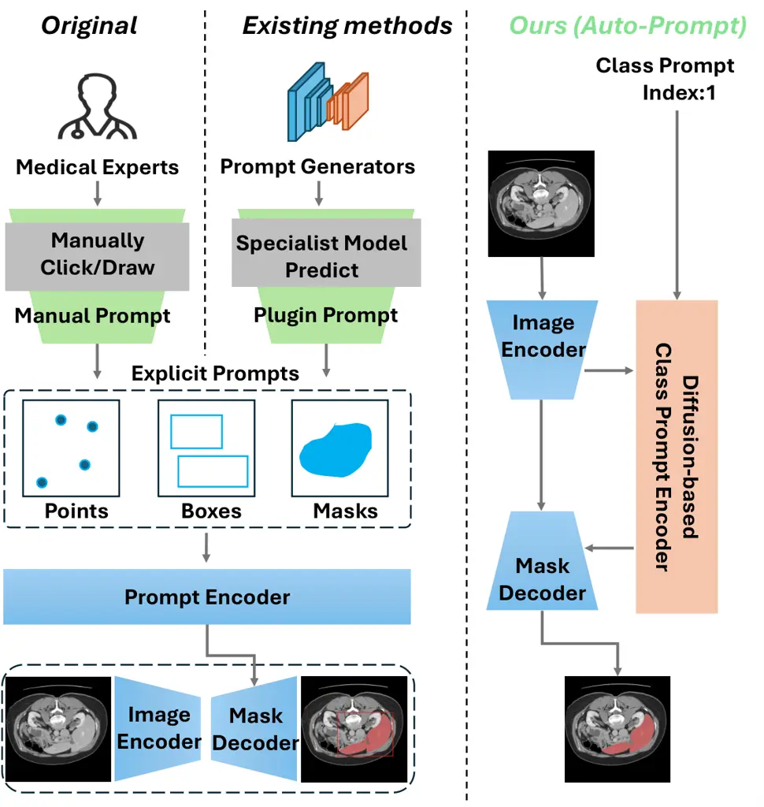
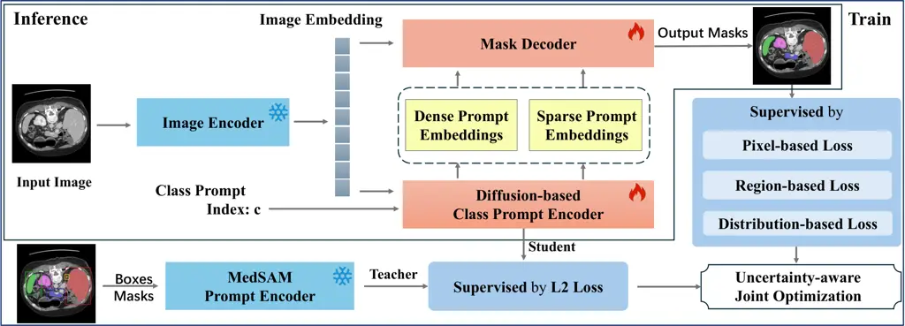
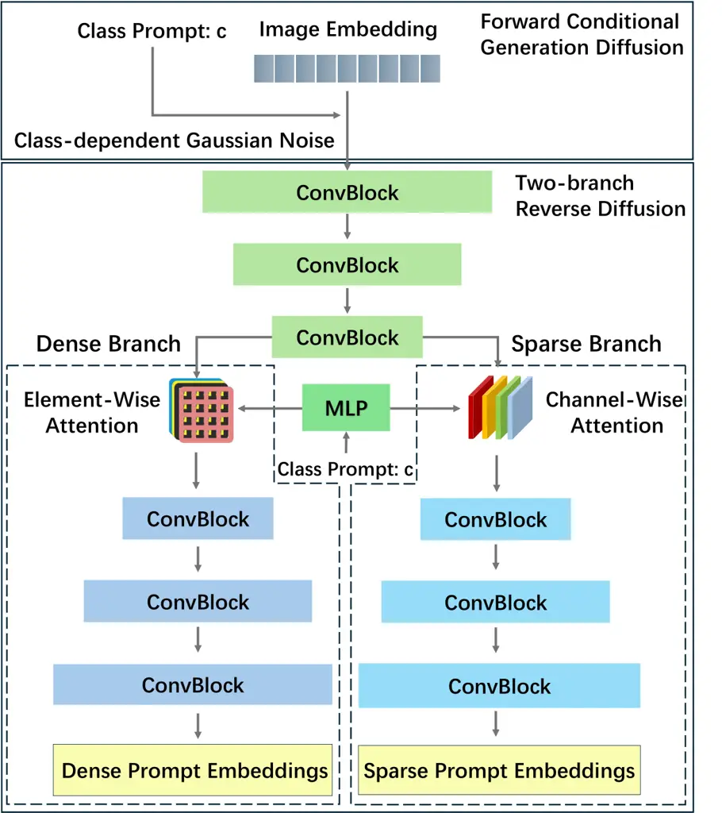
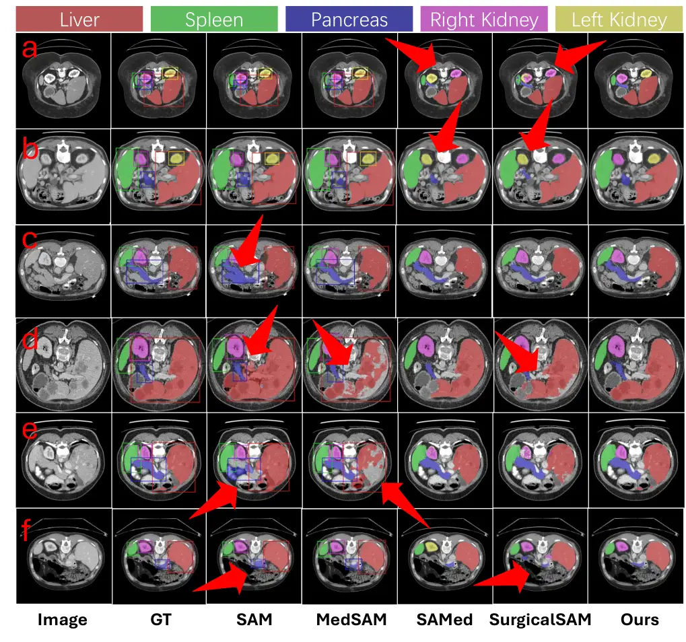
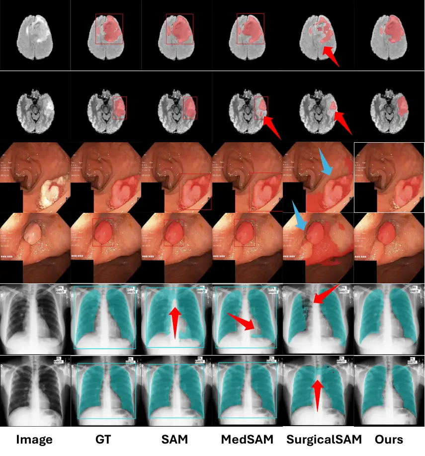
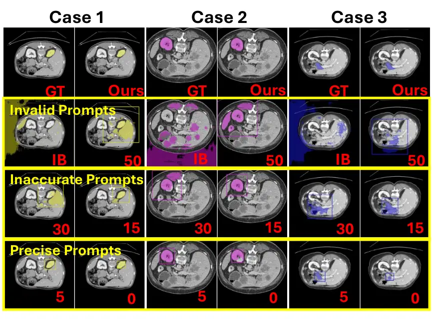

# Diffusion-empowered AutoPrompt MedSAM

Peng Huang    Shu Hu    Bo Peng    Xun Gong    Penghang Yin    Hongtu
Zhu    Xi Wu    Xin Wang ^(†)^(†)thanks: Peng Huang, Bo Peng, and Xun
Gong are with the School of Computing and Artificial Intelligence,
Southwest Jiaotong University, Chengdu, China (e-mail:
huangpeng@my.swjtu.edu.cn; bpeng@swjtu.edu.cn;
gongxun@foxmail.com).^(†)^(†)thanks: Shu Hu is with the Department of
Computer and Information Technology, Purdue University, USA (e-mail:
hu968@purdue.edu).^(†)^(†)thanks: Penghang Yin is with the Department of
Mathematics and Statistics, University at Albany, State University of
New York, USA (e-mail: pyin@albany.edu).^(†)^(†)thanks: Hongtu Zhu is
with the University of North Carolina at Chapel Hill, USA (e-mail:
htzhu@email.unc.edu).^(†)^(†)thanks: Xi Wu is with the School of
Computer Science, Chengdu University of Information Technology, Chengdu,
China (e-mail: wuxi@cuit.edu.cn).^(†)^(†)thanks: Xin Wang is with the
College of Integrated Health Sciences and the AI Plus Institute,
University at Albany, State University of New York, USA (e-mail:
xwang56@albany.edu).^(†)^(†)thanks: Corresponding Author: Bo Peng, Xin
Wang.

###### Abstract

MedSAM, a medical foundation model derived from SAM, has achieved
remarkable success across various medical domains. Nonetheless, its
clinical adoption encounters two primary challenges: the reliance on
labor-intensive manual prompt generation, which places a considerable
burden on clinicians, and the lack of semantic labeling in the generated
segmentation masks for organs or lesions, which hinders its usability
for non-expert users. To overcome these limitations, we propose an
end-to-end interactive segmentation model, AutoMedSAM. AutoMedSAM
employs a diffusion-based class prompt encoder to generate prompt
embeddings guided by the prompt class indices and eliminates the
reliance on manual prompts. During the diffusion process, the encoder
progressively captures the semantic structure and fine-grained features
of the target object, injecting semantic information into the prediction
pipeline. Furthermore, we introduce an uncertainty-aware joint
optimization strategy that integrates pixel-based, region-based, and
distribution-based losses. This approach harnesses MedSAM’s pre-trained
knowledge and various loss functions to enhance the model’s
generalization. Experimental evaluations on diverse datasets demonstrate
that AutoMedSAM not only achieves superior segmentation performance but
also extends its applicability to clinical environments and
non-specialist users. Code is available at
[https://github.com/HP-ML/AutoPromptMedSAM.git](https://github.com/HP-ML/AutoPromptMedSAM.git).

###### Index Terms: 

MedSAM, medical image foundation model, end-to-end, diffusion model,
uncertainty learning

## I Introduction

Deep learning models have traditionally been applied in medicine by
designing and training specialized models for specific tasks, achieving
significant success \[1, 2, 3, 4\]. However, these approaches often
require training a model from scratch using corresponding data \[5, 6,
7\], leading to low training efficiency and limited transferability to
other tasks \[8, 9\]. Meanwhile, diagnostic-computer interaction is
essential in medical scenarios. Ideally, a physician should be able to
provide reference information (e.g., an organ or lesion class ID) to the
system, which then recognizes and segments relevant targets. However,
most existing specialist models do not support the operation of such
interactivity. Recently, prompt-based foundational models in computer
vision, such as the Segment Anything Model (SAM) \[10\], have
demonstrated impressive performance and generalization capabilities in
various semantic segmentation tasks based on user-provided prompts \[11,
12\].



Fig. 1: Comparison with SAM-based models.(Left) The original SAM model
relies on manual prompts from medical experts, restricting its usability
and scenarios. (Middle) Current SAM-based methods employ specialist
models for prompt generation, but these models are organ- or
lesion-specific, limiting SAM’s generalizability. (Right) Our method
introduces an automatic diffusion-based class prompt encoder, removing
the need for explicit prompts, adding semantic labels to masks, and
enabling accurate, end-to-end segmentation for non-experts in diverse
medical contexts.

Compared to natural images, medical images generally have lower
contrast, lower resolution, and high inter-class similarity, with strong
domain-specific characteristics. As a result, SAM performs poorly in the
medical domain. To address this, Ma et al. proposed the foundational
medical model MedSAM \[13\], which has been optimized for the unique
characteristics of medical images. In its optimization process, MedSAM
utilized over one million medical masks, including common modalities
such as MRI and CT, marking the entry of segmentation models in the
medical field into the era of large segmentation models.

In busy clinical environments, it is difficult for physicians to provide
accurate prompts through labor-intensive manual prompting, but it is a
fundamental requirement for obtaining precise masks. On the other hand,
for users without medical knowledge, the pixels in the image
corresponding to organs or lesions are not immediately intuitive, and
the generated segmentation masks lack additional semantic annotations,
making them difficult to interpret. This renders the segmentation
results of little practical value for non-expert users, thereby limiting
the applicability of MedSAM in certain contexts and its potential user
base. Although MedSAM boasts impressive zero-shot and few-shot
segmentation capabilities, there are still some challenges.
Specifically: (1) Dependency on Manual Prompts: It requires users to
provide precise prompts to segment the target region. However, creating
prompts for medical images requires expertise, and in clinical settings,
providing explicit prompts like points, bounding boxes, or scribbles is
impractical. (2) Limitations of Prompt Precision: The manual nature of
these prompts means the error may not be within a controllable
range \[14\]. Using the bounding box prompt as an example, MedSAM’s
performance relies on the discrepancy between the prompt box and the
true boundary. However, other targets within the prompt box cannot be
avoided, and different organ or lesion categories often exhibit high
similarity and low inter-class variation \[15\]. (3) Lack of Semantic
Information: MedSAM cannot obtain the semantic information of the masks
it predicts. It can only predict binary masks for each prompt, without
associating them with semantic labels \[10, 13, 16\].

To address these challenges, we propose AutoMedSAM. A comparison between
AutoMedSAM and existing methods is shown in Fig. 1. We replaced the
original prompt encoder with a diffusion-based class prompt encoder.
This new encoder uses a lesion or organ index as prompting,
incorporating semantic information about the target into the AutoMedSAM
learning process. The class prompts and image embeddings are input
information to generate prompt embeddings for the mask decoder directly.
By generating prompt embeddings directly from class prompts, we
eliminate the robustness issues caused by manually provided explicit
prompts and transform the semi-automatic MedSAM into a fully automated
end-to-end process. Meanwhile, we designed an uncertainty-aware joint
optimization training strategy. This strategy can optimize the model
training process by combining the advantages of multiple loss functions
while transferring the pre-training knowledge from MedSAM to AutoMedSAM.
This enables AutoMedSAM to adapt to data of various modalities and
effectively extract features of different organs or lesions, enhancing
the segmentation performance and robustness of the model.

In summary, our contributions are as follows:

1.  1.  We introduced an interactive end-to-end model, AutoMedSAM, enabling
        doctors and researchers to rapidly and accurately analyze medical
        images for more timely diagnosis and treatment, without relying on
        labor-intensive manual sketching of organs or lesions to guide the
        segmentation process.
2.  2.  We proposed a diffusion-based class prompt encoder that eliminates
        the need for explicit prompts and facilitates direct learning of
        latent prompt embeddings from class prompts. Through the diffusion
        process, the encoder progressively enhances its understanding of the
        medical targets, thereby improving the effectiveness and
        generalization capability of the class prompts.
3.  3.  We designed an uncertainty-aware joint optimization strategy that
        combines pixel-based, region-based, and distribution-based loss
        functions. This approach leverages the pre-trained knowledge of
        MedSAM and integrates diverse loss components to improve the model’s
        generalization ability and robustness across multi-modal medical
        data.

## II Related Works

### II-A SAM-based Medical Image Segmentation

SAM represents a significant breakthrough in transforming image
segmentation from specialized applications to a general-purpose
tool \[17\]. After training on large-scale datasets, SAM builds a broad
knowledge base and relies on manually provided explicit prompts with
precise locations (e.g., points and bounding boxes) to trigger
segmentation responses \[18\]. However, due to the substantial domain
gap between natural and medical images, SAM exhibits limited
generalizability in medical imaging. To bridge this gap, studies such as
MedSAM and SAM Med2D integrate extensive medical imaging data with
specialized fine-tuning strategies, effectively improving performance in
medical scenarios \[13, 19, 20\]. However, the accuracy of SAM’s
segmentation is sensitive to the positional bias of the prompts (as
validated in Section IV-E). Consequently, the segmentation process often
requires extensive manual intervention or professional detectors,
turning it into a multi-stage workflow. In certain clinical
settings(e.g., surgeries \[15\]), providing explicit prompts for every
frame is impractical. To address this limitation, methods like MaskSAM
and UV-SAM employ task-specific expert models to generate coarse
positional prompts, reducing reliance on explicit user input \[16, 21\].
While these approaches mitigate the need for explicit prompts, they lack
fine-grained class-specific prompting capabilities and face scalability
challenges \[22, 23\]. In contrast, our method introduces a class-based
prompting approach, leveraging a diffusion process to generate prompt
embeddings from image features. This simplified prompting mechanism
streamlines the segmentation pipeline, and enhances fine-grained class
differentiation.



Fig. 2: An overview of the AutoMedSAM. AutoMedSAM generates dense and
sparse prompt embeddings through a diffusion-based class prompt encoder,
eliminating the need for explicit prompts. During training, we employ an
uncertainty-aware joint optimization strategy with multiple loss
functions for supervision, while transferring MedSAM’s pre-trained
knowledge to AutoMedSAM. This approach improves training efficiency and
generalization. With end-to-end inference, AutoMedSAM overcomes SAM’s
limitations, enhancing usability and expanding its application scope and
user base.

### II-B Diffusion Models for Medical Domain

Diffusion models show strong potential in medical imaging, achieving
notable success in tasks such as image generation, segmentation, and
classification \[24, 25, 26\]. The initial applications of diffusion
models in the medical field primarily focused on generating medical
data, which has proven useful for medical data augmentation \[27\]. In
addition, several scholars have investigated the potential of medical
images generated by diffusion models as a substitute for real data in
training deep networks. M. Usman Akbar et al. and D. Stojanovski et al.
demonstrated that these synthetic data are effective for downstream
tasks \[28, 29\]. Recent studies have used diffusion models for
cross-modality synthesis \[30, 31\]. For example, DCE-diff addresses
data heterogeneity by leveraging multimodal non-contrast images to
extract anatomical details from structural MRI sequences and perfusion
information from ADC images, enabling the synthesis of early-phase and
late-phase DCE-MRI \[32\]. D. Stojanovski et al. demonstrated that
visual realism during model training does not necessarily correlate with
model performance. Consequently, these models can generate organ or
lesion features optimized for deep learning, thereby enhancing the
accuracy of downstream tasks. Furthermore, utilizing more efficient
models can significantly reduce computational costs \[29\]. By
progressively refining representations through noise-based generation
and denoising, diffusion models inherently capture fine-grained
structural details and semantic consistency, which are particularly
beneficial for complex medical image tasks.

## III Method

### III-A Overview of AutoMedSAM

The optimization of AutoMedSAM is essentially based on the structure of
SAM, with the innovative introduction of a diffusion-based class prompt
encoder to address the challenges of manual prompts. Specifically, as
illustrated in Fig. 2, AutoMedSAM consists of three core modules: an
image encoder $`E_{I}`$, a diffusion-based class prompt encoder
$`E_{P}`$, and a mask decoder $`D_{M}`$. The input image is denoted as
$`I\in\mathbb{R}^{h\times w\times 3}`$, with spatial resolution
$`h\times w`$. By providing the prompt class $`c`$, AutoMedSAM can
predict the mask corresponding to the class $`c`$. The image is first
processed by the image encoder to generate the image embedding
$`F_{I}`$. Subsequently, the class prompt encoder $`E_{P}`$, based on a
diffusion model, processes the image embedding to generate sparse prompt
embedding $`P_{s}^{(c)}`$ and dense prompt embedding $`P_{d}^{(c)}`$
from the target prompts. Finally, the mask decoder combines the image
embedding, positional encoding $`P_{p}`$, sparse prompt embedding, and
dense prompt embedding to predict the segmentation mask $`M^{(c)}`$ for
class $`c`$. The entire process can be represented as:

```math
\displaystyle F_{I}=E_{I}(I), \tag{1a}
```

```math
\displaystyle P_{s}^{(c)},P_{d}^{(c)}=E_{P}(F_{I},c), \tag{1b}
```

```math
\displaystyle M^{(c)}=D_{M}(F_{I},P_{p},P_{s}^{(c)},P_{d}^{(c)}). \tag{1c}
```

### III-B Diffusion-based Class Prompt Encoder

Through an exploration of the SAM mechanism, we found that the goal of
the prompt encoder is to generate sparse and dense prompt embeddings. To
eliminate the need for manual prompts, we propose a diffusion-based
class prompt encoder that integrates the diffusion process with an
encoder-decoder framework. Fig. 3 shows the detailed network structure.
As seen, it consists of an encoder and two decoders. The two decoder
branches are tasked with generating sparse and dense prompt embeddings,
respectively. Additionally, the class prompt not only guides the entire
generation process but also ensures that the model’s prediction masks
carry semantic information.

#### III-B1 Forward Conditional Generation Diffusion

In the forward diffusion process, the prompt class $`c`$ is projected
and integrated into the noise generation process, enabling the image
embeddings to incorporate class information at each step of the
diffusion. This approach helps enhance the model’s ability to capture
class-specific features when processing inputs with distinct class
attributes. Specifically, the class prompt is projected through a linear
layer to match the dimensions of the image embedding. The projection
process can be represented as:

```math
c_{\text{proj}}=W_{c}c+b_{c}, \tag{2}
```

where $`W_{c}\in\mathbb{R}^{H\times W}`$ and
$`b_{c}\in\mathbb{R}^{H\times W}`$ are the weight matrix and bias vector
of the linear layer. The projected class prompt $`c_{\text{proj}}`$ is
then reshaped to:

```math
c_{\text{expand}}=c_{\text{proj}}.view(B,1,H,W)\in\mathbb{R}^{B\times 1\times H\times W}. \tag{3}
```

At each time step $`t`$, the generated Gaussian noise $`\epsilon_{t}`$
follows a normal distribution with zero mean and variance
$`\sigma_{t}^{2}`$:

```math
\epsilon_{t}\sim\mathcal{N}(0,\sigma_{t}^{2}),\quad\sigma_{t}=\frac{1}{t+1} \tag{4}
```

As the time step $`t`$ increases, the noise scale gradually decreases.
Finally, the forward diffused embedding $`F_{t}`$ is obtained by adding
the image embedding $`F_{I}`$, the projected class prompt
$`c_{\text{expand}}`$, and the Gaussian noise $`\epsilon_{t}`$ together:

```math
F_{t}=F_{I}+\epsilon_{t}+c_{\text{expand}}. \tag{5}
```

By conditional generation, we integrate class information into the noise
generation process, making the forward diffusion process conditional
rather than unconditional. This enhances the controllability of the
generation process. This approach enhances feature representation
quality and strengthens the model’s ability to differentiate
class-specific features, thereby improving prompt embedding generation
performance.

#### III-B2 Two-branch Reverse Diffusion

In SAM, dense prompt embeddings capture fine-grained local information
specific to a target, while sparse prompt embeddings emphasize capturing
broader global features. To distinguish the functional roles of the two
embedding types, our diffusion-based class prompt encoder incorporates a
single encoder with two independent decoder branches \[33\], designed to
analyze local and global features and produce distinct prompt
embeddings. Based on the specific use of dense and sparse prompt
embeddings, element-wise attention is applied to the dense prompt
branch, while channel-wise attention is used for the sparse prompt
branch. Additionally, the model employs skip connections between the
encoder and decoder to retain low-level features \[34\]. During this
process, the prompt class $`c`$ is encoded and combined with embeddings
from the encoder, enabling the model to focus on input features relevant
to the specific category more effectively. This enhances the model’s
ability to perceive and distinguish category-specific features, thereby
improving the quality and specificity of the generation process.

Specifically, the diffusion embedding
$`F_{t}\in\mathbb{R}^{B\times C\times H\times W}`$ obtained from forward
diffusion is fed into the encoder, which captures its features
progressively. The encoding process can be represented as:

```math
F_{\text{enc}}^{(l)}=\sigma(W^{(l)}*F_{\text{enc}}^{(l-1)}+b^{(l)}),\quad\forall l=1,2,\dots,L \tag{6}
```

where $`F_{\text{enc}}^{(l)}`$ is the output feature at layer $`l`$,
$`F_{\text{enc}}^{(0)}=F_{t}`$ represents the diffusion embedding,
$`W^{(l)}`$ is the weight matrix of the convolution kernel, $`b^{(l)}`$
is the bias vector, $`*`$ denotes the convolution operation, and
$`\sigma`$ represents the ReLU activation function.

After obtaining the encoder’s output feature $`F_{\text{enc}}^{(l)}`$,
we code the class prompt $`c`$ via (2) and (3) to align with the feature
map’s dimensions. Subsequently, we concatenate $`F_{\text{enc}}^{(l)}`$
with the post-coding prompt $`c_{\text{p}}`$ along the channel
dimension. The concatenated feature $`F_{\text{att}}^{(l)}`$ contains
the image information of the prompt class. It is then passed through the
dense prompt embedding branch and the sparse prompt embedding branch
separately:

Dense Prompt Embedding Branch. To refine the exploration of local
features, we compute the attention weights $`A_{\text{dense}}^{(l)}`$
using an element-wise convolution operation:

```math
A_{\text{dense}}^{(l)}=\sigma(W_{\text{att}}^{(l)}*F_{\text{att}}^{(l)}+b_{\text{att}}^{(l)}). \tag{7}
```

Next, we apply these attention weights to $`F_{\text{enc}}^{(l)}`$,
automatically focusing on the fine-grained features related to the
prompt.

```math
F_{\text{dense}}^{(l)^{\prime}}=F_{\text{enc}}^{(l)}\odot A_{\text{dense}}^{(l)}, \tag{8}
```

where $`\odot`$ denotes element-wise multiplication. The resulting
attention-enhanced feature $`F_{\text{enc}}^{(l)^{\prime}}`$ is
subsequently concatenated with the corresponding feature from the skip
connection and provided as input to the decoder for progressive
layer-by-layer decoding:

```math
P_{d}^{(c)}=F_{\text{dec}}^{(l-1)}=\sigma(W_{\text{dec}}^{(l)}*F_{\text{dec}}^{(l)}+b_{\text{dec}}^{(l)}). \tag{9}
```

The $`P_{d}^{(c)}`$ obtained from the dense branch contains rich
features related to the prompt.



Fig. 3: Structure of the diffusion-based class prompt encoder. It is
designed with an encoder and two independent decoder branches to extract
local and global features, based on the practical significance of sparse
and dense prompts. The use of prompt classes enables the model to more
effectively focus on parts of the input related to specific classes,
enhancing its ability to perceive and distinguish class-specific
features, thereby improving the controllability and quality of the
generation process.

Sparse Prompt Embedding Branch. The sparse prompt embedding necessitates
the branch to develop a deeper understanding of global information. To
achieve this, we perform global adaptive average pooling on the
information from each channel for compression, yielding the global
feature $`F_{\text{global}}^{(l)}`$:

```math
F_{\text{global}}^{(l)}=\text{AdaptiveAvgPool2D}(F_{\text{att}}^{(l)}). \tag{10}
```

We then determine the channel attention weights
$`A_{\text{sparse}}^{(l)}`$ via $`Sigmoid`$ :

```math
A_{\text{sparse}}^{(l)}=\text{Sigmoid}(W_{\text{att}}^{(l)}*F_{\text{global}}^{(l)}+b_{\text{att}}^{(l)}). \tag{11}
```

The obtained channel attention weights are subsequently applied to the
encoder’s output feature to enhance globally relevant class information:

```math
F_{\text{sparse}}^{(l)^{\prime}}=F_{\text{enc}}^{(l)}\otimes A_{\text{sparse}}^{(l)}, \tag{12}
```

where $`\otimes`$ represents a weighted operation applied to each
channel.

After $`F_{\text{sparse}}^{(l)^{\prime}}`$ undergoes the same decoding
process as the dense prompt branch, it is transformed in size to obtain
the sparse prompt embedding $`P_{s}^{(c)}`$. This embedding provides
global features related to the class prompt. Combined with
$`P_{d}^{(c)}`$, it meets the requirements of the mask decoder, thereby
improving the quality of the generated mask.

### III-C Uncertainty-aware Joint Optimization

AutoMedSAM is designed to accommodate various modalities of medical
images, which often have significant differences. Moreover, medical
images generally have characteristics such as low contrast and high
similarity among targets. To enhance segmentation accuracy, the model’s
optimization process needs to integrate multiple loss functions to
improve overall performance. However, as the number of loss functions
increases, adjusting their weights becomes increasingly challenging, and
these weights are crucial for model optimization as they directly
influence the optimization direction \[35\]. We introduced an
uncertainty-aware joint optimization algorithm to adaptively adjust the
loss weights. Without the need for any hyperparameters, this strategy
autonomously integrates pixel-level, region-level, distribution-level,
and other loss functions to comprehensively enhance the model during
training. Specifically, we employed the following loss functions:

(1) Mean Squared Error (MSE) Loss: A pixel-based loss that focuses on
the difference between predicted and true values for each pixel.

(2) Cross-Entropy (CE) Loss: A pixel-based loss that measures the degree
of alignment between the predicted class probabilities and the target
labels at each pixel.

(3) Dice Coefficient (DC) Loss: A region-based metric that measures the
overlap between the predicted region and the true region.

(4) Shape Distance (SD) Loss: A distribution-based loss that emphasizes
the geometric and structural information of the target.

We first generate the sparse prompt embedding $`P_{s,i}^{(c)}`$ and
dense prompt embedding $`P_{d,i}^{(c)}`$ using the original MedSAM
prompt encoder and supervise the generation process of our
diffusion-based class prompt encoder using MSE. This can be represented
as:

```math
\displaystyle L_{\text{MSE}^{S}}=\frac{1}{n}\sum_{c\in C}\sum_{i=1}^{n}(P_{s,i}^{(c)}-\hat{P_{s,i}^{(c)}})^{2}, \tag{13a}
```

```math
\displaystyle L_{\text{MSE}^{D}}=\frac{1}{n}\sum_{c\in C}\sum_{i=1}^{n}(P_{d,i}^{(c)}-\hat{P_{d,i}^{(c)}})^{2}, \tag{13b}
```

where $`n`$ represents the total number of samples, and $`C`$ represents
the set containing the prompted classes. In this way, our class prompt
encoder can quickly leverage the extensive pre-trained knowledge from
MedSAM’s original prompt encoder. For a given predicted mask and ground
truth mask, we use the Dice Coefficient (DC) loss to evaluate their
overlap, defined as:

```math
L_{DC}=1-\frac{2\sum_{c\in C}\sum_{i=1}^{n}M_{i}^{(c)}\hat{M_{i}^{(c)}}}{\sum_{c\in C}\left(\sum_{i=1}^{n}(M_{i}^{(c)})^{2}+\sum_{i=1}^{n}(\hat{M_{i}^{(c)}})^{2}\right)}. \tag{14}
```

Next, the classification probability for each pixel is evaluated using
Cross-Entropy (CE) loss:

```math
\displaystyle L_{CE}= \displaystyle-\frac{1}{n}\sum_{c\in C}\sum_{i=1}^{n}\Big[M_{i}^{(c)}\log(\hat{M_{i}^{(c)}})
```

```math
\displaystyle+(1-M_{i}^{(c)})\log(1-\hat{M_{i}^{(c)}})\Big]. \tag{15}
```

For each channel $`ch`$ of each sample, Shape Distance (SD) loss
strengthens boundaries and shape consistency by calculating the average
difference between the predicted result and the distance transform of
the ground truth $`D`$. The calculation process of $`L_{SD}`$ is as
follows \[36\]:

```math
\displaystyle f_{i,ch}=\frac{\sum_{h,w}|D({M_{i,ch}^{(c)}}(h,w))-\hat{M_{i,ch}^{(c)}(h,w)}|}{\sum_{h,w}\hat{M_{i,ch}^{(c)}(h,w)}}, \tag{16a}
```

```math
\displaystyle L_{SD}=\frac{1}{n\cdot h}\sum_{im=1}^{n}\sum_{ch=1}^{h}f_{i,ch}. \tag{16b}
```

Finally, we combine all the losses through an uncertainty-aware
framework. It is defined as:

```math
L=\sum_{j=1}^{J}\left(\frac{1}{2\lambda_{j}^{2}}L_{j}+\log(1+\lambda_{j}^{2})\right), \tag{17}
```

where $`J`$ represents the number of loss members involved in the
optimization during training, $`L_{j}`$ represents all the losses we
mentioned above, and $`\lambda_{j}`$ are learnable parameters that
adjust the contribution of each loss component based on uncertainty.

## IV Experiment

### IV-A Experimental Settings

#### IV-A1 Datasets

To evaluate the generalizability of AutoMedSAM, we conducted tests on
several commonly used benchmark datasets, including AbdomenCT1K\[37\],
BraTS\[38\], Kvasir-SEG\[39\], and Chest Xray Masks and
Labels(Chest-XML)\[40\]. All data were obtained from the CVPR 2024
Medical Image Segmentation on Laptop Challenge¹¹ 1
https://www.codabench.org/competitions/1847. These datasets encompass
four distinct imaging modalities: CT, MR, endoscopy, and X-ray, covering
diverse segmentation targets ranging from organs to lesions. This
diversity effectively demonstrates the broad applicability of our
method. Table I provides an overview of the datasets used.

| Dataset Name                      | Modality        | Segmentation Targets             |
| --------------------------------- | --------------- | -------------------------------- |
| AbdomenCT-1K\[37\]                | CT(3D)          | Liver, kidneys, pancreas, spleen |
| BraTS\[38\]                       | MR-FLAIR(3D)    | Brain tumor                      |
| Kvasir\[39\]                      | Endoscopy(2D)   | Polyp                            |
| Chest Xray Masks and Labels\[40\] | Chest X-Ray(2D) | Lung                             |
| AMOS\[41\]                        | CT(3D)          | Liver, kidneys, pancreas, spleen |

TABLE I: Description of the dataset used in this paper.

#### IV-A2 Evaluation Metrics

To quantitatively evaluate the segmentation results, we adopted the Dice
Similarity Coefficient (DSC) and Normalized Surface Distance
(NSD) \[13\]. The DSC is a region-based metric used to evaluate the
degree of overlap between the predicted segmentation mask and the expert
annotation mask. It is defined as:

```math
DSC(G,S)=\frac{2|G\cap S|}{|G|+|S|}, \tag{18}
```

where $`G`$ and $`S`$ denote the ground truth mask and the predicted
segmentation mask, respectively.

The NSD is a boundary-based metric that measures the agreement between
the boundaries of the predicted segmentation and the expert annotation,
considering a specified tolerance $`\tau`$. It is defined as:

```math
NSD(G,S)=\frac{|\partial G\cap B_{\partial S}^{(\tau)}|+|\partial S\cap B_{\partial G}^{(\tau)}|}{|\partial G|+|\partial S|}, \tag{19}
```

where $`B_{\partial G}^{(\tau)}`$ and $`B_{\partial S}^{(\tau)}`$ denote
the border regions around the boundaries of the ground truth and the
predicted mask, respectively, within the tolerance $`\tau`$. In
evaluation, we set the tolerance $`\tau`$ to 2. For both metrics, a
value approaching 1 represents superior segmentation performance,
highlighting accurate spatial overlap and boundary consistency with the
ground truth annotations.

#### IV-A3 Efficient Tuning

AutoMedSAM demonstrates high training efficiency by employing a
selective tuning strategy. During the tuning phase, the large image
encoder is kept frozen, while only the diffusion-based prompt encoder
and mask decoder parameters are updated. This end-to-end tuning process
is conducted under the supervision of the objective defined in (17),
ensuring efficient optimization of the relevant components.

#### IV-A4 Implementation Details

All experiments were conducted using PyTorch and trained on an NVIDIA
RTX A40 GPU. We set the batch size to 16 during training and trained for
100 epochs. The training process utilized the AdamW optimizer with a
learning rate of $`lr=5\times 10^{-4}`$. The optimizer employed
hyperparameters $`\beta_{1}=0.9`$, $`\beta_{2}=0.999`$,
$`\epsilon=10^{-8}`$. Additionally, a learning rate scheduler was used
to reduce the learning rate on a plateau with a factor of 0.9, patience
of 5 epochs, and no cooldown period.

#### IV-A5 Baseline Methods

We compared our method with state-of-the-art medical imaging SAM models,
grouped into SAM-Core models (SAM \[10\], SAM2 \[42\], MedSAM \[13\],
Med2d \[20\], and U-MedSAM \[43\]) and SAM-Based models (SAMed \[44\],
H-SAM \[45\], AutoSAM \[46\], and SurgicalSAM \[15\]). The SAM-Core
Model retains the foundational framework of SAM, requiring manual
prompting for operation. The SAM-Based Model builds upon SAM,
introducing enhancements that eliminate the need for manual prompting.
Notably, SurgicalSAM, like our approach, uses class prompts and
prototype contrastive learning to distinguish surgical instruments. To
ensure the reliability of the experimental results, all methods were
conducted under identical experimental conditions. Besides, we use
expert models (i.e., nnU-Net \[47\], Swin-Unet \[48\], and
MedFormer \[49\]) as performance benchmarks.

### IV-B Comparing with the Existing Methods

The interactive segmentation process requires the model to have a
multi-objective segmentation capability. Accordingly, we first evaluated
the performance of various models on the multi-organ segmentation task
using the AbdomenCT1K dataset. The results are shown in Table II. It can
be observed that the performance of different models varies
significantly under the DSC and NSD metrics, with AutoMedSAM
demonstrating the best overall performance among all methods.
Specifically, AutoMedSAM achieves the highest scores on both overall
metrics, DSC (94.580%) and NSD (95.148%). This improvement is not only
reflected in the average performance, but also stands out at the
single-organ level(e.g., Pancreas and Kidney). The performance gain can
be attributed to the proposed diffusion-based class prompt encoder and
uncertainty-aware joint optimization strategy, which refines the
structure and detail of the prompt class through the diffusion process
and injects semantic information into the prediction pipeline. In
contrast, although SAM-Core models (e.g., MedSAM with an NSD of 92.969%)
offer stable performance due to manual prompting, they suffer from
inefficiency in practical use. This limitation makes them less suitable
for time-sensitive clinical scenarios where fast segmentation of complex
medical images is essential. SAM-Based models, while capable of
automatic prompting, generally perform worse in terms of segmentation
accuracy. All models in this category, except AutoMedSAM, fall below the
SAM-Core baseline. Traditional specialist models deliver relatively
balanced performance and even excel in specific organs (e.g., nnU-Net
with a DSC of 96.317% on the right kidney), yet they lack the
generalization and flexibility needed for interactive segmentation
tasks, limiting their broader applicability.

|                  |                   |                    |                    |                    |        |          |          |           |                    |        |          |           |           |
| ---------------- | ----------------- | ------------------ | ------------------ | ------------------ | ------ | -------- | -------- | --------- | ------------------ | ------ | -------- | --------- | --------- |
| Method Category  | Method            | DSC(%)$`\uparrow`$ | NSD(%)$`\uparrow`$ | Organ              |        |          |          |           |                    |        |          |           |           |
|                  |                   |                    |                    | DSC(%)$`\uparrow`$ |        |          |          |           | NSD(%)$`\uparrow`$ |        |          |           |           |
|                  |                   |                    |                    | Liver              | Spleen | Pancreas | L.Kidney | R. Kidney | Liver              | Spleen | Pancreas | L. Kidney | R. Kidney |
| Specialist Model | nnU-Net \[47\]    | 93.196             | 92.621             | 96.187             | 96.130 | 82.095   | 95.249   | 96.317    | 90.962             | 97.573 | 83.351   | 94.103    | 97.118    |
|                  | Swin-Unet \[48\]  | 87.996             | 86.215             | 97.057             | 94.790 | 68.878   | 88.874   | 90.382    | 96.132             | 97.126 | 65.835   | 80.419    | 91.563    |
|                  | MedFormer \[49\]  | 92.479             | 88.452             | 96.883             | 94.816 | 80.942   | 94.861   | 94.894    | 95.491             | 90.733 | 85.066   | 87.668    | 83.300    |
| SAM-Core Model   | SAM\[10\]         | 89.790             | 83.940             | 92.117             | 93.766 | 72.694   | 95.254   | 95.121    | 75.376             | 90.253 | 69.687   | 92.385    | 91.998    |
|                  | SAM2\[42\]        | 90.191             | 85.137             | 93.815             | 95.391 | 70.793   | 95.623   | 95.334    | 81.804             | 94.149 | 62.519   | 93.860    | 93.354    |
|                  | MedSAM\[13\]      | 93.505             | 92.969             | 96.836             | 97.120 | 81.648   | 96.121   | 95.800    | 91.908             | 98.807 | 83.845   | 95.374    | 94.913    |
|                  | Med2d\[20\]       | 83.840             | 79.347             | 93.562             | 93.371 | 58.168   | 87.081   | 87.020    | 80.020             | 89.751 | 67.776   | 79.624    | 79.566    |
|                  | U-MedSAM\[43\]    | 92.979             | 91.158             | 96.606             | 96.799 | 79.841   | 95.906   | 95.742    | 90.469             | 98.327 | 76.932   | 95.258    | 94.804    |
| SAM-Based model  | SAMed\[44\]       | 81.329             | 78.504             | 97.132             | 96.838 | 76.512   | 67.904   | 68.259    | 92.435             | 95.390 | 77.635   | 63.342    | 63.716    |
|                  | H-SAM\[45\]       | 83.018             | 78.852             | 96.678             | 96.447 | 77.337   | 71.856   | 72.774    | 91.641             | 95.392 | 78.946   | 63.894    | 64.388    |
|                  | AutoSAM\[46\]     | 82.258             | 76.305             | 96.326             | 95.625 | 72.555   | 73.206   | 73.578    | 89.899             | 91.574 | 72.391   | 63.589    | 64.073    |
|                  | SurgicalSAM\[15\] | 75.505             | 70.119             | 96.054             | 94.255 | 75.621   | 54.915   | 56.683    | 87.399             | 92.303 | 73.985   | 48.386    | 48.524    |
|                  | AutoMedSAM(Ours)  | 94.580             | 95.148             | 97.467             | 96.958 | 86.061   | 96.291   | 96.121    | 95.030             | 98.911 | 88.903   | 96.585    | 96.309    |

TABLE II: Comparative Results on the AbdomenCT-1K Dataset. The SAM-Core
Model retains the framework of SAM, requiring manual prompting for
operation. The SAM-Based Model builds upon SAM, introducing enhancements
that eliminate the need for manual prompting. L. and R. stand for left
and right. $`\uparrow`$ means higher is better. The best results are
shown in Bold.

As shown in Table II, the segmentation performance of the tested models
varies minimally for the liver, spleen, and pancreas but significantly
deteriorates for kidney segmentation. To investigate this, we visualized
the segmentation results (shown in Fig. 4). Fig. 4 (a) and (b)
illustrate that while SAM-Based models generally perform well in
boundary recognition, they confuse the left and right kidneys. This is
due to the strong symmetry and high morphological similarity of the left
and right kidneys, and the SAM-Core model addresses this challenge by
providing location information of the target organs through manual
prompting. However, the automatic prompting mechanism of the SAM-Based
model lacks this information. This is why their performance drops
sharply. However, during manual prompting, bounding boxes may
unavoidably include other organs. Since SAM-Core models lack semantic
information during prediction, they cannot accurately identify specific
organs, leading to segmentation errors. As shown in Fig. 4 (c) and (d),
both SAM and MedSAM mistakenly identified other tissues to varying
degrees. Additionally, even with minimal redundancy within bounding
boxes, SAM models tend to segment features that appear prominent, which
degrades mask quality (shown in Fig. 4 (e) and (f)). In contrast, our
method incorporates class-based prompts to introduce semantic
information into predictions, effectively mitigating this issue.



Fig. 4: The qualitative results of AutoMedSAM and other comparison
models on AbdomenCT-1K. The bounding box represents the input prompt.



Fig. 5: The qualitative analysis results of AutoMedSAM and other
comparison models on BraTS, Kvasir-SEG, and Chest-XML.

To evaluate segmentation accuracy independently, we conducted additional
experiments on the BraTS, Kvasir-SEG, and Chest-XML datasets. In BraTS
and Kvasir-SEG, the targets (tumor and polyp) are singular but
structurally complex, with diverse shapes and ambiguous boundaries. In
Chest-XML, overlapping structures like ribs around the lungs and the
large target area introduce significant challenges. These datasets
provide diverse difficulties suitable for evaluating segmentation
performance. The results and visualizations are shown in Table III and
Fig. 5, respectively.

|                  |                   |                       |                    |                    |                    |                    |                    |
| ---------------- | ----------------- | --------------------- | ------------------ | ------------------ | ------------------ | ------------------ | ------------------ |
| Method Category  | Method            | Dataset(Lesion/Organ) |                    |                    |                    |                    |                    |
|                  |                   | BraTS(Tumor)          |                    | Kvasir-SEG(Polyp)  |                    | Chest-XML(Lung)    |                    |
|                  |                   | DSC(%)$`\uparrow`$    | NSD(%)$`\uparrow`$ | DSC(%)$`\uparrow`$ | NSD(%)$`\uparrow`$ | DSC(%)$`\uparrow`$ | NSD(%)$`\uparrow`$ |
| Specialist Model | nnU-Net \[47\]    | 87.860                | 87.611             | 90.854             | 92.692             | 95.972             | 96.457             |
|                  | Swin-Unet \[48\]  | 86.236                | 84.235             | 88.465             | 91.496             | 94.285             | 94.840             |
|                  | MedFormer \[49\]  | 89.251                | 89.398             | 91.647             | 94.649             | 96.204             | 96.694             |
| SAM-Core Model   | SAM\[10\]         | 69.667                | 42.112             | 92.749             | 95.384             | 94.326             | 94.878             |
|                  | SAM2\[42\]        | 77.061                | 57.808             | 94.013             | 96.282             | 95.423             | 95.975             |
|                  | MedSAM\[13\]      | 89.568                | 89.517             | 95.803             | 97.829             | 95.864             | 96.354             |
|                  | Med2d\[20\]       | 63.327                | 73.528             | 81.609             | 87.202             | 92.805             | 93.412             |
|                  | U-MedSAM\[43\]    | 89.616                | 88.793             | 95.007             | 97.091             | 96.813             | 97.310             |
| SAM-Based model  | SAMed\[44\]       | 89.902                | 89.097             | 86.393             | 88.255             | 94.066             | 94.600             |
|                  | H-SAM\[45\]       | 90.615                | 90.288             | 88.010             | 90.084             | 92.264             | 92.978             |
|                  | AutoSAM\[46\]     | 90.240                | 89.186             | 87.045             | 89.288             | 89.616             | 90.516             |
|                  | SurgicalSAM\[15\] | 80.373                | 75.654             | 78.831             | 80.684             | 91.406             | 92.063             |
|                  | AutoMedSAM(Ours)  | 91.057                | 92.661             | 96.828             | 98.729             | 96.941             | 97.367             |

TABLE III: Comparative Results on the BraTS, Kvasir-SEG and Chest-XML
Datasets

As shown in Table III, AutoMedSAM achieved superior performance across
all tasks, with DSC and NSD scores of 96.828% and 98.729% for polyp
segmentation, demonstrating its adaptability to complex medical
environments. Conversely, when SAM-Core models lose their advantage of
manual prompts, their performance declines significantly. For example,
in BraTS, SAM achieved only 69.667% DSC and 42.112% NSD for tumor
segmentation, indicating reasonable overlap with ground truth but poor
boundary recognition. Similar issues were observed in lung segmentation,
as shown in the last two subfigures of Fig. 5, where SAM models produced
masks containing excessive non-target tissues. In conclusion, the
experimental results confirm that the proposed AutoMedSAM effectively
adapts to various medical modalities, delivering accurate segmentation
masks and achieving the best metrics across all datasets.

### IV-C Cross-Dataset Generalization

To verify the cross-dataset and cross-modality generalization of
AutoMedSAM, we trained the model on AbdomenCT-1K and BraTS-FLAIR, then
tested it on AMOS and BraTS-T1CE. The results are shown in Table IV,
where only the organ or lesion classes shared by both datasets are
considered. Our method holds significant advantages compared to
SurgicalSAM, which also employs class indexes as prompts. Notably, when
generalizing from BraTS-FlAIR to BraTS-T1CE, we achieve a large
improvement of 15.67% in the DSC. This demonstrates that, compared to
SurgicalSAM’s prototype-based contrastive learning, AutoMedSAM achieves
stronger generalization ability by capturing more fine-grained features
of organs or lesions through the diffusion process.

| Training     | Testing    | Method      | DSC(%)$`\uparrow`$ | NSD(%)$`\uparrow`$ |
| ------------ | ---------- | ----------- | ------------------ | ------------------ |
| AbdomenCT-1K | AMOS       | SurgicalSAM | 56.930             | 64.451             |
|              |            | AutoMedSAM  | 71.141             | 77.282             |
| BraTS-FLAIR  | BraTS-T1CE | SurgicalSAM | 36.843             | 39.825             |
|              |            | AutoMedSAM  | 52.513             | 48.101             |

TABLE IV: Cross-Dataset Generalization.

### IV-D Ablation Study

#### IV-D1 Effects of Prompt Branch

The diffusion-based prompt encoder structure shows that we designed two
branches to enhance its performance. To determine their impact on the
final segmentation accuracy, we conducted experiments on each branch
separately (shown in Table V). During the experiments, one branch was
deactivated when the other was activated. The missing prompt embeddings
are initialized in accordance with the approach adopted by MedSAM.
Table V shows that AutoMedSAM achieves optimal performance when both
branches are activated simultaneously. When the Sparse branch is
activated, the NSD decreases by 4.616%, whereas activating the Dense
branch results in a 1.09% decrease. This demonstrates that the Dense
branch plays a complementary role in enhancing boundary details. And the
embeddings from both branches mutually reinforce each other, ultimately
contributing to optimal prompt.

| Prompt Branch               | DSC(%)$`\uparrow`$ | NSD(%)$`\uparrow`$ |
| --------------------------- | ------------------ | ------------------ |
| Dense Branch                | 93.752             | 94.058             |
| Sparse Branch               | 93.256             | 90.532             |
| Dense + Sparse Branch(Ours) | 94.580             | 95.148             |

TABLE V: Ablation study on the prompt branch using the AbdomenCT-1K
dataset.

#### IV-D2 Effects of Diffusion Processing

Following the characteristics of diffusion models, AutoMedSAM
incorporates class prompts conditionally during the forward diffusion
process, enabling the model to learn to emphasize target-specific
features across varying noise levels, thereby enhancing its
representation of complex anatomical structures. We performed ablation
experiments to verify the diffusion process’s effect on the prompts.
Table VI shows the experimental results. From the table, it can be
noticed that when the diffusion process is disabled, the DSC and NSD are
reduced by 5.379% and 5.173% respectively. This proves that diffusion
processing is the key to AutoMedSAM’s robust generalization in complex
clinical settings.

| Diffusion Processing | DSC(%)$`\uparrow`$ | NSD(%)$`\uparrow`$ |
| -------------------- | ------------------ | ------------------ |
| ✗                    | 91.562             | 92.194             |
| ✓                    | 96.941             | 97.367             |

TABLE VI: Ablation study on the diffusion processing using the Chest-XML
dataset.

#### IV-D3 Effects of Uncertainty-aware Joint Optimization

| Joint Optimization | CE  | Dice | SD  | MSE | DSC(%)$`\uparrow`$ | NSD(%)$`\uparrow`$ |
| ------------------ | --- | ---- | --- | --- | ------------------ | ------------------ |
| ✓                  | ✓   | ✓    | ✓   | ✗   | 92.573             | 93.281             |
| ✓                  | ✓   | ✓    | ✗   | ✓   | 95.263             | 95.800             |
| ✓                  | ✓   | ✗    | ✓   | ✓   | 94.452             | 95.208             |
| ✓                  | ✗   | ✓    | ✓   | ✓   | 93.570             | 94.060             |
| ✗                  | ✓   | ✓    | ✓   | ✓   | 93.359             | 94.113             |
| ✓                  | ✓   | ✓    | ✓   | ✓   | 96.941             | 97.367             |

TABLE VII: Ablation study on the Uncertainty-aware joint optimization
using the Chest-XML dataset.

To evaluate the contribution of the proposed uncertainty-aware joint
optimization with each loss, we conducted a series of ablation
experiments. As shown in Table VII, we progressively disabled the
different loss components (e.g., CE, DC, SD, and MSE), and observed the
resulting changes in segmentation performance. The full strategy with
all four losses included in the uncertainty-aware weighting framework
achieved the highest performance with DSC and NSD metrics of 96.941% and
97.367%, respectively. When the uncertainty weighting was removed and
fixed weights were used, the DSC and NSD metrics decreased by 3.582% and
3.254%, respectively, indicating that the adaptive weighting mechanism
is very effective in reconciling conflicting loss contributions. Among
the individual loss components, removing the MSE loss (used to transfer
MedSAM pre-training knowledge) resulted in the most significant decrease
(from 96.941% to 92.573%), indicating its important role in knowledge
transfer. Disabling CE, DC, or SD loss also led to significant
degradation, highlighting the complementary nature of pixel-based,
region-based, and distribution-based targets when capturing fine
anatomical structures. Overall, uncertainty-aware joint optimization can
effectively balance multiple loss functions, and improve segmentation
accuracy and generalization.

### IV-E Limitations of Manual Prompts

As discussed in Sec. I, manually sketching an explicit prompt
significantly constrains the segmentation accuracy of the model. To
further investigate this phenomenon, we explored the impact of prompt
boxes with varying offsets on the segmentation results. The experimental
results indicate that segmentation accuracy improves as the boundaries
of the prompt box approach the target object(shown in Table VIII).
However, the accuracy is not the best when the box aligns perfectly with
the target boundary. Fig. 6 illustrates the segmentation masks under
different prompt box configurations. The figure reveals that overly
large prompt boxes include multiple segmentable objects, leading to
misidentification by the SAM-core model, as it struggles to determine
the specific organ to segment. Conversely, overly small prompt boxes
drive the model to search for deeper internal differences within the
box, which reduces segmentation accuracy. To address these challenges,
we proposed the class prompt method, which incorporates semantic
information into the segmentation process. This approach eliminates
errors caused by unstable manual prompts, simplifies the segmentation
procedure, and enhances the model’s robustness.



Fig. 6: The effect of different sized prompt boxes on segmentation
masks. The marked numbers indicate the offset pixel size of the prompt
box. IB represents the image boundary.

| Box Offset(pixel) | DSC(%)$`\uparrow`$ | NSD(%)$`\uparrow`$ |
| ----------------- | ------------------ | ------------------ |
| 0                 | 91.301             | 89.816             |
| 5                 | 93.505             | 92.969             |
| 15                | 81.714             | 64.624             |
| 30                | 48.310             | 28.924             |
| 50                | 24.432             | 16.525             |
| Image Boundary    | 2.359              | 2.366              |

TABLE VIII: The impact of boundary box prompts with different accuracies
on MedSAM performance. The experimental results were tested on the
AbdomenCT1K dataset.

## V Conclusion

In this paper, we present AutoMedSAM, an end-to-end interactive model
for medical image segmentation, designed to address the limitations of
manual prompting and the lack of semantic annotation in SAM. By
introducing a diffusion-based class prompt encoder, AutoMedSAM
eliminates the need for labor-intensive prompts (e.g., points, boxes, or
scribbles), and instead utilizes class indices to generate prompt
embeddings. The diffusion process conditionally integrates class prompts
throughout the generation of embeddings, progressively enhancing the
model’s ability to capture the structural and semantic characteristics
of organs or lesions, thereby improving the controllability and quality
of the generated prompts. The dual-branch architecture further refines
both local and global features, boosting segmentation detail and
stability. Additionally, we propose an uncertainty-aware joint
optimization strategy that adaptively integrates pixel-based,
region-based, and distribution-based losses, improving generalization
and robustness across diverse medical modalities. Extensive experiments
demonstrate that AutoMedSAM achieves state-of-the-art performance, and
also shows strong cross-dataset generalization. With the help of
AutoMedSAM, doctors and researchers can quickly and accurately analyze
medical images in time-sensitive clinical settings, enabling more timely
diagnosis and treatment. In the future, we will optimize it on
larger-scale medical datasets to enhance its practicality and clinical
applicability.

## References

## References

- \[1\] R. Azad _et al._, “Medical image segmentation review: The
  success of u-net,” _IEEE Transactions on Pattern Analysis and Machine
  Intelligence_, vol. 46, no. 12, pp. 10 076–10 095, 2024.
- \[2\] Z. Marinov, P. F. Jäger, J. Egger, J. Kleesiek, and
  R. Stiefelhagen, “Deep interactive segmentation of medical images: A
  systematic review and taxonomy,” _IEEE Transactions on Pattern
  Analysis and Machine Intelligence_, vol. 46, no. 12, pp.
  10 998–11 018, 2024.
- \[3\] P. Huang, S. Hu, B. Peng, J. Zhang, X. Wu, and X. Wang,
  “Robustly optimized deep feature decoupling network for fatty liver
  diseases detection,” in _MICCAI_. Springer, 2024, pp. 68–78.
- \[4\] X. Wang and H. Zhu, “Artificial intelligence in image-based
  cardiovascular disease analysis: A comprehensive survey and future
  outlook,” _arXiv:2402.03394_, 2024.
- \[5\] A. Hatamizadeh _et al._, “Unetr: Transformers for 3d medical
  image segmentation,” in _WACV_, Jan 2022.
- \[6\] J. Ma, F. Li, and B. Wang, “U-mamba: Enhancing long-range
  dependency for biomedical image segmentation,” _arXiv preprint
  arXiv:2401.04722_, 2024.
- \[7\] H.-Y. Zhou _et al._, “nnformer: Volumetric medical image
  segmentation via a 3d transformer,” _IEEE Transactions on Medical
  Imaging_, vol. 32, pp. 4036–4045, 2023.
- \[8\] K. Weiss, T. M. Khoshgoftaar, and D. Wang, “A survey of transfer
  learning,” _Journal of Big data_, vol. 3, pp. 1–40, 2016.
- \[9\] A. Hosna, E. Merry, J. Gyalmo, Z. Alom, Z. Aung, and M. A. Azim,
  “Transfer learning: a friendly introduction,” _Journal of Big Data_,
  vol. 9, no. 1, p. 102, 2022.
- \[10\] A. Kirillov _et al._, “Segment anything,” in _ICCV_, 2023, pp.
  4015–4026.
- \[11\] C. Zhang _et al._, “A comprehensive survey on segment anything
  model for vision and beyond,” _arXiv preprint arXiv:2305.08196_, 2023.
- \[12\] N. Zhou _et al._, “Medsam-u: Uncertainty-guided auto
  multi-prompt adaptation for reliable medsam,” _arXiv preprint
  arXiv:2409.00924_, 2024.
- \[13\] J. Ma, Y. He, F. Li, L. Han, C. You, and B. Wang, “Segment
  anything in medical images,” _Nature Communications_, vol. 15,
  no. 1, p. 654, 2024.
- \[14\] C. Li, P. Khanduri, Y. Qiang, R. I. Sultan, I. Chetty, and
  D. Zhu, “Autoprosam: Automated prompting sam for 3d multi-organ
  segmentation,” _arXiv preprint arXiv:2308.14936_, 2023.
- \[15\] W. Yue, J. Zhang, K. Hu, Y. Xia, J. Luo, and Z. Wang,
  “Surgicalsam: Efficient class promptable surgical instrument
  segmentation,” in _AAAI_, vol. 38, 2024, pp. 6890–6898.
- \[16\] B. Xie, H. Tang, B. Duan, D. Cai, and Y. Yan, “Masksam: Towards
  auto-prompt sam with mask classification for medical image
  segmentation,” _arXiv preprint arXiv:2403.14103_, 2024.
- \[17\] M. A. Mazurowski, H. Dong, H. Gu, J. Yang, N. Konz, and
  Y. Zhang, “Segment anything model for medical image analysis: An
  experimental study,” _Medical Image Analysis_, vol. 89, p.
  102918, 2023.
- \[18\] Y. Zhang, Z. Shen, and R. Jiao, “Segment anything model for
  medical image segmentation: Current applications and future
  directions,” _Computers in Biology and Medicine_, vol. 171, p.
  108238, 2024.
- \[19\] B.-H. Le, D.-K. Nguyen-Vu, T.-H. Nguyen-Mau, H.-D. Nguyen, and
  M.-T. Tran, “Medficientsam: A robust medical segmentation model with
  optimized inference pipeline for limited clinical settings,” in _CVPR
  workshop_, 2024.
- \[20\] J. Cheng _et al._, “Sam-med2d,” _arXiv preprint
  arXiv:2308.16184_, 2023.
- \[21\] X. Zhang, Y. Liu, Y. Lin, Q. Liao, and Y. Li, “Uv-sam: Adapting
  segment anything model for urban village identification,” in _AAAI_,
  vol. 38, 2024, pp. 22 520–22 528.
- \[22\] J. N. Paranjape, N. G. Nair, S. Sikder, S. S. Vedula, and V. M.
  Patel, “Adaptivesam: Towards efficient tuning of sam for surgical
  scene segmentation,” in _MIUA_. Springer, 2024, pp. 187–201.
- \[23\] W. Yue _et al._, “Part to whole: Collaborative prompting for
  surgical instrument segmentation,” _arXiv preprint
  arXiv:2312.14481_, 2023.
- \[24\] P. Yan, M. Li, J. Zhang, G. Li, Y. Jiang, and H. Luo, “Cold
  segdiffusion: A novel diffusion model for medical image segmentation,”
  _Knowledge-Based Systems_, vol. 301, p. 112350, 2024.
- \[25\] Z. Zhu, Y. Liu, C.-A. Yuan, X. Qin, and F. Yang, “A diffusion
  model multi-scale feature fusion network for imbalanced medical image
  classification research,” _Computer Methods and Programs in
  Biomedicine_, vol. 256, p. 108384, 2024.
- \[26\] A. Fontanella, G. Mair, J. Wardlaw, E. Trucco, and A. Storkey,
  “Diffusion models for counterfactual generation and anomaly detection
  in brain images,” _IEEE Transactions on Medical Imaging_, 2024.
- \[27\] A. Kazerouni _et al._, “Diffusion models in medical imaging: A
  comprehensive survey,” _Medical Image Analysis_, vol. 88, p.
  102846, 2023.
- \[28\] M. Usman Akbar, M. Larsson, I. Blystad, and A. Eklund, “Brain
  tumor segmentation using synthetic mr images-a comparison of gans and
  diffusion models,” _Scientific Data_, vol. 11, no. 1, p. 259, 2024.
- \[29\] D. Stojanovski, M. da Silva, P. Lamata, A. Beqiri, and
  A. Gomez, “Efficient semantic diffusion architectures for model
  training on synthetic echocardiograms,” _arXiv preprint
  arXiv:2409.19371_, 2024.
- \[30\] Y. Luo _et al._, “Target-guided diffusion models for unpaired
  cross-modality medical image translation,” _IEEE Journal of Biomedical
  and Health Informatics_, 2024.
- \[31\] S. Pan _et al._, “Synthetic ct generation from mri using 3d
  transformer-based denoising diffusion model,” _Medical Physics_,
  vol. 51, no. 4, pp. 2538–2548, 2024.
- \[32\] S. Ramanarayanan, A. Sarkar, M. N. Gayathri, K. Ram,
  M. Sivaprakasam _et al._, “Dce-diff: Diffusion model for synthesis of
  early and late dynamic contrast-enhanced mr images from non-contrast
  multimodal inputs,” in _CVPR_, 2024, pp. 5174–5183.
- \[33\] O. Ronneberger, P. Fischer, and T. Brox, “U-net: Convolutional
  networks for biomedical image segmentation,” in _MICCAI_. Springer,
  2015, pp. 234–241.
- \[34\] Z. Wu, C. Shen, and A. Van Den Hengel, “Wider or deeper:
  Revisiting the resnet model for visual recognition,” _Pattern Recogn_,
  vol. 90, pp. 119–133, 2019.
- \[35\] T. Y. Tsai, L. Lin, S. Hu, M.-C. Chang, H. Zhu, and X. Wang,
  “Uu-mamba: Uncertainty-aware u-mamba for cardiac image segmentation,”
  in _MIPR_, 2024, pp. 267–273.
- \[36\] Q. Huang, Y. Zhou, and L. Tao, “Dual-term loss function for
  shape-aware medical image segmentation,” in _ISBI_, 2021, pp.
  1798–1802.
- \[37\] J. Ma _et al._, “Abdomenct-1k: Is abdominal organ segmentation
  a solved problem?” _IEEE Transactions on Pattern Analysis and Machine
  Intelligence_, vol. 44, no. 10, pp. 6695–6714, 2021.
- \[38\] B. H. Menze _et al._, “The multimodal brain tumor image
  segmentation benchmark (brats),” _IEEE Transactions on Medical
  Imaging_, vol. 34, no. 10, pp. 1993–2024, 2014.
- \[39\] D. Jha _et al._, “Kvasir-seg: A segmented polyp dataset,” in
  _MMM_. Springer, 2020, pp. 451–462.
- \[40\] S. Candemir _et al._, “Lung segmentation in chest radiographs
  using anatomical atlases with nonrigid registration,” _IEEE
  Transactions on Medical Imaging_, vol. 33, no. 2, pp. 577–590, 2013.
- \[41\] Y. Ji _et al._, “Amos: A large-scale abdominal multi-organ
  benchmark for versatile medical image segmentation,” _arXiv preprint
  arXiv:2206.08023_, 2022.
- \[42\] N. Ravi _et al._, “Sam 2: Segment anything in images and
  videos,” _arXiv preprint arXiv:2408.00714_, 2024.
- \[43\] X. Wang, X. Liu, P. Huang, P. Huang, S. Hu, and H. Zhu,
  “U-medsam: Uncertainty-aware medsam for medical image segmentation,”
  _arXiv preprint arXiv:2408.08881_, 2024.
- \[44\] K. Zhang and D. Liu, “Customized segment anything model for
  medical image segmentation,” _arXiv preprint arXiv:2304.13785_, 2023.
- \[45\] Z. Cheng _et al._, “Unleashing the potential of sam for medical
  adaptation via hierarchical decoding,” in _CVPR_, 2024, pp. 3511–3522.
- \[46\] X. Hu, X. Xu, and Y. Shi, “How to efficiently adapt large
  segmentation model (sam) to medical images,” _arXiv preprint
  arXiv:2306.13731_, 2023.
- \[47\] F. Isensee, P. F. Jaeger, S. A. Kohl, J. Petersen, and K. H.
  Maier-Hein, “nnu-net: a self-configuring method for deep
  learning-based biomedical image segmentation,” _Nature methods_,
  vol. 18, no. 2, pp. 203–211, 2021.
- \[48\] H. Cao _et al._, “Swin-unet: Unet-like pure transformer for
  medical image segmentation,” in _ECCV_. Springer, 2022, pp. 205–218.
- \[49\] Y. Gao, M. Zhou, D. Liu, Z. Yan, S. Zhang, and D. N. Metaxas,
  “A data-scalable transformer for medical image segmentation:
  architecture, model efficiency, and benchmark,” _arXiv preprint
  arXiv:2203.00131_, 2022.
