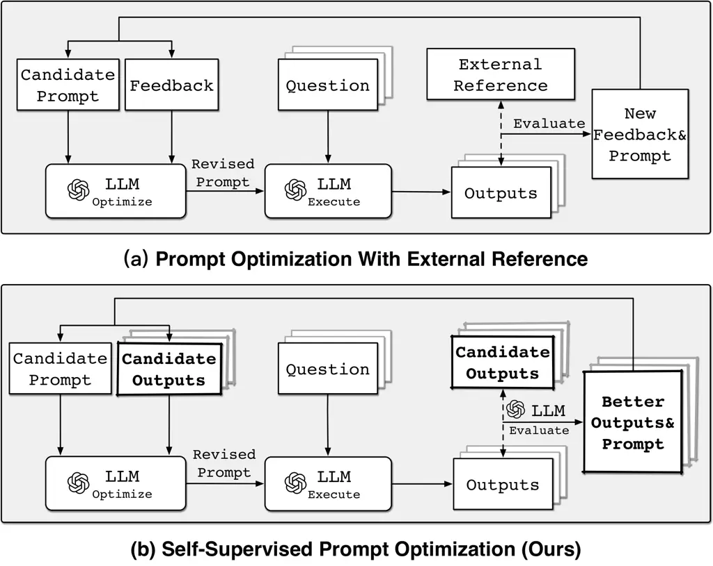
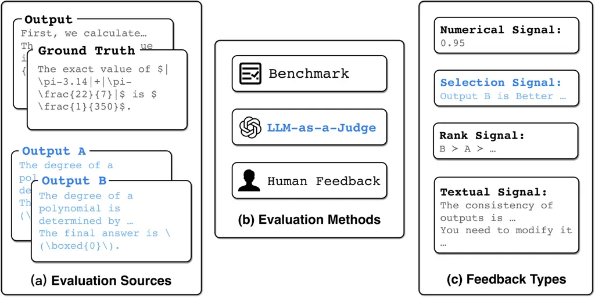
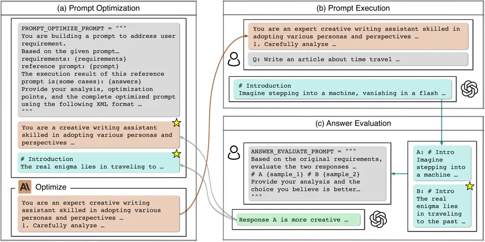
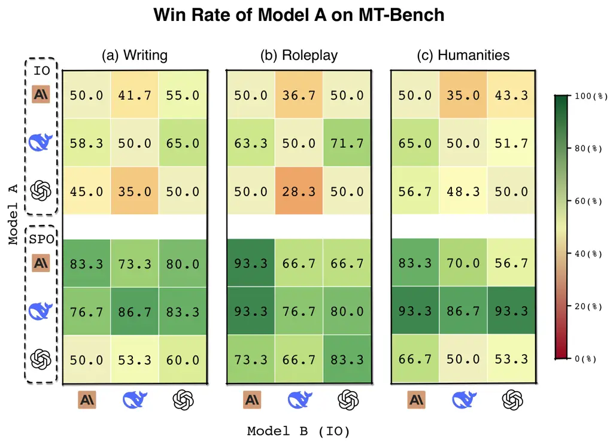

# Self-Supervised Prompt Optimization

Jinyu Xiang¹¹footnotemark: 1 Affiliation: DeepWisdom    Jiayi Zhang
^(†)^(†)thanks: These authors contributed equally to this work.
Affiliation: DeepWisdom Affiliation: The Hong Kong University of Science
and Technology (Guangzhou)    Zhaoyang Yu Affiliation: DeepWisdom   
Xinbing Liang Affiliation: DeepWisdom    Fengwei Teng Affiliation: The
Hong Kong University of Science and Technology (Guangzhou)    Jinhao Tu
Affiliation: Independent Researcher    Fashen Ren Affiliation: The Hong
Kong University of Science and Technology (Guangzhou)    Xiangru Tang
Affiliation: Yale University    Sirui Hong Affiliation: DeepWisdom   
Chenglin Wu²²footnotemark: 2 Affiliation: DeepWisdom    Yuyu Luo
^(†)^(†)thanks: Corresponding authors: Chenglin Wu (E-mail:
alexanderwu@deepwisdom.ai), Yuyu Luo (E-mail:yuyuluo@hkust-gz.edu.cn)
Affiliation: The Hong Kong University of Science and Technology
(Guangzhou)

###### Abstract

Well-designed prompts are crucial for enhancing Large language models’
(LLMs) reasoning capabilities while aligning their outputs with task
requirements across diverse domains. However, manually designed prompts
require expertise and iterative experimentation. While existing prompt
optimization methods aim to automate this process, they rely heavily on
external references such as ground truth or by humans, limiting their
applicability in real-world scenarios where such data is unavailable or
costly to obtain. To address this, we propose Self-Supervised Prompt
Optimization (SPO), a cost-efficient framework that discovers effective
prompts for both closed and open-ended tasks without requiring external
reference. Motivated by the observations that prompt quality manifests
directly in LLM outputs and LLMs can effectively assess adherence to
task requirements, we derive evaluation and optimization signals purely
from output comparisons. Specifically, SPO selects superior prompts
through pairwise output comparisons evaluated by an LLM evaluator,
followed by an LLM optimizer that aligns outputs with task requirements.
Extensive experiments demonstrate that SPO outperforms state-of-the-art
prompt optimization methods, achieving comparable or superior results
with significantly lower costs (e.g., 1.1% to 5.6% of existing methods)
and fewer samples (e.g., three samples). The code is available at
[https://github.com/FoundationAgents/SPO](https://github.com/FoundationAgents/SPO).

## 1 Introduction



Figure 1: Comparison of Prompt Optimization Methods. (a) illustrates the
traditional prompt optimization process with external reference, where
feedback from the ground truth of humans is used to iteratively improve
the best prompt. (b) presents our proposed self-supervised prompt
optimization, which utilizes pairwise comparisons of LLM’s own outputs
to optimize prompts without relying on external reference.

Figure 2: Comparison of Performance ($`y`$-axis) and Optimization Costs
in Dollars ($`x`$-axis) across Six Prompt Optimization Methods. SPO
demonstrates competitive performance, consistently ranking among the top
two methods while maintaining significantly lower costs (ranging from
1.1% to 5.6% of the costs incurred by other methods) across all
datasets.

As large language models (LLMs) continue to advance, well-designed
prompts have become critical for maximizing their reasoning
capabilities Wei et al. (2022); Zheng et al. (2024); Deng et al. (2023)
and ensuring alignment with diverse task requirements. However, creating
effective prompts often requires substantial trial-and-error
experimentation and deep task-specific knowledge.

To address this challenge, researchers have explored Prompt Optimization
(PO) methods that use LLMs’ own capabilities to automatically improve
prompts. PO advances beyond traditional prompt engineering, by providing
a more systematic and efficient approach to prompt design. As shown in
Figure 1(a), these methods typically involve an iterative process of
prompt optimization, execution, and evaluation. The design choices for
these components significantly influence optimization effectiveness and
efficiency. Existing approaches have demonstrated success with both
numerical evaluation mechanisms Wang et al. (2024d); Yang et al. (2023);
Fernando et al. (2024) and textual “gradient” optimization
strategies Yüksekgönül et al. (2024). Through these innovations, PO
methods have shown promise in reducing manual effort while enhancing
task performance Zhang et al. (2024a); Zhou et al. (2024); He et al.
(2025).

Despite their potential, existing PO methods face significant challenges
in real-world scenarios, as discussed below. First, current methods
often depend heavily on external references for evaluation. Methods
using ground truth for evaluation Yang et al. (2023); Fernando et al.
(2024); Yüksekgönül et al. (2024); Pryzant et al. (2023) require large
amounts of annotated data to assess prompt quality, yet such standard
answers are often unavailable in many practical applications, especially
for open-ended tasks. Similarly, methods relying on human Chen et al.
(2024); Lin et al. (2024) require manual evaluations or human-designed
rules to generate feedback, which is time-consuming and contradicts the
goal of automation. Second, existing methods typically require
evaluating prompts on numerous samples to obtain reliable feedback,
leading to substantial computational overhead Wang et al. (2024d);
Fernando et al. (2024).

At the core of these challenges lies the absence of reliable and
efficient reference-free methods for assessing prompt quality. Analysis
of LLM behavior reveals two key insights that inform our approach.
First, prompt quality inherently manifests in model outputs, as
evidenced by how different prompting strategies significantly influence
both reasoning paths Wei et al. (2022); Deng et al. (2023) and response
features Wang et al. (2024b); Schmidgall et al. (2025). Second,
extensive studies on LLM-as-a-judge have demonstrated their
effectiveness in evaluating output adherence to task requirements Zheng
et al. (2023); Li et al. (2024b). These observations suggest that by
leveraging LLMs’ inherent ability to assess outputs that naturally
reflect prompt quality, reference-free prompt optimization becomes
feasible.

Motivated by these insights, we propose a cost-efficient framework that
generates evaluation and optimization signals purely from LLM outputs,
similar to how self-supervised learning derives training signals from
data. We term this approach Self-Supervised Prompt Optimization (SPO).
As shown in Figure 1, SPO builds upon the fundamental
Optimize-Execute-Evaluate loop while introducing several innovative
mechanisms:

\(1\) Output as Pairwise Evaluation Reference: At its core, SPO employs
a pairwise comparison approach that assesses the relative quality of
outputs from different prompts. This evaluation mechanism leverages
LLM’s inherent capability to understand task requirements, validating
optimization effectiveness without external references.

\(2\) Output as Optimization Guidance: SPO optimizes prompts through
LLM’s understanding of better solutions for the current best output.
Rather than relying on explicit optimization signals, this process
naturally aligns prompt modifications with the model’s comprehension of
optimal task solutions.

Contributions. Our main contributions are as follows:

\(1\) Self-Supervised Prompt Optimization Framework. We introduce SPO, a
novel framework that leverages pairwise comparisons of LLM’s outputs to
guide prompt optimization without requiring external reference.

\(2\) Cost-effective Optimization. SPO optimizes prompts with minimal
computational overhead (\$0.15 per dataset) and sample requirements (3
samples), significantly reducing resource demands.

\(3\) Extensive Evaluation. As shown in Figure 2, SPO requires only 1.1%
to 5.6% of the cost of state-of-the-art methods while maintaining
superior performance across both closed and open-ended tasks.

## 2 Preliminary

### 2.1 Problem Definition

Prompt Optimization aims to automatically enhance the effectiveness of a
prompt for a given task type $`t\in\mathcal{T}`$. For a given type
$`t`$, we observe a dataset $`D_{t}=\{(Q_{i},G_{i})\}_{i=1}^{N_{t}}`$,
which each pair consists of an input query $`Q_{i}`$ and the optional
ground truth $`G_{i}`$. A candidate prompt for type $`t`$ is denoted
$`P_{t}\in\mathcal{P}`$, and the goal is to find a optimal prompt.

```math
P_{t}^{*}=\mathop{\arg\max}_{P_{t}\in\mathcal{P}}\mathbb{E}_{(Q,G)\sim D_{t}}\Bigl[\phi_{\text{eval}}\!\bigl(\phi_{\text{exe}}(Q,P_{t}),G\bigr)\Bigr]. \tag{1}
```

As illustrated in Figure 1, this optimization process typically involves
three fundamental functions: (1) Optimization function
($`\phi_{\text{opt}}`$): generates a revised prompt based on the
candidate prompt; (2) Execution function ($`\phi_{\text{exe}}`$):
applies the revised prompt with an LLM to produce output $`O`$,
consisting of a reasoning path and a final answer; (3) Evaluation
function ($`\phi_{\text{eval}}`$): assesses the quality of $`O`$ and
provides feedback $`F`$ to guide further optimization, refining the
candidate prompts iteratively.

Among these functions, the evaluation function plays a pivotal role as
its output (feedback $`F`$) guides the assessment and improvement of
prompts. We will discuss the evaluation framework for prompt
optimization in Section 2.2.

### 2.2 Evaluation Framework in Prompt Optimization

This section outlines our evaluation framework for prompt optimization,
covering three key components: evaluation sources, evaluation methods,
and feedback types, as shown in Figure 3. We conclude by introducing our
selected evaluation framework for SPO.

Evaluation Sources As shown in Figure 3(a), two primary sources can be
used for evaluation: LLM-generated outputs and task-specific ground
truth. These sources provide the basis for assessing prompt performance.

Evaluation Methods The evaluation method defines how the evaluation
sources are assessed and the associated costs. Three common methods are
used: (1) Benchmark relies on predefined metrics Suzgun et al. (2023);
Rein et al. (2023) or rules Chen et al. (2024). (2) LLM-as-a-judge Zheng
et al. (2023) leverage LLMs capability to understand and assess outputs
based on task requirements. (3) Human Feedback Lin et al. (2024)
provides the most comprehensive evaluation through direct human
assessment of outputs.

While Human Feedback offers the most thorough evaluation by capturing
human preferences and task-specific needs, it incurs substantially
higher costs than Benchmark or LLM-as-a-judge methods, creating a
trade-off between evaluation quality and feasibility.

Feedback Types Feedback produced by evaluation methods typically take
three forms: (1) Numerical Feedback provides quantitative performance
measures across the dataset. However, it requires substantial samples
for stable evaluation and may overlook instance-specific details Zhang
et al. (2024a). (2) Textual Feedback offers rich, instance-specific
guidance through analysis and suggestions, directly generating
optimization signals Yüksekgönül et al. (2024). (3) Ranking or Selection
Feedback establishes relative quality ordering among outputs through
either complete ranking or pairwise comparisons, providing clear
optimization direction without requiring absolute quality measures.



Figure 3: Components of the Evaluation Framework for Prompt
Optimization. (a) Evaluation Sources: Compares different outputs,
including ground truth and model-generated outputs, to assess quality.
(b) Evaluation Methods: Showcases various evaluation techniques,
including benchmark comparisons, LLM-as-a-Judge, and human feedback. (c)
Feedback Types: Showcases a range of feedback. For clarity, the
rank-signal example now compares only Output A and Output B. The blue in
(a), (b), and (c) indicate the specific evaluation approach selected for
SPO.

##### Evaluation Framework

Building on the previous discussion on evaluation’s sources, methods,
and feedback types, the evaluation framework determines how sources are
compared and assessed within the context of prompt optimization.
Specifically, we derive two evaluation frameworks to generate feedback
$`F`$ for prompt optimization:

\(1\) Output vs. Ground Truth (OvG): Feedback is generated by comparing
the output $`O_{i}`$ of query $`Q_{i}`$ with ground truth $`G_{i}`$:

```math
f_{\text{OvG}}=\phi_{eval}\Bigl(\phi_{exe}(Q_{i},P_{t}),G_{i}\Bigr). \tag{2}
```

Although this approach allows for a direct quality assessment through an
external reference, it requires well-defined ground truth, making it
unsuitable for open-ended tasks where ground truth may not always be
available or practical to define.

\(2\) Output vs. Output (OvO): When ground truth is unavailable, we turn
to direct output comparison. The core idea behind OvO is that even in
the absence of perfect ground truth, comparing outputs generated by
different prompts can offer valuable signals about their relative
quality. This method removes the dependency on external references and
is particularly useful for open-ended tasks where multiple answers may
be valid. It can be formally expressed as:

```math
f_{\text{OVO}}=\phi_{\text{eval}}\Bigl(\{\phi_{\text{exe}}(Q_{i},P_{i})\},G_{i}\Bigr). \tag{3}
```

After introducing the OvG and OvO evaluation frameworks, we emphasize
that OvO serves as the core method in Self-Supervised Prompt
Optimization (SPO). By comparing outputs generated by different prompts,
OvO provides valuable feedback on their relative quality without relying
on external reference. This approach aligns with our objective of
generating feedback directly from the outputs themselves, thus
facilitating iterative optimization in both closed and open-ended tasks.

## 3 Self-Supervised Prompt Optimization

In this section, we first overview our method (Section 3.1) and then
analyze its effectiveness (Section 3.2).



Figure 4: A Running Example of SPO Framework: Pairwise evaluation on the
outputs selects the better one from corresponding prompts. The best
output and prompt pair are highlited with pentagrams, which will be
updated after evaluation. Furthermore, using a case from MT-bench, we
show the complete process of SPO’s $`\phi_{opt}`$, $`\phi_{exe}`$, and
$`\phi_{eval}`$ and corresponding prompt.

### 3.1 An Overview of SPO

A core challenge in reference-free prompt optimization is how to
construct effective evaluation and optimization signals. We propose
Self-Supervised Prompt Optimization (SPO), a simple yet effective
framework that retains the basic Optimize-Execute-Evaluate loop while
enabling reference-free optimization by leveraging only model outputs as
both evaluation sources and optimization guidance.

As shown in Algorithm 1, SPO operates through three key components and
the corresponding prompts are shown in Appendix A.1:

- •
  Optimization function ($`\phi_{opt}`$): Generates new prompts by
  analyzing the current best prompt and its corresponding outputs.
- •
  Execution function ($`\phi_{exe}`$): Applies the generated prompts to
  obtain outputs.
- •
  Evaluation function ($`\phi_{eval}`$): Uses an LLM to compare outputs
  and determine the superior prompt through pairwise comparisons.

This iterative process begins with a basic prompt template (e.g.,
Chain-of-Thought Wei et al. (2022)) and a small question set sampled
from the dataset. In each iteration, SPO generates new prompts, executes
them, and performs pairwise evaluations of outputs to assess their
adherence to task requirements.

The prompt associated with the superior output is selected as the best
candidate for the next iteration. The process continues until a
predefined maximum number of iterations is reached.

A Running Example As illustrated in Figure 4, SPO achieves high
efficiency, requiring only 8 LLM calls per iteration with three samples,
significantly lower than existing methods Wang et al. (2024d); Fernando
et al. (2024); Yüksekgönül et al. (2024); Shen et al. (2024a); Zhou
et al. (2023). Despite its simplicity, SPO demonstrates superior
performance across a range of tasks, as detailed in Section 4. In the
following section, we analyze the theoretical foundations of its
effectiveness.

0:  Dataset $`D`$

0:  Optimized Prompt $`P^{*}`$

1:  Initialize $`P_{0}`$; Sample 3 Questions $`Q`$ from $`D`$

2:  $`\text{Best Prompt }P^{*}\leftarrow P_{0}`$

3:  $`\text{Best Answer }A^{*}\leftarrow\phi_{exe}(Q,P^{*})`$

4:  for $`iteration\leftarrow 1`$ to $`N_{max}`$ do

5:   $`P^{\prime}\leftarrow\phi_{opt}(P^{*},A^{*})`$

6:   $`A^{\prime}\leftarrow\phi_{exe}(Q,P^{\prime})`$

7:   $`optimizationSuccess\leftarrow\phi_{eval}(Q,A^{\prime},A^{*})`$

8:   if $`optimizationSuccess`$ then

9:    $`P^{*}\leftarrow P^{\prime}`$

10:    $`A^{*}\leftarrow A^{\prime}`$

11:   end if

12:  end for

13:  return $`P^{*}`$

Algorithm 1 An Overview of SPO.

### 3.2 Understanding the Effectiveness of SPO

The theoretical foundation of SPO is built upon two key observations:

First, the outputs of LLMs inherently contain rich quality information
that directly reflects prompt effectiveness, as evidenced by how
step-by-step reasoning paths demonstrate the success of Chain-of-thought
prompting Wei et al. (2022). Second, LLMs exhibit human-like task
comprehension, enabling them to assess answer quality and identify
superior solutions based on task requirements. These complementary
capabilities allow SPO to perform prompt evaluation and optimization
without external references. These two aspects of utilizing model
outputs work together to enable effective prompt optimization:

Output as Optimization Guidance In terms of $`\phi_{opt}`$ design,
unlike other methods that introduce explicit optimization signals
Fernando et al. (2024); Yüksekgönül et al. (2024); Pryzant et al.
(2023), $`\phi_{opt}`$ optimizes directly based on the prompt and its
corresponding outputs. The optimization signal stems from the LLMs’
inherent ability to assess output quality, while the optimization
behavior is guided by its understanding of what constitutes superior
solutions. Therefore, even without explicit optimization signals, SPO’s
optimization essentially guides prompts toward the LLM’s optimal
understanding of the task.

Output as Pairwise Evaluation Reference Regarding $`\phi_{eval}`$
design, by employing the evaluation model to perform pairwise selection,
we are effectively leveraging the evaluation model’s inherent preference
understanding of tasks. This internal signal can be obtained through
simple pairwise comparisons of outputs, avoiding the need for large
sample sizes to ensure scoring stability, which is typically required in
score-based feedback methods.

While we mitigate potential biases through four rounds of randomized
evaluation, these biases cannot be completely eliminated Zhou et al.
(2024). However, these biases do not affect the overall optimization
trend because eval’s feedback merely serves as a reference for the next
round of optimization. The overall optimization process naturally aligns
with the optimization model’s task understanding, with the eval
mechanism serving to validate the effectiveness of each iteration.

## 4 Experiment

### 4.1 Experimental Setup

|                                      |                 |              |      |      |              |            |               |
| ------------------------------------ | --------------- | ------------ | ---- | ---- | ------------ | ---------- | ------------- |
| Method                               | Method Analysis |              |      |      |              |            |               |
|                                      | GPQA            | AGIEval-MATH | LIAR | WSC  | BBH-Navigate | Avg. Perf. | Avg. Cost(\$) |
| IO                                   | 38.9            | 42.1         | 63.5 | 72.4 | 91.3         | 61.6       | \-            |
| CoT Wei et al. (2022)                | 41.6            | 44.5         | 65.4 | 77.8 | 89.7         | 63.8       | \-            |
| Rephrase Deng et al. (2023)          | 40.2            | 42.1         | 50.5 | 79.1 | 93.5         | 61.1       | \-            |
| Step-back Zheng et al. (2024)        | 42.4            | 47.5         | 62.8 | 78.7 | 93.5         | 65.0       | \-            |
| APE Zhou et al. (2023)               | 41.1            | 44.4         | 65.9 | 80.2 | 92.5         | 64.8       | 9.07          |
| OPRO Yang et al. (2023)              | 43.3            | 46.1         | 67.6 | 80.2 | 95.8         | 66.6       | 4.51          |
| PromptAgent Wang et al. (2024d)      | 41.3            | 41.4         | 64.1 | 82.7 | 95.7         | 65.0       | 2.71          |
| PromptBreeder Fernando et al. (2024) | 40.9            | 45.9         | 63.2 | 76.7 | 96.3         | 64.5       | 4.82          |
| TextGrad  Yüksekgönül et al. (2024)  | 40.2            | 44.4         | 65.7 | 78.0 | 91.3         | 63.9       | 13.14         |
| SPO (ours)                           | 43.6            | 46.1         | 67.1 | 82.0 | 97.2         | 66.9       | 0.15          |
| SPO^(∗) (ours)                       | 41.8            | 45.3         | 66.9 | 81.1 | 96.3         | 66.3       | 0.12          |

Table 1: Comparison of performance between conventional prompt methods
and prompt generated by prompt optimization methods in five benchmarks.
All methods are executed with GPT-4o-mini on the divided test set, with
results averaged over three runs. SPO and SPO ^(∗) use Claude-3.5-Sonnet
and GPT-4o as their optimization models, respectively. The Avg. Cost
refers to the averaged optimization cost.

##### Datasets

We evaluated SPO on a diverse set of tasks, including both closed tasks
and open-ended tasks, to comprehensively assess its effectiveness.

For closed tasks, we utilized five established benchmarks: GPQA Rein
et al. (2023), AGIEval-MATH Zhong et al. (2024), LIAR Wang (2017),
WSC Levesque et al. (2012), and BBH-navigate Suzgun et al. (2023). For
WSC, LIAR, and BBH-Navigate, we sampled portions from their original
datasets as test sets following Yan et al. (2024). For GPQA, we used the
more challenging GPQA-Diamond subset as the test set, while for
AGIEval-Math, we used Level 5 problems as the test set. For open-ended
tasks, we selected writing, roleplay, and humanities tasks from
MT-Bench Zheng et al. (2023). Given the limited size of the dataset, we
manually constructed three validation sets for these tasks. Detailed
descriptions of the datasets and the construction procedures for
validation and test sets are provided in Appendix A.3.

##### Baselines

We evaluate SPO against two categories of methods on closed tasks: (1)
conventional prompting approaches, comprising io (direct llm
invocation), chain-of-thought, rephrase, and step-back abstract; and (2)
automated prompt optimization methods, including APE, OPRO, PromptAgent,
PromptBreeder and TextGrad with their evaluation framework setting,
features detailed in Appendix A.3.2.

For open-ended tasks in MT-Bench Zheng et al. (2023), we use GPT-4o to
compare outputs generated by SPO against those directly generated by the
model.

##### Implementation Details

SPO employs different models for optimization, evaluation, and
execution. In the main experiments, we use Claude-3.5-Sonnet-20240620
and GPT-4o-0806 (temperature = 0.7) as optimization models, while
GPT-4o-mini-0718 (temperature = 0.3 for evaluation, 0 for execution) is
used for both evaluation and execution. The optimization process runs
for 10 iterations with three samples per iteration, while detailed
baseline implementation settings are provided in Appendix A.3.

##### Metrics

We evaluate performance using accuracy metrics for GPQA, LIAR,
BBH-Navigate, AGIEval-MATH and WSC, following  Yan et al. (2024);
Saad-Falcon et al. (2024); Rein et al. (2023). For MT-Bench, we report
win rates of SPO compared to other methods. To assess cost-efficiency,
we also measure optimization costs. To verify the stability of results,
we include standard deviation metrics in Appendix  A.4.

### 4.2 Experimental Results and Analysis

##### Main Result of Closed Tasks

As shown in Table 1, prompts optimized by SPO outperform all
conventional prompting methods on average, exceeding the best baseline
by 1.9. Meanwhile, it achieves comparable performance to ground
truth-dependent prompt optimization methods across most datasets, and
reaches optimal results on GPQA and BBH-navigate datasets. Specifically,
SPO’s superior average performance over other optimization methods
demonstrates that its pairwise evaluation approach can generate more
effective optimization signals compared to the tested methods relying on
external reference. Furthermore, to verify the effectiveness of our
method across different optimization models, we conducted experiments
using GPT-4o as the optimization model, achieving an average performance
of 66.3. While slightly lower than results using Claude-3-5-Sonnet as
the optimization model, this still ranks third among all compared
methods.

##### Cost Analysis

We present a comprehensive comparison of optimization costs and
performance between SPO (using Claude-3.5-Sonnet and GPT-4o as
optimization models) and other optimization methods in Table 1. While
maintaining comparable performance with other ground truth-dependent
prompt optimization methods, SPO requires only 1.1% to 5.6% of their
optimization costs, with an average optimization cost of 0.15 \$ per
dataset. The low computational cost and no need for ground truth make
SPO ideal for real-world applications.

##### Ablation Study

|                   |             |            |                |
| ----------------- | ----------- | ---------- | -------------- |
|                   | GPT-4o-mini | Llama3-70B | Claude-3-Haiku |
| IO                | 91.3        | 82.7       | 62.2           |
| COT               | 89.7        | 86.2       | 68             |
| Claude-3.5-Sonnet | 95          | 86.8       | 68.2           |
| Llama3-70B        | 94.5        | 94.2       | 82.0           |
| GPT-4o-mini       | 97.8        | 90.7       | 82.0           |

Table 2: Performance comparison on BBH-navigate: prompting methods and
SPO with different evaluation models (rows) and execution models
(columns). The optimization model is set to Claude-3.5-Sonnet.

|                   | GPT-4o-mini | Llama3-70B | Claude-3-Haiku |
| ----------------- | ----------- | ---------- | -------------- |
| Claude-3.5-Sonnet | 97.2        | 86.7       | 89.7           |
| GPT-4o            | 96.3        | 85.5       | 73.0           |
| GPT-4o-mini       | 97.8        | 90.7       | 82.0           |
| DeepSeek-V3       | 94.7        | 83.7       | 77.2           |
| Gemma-3-12B       | 97.5        | 92.0       | 69.0           |

Table 3: Performance comparison across different optimization models
(rows) and execution models (columns) on BBH-navigate. The evaluation
model is set to GPT-4o-mini.

To evaluate the transferability of SPO across different optimization,
evaluation, and execution models, we conducted ablation experiments on
the BBH-Navigate dataset. The experimental results in Table 2, 3
demonstrate that SPO exhibits robust performance across different
models. Notably, the best performance (97.8) was achieved when
GPT-4o-mini was used as the optimization, execution, and evaluation
model. In terms of execution, SPO effectively improves the performance
of weaker models, elevating Claude-3-Haiku from 62.2 to 89.7,
demonstrating SPO’s applicability to weaker models and further expanding
its potential for real-world applications.

We conduct an ablation study to investigate the impact of sample number
and iteration rounds on SPO’s performance using the BBH-Navigate
dataset. For sample number, the performance curves of all three
optimization models exhibit similar patterns: performance initially
improves with increased sample number but eventually converges or
declines. For iteration rounds, when we extend the optimization process
to 20 rounds, we find that the actual performance of the optimal prompt
selected by SPO similarly shows a pattern of initial improvement
followed by degradation, which we attribute to overfitting to the sample
questions. Based on these experiments, we determine the final sample
number and iteration rounds for SPO, with more details shown in Appendix
 A.4.



Figure 5: Win rates comparison between different LLMs and SPO across
three tasks. The heatmap shows pairwise win rates (%) where each cell
represents the row model’s win rate against the column model. Models
tested include Claude-3.5-Sonnet, DeepSeek-V3, and GPT-4o-mini. Models
are evaluated both in IO (top three rows) and after SPO optimization
(bottom three rows). Win rates range from 0% to 100%, with higher
percentages indicating better performance.

##### Main Result of Open-ended Tasks

To validate SPO’s capability in open-ended tasks, we selected three
categories from MT-Bench: “Writing”, “Roleplay”, and “Humanities” for
evaluation. We use Claude-3.5-Sonnet as the optimization model,
GPT-4o-mini as the evaluation model, and selected Claude-3.5-Sonnet,
DeepSeek-V3, and GPT-4o-mini as execution models, conducting five
iterations. Subsequently, following the evaluation methodology in Zheng
et al. (2023), we employed GPT-4o to perform pairwise comparisons
between model A and model B’s output in Figure 5. The experimental
results shown in 5 demonstrate that SPO significantly improves model
performance across all model configurations. Notably, smaller models
(such as GPT-4o-mini) using optimized prompts frequently outperformed
larger models in most scenarios.

### 4.3 Case Study

We present optimization results on additional open-ended tasks without
datasets and SPO’s optimization trajectories in the Appendix A.5. We
also provide optimal prompt across five closed tasks discoverd by SPO in
the supplementary material. Given that real-world applications often
face challenges with limited datasets, we evaluate SPO’s performance on
tasks that lack conventional benchmarks. The experimental results,
coupled with SPO’s cost efficiency, demonstrate its practical value in
real-world scenarios. Specifically, we demonstrate the optimization
results after 10 iterations using Claude-3.5-Sonnet as the optimization
model, GPT-4o-mini as the evaluation model, and Llama-3-8B as the
execution model across four tasks: Advertising Design, Social Media
Content, Modern Poetry Writing, and Concept Interpretation in Appendix
A.5.2. Moreover, we provide a comprehensive analysis of SPO’s
optimization trajectory on the BBH-navigate dataset in Appendix A.5.1,
presenting both successful and unsuccessful examples to offer deeper
insights into the optimization process.

## 5 Related Work

### 5.1 Prompt Engineering

Research on prompting methods for large language models has primarily
evolved along two directions. The first focuses on task-agnostic
prompting techniques that enhance LLMs’ general capabilities, including
chain-of-thought Wei et al. (2022); Kojima et al. (2022), single-shot
reasoning enhancement Deng et al. (2023); Zheng et al. (2024); Wang
et al. (2024e), and output format specification Zhang et al. (2024a); He
et al. (2024); Tam et al. (2024). The second direction addresses
domain-specific prompting for tasks in code generation Hong et al.
(2024b); Ridnik et al. (2024); Shen et al. (2024a), data analysis Hong
et al. (2024a); Liu et al. (2024); Li et al. (2024a), question
answering Wu et al. (2024a); Zhu et al. (2024); Yang et al. (2024),
decision-makings Zhang et al. (2024b); Wang et al. (2024a), and other
domains Guo et al. (2024b); Ye et al. (2024); Shen et al. (2024b). As
LLM applications expand to increasingly complex scenarios, manually
crafting effective domain-specific prompts becomes impractical Zhang
et al. (2024a), motivating research in prompt optimization to
systematically develop effective prompts rather than discovering general
principles.

### 5.2 Prompt Optimization

The design of evaluation frameworks is crucial in Prompt Optimization
(PO), determining both optimization effectiveness and computational
efficiency. The evolution of evaluation mechanisms in PO has progressed
from simple feedback collection to sophisticated optimization signal
generation Chang et al. (2024). Existing methods largely rely on ground
truth as the evaluation source with benchmark-based numerical
assessments Zhou et al. (2023); Guo et al. (2024a); Yang et al. (2023);
Fernando et al. (2024); Wang et al. (2024d); Khattab et al. (2023),
often requiring substantial iterations and samples, while others use
LLM-as-a-judge Zheng et al. (2023) to generate detailed textual feedback
Yan et al. (2024); Yüksekgönül et al. (2024); Wu et al. (2024b); Wang
et al. (2024c); Pryzant et al. (2023); Li et al. (2025), still depending
on ground truth data. Some approaches focus on human preferences through
evaluation rules or direct feedback Chen et al. (2024); Lin et al.
(2024), while others explore alternative criteria like output
consistency Zhang et al. (2024c).

In contrast to these approaches, SPO introduces a novel evaluation
paradigm that eliminates dependency on external references while
maintaining efficiency. By leveraging only model outputs through
pairwise comparisons, SPO achieves robust evaluation without requiring
ground truth, human feedback, or extensive sampling, making it
particularly suitable for real-world applications.

## 6 Conclusion

This paper addresses a key challenge in prompt optimization: dependency
on external references. We introduce Self-Supervised Prompt Optimization
(SPO), a framework that overcomes this dependency while achieving
remarkable cost-efficiency at only \$0.15 per dataset. Drawing
inspiration from self-supervised learning, SPO innovatively constructs
evaluation and optimization signals through pairwise comparisons of
model outputs, enabling reference-free optimization without compromising
effectiveness. Our evaluation shows SPO achieves state-of-the-art
performance across diverse tasks while requiring only 1.1%-5.6% of
existing methods’ costs. Success on both benchmarks and real-world
applications validates SPO’s effectiveness and generalization
capabilities, making prompt optimization more accessible and practical
across various domains.

## Limitations

Despite SPO’s promising performance and cost efficiency, several
limitations should be acknowledged. First, while our method eliminates
dependence on external references, its effectiveness remains contingent
on the evaluation model’s ability to accurately assess output quality,
which may introduce biases when the evaluation model lacks sufficient
understanding of specialized domains. Second, our approach currently
focuses on optimizing prompts for a single model; future work should
explore cross-model prompt optimization to enhance transferability
across different LLMs with varying capabilities.

## Ethical Consideration

SPO offers significant advancements in prompt engineering for LLMs,
offering benefits such as democratized access, reduced costs, and
improved performance across various tasks. However, it also carries
risks, including potential bias amplification, misuse of harmful content
generation, and over-reliance on LLMs.

## References

- Chang et al. (2024) Kaiyan Chang, Songcheng Xu, Chenglong Wang,
  Yingfeng Luo, Tong Xiao, and Jingbo Zhu. 2024. Efficient prompting
  methods for large language models: A survey. _CoRR_, abs/2404.01077.
- Chen et al. (2024) Yongchao Chen, Jacob Arkin, Yilun Hao, Yang Zhang,
  Nicholas Roy, and Chuchu Fan. 2024. Prompt optimization in multi-step
  tasks (PROMST): integrating human feedback and heuristic-based
  sampling. In _EMNLP_, pages 3859–3920. Association for Computational
  Linguistics.
- Deng et al. (2023) Yihe Deng, Weitong Zhang, Zixiang Chen, and
  Quanquan Gu. 2023. Rephrase and respond: Let large language models ask
  better questions for themselves. _CoRR_, abs/2311.04205.
- Fernando et al. (2024) Chrisantha Fernando, Dylan Banarse, Henryk
  Michalewski, Simon Osindero, and Tim Rocktäschel. 2024. Promptbreeder:
  Self-referential self-improvement via prompt evolution. In _ICML_.
  OpenReview.net.
- Guo et al. (2024a) Qingyan Guo, Rui Wang, Junliang Guo, Bei Li, Kaitao
  Song, Xu Tan, Guoqing Liu, Jiang Bian, and Yujiu Yang. 2024a.
  Connecting large language models with evolutionary algorithms yields
  powerful prompt optimizers. In _ICLR_. OpenReview.net.
- Guo et al. (2024b) Taicheng Guo, Xiuying Chen, Yaqi Wang, Ruidi Chang,
  Shichao Pei, Nitesh V. Chawla, Olaf Wiest, and Xiangliang Zhang.
  2024b. [Large language model based multi-agents: A survey of progress
  and challenges](https://arxiv.org/abs/2402.01680). _Preprint_,
  arXiv:2402.01680.
- He et al. (2025) Han He, Qianchu Liu, Lei Xu, Chaitanya Shivade,
  Yi Zhang, Sundararajan Srinivasan, and Katrin Kirchhoff. 2025. Crispo:
  Multi-aspect critique-suggestion-guided automatic prompt optimization
  for text generation. In _Proceedings of the AAAI Conference on
  Artificial Intelligence_, volume 39, pages 24014–24022.
- He et al. (2024) Jia He, Mukund Rungta, David Koleczek, Arshdeep
  Sekhon, Franklin X Wang, and Sadid Hasan. 2024. [Does prompt
  formatting have any impact on llm
  performance?](https://arxiv.org/abs/2411.10541) _Preprint_,
  arXiv:2411.10541.
- Hong et al. (2024a) Sirui Hong, Yizhang Lin, Bang Liu, Bangbang Liu,
  Binhao Wu, Danyang Li, Jiaqi Chen, Jiayi Zhang, Jinlin Wang, Li Zhang,
  Lingyao Zhang, Min Yang, Mingchen Zhuge, Taicheng Guo, Tuo Zhou, Wei
  Tao, Wenyi Wang, Xiangru Tang, Xiangtao Lu, and 6 others. 2024a. Data
  interpreter: An LLM agent for data science. _CoRR_, abs/2402.18679.
- Hong et al. (2024b) Sirui Hong, Mingchen Zhuge, Jonathan Chen, Xiawu
  Zheng, Yuheng Cheng, Jinlin Wang, Ceyao Zhang, Zili Wang, Steven
  Ka Shing Yau, Zijuan Lin, Liyang Zhou, Chenyu Ran, Lingfeng Xiao,
  Chenglin Wu, and Jürgen Schmidhuber. 2024b. Metagpt: Meta programming
  for A multi-agent collaborative framework. In _ICLR_. OpenReview.net.
- Khattab et al. (2023) Omar Khattab, Arnav Singhvi, Paridhi Maheshwari,
  Zhiyuan Zhang, Keshav Santhanam, Sri Vardhamanan, Saiful Haq, Ashutosh
  Sharma, Thomas T. Joshi, Hanna Moazam, Heather Miller, Matei Zaharia,
  and Christopher Potts. 2023. Dspy: Compiling declarative language
  model calls into self-improving pipelines. _CoRR_, abs/2310.03714.
- Kojima et al. (2022) Takeshi Kojima, Shixiang Shane Gu, Machel Reid,
  Yutaka Matsuo, and Yusuke Iwasawa. 2022. Large language models are
  zero-shot reasoners. In _NeurIPS_.
- Levesque et al. (2012) Hector J. Levesque, Ernest Davis, and Leora
  Morgenstern. 2012. The winograd schema challenge. In _KR_. AAAI Press.
- Li et al. (2024a) Boyan Li, Yuyu Luo, Chengliang Chai, Guoliang Li,
  and Nan Tang. 2024a. The dawn of natural language to SQL: are we fully
  ready? _Proc. VLDB Endow._, 17(11):3318–3331.
- Li et al. (2024b) Dawei Li, Bohan Jiang, Liangjie Huang, Alimohammad
  Beigi, Chengshuai Zhao, Zhen Tan, Amrita Bhattacharjee, Yuxuan Jiang,
  Canyu Chen, Tianhao Wu, Kai Shu, Lu Cheng, and Huan Liu. 2024b. From
  generation to judgment: Opportunities and challenges of
  llm-as-a-judge. _CoRR_, abs/2411.16594.
- Li et al. (2025) Yafu Li, Xuyang Hu, Xiaoye Qu, Linjie Li, and
  Yu Cheng. 2025. [Test-time preference optimization: On-the-fly
  alignment via iterative textual
  feedback](https://arxiv.org/abs/2501.12895). _Preprint_,
  arXiv:2501.12895.
- Lin et al. (2024) Xiaoqiang Lin, Zhongxiang Dai, Arun Verma, See-Kiong
  Ng, Patrick Jaillet, and Bryan Kian Hsiang Low. 2024. Prompt
  optimization with human feedback. _arXiv preprint arXiv:2405.17346_.
- Liu et al. (2024) Xinyu Liu, Shuyu Shen, Boyan Li, Peixian Ma, Runzhi
  Jiang, Yuxin Zhang, Ju Fan, Guoliang Li, Nan Tang, and Yuyu Luo. 2024.
  [A survey of nl2sql with large language models: Where are we, and
  where are we going?](https://arxiv.org/abs/2408.05109) _Preprint_,
  arXiv:2408.05109.
- Pryzant et al. (2023) Reid Pryzant, Dan Iter, Jerry Li, Yin Tat Lee,
  Chenguang Zhu, and Michael Zeng. 2023. Automatic prompt optimization
  with "gradient descent" and beam search. In _EMNLP_, pages 7957–7968.
  Association for Computational Linguistics.
- Rein et al. (2023) David Rein, Betty Li Hou, Asa Cooper Stickland,
  Jackson Petty, Richard Yuanzhe Pang, Julien Dirani, Julian Michael,
  and Samuel R. Bowman. 2023. GPQA: A graduate-level google-proof q&a
  benchmark. _CoRR_, abs/2311.12022.
- Ridnik et al. (2024) Tal Ridnik, Dedy Kredo, and Itamar
  Friedman. 2024. Code generation with alphacodium: From prompt
  engineering to flow engineering. _CoRR_, abs/2401.08500.
- Saad-Falcon et al. (2024) Jon Saad-Falcon, Adrian Gamarra Lafuente,
  Shlok Natarajan, Nahum Maru, Hristo Todorov, Etash Guha,
  Estefany Kelly Buchanan, Mayee Chen, Neel Guha, Christopher Ré, and
  Azalia Mirhoseini. 2024. Archon: An architecture search framework for
  inference-time techniques. _CoRR_, abs/2409.15254.
- Schmidgall et al. (2025) Samuel Schmidgall, Yusheng Su, Ze Wang,
  Ximeng Sun, Jialian Wu, Xiaodong Yu, Jiang Liu, Zicheng Liu, and Emad
  Barsoum. 2025. [Agent laboratory: Using llm agents as research
  assistants](https://arxiv.org/abs/2501.04227). _Preprint_,
  arXiv:2501.04227.
- Shen et al. (2024a) Leixian Shen, Haotian Li, Yun Wang, Tianqi Luo,
  Yuyu Luo, and Huamin Qu. 2024a. [Data playwright: Authoring data
  videos with annotated
  narration](https://doi.org/10.1109/TVCG.2024.3477926). _IEEE
  Transactions on Visualization and Computer Graphics_, pages 1–14.
- Shen et al. (2024b) Shuyu Shen, Sirong Lu, Leixian Shen, Zhonghua
  Sheng, Nan Tang, and Yuyu Luo. 2024b. [Ask humans or ai? exploring
  their roles in visualization
  troubleshooting](https://arxiv.org/abs/2412.07673). _Preprint_,
  arXiv:2412.07673.
- Suzgun et al. (2023) Mirac Suzgun, Nathan Scales, Nathanael Schärli,
  Sebastian Gehrmann, Yi Tay, Hyung Won Chung, Aakanksha Chowdhery,
  Quoc V. Le, Ed H. Chi, Denny Zhou, and Jason Wei. 2023. Challenging
  big-bench tasks and whether chain-of-thought can solve them. In _ACL
  (Findings)_, pages 13003–13051. Association for Computational
  Linguistics.
- Tam et al. (2024) Zhi Rui Tam, Cheng-Kuang Wu, Yi-Lin Tsai, Chieh-Yen
  Lin, Hung-yi Lee, and Yun-Nung Chen. 2024. Let me speak freely? A
  study on the impact of format restrictions on performance of large
  language models. _CoRR_, abs/2408.02442.
- Wang et al. (2024a) Guanzhi Wang, Yuqi Xie, Yunfan Jiang, Ajay
  Mandlekar, Chaowei Xiao, Yuke Zhu, Linxi Fan, and Anima Anandkumar.
  2024a. Voyager: An open-ended embodied agent with large language
  models. _Trans. Mach. Learn. Res._, 2024.
- Wang et al. (2024b) Lei Wang, Jianxun Lian, Yi Huang, Yanqi Dai,
  Haoxuan Li, Xu Chen, Xing Xie, and Ji-Rong Wen. 2024b. Characterbox:
  Evaluating the role-playing capabilities of llms in text-based virtual
  worlds. _CoRR_, abs/2412.05631.
- Wang et al. (2024c) Wenyi Wang, Hisham A Alyahya, Dylan R Ashley, Oleg
  Serikov, Dmitrii Khizbullin, Francesco Faccio, and Jürgen Schmidhuber.
  2024c. How to correctly do semantic backpropagation on language-based
  agentic systems. _arXiv preprint arXiv:2412.03624_.
- Wang (2017) William Yang Wang. 2017. "liar, liar pants on fire": A new
  benchmark dataset for fake news detection. In _ACL (2)_, pages
  422–426. Association for Computational Linguistics.
- Wang et al. (2024d) Xinyuan Wang, Chenxi Li, Zhen Wang, Fan Bai,
  Haotian Luo, Jiayou Zhang, Nebojsa Jojic, Eric P. Xing, and Zhiting
  Hu. 2024d. Promptagent: Strategic planning with language models
  enables expert-level prompt optimization. In _ICLR_. OpenReview.net.
- Wang et al. (2024e) Xu Wang, Cheng Li, Yi Chang, Jindong Wang, and
  Yuan Wu. 2024e. Negativeprompt: Leveraging psychology for large
  language models enhancement via negative emotional stimuli. In
  _IJCAI_, pages 6504–6512. ijcai.org.
- Wei et al. (2022) Jason Wei, Xuezhi Wang, Dale Schuurmans, Maarten
  Bosma, Fei Xia, Ed Chi, Quoc V Le, Denny Zhou, and 1 others. 2022.
  Chain-of-thought prompting elicits reasoning in large language models.
  _Advances in Neural Information Processing Systems_, 35:24824–24837.
- Wu et al. (2024a) Yifan Wu, Lutao Yan, Leixian Shen, Yunhai Wang, Nan
  Tang, and Yuyu Luo. 2024a. Chartinsights: Evaluating multimodal large
  language models for low-level chart question answering. In _EMNLP
  (Findings)_, pages 12174–12200. Association for Computational
  Linguistics.
- Wu et al. (2024b) Yurong Wu, Yan Gao, Bin Zhu, Zineng Zhou, Xiaodi
  Sun, Sheng Yang, Jian-Guang Lou, Zhiming Ding, and Linjun Yang. 2024b.
  Strago: Harnessing strategic guidance for prompt optimization. In
  _EMNLP (Findings)_, pages 10043–10061. Association for Computational
  Linguistics.
- Yan et al. (2024) Cilin Yan, Jingyun Wang, Lin Zhang, Ruihui Zhao,
  Xiaopu Wu, Kai Xiong, Qingsong Liu, Guoliang Kang, and Yangyang
  Kang. 2024. [Efficient and accurate prompt optimization: the benefit
  of memory in exemplar-guided
  reflection](https://arxiv.org/abs/2411.07446). _Preprint_,
  arXiv:2411.07446.
- Yang et al. (2023) Chengrun Yang, Xuezhi Wang, Yifeng Lu, Hanxiao Liu,
  Quoc V Le, Denny Zhou, and Xinyun Chen. 2023. Large language models as
  optimizers. _arXiv preprint arXiv:2309.03409_.
- Yang et al. (2024) Xudong Yang, Yifan Wu, Yizhang Zhu, Nan Tang, and
  Yuyu Luo. 2024. [Askchart: Universal chart understanding through
  textual enhancement](https://arxiv.org/abs/2412.19146). _Preprint_,
  arXiv:2412.19146.
- Ye et al. (2024) Yilin Ye, Jianing Hao, Yihan Hou, Zhan Wang, Shishi
  Xiao, Yuyu Luo, and Wei Zeng. 2024. Generative AI for visualization:
  State of the art and future directions. _CoRR_, abs/2404.18144.
- Yüksekgönül et al. (2024) Mert Yüksekgönül, Federico Bianchi, Joseph
  Boen, Sheng Liu, Zhi Huang, Carlos Guestrin, and James Zou. 2024.
  Textgrad: Automatic "differentiation" via text. _CoRR_,
  abs/2406.07496.
- Zhang et al. (2024a) Jiayi Zhang, Jinyu Xiang, Zhaoyang Yu, Fengwei
  Teng, Xionghui Chen, Jiaqi Chen, Mingchen Zhuge, Xin Cheng, Sirui
  Hong, Jinlin Wang, Bingnan Zheng, Bang Liu, Yuyu Luo, and Chenglin Wu.
  2024a. [Aflow: Automating agentic workflow
  generation](https://arxiv.org/abs/2410.10762). _Preprint_,
  arXiv:2410.10762.
- Zhang et al. (2024b) Jiayi Zhang, Chuang Zhao, Yihan Zhao, Zhaoyang
  Yu, Ming He, and Jianping Fan. 2024b. Mobileexperts: A dynamic
  tool-enabled agent team in mobile devices. _CoRR_, abs/2407.03913.
- Zhang et al. (2024c) Xuanchang Zhang, Zhuosheng Zhang, and Hai Zhao.
  2024c. Glape: Gold label-agnostic prompt evaluation and optimization
  for large language model. _CoRR_, abs/2402.02408.
- Zheng et al. (2024) Huaixiu Steven Zheng, Swaroop Mishra, Xinyun Chen,
  Heng-Tze Cheng, Ed H. Chi, Quoc V. Le, and Denny Zhou. 2024. Take a
  step back: Evoking reasoning via abstraction in large language models.
  In _ICLR_. OpenReview.net.
- Zheng et al. (2023) Lianmin Zheng, Wei-Lin Chiang, Ying Sheng, Siyuan
  Zhuang, Zhanghao Wu, Yonghao Zhuang, Zi Lin, Zhuohan Li, Dacheng Li,
  Eric P. Xing, Hao Zhang, Joseph E. Gonzalez, and Ion Stoica. 2023.
  Judging llm-as-a-judge with mt-bench and chatbot arena. In _NeurIPS_.
- Zhong et al. (2024) Wanjun Zhong, Ruixiang Cui, Yiduo Guo, Yaobo
  Liang, Shuai Lu, Yanlin Wang, Amin Saied, Weizhu Chen, and Nan
  Duan. 2024. Agieval: A human-centric benchmark for evaluating
  foundation models. In _NAACL-HLT (Findings)_, pages 2299–2314.
  Association for Computational Linguistics.
- Zhou et al. (2024) Han Zhou, Xingchen Wan, Yinhong Liu, Nigel Collier,
  Ivan Vulic, and Anna Korhonen. 2024. Fairer preferences elicit
  improved human-aligned large language model judgments. In _EMNLP_,
  pages 1241–1252. Association for Computational Linguistics.
- Zhou et al. (2023) Yongchao Zhou, Andrei Ioan Muresanu, Ziwen Han,
  Keiran Paster, Silviu Pitis, Harris Chan, and Jimmy Ba. 2023. Large
  language models are human-level prompt engineers. In _ICLR_.
  OpenReview.net.
- Zhu et al. (2024) Yizhang Zhu, Shiyin Du, Boyan Li, Yuyu Luo, and Nan
  Tang. 2024. Are large language models good statisticians? _CoRR_,
  abs/2406.07815.

## Appendix A Appendix

### A.1 Detailed Prompts of SPO

In this section, we present the Meta Prompt used for iteration. It
should be noted that here we have only used the simplest and most
straightforward Prompt. There is still room for improvement by
optimizing the following Meta Prompt for specific domains.


This prompt template guides LLMs to iteratively improve existing prompts
through structured XML analysis. It requires identifying weaknesses in
reference prompt outputs, proposing modifications, and generating
optimized versions. The template emphasizes incremental improvements
while maintaining requirement compliance.


The evaluation template uses comparative analysis to assess response
quality. It requires XML-formatted reasoning that analyzes
strengths/weaknesses of two responses (A/B) against requirements,
followed by a definitive choice.

### A.2 Detailed Prompt Template of Iteration Start


This YAML file demonstrates the initial configuration for our approach
to iterating on the BBH-navigate task. By configuring a simple initial
Prompt and requirements, along with three specific questions, iterative
optimization can be performed. It should be noted that the content shown
here is the complete content of the file, and the content in the answer
section is not the actual answer but serves as a reference for the
thought process and correct output format.

### A.3 Experiment Details

#### A.3.1 Tasks and Data Details

| Dataset Name | Test | Train&Validate |
| ------------ | ---- | -------------- |
| LIAR         | 461  | 3681           |
| BBH-Navigate | 200  | 50             |
| WSC          | 150  | 50             |
| AGIEval-MATH | 256  | 232            |
| GPQA         | 198  | 250            |
| MT-bench     | 80   | 0              |

Table A1: Dataset sizes and data splits.

LIAR LIAR Wang (2017) is an English fake news detection dataset
consisting of 4,000 statements, each accompanied by contextual
information and lie labels. For our experiments, we sampled portions
from the original dataset as test sets following Yan et al. (2024).
BBH-Navigate BBH-Navigate Suzgun et al. (2023) is a task from the
BIG-bench Hard dataset, a subset of the BIG Bench dataset. This task
focuses on navigation reasoning, requiring the model to determine
whether an agent, after following a series of navigation steps, returns
to its starting point. For our experiments, we employed random sampling
(seed=42) to obtain 200/25/25 test/train/validation splits. WSC The
Winograd Schema Challenge (WSC) Levesque et al. (2012) is a benchmark
designed to evaluate a system’s ability to perform commonsense reasoning
by resolving pronoun references in context. For our experiments, we
sampled portions from the original dataset as test sets following Yan
et al. (2024). AGIEval-MATH AGIEval-MATH Zhong et al. (2024) is a subset
of the AGIEval benchmark, focusing on mathematical problem-solving
tasks. It includes a variety of math problems designed to assess
reasoning and computational abilities. For our experiments, we used
Level 5 problems as the test set and Level 4 problems as the training
and validation set. GPQA GPQA Rein et al. (2023) is a dataset designed
to evaluate the performance of language models on graduate-level
questions across multiple disciplines, including biology, physics, and
chemistry. For our experiments, we utilized the GPQA-Diamond subset as
the test set, while constructing our training and validation set from
questions that are exclusive to GPQA-main (i.e., those present in
GPQA-main but absent from GPQA-Diamond). MT-bench MT-bench Zheng et al.
(2023) is a multi-task benchmark designed to evaluate the generalization
capabilities of language models across diverse tasks, including text
classification, summarization, and question answering. For our
experiments, we selected writing, roleplay, and humanities tasks from
MT-Bench. These validation questions are provided in the supplementary
materials.

#### A.3.2 Configuration

In our experiments, we configured different optimization frameworks to
align their optimization costs as much as possible. These frameworks
generally allow setting some parameters to adjust optimization costs,
including the number of iterations and the number of prompts generated
per iteration. Specifically, we compare the features of prompt
optimization methods we used in Table  A2.

| Method        | Evaluation Source | Evaluation Method |
| ------------- | ----------------- | ----------------- |
| APE           | OvG               | Benchmark         |
| OPRO          | OvG               | Benchmark         |
| PromptAgent   | OvG               | Benchmark         |
| PromptBreeder | OvG               | Benchmark         |
| TextGrad      | OvG               | LLM as a judge    |
| SPO           | OvO               | LLM as a judge    |

Table A2: Comparison of evaluation frameworks across different prompt
optimization methods. OvG denotes evaluation against ground truth, while
OvO represents output-vs-output comparison. Methods are categorized by
their evaluation source and method.

APE APE employs a three-round iterative optimization process, selecting
the top 10% (ratio=0.1) performing prompts from the current pool as
elite prompts in each round. To maintain diversity and size of the
prompt pool, variant sampling is used to mutate these elite prompts,
keeping the total number of prompts at 50. Following the setting in
original paper Zhou et al. (2023), the optimization process does not
incorporate specific sample execution results to guide LLM prompt
optimization. Instead, performance scores are obtained by evaluating
prompts on the entire training set.

OPRO OPRO uses a 10-round iterative optimization process, generating 10
candidate prompts per round. OPRO evaluates prompt performance on the
complete training set and filters based on evaluation scores. OPRO
doesn’t maintain a fixed-size prompt pool but directly generates new
candidates based on the current best prompt in each round. The
optimization direction is guided through performance evaluation on the
full training data.

PromptAgent Except for the Liar dataset, on which we sampled 150 data
for both training and validation, all other datasets follow the sizes
specified in Table A1. PromptAgent uses a Monte Carlo Tree Search (MCTS)
framework to optimize prompts. It starts with an initial prompt and
generates new candidates based on model error feedback. The process is
guided by evaluations with benchmark on a sampled training set to
identify high-reward paths for improved task performance. Finally, we
select the top 5 prompts that perform best on the validation set for
testing and choose the optimal one. Key parameters of MCTS include an
expand width of 3, a depth limit of 8, and 12 iterations.

PromptBreeder In our implementation of PromptBreeder, we configure the
system with 5 mutation prompts and 5 thinking styles for initialization.
The evolution process runs for 20 generations, with 20 evaluations
performed on randomly sampled training examples in each generation. The
optimization model defaults to Claude-3.5-Sonnet and the execution model
defaults to GPT-4o-mini.

TextGrad Except for the Liar dataset where the Train&Validate set is
reduced to 50 samples, all other datasets follow the sizes specified in
Table A1. TextGrad employs a three-epoch optimization process with three
steps per epoch (epoch=3, steps=3), using a batch size of 3 for
stochastic gradient descent. In each step, TextGrad generates gradients
through back-propagation of feedback from the optimizer LLM
(Claude-3.5-Sonnet) to update the system prompt. The framework maintains
a validation-based reversion mechanism - if the updated prompt performs
worse on the validation set compared to the previous iteration, the
update is rejected and the prompt reverts to its previous state. The
optimization process is guided by evaluating prompts using
Claude-3.5-Sonnet as the evaluation LLM, while the actual task execution
uses GPT-4o-mini as the execution LLM. Our experimental configuration
follows the prompt optimization setting provided in the official
TextGrad repository Yüksekgönül et al. (2024).

SPO SPO conducts optimization through 10 iterations per task, randomly
selecting 3 questions (without answers) from the pre-split
Train&Validate dataset for each iteration. The optimization model
defaults to Claude-3.5-Sonnet, the evaluation model defaults to
GPT-4o-mini, and the execution model defaults to GPT-4o-mini. Notably,
SPO demonstrates effective prompt optimization using only questions
without ground truth answers, validating its capability.

#### A.3.3 Baseline Prompt

In this section, we provide the Baseline Prompts for comparison. Note
that for all Prompt Optimization work requiring initial iteration
prompts, we consistently provide the COT Prompt shown below.


#### A.3.4 Prompt Optimized by SPO

In this section, we present the optimized prompts obtained from our main
experiments, where Claude-3.5-Sonnet serves as the optimization model,
and GPT-4o-mini serves as both the evaluation and execution model.


### A.4 Addtional Experiments

#### A.4.1 Stability of SPO

Check the results in Table  A3.

| Datasets     | SPO         | SPO^(∗)     |
| ------------ | ----------- | ----------- |
| GPQA         | 43.6 ± 0.31 | 41.8 ± 2.28 |
| AGIEval-MATH | 46.1 ± 0.69 | 45.3 ± 1.43 |
| LIAR         | 67.1 ± 0.59 | 66.9 ± 1.20 |
| WSC          | 82.0 ± 1.15 | 81.1 ± 1.01 |
| BBH-Navigate | 97.2 ± 0.29 | 96.3 ± 1.04 |

Table A3: Performance stability analysis of SPO. Standard deviation
values are reported for the main experiments, where SPO and SPO ^(∗) use
Claude-3.5-Sonnet and GPT-4o as their optimization models, respectively.

#### A.4.2 Ablation Study on Sample Number

The performance curves (shown in Figure  A1)of all three optimization
models exhibit similar patterns: performance initially improves with
increased sample number but eventually converges or decline. This
phenomenon can be attributed to two factors: insufficient samples lead
to overfitting in prompt optimization, while excessive samples not only
increase computational costs but also result in longer context for the
evaluation model, potentially degrading assessment quality. Based on
extensive experiments, we determine that a sample size of 3 achieves the
optimal balance between cost-efficiency and performance.

Figure A1: Impact of sample number on performance across different
optimization models on BBH-Navigate dataset. We evaluate three
optimization models: GPT-4o-mini, GPT-4o, and Claude-3.5-Sonnet. The
results demonstrate an inverted U-shaped relationship between sample
number and performance.

#### A.4.3 Ablation Study on Iteration Rounds

The choice of 10 iterations is based on comprehensive empirical
analysis. Taking BBH task as an example, we conducted extended
optimization experiments (up to 20 iterations) using three different
optimization models (Claude-3.5-Sonnet, GPT-4o, GPT-4o-mini), with
GPT-4o-mini as both evaluation and execution model. The performance of
the best prompts (as judged by the evaluation model) at different
iteration steps is shown below (mean ± std over 3 runs):

As demonstrated by the results (plotted in Figure  A2), SPO typically
discovers the optimal prompts within 10 iterations. Further iterations
not only increase computational costs but may lead to question-specific
overfitting, potentially degrading overall performance. For instance,
with Claude-3.5-Sonnet, the performance peaks at iteration 7 (95.8%) and
gradually decreases afterwards. Similar patterns are observed across
different optimization models.

Figure A2: Impact of iteration rounds on performance across different
optimization models on BBH-Navigate dataset. We evaluate three
optimization models: GPT-4o-mini, GPT-4o, and Claude-3.5-Sonnet.

### A.5 Case Study

#### A.5.1 Optimization Trajectory

We present the prompt optimization trajectory of GPT-4o-mini on the
BBH-navigate dataset, where it serves as the optimization model,
evaluation model, and execution model. This includes whether each
iteration was successful relative to the best prompt at that time, as
well as the corresponding prompt content.


The success/failure boxes demonstrate SPO’ optimization process through
10 iterations of a BBH-navigation prompt. Successful versions (green)
gradually improve the prompt to elicit better thought processes, while
failed attempts (red) may lead to oversimplified or redundant thinking
due to suboptimal prompts. This trajectory shows the system’s
trial-and-error refinement mechanism.


By comparing the output results of the initial prompt at iteration 0 and
the final prompt at iteration 10, the “iterative optimization of thought
processes” becomes evident. In this case, the model evolves from
initially using textual descriptions to reason about positions to
eventually demonstrating the ability to use coordinates, even though the
prompt did not explicitly emphasize the use of coordinates.

#### A.5.2 Real-World Applications

In this section, we demonstrate the optimization results after 10
iterations using Claud-3.5-Sonnet as the optimization model, GPT-4o-mini
as the evaluation model, and Llama-3-8B as the execution model across
four tasks: Advertising Design, Social Media Content, Modern Poetry
Writing, and Concept Interpretation. Additionally, we provide the YAML
configuration files used during the iterations and the optimized prompts
obtained from the process.

Advertising Design


The pre-optimization ad titles were generic, such as “BLACK FRIDAY
ALERT: Unbeatable Tech Deals Inside!”, lacking specificity and creative
depth, and failing to highlight the target audience’s characteristics or
brand personality. The optimized titles, like “Unlock the Future: Up to
50% Off Top Tech Deals”, are more compelling, using “Unlock the Future”
to emphasize technological innovation while combining discount
information to both spark curiosity and highlight value, better aligning
with tech enthusiasts’ psychological needs.


Social Media Content


The pre-optimization tweet used free giveaways as a lure, with direct
content lacking emotional resonance, such as “Good morning, coffee
lovers! We’re giving away a FREE cup…”. The optimized tweet, through the
humorous expression “When coffee is the only adult in the room”,
cleverly integrated coffee into daily life scenarios, making it more
relatable and interactive, such as “Who else has had a morning where
coffee is the only one keeping it together?”, successfully sparking user
engagement and emotional connection.


Modern Poetry Writing


The pre-optimization sonnet, while structurally neat, used traditional
imagery like “rising temperatures” and “melting ice”, lacking novelty.
The optimized poem introduced scientific concepts such as "fractal
whispers" and “thermodynamic entropy”, like "In fractal whispers, the
Earth’s pulse beats slow" and “The thermodynamic dance of life unwinds”,
using interdisciplinary metaphors to imbue the climate theme with deeper
philosophical reflection, enhancing the poem’s artistic and intellectual
depth.


Concept Interpretation


The pre-optimization explanation, while using a cooking analogy, was
lengthy and lacked focus, such as “Imagine you’re a master chef…”. The
optimized version, through the core metaphor of a "recipe card", like
“The mRNA sequence is like a set of instructions that tells the body how
to make the specific protein”, simplified complex concepts into
easy-to-follow steps, while using the “chef-sous chef” role interaction
to make the explanation more vivid and intuitive, helping readers
quickly grasp the key points.


### A.6 Full Related Work

#### A.6.1 Prompt Engineering

Research on effective prompting methods for large language models has
primarily evolved along two main directions. The first focuses on
task-agnostic prompting techniques that enhance LLMs’ general
capabilities. Notable examples include the chain-of-thought Wei et al.
(2022); Kojima et al. (2022) which improved reasoning across various
tasks, techniques for enhancing single-shot reasoning Deng et al.
(2023); Zheng et al. (2024); Wang et al. (2024e), and methods for output
format specification Zhang et al. (2024a); He et al. (2024); Tam et al.
(2024). These techniques, developed through human insights and extensive
experimentation, provide essential optimization seeds for automated
prompt optimization research.

The second direction addresses domain-specific prompting, where
researchers have developed specialized techniques for tasks in code
generation Hong et al. (2024b); Ridnik et al. (2024); Shen et al.
(2024a), data analysis Hong et al. (2024a); Liu et al. (2024); Li et al.
(2024a), question answering Wu et al. (2024a); Zhu et al. (2024); Yang
et al. (2024), decision-makings Zhang et al. (2024b); Wang et al.
(2024a), and other domains Guo et al. (2024b); Ye et al. (2024); Shen
et al. (2024b). However, as applications of LLMs expand to increasingly
complex real-world scenarios, manually crafting effective prompts for
each domain becomes impractical Zhang et al. (2024a). This challenge has
motivated research in prompt optimization, which aims to systematically
develop effective domain-specific prompts rather than discovering
general prompting principles.

#### A.6.2 Prompt Optimization

The design of evaluation frameworks is crucial in Prompt Optimization
(PO), as it determines both optimization effectiveness and computational
efficiency. The evolution of evaluation mechanisms in PO has progressed
from simple evaluation feedback collection to sophisticated optimization
signal generation Chang et al. (2024). Existing PO methods can be
categorized based on their evaluation sources and mechanisms.

The most common approach relies on ground truth as the evaluation
source, utilizing benchmark-based numerical assessments Zhou et al.
(2023); Guo et al. (2024a); Yang et al. (2023); Fernando et al. (2024);
Wang et al. (2024d); Khattab et al. (2023). While these methods have
demonstrated success in specific tasks, they typically require
substantial iterations and samples to ensure evaluation stability,
leading to significant computational overhead.

To reduce sample requirements, several methods Yan et al. (2024);
Yüksekgönül et al. (2024); Wu et al. (2024b); Wang et al. (2024c);
Pryzant et al. (2023); Li et al. (2025) use LLM-as-a-judge Zheng et al.
(2023) to generate detailed textual feedback. Although this approach
provides richer evaluation signals with fewer samples, it still depends
on ground truth data, limiting its applicability in open-ended tasks
where reference answers may not exist.

Alternative approaches focus on human preferences, either through
manually designed evaluation rules or direct human feedback Chen et al.
(2024); Lin et al. (2024). While these methods can handle open-ended
tasks effectively, their reliance on extensive human involvement
contradicts the goal of automated prompt optimization. Meanwhile, some
researchers explore different evaluation criteria, such as Zhang et al.
(2024c)’s proposal to evaluate prompt effectiveness through output
consistency. However, this approach faces a fundamental challenge: the
non-linear relationship between consistency and effectiveness often
leads to suboptimal evaluation signals.

In contrast to these approaches, SPO introduces a novel evaluation
paradigm that eliminates dependency on external references while
maintaining efficiency. By leveraging only model outputs through
pairwise comparisons, SPO achieves robust evaluation without requiring
ground truth, human feedback, or extensive sampling, making it
particularly suitable for real-world applications.
