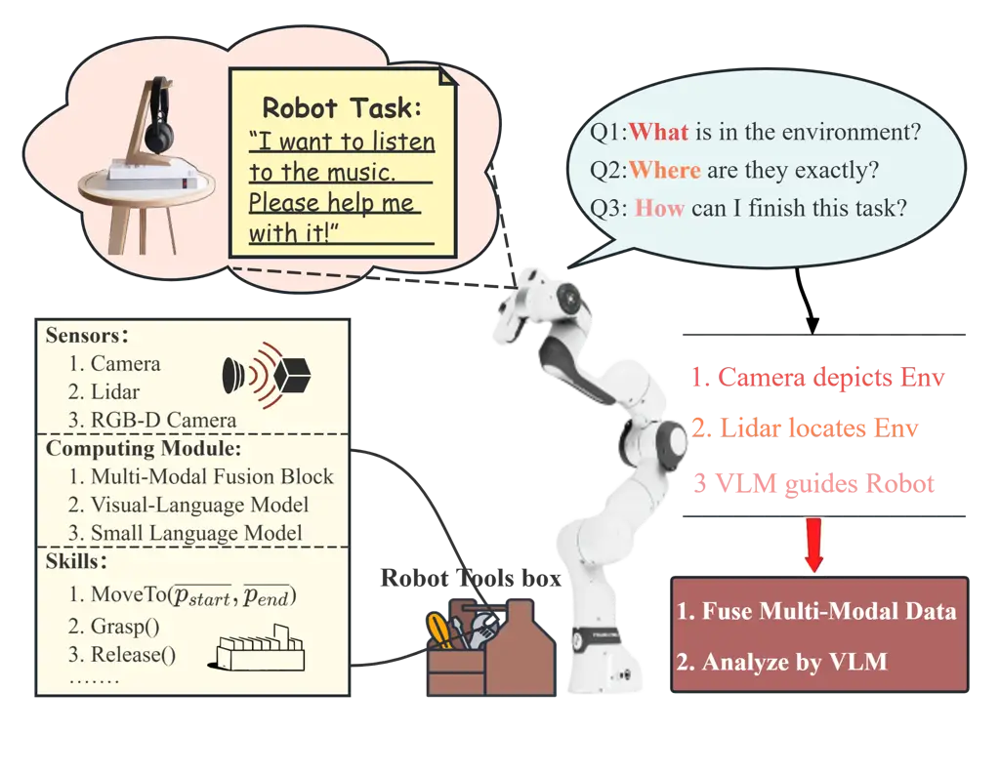
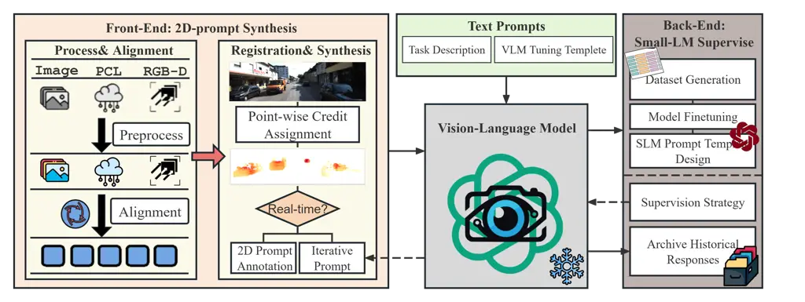
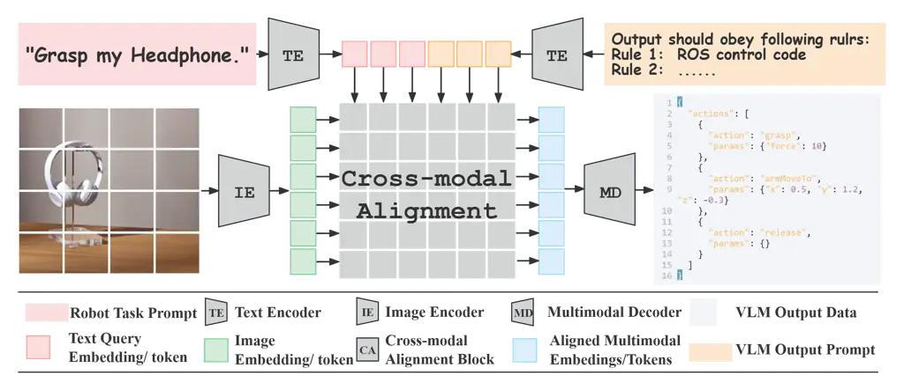
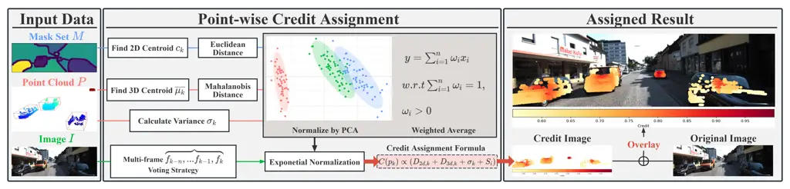
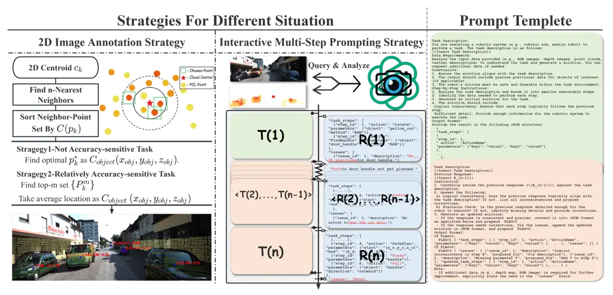
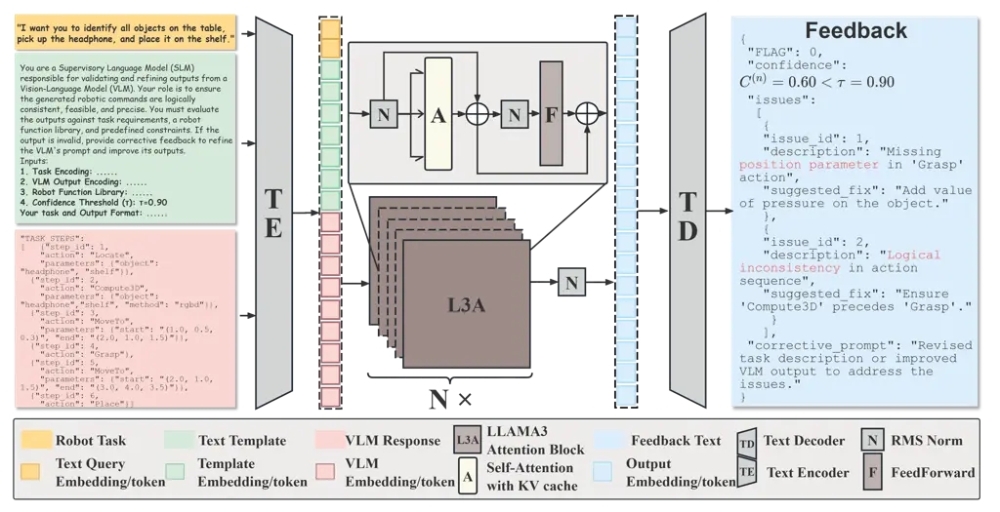
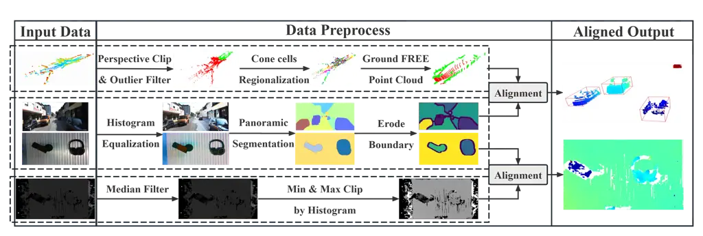
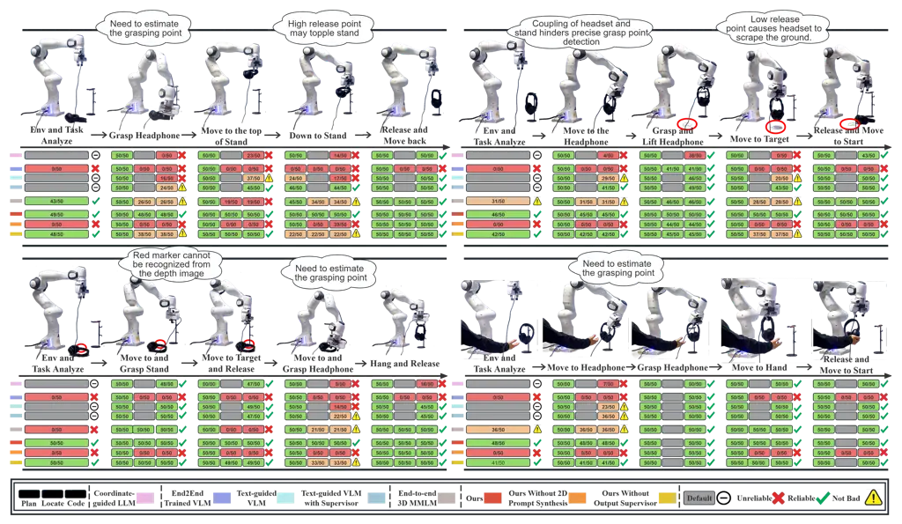

# 3D-Grounded Vision-Language Framework for Robotic Task Planning: Automated Prompt Synthesis and Supervised Reasoning

PubID: pubid:

Guoqin Tang    Qingxuan Jia    Zeyuan Huang    Gang Chen    Ning Ji   
Zhipeng Yao

###### Abstract

Vision-language models (VLMs) have achieved remarkable success in scene
understanding and perception tasks, enabling robots to plan and execute
actions adaptively in dynamic environments. However, most multimodal
large language models lack robust 3D scene localization capabilities,
limiting their effectiveness in fine-grained robotic operations.
Additionally, challenges such as low recognition accuracy, inefficiency,
poor transferability, and reliability hinder their use in precision
tasks. To address these limitations, we propose a novel framework that
integrates a 2D prompt synthesis module by mapping 2D images to point
clouds, and incorporates a small language model (SLM) for supervising
VLM outputs. The 2D prompt synthesis module enables VLMs, trained on 2D
images and text, to autonomously extract precise 3D spatial information
without manual intervention, significantly enhancing 3D scene
understanding. Meanwhile, the SLM supervises VLM outputs, mitigating
hallucinations and ensuring reliable, executable robotic control code
generation. Our framework eliminates the need for retraining in new
environments, thereby improving cost efficiency and operational
robustness. Experimental results that the proposed framework achieved a
96.0% Task Success Rate (TSR), outperforming other methods. Ablation
studies demonstrated the critical role of both the 2D prompt synthesis
module and the output supervision module (which, when removed, caused a
67% TSR drop). These findings validate the framework’s effectiveness in
improving 3D recognition, task planning, and robotic task execution.

###### Index Terms: 

Vision-language models (VLMs), Multimodal information fusion, Robotic
task planning, Prompt engineering, Autonomous robots

## I Introduction

The integration of robotics and artificial intelligence (AI) has
catalyzed significant advancements in the autonomous execution of
complex tasks, marking a new era of embodied intelligence where robots
are not only capable of physical interactions but also capable of
reasoning and decision-making through multi-modal data fusion and
intelligent planning systems\[1, 2\]. In industrial automation, robotic
systems have demonstrated exceptional efficiency, precision,
cost-effectiveness, and safety, enabling diverse applications such as
industrial equipment installation, precision instrument assembly, and
logistics automation, forming the backbone of modern smart manufacturing
processes\[3, 4\]. However, achieving robust autonomy in complex
environments presents one fundamental challenge: reasonable task
planning.



Fig. 1: Overview of the robotic task execution process using a Franka
robotic arm. The cloud (top left) defines the task involving objects on
a table. Key challenges (top right bubble) include: Perception,
Localization, and Planning. The proposed solution (right) integrates
multimodal perception (camera & lidar) with reasoning (VLM). The toolbox
(bottom left) outlines available resources, including sensors, computing
modules, and robotic skills.

Task planning, as stated in \[5\], encompasses environmental perception,
task understanding, and action planning, resulting in executable
sequences of robotic actions that achieve specified objectives. Common
perception techniques\[6\], ranging from image-based\[7\] and point
cloud-based\[8\] methods to multimodal fusion\[9\], provide essential
environmental modeling and serve as key constraints for subsequent
planning steps. However, traditional approaches, such as rule-based
methods and state-transition strategies, rely heavily on expert
knowledge, predefined robot states, and fixed interaction rules\[5\].
This dependency limits their adaptability and scalability in complex,
uncertain environments, prompting researchers to explore alternative
strategies\[10\].



Fig. 2: The overall architecture of the proposed framework. The
framework consists of three main components: 2D Prompt Synthesis Module
(orange), including Process & Alignment (light yellow) for multimodal
data preprocessing and alignment, and Registration & Synthesis (light
yellow) for credit-based prompt generation. A red arrow indicates data
flow between these submodules. The Frozen Vision-Language Model (VLM,
gray) serves as the reasoning core, receiving inputs from the 2D Prompt
Synthesis Module and Text Prompts. A dashed arrow represents iterative
refinement with the iterative prompt algorithm in Registration &
Synthesis. The Back-End Small Language Model (SLM) Supervision (brown)
validates and refines outputs via a solid arrow, with a dashed arrow
enabling feedback correction to the VLM. Final validated outputs are
archived in the Archive Historical Responses submodule.

Building on these explorations, recent work has investigated multimodal
fusion \[11, 12\] for richer environmental representation and
large-scale models \[13, 14, 15\] for more flexible, data-driven task
planning. In these frameworks, perception is not an isolated step but an
integral component of the planning pipeline, providing critical spatial
and semantic cues that guide subsequent reasoning. Yet, despite these
efforts, significant challenges persist in bridging the gap between
high-level commands and actionable robot behaviors. For example,
consider a task where a robotic arm is required to pick up a headphone
from a cluttered desk and hang it on a designated stand. This scenario
highlights three critical requirements. First, the system must
accurately perceive the spatial information of the target object, such
as its position and orientation. In complex environments, limitations in
sensor resolution or perception algorithms often result in incomplete or
inaccurate 3D spatial data, which directly impacts the feasibility and
precision of task planning. Second, the system needs to infer geometric
constraints and semantic relationships between objects, especially in
multi-object interaction scenarios. For instance, it must deduce the
optimal grasping point (e.g., the headphone bridge) or align objects
(e.g., the headphone and the stand) based on the task requirements.
Finally, the dynamic nature of the environment further complicates task
execution, as unexpected changes can disrupt the scene structure.
Without real-time supervision and feedback mechanisms, the system cannot
adapt its plans to handle these changes, resulting in task failure.
These challenges illustrate significant gaps in existing methods
regarding perception, reasoning, and dynamic adaptability.

Some approaches\[16, 17\] attempt to mitigate these issues by
incorporating image-based cues, but they often fail to capture critical
spatial relationships—such as proximity or alignment—especially in
cluttered or dynamically changing scenes. Although end-to-end multimodal
models (E2E-MM)\[18, 19, 20\] improve perceptual accuracy by integrating
multiple sensory inputs, they remain resource-intensive and difficult to
interpret. Meanwhile, prompt-based modular frameworks\[21, 22, 23\],
which combine textual and visual inputs more flexibly, still struggle to
fully align these modalities, limiting their spatial understanding.
Moreover, the lack of robust supervision and iterative feedback loops
prevents current methods from refining their plans as conditions evolve.
Collectively, these challenges underscore the need for a more
interpretable, spatially-aware, and feedback-driven framework that
seamlessly integrates perception into the task planning process.

To address these persistent challenges, we propose a novel plug-and-play
framework designed to integrate multimodal data from different sensors
and supervise robotic task execution in dynamic environments. By
leveraging existing large-scale models without requiring extensive
retraining, this approach offers a cost-effective and scalable solution.
The framework consists of three key modules: (1) a 2D prompt synthesis
module at the front, which fuses depth information into 2D images to
generate precise 3D spatial coordinates, enabling accurate perception of
target objects; (2) a frozen Vision-Language Model (VLM) at the core,
which leverages pre-trained visual and textual reasoning capabilities to
infer geometric constraints and semantic relationships, supporting
complex task planning; and (3) a supervision module at the back, which
employs a fine-tuned small language model (SLM) to validate and refine
task plans, ensuring logical consistency and dynamic adaptability. This
approach enhances spatial reasoning, mitigates LLM hallucinations caused
by 3D information ambiguity, and improves task planning reliability.
Experiments conducted on a Franka robotic arm performing dynamic
assembly tasks demonstrated significant improvements, including a 31.93%
increase in 3D recognition accuracy, a 46.40% enhancement in
localization precision, and a 58.10% boost in task execution success
rate compared to a state-of-the-art 3D-MMLM. These results validate the
framework’s robustness in spatial perception and multi-step planning
across diverse scenarios.

Building on these improvements, our main contributions are as follows:

- •
  A Framework Integrating 3D Perception and SLM Supervision: A novel
  framework combining 2D prompt synthesis for 3D perception with SLM
  supervision to enhance task planning reliability and reduce
  hallucinations.
- •
  Credit-based Registration-Efficient Multimodal Fusion: A
  high-performance algorithm integrating 2D and 3D data using
  confidence-based strategies for reliable and fast task execution.
- •
  Image Prompt Synthesis Algorithms for 3D Perception: A method enabling
  VLMs trained on 2D data to achieve precise 3D spatial understanding
  and analysis.

## II Related Work

Achieving robust task planning in robotics requires addressing two
interrelated challenges: precise 3D spatial understanding and the
effective utilization of large pre-trained models. Precise 3D perception
provides the geometric and spatial foundation necessary for fine-grained
operations, such as grasping and trajectory planning. However,
integrating these perceptual insights into large models, such as
Vision-Language Models (VLMs) and Large Language Models (LLMs), is
equally critical to ensure task-relevant outputs and dynamic
adaptability. This section reviews progress in these areas, focusing on
multimodal perception and model adaptation strategies, and highlights
their limitations.

### II-A Multimodal Perception for Robotic Operations

Multimodal perception enhances 3D scene understanding by combining RGB,
depth, and textual inputs. Current approaches can be broadly categorized
into End-to-End Models and Modular Architectures. End-to-End Models, for
example ”RT series”\[24, 25\] and ”RobotFlamingo”\[26\], employ
transformer-based frameworks to encode sensory inputs into unified
cross-modal embeddings, enabling robust multimodal reasoning. These
methods excel in learning rich representations but often lack geometric
fidelity, struggle with task-specific adaptation, and require costly
retraining on large annotated datasets, making them less effective in
dynamic environments.

Modular architectures decouple perception and reasoning processes,
leveraging pre-trained VLMs to reduce computational demands. For
example, CLIP-based methods extract semantic features, while auxiliary
modules handle spatial reasoning \[27, 28\]. Another approach integrates
Reinforcement Learning (RL) modules to generate desired outputs directly
\[29\]. Despite their flexibility, these architectures face significant
challenges in multimodal data fusion, particularly in addressing sensor
uncertainties and prioritizing task-relevant features in cluttered or
dynamic scenarios. These limitations highlight the need for adaptive
frameworks capable of integrating 3D perception with dynamic task
planning.



Fig. 3: The architecture of the Vision-Language Model (VLM). Inputs
include a robot task (top-left), segmented image (bottom-left), and text
template (top-right), processed by encoders to generate feature vectors.
The cross-modal alignment module (center) integrates text and image
features, producing a unified representation. The multimodal decoder
(right) generates executable robot control codes.

### II-B Large Pre-trained Models In Robotic Tasks

Large pre-trained models (VLMs and LLMs) have emerged as powerful tools
for robotic task planning \[30\] and navigation \[31\] through their
multimodal reasoning capabilities \[32\]. Their integration into
robotics employs two complementary approaches: prompt engineering that
steers models through input design without parameter modification, and
architectural innovations involving structural adaptations or
domain-specific retraining.

Prompt engineering strategies, which preserve original model parameters,
include textual instructions for task decomposition \[33\] and visual
prompts encoding spatial layouts via images \[34, 35\]. Advanced
techniques like chain-of-thought (CoT) prompting \[36\] further enhance
complex task handling by breaking operations into logical sequences.
However, their reliance on textual or 2D visual inputs introduces
geometric reasoning limitations, leading to failures in precision tasks
such as sub-centimeter alignment. Architectural innovations address
these limitations at the cost of flexibility: Models like XComposer
\[37\] leverage cross-modal attention mechanisms to align visual-textual
embeddings obtaining geometric grounding ability. Mini-CPM \[38\], a new
cross-modal attention work, optimizes computational efficiency through
layer pruning. This type of mechanism(multimodal pretrained method)
underpin diverse applications: Well-designed domain-specific VLMs guide
navigation in large-scale environments \[39, 40\], while multimodal LLMs
like PALM-E \[41\] enable robotic arm control through embodied
reasoning. Although performing well in specific domain,
structure-modified models suffer from resource-intensive retraining for
new environment.

These challenges highlight three key unresolved issues: the
semantic-geometric divide in complex 3D tasks, the computational burden
of architectural adaptations, and the absence of automatic geometric
grounding in prompt-based approaches.

## III Methodology

This paper introduces a modular framework (Fig. 2) to address the
limitations of Vision-Language Models (VLMs) in fine-grained robotic
task planning. The proposed framework enhances spatial reasoning,
logical consistency, and adaptability by integrating three complementary
modules, enabling precise and reliable execution of complex robotic
tasks.

### III-A VLM-Based Robotic Task Planning Framework

The proposed framework leverages a frozen Vision-Language Model (VLM)
pre-trained on large-scale datasets, as shown in Fig. 3. While
traditional VLMs excel in image-text reasoning, they lack precise 3D
spatial understanding and efficient multimodal integration, limiting
their effectiveness in robotic task planning.

To address these limitations, the framework adopts a modular
architecture consisting of the following key components:

- •
  2D Prompt Synthesis Module: This module processes and aligns
  multimodal data, ensuring accurate integration of RGB and depth
  information. It employs registration algorithms and iterative
  prompting strategies to optimize task-specific prompts for downstream
  reasoning tasks.
- •
  Frozen Vision-Language Model: Serving as the reasoning core, the VLM
  integrates 2D prompts and textual commands for multimodal reasoning
  and task plan generation. Iterative interactions with the synthesis
  module enable refined and context-aware outputs.
- •
  Back-End Small Language Model Supervision: This module validates and
  refines outputs from the VLM, ensuring logical consistency and
  actionable task plans. Approved outputs are archived for iterative
  refinement and future reference.

This modular design bridges the gap between 2D VLM capabilities and 3D
robotic requirements, offering a solution that supports dynamic
environments, improves spatial reasoning, and ensures robust task
execution. Applications include precision assembly, dynamic navigation,
and complex task execution. Detailed implementations of each module are
presented in the following sections.



Fig. 4: The figure illustrates the process of computing confidence
scores using filtered point cloud data and corresponding paired image
data. The central section outlines the computational steps, including
mask processing, 3D point cloud analysis, and RGB image integration. The
rightmost block presents the final assignment results, where confidence
scores are overlaid onto the original image for visualization.

### III-B Confidence-Based Registration Strategy

Accurate multimodal data fusion is essential for robotic perception
systems, yet it remains challenging due to segmentation errors, sensor
noise, and spatial misalignment. These uncertainties are especially
detrimental in dynamic environments or tasks requiring high spatial
accuracy. To address these issues, we propose a confidence-based
registration strategy that evaluates and prioritizes spatial points
based on an entropy-guided probabilistic framework. This strategy
ensures that only reliable information contributes to downstream tasks,
such as object localization and trajectory planning.

#### III-B1 Mathematical Definition of Confidence Score

The confidence score $`C_{i}`$ quantifies the reliability of each
spatial point $`x_{i}`$, integrating multiple sources of uncertainty
into a unified probabilistic measure:

```math
C_{i}=\exp\left(-\sum_{n=1}^{K}\lambda_{n}\cdot H_{n}(x_{i})\right), \tag{1}
```

where $`H_{n}(x_{i})`$ represents the normalized entropy capturing
uncertainty in the $`n`$-th dimension, $`\lambda_{n}`$ is the
task-specific weighting coefficient reflecting the importance of the
$`n`$-th dimension, and $`K`$ is the total number of uncertainty
dimensions.

This formulation draws from information theory, where entropy quantifies
the level of uncertainty in a probability distribution. By exponentially
scaling the summed entropies, this model ensures that points with higher
uncertainty have significantly lower confidence scores, prioritizing
reliable points for fusion and downstream tasks.

#### III-B2 Entropy Components and Their Physical Significance

The confidence score integrates four entropy components, each addressing
distinct uncertainty sources. These components are normalized to the
range $`[0,1]`$ to ensure uniform scaling and compatibility across
heterogeneous data modalities.

##### Spatial Consistency Entropy $`H_{1}(x_{i})`$

This component measures the deviation of a point $`x_{i}`$ from the
centroid of its segmentation mask $`\mathbf{c}_{k}`$. Using the 2D
Euclidean distance:

```math
d_{\text{2D}}(x_{i})=\|\mathbf{p}_{i}-\mathbf{c}_{k}\|_{2}, \tag{2}
```

where $`\mathbf{p}_{i}`$ is the 2D position of $`x_{i}`$. The normalized
probability and entropy are:

```math
P_{1}(x_{i})=\frac{1}{1+d_{\text{2D}}(x_{i})},\quad H_{1}(x_{i})=-P_{1}(x_{i})\log(P_{1}(x_{i})). \tag{3}
```

Physically, $`H_{1}(x_{i})`$ quantifies the consistency of $`x_{i}`$
within its segmentation context, penalizing outliers far from the
centroid.

##### Geometric Consistency Entropy $`H_{2}(x_{i})`$

Geometric consistency evaluates the deviation of a point $`x_{i}`$ from
the local point cloud structure using the Mahalanobis distance:

```math
D_{\text{M}}(x_{i})=(\mathbf{x}_{i}-\boldsymbol{\mu})^{\top}\mathbf{\Sigma}^{-1}(\mathbf{x}_{i}-\boldsymbol{\mu}), \tag{4}
```

where $`\boldsymbol{\mu}`$ and $`\mathbf{\Sigma}`$ represent the local
mean and covariance matrix. The normalized probability and entropy are:

```math
P_{2}(x_{i})=\frac{D_{\text{M}}(x_{i})}{D_{\text{max}}},\quad H_{2}(x_{i})=-P_{2}(x_{i})\log(P_{2}(x_{i})). \tag{5}
```

This entropy component penalizes points deviating from the local
geometric structure, ensuring robust point cloud consistency.

##### Depth Measurement Entropy $`H_{3}(x_{i})`$

Depth uncertainty is modeled using local depth variance
$`\sigma_{z,i}^{2}`$:

```math
P_{3}(x_{i})=\frac{\sigma_{z,i}^{2}}{\sigma_{\text{max}}},\quad H_{3}(x_{i})=-P_{3}(x_{i})\log(P_{3}(x_{i})). \tag{6}
```

Here, $`H_{3}(x_{i})`$ reflects the reliability of depth measurements,
penalizing inconsistent or noisy depth readings.

##### Temporal Stability Entropy $`H_{4}(x_{i})`$

In dynamic environments, temporal stability measures the variability of
a point $`x_{i}`$ across frames:

```math
S_{i}=\frac{1}{T-1}\sum_{t=1}^{T-1}\frac{|x_{i}^{(t)}-x_{i}^{(t-1)}|}{D_{\text{max}}}, \tag{7}
```

where $`|x_{i}^{(t)}-x_{i}^{(t-1)}|`$ represents the displacement
between consecutive frames. The normalized probability and entropy are:

```math
P_{4}(x_{i})=\frac{S_{i}}{S_{i}+1},\quad H_{4}(x_{i})=-P_{4}(x_{i})\log(P_{4}(x_{i})). \tag{8}
```

This entropy component penalizes points exhibiting high temporal
instability, ensuring that only stable points are prioritized.

#### III-B3 Task-Driven Weight Allocation

The weighting coefficients $`\lambda_{n}`$ are tailored to specific
tasks, prioritizing relevant uncertainty dimensions based on operational
requirements:

- •
  High spatial resolution tasks: Emphasize $`H_{1}(x_{i})`$ and
  $`H_{2}(x_{i})`$ for precise spatial alignment.
- •
  Dynamic environments: Prioritize $`H_{4}(x_{i})`$ for motion tracking
  and stability.
- •
  Cluttered environments: Adjust $`\lambda_{3}`$ to suppress noisy depth
  information.

For instance, in robotic navigation, temporal stability
($`H_{4}(x_{i})`$) is critical for maintaining trajectory coherence,
while precision assembly tasks emphasize spatial ($`H_{1}(x_{i})`$) and
geometric ($`H_{2}(x_{i})`$) consistency.

#### III-B4 Integration with Downstream Tasks

The confidence-based registration strategy ensures that high-confidence
points contribute to downstream processes, such as trajectory planning
and control generation. By systematically integrating multiple
dimensions of uncertainty, this approach enhances the robustness and
reliability of multimodal data fusion, significantly improving robotic
perception and decision-making in complex environments.



Fig. 5: The figure illustrates confidence-driven strategies for
task-specific prompting: The left section represents time-sensitive
tasks, employing a 2D Image Annotation Strategy, and focusing on quickly
filtering and annotating key credit points; The middle section
corresponds to precision-sensitive tasks, employing an Interactive
Multi-Step Prompting Strategy, and showcasing the query and analyze
interaction between the Vision-Language Model (VLM), Credit Image, and
RGB Image for iterative refinement. The right section provides a Prompt
Template, with the green and pink blocks aligning with their
corresponding components in the middle section, offering structured
guidance for logical and accurate task execution.

### III-C 2D Prompt Synthesis and Textual Prompt Design

This subsection presents a framework(fig 4) that integrates 2D prompt
synthesis with textual prompt design to enhance the Vision-Language
Model (VLM)’s spatial reasoning capabilities. By embedding reliable 3D
spatial information into 2D inputs and dynamically refining textual
prompts, the framework constrains the high-dimensional space of VLM
encoding, ensuring accurate outputs for robotic control tasks.

#### III-C1 Nearest Neighbor Selection Strategy

The nearest neighbor strategy is designed for tasks requiring quick
responses with moderate precision. It embeds selected 3D points into 2D
inputs, reducing visual redundancy while preserving essential spatial
details. For each segmentation mask $`M_{k}`$, the centroid $`c_{k}`$ in
the 2D plane is computed as:

```math
c_{k}=\frac{1}{|M_{k}|}\sum_{\mathbf{p}\in M_{k}}\mathbf{p}, \tag{9}
```

where $`|M_{k}|`$ is the number of pixels in $`M_{k}`$, and
$`\mathbf{p}=(x,y)`$ represents pixel coordinates.

Using the nearest neighbor (NN) algorithm, candidate 3D points
$`\mathcal{N}_{k}`$ near $`c_{k}`$ are identified:

```math
\mathcal{N}_{k}=\{\mathbf{p}\in\mathcal{P}\mid\mathbf{p}\in\text{NN}_{4}(c_{k})\}, \tag{10}
```

where $`\mathcal{P}`$ is the point cloud. A confidence score
$`C(\mathbf{p})`$ determines the most reliable point:

```math
\mathbf{p}^{*}_{k}=\arg\max_{\mathbf{p}\in\mathcal{N}_{k}}C(\mathbf{p}). \tag{11}
```

The selected point $`\mathbf{p}^{*}_{k}`$ is annotated onto the 2D
image, providing critical spatial cues to the VLM.

This process constrains the high-dimensional space of VLM encoding by
incorporating key 3D spatial information into the image vector
$`\mathbf{v}_{I}`$, which refines the probability distribution of the
output vector $`\mathbf{v}_{O}`$:

```math
p(\mathbf{v}_{O}\mid\mathbf{v}_{I})\rightarrow p(\mathbf{v}_{O}\mid\mathbf{v}_{I},\mathbf{p}^{*}_{k}). \tag{12}
```

The reduced uncertainty allows the decoder to generate more precise
robotic control commands.

The textual prompt specifies the VLM’s role, linking the red points in
the image to their corresponding 3D coordinates and instructing the
model to generate robot-accessible outputs.

#### III-C2 Iterative Multi-Step Prompting Strategy

This strategy systematically refines spatial understanding and task
precision through recursive visual-linguistic processing. It integrates
multimodal inputs (such as images and textual descriptions) with
iterative updates to the task prompt. The process consists of the
following stages:

Initial Encoding and Prompt Formulation:

The initial task prompt $`T^{(1)}`$ is generated by combining the input
image $`\mathcal{I}`$ with the corresponding textual description
$`\mathcal{D}`$, along with a predefined text template $`\mathcal{T}`$
that specifies the output format and interaction guidelines for the
Vision-Language Model (VLM). This multimodal information is mapped into
a task vector $`\mathbf{v}_{T}`$ within a high-dimensional space
$`\mathcal{V}`$, as shown below:

```math
T^{(1)}:(\mathcal{I},\mathcal{D},\mathcal{T})\rightarrow\mathbf{v}_{T},\quad\mathbf{v}_{T}\in\mathcal{V}
```

Here, $`\mathcal{I}`$ is the input image, $`\mathcal{D}`$ is the
associated textual description (e.g., task instructions or goals), and
$`\mathcal{T}`$ is the predefined text template that outlines the
expected output format, enabling the VLM to generate responses that
include self-evaluation and check for the need for further information.

Input: Segmentation masks $`\{M_{k}\}`$, point cloud $`\mathcal{P}`$,
VLM model, textual prompt templates  
Output: Enhanced 2D inputs and executable robotic commands

1:  Initialize an empty database for storing feedback and motion
primitives.

2:  for each segmentation mask $`M_{k}`$ do

3:   Compute the centroid $`c_{k}`$ using Equation 9.

4:   Identify the four nearest points $`\mathcal{N}_{k}`$ in
$`\mathcal{P}`$ using Equation 10.

5:   Select the most reliable 3D position $`\mathbf{p}^{*}_{k}`$ using
confidence scores $`C(\mathbf{p})`$.

6:   Annotate $`\mathbf{p}^{*}_{k}`$ on the 2D image near $`c_{k}`$.

7:  end for

8:  Initialize prompt sequence $`T^{(1)}`$ for interactive refinement.

9:  for each iteration $`n`$ do

10:   Generate output $`R^{(n)}`$ using Equation 14.

11:   Update $`T^{(n+1)}`$ based on $`R^{(n)}`$.

12:   IF convergence criteria met THEN break.

13:  end for

14:  Populate textual templates with task-specific parameters,
leveraging database-stored motion primitives and constraints.

Algorithm 1 2D Prompt Synthesis Algorithm

Iterative Refinement Mechanism:

For each iteration $`n`$, capture new image if required. Otherwise, use
the previous image data.

The task prompt $`T^{(n)}`$ is updated based on the image data
$`\mathcal{I}^{(n)}`$, the task description $`\mathcal{D}`$, and the
previous output $`T^{(n-1)}`$:

```math
T^{(n)}=\text{Update}(T^{(n-1)},\mathcal{I}^{(n)},\mathcal{D}) \tag{13}
```

The Vision-Language Model (VLM) generates a response $`R^{(n)}`$, which
includes the region of interest (ROI) coordinates, based on the updated
prompt $`T^{(n)}`$ and image data $`\mathcal{I}^{(n)}`$:

```math
R^{(n)}=\text{VLM}(\mathcal{I}^{(n)},T^{(n)},\mathcal{V}) \tag{14}
```

The coordinates of the ROI are directly extracted from $`R^{(n)}`$,
which also contains information about the target region in the image:

```math
\text{ROI}^{(n)}=\text{ExtractROI}(R^{(n)}) \tag{15}
```

The region of interest $`\text{ROI}^{(n)}`$ is then mapped with the
depth information:

```math
\text{Depth}_{\text{optimal}}^{(n)}=\underset{\mathbf{p}\in\text{NN}(\text{ROI}^{(n)})}{\operatorname{arg\,max}}\,C(\mathbf{p}) \tag{16}
```

This process iteratively refines the VLM’s output, using regions of
interest to guide the robot to precise interaction points based on the
confidence of depth values.

Convergence Criteria:

```math
\text{Stop Condition}:|\Delta\text{ROI}^{(n)}|<\epsilon\ \text{and}\ FLAG=1 \tag{17}
```

Terminate the iteration when the change in ROI falls below the threshold
$`\epsilon`$ and the task is deemed complete by the VLM with $`FLAG=1`$,
indicating sufficient precision has been achieved.

#### III-C3 Integration and Complementarity

The nearest neighbor strategy emphasizes efficiency, making it suitable
for tasks with strict time constraints, while the iterative strategy
ensures precision, excelling in complex scenarios. By combining both
approaches, we achieve a robust framework that enhances spatial
understanding and interaction precision across diverse robotic
applications. The integration of 2D prompt synthesis and textual design
ensures that the high-dimensional encoding space remains
well-constrained, enabling reliable task execution.



Fig. 6: The architecture of the Small Language Model (SLM) supervision
module. Inputs (left) are processed by the text encoder to generate
embeddings, which pass through the LLAMA3 attention block (center) for
reasoning and alignment. The outputs are decoded into actionable text
commands by the text decoder (right). The shaded area above illustrates
the internal structure of the LLAMA3 attention block.

### III-D Supervisory Feedback via SLM

To address hallucinations and logical inconsistencies in Vision-Language
Models (VLMs) for robotic control tasks, this study proposes a
supervisory feedback mechanism based on a Small Language Model (SLM).
The mechanism ensures the precision, consistency, and safety of control
commands through iterative optimization. In practice, we identify three
primary types of errors: parameter errors, logical errors, and
constraint violations, which involve control values exceeding
operational ranges, task execution sequence disorders, and violations of
safety and task-specific conditions, respectively. We specifically train
the SLM to retain this critical information and validate key parameters
in the VLM’s output, such as joint angles, end-effector positions, and
grip forces, ensuring logical consistency and adherence to environmental
constraints. Through continuous queries and verification processes, the
SLM leverages its knowledge base to guide the VLM in correcting its
outputs, thereby enhancing task success rates.

The overall architecture of the supervisory system is illustrated in
Fig. 6, revealing the feedback loops and information flow between system
components. Subsequent sections will discuss in detail the following
four crucial aspects: ”Model Finetuning”, ”SLM Prompt Template Design”,
”Supervision Strategy” and ”SLM-VLM Interaction Framework”, all of which
are essential for constructing the supervisory system.

#### III-D1 Domain-Specific Model Fine-Tuning

In practical operational tasks, errors in VLM outputs can be categorized
into three primary defined as follows:

- •
  Parameter Errors: These occur when control values exceed operational
  ranges (e.g., joint angles
  $`\theta\notin[\theta_{\text{min}},\theta_{\text{max}}]`$).
- •
  Logical Errors: These pertain to violations of task sequence
  constraints (e.g., releasing an object before grasp completion).
- •
  Constraint Violations: These refer to breaches of safety or
  task-specific conditions (e.g., end-effector colliding with a
  barrier).

To optimize the supervisory capabilities of the SLM, we train it
specifically to recognize and address these errors. This training
involves fine-tuning the SLM using a curated dataset that includes
examples of these error types, along with corresponding corrections and
confidence scores.

##### Dataset

The fine-tuning process leverages a dataset $`\mathcal{D}`$ constructed
as follows:

```math
\mathcal{D}=\{(x_{i},y_{i},c_{i})\}_{i=1}^{N} \tag{18}
```

where $`x_{i}`$ represents input commands, $`y_{i}`$ denotes correct
outputs, and $`c_{i}`$ indicates confidence scores. It includes four
critical components:

- •
  Natural-language task descriptions with validated control parameters
- •
  Expert-annotated correction examples with confidence scores
- •
  Historical execution logs with success/failure cases
- •
  Task-specific constraints and safety thresholds

The construction details are presented in Section IV.

##### Fine-Tuning Method

The fine-tuning process leverages Low-Rank Adaptation (LoRA), which
introduces trainable matrices $`A\in\mathbb{R}^{r\times d}`$ and
$`B\in\mathbb{R}^{d\times r}`$ with rank $`r`$ into the pre-trained
weights $`W`$, as shown below:

```math
W+BA=W+\Delta W \tag{19}
```

This parameter-efficient adaptation balances domain specificity and
computational efficiency \[42\]. The rank $`r`$ controls the adaptation
capacity, with lower values preserving more original knowledge. During
fine-tuning, a cross-entropy loss function is employed to minimize
prediction errors while preserving logical coherence in task outputs.
Critical hyperparameters, such as rank and learning rate, are
empirically optimized.

#### III-D2 SLM Prompt Template for SLM–VLM Interaction

To standardize the supervision process, we define the SLM Prompt
Template structure, see TABLE I. This template provides necessary
information to the SLM for generating accurate feedback and adjustment
suggestions. Details are presented in Section IV.

|                                  |                                                              |
| -------------------------------- | ------------------------------------------------------------ |
| Component                        | Description                                                  |
| Input                            |                                                              |
| Task Description ({T})           | The task description provided to the system.                 |
| Prompt Template ({PT})           | Template used to structure prompts for VLM input.            |
| Historical Responses ({H^((n))}) | Record of prior interactions and outputs for context.        |
| VLM Output ({R^((n))})           | The current output generated by the VLM.                     |
| Instruction                      |                                                              |
| Validate                         | Verify parameters, logic, and constraints in the VLM output. |
| Identify Issues                  | Identify any inconsistencies or errors in the output.        |
| Provide Suggestions              | Offer actionable recommendations with confidence scores.     |
| Output                           |                                                              |
| Feedback ({F})                   | Constructive feedback for improving the VLM output.          |
| Adjustments ($`\Delta`$)         | Suggested changes to refine the output.                      |
| Confidence ($`\sigma`$)          | Confidence level associated with feedback and adjustments.   |

TABLE I: SLM–VLM Interaction Prompt Template

#### III-D3 Supervision Strategies for SLM-VLM Interaction

To ensure stability and convergence within the feedback loop, the SLM
employs two complementary strategies:

##### Single-Dimension Adjustments

This strategy focus each iteration on refining one parameter or logical
step at a time, thereby avoiding interference among interdependent
variables:

```math
\Delta p_{j}^{(n)}=\delta_{j,i(n)}\cdot f\left(e_{j}^{(n)}\right) \tag{20}
```

where $`i(n)`$ denotes the parameter selected for adjustment in the
$`n`$-th iteration, $`p_{j}`$ represents the $`j`$-th parameter, and
$`e_{j}`$ is its associated error. This multi-stage optimization ensures
monotonic improvement through incremental parameter updates.

##### Feedback History Tracking

This strategy maintains a record of past adjustments, preventing
redundant or contradictory corrections:

```math
\mathcal{H}^{(n)}=\left\{\Delta p_{i}^{(k)}\,|\,k=1,\ldots,n-1\right\} \tag{21}
```

Here, $`\mathcal{H}^{(n)}`$ represents the feedback history. Given that
the SLM is a small model, it is solely responsible for adjusting the
VLM’s outputs in complex tasks. By caching historical adjustments, the
SLM can quickly provide optimal feedback for tasks it has previously
corrected, thereby enhancing efficiency.

##### Implementation Example

Consider a VLM-generated command for robotic manipulation:

> ”Apply 15 N grip force on fragile component”

The SLM identifies a safety violation (max 5 N threshold) and generates
corrective feedback:

> _“A grip force of 15 N exceeds the safety threshold for fragile
> components (maximum allowable force: 5 N). Please adjust the grip
> force to at most 5 N and reattempt the grasping action while
> maintaining the current approach vector and speed.”_

This feedback is reintegrated into the text prompt helping VLM to
regenerate commands until either the commands satisfy all task
requirements or a predefined iteration limit $`N_{\text{max}}`$ is
reached. If convergence remains unattainable after $`N_{\text{max}}`$
iterations, a fallback mechanism ensures task safety by either reverting
to a default safe state or requesting human intervention, depending on
the task’s criticality level.

1:  Input: Task description $`T`$, prompt template $`PT`$, maximum
iterations $`N_{\text{max}}`$, confidence threshold $`\tau`$, historical
responses $`H^{(n)}`$, VLM output $`R^{(n)}`$ (with confidence score
$`C^{(n)}`$), acceptance flag $`flag^{(n)}\in\{0,1\}`$, issue set
$`I^{(n)}`$, suggestion set $`S^{(n)}=\{(s_{i},c_{i})\}`$ where
$`c_{i}\in\{A,B,C\}`$, and VLM prompt $`P^{(n)}`$

2:  Output: Final robotic command $`R^{*}`$, Recorded information $`R`$

3:  Initialize $`n\leftarrow 0`$, $`H^{(0)}\leftarrow\emptyset`$,
$`R^{(0)}\leftarrow\emptyset`$

4:  while $`n<N_{\text{max}}`$ do

5:   SLM Processing:

6:    Generate feedback
$`Y^{(n)}=\{\text{flag}^{(n)},C^{(n)},I^{(n)},S^{(n)},\newline
\hskip 65.00009ptP^{(n)}\}`$ based on $`T`$, $`PT`$, $`H^{(n)}`$, and
$`R^{(n)}`$

7:    Update history $`H^{(n+1)}=H^{(n)}\cup\{Y^{(n)}\}`$

8:   VLM Processing:

9:    Generate output $`R^{(n+1)}=\text{VLM}(P^{(n)})`$

10:   Evaluation:

11:   if $`C^{(n+1)}>\tau`$ and $`\text{flag}^{(n+1)}=1`$ then

12:    Finalize:

13:     Require VLM to describe the scenario in detail.

14:     Adopt VLM’s output $`R^{(n+1)}`$ for robot control.

15:     Record $`R=\{\text{Scenario Info},\text{Task Info},\newline
\hskip 65.00009pt\text{Robot Control Code}\}`$

16:     Terminate

17:   end if

18:   if $`n+1=N_{\text{max}}`$ then

19:    Fallback Mechanism:

20:     Revert to $`H^{(n)}`$

21:     Identify the action with the lowest confidence level

22:     Generate a correction prompt for this action

23:     Continue to next iteration

24:   end if

25:   Increment $`n\leftarrow n+1`$

26:  end while

27:  Task Outcome:

28:  if Task Successful then

29:   Record $`R=\{\text{Scenario Info},\text{Task Info},\newline
\hskip 65.00009pt\text{Final Robot Control Code}\}`$

30:  else

31:   Record failure and request human intervention

32:  end if

Algorithm 2 SLM–VLM Interaction Process

#### III-D4 SLM-VLM Interaction Framework

The interaction between the Small Language Model (SLM) and
Vision–Language Model (VLM) constitutes a closed-loop feedback system
for iterative refinement of robotic control commands. This dual-model
approach enables robust command generation through continuous validation
and refinement. See Algorithm2.

##### System Formalization

The interaction is formalized as a state transition system
$`\mathcal{S}=(X,U,F)`$, where $`X\subseteq\mathbb{R}^{n}`$ stands for
the state space of possible commands, $`U\subseteq\mathbb{R}^{m}`$ is
the feedback space and $`F:X\times U\rightarrow X`$ refers to state
transition function.

##### Interaction Components

The SLM generates feedback $`Y^{(n)}`$ at iteration $`n`$:

```math
Y^{(n)}=\{\text{flag}^{(n)},C^{(n)},I^{(n)},S^{(n)},P^{(n)}\}
```

where $`Y^{(n)}`$ represents the feedback generated by the SLM in the
$`n`$-th iteration, encompassing the acceptance flag, confidence score,
detected issues, corresponding suggestions, and the prompt for the VLM.



Fig. 7: The complete data preprocessing pipeline and experiment results.
Inputs (left) include point cloud data, RGB images, and depth maps. The
central process (middle) consists of three layers: Point Cloud
Processing (top), Image Processing (center), and Depth Map Processing
(bottom). Image processing further distinguishes KITTI dataset images
(top row) for point cloud alignment and real-world robotic arm images
(bottom row) for depth map alignment. Outputs (right) are the aligned
and segmented point cloud and aligned depth map.

## IV Experiments

In this section, we evaluate the effectiveness of the proposed modular
framework in enhancing scene understanding and task execution for
robotic systems. We focus on assessing the contributions of the fusion
and supervision modules in terms of 3D spatial reasoning, task planning,
and control code generation.

### IV-A Experimental Setup

We conducted experiments using a FRANKA robotic arm equipped with a
RealSense RGB-D camera and a LiDAR sensor. The robot performed a series
of manipulation tasks in an indoor environment featuring moderate
clutter and varying lighting conditions. Camera and LiDAR data were used
for scene perception and task planning.

#### IV-A1 Camera and LiDAR Registration

Accurate alignment of camera and LiDAR data was achieved using
pre-calibrated intrinsic and extrinsic parameters. A transformation
matrix $`T_{\text{Lidar}}^{\text{Camera}}`$ was computed to project
LiDAR points into the camera frame, enabling precise multimodal data
fusion for 2D prompt synthesis. The alignment accuracy was verified by
comparing projected point cloud edges with image contours, ensuring
consistent integration of RGB and depth information.

```math
\begin{bmatrix}X_{\text{camera}}\\
Y_{\text{camera}}\\
Z_{\text{camera}}\\
1\end{bmatrix}=T^{\text{camera}}_{\text{Lidar}}\cdot\begin{bmatrix}X_{\text{Lidar}}\\
Y_{\text{Lidar}}\\
Z_{\text{Lidar}}\\
1\end{bmatrix} \tag{22}
```

```math
\begin{bmatrix}u\\
v\\
1\end{bmatrix}=\frac{1}{Z_{\text{camera}}}\begin{bmatrix}f_{x}&0&c_{x}\\
0&f_{y}&c_{y}\\
0&0&1\end{bmatrix}\begin{bmatrix}X_{\text{camera}}\\
Y_{\text{camera}}\\
Z_{\text{camera}}\end{bmatrix} \tag{23}
```

#### IV-A2 Data Preprocessing

High-quality data preprocessing is crucial for robust multimodal fusion.
The following preprocessing steps were applied to point cloud, image,
and depth map data:

- •
  Point Cloud Processing: The cone cell-based segmentation method
  divides the point cloud within the camera’s frustum into multiple
  regions, effectively addressing issues caused by multiple ground
  layers\[43\]. PCA and thresholding are applied within each region to
  remove ground points. Additionally, redundancy sampling is employed to
  reduce computational overhead.
- •
  Image Processing: Histogram-based color equalization, viewpoint
  cropping, and neural network-based segmentation techniques are used
  for panoramic segmentation, improving the clarity and quality of the
  images.
- •
  Depth Map Processing: Filtering and cropping methods are applied to
  reduce artifacts and ensure smooth depth transitions.

These steps, as illustrated in Figure 7, ensure that the fused data is
accurate and robust for 2D prompt synthesis, with corresponding
experimental results shown in the same figure.

### IV-B Prompt Template

In this experiment, prompt templates play a critical role in guiding the
Vision-Language Model (VLM) and Small Language Model (SLM) to perform
robotic task planning and validation. These templates standardize
input-output interactions, ensuring task-specific requirements are met
while addressing logical consistency and safety constraints. The VLM
template focuses on generating task steps from visual and textual
inputs, while the SLM template supervises the VLM outputs and provides
necessary adjustments. The following sections detail the configuration
of these templates.

#### IV-B1 VLM Template

The Vision-Language Model (VLM) is tasked with generating task plans
based on visual and textual inputs. Its output directly influences the
robotic actions, making it critical to standardize the input and output
structure for consistent performance. This template provides the VLM
with task descriptions, prior knowledge of the robot and the
environment, and necessary constraints, ensuring safe and precise task
execution. See -A.

#### IV-B2 SLM Template

The Small Language Model (SLM) ensures that the VLM outputs adhere to
logical consistency, safety, and task-specific requirements. Acting as a
validation layer, the SLM identifies potential issues in the VLM outputs
and provides corrective feedback to refine the task plan. The template
defines the input-output structure and specifies the feedback format to
guide the VLM iteratively. See -B.

### IV-C Output Examples

This section provides example outputs from the Vision-Language Model
(VLM) and the Small Language Model (SLM) for a specific robotic task.
These outputs illustrate how the models interact and refine their
responses during task execution. The task is defined as follows:

> Task Description: Identify and remove a headphone from a headphone
> stand in the scene, and place it into the user’s hand. Prompt
> Template: {PT}, Historical Responses: {H^((n))}, VLM Output: Grasp the
> headphone.

The following subsections detail the outputs from the VLM and SLM for
this task, demonstrating the iterative refinement process.

#### IV-C1 VLM Output

An example output is stated in -C generated by the Vision-Language Model
(VLM) after processing the task description and environmental inputs.
The VLM attempts to generate a sequence of robotic actions to achieve
the task. Output highlights the VLM’s initial attempt to generate a
valid sequence of robotic actions. However, certain issues, such as the
use of undefined functions and inappropriate parameters, require further
refinement.

#### IV-C2 SLM Output

The Small Language Model (SLM) analyzes the VLM’s output and identifies
areas for improvement. It provides feedback and suggestions to enhance
the logical consistency and safety of the action sequence. -D is an
example of the SLM’s feedback. The example demonstrates how the SLM
enhances the action plan by addressing key issues and ensuring that the
final commands are safe and executable. The iterative feedback loop
between the VLM and SLM ensures the task’s successful completion.

### IV-D SLM Dataset Construction

To train the Small Language Model (SLM), we constructed a dataset
combining public datasets, custom experimental data, and augmented data.
All raw data were processed to conform to the SLM’s input-output format,
ensuring compatibility with next token prediction training.

#### IV-D1 Positive Data Collection

We utilized BridgeData V2\[44\], focusing on task descriptions and task
decompositions while removing trajectory-related data. From this
dataset, we extracted 240 samples, representing 24 unique scenes, with
10 frames uniformly sampled from each scene. Each sample includes a task
description, task decomposition, and object coordinates within the
scene. Additionally, we collected 320 task samples in a controlled
environment featuring a robotic arm, headphone stand, and headset.
Object positions were systematically varied to generate scene
descriptions with precise 3D coordinates relative to the robot base,
along with corresponding task decompositions.

#### IV-D2 Data Augmentation and Negative Data Generation

To diversify the dataset and simulate challenging scenarios, we
generated 3,000 augmented samples. The augmentation strategies included:

- •
  Positive Data Augmentation:
  - –
    Modifying task parameters to exceed operational thresholds (e.g.,
    increasing grip force beyond safe limits).
  - –
    Removing or adding steps in task decomposition to simulate
    incomplete or invalid sequences (e.g., omitting the release step in
    a pick-and-place task).

- •
  Negative Data Generation:
  - –
    Reversing task flows, such as swapping grasp and release actions.
  - –
    Introducing parameter violations, such as invalid object positions
    outside the robot’s workspace.
  - –
    Simulating occlusions by removing parts of the object’s location
    data in the scene description.

Each augmented sample was paired with its predefined error type, and
GPT-4 was tasked with generating feedback strictly based on the given
error and task information. This ensured that the feedback aligned with
the predefined errors while conforming to the SLM input-output format.

#### IV-D3 Data Processing and Final Dataset Composition

All collected and generated data were initially raw data and were
transformed into complete input-output pairs to prepare the dataset for
next token prediction training. Each sample follows the input-output
structure detailed in Appendix -B. The final dataset comprises 240
samples from BridgeData V2, 320 samples from custom experiments, and
3,000 augmented samples. All samples are stored in a structured JSON
format compatible with the SLM training pipeline, balancing positive and
negative samples to ensure effective learning of both task validation
and error correction.

### IV-E Evaluation Tasks

The proposed framework was evaluated on four manipulation tasks using
the FRANKA robotic arm equipped with an RGB-D camera. These tasks were
designed with increasing complexity to assess the framework’s
performance in scene understanding, task planning, and control code
generation:

- •
  Task 1: Hanging a headphone on a stand. The task begins with the
  headphone placed on a flat surface and the stand fixed at a predefined
  location. This task evaluates the system’s spatial perception and
  object manipulation capabilities.
- •
  Task 2: Placing the headphone in a designated position. Starting with
  the headphone hanging on the stand, the robot must identify and remove
  it, then place it at a specified 3D location. This task tests the
  framework’s ability to perform object segmentation, spatial coupling,
  and precise placement.
- •
  Task 3: Moving the stand and hanging the headphone. The robot must
  first relocate the stand to a specified position and then hang the
  headphone on it. This task evaluates the framework’s dual-task
  reasoning, coordination, and sequential execution capabilities.
- •
  Task 4: Generating control code from high-level instructions (e.g.,
  ”listen to music”). The robot must interpret the instruction, generate
  executable control commands, and perform the corresponding actions,
  such as placing the headphone in the appropriate position. This task
  evaluates the framework’s ability to translate abstract commands into
  logically consistent and executable actions.

### IV-F Evaluation Metrics

To evaluate the proposed framework, four key metrics were used: mIoU,
ROUGE-L, Executability, and TSR. These metrics assess spatial
localization accuracy, task decomposition ability, command
executability, and overall task success rate.

#### IV-F1 Mean Intersection over Union (mIoU)

mIoU measures the localization accuracy by comparing the overlap between
the predicted and ground-truth object regions in the 3D space. The
formula is:

```math
\text{mIoU}=\frac{1}{N}\sum_{i=1}^{N}\frac{|A_{i}\cap B_{i}|}{|A_{i}\cup B_{i}|}, \tag{24}
```

where $`A_{i}`$ and $`B_{i}`$ represent the predicted and ground-truth
points, respectively, constrained by a 3D localization error of less
than 0.2. This adaptation ensures mIoU evaluates the spatial precision
required for accurate object manipulation.

#### IV-F2 ROUGE-L

ROUGE-L evaluates the semantic consistency of generated control
sequences by computing the longest common subsequence (LCS) between the
predicted sequence $`P`$ and the ground-truth sequence $`G`$:

```math
\text{ROUGE-L}=\frac{2\cdot LCS(P,G)}{|P|+|G|}. \tag{25}
```

This metric focuses on high-level task command consistency, such as
evaluating instructions like ”listen to music.”

#### IV-F3 Executability

Executability quantifies the proportion of control commands that can be
successfully parsed and executed by the robot:

```math
\text{Executability}=\frac{\text{Successful Executions}}{\text{Total Executions}}\times 100\%. \tag{26}
```

Parsing ensures that each generated command conforms to the robot’s
syntax and functional constraints, reflecting the compatibility of
instructions with physical capabilities.

#### IV-F4 Task Success Rate (TSR)

TSR measures the overall success rate of task completion:

```math
\text{TSR}=\frac{\text{Successful Tasks}}{\text{Total Tasks}}\times 100\%. \tag{27}
```

A task is considered successful only if all steps in the generated plan
are executed without failure. Repeated trials ensure that TSR captures
the robustness and reliability of the framework under real-world
conditions.



Fig. 8: Multi-Dimensional Performance Evaluation of Robotic Headphone
Manipulation Tasks. The figure is divided into four quadrants, each
representing a distinct headphone manipulation task mentioned in IV-E.
Each quadrant comprises two sections. The upper section displays five
sequential real-time operational states of the robotic arm, each
accompanied by corresponding action descriptions (e.g., ”Grasp
headphone”). The lower section contains five 3×8 tables, each
corresponding to one of the five operational states. Within each table,
the three columns represent distinct evaluation criteria: (1) success of
task step planning, (2) accuracy of position recognition, and (3)
executability of the generated control code. Each table evaluates eight
different robotic learning models, including Coordinate-guided LLM,
End-to-End Trained VLM, Text-guided VLM variants, 3D Multimodal Learning
Models, and the proposed approaches with and without specific prompt
synthesization and supervisory mechanisms. Performance metrics are
visualized through color-coded cells based on success rates from 50
experimental trials: red (0–40% reliability, unreliable), yellow (40–80%
reliability, not bad), and green (80–100% reliability, reliable). A
legend at the bottom of the figure elucidates the model names and the
significance of the color codes.

|                       |        |       |       |       |        |       |       |       |        |       |       |       |        |       |       |       |
| --------------------- | ------ | ----- | ----- | ----- | ------ | ----- | ----- | ----- | ------ | ----- | ----- | ----- | ------ | ----- | ----- | ----- |
| Model Name            | Task 1 |       |       |       | Task 2 |       |       |       | Task 3 |       |       |       | Task 4 |       |       |       |
|                       | mIOU↑  | R-L↑  | Exe↑  | TSR↑  | mIOU↑  | R-L↑  | Exe↑  | TSR↑  | mIOU↑  | R-L↑  | Exe↑  | TSR↑  | mIOU↑  | R-L↑  | Exe↑  | TSR↑  |
| Text-guided LLM       | –      | 0.683 | 0.435 | 0     | –      | 0.590 | 0.425 | 0     | –      | 0.365 | 0.580 | 0.029 | –      | 0.590 | 0.785 | 0.140 |
| End2End VLM           | 0      | 0.780 | 0     | 0     | 0      | 0.680 | 0.205 | 0     | 0      | 0.432 | 0     | 0     | 0      | 0.680 | 0.250 | 0     |
| Text-guided VLM       | –      | 0.780 | 0.600 | 0.081 | –      | 0.680 | 0.725 | 0.213 | –      | 0.432 | 0.790 | 0.247 | –      | 0.680 | 0.865 | 0.460 |
| Text-guided VLM (COT) | –      | 1.00  | 0.815 | 0.380 | –      | 0.880 | 0.915 | 0.691 | –      | 0.625 | 0.820 | 0.372 | –      | 0.880 | 0.930 | 0.720 |
| 3D Multimodal LM      | 0.525  | 0.780 | 0.645 | 0.134 | 0.627  | 0.680 | 0.775 | 0.319 | 0.567  | 0.432 | 0.605 | 0     | 0.781  | 0.680 | 0.930 | 0.740 |
| Ours                  | 0.981  | 1.00  | 0.990 | 0.960 | 0.955  | 1.00  | 0.975 | 0.900 | 0.990  | 1.00  | 1.00  | 1.00  | 0.962  | 1.00  | 0.990 | 0.960 |
| Ours (-2D Prompt)     | 0      | 1.00  | 0.445 | 0     | 0      | 0.880 | 0.220 | 0     | 0      | 0.625 | 0.250 | 0     | 0      | 0.880 | 0.250 | 0     |
| Ours (-SLM)           | 0.723  | 0.780 | 0.800 | 0.334 | 0.782  | 0.680 | 0.870 | 0.559 | 0.863  | 0.432 | 0.910 | 0.647 | 0.847  | 0.680 | 0.955 | 0.820 |

TABLE II: Performance Comparison of Various Models Across Four Tasks

### IV-G Results and Analysis

Experimental results, summarized in Table II, highlight the key
limitations of existing models and demonstrate the proposed framework’s
advantages.

#### IV-G1 Task Execution Comparison

The experimental results reveal fundamental limitations across different
categories of models, highlighting the advantages of the proposed
framework. For models incapable of autonomously acquiring 3D coordinates
(e.g., LLM, VLM, VLM with COT), precise object positions were directly
provided to simulate scenarios where such information might be obtained
via alternative means (e.g., prompt engineering, manual input, or
pre-training on specific scenes). This setup effectively isolates the
models’ spatial data acquisition capabilities, allowing for a fair and
focused evaluation of their spatial understanding, task planning, and
execution performance. It should be noted, however, that providing
spatial data does not equate to enhancing the models’ inherent spatial
reasoning capabilities, although the use of prompts indirectly
facilitates task understanding to some extent.

- •
  Coordinate-Guided Models (e.g., LLAMA3.3 70B): These models, rooted in
  high-dimensional text embedding spaces, lack the capacity to
  autonomously integrate spatial data into coherent 3D environment
  representations. Even with precise object coordinates provided, their
  inability to understand spatial relationships results in execution
  errors. For example, in Task 1 (hanging the headphone) and Task 3
  (moving and hanging the headphone), these models fail to predict
  spatial constraints, frequently causing collisions. This limitation
  reflects the inherent disconnect between text-based reasoning and
  physical task requirements in dynamic, multi-object scenarios.
- •
  End-to-End Vision-Language Models (e.g., GPT-4o): While incorporating
  2D visual inputs improves task planning, these models exhibit unclear
  understanding of spatial coupling relationships. In Task 2 (placing
  the headphone), for instance, the lack of clear comprehension of
  spatial coupling leads to inconsistent object placement and suboptimal
  task execution. This highlights a key limitation in their ability to
  extrapolate 3D spatial relationships from 2D inputs, particularly in
  unstructured environments.
- •
  Text-Guided Reasoning Models (e.g., GPT-o1 with COT): Incorporating
  chain-of-thought reasoning improves task decomposition and planning,
  demonstrating better performance compared to standard vision-language
  models. This feedback-based and iterative reasoning approach enables
  deeper consideration of task constraints, particularly in tasks
  requiring spatial depth reasoning. However, despite the provision of
  precise coordinates, these models lack adaptive refinement during task
  execution. For instance, in Task 3, their inability to dynamically
  adjust plans results in frequent execution errors in object
  interactions, reflecting an over-reliance on static reasoning.
- •
  3D Multimodal Learning Models (e.g., 3D-LLM): These models integrate
  multimodal inputs, achieving higher spatial reasoning capabilities
  compared to text-only or vision-language models. However, their
  reliance on static, highly precise inputs reduces their robustness in
  real-world environments. For instance, in Task 4 (generating control
  code), these models struggle to adapt to environmental ambiguities or
  dynamically changing contexts, often producing incomplete or erroneous
  task plans. This highlights their difficulty in generalizing to
  unstructured or dynamic operational conditions.
- •
  Proposed Framework: The proposed framework demonstrates significant
  advantages by autonomously acquiring and processing spatial data
  through the 2D Prompt Synthesis Module and ensuring task consistency
  via the Output Supervision Module. These components enable the
  framework to construct rich, context-aware spatial representations,
  iteratively refine task plans, and adapt to dynamic scenarios. For
  example, in Task 3, the framework dynamically adjusted object
  positions, achieving 100% TSR with precise localization and
  collision-free execution. Furthermore, in Task 4, the framework
  translated high-level commands into detailed task plans with ROUGE-L =
  1.00, demonstrating logical consistency and high executability. These
  results highlight the framework’s robustness in handling spatially
  complex and semantically rich tasks.

This analysis focuses on the key limitations of existing model
categories while providing a clear evaluation of the proposed
framework’s performance.

#### IV-G2 Ablation Study

The ablation study, detailed in the last three rows of Table II,
evaluates the individual contributions of the 2D Prompt Synthesis Module
and Output Supervision Module. Results validate their necessity for
robust spatial reasoning and task execution.

##### 2D Prompt Synthesis Module

Removing this module resulted in a complete failure across all tasks (0%
TSR). This highlights its indispensable role in embedding spatial
details into task planning. Without this module:

1.  1.  Object Relationship Errors: In spatially complex tasks, such as Task
        1 (hanging the headphone) and Task 3 (moving and hanging the
        headphone), the framework misinterpreted object relationships,
        leading to failed grasping or frequent collisions.
2.  2.  Trajectory Generation Failure: The absence of spatial prompts
        rendered the framework incapable of generating accurate object
        trajectories, particularly in dynamic scenarios.

This demonstrates that the 2D Prompt Synthesis Module provides essential
geometric priors for environments with coupled objects or moving
targets.

##### Output Supervision Module

Eliminating this module caused substantial performance degradation, with
TSR dropping by 67% in Task 2 and ROUGE-L decreasing by 22%. This module
serves as a critical safeguard for ensuring logical consistency and
reducing hallucinations in generated control sequences. Without it:

1.  1.  Task Planning Hallucinations: In Task 2 (placing the headphone), the
        framework often produced infeasible or incorrect task plans, such as
        placing the headphone outside the target zone.
2.  2.  Sequence Incoherence: In Task 4 (high-level command execution),
        hallucinations in task decomposition increased, leading to
        incomplete or logically inconsistent sequences.

These results highlight the Output Supervision Module’s importance in
validating control commands against spatial and logical constraints,
ensuring reliable execution across diverse tasks.

##### Conclusion

The ablation study reveals how these two modules jointly address
limitations inherent to existing models. The 2D Prompt Synthesis Module
bridges the gap in spatial reasoning by embedding precise contextual
information into task planning, while the Output Supervision Module
ensures semantic and logical coherence in task execution. Together, they
enable the proposed framework to perform reliably in spatially
challenging and semantically complex tasks, achieving consistent success
rates even in dynamic and ambiguous environments.

#### IV-G3 Discussion and Insights

This section delves deeper into the experimental results, analyzes the
strengths and limitations of the proposed framework, and discusses
future research directions. The experiments aim to validate the
effectiveness of the framework in autonomous 3D spatial understanding,
efficient task planning based on VLM and Chain-of-Thought (COT), and
improving control sequence reliability through the Output Supervision
Module. The results (Table II) clearly demonstrate the superiority of
our framework in various performance metrics, particularly Task Success
Rate (TSR) and spatial localization accuracy (mIoU).

##### Autonomous 3D Data Acquisition and Spatial Understanding

A key innovation of our framework is the ability to autonomously acquire
and process 3D spatial information, in contrast to traditional methods
that rely on manually or pre-defined 3D coordinates. The 2D Prompt
Synthesis Module enables effective mapping from 2D image data to 3D
space by aligning the image pixels with the point cloud data from a
LiDAR sensor. This process allows each pixel to be assigned a 3D
coordinate, making real-time, dynamic spatial understanding possible,
which is essential for robust task execution in dynamic environments.

However, while our framework performs well in static environments, we
observe that challenges arise in dynamic environments, especially due to
sensor noise, rapid motion, occlusion, and the inherent limitations of
geometry-based registration methods like ICP. These factors can
negatively impact the precision of point cloud alignment, thus affecting
the accuracy of the 3D coordinates. Future research could focus on
exploring more advanced sensor fusion techniques and improving the
robustness of point cloud processing to better handle these dynamic
challenges.

##### Task Planning and Execution through Chain-of-Thought (COT)

The integration of Chain-of-Thought (COT) reasoning into the Text-Guided
VLM significantly enhances task decomposition and the logical
consistency of generated task plans. For instance, in Task 4, the model
demonstrated improved abilities in generating task plans and control
sequences that follow logical structures, leading to higher task
execution success rates. COT reasoning enables the model to make
sequential decisions, which helps to handle task dependencies more
effectively. This finding underscores the value of iterative reasoning
in improving task execution in complex, dynamic environments.

Despite these improvements, there are still limitations in terms of the
model’s ability to handle long sequences of complex tasks, especially
when dependencies between actions are highly intricate. Further
exploration is needed to optimize the reasoning process, such as through
multi-step thinking or enhancing the model’s ability to predict future
states based on past actions.

##### Efficiency of the Proposed Framework with Minimal Training Data

Another significant advantage of our framework is its ability to achieve
excellent performance with a minimal amount of training data, unlike
other approaches that require large, task-specific datasets. Many
existing models are trained on extensive datasets specific to particular
tasks or environments, which results in a lack of generalization and
inefficiency in resource use. In contrast, our modular approach,
inspired by human cognitive processing, leverages the pre-trained
capabilities of VLMs, such as image analysis and logical reasoning, to
process diverse tasks without retraining on large, task-specific
datasets.

This approach not only makes our model more resource-efficient but also
improves its generalization capabilities across a wide range of tasks.
By incorporating a simple 3D coordinate synthesis head and an output
supervision module, we can adapt the model to different environments and
tasks with minimal additional training. This highlights the potential of
modular, flexible systems in real-world robotic applications, where
task-specific data collection and retraining are costly and
time-consuming.

##### Challenges in Dynamic Environment Adaptation

While the framework excels in static environments, real-time adaptation
to dynamic environments remains a significant challenge. The current
approach to 3D data acquisition, though effective, relies on point cloud
and image alignment, which can be influenced by various environmental
factors such as motion blur, occlusion, or sensor misalignment. The
ability to adjust to changing environments in real-time, with continuous
updates to task plans and spatial data, is a crucial area for future
improvement.

This challenge can be further explored through the integration of
advanced sensor fusion techniques that combine the strengths of multiple
sensors (e.g., RGB-D cameras, LiDAR, and IMUs) to achieve more robust
environmental understanding. Moreover, continuous learning techniques,
where the model updates its spatial understanding based on new sensory
input, could improve real-time adaptability.

##### Future Research Directions

Our future work will focus on improving the robustness and accuracy of
3D spatial data acquisition in dynamic environments, particularly by
enhancing the alignment techniques used between point clouds and images.
Research into more advanced sensor fusion methods and real-time adaptive
control strategies will be essential for achieving seamless task
execution in ever-changing environments. Additionally, further
optimization of the Chain-of-Thought reasoning process will be explored
to handle complex, long-term task dependencies more efficiently.

Moreover, we aim to explore the potential of integrating reinforcement
learning (RL) to enhance the model’s ability to make adaptive decisions
based on trial-and-error, which would be especially useful in
environments with high uncertainty. By combining our current framework
with RL, we hope to create a more flexible and intelligent robotic
system capable of handling a wide range of tasks with minimal
supervision.

## V Conclusion

This paper introduces a novel framework that enhances Vision-Language
Models (VLMs) for precise 3D robotic task execution by integrating
multimodal data fusion, 2D prompt synthesis, and Small Language Model
(SLM) supervision. Experimental results validate its effectiveness,
achieving a 96.0% task success rate in fine-grained operations, such as
coupled object handling, and demonstrating robust adaptability across
dynamic tasks.While the framework excels in spatial reasoning and
logical task planning, its iterative question-answering strategy incurs
a computational overhead of 0.8 seconds per session, and the current
image-depth registration relies on multi-step refinement. Future work
will focus on optimizing RGB-depth fusion for real-time efficiency and
enhancing robustness under noisy conditions.By addressing these
challenges, the framework provides a scalable and cost-effective
solution for precision robotic operations, laying a solid foundation for
advancements in industrial assembly, autonomous manipulation, and
collaborative robotics.

## PROMPT & OUTPUT

### -A VLM Prompt

#### -A1 Strategy 1: Direct Task Planning with Predefined Semantic Cues

1 Instruction:

2 1. You are tasked to generate robotic control steps to complete the
given task.

3 2. The provided image contains red markers on objects, labeled with
their 3D positions relative to the robot base coordinate system.

4 3. Use the task description, markers, and any provided SLM Feedback to
plan precise and safe actions.

5 4. Ensure your output adheres to the following constraints:

6 - The robot can perform actions such as move_to, grasp, release,
rotate.

7 - Avoid collisions with obstacles in the scene.

8 - Use safe gripping forces for fragile objects.

9 - Operate within the safe zone defined by coordinates: x, y, z in
\[0, 1\].

10 Input:

11 - Task Description: {T}

12 - Image Markers: Red markers indicate object names and positions
(e.g., headphone: \[x, y, z\]).

13 - Robot Constraints:

14 - Maximum gripping force: 10 N.

15 - Minimum distance from obstacles: 0.1 m.

16 - Safe operation zone: x, y, z in \[0, 1\].

17 - SLM Feedback (if any): Feedback from SLM regarding task
constraints, logical corrections, or improvements. Example:

18 {

19 "Feedback": \[

20 "Reduce gripping force to 5N for fragile objects.",

21 "Ensure movement paths avoid obstacle at \[0.6, 0.4, 0.3\]."

22 \]

23 }

24 Output Requirements:

25 1. Include "scene_description" to describe object names and
positions.

26 2. Define "task_steps" with clear and executable actions.

27 Output Format:

28 {

29 "scene_description": {

30 "objects": \[

31 {"name": "object_name", "position": \[x, y, z\]},

32 {"name": "object_name_2", "position": \[x2, y2, z2\]}

33 \]

34 },

35 "task_steps": \[

36 {"step_id": "1", "action": "move_to(\[x, y, z\])"},

37 {"step_id": "2", "action": "grasp(’object_name’)"}

38 \]

39 }

40

41 Example Output:

42 {

43 "scene_description": {

44 "objects": \[

45 {"name": "headphone", "position": \[0.5, 0.3, 0.2\]},

46 {"name": "stand", "position": \[0.4, 0.2, 0.1\]}

47 \]

48 },

49 "task_steps": \[

50 {"step_id": "1", "action": "move_to(\[0.5, 0.3, 0.2\])"},

51 {"step_id": "2", "action": "grasp(’headphone’)"},

52 {"step_id": "3", "action": "move_to(\[0.7, 0.3, 0.2\])"}

53 \]

54 }

Listing 1: Direct Scene Prompt Strategy

#### -A2 Strategy 2: Iterative Multistep Prompting Strategy

1 Instruction:

2 1. You will iteratively generate robotic control steps based on the
task and image provided.

3 2. If any information is missing or unclear, include these as "issues"
and suggest resolutions.

4 3. Use historical outputs from previous iterations and any provided
SLM Feedback to refine your output.

5 4. Ensure your output adheres to the following constraints:

6 - The robot can perform actions such as move_to, grasp, release,
rotate.

7 - Avoid collisions with obstacles in the scene.

8 - Use safe gripping forces for fragile objects.

9 - Operate within the safe zone defined by coordinates: x, y, z in
\[0, 1\].

10 Input:

11 - Task Description: {T}

12 - Image \<I\>: Red markers indicate object names and positions.

13 - Historical Outputs:

14 - \<Iteration 1\>: {"task_steps": \[...\], "issues": \[...\],
"flag": "incomplete"}.

15 - \<Iteration 2\>: {"task_steps": \[...\], "issues": \[\], "flag":
"complete"}.

16 - SLM Feedback (if any): Feedback from SLM regarding task
constraints, logical corrections, or improvements. Example:

17 {

18 "feedback": \[

19 "Adjust the approach angle to 45 degrees for optimal grasping.",

20 "Ensure safe clearance from obstacle at \[0.4, 0.3, 0.2\]."

21 \]

22 }

23 Output Requirements:

24 1. Include "scene_description" to describe object names and their
positions.

25 2. Define "task_steps" with clear and executable actions.

26 3. Use "issues" to flag missing or unclear information.

27 4. Adjust the "flag" based on the completeness of the output.

28

29 Output Format:

30 {

31 "scene_description": {

32 "objects": \[

33 {"name": "object_name", "position": \[x, y, z\]}

34 \]

35 },

36 "task_steps": \[

37 {"step_id": "1", "action": "move_to(\[x, y, z\])"},

38 {"step_id": "2", "action": "grasp(’object_name’)"}

39 \],

40 "issues": \[

41 {"description": "..."}

42 \],

43 "flag": "default"

44 }

45 Example Output:

46 {

47 "scene_description": {

48 "objects": \[

49 {"name": "headphone", "position": \[0.5, 0.3, 0.2\]},

50 {"name": "stand", "position": \[0.4, 0.2, 0.1\]}

51 \]

52 },

53 "task_steps": \[

54 {"step_id": "1", "action": "move_to(\[0.5, 0.3, 0.2\])"},

55 {"step_id": "2", "action": "grasp(’headphone’)"},

56 {"step_id": "3", "action": "move_to(\[0.7, 0.3, 0.2\])"},

57 {"step_id": "4", "action": "release()"}

58 \],

59 "issues": \[

60 {"description": "Gripping force not defined for headphone grasping."}

61 \],

62 "flag": "incomplete"

63 }

Listing 2: Iterative Interaction Strategy

### -B SLM Prompt

1 Instruction:

2 1. You are responsible for evaluating the output generated by the VLM
and ensuring its logical consistency, safety, and adherence to the
provided task constraints.

3 2. Validate the following fields from the VLM output:

4 - "scene_description": Ensure all objects and their 3D positions are
accurately listed.

5 - "task_steps": Check that each step is executable, logically
consistent, and safe.

6 3. Identify any issues in the output and provide suggestions to
resolve them.

7 4. If "Historical SLM Feedback" is provided, use it to refine your
analysis.

8 5. Output your feedback in JSON format, including "Feedback",
"Suggestions", "Confidence", and "PromptForVLM".

9 Input:

10 {

11 "Task Description": "Identify and remove a headphone from a headphone
stand in the scene, and place it into the user’s hand.",

12 "VLM Output": {

13 "scene_description": {

14 "objects": \[

15 {"name": "headphone", "position": \[0.5, 0.3, 0.2\]},

16 {"name": "stand", "position": \[0.4, 0.2, 0.1\]}

17 \]

18 },

19 "task_steps": \[

20 {"step_id": "1", "action": "move_to(\[0.5, 0.3, 0.2\])"},

21 {"step_id": "2", "action": "grasp(’headphone’)"},

22 {"step_id": "3", "action": "move_to(\[0.7, 0.3, 0.2\])"}

23 \]

24 },

25 "Historical SLM Feedback": \[

26 "In previous tasks, gripping force recommendations for fragile
objects were adjusted to 5 N to prevent damage.",

27 "Ensure minimum distance from obstacle at \[0.6, 0.4, 0.3\] in future
steps."

28 \]

29 }

30 "Output Structure": {

31 "Feedback": {

32 "Description": "A summary of the main issues identified in the VLM
output and their significance.",

33 "Example": "The VLM output ’grasp the headphone’ lacks specificity
regarding the exact gripping position, which may lead to inefficient or
unsafe handling."

34 },

35 "Suggestions": {

36 "Description": "A list of suggested adjustments or improvements to
the VLM output. Each suggestion should be accompanied by a confidence
level indicating the reliability of the recommendation.",

37 "Example": \[

38 {

39 "id": "A",

40 "text": "Specify the exact gripping position on the headphone, such
as the headband or ear cups, to ensure a secure hold.",

41 "confidence": 0.9

42 },

43 {

44 "id": "B",

45 "text": "Define the coordinates or reference points for the gripping
action to enhance precision.",

46 "confidence": 0.8

47 },

48 {

49 "id": "C",

50 "text": "Include details about the gripping force and approach angle
to prevent accidental drops or damage.",

51 "confidence": 0.7

52 }

53 \]

54 },

55 "Confidence": {

56 "Description": "A numerical value representing the confidence in the
output of SLM, based on the analysis of the VLM output and the task
constraints.",

57 "Example": 0.85

58 },

59 "Prompt for VLM": {

60 "Description": "A command that can be fed into VLM to refine its
output. This should include all the necessary details for VLM to adjust
its instructions.",

61 "Example": "Please specify the exact position on the headphone to
grasp (e.g., the headband), and provide the coordinates or reference
points for precise handling."

62 }

63 }

Listing 3: SLM Prompt Template

### -C VLM Output Example

1 "scene_description": {

2 "objects": \[

3 {

4 "name": "headphone",

5 "position": \[0.5, 0.3, 0.2\],

6 "properties": {

7 "fragility": "high"

8 }

9 },

10 {

11 "name": "headphone_stand",

12 "position": \[0.4, 0.2, 0.1\],

13 "properties": {

14 "material": "plastic",

15 "stability": "unstable"

16 }

17 },

18 {

19 "name": "obstacle",

20 "position": \[0.6, 0.4, 0.3\],

21 "properties": {

22 "size": "medium",

23 "type": "box"

24 }

25 }\]

26 },

27 "task_steps": \[

28 {

29 "step_id": "1",

30 "action": "moveTo(0.3, 0.2, 0.5)",

31 "description": "Move the robotic arm to the initial position near the
headphone stand."

32 },

33 {

34 "step_id": "2",

35 "action": "analyse()",

36 "description": "Analyze the scene to identify the headphone on the
stand and calculate its position."

37 },

38 {

39 "step_id": "3",

40 "action": "moveTo(0.35, 0.25, 0.45)",

41 "description": "Move the robotic arm to the calculated position for
grasping the headphone."

42 },

43 {

44 "step_id": "4",

45 "action": "grasp(15)",

46 "description": "Grasp the headphone with a secure force of 15N to
avoid damage."

47 },

48 {

49 "step_id": "5",

50 "action": "liftTo(0.4, 0.3, 0.5)",

51 "description": "Lift the headphone off the stand to a safe position.
(This function is undefined.)"

52 },

53 {

54 "step_id": "6",

55 "action": "moveTo(0.5, 0.4, 0.2)",

56 "description": "Move the robotic arm to the position above the user’s
hand."

57 },

58 {

59 "step_id": "7",

60 "action": "release()",

61 "description": "Release the headphone into the user’s hand."

62 }

63 \],

64 "issues": \[

65 {

66 "description": "The function ’liftTo’ is not recognized as a valid
robotic function.",

67 "step_id": "5",

68 "suggestion": "Replace ’liftTo’ with ’moveTo’ using appropriate
coordinates."

69 }

70 \],

71 "flag": "complete"

Listing 4: Detailed Example VLM Output

### -D SLM Output Example

1 {

2 "Feedback": {

3 "Description": "The VLM output contains issues in function validity
and parameter safety. The ’liftTo’ function in step 5 is undefined, and
the grasp force in step 4 exceeds the safe threshold for fragile
objects.",

4 "Details": \[

5 {

6 "step_id": "4",

7 "issue": "The grasp force of 15N is above the recommended threshold
for the headphone.",

8 "recommendation": "Adjust the grasp force to 5N to ensure safety."

9 },

10 {

11 "step_id": "5",

12 "issue": "The function ’liftTo’ is not recognized as a valid robotic
function.",

13 "recommendation": "Replace ’liftTo’ with ’moveTo’ using appropriate
coordinates."

14 }

15 \]

16 },

17 "Suggestions": \[

18 {

19 "id": "A",

20 "text": "Replace ’liftTo(0.4, 0.3, 0.5)’ with ’moveTo(0.4, 0.3, 0.5)’
in step 5 to ensure the action is executable.",

21 "confidence": 0.9

22 },

23 {

24 "id": "B",

25 "text": "Reduce the grasp force in step 4 to 5N to avoid damaging the
headphone.",

26 "confidence": 0.85

27 },

28 {

29 "id": "C",

30 "text": "Include a validation step after the grasp action to confirm
successful gripping before proceeding to lift.",

31 "confidence": 0.8

32 }

33 \],

34 "Confidence": {

35 "Description": "A confidence score based on the reliability of the
suggestions provided.",

36 "Value": 0.85

37 },

38 "Prompt for VLM": {

39 "Description": "Refine the task plan by addressing the identified
issues and suggestions.",

40 "Command": "Please correct the undefined function ’liftTo’ in step 5,
adjust the grasp force in step 4 to 5N, and add a validation step after
the grasp action to confirm successful gripping."

41 }

42 }

Listing 5: Detailed Example SLM Output

## References

- \[1\] L. Ren, J. Dong, S. Liu, L. Zhang, and L. Wang, “Embodied
  intelligence toward future smart manufacturing in the era of ai
  foundation model,” _IEEE/ASME Transactions on Mechatronics_, pp.
  1–11, 2024.
- \[2\] R. Tallat, A. Hawbani, X. Wang, A. Al-Dubai, L. Zhao, Z. Liu,
  G. Min, A. Y. Zomaya, and S. Hamood Alsamhi, “Navigating industry 5.0:
  A survey of key enabling technologies, trends, challenges, and
  opportunities,” _IEEE Communications Surveys & Tutorials_, vol. 26,
  no. 2, pp. 1080–1126, 2024.
- \[3\] W. Xiang, K. Yu, F. Han, L. Fang, D. He, and Q.-L. Han,
  “Advanced manufacturing in industry 5.0: A survey of key enabling
  technologies and future trends,” _IEEE Transactions on Industrial
  Informatics_, vol. 20, no. 2, pp. 1055–1068, 2024.
- \[4\] C. Zhang, J. Chen, J. Li, Y. Peng, and Z. bing Mao, “Large
  language models for human-robot interaction: A review,” _Biomimetic
  Intelligence and Robotics_, 2023. \[Online\]. Available:
  [https://api.semanticscholar.org/CorpusID:264564300](https://api.semanticscholar.org/CorpusID:264564300)
- \[5\] Z. Zhao, S. Cheng, Y. Ding, Z. Zhou, S. Zhang, D. Xu, and
  Y. Zhao, “A survey of optimization-based task and motion planning:
  From classical to learning approaches,” _IEEE/ASME Transactions on
  Mechatronics_, pp. 1–27, 2024.
- \[6\] L. Wang, X. Zhang, Z. Song, J. Bi, G. Zhang, H. Wei, L. Tang,
  L. Yang, J. Li, C. Jia, and L. Zhao, “Multi-modal 3d object detection
  in autonomous driving: A survey and taxonomy,” _IEEE Transactions on
  Intelligent Vehicles_, vol. 8, no. 7, pp. 3781–3798, 2023.
- \[7\] L. Zhou, L. Zhang, and N. Konz, “Computer vision techniques in
  manufacturing,” _IEEE Transactions on Systems, Man, and Cybernetics:
  Systems_, vol. 53, no. 1, pp. 105–117, 2023.
- \[8\] Y. Cong, R. Chen, B. Ma, H. Liu, D. Hou, and C. Yang, “A
  comprehensive study of 3-d vision-based robot manipulation,” _IEEE
  Transactions on Cybernetics_, vol. 53, no. 3, pp. 1682–1698, 2023.
- \[9\] L. Wang, X. Zhang, Z. Song, J. Bi, G. Zhang, H. Wei, L. Tang,
  L. Yang, J. Li, C. Jia, and L. Zhao, “Multi-modal 3d object detection
  in autonomous driving: A survey and taxonomy,” _IEEE Transactions on
  Intelligent Vehicles_, vol. 8, no. 7, pp. 3781–3798, 2023.
- \[10\] H. Duan, Y. Yang, D. Li, and P. Wang, “Human–robot object
  handover: Recent progress and future direction,” _Biomimetic
  Intelligence and Robotics_, vol. 4, no. 1, p. 100145, 2024.
  \[Online\]. Available:
  [https://www.sciencedirect.com/science/article/pii/S2667379724000032](https://www.sciencedirect.com/science/article/pii/S2667379724000032)
- \[11\] J. Zhang, H. Liu, K. Yang, X. Hu, R. Liu, and R. Stiefelhagen,
  “Cmx: Cross-modal fusion for rgb-x semantic segmentation with
  transformers,” _IEEE Transactions on Intelligent Transportation
  Systems_, vol. 24, no. 12, pp. 14 679–14 694, 2023.
- \[12\] C. Shu and Y. Luo, “Multi-modal feature constraint based
  tightly coupled monocular visual-lidar odometry and mapping,” _IEEE
  Transactions on Intelligent Vehicles_, vol. 8, no. 5, pp.
  3384–3393, 2023.
- \[13\] H. Zhou, Y. Lin, L. Yan, J. Zhu, and H. Min, “Llm-bt:
  Performing robotic adaptive tasks based on large language models and
  behavior trees,” in _2024 IEEE International Conference on Robotics
  and Automation (ICRA)_, 2024, pp. 16 655–16 661.
- \[14\] S. Chen, X. Chen, C. Zhang, M. Li, G. Yu, H. Fei, H. Zhu,
  J. Fan, and T. Chen, “Ll3da: Visual interactive instruction tuning for
  omni-3d understanding, reasoning, and planning,” in _2024 IEEE/CVF
  Conference on Computer Vision and Pattern Recognition (CVPR)_, 2024,
  pp. 26 418–26 428.
- \[15\] J. Zhang, R. Dong, and K. Ma, “Clip-fo3d: Learning free
  open-world 3d scene representations from 2d dense clip,” in _2023
  IEEE/CVF International Conference on Computer Vision Workshops
  (ICCVW)_, 2023, pp. 2040–2051.
- \[16\] Z. Xu, Y. Zhang, E. Xie, Z. Zhao, Y. Guo, K.-Y. K. Wong, Z. Li,
  and H. Zhao, “Drivegpt4: Interpretable end-to-end autonomous driving
  via large language model,” _IEEE Robotics and Automation Letters_,
  vol. 9, no. 10, pp. 8186–8193, 2024.
- \[17\] I. Singh, V. Blukis, A. Mousavian, A. Goyal, D. Xu,
  J. Tremblay, D. Fox, J. Thomason, and A. Garg, “Progprompt: Generating
  situated robot task plans using large language models,” in _2023 IEEE
  International Conference on Robotics and Automation (ICRA)_, 2023, pp.
  11 523–11 530.
- \[18\] Y. Hong, H. Zhen, P. Chen, S. Zheng, Y. Du, Z. Chen, and
  C. Gan, “3d-llm: injecting the 3d world into large language models,”
  in _Proceedings of the 37th International Conference on Neural
  Information Processing Systems_, ser. NIPS ’23. Red Hook, NY, USA:
  Curran Associates Inc., 2024.
- \[19\] F. Yang, S. Zhao, Y. Zhang, H. Chen, H. Chen, W. Tang, H. Lu,
  P. Xu, Z. Yang, J. Han, and G. Ding, “Llmi3d: Empowering llm with 3d
  perception from a single 2d image,” 2024. \[Online\]. Available:
  [https://arxiv.org/abs/2408.07422](https://arxiv.org/abs/2408.07422)
- \[20\] S. Liu, L. Wu, B. Li, H. Tan, H. Chen, Z. Wang, K. Xu, H. Su,
  and J. Zhu, “Rdt-1b: a diffusion foundation model for bimanual
  manipulation,” 2024. \[Online\]. Available:
  [https://arxiv.org/abs/2410.07864](https://arxiv.org/abs/2410.07864)
- \[21\] B. Xiao, B. Kantarci, J. Kang, D. Niyato, and M. Guizani,
  “Efficient prompting for llm-based generative internet of things,”
  _IEEE Internet of Things Journal_, vol. 12, no. 1, pp. 778–791, 2025.
- \[22\] H. Ha and S. Song, 2022. \[Online\]. Available:
  [https://arxiv.org/abs/2207.11514](https://arxiv.org/abs/2207.11514)
- \[23\] R. Jiang, L. Liu, and C. Chen, “Mope: Parameter-efficient and
  scalable multimodal fusion via mixture of prompt experts,” 2024.
  \[Online\]. Available:
  [https://arxiv.org/abs/2403.10568](https://arxiv.org/abs/2403.10568)
- \[24\] A. Brohan, N. Brown, and J. Carbajal…, “Rt-1: Robotics
  transformer for real-world control at scale,” 2023. \[Online\].
  Available:
  [https://arxiv.org/abs/2212.06817](https://arxiv.org/abs/2212.06817)
- \[25\] ——, “Rt-2: Vision-language-action models transfer web knowledge
  to robotic control,” 2023. \[Online\]. Available:
  [https://arxiv.org/abs/2307.15818](https://arxiv.org/abs/2307.15818)
- \[26\] X. Li, M. Liu, H. Zhang, C. Yu, J. Xu, H. Wu, C. Cheang,
  Y. Jing, W. Zhang, H. Liu, H. Li, and T. Kong, “Vision-language
  foundation models as effective robot imitators,” 2024. \[Online\].
  Available:
  [https://arxiv.org/abs/2311.01378](https://arxiv.org/abs/2311.01378)
- \[27\] G. Tziafas, Y. Xu, A. Goel, M. Kasaei, Z. Li, and H. Kasaei,
  “Language-guided robot grasping: Clip-based referring grasp synthesis
  in clutter,” 2023. \[Online\]. Available:
  [https://arxiv.org/abs/2311.05779](https://arxiv.org/abs/2311.05779)
- \[28\] J. Zhang, R. Dong, and K. Ma, “Clip-fo3d: Learning free
  open-world 3d scene representations from 2d dense clip,” in _2023
  IEEE/CVF International Conference on Computer Vision Workshops
  (ICCVW)_, 2023, pp. 2040–2051.
- \[29\] Y. Cao, H. Zhao, Y. Cheng, T. Shu, Y. Chen, G. Liu, G. Liang,
  J. Zhao, J. Yan, and Y. Li, “Survey on large language model-enhanced
  reinforcement learning: Concept, taxonomy, and methods,” _IEEE
  Transactions on Neural Networks and Learning Systems_, pp. 1–21, 2024.
- \[30\] K. Su, X. Zhang, S. Zhang, J. Zhu, and B. Zhang, “To boost
  zero-shot generalization for embodied reasoning with vision-language
  pre-training,” _IEEE Transactions on Image Processing_, vol. 33, pp.
  5370–5381, 2024.
- \[31\] T. Zhang, X. Hu, J. Xiao, and G. Zhang, “A survey of visual
  navigation: From geometry to embodied ai,” _Engineering Applications
  of Artificial Intelligence_, vol. 114, p. 105036, 2022. \[Online\].
  Available:
  [https://www.sciencedirect.com/science/article/pii/S095219762200207X](https://www.sciencedirect.com/science/article/pii/S095219762200207X)
- \[32\] S. Luo, W. Chen, W. Tian, R. Liu, L. Hou, X. Zhang, H. Shen,
  R. Wu, S. Geng, Y. Zhou, L. Shao, Y. Yang, B. Gao, Q. Li, and G. Wu,
  “Delving into multi-modal multi-task foundation models for road scene
  understanding: From learning paradigm perspectives,” _IEEE
  Transactions on Intelligent Vehicles_, pp. 1–25, 2024.
- \[33\] M. Ahn, A. Brohan, and N. Brown…, “Do as i can, not as i say:
  Grounding language in robotic affordances,” 2022. \[Online\].
  Available:
  [https://arxiv.org/abs/2204.01691](https://arxiv.org/abs/2204.01691)
- \[34\] J. Li, D. Li, S. Savarese, and S. Hoi, “Blip-2: Bootstrapping
  language-image pre-training with frozen image encoders and large
  language models,” 2023. \[Online\]. Available:
  [https://arxiv.org/abs/2301.12597](https://arxiv.org/abs/2301.12597)
- \[35\] F. Li, R. Zhang, H. Zhang, Y. Zhang, B. Li, W. Li, Z. Ma, and
  C. Li, “Llava-next-interleave: Tackling multi-image, video, and 3d in
  large multimodal models,” 2024. \[Online\]. Available:
  [https://arxiv.org/abs/2407.07895](https://arxiv.org/abs/2407.07895)
- \[36\] L. Sun, D. K. Jha, C. Hori, S. Jain, R. Corcodel, X. Zhu,
  M. Tomizuka, and D. Romeres, “Interactive planning using large
  language models for partially observable robotic tasks,” in _2024 IEEE
  International Conference on Robotics and Automation (ICRA)_, 2024, pp.
  14 054–14 061.
- \[37\] P. Zhang, X. Dong, and Y. Zang…, “Internlm-xcomposer-2.5: A
  versatile large vision language model supporting long-contextual input
  and output,” 2024. \[Online\]. Available:
  [https://arxiv.org/abs/2407.03320](https://arxiv.org/abs/2407.03320)
- \[38\] S. Hu, Y. Tu, and X. Han…, “Minicpm: Unveiling the potential of
  small language models with scalable training strategies,” 2024.
  \[Online\]. Available:
  [https://arxiv.org/abs/2404.06395](https://arxiv.org/abs/2404.06395)
- \[39\] C. Huang, O. Mees, A. Zeng, and W. Burgard, “Visual language
  maps for robot navigation,” in _2023 IEEE International Conference on
  Robotics and Automation (ICRA)_, 2023, pp. 10 608–10 615.
- \[40\] D. Shah, B. Eysenbach, G. Kahn, N. Rhinehart, and S. Levine,
  “Ving: Learning open-world navigation with visual goals,” in _2021
  IEEE International Conference on Robotics and Automation
  (ICRA)_. IEEE, May 2021. \[Online\]. Available:
  [http://dx.doi.org/10.1109/ICRA48506.2021.9561936](http://dx.doi.org/10.1109/ICRA48506.2021.9561936)
- \[41\] D. Driess, F. Xia, M. S. M. Sajjadi, C. Lynch, A. Chowdhery,
  B. Ichter, A. Wahid, J. Tompson, Q. Vuong, T. Yu, W. Huang,
  Y. Chebotar, P. Sermanet, D. Duckworth, S. Levine, V. Vanhoucke,
  K. Hausman, M. Toussaint, K. Greff, A. Zeng, I. Mordatch, and
  P. Florence, “Palm-e: An embodied multimodal language model,” 2023.
  \[Online\]. Available:
  [https://arxiv.org/abs/2303.03378](https://arxiv.org/abs/2303.03378)
- \[42\] E. J. Hu, Y. Shen, P. Wallis, Z. Allen-Zhu, Y. Li, S. Wang,
  L. Wang, and W. Chen, “Lora: Low-rank adaptation of large language
  models,” 2021. \[Online\]. Available:
  [https://arxiv.org/abs/2106.09685](https://arxiv.org/abs/2106.09685)
- \[43\] S. Lee, H. Lim, and H. Myung, “Patchwork++: Fast and robust
  ground segmentation solving partial under-segmentation using 3d point
  cloud,” 2022. \[Online\]. Available:
  [https://arxiv.org/abs/2207.11919](https://arxiv.org/abs/2207.11919)
- \[44\] H. Walke, K. Black, A. Lee, M. J. Kim, M. Du, C. Zheng,
  T. Zhao, P. Hansen-Estruch, Q. Vuong, A. He, V. Myers, K. Fang,
  C. Finn, and S. Levine, “Bridgedata v2: A dataset for robot learning
  at scale,” 2024. \[Online\]. Available:
  [https://arxiv.org/abs/2308.12952](https://arxiv.org/abs/2308.12952)
