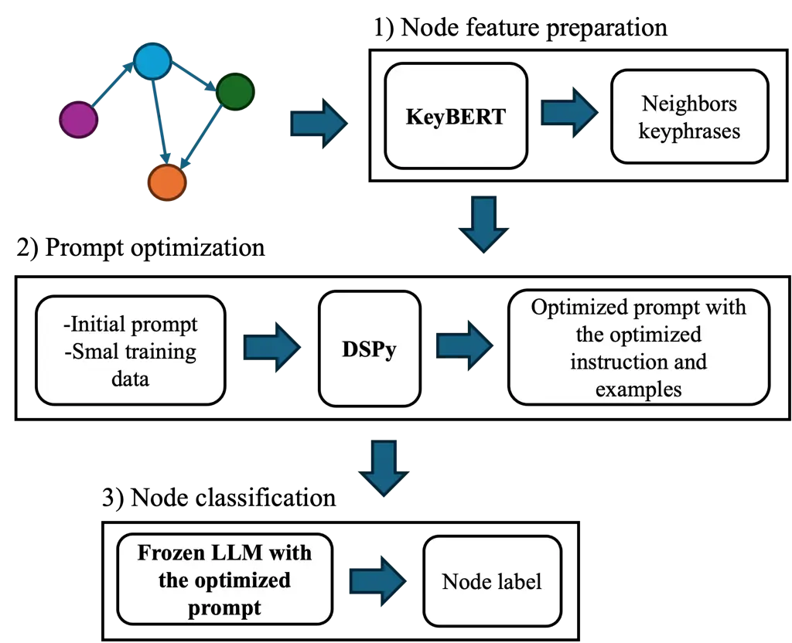
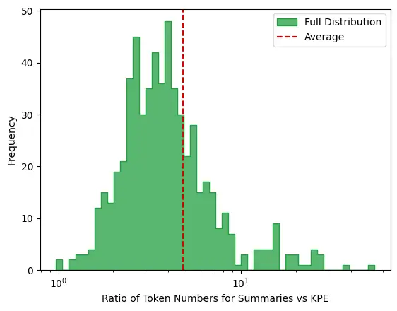

# GraphiT: Efficient Node Classification on Text-Attributed Graphs with Prompt Optimized LLMs

Shima Khoshraftar, Niaz Abedini and Amir Hajian Affiliation: Arteria AI,
Toronto, Canada

© none

###### Abstract.

The application of large language models (LLMs) to graph data has
attracted a lot of attention recently. LLMs allow us to use deep
contextual embeddings from pretrained models in text-attributed graphs,
where shallow embeddings are often used for the text attributes of
nodes. However, it is still challenging to efficiently encode the graph
structure and features into a sequential form for use by LLMs. In
addition, the performance of an LLM alone, is highly dependent on the
structure of the input prompt, which limits their effectiveness as a
reliable approach and often requires iterative manual adjustments that
could be slow, tedious and difficult to replicate programmatically. In
this paper, we propose GraphiT (Graphs in Text), a framework for
encoding graphs into a textual format and optimizing LLM prompts for
graph prediction tasks. Here we focus on node classification for
text-attributed graphs. We encode the graph data for every node and its
neighborhood into a concise text to enable LLMs to better utilize the
information in the graph. We then further programmatically optimize the
LLM prompts using the DSPy framework to automate this step and make it
more efficient and reproducible. GraphiT outperforms our LLM-based
baselines on three datasets and we show how the optimization step in
GraphiT leads to measurably better results without manual prompt
tweaking. We also demonstrated that our graph encoding approach is
competitive to other graph encoding methods while being less expensive
because it uses significantly less tokens for the same task.

###### Keywords: 

Graphs, Large language models, Node classification, DSPy

⁰⁰footnotetext: Corresponding author: shima.khoshraftar@arteria.ai

## 1. Introduction

Graphs are powerful tools for representing entities and the
relationships between them in different applications such as social
networks and citation networks. For instance, in a citation network,
nodes are the articles and there is an edge between two articles if one
article cites another one. In text-attributed graphs, nodes have text
attributes which provide further information about the nodes. In the
citation network described above, the text attributes of a node could be
the content of the associated article. One of the main applications of
graphs is the node classification task in which a model predicts a label
for the nodes in the test set.

Graph Neural Nets (GNNs) (Zhang et al., 2020; Khoshraftar and An, 2024)
are the state of the art in graph representation learning. They
typically generate a node embedding by aggregating the embeddings of
neighbors of the node in a message passing mechanism (Kipf and Welling,
2017; Veličković et al., 2018). GNNs consider the structure and the
attributes of graphs in generating embeddings. The text attributes of
nodes are often represented by shallow embeddings such as bag-of-words
(Katz, 1985) and word2vec (Mikolov, 2013) which can not capture the
contextual relationships between words in text attributes. However,
large language models have demonstrated great success in generating
contextual text embeddings with superior performance than shallow
embeddings in natural language processing (NLP) tasks. The success of
the LLM models is mainly due to their pre-training on a vast amount of
text corpora which gives them massive knowledge and semantic
comprehension capabilities. Hence, many recent efforts have explored
combining LLMs and GNNs (He et al., 2023; Duan et al., 2023; Yu et al.,
2023; Zhu et al., 2024; Xue et al., 2023). While effective, this
combination results in a complex system involving two large models which
increase the computational demands and require labeled training data.

Consequently, other studies focused on evaluating the potential of LLMs
to act as standalone models for both embedding generation and prediction
(Fatemi et al., 2024; Ye et al., 2024; Perozzi et al., 2024; Chen
et al., 2024). These methods employ various techniques for optimizing
LLMs, which can be broadly categorized into prompt engineering (Fatemi
et al., 2024) which relies heavily on manual adjustments or fine-tuning
which require labeled training data (Ye et al., 2024). Additionally,
different approaches are explored for converting graph structures into
sequential formats suitable for LLMs, including using text attributes,
lists of a node’s neighbors (Ye et al., 2024), and neighbor summaries
(Chen et al., 2024) which can lead to increasing the context length of
prompts making the LLM calls more expensive.

In this paper, we investigate the promise and limitations of using LLMs
for the node classification tasks by proposing new approaches for graph
encoding and prompt optimization in terms of instruction and examples
using DSPy framework (Khattab et al., 2023). Specifically, we use a
prompt programming approach which automates the optimization of LLMs for
node classification without extra training, manual tweaks and with a
small set of labeled data. Furthermore, we propose using keyphrases of
neighbor nodes to represent a node, which offer several advantages.
First, keyphrases require significantly less of the LLMs’ context window
while effectively conveying the key points. Second, when neighbor
summaries are lengthy, LLMs may experience the "lost-in-the-middle"
effect (Liu et al., 2024), where critical information representing a
node’s neighbors is overlooked. Lastly, in certain graph applications,
including multi-hop neighbors is essential. However, summarizing such
extended neighborhood information becomes challenging and less
interpretable. By using keyphrases, we can generate concise yet
informative summaries that capture a broader span of information within
the graph. Our main contributions in this paper are as follows:

- •
  We present GraphiT, a novel technique for graph encoding and LLM
  prompt optimization in node classification task.
- •
  GraphiT provides an efficient solution for minimizing the use of LLM
  context window and automating LLM prompt optimization.
- •
  We evaluate the performance of our approach with three baselines on
  three datasets. In addition, we perform ablation studies to show the
  effectiveness of GraphiT components. GraphiT can be easily adapted to
  new tasks and datasets with minimal effort.

## 2. Related works

GNNs are the frontier techniques in the field of graph representation
learning (Zhang et al., 2020; Khoshraftar and An, 2024). However, they
use shallow embeddings to represent text attributes of nodes. Given the
capability of LLMs to generate rich contextual embeddings, several works
have combined LLMs with GNNs to enhance GNN performance (He et al.,
2023; Duan et al., 2023; Yu et al., 2023; Zhu et al., 2024; Xue et al.,
2023). Leading (Xue et al., 2023) employs an end-to-end training of LMs
and GNNs for graph prediction tasks. Engine (Zhu et al., 2024) combines
LLMs and GNNs using a tunable side structure. Despite their
effectiveness, these integrations create complex systems that are often
computationally intensive and require labeled data for training.
Therefore, other studies investigate the possibility of using LLMs alone
for graph prediction tasks. In (Wang et al., 2024), LLMs are utilized
for several graph reasoning tasks such as connectivity, shortest path
and topological sort using two instruction-based prompt engineering
techniques. InstructGLM (Ye et al., 2024) proposes a instruction
fine-tuning method for node classification by LLMs. In (Chen et al.,
2024), LLMs have been used both as enhancer and predictor for node
classification task. It encodes the nodes into text by incorporating
text attributes and 2-hop neighbors summaries. In (Fatemi et al., 2024),
different methods for graph encoding and prompt engineering were
investigated. In (Perozzi et al., 2024), graphs are input to LLMs using
a graph encoder which was trained similar to soft prompting methods
(Lester et al., 2021). Fine-tuning and soft promoting techniques require
training with labeled data. Traditional prompt engineering relies
heavily on human expertise and manual adjustments. In contrast, we
programmatically optimize LLM usage with only a small set of labeled
data. In addition, we efficiently capture the information in a node’s
neighborhood by extracting keyphrases from text attributes of
neighboring nodes.

## 3. Method

### 3.1. Problem definition

Let $`G=(V,E,S)`$ be a text-attributed graph $`G`$ where $`V`$, $`E`$
and $`S`$ represent nodes, edges and text attributes of nodes in the
graph, respectively. For each node $`v_{i}\in V`$, $`s_{i}\in S`$
represents the text attributes of $`v_{i}`$. $`Y`$ is the set of labels
associated with nodes. Our goal is to perform node classification on the
graph using a large language model. In the node classification, a label
is predicted for each node in the graph. Formally, a classifier $`f`$
maps the set of nodes $`V`$ to the set of labels $`Y`$ represented as:
$`f:V\rightarrow Y`$. The core of our approach consists of three main
steps: 1) each node $`v_{i}`$ in the graph is encoded into a sequential
form for use by LLM, 2) an LLM prompt is optimized in terms of
instruction and demonstrative examples. 3) the LLM with the optimized
prompt is utilized to assign a label to each node.



Figure 1. The general framework of GraphiT. First, node features,
including neighbors keyphrases, are extracted for each node in the
graph. Next, a small subset of nodes, along with an initial prompt, are
fed into DSPy to produce an optimized prompt. Finally, node
classification is performed using the optimized prompt.

### 3.2. Node feature preparation

While LLMs have shown remarkable success with textual data, a crucial
question remains: how LLMs can best utilize the information in
structured graph data? (Perozzi et al., 2024). In this study, we use the
homophily assumption in graphs which says connected nodes are similar
(Ciotti et al., 2016) and for each node consider the features of the
1-hop neighbors of a node to help the LLM in predicting the node labels.
For a node $`v_{i}`$ with $`N_{i}=\{v_{0},...,v_{k}\}`$ representing the
set of its 1-hop neighbors, $`v_{0}`$ to $`v_{k}`$, we consider the
following features beside node text attributes.

###### Definition 0.

(Neighbors labels). This set consists of labels of 1-hop neighbors of
node $`v_{i}`$ denoted as $`l_{N_{i}}=\{l_{0},...,l_{k}\}`$.

###### Definition 0.

(Neighbors keyphrases). Let $`s_{N_{i}}=\{s_{0},...,s_{k}\}`$ be a set
consisting of text attributes of 1-hop neighbors of the node. Neighbors
keyphrases denoted by $`p_{N_{i}}=\{p_{0},...,p_{\zeta}\}`$ is a set
containing the $`\zeta`$ keyphrases that are shared among the node’s
neighbors text attributes.

The process for extracting neighbors keyphrases for each node is
detailed in the next section. We apply the keyphrase extraction
algorithm to the concatenation of elements in $`s_{N_{i}}`$.

#### 3.2.1. Keyphrase extraction

Keyphrase extraction (KPE) is an automated process that identifies the
most important words or phrases from a given text. These keyphrases are
useful for various downstream applications, such as document
classification, clustering, summarization, indexing documents, query
expansion, and interactive document retrieval. Various approaches have
been developed for efficient extraction of keyphrases over the past
three decades. See (Papagiannopoulou and Tsoumakas, 2019) and the
references therein for a comprehensive review of well-established
keyphrase extraction methods and (Schopf et al., 2022) for a more recent
approach using semantic extractions. In our current work, we use a
semantic KPE approach that works as follows: first $`n`$-grams are
generated using a count vectorizer using the optimal choice of $`n`$
identified experimentally. The candidate keyphrases are then mapped into
dense representations using Transformer-based contextual embeddings.
Similar keyphrases are identified through an embedding-based semantic
similarity measure and ranked based on their similarity scores to the
input text (Bennani-Smires et al., 2018) using KeyBERT implementation by
(Grootendorst, 2020). The top-ranked candidates are considered the most
relevant keywords/keyphrases for the text. Then a diversity module is
applied to the selected keyphrases to ensure redundancy reduction using
techniques like maximum marginal relevance and max sum similarity
(Bennani-Smires et al., 2018). The final result is a set of most
important keyphrases that encompass the main content of the input text.

An example of node neighbors summary and node neighbors keyphrases is
shown in Table 1. In this example, we see that the keyphrases capture
the main concepts of the neighbors summary in a concise manner.

[TABLE]

Table 1. Example of extracted node neighbors keyphrases compared to the
node neighbors summary for a random node with one neighbor in the Cora
dataset.

### 3.3. Prompt optimization

Considering that the quality of the input prompt to an LLM has a huge
effect on the output of the model, we optimize the LLM prompt for the
node classification both in terms of instruction and examples. In order
to do that, we use the optimization framework of DSPy programming model.
DSPy provides a framework in which we can define our task as a program
and automatically optimize the prompt for the best performance. We will
explain each step in the following sections.

#### 3.3.1. Node classification program

The program for node classification is illustrated in Code Snippet 1.
Given the node features and a set of node labels as options, an LLM
predicts a label for each node. We use the chain of thought technique
(Wei et al., 2022) to let the LLM solve the problem step by step by
breaking down the question into simpler tasks.

1 class NodeClassification(dspy.Module):

2 def \_\_init\_\_(self):

3 self.cot = dspy.ChainOfThought(NodeClassficationSignature)

4

5 def forward(self, NodeFeatures: str, options: list\[str\]) -\>
Prediction:

6 \# Predict with LM

7 output = self.cot(NodeFeatures=NodeFeatures,
options=options).completions.output

8 return dspy.Prediction(predictions=output)

Code Snippet 1: DSPy code for NodeClassification program with minor
alterations for brevity.

#### 3.3.2. Signature

The prompt for the LLM in the node classification program is defined
using a signature abstraction. The signature for node classification on
Cora and PubMed datasets are defined in Code Snippet 2. This signature
contains a task description in a docstring, the node features and a set
of labels as inputs and the predicted output along with description and
formatting information. As we encode the node information into a text
format for use by LLM, we also formulate the node classification task
into a text classification task in the task description and ask the LLM
to classify a given text into the most applicable category. As Cora and
PubMed are citation datasets, the task description specifies that the
text is a scientific paper but this can be adjusted for any new dataset
depending on the dataset graph content.

1 class NodeClassficationSignature(dspy.Signature):

2 \_\_doc\_\_ = f"""Given a snippet from a scientific paper, pick the
most applicable category from the options."""

3

4 NodeFeatures = dspy.InputField(prefix="Paper:")

5 options = dspy.InputField(

6 prefix="Options:",

7 desc="List of comma-separated options to choose from",

8 format=lambda x: ", ".join(x) if isinstance(x, list) else x,

9 )

10 output = dspy.OutputField(

11 prefix="Category:"

12 )

Code Snippet 2: DSPy signature of NodeClassification program for Cora
and PubMed.

#### 3.3.3. Compilation

We optimize the node classification program in terms of instruction and
prediction examples. DSPy compilers handle this optimization
programmatically. For instruction optimization, we use COPRO
(Coordinate-ascent Optimization by Prompting) (Khattab et al., 2023;
Opsahl-Ong et al., 2024), an extension of OPRO approach (Yang et al.,
2023). The OPRO method relies on LLMs to iteratively optimize their own
prompt based on a given problem description. COPRO generalizes OPRO
(Yang et al., 2023) by incorporating a coordinate ascent strategy,
allowing it to be applied to programs with multiple prompts. In this
approach, each prompt is optimized individually while the other
parameters remain fixed. In DSPy, the compiler continuously refines the
program’s instructions based on the LLM’s performance on the validation
set, ultimately converging to a set of optimized instructions tailored
to the task.

Similarly, a set of optimized demonstrative examples are added to the
prompt by an iterative process using bootstrap few-shot random search
approach (Khattab et al., 2023; Opsahl-Ong et al., 2024). In this
process, a prediction is generated for each example within the training
set. Let $`\phi(x)`$ represent the prediction for an example $`x`$,
$`x^{\prime}`$ denote the ground truth, and $`\mu(\phi(x),x^{\prime})`$
be the score of the prediction compared to the ground truth based on a
metric $`\mu`$. If $`\mu(\phi(x),x^{\prime})\geq\lambda`$ where
$`\lambda`$ is a predefined threshold, the prediction is considered
successful. Upon successful prediction, a demonstration comprising the
input to the LLM and the corresponding output is recorded. A
predetermined maximum number of these demonstrations are then
incorporated into the prompt. This process is repeated multiple times
and the most performant demonstrations on the validation set are
selected through random search. We measure the performance of each
program using the rank-precision at top K results (RP@K) and the metric
defined as (D’Oosterlinck et al., 2024):

```math
RP@K=\frac{1}{N}\sum_{n=1}^{N}\frac{1}{min(K,R_{n})}\sum_{k=1}^{K}Rel(n,k) \tag{1}
```

where $`R_{n}`$ is the set of labels for a node $`n`$, $`Rel(n,k)`$ is
$`1`$ if the $`k`$-th predicted label for node $`n`$ is relevant and
otherwise is $`0`$. $`N`$ is the total number of nodes in the set.

|                                |       |        |            |     |
| ------------------------------ | ----- | ------ | ---------- | --- |
| Method                         | Cora  | PubMed | Ogbn-arxiv |     |
| Vanilla                        | 74.49 | 87.56  | 49.5       |     |
| Chen et al (Chen et al., 2024) | 74    | 90.75  | 55         |     |
| GraphiT                        | 79.84 | 93.28  | 57.25      |     |
| GCN (Kipf and Welling, 2017)   | 82.20 | 81.01  | 73.10      |     |

Table 2. The node classification results in terms of accuracy

| Dataset    | Graph info                                                | Vanilla | GraphiT |
| ---------- | --------------------------------------------------------- | ------- | ------- |
| Cora       | Text attributes                                           | 57.65   | 59.18   |
|            | Text attributes + Neighbors labels                        | 71.68   | 78.31   |
|            | Text attributes + Neighbors labels + Neighbors summary    | 72.19   | 80.1    |
|            | Text attributes + Neighbors labels + Neighbors keyphrases | 74.49   | 79.84   |
| PubMed     | Text attributes                                           | 89.55   | 93.03   |
|            | Text attributes + Neighbors labels                        | 87.06   | 90.54   |
|            | Text attributes + Neighbors labels + Neighbors summary    | 87.31   | 92.78   |
|            | Text attributes + Neighbors labels + Neighbors keyphrases | 87.56   | 93.28   |
| Ogbn-arxiv | Text attributes                                           | 40      | 45.25   |
|            | Text attributes + Neighbors labels                        | 49.75   | 55      |
|            | Text attributes + Neighbors labels + Neighbors summary    | 49      | 58.5    |
|            | Text attributes + Neighbors labels + Neighbors keyphrases | 49.5    | 57.25   |

Table 3. Node classification results from our experiments with different
node encoding techniques for GraphiT and a Vanilla LLM.

## 4. Experiments

### 4.1. Datasets

We evaluated GraphiT was on three public datasets: Cora, PubMed and
Ogbn-arxiv. Cora  (He et al., 2023) is a citation network where each
node is an article and each edge indicates a citation relationship
between two articles. Number of nodes and edges are 2708 and 5429. Each
node belongs to one of the 7 classes: case based, genetic algorithms,
neural networks, probabilistic methods, reinforcement learning, rule
learning, and theory. Each node is associated with a text attribute
containing the title and the abstract of the article. Similarly, PubMed
 (He et al., 2023) is a citation network with 19k nodes and 44k edges.
Each node in the dataset has one of the three labels: experimental
induced diabetes, type 1 diabetes, and type 2 diabetes. The text
attributes of nodes in PubMed are similar to Cora. Ogbn-arxiv (Hu
et al., 2020) is also a citation networks between all Computer Science
arxiv papers containing 169k nodes, 1M edges and 40 subject areas.

### 4.2. Settings

Similar to  (Chen et al., 2024), we randomly selected 200 nodes from the
test set of each dataset as our test data. The reported scores are
averaged over two sampled test sets. Our evaluation metric is $`RP@1`$
which is equivalent to accuracy in our experiments. The LLM that we used
was gpt-3.5-turbo-1106. We used BootstrapFewShotWithRandomSearch and
COPRO compilers from DSPy. The length of ngrams in the keyphrase
extraction step is set to $`ngram\in\{1,2,3\}`$ and we set $`\zeta=5`$.
The nodes neighbors summaries are generated using the quantized version
of the Phi 3.5 model (et al, 2024; quantized model, \[n. d.\]) by
llama.cpp (Gerganov, 2023).

### 4.3. Node classification

We evaluate the performance of GraphiT compared to three baselines on
three datasets. Each node in the graph is encoded by integrating the
node’s neighbors’ keyphrases with its text attributes and the labels of
its neighbors. Without the loss of generality, for prompt optimization,
we generate small training and validation sets by randomly sampling 3
and 2 nodes per class from training and validation sets of Cora dataset.
Then, we use the optimized programs for inference on arbitrarily large
test sets.

Table 2 presents the node classification results from GraphiT, the
result from the vanilla LLM using the same graph encoding, the best
results from an unoptimized few-shot learning approach using LLMs by
Chen et al (Chen et al., 2024) and a graph convolutional network (GCN)
result (Kipf and Welling, 2017) obtained from (Chen et al., 2024). We
were able to compare with the methods reported in (Chen et al., 2024) as
they used the same number of nodes in the test sets for each dataset as
us and were designed for the node classification task. GraphiT
outperforms the results by the LLM-based models on all three datasets.
It also achieves superior performance on PubMed compared to GCN.
However, GraphiT falls short of the performance by GCN on Cora and
Ogbn-arxiv datasets. This could be because GCN captures information from
2-hop neighbors for each node, which is useful for node classification
on those datasets. Exploring the incorporation of neighbors beyond 1-hop
in GraphiT will be one of our future research directions.

### 4.4. Ablation study

We investigate the effects of different components of GraphiT across
three dataset. One major component of our model is the node neighbors
keyphrases. We consider four settings to encode nodes into a sequence
format, beginning with only the text attributes of the nodes and
progressively incorporating additional features through concatenation.
Table 3 shows the results of the node classification for GraphiT in four
settings. For all the datasets, incorporating neighbors keyphrases
alongside the text attributes and neighbors labels enhances performance.
Moreover, this approach has a comparable or better results compared to
using neighbor summaries while significantly reducing the context length
in the LLM prompt. In Table 3, we also have the node classification
results from Vanilla LLM across the four settings. Using neighbors
keyphrases has a similar effects on Vanilla LLM. Additionally, we can
see that GraphiT consistently outperforms the Vanilla method across all
node encoding techniques.

### 4.5. Cost comparison of using neighbors keyphrases versus summary

In Figure 2, we present a histogram depicting the ratio of the number of
tokens in neighbors summary to those in neighbors keyphrases for all
datasets combined. The figure indicates that the average number of
tokens resulting from the KPE approach on the node neighbors text is a
few times smaller that the ones from the summarization method. As a
result, leveraging keyphrases leads to lower LLM API costs while still
delivering competitive results compared to the summarization approach,
as shown in Table 3. In addition, for the KPE method, we use small
encoder models for the generation of embeddings which is fast and
lightweight, easily suitable for running on ordinary CPUs of today’s
laptops (Reimers and Gurevych, 2019).



Figure 2. Histogram of the ratio of the number of tokens for summaries
to those obtained from the KPE approach. The KPE method applied to the
node neighbors results in significantly less tokens compared to the
summarization method with minimal impact on the quality of the
classification results. This reduction translates to lower LLM API costs
by making the input context length considerably shorter.

## 5. Conclusions

Our paper focuses on graph encoding and LLM optimization for the node
classification task on text-attributed graphs. We demonstrate that the
information in the nodes neighborhood is efficiently represented by the
right choice of keyphrases. In addition, we optimize the LLM prompt
automatically by refining instructions and adding demonstrative examples
to the prompt leveraging the DSPy optimization framework. We compare the
performance of our approach, GraphiT, with three baselines across three
public datasets. The results demonstrate that our approach has a better
performance compared to other models that are based on LLM models in all
experiments. While promising for optimizing LLMs in the node
classification task, GraphiT falls short of the GNNs performance on two
datasets, highlighting a key area for our future research. Strategies
like incorporating more neighborhood information for a node and
integrating LLMs with GNNs could help bridge this performance gap.
Furthermore, we will extend our approach to other graph prediction
tasks, including link prediction.

## References

- Bennani-Smires et al. (2018) Kamil Bennani-Smires, Claudiu Musat,
  Martin Jaggi, Andreea Hossmann, and Michael Baeriswyl. 2018.
  EmbedRank: Unsupervised Keyphrase Extraction using Sentence
  Embeddings. _CoRR_ abs/1801.04470 (2018). arXiv:1801.04470
  [http://arxiv.org/abs/1801.04470](http://arxiv.org/abs/1801.04470)
- Chen et al. (2024) Zhikai Chen, Haitao Mao, Hang Li, Wei Jin, Hongzhi
  Wen, Xiaochi Wei, Shuaiqiang Wang, Dawei Yin, Wenqi Fan, Hui Liu,
  et al. 2024. Exploring the potential of large language models (llms)
  in learning on graphs. _ACM SIGKDD Explorations Newsletter_ 25, 2
  (2024), 42–61.
- Ciotti et al. (2016) Valerio Ciotti, Moreno Bonaventura, Vincenzo
  Nicosia, Pietro Panzarasa, and Vito Latora. 2016. Homophily and
  missing links in citation networks. _EPJ Data Science_ 5 (2016), 1–14.
- D’Oosterlinck et al. (2024) Karel D’Oosterlinck, Omar Khattab,
  François Remy, Thomas Demeester, Chris Develder, and Christopher
  Potts. 2024. In-context learning for extreme multi-label
  classification. _arXiv preprint arXiv:2401.12178_ (2024).
- Duan et al. (2023) K Duan, Q Liu, TS Chua, S Yan, WT Ooi, Q Xie, and
  J Simteg He. 2023. A frustratingly simple approach improves textual
  graph learning. _arXiv preprint arXiv:2308.02565_ (2023).
- et al (2024) Marah Abdin et al. 2024. Phi-3 Technical Report: A Highly
  Capable Language Model Locally on Your Phone.
  arXiv:2404.14219 \[cs.CL\]
  [https://arxiv.org/abs/2404.14219](https://arxiv.org/abs/2404.14219)
- Fatemi et al. (2024) Bahare Fatemi, Jonathan Halcrow, and Bryan
  Perozzi. 2024. Talk like a Graph: Encoding Graphs for Large Language
  Models. In _The Twelfth International Conference on Learning
  Representations_.
- Gerganov (2023) Georgi Gerganov. 2023. llama.cpp: LLM inference in
  C/C++.
  [https://github.com/ggerganov/llama.cpp](https://github.com/ggerganov/llama.cpp).
- Grootendorst (2020) Maarten Grootendorst. 2020. KeyBERT: Minimal
  keyword extraction with BERT.
  [doi:10.5281/zenodo.4461265](https://doi.org/10.5281/zenodo.4461265)
- He et al. (2023) Xiaoxin He, Xavier Bresson, Thomas Laurent, Adam
  Perold, Yann LeCun, and Bryan Hooi. 2023. Harnessing explanations:
  Llm-to-lm interpreter for enhanced text-attributed graph
  representation learning. _arXiv preprint arXiv:2305.19523_ (2023).
- Hu et al. (2020) Weihua Hu, Matthias Fey, Marinka Zitnik, Yuxiao Dong,
  Hongyu Ren, Bowen Liu, Michele Catasta, and Jure Leskovec. 2020. Open
  graph benchmark: Datasets for machine learning on graphs. _Advances in
  neural information processing systems_ 33 (2020), 22118–22133.
- Katz (1985) Jerrold J Katz. 1985. The philosophy of linguistics.
  (1985).
- Khattab et al. (2023) Omar Khattab, Arnav Singhvi, Paridhi Maheshwari,
  Zhiyuan Zhang, Keshav Santhanam, Sri Vardhamanan, Saiful Haq, Ashutosh
  Sharma, Thomas T Joshi, Hanna Moazam, et al. 2023. DSPy: Compiling
  declarative language model calls into self-improving pipelines. _arXiv
  preprint arXiv:2310.03714_ (2023).
- Khoshraftar and An (2024) Shima Khoshraftar and Aijun An. 2024. A
  survey on graph representation learning methods. _ACM Transactions on
  Intelligent Systems and Technology_ 15, 1 (2024), 1–55.
- Kipf and Welling (2017) Thomas N Kipf and Max Welling. 2017.
  Semi-supervised classification with graph convolutional networks.
  _International Conference on Learning Representations_ (2017).
- Lester et al. (2021) Brian Lester, Rami Al-Rfou, and Noah
  Constant. 2021. The Power of Scale for Parameter-Efficient Prompt
  Tuning. In _Proceedings of the 2021 Conference on Empirical Methods in
  Natural Language Processing_. 3045–3059.
- Liu et al. (2024) Nelson F Liu, Kevin Lin, John Hewitt, Ashwin
  Paranjape, Michele Bevilacqua, Fabio Petroni, and Percy Liang. 2024.
  Lost in the middle: How language models use long contexts.
  _Transactions of the Association for Computational Linguistics_ 12
  (2024), 157–173.
- Mikolov (2013) Tomas Mikolov. 2013. Efficient estimation of word
  representations in vector space. _arXiv preprint arXiv:1301.3781_
  (2013).
- Opsahl-Ong et al. (2024) Krista Opsahl-Ong, Michael J Ryan, Josh
  Purtell, David Broman, Christopher Potts, Matei Zaharia, and Omar
  Khattab. 2024. Optimizing Instructions and Demonstrations for
  Multi-Stage Language Model Programs. _arXiv preprint arXiv:2406.11695_
  (2024).
- Papagiannopoulou and Tsoumakas (2019) Eirini Papagiannopoulou and
  Grigorios Tsoumakas. 2019. A review of keyphrase extraction. _Wiley
  Interdisciplinary Reviews: Data Mining and Knowledge Discovery_ 10
  (2019).
  [https://api.semanticscholar.org/CorpusID:152282295](https://api.semanticscholar.org/CorpusID:152282295)
- Perozzi et al. (2024) Bryan Perozzi, Bahare Fatemi, Dustin Zelle,
  Anton Tsitsulin, Mehran Kazemi, Rami Al-Rfou, and Jonathan
  Halcrow. 2024. Let your graph do the talking: Encoding structured data
  for llms. _arXiv preprint arXiv:2402.05862_ (2024).
- quantized model (\[n. d.\]) Phi-3 quantized model. \[n. d.\].
  [https://huggingface.co/bartowski/Phi-3.5-mini-instruct-GGUF](https://huggingface.co/bartowski/Phi-3.5-mini-instruct-GGUF),.
- Reimers and Gurevych (2019) Nils Reimers and Iryna Gurevych. 2019.
  Sentence-BERT: Sentence Embeddings using Siamese BERT-Networks. In
  _Proceedings of the 2019 Conference on Empirical Methods in Natural
  Language Processing_. Association for Computational Linguistics.
  [https://arxiv.org/abs/1908.10084](https://arxiv.org/abs/1908.10084)
- Schopf et al. (2022) Tim Schopf, Simon Klimek, and Florian
  Matthes. 2022. PatternRank: Leveraging Pretrained Language Models and
  Part of Speech for Unsupervised Keyphrase Extraction. _ArXiv_
  abs/2210.05245 (2022).
  [https://api.semanticscholar.org/CorpusID:252815417](https://api.semanticscholar.org/CorpusID:252815417)
- Veličković et al. (2018) Petar Veličković, Guillem Cucurull, Arantxa
  Casanova, Adriana Romero, Pietro Liò, and Yoshua Bengio. 2018. Graph
  Attention Networks. In _International Conference on Learning
  Representations_.
- Wang et al. (2024) Heng Wang, Shangbin Feng, Tianxing He, Zhaoxuan
  Tan, Xiaochuang Han, and Yulia Tsvetkov. 2024. Can language models
  solve graph problems in natural language? _Advances in Neural
  Information Processing Systems_ 36 (2024).
- Wei et al. (2022) Jason Wei, Xuezhi Wang, Dale Schuurmans, Maarten
  Bosma, Fei Xia, Ed Chi, Quoc V Le, Denny Zhou, et al. 2022.
  Chain-of-thought prompting elicits reasoning in large language models.
  _Advances in neural information processing systems_ 35 (2022),
  24824–24837.
- Xue et al. (2023) Rui Xue, Xipeng Shen, Ruozhou Yu, and Xiaorui
  Liu. 2023. Efficient large language models fine-tuning on graphs.
  _arXiv preprint arXiv:2312.04737_ (2023).
- Yang et al. (2023) Chengrun Yang, Xuezhi Wang, Yifeng Lu, Hanxiao Liu,
  Quoc V Le, Denny Zhou, and Xinyun Chen. 2023. Large language models as
  optimizers. _arXiv preprint arXiv:2309.03409_ (2023).
- Ye et al. (2024) Ruosong Ye, Caiqi Zhang, Runhui Wang, Shuyuan Xu, and
  Yongfeng Zhang. 2024. Language is all a graph needs. In _Findings of
  the Association for Computational Linguistics: EACL 2024_. 1955–1973.
- Yu et al. (2023) Jianxiang Yu, Yuxiang Ren, Chenghua Gong, Jiaqi Tan,
  Xiang Li, and Xuecang Zhang. 2023. Empower text-attributed graphs
  learning with large language models (llms). _arXiv preprint
  arXiv:2310.09872_ (2023).
- Zhang et al. (2020) Ziwei Zhang, Peng Cui, and Wenwu Zhu. 2020. Deep
  learning on graphs: A survey. _IEEE Transactions on Knowledge and Data
  Engineering_ 34, 1 (2020), 249–270.
- Zhu et al. (2024) Yun Zhu, Yaoke Wang, Haizhou Shi, and Siliang
  Tang. 2024. Efficient tuning and inference for large language models
  on textual graphs. _arXiv preprint arXiv:2401.15569_ (2024).
