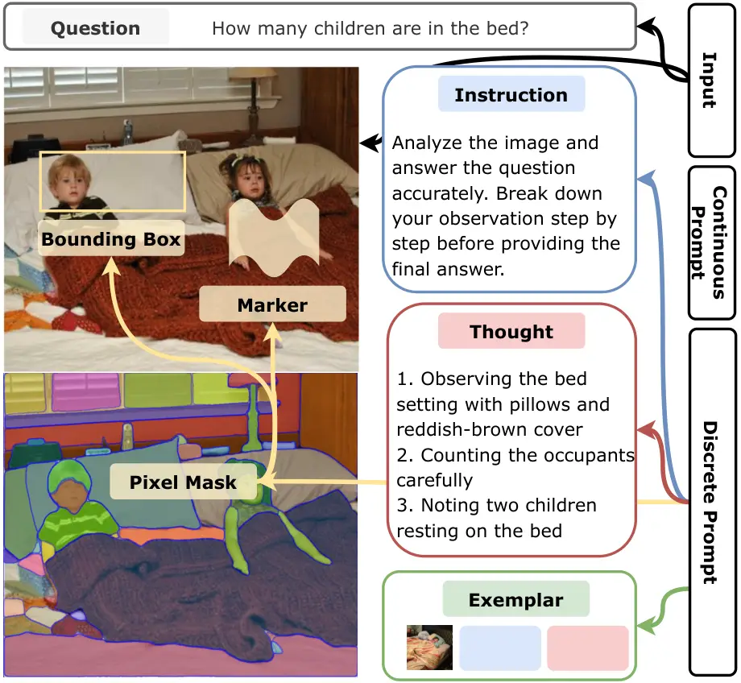
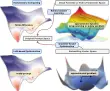

# A Survey of Automatic Prompt Engineering: An Optimization Perspective

Wenwu Li Affiliation: School of Computer Science and Technology, Tongji
University    Xiangfeng Wang Affiliation: School of Computer Science and
Technology, East China Normal University Affiliation: Key Laboratory of
Mathematics and Engineering Applications, MoE, East China Normal
University    Wenhao Li ^(†)^(†)thanks: whli@tongji.edu.cn
Affiliation: School of Computer Science and Technology, Tongji
University    Bo Jin ^(†)^(†)thanks: bjin@tongji.edu.cn
Affiliation: School of Computer Science and Technology, Tongji
University Affiliation: Shanghai Research Institute for Intelligent
Autonomous Systems, Tongji University

###### Abstract

The rise of foundation models has shifted focus from resource-intensive
fine-tuning to prompt engineering, a paradigm that steers model behavior
through input design rather than weight updates. While manual prompt
engineering faces limitations in scalability, adaptability, and
cross-modal alignment, automated methods, spanning foundation model (FM)
based optimization, evolutionary methods, gradient-based optimization,
and reinforcement learning, offer promising solutions. Existing surveys,
however, remain fragmented across modalities and methodologies. This
paper presents the first comprehensive survey on automated prompt
engineering through a unified optimization-theoretic lens. We formalize
prompt optimization as a maximization problem over discrete, continuous,
and hybrid prompt spaces, systematically organizing methods by their
optimization variables (instructions, soft prompts, exemplars),
task-specific objectives, and computational frameworks. By bridging
theoretical formulation with practical implementations across text,
vision, and multimodal domains, this survey establishes a foundational
framework for both researchers and practitioners, while highlighting
underexplored frontiers in constrained optimization and agent-oriented
prompt design.

## 1 Introduction

The transformative impact of pre-trained foundation models (FMs, e.g.,
large language models, LLMs or vision language models, VLMs) has
revolutionized natural language processing and visual understanding,
enabling unprecedented capabilities in complex cognitive tasks ranging
from mathematical reasoning to multi-agent collaboration
systems \[XCG+25\]. As model scales escalate into the trillions of
parameters, conventional fine-tuning approaches face prohibitive
computational barriers. This resource intensiveness fundamentally
restricts FM deployment in real-world applications, particularly for
edge devices and time-sensitive scenarios like autonomous vehicle
decision-making or real-time medical diagnosis.

Several efficiency-focused approaches have emerged including
parameter-efficient fine-tuning, model distillation, sparse training,
and dynamic architecture methods \[WWL+24\]. While these reduce
computational demands to varying degrees, they maintain dependency on
parameter updates requiring substantial training data and
backpropagation mechanics. This proves particularly limiting in
scenarios demanding rapid adaptation - such as financial fraud detection
systems needing hourly model updates, or medical applications where
patient data privacy prohibits retraining. Prompt engineering
circumvents these constraints through a paradigm shift: rather than
modifying neural weights, it reprograms FM behavior via strategic input
design \[SSS+24, Ama24, VD24\].

Manual prompt engineering has demonstrated remarkable generalizability
through techniques like Chain-of-Thought (CoT) and few-shot exemplar
selection \[AJSK24\]. However, its practical adoption faces fundamental
limitations: 1) expert dependency requiring laborious
trial-and-error \[SSS+24\]; 2) input format sensitivity where minor
syntactic variations (e.g., punctuation changes or instruction phrasing)
yield performance fluctuations \[SCTS24\], and 3) static design unable
to adapt to evolving inputs like shifting social media discourse
patterns \[ZMH+22\]. These limitations intensify in multimodal systems
where manual prompting must resolve cross-modal alignment challenges -
for instance, ensuring visual grounding accuracy in vision language
models (VLMs) requires precise coordination between image region
descriptors and textual queries that humans often misalign \[GHC+23\].

Automated prompt optimization addresses these limitations through
systematic exploration of combinatorial prompt spaces using evolutionary
strategies that mutate token sequences through genetic operations,
reinforcement learning (RL) that treat prompts as differentiable
policies, and meta-learning approaches that adapt prompts through
gradient-based hyperparameter optimization. Crucially, these methods
demonstrate emergent capabilities surpassing human design, such as
automatically discovering prompts that balance multiple
objectives \[MRK25\] or adaptively reconfigure based on real-time
feedback in robotics control systems \[MLW+24\].

Existing surveys remain fragmented across methodological and modal
boundaries. While foundational works establish prompt-based learning
theory \[LYF+23\] and multimodal applications \[GHC+23\], specialized
reviews focus on compression techniques \[LLSC24\] or manual design
patterns \[SSS+24, Ama24, VD24\]. Though \[CXW+24\] addresses efficiency
aspects, no comprehensive treatment exists for automated prompt
engineering across modalities.

Figure 1: A unified optimization framework for the automated prompt
engineering.

Our work establishes the first unified optimization theoretic framework
(Figure 1) for automated prompt engineering across modalities. We
formalize the problem as maximizing expected performance metrics over
discrete, continuous, and hybrid prompt spaces (Section 3), where
different variable types (hard instructions, soft prompts, few-shot
exemplars and mixed variables) correspond to specific optimization
subproblems. This survey systematically organizes existing methods
through this lens: (1) Optimization Spaces (Section 4) categorize prompt
elements across text, vision, and multimodal domains; (2) Objective
Functions (Section 5) characterize various task categories with
mathematical instantiations of performance metrics and constraints; (3)
Optimization Methods (Section 6) classify techniques into representative
computational paradigms (FM-based, evolutionary, gradient-based, and
RL). This unified view not only helps explain the effectiveness of
existing methods but also establishes a rigorous foundation for
developing more sophisticated automated prompt engineering algorithms,
bridging the gap between theoretical understanding and practical
implementation while identifying underexplored research frontiers.

## 2 Related Work

Prompt engineering has rapidly gained prominence as an essential method
for enhancing the capabilities of FMs across diverse tasks. Several
surveys have contributed to this domain by examining specific facets of
prompt-based learning. For instance, \[LYF+23\] position prompt
engineering within the broader context of natural language processing
(NLP), emphasizing how textual prompts differ from traditional
supervised training. Similarly, \[VD24\] and \[SSS+24\] each provide
comprehensive overviews of prompt methods (ranging from meticulously
crafted natural language instructions to learned vectors), detailing
their performance across various NLP benchmarks. Meanwhile, \[Ama24\]
explore more advanced prompt-based mechanisms such as CoT and Reflection
and examine toolkits like LangChain and Semantic Kernel.

In addition to these foundational surveys, domain- and
technique-specific works have emerged. \[LLSC24\] focus on prompt
compression methods, exploring both hard and soft approaches and
illustrating the ways in which compression can streamline model
performance without sacrificing accuracy. \[GHC+23\] expand these ideas
to vision-language models, distinguishing between multimodal-to-text
generation, image-text matching, and text-to-image generation. They
investigate how prompting strategies differ in multimodal settings
compared to purely textual ones. Thus, these surveys collectively
delineate a growing research landscape that spans multiple model types,
task formats, and optimization considerations.

Yet, while these works are individually valuable, they remain fragmented
by methodological or modal boundaries. \[CXW+24\] specifically address
efficiency aspects, but no comprehensive resource unifies the
theoretical underpinnings across discrete, continuous, and hybrid prompt
spaces. Existing surveys either concentrate on foundational
theories \[LYF+23, GHC+23\], explore a narrowly defined technique such
as compression \[LLSC24\], or focus on manual design patterns \[SSS+24,
VD24\]. This compartmentalization leaves open questions about how to
systematically organize prompt components, objectives, and optimization
strategies under a cohesive theoretical framework.

Our survey bridges this gap by introducing a unified,
optimization-theoretic perspective on automated prompt engineering
across modalities. Unlike prior works that center on specific tasks,
prompt types, or efficiency improvements, we formulate prompt
engineering as an overarching optimization problem that seeks to
maximize task-specific performance metrics for discrete (hard and
exampler), continuous (soft), and mixed prompts. Our taxonomy spans
variables, objective functions, and optimization methods, clarifying
best practices and underscoring promising directions for future
research. In doing so, we provide researchers and practitioners with a
rigorous foundation for advancing automated prompt engineering,
synthesizing the diverse strands of existing studies into a single,
cohesive framework.

## 3 Optimization Problem Formulation

This paper studies the prompt optimization problem for foundation
models, including both LLMs and VLMs. Let $`\mathcal{X}`$ denote the
input space and $`\mathcal{Y}`$ denote the output space. For LLMs,
$`\mathcal{X}`$ represents text inputs, while for VLMs,
$`\mathcal{X}=\mathcal{X}_{v}\times\mathcal{X}_{t}`$ represents
image-text pairs, where $`\mathcal{X}_{v}`$ denotes the visual space and
$`\mathcal{X}_{t}`$ denotes the text space. A prompt function
$`P:\mathcal{X}\rightarrow\mathcal{P}`$ maps input queries to a
conditioning pattern that elicits specific model behaviors. The prompt
space $`\mathcal{P}`$ can be partitioned into three subspaces: the
discrete prompt space $`\mathcal{P}_{d}`$, the continuous prompt space
$`\mathcal{P}_{c}`$, and the hybrid prompt space
$`\mathcal{P}_{h}=\mathcal{P}_{d}\times\mathcal{P}_{c}`$.

For $`P\in\mathcal{P}_{d}`$, we consider different canonical forms based
on model type. In LLMs, the zero-shot form is expressed as
$`P(x)=\left[I,T;x\right]`$, where $`I,T\in\mathcal{V}^{*}`$ denotes a
learnable instruction and thought sequence from vocabulary space
$`\mathcal{V}`$ respectively, and $`\mathcal{V}^{*}`$ represents the set
of all possible sequences over $`\mathcal{V}`$. The few-shot form
$`P(x)=\left[I,T,e_{1},\ldots,e_{k};x\right]`$, where
$`\{e_{i}\in\mathcal{E}\}_{i=1}^{k}`$ are $`k`$ learnable exemplars from
space $`\mathcal{E}`$. Each exemplar $`e_{i}=(x_{i}^{e},y_{i}^{e})`$
consists of an I/O pair where $`x_{i}^{e}\in\mathcal{X}`$ and
$`y_{i}^{e}\in\mathcal{Y}`$.

In VLMs, besides inheriting all prompt forms from LLMs, the spatial
annotation form takes a general expression
$`P(x)=\left[I,T,R_{1},\ldots,R_{m};x\right]`$, where
$`\{R_{i}\in\mathcal{R}\}_{i=1}^{m}`$ are spatial regions from a general
region space $`\mathcal{R}`$. Each region $`R_{i}=(A_{i},l_{i})`$
consists of an area specification $`A_{i}\in\mathcal{A}`$ and a label
$`l_{i}\in\mathcal{L}`$, where $`\mathcal{A}`$ is a general area
specification space that can represent various forms including but not
limited to: 1) bounding boxes: $`A_{i}\in[0,1]^{4}`$ representing
normalized coordinates; 2) markers: $`A_{i}\in[0,1]^{3}`$ representing
center coordinates and radius; 3) pixel masks:
$`A_{i}\in\{0,1\}^{H\times W}`$ representing binary masks; and 4) other
region specifications (e.g., polygons, curves).

For $`P\in\mathcal{P}_{c}`$, the prompt takes a unified form:

```math
P(e_{x})=\left[\theta_{1},\ldots,\theta_{m};e_{x}\right], \tag{1}
```

where $`e_{x}=\text{Embed}(x)\in\mathbb{R}^{d}`$ is the embedding
representation of input $`x`$ through an embedding function
$`\text{Embed}:\mathcal{X}\rightarrow\mathbb{R}^{d}`$, and
$`\{\theta_{i}\in\mathbb{R}^{d}\}_{i=1}^{m}`$ are $`m`$ learnable
vectors in the $`d`$-dimensional embedding space. For
$`P\in\mathcal{P}_{h}`$, the prompt combines both discrete and
continuous elements:

```math
P(x,e_{x})=\left[I,T,R_{1},\ldots,R_{k},\theta_{1},\ldots,\theta_{m};x\right], \tag{2}
```

allowing joint optimization of discrete regions and continuous
embeddings.

| Symbol                       | Space                                                  | Definition                                    |
| ---------------------------- | ------------------------------------------------------ | --------------------------------------------- |
| $`x`$                        | $`\mathcal{X}=\mathcal{X}_{v}\times\mathcal{X}_{t}`$   | Input query (text or image-text pair)         |
| $`y`$                        | $`\mathcal{Y}`$                                        | Output response                               |
| $`\mathcal{V}`$              | \-                                                     | Vocabulary of tokens                          |
| $`I`$                        | $`\mathcal{V}^{*}`$                                    | Instruction sequence                          |
| $`T`$                        | $`\mathcal{V}^{*}`$                                    | Thought sequence                              |
| $`e_{i}`$                    | $`\mathcal{E}=\mathcal{X}\times\mathcal{Y}`$           | Text exemplar (input-output pair)             |
| $`\mathcal{R}`$              | \-                                                     | General region space                          |
| $`A_{i}`$                    | $`\mathcal{A}`$                                        | Area specification (box/marker/mask/etc.)     |
| $`R_{i}`$                    | $`\mathcal{R}=\mathcal{A}\times\mathcal{L}`$           | Spatial region with label                     |
| $`\theta_{i}`$               | $`\mathbb{R}^{d}`$                                     | Learnable prompt vector                       |
| $`e_{x}`$                    | $`\mathbb{R}^{d}`$                                     | Input embedding                               |
| $`P`$                        | $`\mathcal{P}=\mathcal{P}_{d}\cup\mathcal{P}_{c}`$     | Prompt function                               |
| $`\mathcal{P}_{d}`$          | $`\mathcal{P}_{d}^{t}\times\mathcal{P}_{d}^{v}`$       | Discrete prompt space                         |
| $`\mathcal{P}_{c}`$          | \-                                                     | Continuous prompt space                       |
| $`\mathcal{P}_{h}`$          | $`\mathcal{P}_{d}\times\mathcal{P}_{c}`$               | Hybrid prompt space                           |
| $`f`$                        | $`\mathcal{P}\times\mathcal{X}\rightarrow\mathcal{Y}`$ | Foundation model                              |
| $`g`$                        | $`\mathcal{Y}\times\mathcal{Y}\rightarrow\mathbb{R}`$  | Performance metric                            |
| $`\mathcal{D}_{\text{val}}`$ | $`(\mathcal{X}\times\mathcal{Y})^{n_{\text{val}}}`$    | Validation dataset of size $`n_{\text{val}}`$ |

Table 1: Summary of Mathematical Notation

Given a black-box foundation model
$`f:\mathcal{P}\times\mathcal{X}\rightarrow\mathcal{Y}`$ and a
validation set
$`\mathcal{D}_{\text{val}}=\{(x_{i},y_{i})\}_{i=1}^{n_{\text{val}}}`$ of
size $`n_{\text{val}}`$, the prompt optimization problem can be
formulated as:

```math
\displaystyle P^{*}= \displaystyle\underset{P\in\mathcal{P}}{\arg\max} \displaystyle\mathbb{E}_{(x,y)\sim\mathcal{D}_{\text{val}}}[g(f(P(x)),y)] \tag{3}
```

```math
\displaystyle\text{subject to} \displaystyle P\in\mathcal{P}_{d}\text{ or }P\in\mathcal{P}_{c}\text{ or }P\in\mathcal{P}_{h},
```

where $`g:\mathcal{Y}\times\mathcal{Y}\rightarrow\mathbb{R}`$ denotes a
performance metric measuring the quality of model predictions against
ground truth. This formulation leads to $`3`$ subclasses of problems:

```math
\max_{P\in\mathcal{P}_{\star}}\mathbb{E}_{(x,y)}\left[g(f(P(\triangle)),y)\right],\begin{cases}\star=d,\triangle=x,&\text{(DPO)}\\
\star=c,\triangle=e_{x},&\text{(CPO)}\\
\star=h,\triangle=(x,e_{x}),&\text{(HPO)}\end{cases}
```

where DPO, CPO, and HPO denote discrete, continuous, and hybrid prompt
optimization respectively. Solutions for all cases are discussed in
subsequent sections.

## 4 Optimization Spaces

Building upon formulation in Section 3, we systematically analyze the
$`3`$ fundamental variable types in prompt optimization: discrete
($`\mathcal{P}_{d}`$), continuous ($`\mathcal{P}_{c}`$), and hybrid
combinations ($`\mathcal{P}_{h}`$) (Figure 2). This taxonomy enables
principled analysis of automated prompt engineering across modalities.



Figure 2: A prompt example for the visual question-answering task.

### 4.1 Discrete Variables

Discrete prompt optimization operates in $`\mathcal{P}_{d}`$ space,
manipulating human-interpretable elements through combinatorial search.
We identify three principal variable subtypes:

#### Instructions

Instruction variables ($`I\in\mathcal{V}^{*}`$) specify task objectives
through natural language directives (e.g., “Translate to French”). Their
optimization centers on generating concise yet precise directives to
elicit strong model performance. Representative approaches
generate \[HSYD23, YWL+24, WLW+24\], mutate \[YWL+24\]\[GWG+23\] or
refine \[SRLI+20, PI+23, GWG+23, KHZ+24, KKK+24, DW+22, HSY+24\]
instructions via gradient-inspired edits, GA, or RL to systematically
improve task accuracy. This classification can be further extended to
multimodal prompts, with representative approaches including *generate* 
\[KSL+23\], *mutate*  \[HCDW24, OS24\] or *refine*  \[MA+24, YPO+24,
MLY+24, WHS+24, RLH23, MZB+24\], which play a crucial role in optimizing
accuracy and ensuring consistency in generated image quality.

#### Thoughts

Thought variables ($`T\in\mathcal{V}^{*}`$) implement chain-of-reasoning
through intermediate reasoning steps. By decomposing large problems into
smaller subproblems, CoT guidance can substantially boost solution
correctness when automatically generated or refined. These approaches
enhance the precision and flexibility of CoT reasoning, enabling models
to better handle complex tasks. Representative methods include
*feedkback* \[PZ+23, CAH+24, CK+24\], which uses self or external
feedback to refine reasoning, and *interaction* \[YZY+23, MTG+24\],
which leverages external tools or resources to verify and adjust
reasoning dynamically.

#### Few-shot Examples

These short input-output pairs ($`{e_{i}}\subset\mathcal{E}`$)
demonstrate task-relevant behaviors, assisting models in inferring
patterns with minimal supervision. Exemplar optimization techniques may
address exemplar *selection* \[LSZ+22, MSAD23, ZFT22\] or _ordering_
\[LBM+22\], and some methods automate the generation of new examples
\[MSAD23\] for improved performance.

#### Annotations

Although bounding boxes, markers, and pixel masks are widely employed in
vision-language tasks for visual guidance \[KMR+23\], these prompts
remain exceptionally underexplored with respect to prompt
optimization \[GHC+23\]. Existing approaches often treat the encoded
image representation (e.g., image embeddings) as the “soft” prompt,
leveraging soft prompt tuning strategies without explicitly capitalizing
on human-crafted annotations. Only a limited body of work has introduced
annotations as extra visual cues in manual prompt engineering \[PW+23,
DBB+24\].

Though instructions, thoughts, exemplars, and annotations each serve
distinct roles, many works integrate their optimization in a shared
framework, aiming to maximize discrete prompt effectiveness while
minimizing manual effort.

### 4.2 Continuous Variables

In contrast to discrete tokens, continuous (soft) prompts
($`\mathcal{P}_{c}`$) rely on learnable embeddings
$`{\theta_{i}}\subset\mathbb{R}^{d}`$. These vectors can be appended to
input representations and optimized via gradient-based methods. By
avoiding changes to the underlying model parameters, soft prompts
require fewer resources for adaptation. Notable research explores
prefix-based \[LL21, LARC21, PWWF25, WC23\] or layer-spanning embeddings
\[LZ+24\], revealing that tuning a small set of trainable vectors can
achieve strong performance gains while preserving model generality. Soft
prompts thus offer an efficient path to personalize or specialize
foundation models without extensive fine-tuning or large-scale data.

### 4.3 Mixed Variables

Mixed (hybrid) settings in $`\mathcal{P}_{h}`$ space incorporate both
discrete and continuous elements, combining human-readable instructions
or exemplars with trainable embedding vectors. This fusion leverages the
interpretability and domain specificity of discrete tokens and the
flexibility of continuous embeddings. Early works on co-optimizing
instructions and exemplars \[FBM+23, WAC+25, AD+24, CZL+24\] demonstrate
that jointly refining these complementary parts often achieves more
robust and adaptable behavior than optimizing each component alone. Such
synergy can be extended to multimodal prompts\[WJK+24\], for instance,
by coupling discrete spatial regions (in VLMs) with continuous alignment
vectors, thereby enabling comprehensive, end-to-end optimization.

## 5 Objective Functions

As formulated in Section 3, our goal is to solve

```math
\max_{P\in\mathcal{P}}\;\;\mathbb{E}_{(x,y)\sim\mathcal{D}_{\text{val}}}\bigl[g\bigl(f\bigl(P(x)\bigr),y\bigr)\bigr], \tag{4}
```

where $`f\!:\!\mathcal{P}\times\mathcal{X}\to\mathcal{Y}`$ denotes the
black-box foundation model (either an LLM or VLM), $`P`$ is a prompt
from the prompt space $`\mathcal{P}`$ (discrete, continuous, or hybrid),
and $`g:\mathcal{Y}\times\mathcal{Y}\to\mathbb{R}`$ is a performance
metric. We now illustrate how $`g(\cdot)`$ is instantiated across
downstream tasks (Section 5.1) and then discuss constrained objectives
(Section 5.2), all within the framework of Equation (3).

### 5.1 Downstream Tasks

Figure 3: Taxonomy of Downstream Tasks and Corresponding Prompt
Optimization Techniques.

#### Instruction Induction.

This task evaluates how well $`f\bigl(P(x)\bigr)`$ extracts and
generalizes underlying instructions. Following \[HSBL22\], it spans 24
sub-tasks such as morphosyntactic transformations and causality
detection. Typical $`g(\cdot)`$ measures include BERTScore-F1 and
exact/set match.

#### Text Classification.

Models map text $`x\in\mathcal{X}`$ to a discrete label
$`y\in\mathcal{Y}`$. Datasets like SST-2 \[SPW+13\], SST-5 \[SPW+13\]
and AGNEWS \[ZZL15\] cover sentiment, topic classification, and
subjectivity detection. Common metrics $`g\bigl(f(P(x)),y\bigr)`$
include classification accuracy and Macro-F1.

#### Math Reasoning.

Here $`f\bigl(P(x)\bigr)`$ must solve arithmetic or algebraic word
problems. Datasets such as GSM8K \[CKB+21\], MultiArith \[KKRA+16\] and
SingleEq \[KKRA+16\] vary from single-step arithmetic to multi-step
reasoning. Evaluation relies on comparing numeric outputs or perplexity.

#### Commonsense Reasoning.

Models must incorporate external, everyday knowledge to answer or infer
implicit context. Tasks like CommonsenseQA \[THLB19\], and
StrategyQA \[GKS+21\] evaluate $`f\bigl(P(x)\bigr)`$ for multi-step
common-sense inferences. Exact match are typical performance metrics.

#### Multi-Hop Reasoning.

Extending beyond single-step inferences, multi-hop tasks demand chaining
evidence from multiple sources. BBH \[SSS+23\] exemplifies this domain.
The key objective is again $`\max\mathbb{E}[g(\cdot)]`$ over correctness
but with specialized intermediate-step or CoT evaluations.

#### Domain-Specific Tasks.

Focus on specialized areas demanding expert-level knowledge, e.g.,
biomedical tasks in MedQA \[JPO+21\] and MedMCQA \[PUS22\], where
$`f\bigl(P(x)\bigr)`$ must accurately handle topic-specific queries.
Evaluation often uses accuracy or Macro-F1 on domain-specific labels.

#### Multimodal Tasks.

Here $`\mathcal{X}=\mathcal{X}_{v}\times\mathcal{X}_{t}`$ includes image
and text. Datasets MS COCO \[LMB+14\], LAION \[SBV+22\], and
Celeb-A \[LLWT15\] support image captioning, retrieval, and visual
question answering. Objectives involve image-text alignment, retrieval
accuracy, CLIP or Aesthetics Score.

### 5.2 Constrained Objectives

Beyond purely maximizing task-specific metrics, several prompt
optimization scenarios require additional constraints:

- •
  Prompt Editing. Here we impose structural or semantic constraints on
  $`P(x)\in\mathcal{P}`$. Minor reformulations of instructions,
  exemplars, or spatial annotations must preserve or improve
  $`\mathbb{E}[g(\cdot)]`$ under restricted editing budgets. This suits
  tasks where $`f(P(x))`$ is sensitive to subtle prompt shifts \[SSS+24,
  Ama24\].
- •
  Prompt Compression. Constrains
  $`\lVert P\!\rVert_{\text{length}}\leq\kappa`$ (token-length or
  embedding-size budget), seeking
  $`\max_{P\in\mathcal{P}}\mathbb{E}[g(\cdot)]`$ subject to $`\kappa`$.
  Trimming extraneous tokens or embedding vectors increases
  computational efficiency while preserving accuracy, crucial in
  real-time or large-scale scenarios \[CXW+24\].

These can be viewed as special cases of Eq. (3) with additional
constraints $`\Gamma(P)\leq\kappa`$, leading to solutions that favor
prompt conciseness or regulated edits. By integrating such constraints
into the optimization procedure, automated prompt design expands beyond
raw performance maximization to meet usability, efficiency, and
alignment requirements.

## 6 Optimization Methods

To establish a cohesive organization, we propose a unifying taxonomy and
classify optimization methods across four major paradigms, as shown in
Figure 4: (1) FM-based Optimization, (2) Evolutionary Computing, (3)
Gradient-Based Optimization, and (4) Reinforcement Learning. Each
paradigm can further be subdivided based on whether it optimizes purely
discrete prompts ($`P\in\mathcal{P}_{d}`$), purely continuous prompts
($`P\in\mathcal{P}_{c}`$), or hybrids ($`P\in\mathcal{P}_{h}`$). Many
works mix or extend these categories (e.g., _EvoPrompt_ combines
FM-based generation with Genetic Algorithm (GA) operators). By situating
each study within this two-dimensional taxonomy, we highlight shared
structural principles across seemingly diverse algorithms and providing
a cohesive view of the rapidly expanding literature, as shown in
Table 2.



Figure 4: The landscapes of different optimization methods.

### 6.1 FM-based Optimization

FM-based optimization methods directly leverage FM as _meta-optimizers_
to refine prompts. These approaches often implement iterative
improvement in which an FM proposes an updated prompt based on
performance feedback.

#### Heuristic Meta-Prompt

Several methods harnesses human-designed meta-prompts, i.e.,
manually-craft sequences that instruct an FM how to revise an existing
prompt. *PE2* \[YAPK23\] uses rich meta-descriptions, context
specifications, and CoT templates to iteratively update prompts for
various tasks. *OPRO* \[YWL+24\] unifies solution exploration and
evaluation, integrating previously generated solutions (and their
quality metrics) within a meta-prompt that the FM uses to refine future
versions of $`P`$. *LCP* \[LAX+24\] integrates contrastive learning
signals into meta-prompts, encouraging FMs to distinguish high-quality
$`P_{d}\in\mathcal{P}_{d}`$ from suboptimal ones, and adapt across model
families/languages. Similarly, *StraGo* \[WGZ+24\] merges success and
failure exemplars as meta-context to steer in-context learning toward
more robust prompts.

#### Automatic Meta-Prompt Generation

Another subset generate meta-prompt relying on external feedback and
self-reflection. *ProTeGi* \[PI+23\] formulates an iterative
“gradient-like” textual editing loop, incorporating beam search and
multi-armed bandit strategies to refine discrete prompts
$`P\in\mathcal{P}_{d}`$. *AutoHint* \[SLX+23\] appends FM-inferred hints
derived from prior prediction errors, thereby evolving initial prompts
in a step-by-step manner. *CriSPO* \[HLX+24\] introduces
critique-suggestion pairs that guide FM feedback to improve text
generation prompts without modifying model weights; it further proposes
Automatic Suffix Tuning (AST) for multi-objective prompt engineering.
Likewise, *BPO* \[CL+23\] aligns $`f(P(x))`$ with user intent by
collecting human feedback on interim outputs, then editing $`P`$
accordingly.

#### Strategic Search and Replanning

A few works incorporate explicit search strategies. *APE* \[ZMH+22\]
conducts black-box prompt exploration through an FM-proposed candidate
pool, selecting prompts that maximize task performance without requiring
gradients. *PromptAgent* \[WLW+24\] leverages Monte Carlo Tree Search
(MCTS) to navigate a combinatorial space of expert-level prompts,
applying user feedback as value signals. *AMPO* \[YWG+24\] evolves
multi-branched prompts, guided by failures and partial successes; each
branch refines $`P(x)`$ to better handle increasingly complex task
variations. *adv-ICL* \[LZBo24\] employs a generator-discriminator FM
setup to explore adversarial prompts, leading to robust in-context
demonstrations. *OPT2I* \[MA+24\] focuses on text-to-image consistency
by rewriting textual prompts $`P_{d}`$ to boost alignment.

| Method                        | Optimization Space | Variable Type              | Optimization Methods        | Optimization Strategy                     |
| ----------------------------- | ------------------ | -------------------------- | --------------------------- | ----------------------------------------- |
| PE2 \[YAPK23\]                | Discrete           | Instructions               | FM-based Optimization       | Heuristic Meta-Prompt                     |
| OPRO \[YWL+24\]               | Discrete           | Instructions               | FM-based Optimization       | Heuristic Meta-Prompt                     |
| LCP \[LAX+24\]                | Discrete           | Instructions               | FM-based Optimization       | Heuristic Meta-Prompt                     |
| StraGo \[WGZ+24\]             | Discrete           | Instructions               | FM-based Optimization       | Heuristic Meta-Prompt                     |
| ProTeGi \[PI+23\]             | Discrete           | Instructions               | FM-based Optimization       | Automatic Meta-Prompt Generation          |
| AutoHint \[SLX+23\]           | Discrete           | Instructions               | FM-based Optimization       | Automatic Meta-Prompt Generation          |
| CriSPO \[HLX+24\]             | Discrete           | Instructions               | FM-based Optimization       | Automatic Meta-Prompt Generation          |
| BPO \[CL+23\]                 | Discrete           | Instructions               | FM-based Optimization       | Automatic Meta-Prompt Generation          |
| APE \[ZMH+22\]                | Discrete           | Instructions               | FM-based Optimization       | Strategic Search and Replanning           |
| PromptAgent \[WLW+24\]        | Discrete           | Instructions               | FM-based Optimization       | Strategic Search and Replanning           |
| AMPO \[YWG+24\]               | Discrete           | Instructions               | FM-based Optimization       | Strategic Search and Replanning           |
| adv-ICL \[LZBo24\]            | Discrete           | Instructions               | FM-based Optimization       | Strategic Search and Replanning           |
| OPT2I \[MA+24\]               | Discrete           | Instructions               | FM-based Optimization       | Strategic Search and Replanning           |
| GPS \[XCDo22\]                | Discrete           | Instructions               | Evolutionary Computing      | Genetic Operators and Heuristics          |
| LongPO \[HSYD23\]             | Discrete           | Instructions               | Evolutionary Computing      | Genetic Operators and Heuristics          |
| GrIPS \[PHZB23\]              | Discrete           | Instructions               | Evolutionary Computing      | Genetic Operators and Heuristics          |
| EvoPrompt \[GWG+23\]          | Discrete           | Instructions               | Evolutionary Computing      | Self-Referential Evolution                |
| HPME \[WJK+24\]               | Discrete           | Instructions               | Gradient-Based Optimization | Discrete Token Gradient Methods           |
| AutoPrompt \[SRLI+20\]        | Discrete           | Instructions               | Gradient-Based Optimization | Discrete Token Gradient Methods           |
| ZOPO \[HSY+24\]               | Discrete           | Instructions               | Gradient-Based Optimization | Discrete Token Gradient Methods           |
| RLPrompt \[DW+22\]            | Discrete           | Instructions               | Reinforcement Learning      | Prompt Editing as RL Actions              |
| TEMPERA \[ZWZ+22\]            | Discrete           | Instructions               | Reinforcement Learning      | Prompt Editing as RL Actions              |
| PRewrite \[KHZ+24\]           | Discrete           | Instructions               | Reinforcement Learning      | Prompt Editing as RL Actions              |
| PACE \[DLo23\]                | Discrete           | Instructions               | Reinforcement Learning      | Prompt Editing as RL Actions              |
| StablePrompt \[KKK+24\]       | Discrete           | Instructions               | Reinforcement Learning      | Prompt Editing as RL Actions              |
| Evoke \[HTZ+23\]              | Discrete           | Instructions               | Reinforcement Learning      | Prompt Editing as RL Actions              |
| Prompt-OIRL \[SHvdS23\]       | Discrete           | Instructions               | Reinforcement Learning      | Multi-Objective and Inverse RL Strategies |
| MORL-Prompt \[JMY+24\]        | Discrete           | Instructions               | Reinforcement Learning      | Multi-Objective and Inverse RL Strategies |
| MAPO \[CWF+23\]               | Discrete           | Instructions               | Reinforcement Learning      | Multi-Objective and Inverse RL Strategies |
| Self-ask \[PZ+23\]            | Discrete           | Thoughts                   | FM-based Optimization       | Strategic Search and Replanning           |
| Reprompt \[CK+24\]            | Discrete           | Thoughts                   | FM-based Optimization       | Strategic Search and Replanning           |
| PROMST \[CAH+24\]             | Discrete           | Thoughts                   | Evolutionary Computing      | Self-Referential Evolution                |
| ReAcT \[YZY+23\]              | Discrete           | Thoughts                   | FM-based Optimization       | Strategic Search and Replanning           |
| Self-refine \[MTG+24\]        | Discrete           | Thoughts                   | FM-based Optimization       | Strategic Search and Replanning           |
| KATE \[LSZ+22\]               | Discrete           | Few-shot Examples          | FM-based Optimization       | Strategic Search and Replanning           |
| AL \[MSAD23\]                 | Discrete           | Few-shot Examples          | FM-based Optimization       | Strategic Search and Replanning           |
| AES \[ZFT22\]                 | Discrete           | Few-shot Examples          | Reinforcement Learning      | Prompt Editing as RL Actions              |
| Ordered Prompt \[LBM+22\]     | Discrete           | Few-shot Examples          | FM-based Optimization       | Strategic Search and Replanning           |
| SA \[KMR+23\]                 | Discrete           | Annotations                | FM-based Optimization       | Automatic Meta-Prompt Generation          |
| KOSMOS-2 \[PW+23\]            | Discrete           | Annotations                | FM-based Optimization       | Automatic Meta-Prompt Generation          |
| Visualcues \[DBB+24\]         | Discrete           | Annotations                | FM-based Optimization       | Automatic Meta-Prompt Generation          |
| Prefix-tuning \[LL21\]        | Continuous         | Soft Prompt                | Gradient-Based Optimization | Soft Prompt Tuning                        |
| Prompt-Tuning \[LARC21\]      | Continuous         | Soft Prompt                | Gradient-Based Optimization | Soft Prompt Tuning                        |
| P-Tuning \[LZ+24\]            | Continuous         | Soft Prompt                | Gradient-Based Optimization | Soft Prompt Tuning                        |
| PhaseEvo \[CZL+24\]           | Hybrid             | Instructions and Exemplars | Evolutionary Computing      | Genetic Operators and Heuristics          |
| Promptbreeder \[FBM+23\]      | Hybrid             | Instructions and Exemplars | Evolutionary Computing      | Self-Referential Evolution                |
| Mixture-of-Prompts \[WAC+25\] | Hybrid             | Instructions and Exemplars | FM-based Optimization       | Automatic Meta-Prompt Generation          |
| Promptwizard \[AD+24\]        | Hybrid             | Instructions and Exemplars | FM-based Optimization       | Automatic Meta-Prompt Generation          |

Table 2: Categorization of representive papers based on optimization
variables and methods.

### 6.2 Evolutionary Computing

Evolutionary methods model prompt optimization as a genetic or
evolutionary process. They treat the prompt $`P\in\mathcal{P}_{d}`$ as
an “organism,” mutated or crossed over to produce “offspring” that
survive based on higher fitness (i.e., the performance measure
$`g(f(P(x)),\,y)`$). These approaches are particularly suitable for
purely discrete prompt spaces.

#### Genetic Operators and Heuristics

*GPS* \[XCDo22\] applies a straightforward genetic algorithm to refine
few-shot instruction prompts, iteratively mutating tokens and retaining
top-performing discrete prompts. *LongPO* \[HSYD23\] extends these ideas
to long prompts by incorporating beam search heuristics and a history
buffer to preserve context across mutations. Though not strictly a GA,
*GrIPS* \[PHZB23\] shares a similar local-edit mechanism to produce
improved child prompts from parent instructions. *PhaseEvo* \[CZL+24\]
further unifies instruction and example optimization into a multi-phase
generation pipeline, alternating between refining
$`I,\,T\in\mathcal{V}^{*}`$ and exemplar sets
$`\{e_{i}\}_{i=1}^{k}\subseteq\mathcal{E}`$.

#### Self-Referential Evolution

Other approaches tap into FMs themselves as evolutionary operators.
*EvoPrompt* \[GWG+23\] uses the FM to propose candidate mutations,
combining them with a fitness-based selection procedure.
*Promptbreeder* \[FBM+23\] co-evolves _both_ task prompts and the
mutation prompts: the latter are instructions specifying how to mutate
or cross over parent prompts. *PROMST* \[CAH+24\] specializes in
multi-step tasks. It incorporates a human-in-the-loop rule set and a
learned heuristic model, mixing evolutionary sampling with user feedback
to gradually improve the textual prompt.

### 6.3 Gradient-Based Optimization

Gradient-based strategies derive from classical optimization principles,
but face unique obstacles in prompt engineering since discrete tokens
$`\bigl[I,T,\{e_{i}\}\bigr]\in\mathcal{P}_{d}`$ are not directly
differentiable. Methods in this family either approximate gradients to
navigate discrete spaces or, more commonly, optimize continuous
parameters $`\theta\in\mathbb{R}^{d}`$ in a soft prompt context
$`P\in\mathcal{P}_{c}`$.

#### Discrete Token Gradient Methods

For closed-source FMs, direct gradient access is often unavailable,
requiring alternative solutions: *HPME* \[WJK+24\] projects a learned
continuous embedding back to discrete tokens each iteration, blending
soft gradient updates with nearest-neighbor token matching.
*AutoPrompt* \[SRLI+20\] constructs prompts by adding tokens that
maximize the gradient toward correct labels in a masked language
modeling scenario. *ZOPO* \[HSY+24\] implements zeroth-order
optimization in discrete prompt spaces by sampling localized
perturbations in the token domain, guided by a neural tangent kernel
approximation.

#### Soft Prompt Tuning

Soft prompt methods treat $`P\in\mathcal{P}_{c}`$ as a set of trainable
vectors $`\{\theta_{1},\dots,\theta_{m}\}`$ that concatenate with the
embedding of $`x`$, i.e.,
$`P(e_{x})=[\theta_{1},\ldots,\theta_{m};e_{x}]`$.
*Prefix-tuning* \[LL21\] attaches learnable prefix vectors in the hidden
states of a language model, requiring only a small fraction of trainable
parameters. *Prompt-Tuning* \[LARC21\] similarly adds trainable
embeddings at the input layer, benefiting from large model scalability.
*P-Tuning* \[LZ+24\] extends trainable prompts into multiple layers,
significantly improving few-shot performance. All these methods solve
variants of the continuous optimization subproblem
$`\max_{P\in\mathcal{P}_{c}}\;\mathbb{E}_{(x,y)\sim\mathcal{D}_{\text{val}}}[g(f(P(e_{x})),\,y)]`$
and hence leverage standard gradient descent w.r.t.
$`\theta_{i}\in\mathbb{R}^{d}`$.

### 6.4 Reinforcement Learning

RL methods recast prompt design as an RL problem in which
$`P\in\mathcal{P}`$ (often $`\mathcal{P}_{d}`$ or $`\mathcal{P}_{h}`$)
is updated via a sequence of actions under a reward defined by
$`g\bigl(f(P(x)),\,y\bigr)`$. Across these RL methods, the key idea is
to formulate optimization objective
$`\max_{P\in\mathcal{P}}\;\mathbb{E}_{(x,y)\sim\mathcal{D}_{\text{val}}}[g(f(P(x)),y)]`$
as a Markov Decision Process, where partial or recurrent prompt edits
constitute actions and $`g`$ serves either directly as the reward
function or as part of a learned proxy. Such frameworks unify discrete
prompt editing ($`P\in\mathcal{P}_{d}`$) and continuous prompt
adaptation ($`P\in\mathcal{P}_{c}`$), even allowing for hybrid forms
$`P\in\mathcal{P}_{h}`$ where some components are differentiable (_soft
prompts_) and others remain discrete _(hard instructions)_.

#### Prompt Editing as RL Actions

*RLPrompt* \[DW+22\] represents discrete tokens $`v\in\mathcal{V}`$ as
RL actions, exploring the space of textual prompts with policy gradient
methods. *TEMPERA* \[ZWZ+22\] proposes test-time RL-based editing,
adjusting each query’s prompt adaptively. *PRewrite* \[KHZ+24\] trains a
separate prompt rewritter using RL signals to maximize downstream task
accuracy. In a similar vein, *PACE* \[DLo23\] refines suboptimal human
prompts ($`P_{\text{human}}`$) by iterative RL feedback, while
*StablePrompt* \[KKK+24\] adapts proximal policy optimization to
mitigate training instability. *Evoke* \[HTZ+23\] establishes a
reviewer-author loop, feeding prompt outputs into a critic that suggests
incremental edits.

#### Multi-Objective and Inverse RL Strategies

Other RL approaches tackle multi-objective or partial feedback
scenarios. *Prompt-OIRL* \[SHvdS23\] employs offline inverse RL to learn
a query-specific reward model, thus selecting an optimal prompt without
frequent FM interactions. *MORL-Prompt* \[JMY+24\] addresses conflicting
reward functions (e.g., style vs. accuracy) by adapting multi-objective
RL techniques. *MAPO* \[CWF+23\] combines supervised fine-tuning and RL
in a model-adaptive prompt optimizer that tailors $`P`$ to each target
FM, demonstrating notable gains across diverse downstream tasks.

## 7 Future Directions

The systematic study of prompt optimization for foundation models, from
an applied optimization perspective, presents extensive opportunities
but remains loosely explored. Below, we outline key research themes,
highlighting current progress, pivotal questions, and open challenges.

#### Constraint optimization

Presents methods seldom incorporate semantic or ethical constraints in
discrete prompt spaces. The main issue lies in constructing a search
mechanism that respects human-value alignment, resource bounds, and
readability, particularly in high-dimensional symbolic domains. Another
challenge is formalizing these constraints as tractable mathematical
conditions that guide search algorithms without sacrificing flexibility
or linguistic quality.

#### Multi-task prompt optimization

It’s crucial for leveraging shared structures across tasks. While some
work suggests factorized or sparse representations to capture
prompt-level similarity, formal definitions of inter-task “prompt
similarity” are lacking. Negative transfer can also arise, where
improvements for one task degrade performance on another. The field
needs robust frameworks to codify these trade-offs, enhancing
generalization and adaptivity.

#### Online prompt optimization

Current techniques generally prioritize offline scenarios. However, user
intentions can shift over time, creating the need for algorithms that
maintain stable performance (e.g., bounded dynamic regret) in
nonstationary environments. Reliance on online updates amplifies the
complexity of discrete search in high-dimensional prompt spaces.
Furthermore, real-time user feedback loops introduce additional
uncertainties, demanding advanced convergence analyses.

#### Multi-objective prompt optimization

Multi-objective prompt optimization aims to balance often competing
goals such as accuracy and interpretability. Many existing studies use
single-metric optimization, overlooking fundamental human-centered
preferences. One promising direction is the incorporation of
Pareto-based methods or multi-criteria decision-making, accompanied by
geometric representations of preference spaces. Game-theoretic
techniques may also help arbitrating among conflicting objectives, both
within and across user populations.

#### Heterogeneous modality optimization

Although many works focus on textual cues, prompts in computer vision
and other modalities, such as bounding boxes or pixel-level annotations,
remain far less explored. This calls for a deeper understanding of
cross-modal coupling, as well as conditions under which modalities are
amenable to joint or separate optimization. Such advances might require
novel manifold-based or graph-based tools to unify distinct prompt
representations.

#### Bi-level prompt optimization

Bi-level prompt optimization arises with step-by-step “thought-driven”
models (e.g., OpenAI-o1, Deepseek-R1), where the entire inference chain
depends on the prompt as a high-level controller. This hierarchical
structure challenges standard prompt optimization, as small changes can
drastically alter the reasoning trajectory. It remains open whether
stable equilibria for these layered systems exist and how sensitive they
are to prompt perturbations. Borrowing methods from multi-level
optimization could clarify both existence and uniqueness conditions for
equilibria.

#### Broader application scenarios

For multi-turn agents, prompt optimization unfolds over sequential
decisions, significantly complicating nonstationarity. Introducing
game-theoretic elements for multi-agent designs further underscores the
importance of collaborative or competitive equilibrium concepts.
Similarly, vertical-domain large models (e.g., reinforcement learning,
AI4Science) impose domain-specific constraints that standard prompt
optimization does not account for, calling for specialized theoretical
adaptations.

## 8 Discussion and Conclusion

This survey delineates a optimization-theoretic foundation for automated
prompt engineering that transcends fragmented treatments across
modalities. By synthesizing methods that target discrete, continuous,
and hybrid prompt spaces, we have underscored how variables such as
instructions, soft prompts, and exemplars can be systematically
optimized under unified theoretical principles. Together with our
taxonomy of task objectives and unified perspective on FM as optimizer,
evolutionary computing, gradient-based, and RL-driven methods, we
establish key foundations for theoretical inquiry and realistic
application. Moving forward, tighter integration of multi-level,
multi-objective, and online optimization will be pivotal in shaping
prompt designs for emerging foundation models.

## References

- \[AD⁺24\] E. Agarwal, V. Dani, et al. Promptwizard: Task-aware
  agent-driven prompt optimization framework. arXiv, 2024.
- \[AJSK24\] V. Akinwande, Y. Jiang, D. Sam, and J. Z. Kolter.
  Understanding prompt engineering may not require rethinking
  generalization. In ICLR, 2024.
- \[Ama24\] X. Amatriain. Prompt design and engineering: Introduction
  and advanced methods. arXiv, 2024.
- \[CAH⁺24\] Y. Chen, J. Arkin, Y. Hao, Y. Zhang, et al. Prompt
  optimization in multi-step tasks (promst): Integrating human feedback
  and heuristic-based sampling. In EMNLP, 2024.
- \[CK⁺24\] W. Chen, S. Koenig, et al. Reprompt: Planning by automatic
  prompt engineering for LLMs agents. arXiv, 2024.
- \[CKB⁺21\] K. Cobbe, V. Kosaraju, M. Bavarian, M. Chen, et al.
  Training verifiers to solve math word problems. arXiv, 2021.
- \[CL⁺23\] J. Cheng, X. Liu, et al. Black-box prompt optimization:
  Aligning LLMs without model training. arXiv, 2023.
- \[CWF⁺23\] Y. Chen, Z. Wen, G. Fan, Z. Chen, et al. Mapo: Boosting
  large language model performance with model-adaptive prompt
  optimization. In EMNLP, 2023.
- \[CXW⁺24\] K. Chang, S. Xu, C. Wang, Y. Luo, et al. Efficient
  prompting methods for LLMs: A survey. arXiv, 2024.
- \[CZL⁺24\] W. Cui, J. Zhang, Z. Li, H. Sun, et al. Phaseevo: Towards
  unified in-context prompt optimization for large language models.
  arXiv, 2024.
- \[DBB⁺24\] S. Denner, M. Bujotzek, D. Bounias, D. Zimmerer, et al.
  Visual prompt engineering for medical vision language models in
  radiology. arXiv, 2024.
- \[DLo23\] Y. Dong, K. Luo, and others. Pace: Improving prompt with
  actor-critic editing for large language model. arXiv, 2023.
- \[DW⁺22\] M. Deng, J. Wang, et al. Rlprompt: Optimizing discrete text
  prompts with reinforcement learning. In EMNLP, 2022.
- \[FBM⁺23\] C. Fernando, D. Banarse, H. Michalewski, S. Osindero, and
  T. Rocktäschel. Promptbreeder: Self-referential self-improvement via
  prompt evolution. In ICLR, 2023.
- \[GHC⁺23\] J. Gu, Z. Han, S. Chen, A. Beirami, et al. A systematic
  survey of prompt engineering on vision-language foundation models.
  arXiv, 2023.
- \[GKS⁺21\] M. Geva, D. Khashabi, E. Segal, T. Khot, et al. Did
  aristotle use a laptop? a question answering benchmark with implicit
  reasoning strategies. In ACL, 2021.
- \[GWG⁺23\] Q. Guo, R. Wang, J. Guo, B. Li, et al. Connecting LLMs with
  evolutionary algorithms yields powerful prompt optimizers. In
  ICLR, 2023.
- \[HCDW24\] Y. Hao, Z. Chi, L. Dong, and F. Wei. Optimizing prompts for
  text-to-image generation. NeurIPS, 2024.
- \[HLX⁺24\] H. He, Q. Liu, L. Xu, C. Shivade, et al. Crispo:
  Multi-aspect critique-suggestion-guided automatic prompt optimization
  for text generation. arXiv, 2024.
- \[HSBL22\] O. Honovich, U. Shaham, S. R. Bowman, and O. Levy.
  Instruction induction: From few examples to natural language task
  descriptions. In ACL, 2022.
- \[HSY⁺24\] W. Hu, Y. Shu, Z. Yu, Z. Wu, et al. Localized zeroth-order
  prompt optimization. In ICML Workshop, 2024.
- \[HSYD23\] C.i Hsieh, S. Si, F. Yu, and I. Dhillon. Automatic
  engineering of long prompts. arXiv, 2023.
- \[HTZ⁺23\] X. Hu, P. Tang, S. Zuo, Z. Wang, et al. Evoke: Evoking
  critical thinking abilities in LLMs via reviewer-author prompt
  editing. In NeurIPS Workshop, 2023.
- \[JMY⁺24\] Y. Jafari, D. Mekala, R. Yu, et al. Morl-prompt: An
  empirical analysis of multi-objective reinforcement learning for
  discrete prompt optimization. arXiv, 2024.
- \[JPO⁺21\] D. Jin, E. Pan, N. Oufattole, et al. What disease does this
  patient have? a large-scale open domain question answering dataset
  from medical exams. Applied Sciences, 2021.
- \[KHZ⁺24\] W. Kong, S. A. Hombaiah, M. Zhang, Q. Mei, and
  M. Bendersky. Prewrite: Prompt rewriting with reinforcement learning.
  arXiv, 2024.
- \[KKK⁺24\] M. Kwon, G. Kim, J. Kim, H. Lee, and J. Kim. Stableprompt:
  Automatic prompt tuning using reinforcement learning for LLMs. In
  EMNLP, 2024.
- \[KKRA⁺16\] R. Koncel-Kedziorski, S. Roy, A. Amini, N. Kushman, and
  H. Hajishirzi. Mawps: A math word problem repository. In
  NAACL-HLT, 2016.
- \[KMR⁺23\] A. Kirillov, E. Mintun, N. Ravi, H. Mao, et al. Segment
  anything. In ICCV, 2023.
- \[KSL⁺23\] D. Kim, S. Sohn, L. Logeswaran, D. Shim, et al.
  Multiprompter: Cooperative prompt optimization with multi-agent
  reinforcement learning. arXiv, 2023.
- \[LARC21\] B. Lester, R. Al-Rfou, and N. Constant. The power of scale
  for parameter-efficient prompt tuning. In EMNLP, 2021.
- \[LAX⁺24\] M. Li, K. Aggarwal, Y. Xie, A. Ahmad, and S. Lau. Learning
  from contrastive prompts: Automated optimization and adaptation.
  arXiv, 2024.
- \[LBM⁺22\] Y. Lu, M. Bartolo, A. Moore, S. Riedel, et al.
  Fantastically ordered prompts and where to find them: Overcoming
  few-shot prompt order sensitivity. In ACL, 2022.
- \[LL21\] X. L. Li and P. Liang. Prefix-tuning: Optimizing continuous
  prompts for generation. In ACL, 2021.
- \[LLSC24\] Z. Li, Y. Liu, Y. Su, and N. Collier. Prompt compression
  for LLMs: A survey. arXiv, 2024.
- \[LLWT15\] Z. Liu, P. Luo, X. Wang, and X. Tang. Deep learning face
  attributes in the wild. In ICCV, 2015.
- \[LMB⁺14\] T.-Y. Lin, M. Maire, S. Belongie, J. Hays, et al. Microsoft
  coco: Common objects in context. In ECCV, 2014.
- \[LSZ⁺22\] J. Liu, D. Shen, Y. Zhang, W. B. Dolan, et al. What makes
  good in-context examples for gpt-3? In DeeLIO, 2022.
- \[LYF⁺23\] P. Liu, W. Yuan, J. Fu, et al. Pre-train, prompt, and
  predict: A systematic survey of prompting methods in natural language
  processing. ACM Computing Surveys, 2023.
- \[LZ⁺24\] X. Liu, Y. Zheng, et al. Gpt understands, too. AI
  Open, 2024.
- \[LZBo24\] D. Long, Y. Zhao, H. Brown, and others. Prompt optimization
  via adversarial in-context learning. arXiv, 2024.
- \[MA⁺24\] O. Mañas, P. Astolfi, et al. Improving text-to-image
  consistency via automatic prompt optimization. arXiv, 2024.
- \[MLW⁺24\] Y. J. Ma, W. Liang, G. Wang, et al. Eureka: Human-level
  reward design via coding LLMs. In ICLR, 2024.
- \[MLY⁺24\] K. Mrini, H. Lu, L. Yang, W. Huang, et al. Fast prompt
  alignment for text-to-image generation. arXiv, 2024.
- \[MRK25\] Y. Menchaca Resendiz and R. Klinger. Mopo: Multi-objective
  prompt optimization for affective text generation. In COLING, 2025.
- \[MSAD23\] K. Margatina, T. Schick, N. Aletras, and J. Dwivedi. Active
  learning principles for in-context learning with LLMs. In EMNLP, 2023.
- \[MTG⁺24\] A. Madaan, N. Tandon, P. Gupta, et al. Self-refine:
  Iterative refinement with self-feedback. NeurIPS, 2024.
- \[MZB⁺24\] W. Mo, T. Zhang, Y. Bai, B. Su, et al. Dynamic prompt
  optimizing for text-to-image generation. In CVPR, 2024.
- \[OS24\] M. Ogezi and N. Shi. Optimizing negative prompts for enhanced
  aesthetics and fidelity in text-to-image generation. arXiv, 2024.
- \[PHZB23\] A. Prasad, P. Hase, X. Zhou, and M. Bansal. Grips:
  Gradient-free, edit-based instruction search for prompting LLMs. In
  ACL, 2023.
- \[PI⁺23\] R. Pryzant, D. Iter, et al. Automatic prompt optimization
  with “gradient descent” and beam search. In EMNLP, 2023.
- \[PUS22\] A. Pal, L. K. Umapathi, and M. Sankarasubbu. Medmcqa: A
  large-scale multi-subject multi-choice dataset for medical domain
  question answering. In CHIL, 2022.
- \[PW⁺23\] Z. Peng, W. Wang, et al. Kosmos-2: Grounding multimodal LLMs
  to the world. arXiv, 2023.
- \[PWWF25\] Z. Peng, X. Wu, Q. Wang, and Y. Fang. Soft prompt tuning
  for augmenting dense retrieval with LLMs. Knowledge-Based
  Systems, 2025.
- \[PZ⁺23\] O. Press, M. Zhang, et al. Measuring and narrowing the
  compositionality gap in language models. In EMNLP, 2023.
- \[RLH23\] S. Rosenman, V. Lal, and P. Howard. Neuroprompts: An
  adaptive framework to optimize prompts for text-to-image generation.
  arXiv, 2023.
- \[SBV⁺22\] C. Schuhmann, R. Beaumont, R. Vencu, C. Gordon, et al.
  Laion-5b: An open large-scale dataset for training next generation
  image-text models. In NeurIPS, 2022.
- \[SCTS24\] M. Sclar, Y. Choi, Y. Tsvetkov, and A. Suhr. Quantifying
  language models’ sensitivity to spurious features in prompt design or:
  How i learned to start worrying about prompt formatting. In
  ICLR, 2024.
- \[SHvdS23\] H. Sun, A. Hüyük, and M. van der Schaar. Query-dependent
  prompt evaluation and optimization with offline inverse rl. In
  ICLR, 2023.
- \[SLX⁺23\] H. Sun, X. Li, Y. Xu, Y. Homma, et al. Autohint: Automatic
  prompt optimization with hint generation. arXiv, 2023.
- \[SPW⁺13\] R. Socher, A. Perelygin, J. Wu, J. Chuang, et al. Recursive
  deep models for semantic compositionality over a sentiment treebank.
  In EMNLP, 2013.
- \[SRLI⁺20\] T. Shin, Y. Razeghi, R. L. Logan IV, E. Wallace, and
  S. Singh. Autoprompt: Eliciting knowledge from language models with
  automatically generated prompts. In EMNLP, 2020.
- \[SSS⁺23\] M. Suzgun, N. Scales, N. Schärli, S. Gehrmann, et al.
  Challenging big-bench tasks and whether chain-of-thought can solve
  them. In ACL, 2023.
- \[SSS⁺24\] P. Sahoo, A. K. Singh, S. Saha, V. Jain, et al. A
  systematic survey of prompt engineering in LLMs: Techniques and
  applications. arXiv, 2024.
- \[THLB19\] A. Talmor, J. Herzig, N. Lourie, and J. Berant.
  Commonsenseqa: A question answering challenge targeting commonsense
  knowledge. In ACL, 2019.
- \[VD24\] S. Vatsal and H. Dubey. A survey of prompt engineering
  methods in LLMs for different nlp tasks. arXiv, 2024.
- \[WAC⁺25\] R. Wang, S. An, M. Cheng, T. Zhou, et al.
  Mixture-of-experts in prompt optimization. arXiv, 2025.
- \[WC23\] H. Wei and Z. Chen. Improving generalization of image
  captioning with unsupervised prompt learning. arXiv, 2023.
- \[WGZ⁺24\] Y. Wu, Y. Gao, B. B. Zhu, Z. Zhou, et al. Strago:
  Harnessing strategic guidance for prompt optimization. arXiv, 2024.
- \[WHS⁺24\] Z. Wang, Y. Huang, D. Song, L. Ma, and T. Zhang.
  Promptcharm: Text-to-image generation through multi-modal prompting
  and refinement. In CHI, 2024.
- \[WJK⁺24\] Y. Wen, N. Jain, J. Kirchenbauer, M. Goldblum, et al. Hard
  prompts made easy: Gradient-based discrete optimization for prompt
  tuning and discovery. In NeurIPS, 2024.
- \[WLW⁺24\] X. Wang, C. Li, Z. Wang, F. Bai, et al. Promptagent:
  Strategic planning with language models enables expert-level prompt
  optimization. In ICLR, 2024.
- \[WWL⁺24\] Z. Wan, X. Wang, C. Liu, S. Alam, et al. Efficient LLMs: A
  survey. In TMLR, 2024.
- \[XCDo22\] H. Xu, Y. Chen, Y. Du, and others. Gps: Genetic prompt
  search for efficient few-shot learning. In EMNLP, 2022.
- \[XCG⁺25\] Z. Xi, W. Chen, X. Guo, W. He, et al. The rise and
  potential of large language model based agents: A survey. Science
  China Information Sciences, 2025.
- \[YAPK23\] Q. Ye, M. Axmed, R. Pryzant, and F. Khani. Prompt
  engineering a prompt engineer. arXiv, 2023.
- \[YPO⁺24\] S. Yeh, S. Park, G. Oh, et al. Tipo: Text to image with
  text presampling for prompt optimization. arXiv, 2024.
- \[YWG⁺24\] S. Yang, Y. Wu, Y. Gao, Z. Zhou, et al. Ampo: Automatic
  multi-branched prompt optimization. In EMNLP, 2024.
- \[YWL⁺24\] C. Yang, X. Wang, Y. Lu, H. Liu, et al. LLMs as optimizers.
  In ICLR, 2024.
- \[YZY⁺23\] S. Yao, J. Zhao, D. Yu, N. Du, et al. React: Synergizing
  reasoning and acting in language models. In ICLR, 2023.
- \[ZFT22\] Y. Zhang, S. Feng, and C. Tan. Active example selection for
  in-context learning. In EMNLP, 2022.
- \[ZMH⁺22\] Y. Zhou, A. I. Muresanu, Z. Han, et al. LLMs are
  human-level prompt engineers. In ICLR, 2022.
- \[ZWZ⁺22\] T. Zhang, X. Wang, D. Zhou, et al. Tempera: Test-time
  prompting via reinforcement learning. In ICLR, 2022.
- \[ZZL15\] X. Zhang, J. Zhao, and Y. LeCun. Character-level
  convolutional networks for text classification. In NeurIPS, 2015.
