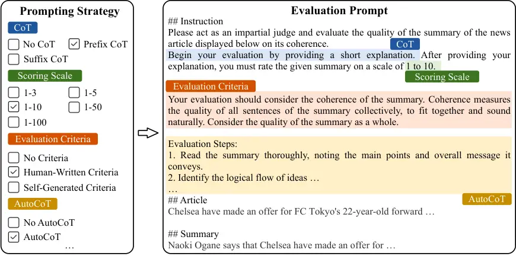
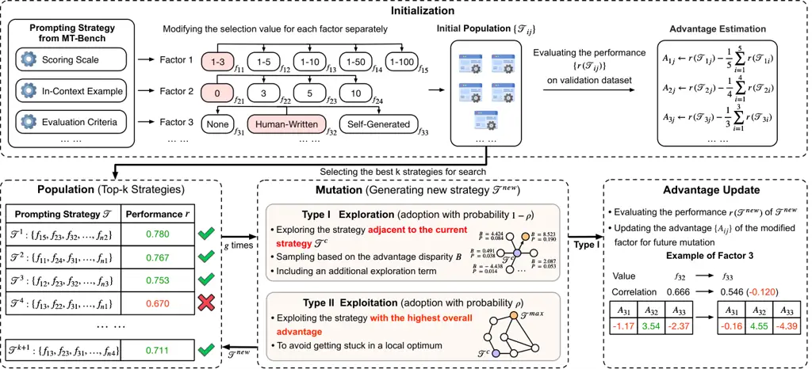
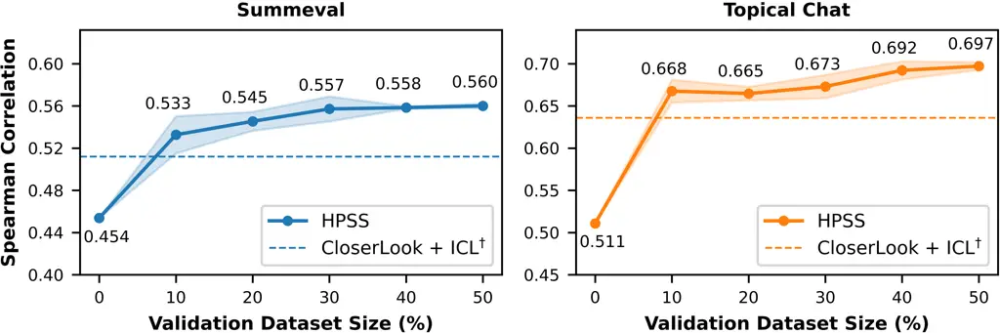
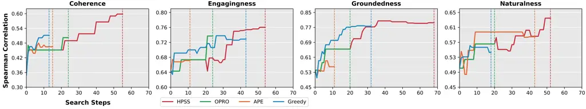
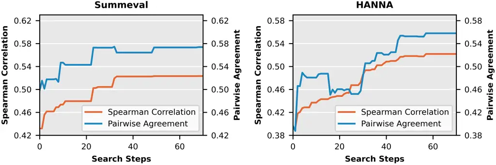
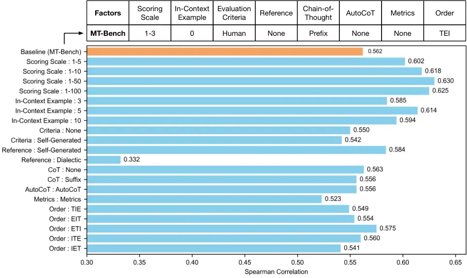
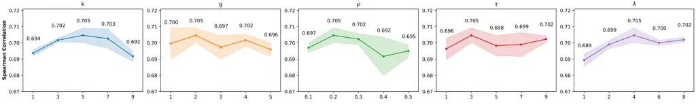

# HPSS: Heuristic Prompting Strategy Search for LLM Evaluators

Bosi Wen Affiliation: The Conversational Artificial Intelligence (CoAI)
Group, Tsinghua University Email: <wbs23@mails.tsinghua.edu.cn>    Pei
Ke Affiliation: University of Electronic Science and Technology of China
Email: <aihuang@tsinghua.edu.cn>    Yufei Sun Affiliation: The Knowledge
Engineering Group (KEG), Tsinghua University    Cunxiang Wang
Affiliation: Zhipu AI Affiliation: The Knowledge Engineering Group
(KEG), Tsinghua University    Xiaotao Gu Affiliation: Zhipu AI   
Jinfeng Zhou  Jie Tang  Hongning Wang   Minlie Huang Affiliation: The
Conversational Artificial Intelligence (CoAI) Group, Tsinghua University
Affiliation: The Knowledge Engineering Group (KEG), Tsinghua University

###### Abstract

Since the adoption of large language models (LLMs) for text evaluation
has become increasingly prevalent in the field of natural language
processing (NLP), a series of existing works attempt to optimize the
prompts for LLM evaluators to improve their alignment with human
judgment. However, their efforts are limited to optimizing individual
factors of evaluation prompts, such as evaluation criteria or output
formats, neglecting the combinatorial impact of multiple factors, which
leads to insufficient optimization of the evaluation pipeline.
Nevertheless, identifying well-behaved prompting strategies for
adjusting multiple factors requires extensive enumeration. To this end,
we comprehensively integrate 8 key factors for evaluation prompts and
propose a novel automatic prompting strategy optimization method called
Heuristic Prompting Strategy Search (HPSS). Inspired by the genetic
algorithm, HPSS conducts an iterative search to find well-behaved
prompting strategies for LLM evaluators. A heuristic function is
employed to guide the search process, enhancing the performance of our
algorithm. Extensive experiments across four evaluation tasks
demonstrate the effectiveness of HPSS, consistently outperforming both
human-designed evaluation prompts and existing automatic prompt
optimization methods. Our code is available at
[https://github.com/thu-coai/HPSS](https://github.com/thu-coai/HPSS).

^(†)^(†) ^(†)Work done when this author interned at Zhipu AI.^(†)^(†)
^(‡)Corresponding author

## 1 Introduction

Evaluation is a long-standing critical and challenging task in NLP
Celikyilmaz et al. (2020); Chang et al. (2024). Recently, with the
advent of advanced large language models (LLMs) such as GPT-4, LLM-based
evaluators have been widely used for various natural language generation
tasks Wang et al. (2023a); Liu et al. (2023); Zheng et al. (2023); Hu
et al. (2024a); Ke et al. (2024). Leveraging the LLMs’ strong language
understanding and instruction-following capabilities, the evaluation
task can be addressed via an evaluation prompt that includes a task
description, evaluation rules, and the text to be assessed Chen et al.
(2023); Ke et al. (2023). Various studies have reported that LLMs can
provide accurate and interpretable evaluation results of text quality on
the specified aspect, offering stronger generalization ability compared
with previous evaluation methods Papineni et al. (2002); Lin (2004);
Zhang et al. (2020); Zhong et al. (2022).



Figure 1: An example of prompting strategy and its corresponding
evaluation prompt for assessing the coherence of text summarization,
where some factors are highlighted and others are not shown.

Despite the advantages mentioned above, LLM-based evaluation methods are
still imperfect in aligning with human judgments Wang et al. (2023a);
Liu et al. (2024b), which cannot fully serve as an alternative to human
evaluation as the gold standard. An emerging line of research attempts
to optimize evaluation prompts for LLM evaluators to improve their
alignment with human judgments from multiple aspects, including
optimizing evaluation criteria Liu et al. (2024c); Liu et al. (2024d),
modifying output formats Chiang and Lee (2023); Chu et al. (2024), and
providing in-context examples Kim et al. (2023); Jain et al. (2023);
Huang et al. (2024).

However, we argue that these methods are only limited to optimizing a
single factor of evaluation prompts (e.g., evaluation criteria or output
formats) but neglect the prompting strategy for adjusting multiple
factors (Kim et al., 2023). Given that the evaluation prompts comprise
multiple components Gao et al. (2024), each encompassing various factors
that simultaneously affect the performance of LLM evaluators, it is
necessary to collectively adjust these factors to fully harness its
evaluation capability.

Nevertheless, due to the vast state space involved in making these
adjustments, extensive enumeration is required to identify well-behaved
prompting strategies, highlighting the need for effective automatic
optimization methods.

To this end, we comprehensively integrate a series of prompting
strategies for LLM evaluators from previous works, select 8 key factors,
and propose the Heuristic Prompting Strategy Search (HPSS) algorithm to
automatically optimize prompting strategies for LLM evaluators tailored
to specific evaluation aspects. Inspired by the genetic algorithm
Mitchell (1980), HPSS gradually mutates the previous prompting
strategies and selects candidate strategies based on their performance
on a validation dataset. Leveraging the limited number of values within
each factor,

HPSS introduced a heuristic function to guide the search process,
assigning higher exploration probability to more promising values, which
enhances the effectiveness of mutation and leads to better performance
compared to random search. We optimize the prompting strategy for two
different LLM evaluators (i.e., GPT-4o-mini OpenAI (2023) and
Qwen2.5-14B-Instruct Yang et al. (2024a)) across four evaluation tasks
for natural language generation (NLG). Experiment results show that HPSS
achieves substantial improvement over the baseline of human-designed
evaluation prompts and existing automatic prompt optimization methods.
Compared to the commonly-used evaluation prompt from MT-Bench Zheng
et al. (2023), HPSS can achieve an average 29.4% relative performance
improvement with the same generation times. Furthermore, compared to
other manually designed prompting strategies such as G-Eval Liu et al.
(2023) and CloserLook Chiang and Lee (2023), HPSS can still achieve
significantly better performance with only 5% of the generation times.
Our contributions can be summarized as follows:

- •
  To the best of our knowledge, we present the first discussion of
  automatic prompting strategy optimization for LLM evaluators,
  demonstrating that appropriate prompting strategies can significantly
  enhance the performance of LLM evaluators.
- •
  We propose HPSS, a novel prompting strategy optimization algorithm via
  iterative search. Furthermore, a heuristic function is introduced to
  estimate the prospect of each value and enhance the effectiveness of
  mutation.
- •
  We validate the effectiveness of HPSS across four evaluation tasks,
  yielding consistently better performance compared to both
  human-designed evaluation prompts and existing automatic prompt
  optimization methods.

## 2 Related Work

### 2.1 Prompt Design for LLM Evaluators

With the emergence of LLMs, utilizing LLMs as evaluators to assess the
quality of given texts has gradually become prevalent Wang et al.
(2023a); Chen et al. (2023); Ke et al. (2023) due to its advantages in
flexibility, interpretability, and generalization. To enhance their
performance, recent researches attempt to optimize the evaluation
prompts for LLM evaluators from multiple aspects Stureborg et al.
(2024); Kim et al. (2023); Jain et al. (2023); Murugadoss et al. (2024);
He et al. (2024); Pereira and Lotufo (2024). Specifically, G-Eval Liu
et al. (2023) requires LLMs to generate evaluation steps first and refer
to these steps to finish the evaluation task. LLMBar Zeng et al. (2024)
explores the effects of self-generated reference answers and
sample-specific metrics on text evaluation. HD-Eval Liu et al. (2024d)
attempts to align LLM evaluators with humans through hierarchical
evaluation criteria decomposition. However, these works are constrained
to optimize an individual factor for evaluation prompts, leading to
insufficient optimization. In contrast, our work focuses on adjusting
multiple factors and searching for effective prompting strategies to
fully stimulate the potential of LLM evaluators.

### 2.2 Prompt Optimization

[TABLE]

Table 1: Factors of evaluation prompts, including their definition,
common usage in previous works, and selection range considered in our
work. The definitions of each component in the last row are described in
Section 3.2.

Although LLMs have demonstrated impressive performance across various
NLP tasks Zhao et al. (2023), researchers point out that their abilities
are highly dependent on sophisticated prompt design Pryzant et al.
(2023); Leidinger et al. (2023); Raina et al. (2024). Considering that
manual prompt engineering is time-consuming, many works attempt to
optimize prompt automatically. For instance, GPS Xu et al. (2022) and
GRIPS Prasad et al. (2023) employ a genetic algorithm, using rule or
generative language models to mutate the initial prompt. PromptBreeder
Fernando et al. (2024) and EvoPrompt Guo et al. (2024) utilize LLMs for
mutation and crossover operations in evolutionary searches. OPRO Yang
et al. (2024b) demonstrates the potential of LLMs to perform iteratively
prompt optimization based on search history. Furthermore, Hsieh et al.
(2024) extends prompt optimization to long prompts containing multiple
sentences. They utilized Lin-UCB to guide the selection of sentences and
employed in-context learning for LLM-based mutation. For comparison, our
work shifts the focus from word or sentence-level prompt optimization to
a higher-level strategy that adjusts multiple factors of evaluation
prompts. Additionally, we introduce a heuristic function to enhance the
effectiveness of mutation based on the characteristics of evaluation
prompting strategies.

## 3 Methodology



Figure 2: Overview of our HPSS algorithm. By perturbing the value of
each factor in the prompting strategy from MT-Bench, HPSS gets the
initial strategy population and the advantage estimations of values.
Subsequently, new strategies are iteratively searched based on the
guidance of the value advantage. The performance $`r`$ of new strategies
is typically measured by the correlation between the evaluation results
of LLM evaluators and human judgments, which is used to update the
top-$`k`$ strategy population and the advantage estimation.

### 3.1 Problem Formulation

NLG evaluation tasks typically require LLM evaluators to generate the
corresponding judgment given the input sample $`d`$ and evaluation
aspect $`a`$. The input sample may include the query and model-generated
text. Meanwhile, the judgment takes various forms, including the rating
score of the generated text in pointwise grading and the preference
label between two generated texts in pairwise comparison. To guide LLM
evaluators to assess the quality of the input sample $`d`$ within the
aspect $`a`$, a prompt template $`\mathcal{T}`$ is needed to provide
sufficient clarifications of the task. In practice, $`d`$ and $`a`$ will
be fed into $`\mathcal{T}`$ to constitute an evaluation instruction, and
the LLM evaluator will follow this instruction to generate the final
judgment.

Since $`\mathcal{T}`$ contains various factors, there are multiple
prompting strategies for adjusting these factors. An example of
prompting strategy is illustrated in Figure 1. Formally, assume that
$`\mathcal{T}`$ has $`n`$ factors $`(F_{1},F_{2},\ldots,F_{n})`$, each
factor $`F_{i}`$ has $`m_{i}`$ possible values
$`(f_{i1},f_{i2},\ldots,f_{im_{i}})`$. Thus, $`\mathcal{T}`$ can be
determined by $`\boldsymbol{F}=(F_{1},F_{2},\ldots,F_{n})`$. For a
dataset $`D=\{d_{i}\}_{i=1}^{|D|}`$ and an evaluation aspect $`a`$, our
objective is to search for the prompting strategy $`\mathcal{T}^{o}`$ to
maximize the performance of LLM evaluators:

```math
\displaystyle\mathcal{T}^{o}=\arg\max_{\boldsymbol{F}}r_{D,a}(\mathcal{T}_{\boldsymbol{F}}) \tag{1}
```

where $`r_{D,a}(\mathcal{T})`$ represents the performance of
$`\mathcal{T}`$ for the aspect $`a`$ on the dataset $`D`$, which is
typically measured by the correlation between the evaluation results of
LLM evaluators using $`\mathcal{T}`$ and human judgments. Detailed
calculation of $`r_{D,a}(\mathcal{T})`$ can be found in Appendix A. To
aid the search for the optimal prompting strategy, we will use a
validation dataset with human judgments to evaluate the performance of
$`\mathcal{T}`$. Without loss of generality, we simplify
$`r_{D,a}(\mathcal{T})`$ as $`r(\mathcal{T})`$ to denote the performance
of $`\mathcal{T}`$ for a specific aspect on the validation dataset.

### 3.2 Factors of Evaluation Prompt

Considering a series of prompting strategies from previous works, we
select 8 key factors for the prompting strategy search, as described in
Table 1. Detailed prompts are provided in Appendix B.

The first 7 factors belong to 3 main components of the evaluation prompt
template $`\mathcal{T}`$: (1) Task Description (TD), which encompasses
the definition of the evaluation task and output format (including
Scoring Scale and Chain-of-Thought), (2) Evaluation Rules (ER), which
encompass the standard and steps for evaluation (including Evaluation
Criteria and AutoCoT), and (3) Input Content (IC), which encompasses the
input sample and sample-specific auxiliary information (including
In-Context Example, Reference, and Metrics). Previous works adopt
different orders for these 3 components. For instance, MT-Bench Zheng
et al. (2023) uses the order TD $`\rightarrow`$ ER $`\rightarrow`$ IC,
while AutoCalibrate Liu et al. (2024c) uses TD $`\rightarrow`$ IC
$`\rightarrow`$ ER. We consider the order of these 3 components as the
last factor and all 6 possible orders as the selection range. The
overall size of the search space is 12,960. We also conduct a
preliminary experiment to explore the effect of these factors on
Appendix C. The results show that these factors significantly influence
the performance of LLM evaluators, yet some findings diverge from
previous works.

### 3.3 Heuristic Prompting Strategy Search

Inspired by the Genetic Algorithms (GA) Mitchell (1980), we propose
Heuristic Prompting Strategy Search (HPSS) to effectively search
prompting strategies to help LLM evaluators achieve better alignment
with human judgment. The framework is shown in Figure 2. HPSS maintains
a population of $`k`$ top-performing prompting strategies and mutates
each strategy in this population to create new strategies. Their
performance is measured by the human correlation between LLM evaluators
and human judgments on the validation dataset. Different from
traditional GA that randomly selects values for mutation with equal
probability, HPSS leverages the limited number of values within each
factor and calculates the expected correlation metric advantage of each
value over the random selection of the corresponding factor. The
advantage of value $`f_{ij}`$ for factor $`F_{i}`$ denotes as
$`A_{ij}`$, which can be formally defined as:

```math
\displaystyle A_{ij}=\mathop{\mathbb{E}}_{\{F_{1},F_{2},\ldots,F_{n}\}\backslash\{F_{i}\}}[r(\mathcal{T}_{F_{1},F_{2},\ldots,f_{ij},\ldots,F_{n}}) \tag{2}
```

```math
\displaystyle-\frac{1}{m_{i}}\sum_{k=1}^{m_{i}}r(\mathcal{T}_{F_{1},F_{2},\ldots,f_{ik},\ldots,F_{n}})]
```

Then, this advantage score serves as a heuristic function to guide
mutation. This mechanism assigns higher selection probabilities to more
promising values, reducing the cost caused by the blindly random search
in GA. HPSS consists of two steps:

|                       |                         |              |              |              |              |       |              |              |              |              |       |
| --------------------- | ----------------------- | ------------ | ------------ | ------------ | ------------ | ----- | ------------ | ------------ | ------------ | ------------ | ----- |
| Model                 | Method                  | Summeval     |              |              |              |       | Topical-Chat |              |              |              |       |
|                       |                         | Coherence    | Consistency  | Fluency      | Relevance    | Avg.  | Coherence    | Engagingness | Groundedness | Naturalness  | Avg.  |
| \-                    | BLEU-4                  | 0.021        | 0.043        | 0.066        | 0.154        | 0.071 | 0.403        | 0.447        | 0.325        | 0.352        | 0.382 |
| \-                    | BertScore               | 0.228        | 0.194        | 0.225        | 0.370        | 0.254 | 0.390        | 0.438        | 0.351        | 0.335        | 0.379 |
| \-                    | UniEval                 | 0.623        | 0.469        | 0.455        | 0.426        | 0.493 | 0.589        | 0.597        | 0.553        | 0.487        | 0.557 |
| GPT-4o-mini           | MT-Bench                | 0.481        | 0.482        | 0.319        | 0.445        | 0.432 | 0.546        | 0.635        | 0.530        | 0.536        | 0.562 |
|                       | G-Eval^(†)              | 0.517        | 0.532        | 0.315        | 0.517        | 0.470 | 0.576        | 0.669        | 0.634        | 0.579        | 0.615 |
|                       | CloserLook^(†)          | 0.581        | 0.506        | 0.431        | 0.532        | 0.513 | 0.551        | 0.705        | 0.630        | 0.655        | 0.635 |
|                       | CloserLook + ICL        | 0.540        | 0.538        | 0.469        | 0.522        | 0.517 | 0.540        | 0.676        | 0.619        | 0.564        | 0.600 |
|                       | CloserLook + ICL^(†)    | 0.554        | 0.514        | 0.522        | 0.539        | 0.532 | 0.592        | 0.740        | 0.652        | 0.655        | 0.660 |
|                       | APE                     | 0.560        | 0.516        | 0.401        | 0.514        | 0.498 | 0.542        | 0.668        | 0.705        | 0.562        | 0.619 |
|                       | OPRO                    | 0.529        | 0.495        | 0.493        | 0.532        | 0.512 | 0.641        | 0.727        | 0.792        | 0.618        | 0.695 |
|                       | Greedy                  | 0.577        | 0.516        | 0.477        | 0.554        | 0.531 | 0.614        | 0.715        | 0.668        | 0.675        | 0.668 |
|                       | Stepwise-Greedy         | 0.545        | 0.466        | 0.494        | 0.552        | 0.514 | 0.619        | 0.713        | 0.677        | 0.630        | 0.662 |
|                       | HPSS (Ours)             | 0.601        | 0.567        | 0.525        | 0.561        | 0.564 | 0.661        | 0.743        | 0.866        | 0.690        | 0.740 |
| Qwen2.5-14B- Instruct | MT-Bench                | 0.449        | 0.460        | 0.455        | 0.451        | 0.454 | 0.394        | 0.635        | 0.517        | 0.497        | 0.511 |
|                       | G-Eval^(†)              | 0.569        | 0.544        | 0.467        | 0.515        | 0.524 | 0.490        | 0.673        | 0.505        | 0.535        | 0.550 |
|                       | CloserLook^(†)          | 0.602        | 0.502        | 0.476        | 0.530        | 0.528 | 0.510        | 0.706        | 0.646        | 0.555        | 0.604 |
|                       | CloserLook + ICL        | 0.478        | 0.587        | 0.355        | 0.480        | 0.475 | 0.436        | 0.675        | 0.642        | 0.580        | 0.583 |
|                       | CloserLook + ICL^(†)    | 0.554        | 0.504        | 0.476        | 0.516        | 0.512 | 0.520        | 0.712        | 0.715        | 0.595        | 0.636 |
|                       | APE                     | 0.489(0.011) | 0.494(0.019) | 0.451(0.021) | 0.487(0.025) | 0.480 | 0.466(0.025) | 0.670(0.034) | 0.567(0.039) | 0.591(0.037) | 0.574 |
|                       | OPRO                    | 0.479(0.041) | 0.564(0.003) | 0.481(0.003) | 0.498(0.010) | 0.506 | 0.502(0.071) | 0.737(0.000) | 0.692(0.000) | 0.583(0.000) | 0.629 |
|                       | Greedy                  | 0.528(0.023) | 0.530(0.028) | 0.489(0.007) | 0.527(0.021) | 0.519 | 0.511(0.002) | 0.728(0.030) | 0.776(0.000) | 0.543(0.034) | 0.640 |
|                       | Stepwise-Greedy         | 0.553(0.000) | 0.516(0.000) | 0.491(0.000) | 0.528(0.000) | 0.522 | 0.586(0.000) | 0.721(0.000) | 0.635(0.000) | 0.601(0.000) | 0.636 |
|                       | HPSS (Ours)             | 0.559(0.000) | 0.625(0.007) | 0.515(0.008) | 0.542(0.006) | 0.560 | 0.598(0.030) | 0.760(0.014) | 0.795(0.016) | 0.635(0.017) | 0.697 |
|                       | \- w/o exploitation     | 0.543(0.012) | 0.626(0.008) | 0.511(0.009) | 0.538(0.003) | 0.555 | 0.537(0.038) | 0.741(0.015) | 0.782(0.009) | 0.596(0.021) | 0.664 |
|                       | \- w/o exploration term | 0.550(0.012) | 0.623(0.012) | 0.508(0.005) | 0.527(0.008) | 0.552 | 0.555(0.026) | 0.760(0.013) | 0.789(0.018) | 0.611(0.000) | 0.679 |
|                       | \- w/o all              | 0.525(0.010) | 0.617(0.004) | 0.499(0.005) | 0.536(0.002) | 0.544 | 0.516(0.026) | 0.745(0.021) | 0.769(0.005) | 0.568(0.002) | 0.650 |

Table 2: Summary-level Spearman correlations of different aspects on
Summeval and dataset-level Spearman correlations on Topical-Chat. †
indicates that the corresponding method employs 20 generations with
self-consistency.

#### Initialization.

This step aims to get the initial strategy population and advantage
estimation of values. Starting with a commonly-used reference-free
pointwise grading prompting strategy from MT-Bench, we modify the
selection value for each factor separately to construct multiple
strategies. After that, we calculate the initial advantage estimation of
each value based on its performance and select $`k`$ top-performing
strategies for the subsequent iterative search step.

#### Iterative Search.

In each iteration, HPSS mutates each prompting strategy
$`\mathcal{T}^{c}`$ within the population for $`g`$ times to generate
new strategies, and then updates the top-$`k`$ strategy population based
on the performance of these new strategies. To enhance the effectiveness
of mutation, HPSS takes overall advantage of all factor values as the
performance estimation of one strategy and allocates more search
resources to the strategies with higher overall advantages.
Specifically, we utilize two types of mutations: exploration and
exploitation, which have the probability $`\rho`$ and $`1-\rho`$ to be
chosen for each mutation, respectively.

\(1\) Exploration: Exploration selects the strategies adjacent to
$`\mathcal{T}^{c}`$ (i.e., the strategies set $`T_{adj}`$ which can be
obtained by modifying a single factor of $`\mathcal{T}^{c}`$) and
calculates the disparity between the overall advantages of these
strategies and $`\mathcal{T}^{c}`$, employing a temperature-controlled
softmax function to determine the exploration probability. Furthermore,
in the preliminary experiment, we notice that inaccurate advantage
estimation during Initialization stage may lead to insufficient
exploration of well-performing values. To address this, motivated by UCB
Sampling Lai and Robbins (1985), we include an additional exploration
term in softmax sampling to incentivize a more comprehensive exploration
of all the values. Formally, assume the value for $`F_{i}`$ within
$`\mathcal{T}^{c}`$ is $`f_{ic_{i}}`$, and the strategy $`\mathcal{T}`$
in $`T_{adj}`$ modifies the value for $`F_{i}`$ from $`f_{ic_{i}}`$ to
$`f_{ij}`$, then the exploration probability is computed as follows:

```math
B_{\mathcal{T}}=\underbrace{A_{ij}-A_{ic_{i}}}_{\text{advantage disparity}}+\underbrace{\lambda\sqrt{\ln(t)/{M_{ij}}}}_{\text{additional exploration term}} \tag{3}
```

```math
P(\mathcal{T})=\frac{\exp(B_{\mathcal{T}}/\tau)}{\sum_{\mathcal{T}^{\prime}\in T_{adj}}\exp(B_{\mathcal{T}^{\prime}}/\tau)} \tag{4}
```

where $`t`$ is the search step, and $`M_{ij}`$ is the appearance count
of value $`f_{ij}`$ during search process.

After exploring a new prompting strategy $`\mathcal{T}^{new}`$, we
evaluate its performance on the validation dataset and calculate the
performance gain brought by the modified value. After that, a moving
average with previous results is applied to update the value’s advantage
estimation. The advantages of the values that belong to the same factor
as the modified value will then be normalized to have a zero mean, so as
to satisfy the property that the expectation sums to zero. Formally, the
advantage $`A`$ will be updated as follows, where $`N_{ij}`$ is the
exploration count of the value $`f_{ij}`$:

```math
A_{ij}\leftarrow\frac{A_{ij}\cdot N_{ij}+[r(\mathcal{T}^{new})-(r(\mathcal{T}^{c})-A_{ic_{i}})]}{N_{ij}+1} \tag{5}
```

```math
\displaystyle A_{ik}\leftarrow A_{ik}-\frac{1}{m_{i}}\sum^{m_{i}}_{j=1}A_{ij} \tag{6}
```

```math
\displaystyle k=1,2,\cdots,m_{i}
```

\(2\) Exploitation: Since the search scope of exploration is constrained
to the vicinity of explored prompting strategies, HPSS also employs the
mutation type exploitation to expand the search scope and avoid getting
stuck in a local optimum. This method selects the unexplored strategy
$`\mathcal{T}^{max}`$ with the highest overall advantage:

```math
\mathcal{T}^{max}=\mathop{\arg\max}\limits_{\boldsymbol{F}}\sum_{i=1}^{n}A_{F_{i}} \tag{7}
```

After reaching the maximum search step, HPSS returns the best-performing
strategy on the validation dataset as the final result. Detailed
implementation of these two steps is presented in Appendix F.1.

## 4 Experiments

### 4.1 Experimental Setup

#### Tasks and Datasets.

We evaluate HPSS on four pointwise grading evaluation tasks: Summeval
Fabbri et al. (2021) for text summarization, Topical-Chat Gopalakrishnan
et al. (2019) for dialogue generation, SFHOT / SFRES Wen et al. (2015)
for data-to-text generation, and HANNA Chhun et al. (2022) for story
generation. The Spearman ($`\rho`$) correlation coefficient between
human judgments and LLM evaluations is adopted as the performance
metric. We also validate HPSS on pairwise comparison benchmarks MT-Bench
Zheng et al. (2023), AUTO-J Li et al. (2024), and LLMBar Zeng et al.
(2024). The results are provided in Appendix G. More details about
benchmarks and metrics can be found in Appendix E and A. Following
HD-Eval Liu et al. (2024d), for each dataset, a 50% proportion is held
out for testing, while the rest is applied for validation.

#### Baselines.

We compare HPSS with three types of baselines: (1) Non-LLM Evaluators:
This category includes BLEU-4 Papineni et al. (2002), BertScore Zhang
et al. (2020), and UniEval Zhong et al. (2022). (2) Human-Designed LLM
Evaluators: The prompting strategy from MT-Bench Zheng et al. (2023)
stands as the starting point of searching. G-Eval Liu et al. (2023)
integrates AutoCoT to enhance the performance of LLM evaluators. Chiang
and Lee (2023) explores various evaluation schemes. We use its best
setting analyze-rate, denoted as CloserLook, and attempt to further
improve its performance by providing human evaluation examples
(CloserLook + ICL). (3) Automatic Prompt Optimization for LLM
Evaluators: We implement 4 strong prompt optimization baselines,
including APE Zhou et al. (2023b), OPRO Yang et al. (2024b), Greedy
Prasad et al. (2023); Zhou et al. (2023a) and Stepwise-Greedy. Greedy is
a widely used iterative search algorithm, where random perturbations are
applied to the current strategy to generate multiple candidates at each
iteration, and the best-performing one is retained for the next
iteration. Stepwise-Greedy sequentially optimizes each factor, choosing
the best-performing value in each step. More details can be found in
Appendix F.2.

|                       |                         |                 |              |       |                 |              |       |              |              |              |              |              |              |       |
| --------------------- | ----------------------- | --------------- | ------------ | ----- | --------------- | ------------ | ----- | ------------ | ------------ | ------------ | ------------ | ------------ | ------------ | ----- |
| Model                 | Method                  | SFHOT           |              |       | SFRES           |              |       | HANNA        |              |              |              |              |              |       |
|                       |                         | Informativeness | Naturalness  | Avg.  | Informativeness | Naturalness  | Avg.  | Relevance    | Coherence    | Empathy      | Surprise     | Engagement   | Complexity   | Avg.  |
| \-                    | BLEU-4                  | 0.046           | 0.029        | 0.038 | 0.227           | 0.142        | 0.185 | 0.308        | 0.313        | 0.307        | 0.244        | 0.329        | 0.374        | 0.313 |
| \-                    | BertScore               | 0.103           | 0.076        | 0.090 | 0.213           | 0.150        | 0.182 | 0.298        | 0.383        | 0.403        | 0.331        | 0.387        | 0.436        | 0.373 |
| \-                    | UniEval                 | 0.237           | 0.312        | 0.275 | 0.211           | 0.340        | 0.276 | \-           | \-           | \-           | \-           | \-           | \-           | -     |
| GPT-4o-mini           | MT-Bench                | 0.307           | 0.385        | 0.346 | 0.253           | 0.417        | 0.335 | 0.499        | 0.457        | 0.475        | 0.365        | 0.490        | 0.500        | 0.464 |
|                       | G-Eval^(†)              | 0.288           | 0.421        | 0.354 | 0.313           | 0.420        | 0.367 | 0.507        | 0.564        | 0.446        | 0.344        | 0.500        | 0.540        | 0.484 |
|                       | CloserLook^(†)          | 0.325           | 0.439        | 0.382 | 0.312           | 0.395        | 0.353 | 0.586        | 0.570        | 0.536        | 0.443        | 0.559        | 0.615        | 0.552 |
|                       | CloserLook + ICL        | 0.327           | 0.445        | 0.386 | 0.295           | 0.379        | 0.337 | 0.528        | 0.518        | 0.493        | 0.384        | 0.552        | 0.575        | 0.508 |
|                       | CloserLook + ICL^(†)    | 0.358           | 0.447        | 0.402 | 0.292           | 0.402        | 0.347 | 0.566        | 0.590        | 0.539        | 0.425        | 0.585        | 0.621        | 0.555 |
|                       | APE                     | 0.289           | 0.427        | 0.358 | 0.272           | 0.373        | 0.323 | 0.524        | 0.494        | 0.507        | 0.321        | 0.427        | 0.499        | 0.462 |
|                       | OPRO                    | 0.344           | 0.403        | 0.374 | 0.328           | 0.378        | 0.353 | 0.508        | 0.550        | 0.469        | 0.388        | 0.536        | 0.583        | 0.506 |
|                       | Greedy                  | 0.371           | 0.435        | 0.403 | 0.284           | 0.427        | 0.356 | 0.548        | 0.584        | 0.438        | 0.433        | 0.537        | 0.566        | 0.518 |
|                       | Stepwise-Greedy         | 0.368           | 0.452        | 0.410 | 0.292           | 0.382        | 0.337 | 0.566        | 0.517        | 0.522        | 0.424        | 0.537        | 0.521        | 0.515 |
|                       | HPSS (Ours)             | 0.395           | 0.466        | 0.431 | 0.370           | 0.439        | 0.405 | 0.548        | 0.594        | 0.535        | 0.459        | 0.542        | 0.591        | 0.545 |
| Qwen2.5-14B- Instruct | MT-Bench                | 0.281           | 0.361        | 0.321 | 0.181           | 0.311        | 0.241 | 0.447        | 0.459        | 0.387        | 0.286        | 0.430        | 0.427        | 0.406 |
|                       | G-Eval^(†)              | 0.262           | 0.418        | 0.340 | 0.308           | 0.455        | 0.382 | 0.514        | 0.467        | 0.444        | 0.326        | 0.391        | 0.504        | 0.441 |
|                       | CloserLook^(†)          | 0.266           | 0.419        | 0.342 | 0.247           | 0.445        | 0.346 | 0.537        | 0.469        | 0.493        | 0.369        | 0.436        | 0.539        | 0.474 |
|                       | CloserLook + ICL        | 0.245           | 0.411        | 0.328 | 0.281           | 0.396        | 0.339 | 0.435        | 0.440        | 0.437        | 0.325        | 0.476        | 0.461        | 0.429 |
|                       | CloserLook + ICL^(†)    | 0.241           | 0.419        | 0.330 | 0.336           | 0.406        | 0.371 | 0.560        | 0.532        | 0.501        | 0.373        | 0.506        | 0.538        | 0.502 |
|                       | APE                     | 0.310(0.016)    | 0.377(0.025) | 0.344 | 0.293(0.033)    | 0.426(0.009) | 0.360 | 0.509(0.026) | 0.476(0.004) | 0.456(0.019) | 0.321(0.016) | 0.417(0.018) | 0.450(0.021) | 0.452 |
|                       | OPRO                    | 0.301(0.000)    | 0.358(0.000) | 0.330 | 0.326(0.025)    | 0.388(0.000) | 0.357 | 0.580(0.004) | 0.517(0.015) | 0.436(0.000) | 0.318(0.030) | 0.517(0.009) | 0.550(0.029) | 0.486 |
|                       | Greedy                  | 0.296(0.017)    | 0.381(0.016) | 0.339 | 0.294(0.001)    | 0.425(0.023) | 0.360 | 0.552(0.011) | 0.493(0.010) | 0.468(0.001) | 0.325(0.034) | 0.495(0.011) | 0.541(0.001) | 0.479 |
|                       | Stepwise-Greedy         | 0.291(0.000)    | 0.345(0.000) | 0.318 | 0.333(0.000)    | 0.359(0.000) | 0.346 | 0.506(0.000) | 0.462(0.000) | 0.459(0.000) | 0.383(0.000) | 0.524(0.000) | 0.590(0.000) | 0.487 |
|                       | HPSS (Ours)             | 0.321(0.000)    | 0.411(0.000) | 0.366 | 0.351(0.005)    | 0.444(0.002) | 0.398 | 0.586(0.004) | 0.538(0.018) | 0.463(0.005) | 0.386(0.020) | 0.545(0.001) | 0.594(0.007) | 0.519 |
|                       | \- w/o exploitation     | 0.295(0.008)    | 0.398(0.010) | 0.347 | 0.346(0.006)    | 0.425(0.013) | 0.386 | 0.544(0.010) | 0.517(0.003) | 0.481(0.017) | 0.370(0.007) | 0.514(0.010) | 0.539(0.004) | 0.494 |
|                       | \- w/o exploration term | 0.296(0.006)    | 0.403(0.012) | 0.350 | 0.347(0.008)    | 0.433(0.011) | 0.390 | 0.561(0.027) | 0.516(0.003) | 0.460(0.000) | 0.378(0.012) | 0.521(0.005) | 0.571(0.011) | 0.501 |
|                       | \- w/o all              | 0.284(0.022)    | 0.387(0.014) | 0.336 | 0.348(0.009)    | 0.413(0.002) | 0.381 | 0.514(0.012) | 0.524(0.007) | 0.467(0.006) | 0.359(0.002) | 0.483(0.008) | 0.521(0.009) | 0.478 |

Table 3: Dataset-level Spearman correlations of different aspects on
SFHOT, SFRES, and HANNA. † indicates that the corresponding method
employs 20 generations with self-consistency.

#### Models and Configurations.

We choose the representative closed-source model GPT-4o-mini OpenAI
(2023) and open-source model Qwen2.5-14B-Instruct Yang et al. (2024a) as
evaluation models. For G-Eval and CloserLook, we use their default
settings (with 20 generation times and the decoding temperature as 1.0).
For other LLM evaluators, greedy search is used for reproducibility. We
limit the computational budget to 71 evaluations on the validation
dataset (including 21 evaluations during initiation in HPSS) for all
prompt search methods (21 for Stepwise-Greedy as an exception, as their
evaluation count is constant). Results of prompt search on
Qwen2.5-14B-Instruct are averaged over 3 seeds and the standard
deviation is provided. While for GPT-4o-mini, we report the results of
one seed due to the API cost. More details including the cost of HPSS
are in Appendix F.3.

### 4.2 Experimental Results

#### Human Alignment.

The main results are presented in Table 2 and 3. Firstly, with the same
generation times, HPSS substantially improves the performance of LLM
evaluators compared to the starting point (i.e., the prompting strategy
from MT-Bench), resulting in an average 29.4% relative improvement in
Spearman correlation across various tasks and outperforming other
Non-LLM and human-designed LLM evaluators by a large margin. Even with
only 5% of the generation times, as baseline methods require 20
generations with self-consistency while HPSS only requires a single
greedy decoding pass, HPSS remains superior to G-Eval and CloserLook.
Additional experiments in Appendix H also demonstrate that the smaller
Qwen2.5-14B-Instruct and GPT-4o-mini evaluators with HPSS substantially
surpass the larger human-designed Qwen2.5-72B-Instruct and GPT-4o
evaluators, respectively. Secondly, HPSS achieves a significant
performance gain over other automatic prompt optimization methods,
showing its better adaptability to NLG evaluation tasks. Finally, HPSS
brings consistent performance improvements to different evaluation
models, highlighting its cross-model generalizability. We also validate
that integrating HPSS with inference-time methods such as
self-consistency Wang et al. (2023b) can further improve the performance
of LLM evaluators in Appendix I.



Figure 3: Average performance of Qwen2.5-14B-Instruct evaluator under
different validation dataset sizes on Summeval and Topical-Chat.

#### Ablation Study.

In Table 2 and 3, we provide an ablation study on key components of HPSS
for the Qwen2.5-14B-Instruct evaluator, including the mutation type
exploitation, the additional exploration term, and the entire
heuristic-function-guided mutation mechanism. The results validate that
all components contribute to the final performance of HPSS. Notably,
removing the entire mechanism leads to the most significant performance
degradation, highlighting its effectiveness. Moreover, the performance
gains from the heuristic search mechanism vary across different
datasets, probably due to different search difficulties.



Figure 4: Performance of Qwen2.5-14B-Instruct evaluator under different
search steps on Topical-Chat. The first 21 steps for HPSS are in
Initialization, which also serves as the initial search history for
OPRO, causing the two methods to produce identical results during these
steps. Post-convergence results are omitted.

#### The impact of validation dataset size and search budget.

Figure 3 shows the performance of HPSS under different validation
dataset sizes. When validating with only 10% of the human expert
annotations, the performance of HPSS remains marginally off and superior
to human-designed LLM evaluators, demonstrating its effectiveness in
low-resource scenarios. Figure 4 shows the performance of
Qwen2.5-14B-Instruct evaluator under different search steps on
Topical-Chat. While HPSS does not exhibit an advantage over baseline
methods in the early stages of the search, it avoids getting trapped in
local optima prematurely (which often appears in baseline methods) and
ultimately converges into better solutions. We speculate that this can
be attributed to two reasons: First, the mutation type exploitation
expands the search scope of HPSS; Second, the advantage estimations for
each value become more accurate as the search progresses, enabling an
effective search even after good solutions have been obtained.

|              |              |              |          |            |       |
| ------------ | ------------ | ------------ | -------- | ---------- | ----- |
| Aspects      | Source       | Target       | MT-Bench | CloserLook | HPSS  |
|              | Dataset      | Dataset      | Prompt   | \+ ICL     |       |
| Coherence    | Summeval     | HANNA        | 0.459    | 0.440      | 0.516 |
|              | HANNA        | Summeval     | 0.449    | 0.478      | 0.505 |
| Relevance    | Summeval     | HANNA        | 0.447    | 0.434      | 0.484 |
|              | HANNA        | Summeval     | 0.451    | 0.480      | 0.556 |
| Engagingness | Topical-Chat | HANNA        | 0.430    | 0.476      | 0.518 |
|              | HANNA        | Topical-Chat | 0.635    | 0.675      | 0.737 |
| Naturalness  | Topical-Chat | SFRES        | 0.311    | 0.396      | 0.411 |
|              | SFRES        | Topical-Chat | 0.497    | 0.580      | 0.566 |

Table 4: Performance of Qwen2.5-14B-Instruct evaluator when directly
applying the prompting strategies found on the source datasets to the
target datasets.

### 4.3 Analysis

#### The generalizability of prompting strategies across datasets.

Using Qwen2.5-14B-Instruct as the evaluation model, we directly apply
the prompting strategies found by HPSS in Table 2 and 3 to other
datasets. As shown in Table 4, these prompting strategies demonstrate
strong generalizability across different datasets on the same evaluation
aspects, as they still achieve significantly better evaluation
performances than human-designed prompting strategies in most scenarios.
We also observe that these prompting strategies show cross-aspect
generalization of different datasets. However, the improvements in
cross-aspect generalization are generally smaller than those in
same-aspect generalization, compared to human-designed prompting
strategies. The cross-dataset generalizability of prompting strategies
may further reduce the overhead and improve the practicality of HPSS.

#### The contribution of each factor.

| Factor                     | Average $`\rho`$ | $`\Delta`$ |
| -------------------------- | ---------------- | ---------- |
| HPSS                       | 0.536            | 0.000      |
| \- w/o Scoring Scale       | 0.497            | -0.039     |
| \- w/o In-Context Example  | 0.507            | -0.029     |
| \- w/o Evaluation Criteria | 0.508            | -0.028     |
| \- w/o Reference           | 0.516            | -0.020     |
| \- w/o Chain-of-Thought    | 0.500            | -0.036     |
| \- w/o AutoCoT             | 0.518            | -0.018     |
| \- w/o Metrics             | 0.527            | -0.009     |
| \- w/o Order               | 0.492            | -0.044     |

Table 5: Average performance of HPSS on Summeval, Topical-Chat, SFHOT,
and HANNA when each factor is individually removed. Qwen2.5-14B-Instruct
is employed as the evaluation model.

To investigate the contribution of each factor to the overall
performance, we conduct an ablation study by independently removing each
factor and rerunning HPSS. The average performance of
Qwen2.5-14B-Instruct evaluator on four datasets is presented in Table 5.
The results indicate that each factor contributes to the final
performance of HPSS. However, the importance of these factors varies.
Metrics (i.e., self-generated sample-specific metrics for good answers)
appear to be the least important, whereas Order (i.e., the placement
order of each component in the evaluation prompt) seems to be the most
important. We leave the dedicated search space design to achieve a
better trade-off between search overhead and performance as important
future work.

#### The advantages of different values.

We calculate the mean and standard deviations of the advantages for each
factor at the end of HPSS across different datasets and evaluation
aspects. Table 6 shows that the advantages exhibit considerable variance
across tasks and evaluators, indicating the necessity of finding
appropriate prompting strategies tailored to specific tasks and
evaluators. However, there are some common characteristics: (1) A
moderate scoring scale of 1-10 generally enhances evaluator performance,
whereas a too coarse-grained scoring scale of 1-3 is less effective. (2)
Under greedy decoding, directly generating scores and employing
human-written evaluation criteria without AutoCoT, Metrics, and
Reference generally improves evaluation performance. (3) Regarding the
placement order of different components, positioning the task
description at the beginning seems to yield better results, possibly
because this arrangement is more logically coherent and helps evaluators
concentrate more on sample information and evaluation criteria. These
findings provide insights into future evaluation prompt design.

|                     |                                          |               |               |
| ------------------- | ---------------------------------------- | ------------- | ------------- |
| Factors             | Values                                   | GPT-4o-mini   | Qwen2.5-14B   |
| Scoring Scale       | 1-3                                      | -3.545(1.828) | -3.500(2.403) |
|                     | 1-5                                      | -0.310(1.830) | 0.393(1.792)  |
|                     | 1-10                                     | 1.492(0.894)  | 1.967(1.652)  |
|                     | 1-50                                     | 0.152(1.456)  | 0.462(1.259)  |
|                     | 1-100                                    | 2.211(0.936)  | 0.678(1.994)  |
| In-Context Example  | 0                                        | -2.208(2.897) | 0.487(3.363)  |
|                     | 3                                        | 0.715(2.043)  | 0.860(3.193)  |
|                     | 5                                        | -0.049(2.826) | 0.062(2.913)  |
|                     | 10                                       | 1.542(3.012)  | -1.410(2.785) |
| Evaluation Criteria | None                                     | -0.210(1.849) | -0.457(1.936) |
|                     | Human-Written                            | 0.822(2.325)  | 0.283(2.158)  |
|                     | Self-Generated                           | -0.612(1.885) | 0.174(1.697)  |
| Reference           | None                                     | 9.038(5.772)  | 5.513(4.732)  |
|                     | Self-Generated                           | 3.968(6.404)  | -1.070(6.022) |
|                     | Dialectic                                | -13.00(11.62) | -4.444(9.902) |
| Chain-of- Thought   | None                                     | 0.540(2.004)  | 0.318(1.475)  |
|                     | Prefix                                   | -0.560(2.033) | -0.021(1.744) |
|                     | Suffix                                   | 0.020(1.654)  | -0.297(1.277) |
| AutoCoT             | None                                     | 0.308(0.594)  | 0.346(1.989)  |
|                     | AutoCoT                                  | -0.308(0.594) | -0.346(1.989) |
| Metrics             | None                                     | 2.191(2.575)  | 2.957(1.892)  |
|                     | Metrics                                  | -2.191(2.575) | -2.957(1.892) |
| Order               | TD $`\rightarrow`$ ER $`\rightarrow`$ IC | 1.128(1.617)  | 0.201(2.538)  |
|                     | TD $`\rightarrow`$ IC $`\rightarrow`$ ER | 0.408(2.177)  | 1.240(2.376)  |
|                     | ER $`\rightarrow`$ TD $`\rightarrow`$ IC | 0.711(1.970)  | -0.393(2.101) |
|                     | ER $`\rightarrow`$ IC $`\rightarrow`$ TD | 0.105(2.243)  | -0.506(3.965) |
|                     | IC $`\rightarrow`$ TD $`\rightarrow`$ ER | -0.449(2.254) | 0.022(2.335)  |
|                     | IC $`\rightarrow`$ ER $`\rightarrow`$ TD | -1.902(1.786) | -0.565(2.836) |

Table 6: Average advantages and standard deviations across different
datasets and evaluation aspects for GPT-4o-mini and Qwen2.5-14B
evaluators.

#### Analysis on reward hacking.

Reward hacking is a widespread problem in the optimization process
Skalse et al. (2022). To analyze this problem in the HPSS framework, we
follow AlignBench Liu et al. (2024a) and introduce a new metric,
Pairwise Agreement, to provide an alternative perspective on evaluator
performance during our optimization process. Specifically, for different
model-generated texts to the same query (e.g., different generated
summaries of the same article for SummEval), we consider all possible
pairs and convert their human-judge and LLM-judge scores into pairwise
comparison results (i.e., win, tie, or lose), respectively. Then, we
measure the agreement between LLM evaluators and humans. On the
validation dataset of Summeval and HANNA, the average performance of the
Qwen2.5-14B-Instruct evaluator under different search steps of HPSS are
shown in Figure 5. The results demonstrate that the Spearman correlation
and pairwise agreement simultaneously improve during the optimization
process and verify that the optimization process of HPSS does not
introduce reward hacking but genuinely enhances the performance of LLM
evaluators. We also provide a case study of HPSS in Appendix K.



Figure 5: Spearman Correlation and Pairwise Agreement of
Qwen2.5-14B-Instruct across different HPSS search steps on the
validation datasets of Summeval and HANNA. The first 21 steps are in
Initialization, which may cause fluctuations in the metrics.

## 5 Conclusion

In this work, we integrate 8 key factors for the prompting strategy of
LLM evaluators and propose HPSS, a heuristic search method to
automatically optimize the prompting strategy for adjusting these
factors. HPSS leverages the expected performance advantages of each
value as the heuristic function to guide the search process. Extensive
experiments on four NLG evaluation tasks demonstrate the superiority of
HPSS, yielding consistent performance gains over both human-designed
evaluation prompts and automatic prompt optimization methods.
Additionally, we validate the generalizability of prompting strategies
found by HPSS and analyze the characteristics of these factors. Our
experimental results may provide new insights into future prompt design
for LLM evaluators.

## 6 Limitations

The limitations of our work are summarized as follows:

1\) HPSS requires iterative search on a validation dataset with human
annotations, introducing additional annotation and inference overheads.
However, we believe that it is not a severe problem for the following
three reasons: Firstly, the overall cost is affordable in the vast
majority of scenarios. Under the default setting, where 50% of the
dataset is selected as the validation dataset, the search cost for a
specific evaluation aspect of one dataset is approximately \$8 for
GPT-4o-mini, and approximately 40 minutes using 4 H100 GPUs for
Qwen2.5-14B-Instruct (See Appendix F.3). Secondly, HPSS remains
effective in low-resource scenarios. As shown in Figure 3, even when
annotated data is scarce (reducing the validation dataset size to 10% of
the entire dataset, $`\sim`$ 100 samples per dataset) , HPSS can still
significantly outperform manually designed prompt templates. Finally,
HPSS is efficient during inference on the test dataset, requiring only a
single greedy decoding pass for each test sample while still achieving
better performance than human-designed LLM evaluators that require 20
generations with self-consistency decoding and much larger
human-designed LLM evaluators (See Table 2, Table 3, and Appendix H).
Nonetheless, introducing well-designed early stopping strategies could
potentially reduce the search overheads of HPSS, which is considered as
important future work.

2\) HPSS mainly focuses on the prompting strategy optimization of the
input prompts for LLM evaluators. Despite the importance of input
prompts, other modules such as decoding and interaction strategies may
also benefit the performance of LLM evaluators. Regarding decoding
strategies, our experiments demonstrate that incorporating
self-consistency decoding can enhance the performance of HPSS (See
Appendix I). Regarding multiple LLM evaluators’ interaction, in our
preliminary experiments, we follow the settings of ChatEval Chan et al.
(2024) to explore the impact of interaction strategies with multiple
Qwen2.5-14B-Instruct evaluators, using the prompting strategies found by
HPSS. We find that different interaction strategies have negligible
impacts on the final evaluation performance, which is similar to the
self-consistency method that directly averages the evaluation results of
multiple individual LLM evaluators. Given that the search space
increases significantly in multi-agent interaction scenarios and that it
is difficult for LLM evaluators with different output formats to
interact directly, we leave the optimization of interaction strategies
among multiple LLM evaluators as important future work.

## Acknowledgements

This work was supported by the National Science Foundation for
Distinguished Young Scholars (with No. 62125604). We would also like to
thank Zhipu AI for sponsoring the computational resources in this work.

## References

- Celikyilmaz et al. (2020) Asli Celikyilmaz, Elizabeth Clark, and
  Jianfeng Gao. 2020. Evaluation of text generation: A survey. _arXiv
  preprint arXiv:2006.14799_.
- Chan et al. (2024) Chi-Min Chan, Weize Chen, Yusheng Su, Jianxuan Yu,
  Wei Xue, Shanghang Zhang, Jie Fu, and Zhiyuan Liu. 2024. [Chateval:
  Towards better LLM-based evaluators through multi-agent
  debate](https://openreview.net/forum?id=FQepisCUWu). In _The Twelfth
  International Conference on Learning Representations_.
- Chang et al. (2024) Yupeng Chang, Xu Wang, Jindong Wang, Yuan Wu,
  Linyi Yang, Kaijie Zhu, Hao Chen, Xiaoyuan Yi, Cunxiang Wang, Yidong
  Wang, et al. 2024. A survey on evaluation of large language models.
  _ACM Transactions on Intelligent Systems and Technology_, 15(3):1–45.
- Chen et al. (2023) Yi Chen, Rui Wang, Haiyun Jiang, Shuming Shi, and
  Ruifeng Xu. 2023. [Exploring the use of large language models for
  reference-free text quality evaluation: An empirical
  study](https://doi.org/10.18653/v1/2023.findings-ijcnlp.32). In
  _Findings of the Association for Computational Linguistics:
  IJCNLP-AACL 2023 (Findings)_, pages 361–374, Nusa Dua, Bali.
  Association for Computational Linguistics.
- Chhun et al. (2022) Cyril Chhun, Pierre Colombo, Fabian M. Suchanek,
  and Chloé Clavel. 2022. [Of human criteria and automatic metrics: A
  benchmark of the evaluation of story
  generation](https://aclanthology.org/2022.coling-1.509/). In
  _Proceedings of the 29th International Conference on Computational
  Linguistics_, pages 5794–5836, Gyeongju, Republic of Korea.
  International Committee on Computational Linguistics.
- Chiang and Lee (2023) Cheng-Han Chiang and Hung-yi Lee. 2023. [A
  closer look into using large language models for automatic
  evaluation](https://doi.org/10.18653/v1/2023.findings-emnlp.599). In
  _Findings of the Association for Computational Linguistics: EMNLP
  2023_, pages 8928–8942, Singapore. Association for Computational
  Linguistics.
- Chu et al. (2024) KuanChao Chu, Yi-Pei Chen, and Hideki
  Nakayama. 2024. A better llm evaluator for text generation: The impact
  of prompt output sequencing and optimization. _arXiv preprint
  arXiv:2406.09972_.
- Doddapaneni et al. (2024) Sumanth Doddapaneni, Mohammed Safi Ur Rahman
  Khan, Sshubam Verma, and Mitesh M Khapra. 2024. [Finding blind spots
  in evaluator LLMs with interpretable
  checklists](https://doi.org/10.18653/v1/2024.emnlp-main.911). In
  _Proceedings of the 2024 Conference on Empirical Methods in Natural
  Language Processing_, pages 16279–16309, Miami, Florida, USA.
  Association for Computational Linguistics.
- Fabbri et al. (2021) Alexander R. Fabbri, Wojciech Kryściński, Bryan
  McCann, Caiming Xiong, Richard Socher, and Dragomir Radev. 2021.
  [SummEval: Re-evaluating summarization
  evaluation](https://doi.org/10.1162/tacl_a_00373). _Transactions of
  the Association for Computational Linguistics_, 9:391–409.
- Fernando et al. (2024) Chrisantha Fernando, Dylan Banarse, Henryk
  Michalewski, Simon Osindero, and Tim Rocktäschel. 2024. Promptbreeder:
  self-referential self-improvement via prompt evolution. In
  _Proceedings of the 41st International Conference on Machine
  Learning_.
- Gao et al. (2024) Mingqi Gao, Xinyu Hu, Jie Ruan, Xiao Pu, and Xiaojun
  Wan. 2024. Llm-based nlg evaluation: Current status and challenges.
  _arXiv preprint arXiv:2402.01383_.
- Gopalakrishnan et al. (2019) Karthik Gopalakrishnan, Behnam
  Hedayatnia, Qinlang Chen, Anna Gottardi, Sanjeev Kwatra, Anu
  Venkatesh, Raefer Gabriel, and Dilek Hakkani-Tür. 2019. [Topical-Chat:
  Towards Knowledge-Grounded Open-Domain
  Conversations](https://doi.org/10.21437/Interspeech.2019-3079). In
  _Proc. Interspeech 2019_, pages 1891–1895.
- Guo et al. (2024) Qingyan Guo, Rui Wang, Junliang Guo, Bei Li, Kaitao
  Song, Xu Tan, Guoqing Liu, Jiang Bian, and Yujiu Yang. 2024.
  [Connecting large language models with evolutionary algorithms yields
  powerful prompt
  optimizers](https://openreview.net/forum?id=ZG3RaNIsO8). In _The
  Twelfth International Conference on Learning Representations_.
- He et al. (2024) Hangfeng He, Hongming Zhang, and Dan Roth. 2024.
  [SocREval: Large language models with the socratic method for
  reference-free reasoning
  evaluation](https://doi.org/10.18653/v1/2024.findings-naacl.175). In
  _Findings of the Association for Computational Linguistics: NAACL
  2024_, pages 2736–2764, Mexico City, Mexico. Association for
  Computational Linguistics.
- Hsieh et al. (2024) Cho-Jui Hsieh, Si Si, Felix Yu, and Inderjit
  Dhillon. 2024. [Automatic engineering of long
  prompts](https://doi.org/10.18653/v1/2024.findings-acl.634). In
  _Findings of the Association for Computational Linguistics: ACL 2024_,
  pages 10672–10685, Bangkok, Thailand. Association for Computational
  Linguistics.
- Hu et al. (2024a) Xinyu Hu, Mingqi Gao, Sen Hu, Yang Zhang, Yicheng
  Chen, Teng Xu, and Xiaojun Wan. 2024a. [Are LLM-based evaluators
  confusing NLG quality
  criteria?](https://doi.org/10.18653/v1/2024.acl-long.516) In
  _Proceedings of the 62nd Annual Meeting of the Association for
  Computational Linguistics (Volume 1: Long Papers)_, pages 9530–9570,
  Bangkok, Thailand. Association for Computational Linguistics.
- Hu et al. (2024b) Xinyu Hu, Li Lin, Mingqi Gao, Xunjian Yin, and
  Xiaojun Wan. 2024b. [Themis: A reference-free NLG evaluation language
  model with flexibility and
  interpretability](https://doi.org/10.18653/v1/2024.emnlp-main.891). In
  _Proceedings of the 2024 Conference on Empirical Methods in Natural
  Language Processing_, pages 15924–15951, Miami, Florida, USA.
  Association for Computational Linguistics.
- Huang et al. (2024) Hui Huang, Yingqi Qu, Jing Liu, Muyun Yang, and
  Tiejun Zhao. 2024. An empirical study of llm-as-a-judge for llm
  evaluation: Fine-tuned judge models are task-specific classifiers.
  _arXiv preprint arXiv:2403.02839_.
- Jain et al. (2023) Sameer Jain, Vaishakh Keshava, Swarnashree
  Mysore Sathyendra, Patrick Fernandes, Pengfei Liu, Graham Neubig, and
  Chunting Zhou. 2023. [Multi-dimensional evaluation of text
  summarization with in-context
  learning](https://doi.org/10.18653/v1/2023.findings-acl.537). In
  _Findings of the Association for Computational Linguistics: ACL 2023_,
  pages 8487–8495, Toronto, Canada. Association for Computational
  Linguistics.
- Ke et al. (2023) Pei Ke, Fei Huang, Fei Mi, Yasheng Wang, Qun Liu,
  Xiaoyan Zhu, and Minlie Huang. 2023. [DecompEval: Evaluating generated
  texts as unsupervised decomposed question
  answering](https://doi.org/10.18653/v1/2023.acl-long.539). In
  _Proceedings of the 61st Annual Meeting of the Association for
  Computational Linguistics (Volume 1: Long Papers)_, pages 9676–9691,
  Toronto, Canada. Association for Computational Linguistics.
- Ke et al. (2024) Pei Ke, Bosi Wen, Andrew Feng, Xiao Liu, Xuanyu Lei,
  Jiale Cheng, Shengyuan Wang, Aohan Zeng, Yuxiao Dong, Hongning Wang,
  Jie Tang, and Minlie Huang. 2024. [CritiqueLLM: Towards an informative
  critique generation model for evaluation of large language model
  generation](https://doi.org/10.18653/v1/2024.acl-long.704). In
  _Proceedings of the 62nd Annual Meeting of the Association for
  Computational Linguistics (Volume 1: Long Papers)_, pages 13034–13054,
  Bangkok, Thailand. Association for Computational Linguistics.
- Kim et al. (2023) JoongHoon Kim, Sangmin Lee, Seung Hun Han, Saeran
  Park, Jiyoon Lee, Kiyoon Jeong, and Pilsung Kang. 2023. [Which is
  better? exploring prompting strategy for LLM-based
  metrics](https://doi.org/10.18653/v1/2023.eval4nlp-1.14). In
  _Proceedings of the 4th Workshop on Evaluation and Comparison of NLP
  Systems_, pages 164–183, Bali, Indonesia. Association for
  Computational Linguistics.
- Kotonya et al. (2023) Neema Kotonya, Saran Krishnasamy, Joel
  Tetreault, and Alejandro Jaimes. 2023. [Little giants: Exploring the
  potential of small LLMs as evaluation metrics in summarization in the
  Eval4NLP 2023 shared
  task](https://doi.org/10.18653/v1/2023.eval4nlp-1.17). In _Proceedings
  of the 4th Workshop on Evaluation and Comparison of NLP Systems_,
  pages 202–218, Bali, Indonesia. Association for Computational
  Linguistics.
- Kwon et al. (2023) Woosuk Kwon, Zhuohan Li, Siyuan Zhuang, Ying Sheng,
  Lianmin Zheng, Cody Hao Yu, Joseph Gonzalez, Hao Zhang, and Ion
  Stoica. 2023. [Efficient memory management for large language model
  serving with pagedattention](https://doi.org/10.1145/3600006.3613165).
  In _Proceedings of the 29th Symposium on Operating Systems
  Principles_, SOSP ’23, page 611–626, New York, NY, USA. Association
  for Computing Machinery.
- Lai and Robbins (1985) Tze Leung Lai and Herbert Robbins. 1985.
  Asymptotically efficient adaptive allocation rules. _Advances in
  applied mathematics_, 6(1):4–22.
- Lambert et al. (2025) Nathan Lambert, Valentina Pyatkin, Jacob
  Morrison, LJ Miranda, Bill Yuchen Lin, Khyathi Chandu, Nouha Dziri,
  Sachin Kumar, Tom Zick, Yejin Choi, Noah A. Smith, and Hannaneh
  Hajishirzi. 2025. [RewardBench: Evaluating reward models for language
  modeling](https://aclanthology.org/2025.findings-naacl.96/). In
  _Findings of the Association for Computational Linguistics: NAACL
  2025_, pages 1755–1797, Albuquerque, New Mexico. Association for
  Computational Linguistics.
- Leidinger et al. (2023) Alina Leidinger, Robert van Rooij, and
  Ekaterina Shutova. 2023. [The language of prompting: What linguistic
  properties make a prompt
  successful?](https://doi.org/10.18653/v1/2023.findings-emnlp.618) In
  _Findings of the Association for Computational Linguistics: EMNLP
  2023_, pages 9210–9232, Singapore. Association for Computational
  Linguistics.
- Li et al. (2024) Junlong Li, Shichao Sun, Weizhe Yuan, Run-Ze Fan, hai
  zhao, and Pengfei Liu. 2024. [Generative judge for evaluating
  alignment](https://openreview.net/forum?id=gtkFw6sZGS). In _The
  Twelfth International Conference on Learning Representations_.
- Lin (2004) Chin-Yew Lin. 2004. [ROUGE: A package for automatic
  evaluation of summaries](https://aclanthology.org/W04-1013/). In _Text
  Summarization Branches Out_, pages 74–81, Barcelona, Spain.
  Association for Computational Linguistics.
- Lin and Chen (2023) Yen-Ting Lin and Yun-Nung Chen. 2023. Llm-eval:
  Unified multi-dimensional automatic evaluation for open-domain
  conversations with large language models. _arXiv preprint
  arXiv:2305.13711_.
- Liu et al. (2024a) Xiao Liu, Xuanyu Lei, Shengyuan Wang, Yue Huang,
  Andrew Feng, Bosi Wen, Jiale Cheng, Pei Ke, Yifan Xu, Weng Lam Tam,
  Xiaohan Zhang, Lichao Sun, Xiaotao Gu, Hongning Wang, Jing Zhang,
  Minlie Huang, Yuxiao Dong, and Jie Tang. 2024a. [AlignBench:
  Benchmarking Chinese alignment of large language
  models](https://doi.org/10.18653/v1/2024.acl-long.624). In
  _Proceedings of the 62nd Annual Meeting of the Association for
  Computational Linguistics (Volume 1: Long Papers)_, pages 11621–11640,
  Bangkok, Thailand. Association for Computational Linguistics.
- Liu et al. (2023) Yang Liu, Dan Iter, Yichong Xu, Shuohang Wang,
  Ruochen Xu, and Chenguang Zhu. 2023. [G-eval: NLG evaluation using
  gpt-4 with better human
  alignment](https://doi.org/10.18653/v1/2023.emnlp-main.153). In
  _Proceedings of the 2023 Conference on Empirical Methods in Natural
  Language Processing_, pages 2511–2522, Singapore. Association for
  Computational Linguistics.
- Liu et al. (2024b) Yinhong Liu, Han Zhou, Zhijiang Guo, Ehsan
  Shareghi, Ivan Vulic, Anna Korhonen, and Nigel Collier. 2024b.
  Aligning with human judgement: The role of pairwise preference in
  large language model evaluators. _arXiv preprint arXiv:2403.16950_.
- Liu et al. (2024c) Yuxuan Liu, Tianchi Yang, Shaohan Huang, Zihan
  Zhang, Haizhen Huang, Furu Wei, Weiwei Deng, Feng Sun, and Qi Zhang.
  2024c. [Calibrating LLM-based
  evaluator](https://aclanthology.org/2024.lrec-main.237/). In
  _Proceedings of the 2024 Joint International Conference on
  Computational Linguistics, Language Resources and Evaluation
  (LREC-COLING 2024)_, pages 2638–2656, Torino, Italia. ELRA and ICCL.
- Liu et al. (2024d) Yuxuan Liu, Tianchi Yang, Shaohan Huang, Zihan
  Zhang, Haizhen Huang, Furu Wei, Weiwei Deng, Feng Sun, and Qi Zhang.
  2024d. [HD-eval: Aligning large language model evaluators through
  hierarchical criteria
  decomposition](https://doi.org/10.18653/v1/2024.acl-long.413). In
  _Proceedings of the 62nd Annual Meeting of the Association for
  Computational Linguistics (Volume 1: Long Papers)_, pages 7641–7660,
  Bangkok, Thailand. Association for Computational Linguistics.
- Mitchell (1980) Tom M Mitchell. 1980. The need for biases in learning
  generalizations.
- Murugadoss et al. (2024) Bhuvanashree Murugadoss, Christian Poelitz,
  Ian Drosos, Vu Le, Nick McKenna, Carina Suzana Negreanu, Chris Parnin,
  and Advait Sarkar. 2024. Evaluating the evaluator: Measuring llms’
  adherence to task evaluation instructions. _arXiv preprint
  arXiv:2408.08781_.
- OpenAI (2023) OpenAI. 2023. GPT-4 technical report. _arXiv preprint
  arXiv:2303.08774_.
- Papineni et al. (2002) Kishore Papineni, Salim Roukos, Todd Ward, and
  Wei-Jing Zhu. 2002. [Bleu: a method for automatic evaluation of
  machine translation](https://doi.org/10.3115/1073083.1073135). In
  _Proceedings of the 40th Annual Meeting of the Association for
  Computational Linguistics_, pages 311–318, Philadelphia, Pennsylvania,
  USA. Association for Computational Linguistics.
- Pereira and Lotufo (2024) Jayr Pereira and Roberto Lotufo. 2024.
  Check-eval: A checklist-based approach for evaluating text quality.
  _arXiv preprint arXiv:2407.14467_.
- Prasad et al. (2023) Archiki Prasad, Peter Hase, Xiang Zhou, and Mohit
  Bansal. 2023. [GrIPS: Gradient-free, edit-based instruction search for
  prompting large language
  models](https://doi.org/10.18653/v1/2023.eacl-main.277). In
  _Proceedings of the 17th Conference of the European Chapter of the
  Association for Computational Linguistics_, pages 3845–3864,
  Dubrovnik, Croatia. Association for Computational Linguistics.
- Pryzant et al. (2023) Reid Pryzant, Dan Iter, Jerry Li, Yin Lee,
  Chenguang Zhu, and Michael Zeng. 2023. [Automatic prompt optimization
  with “gradient descent” and beam
  search](https://doi.org/10.18653/v1/2023.emnlp-main.494). In
  _Proceedings of the 2023 Conference on Empirical Methods in Natural
  Language Processing_, pages 7957–7968, Singapore. Association for
  Computational Linguistics.
- Raina et al. (2024) Vyas Raina, Adian Liusie, and Mark Gales. 2024.
  [Is LLM-as-a-judge robust? investigating universal adversarial attacks
  on zero-shot LLM
  assessment](https://doi.org/10.18653/v1/2024.emnlp-main.427). In
  _Proceedings of the 2024 Conference on Empirical Methods in Natural
  Language Processing_, pages 7499–7517, Miami, Florida, USA.
  Association for Computational Linguistics.
- Siledar et al. (2024) Tejpalsingh Siledar, Swaroop Nath, Sankara
  Muddu, Rupasai Rangaraju, Swaprava Nath, Pushpak Bhattacharyya, Suman
  Banerjee, Amey Patil, Sudhanshu Singh, Muthusamy Chelliah, and Nikesh
  Garera. 2024. [One prompt to rule them all: LLMs for opinion summary
  evaluation](https://doi.org/10.18653/v1/2024.acl-long.655). In
  _Proceedings of the 62nd Annual Meeting of the Association for
  Computational Linguistics (Volume 1: Long Papers)_, pages 12119–12134,
  Bangkok, Thailand. Association for Computational Linguistics.
- Skalse et al. (2022) Joar Skalse, Nikolaus Howe, Dmitrii
  Krasheninnikov, and David Krueger. 2022. Defining and characterizing
  reward gaming. _Advances in Neural Information Processing Systems_,
  35:9460–9471.
- Song et al. (2025) Mingyang Song, Mao Zheng, and Xuan Luo. 2025. [Can
  many-shot in-context learning help LLMs as evaluators? a preliminary
  empirical study](https://aclanthology.org/2025.coling-main.548/). In
  _Proceedings of the 31st International Conference on Computational
  Linguistics_, pages 8232–8241, Abu Dhabi, UAE. Association for
  Computational Linguistics.
- Stureborg et al. (2024) Rickard Stureborg, Dimitris Alikaniotis, and
  Yoshi Suhara. 2024. Large language models are inconsistent and biased
  evaluators. _arXiv preprint arXiv:2405.01724_.
- Wang et al. (2023a) Jiaan Wang, Yunlong Liang, Fandong Meng, Zengkui
  Sun, Haoxiang Shi, Zhixu Li, Jinan Xu, Jianfeng Qu, and Jie Zhou.
  2023a. [Is ChatGPT a good NLG evaluator? a preliminary
  study](https://doi.org/10.18653/v1/2023.newsum-1.1). In _Proceedings
  of the 4th New Frontiers in Summarization Workshop_, pages 1–11,
  Singapore. Association for Computational Linguistics.
- Wang et al. (2023b) Xuezhi Wang, Jason Wei, Dale Schuurmans, Quoc V
  Le, Ed H. Chi, Sharan Narang, Aakanksha Chowdhery, and Denny Zhou.
  2023b. [Self-consistency improves chain of thought reasoning in
  language models](https://openreview.net/forum?id=1PL1NIMMrw). In _The
  Eleventh International Conference on Learning Representations_.
- Wen et al. (2015) Tsung-Hsien Wen, Milica Gašić, Nikola Mrkšić,
  Pei-Hao Su, David Vandyke, and Steve Young. 2015. [Semantically
  conditioned LSTM-based natural language generation for spoken dialogue
  systems](https://doi.org/10.18653/v1/D15-1199). In _Proceedings of the
  2015 Conference on Empirical Methods in Natural Language Processing_,
  pages 1711–1721, Lisbon, Portugal. Association for Computational
  Linguistics.
- Xu et al. (2022) Hanwei Xu, Yujun Chen, Yulun Du, Nan Shao, Wang
  Yanggang, Haiyu Li, and Zhilin Yang. 2022. [GPS: Genetic prompt search
  for efficient few-shot
  learning](https://doi.org/10.18653/v1/2022.emnlp-main.559). In
  _Proceedings of the 2022 Conference on Empirical Methods in Natural
  Language Processing_, pages 8162–8171, Abu Dhabi, United Arab
  Emirates. Association for Computational Linguistics.
- Yang et al. (2024a) An Yang, Baosong Yang, Binyuan Hui, Bo Zheng,
  Bowen Yu, Chang Zhou, Chengpeng Li, Chengyuan Li, Dayiheng Liu, Fei
  Huang, Guanting Dong, Haoran Wei, Huan Lin, Jialong Tang, Jialin Wang,
  Jian Yang, Jianhong Tu, Jianwei Zhang, Jianxin Ma, Jin Xu, Jingren
  Zhou, Jinze Bai, Jinzheng He, Junyang Lin, Kai Dang, Keming Lu, Keqin
  Chen, Kexin Yang, Mei Li, Mingfeng Xue, Na Ni, Pei Zhang, Peng Wang,
  Ru Peng, Rui Men, Ruize Gao, Runji Lin, Shijie Wang, Shuai Bai, Sinan
  Tan, Tianhang Zhu, Tianhao Li, Tianyu Liu, Wenbin Ge, Xiaodong Deng,
  Xiaohuan Zhou, Xingzhang Ren, Xinyu Zhang, Xipin Wei, Xuancheng Ren,
  Yang Fan, Yang Yao, Yichang Zhang, Yu Wan, Yunfei Chu, Yuqiong Liu,
  Zeyu Cui, Zhenru Zhang, and Zhihao Fan. 2024a. Qwen2 technical report.
  _arXiv preprint arXiv:2407.10671_.
- Yang et al. (2024b) Chengrun Yang, Xuezhi Wang, Yifeng Lu, Hanxiao
  Liu, Quoc V Le, Denny Zhou, and Xinyun Chen. 2024b. [Large language
  models as optimizers](https://openreview.net/forum?id=Bb4VGOWELI). In
  _The Twelfth International Conference on Learning Representations_.
- Zeng et al. (2024) Zhiyuan Zeng, Jiatong Yu, Tianyu Gao, Yu Meng,
  Tanya Goyal, and Danqi Chen. 2024. [Evaluating large language models
  at evaluating instruction
  following](https://openreview.net/forum?id=tr0KidwPLc). In _The
  Twelfth International Conference on Learning Representations_.
- Zhang et al. (2025) Qiyuan Zhang, Yufei Wang, Tiezheng YU, Yuxin
  Jiang, Chuhan Wu, Liangyou Li, Yasheng Wang, Xin Jiang, Lifeng Shang,
  Ruiming Tang, Fuyuan Lyu, and Chen Ma. 2025. [Reviseval: Improving
  LLM-as-a-judge via response-adapted
  references](https://openreview.net/forum?id=1tBvzOYTLF). In _The
  Thirteenth International Conference on Learning Representations_.
- Zhang et al. (2020) Tianyi Zhang, Varsha Kishore, Felix Wu, Kilian Q.
  Weinberger, and Yoav Artzi. 2020. [Bertscore: Evaluating text
  generation with bert](https://openreview.net/forum?id=SkeHuCVFDr). In
  _International Conference on Learning Representations_.
- Zhao et al. (2023) Wayne Xin Zhao, Kun Zhou, Junyi Li, Tianyi Tang,
  Xiaolei Wang, Yupeng Hou, Yingqian Min, Beichen Zhang, Junjie Zhang,
  Zican Dong, et al. 2023. A survey of large language models. _arXiv
  preprint arXiv:2303.18223_.
- Zheng et al. (2023) Lianmin Zheng, Wei-Lin Chiang, Ying Sheng, Siyuan
  Zhuang, Zhanghao Wu, Yonghao Zhuang, Zi Lin, Zhuohan Li, Dacheng Li,
  Eric Xing, et al. 2023. Judging llm-as-a-judge with mt-bench and
  chatbot arena. _Advances in Neural Information Processing Systems_,
  36:46595–46623.
- Zhong et al. (2022) Ming Zhong, Yang Liu, Da Yin, Yuning Mao, Yizhu
  Jiao, Pengfei Liu, Chenguang Zhu, Heng Ji, and Jiawei Han. 2022.
  [Towards a unified multi-dimensional evaluator for text
  generation](https://doi.org/10.18653/v1/2022.emnlp-main.131). In
  _Proceedings of the 2022 Conference on Empirical Methods in Natural
  Language Processing_, pages 2023–2038, Abu Dhabi, United Arab
  Emirates. Association for Computational Linguistics.
- Zhou et al. (2023a) Han Zhou, Xingchen Wan, Ivan Vulić, and Anna
  Korhonen. 2023a. [Survival of the most influential prompts: Efficient
  black-box prompt search via clustering and
  pruning](https://doi.org/10.18653/v1/2023.findings-emnlp.870). In
  _Findings of the Association for Computational Linguistics: EMNLP
  2023_, pages 13064–13077, Singapore. Association for Computational
  Linguistics.
- Zhou et al. (2023b) Yongchao Zhou, Andrei Ioan Muresanu, Ziwen Han,
  Keiran Paster, Silviu Pitis, Harris Chan, and Jimmy Ba. 2023b. [Large
  language models are human-level prompt
  engineers](https://openreview.net/forum?id=92gvk82DE-). In _The
  Eleventh International Conference on Learning Representations_.

## Appendix A Metric Calculation

### A.1 Pointwise Grading

Following previous work Liu et al. (2024d); Liu et al. (2024c); Zhong
et al. (2022), we adopt dataset-level (sample-level for Summeval as an
exception) Spearman ($`\rho`$) correlation coefficient between human
judgments and LLM evaluations to measure the performance of LLM
evaluators. Given a dataset $`\mathcal{D}`$, evaluation aspect $`a`$ and
evaluation metric $`f(\cdot)`$, we could calculate the human correlation
of this evaluation metric at either dataset or sample level:

- •
  Dataset Level: For dataset-level human correlation, we evaluate the
  correlations on all samples in the dataset, as follows:

  ```math
  \displaystyle corr_{dataset}(\{s^{*}_{i,a}\}_{i=1}^{|D|},\{s_{i,a}\}_{i=1}^{|D|})= \tag{8}
  ```

  ```math
  \displaystyle\rho([{s}^{*}_{i,a},...,{s}^{*}_{|D|,a}],[s_{i,a},...,s_{|D|,a}])
  ```

  where $`\{s^{*}_{i,a}\}_{i=1}^{|D|}`$ and $`\{s_{i,a}\}_{i=1}^{|D|}`$
  denote the evaluation results (for free-text evaluations, scores are
  extracted via rules as final evaluation results) for the aspect $`a`$
  of dataset $`\mathcal{D}`$ from human annotations and evaluation
  metric $`f(\cdot)`$, respectively.

- •
  Sample Level: Assume that the dataset $`\mathcal{D}`$ consists of
  $`J`$ queries where each query has target responses from $`M`$ diverse
  systems (with a total of $`|D|=M\times J`$ samples), and for
  sample-level human correlation, we first compute correlations on
  multiple responses to an individual query (e.g., the summaries from 16
  summarization systems on one article for Summeval), then average them
  across all queries:

  ```math
  \displaystyle corr_{sample}(\{s^{*}_{i,a}\}_{i=1}^{|D|},\{s_{i,a}\}_{i=1}^{|D|})= \tag{9}
  ```

  ```math
  \displaystyle\frac{1}{J}\sum_{i=1}^{J}(\rho([{s}^{*}_{i1,a},...,{s}^{*}_{iM,a}],[s_{i1,a},...,s_{iM,a}]))
  ```

  where $`s^{*}_{ij,a}`$ and $`s_{ij,a}`$ denote the evaluation results
  for the $`j`$-th response to $`i`$-th query for the aspect $`a`$ of
  dataset $`\mathcal{D}`$, from human annotations and evaluation metric
  $`f(\cdot)`$, respectively.

The evaluation metric $`f(\cdot)`$ is the LLM evaluator using a specific
prompt template in our implementation, and the calculation for the
Spearman correlation coefficient $`\rho`$ between two vectors of length
$`n`$ is as follows:

```math
\displaystyle\rho=1-\frac{6\sum d_{i}^{2}}{n(n^{2}-1)} \tag{10}
```

where $`d_{i}`$ represents the difference in the rank of the $`i`$-th
element between two vectors, where the ranks are determined by sorting
the elements within their respective vectors in ascending order.

### A.2 Pairwise Comparison

Following previous work Zeng et al. (2024); Lambert et al. (2025), we
directly adopt accuracy to measure the performance of LLM evaluators in
pairwise comparison. Given a dataset $`\mathcal{D}`$, evaluation aspect
$`a`$ and evaluation metric $`f(\cdot)`$, the accuracy is calculated as
follows:

```math
\displaystyle acc(\{s^{*}_{i,a}\}_{i=1}^{|D|},\{s_{i,a}\}_{i=1}^{|D|})=\frac{1}{|D|}\mathbb{I}(s^{*}_{i,a}=s_{i,a}) \tag{11}
```

## Appendix B List of Evaluation Prompt Templates

This section lists all prompt templates applied throughout this study,
including the prompt templates utilized to generate the final rating
(Table 11, 13, 15, 17) and the templates used to generate Reference,
AutoCoT, and Metrics (Table 12, 14, 16, 18). For these prompt templates,
we generally refer to the reference-free single answer pointwise grading
prompt from MT-Bench Zheng et al. (2023). However, due to the contents
of some components of this template being mixed, we make minor
adjustments to the order of some sentences to ensure that the search for
the factor Order can be conducted. We use the prompt template of LLMBar
Zeng et al. (2024) to generate Metrics.



Figure 6: Average dataset-level Spearman human correlation on
Topical-Chat for GPT-4o-mini evaluator using different prompting
strategies, which are modified based on the baseline strategy from
MT-Bench for each factor.

## Appendix C Preliminary Experiment on Factor Effects

To further explore the effect of each factor on the performance of LLM
evaluators, we conducted a preliminary experiment with GPT-4o-mini on a
commonly-used dialogue evaluation dataset Topical-Chat Gopalakrishnan
et al. (2019). Using the prompting strategy from MT-Bench Zheng et al.
(2023) with the default scoring scale 1-3 of Topical-Chat as the
baseline, we adjust the selection value of each factor separately,
employ greedy search decoding to generate rating scores, and report the
Spearman correlations with human judgments. The results, as shown in
Figure 6, indicate that these factors significantly influence the
performance of LLM evaluators, yet some findings diverge from previous
works. For instance, Pereira and Lotufo (2024) claims that Metrics can
improve the performance of LLM evaluators. However, we observed a
performance decrease on Topical-Chat. Chiang and Lee (2023) finds that
CoT plays an important role in the evaluation prompt. However, when it
comes to the GPT-4o-mini evaluator, adding CoT results in negligible
differences. These results highlight the importance of optimizing the
prompting strategy for adjusting these factors.

## Appendix D Details of In-Context Example Selection

We perform stratified sampling based on human ratings within the
validation dataset to obtain in-context examples, aiming to ensure an
even distribution of examples across different human ratings. When
evaluating the performance of some prompting strategies on the
validation dataset, we remove the corresponding example in the
in-context examples set if this example is to be evaluated, aiming to
prevent data leakage.

## Appendix E Details of Benchmarks

A brief introduction of the meta-evaluation benchmarks involved is as
follows:

- •
  Summeval Fabbri et al. (2021) is a meta-evaluation benchmark for
  summarization. It contains human evaluation annotations for 16
  summarization systems on 100 articles from the CNN / DailyMail corpus,
  resulting in a total of 1600 summary-level annotations. Each summary
  is evaluated on four aspects: Coherence, Consistency, Fluency, and
  Relevance. The authors recruit annotators on Amazon Mechanical Turk
  (AMT) to rate each summary on a scale from 1 to 5. Cross-validation by
  other annotators and experts is conducted to correct errors and
  enhance annotation quality.
- •
  Topical-Chat Gopalakrishnan et al. (2019) is a meta-evaluation
  benchmark for knowledge-grounded dialogue generation. It contains 360
  samples, each including dialogue context, relevant knowledge, a
  response, and human ratings of the response across five aspects:
  Coherence, Engagingness, Groundedness, Naturalness, and
  Understandability, ranging from 1 to 3. The annotators recruited from
  AMT provide the ratings. Following HD-Eval Liu et al. (2024d), the
  first four aspects are used to measure the performance of HPSS.
- •
  SFHOT/ SFRES Wen et al. (2015) are meta-evaluation benchmarks for
  data-to-text generation. They contain 875 / 1181 samples respectively,
  which provide information about restaurants and hotels in San
  Francisco and aim to let the model generate corresponding utterances.
  The authors recruit annotators from AMT to rate the Informativeness
  and Naturalness of the generated utterances for each sample on a scale
  from 1 to 6.
- •
  HANNA Chhun et al. (2022) serves as a meta-evaluation benchmark for
  story generation. It contains 1,056 stories produced by 10 different
  automatic story generation systems. Each story is rated by 3
  annotators recruited from Amazon Mechanical Turk on 6 aspects:
  Coherence, Relevance, Empathy, Surprise, Engagement, and Complexity.
  Ratings range from 1 to 5. The final score for each aspect is the
  average of the three annotators’ ratings.
- •
  MT-Bench Zheng et al. (2023) comprises 3.3k expert-level pairwise
  human evaluation of responses, generated by six LLMs on 80 carefully
  designed questions. These questions cover 7 categories: Writing,
  Roleplay, Reasoning Math, Coding, Extraction, STEM and Humanities. We
  select the first round of dialogues from this dataset and filter out
  the tied cases, leaving a final evaluation dataset of 1020 instances.
- •
  AUTO-J (Eval-P) Li et al. (2024) provides 1,392 pairwise comparison
  data, each of which contains a query, two LLM-generated responses, and
  a human-annotated preference label. This dataset involves 58
  real-world scenarios and the responses are generated from 6 LLM
  families. We filter out the tied cases and leave a final evaluation
  dataset of 1019 instances.
- •
  LLMBar Zeng et al. (2024) is a meta-evaluation benchmark for
  instruction-following, which consists of two components: (1) The
  Natural set, which is gathered from existing human-preference
  datasets. (2) The Adversarial set, where the authors intentionally
  create misleading outputs that appear plausible but deviate from the
  instructions to challenge the evaluators. This dataset contains a
  total of 419 pairwise comparison instances.

## Appendix F Implementation Details

### F.1 Algorithm Implementation of HPSS

We provide the detailed implementation of the two steps of HPSS in
Algorithm 1 and 2 respectively.

### F.2 Implementation Details of Baselines

As for APE, we use the LLM evaluator to resample new prompts. The queue
size is set to 5. In each iteration, two new prompt candidates are
resampled based on each prompt in the queue. As for OPRO, we use the LLM
evaluator to generate new prompting strategies. We provide the LLM with
the selection range for each factor, as well as the 20 previously
top-performing strategies and their corresponding correlation metrics,
which serve as the search history. The LLM is asked to generate a list
containing the new selection strategy for each factor. The explored
prompting strategies in Initiation will serve as the initial search
history. As for Greedy, we perturb the current prompting strategy 5
times in each iteration by randomly replacing the value of one factor to
generate new strategies. The strategy that performs best on the
validation dataset is retained for the next iteration. Finally, as for
Stepwise-Greedy, we follow the order shown in Table 1 to optimize each
factor sequentially. In each step, we select the value for the current
factor that performs best on the validation dataset while holding all
other factors fixed. This selected choice is then established as the
final optimization result for the current factor.

### F.3 Implementation Details of HPSS

We determine the hyperparameters for HPSS via grid search on the
validation dataset of Topical-Chat using the Qwen2.5-14B-Instruct
evaluator. Specifically, the population size $`k`$ is set to 5. The
mutation time for each template $`g=2`$. The exploitation probability
$`\rho=0.2`$. The temperature $`\tau`$ for the softmax function used to
calculate the exploration probability of each template is set to 5, and
the weight $`\lambda`$ for the additional exploration term is set to 4.
We provide the performance of Qwen2.5-14B-Instruct after modifying each
hyperparameter choice on the validation dataset of Topical-Chat in
Figure 7.

Under the computational budget described in Section 4 (i.e., 71), the
search cost of HPSS (i.e., the inference times of the LLM evaluator) for
a specific evaluation aspect of one dataset is approximately 70 times
the size of the validation dataset. When the size of the validation
dataset is 50% of the entire dataset, for GPT-4o-mini, the cost of HPSS
for a specific evaluation aspect of one dataset is approximately \$8. In
total, the overall cost of HPSS across all datasets is approximately
\$140. For Qwen2.5-14B-Instruct, the runtime of HPSS for a specific
evaluation aspect of one dataset is approximately 40 minutes using 4
H100 GPUs and the vllm Kwon et al. (2023) inference framework, while the
overall runtime of HPSS across all datasets is approximately 12 hours.
The overall costs for other automatic prompt optimization methods for
LLM evaluators are the same as HPSS, which is affordable in the vast
majority of scenarios. We also validate that even with 1/5 of the above
search cost (reducing the validation dataset size to 10% of the entire
dataset), HPSS can still significantly outperform human-designed LLM
evaluators in Figure 3.

## Appendix G Experiments on Pairwise Comparison

### G.1 Experimental Setup

Apart from pointwise grading tasks, we also validate our method on three
pairwise comparison benchmarks, i.e., MT-Bench Zheng et al. (2023),
AUTO-J Li et al. (2024), and LLMBar Zeng et al. (2024), which primarily
focus on instruction-following tasks. Qwen2.5-14B-Instruct is employed
as the evaluation model, with all hyperparameters remaining the same as
pointwise grading experiments. Regarding the search space, we remove the
factor Scoring Scale, and the value Self-Generated Criteria of the
factor Evaluation Criteria, which only exist in the pointwise grading
setting. We compare our method with the prompting strategies from
MT-Bench, the best human-designed prompting strategies
Metrics+Reference^(∗) found by LLMBar, and all automatic prompt
optimization methods examined in pointwise grading experiments. Results
of prompt search are averaged over 3 random seeds and the standard
deviation is provided.

### G.2 Main Results

The main results are provided in Table 7. HPSS substantially improves
the performance of LLM evaluators compared to human-designed prompting
strategies and achieves the best average performance across all
automatic prompt optimization methods, which validates its effectiveness
in pairwise comparison prompt optimization. On the AUTO-J (Eval-P),
multiple prompt optimization methods simultaneously achieve the best
results. Upon data examination, we find that the best prompting strategy
is close to the starting point, with only one factor having a different
value, resulting in lower search difficulty. Overall, we observe that
human-designed prompting strategies for pairwise comparison tasks have
already been well-optimized, and the improvements brought by automatic
prompt optimization are relatively modest compared to those in pointwise
grading tasks.

|                     |              |              |              |       |
| ------------------- | ------------ | ------------ | ------------ | ----- |
| Method              | AUTO-J       | LLMBar       | MT-Bench     | Avg.  |
|                     | (Eval-P)     |              |              |       |
| MT-Bench            | 0.792        | 0.619        | 0.765        | 0.725 |
| Metrics+Reference\* | 0.800        | 0.724        | 0.778        | 0.767 |
| APE                 | 0.799(0.005) | 0.670(0.032) | 0.774(0.008) | 0.748 |
| OPRO                | 0.847(0.000) | 0.695(0.000) | 0.791(0.005) | 0.778 |
| Greedy              | 0.820(0.019) | 0.774(0.005) | 0.775(0.013) | 0.790 |
| Stepwise-Greedy     | 0.847(0.000) | 0.743(0.000) | 0.784(0.000) | 0.791 |
| HPSS (Ours)         | 0.847(0.000) | 0.778(0.005) | 0.789(0.015) | 0.805 |

Table 7: Accuracy of different prompting methods based on
Qwen2.5-14B-Instruct on pairwise comparison datasets including AUTO-J
(Eval-P), LLMBar, and MT-Bench.

|                      |                 |          |              |       |       |         |
| -------------------- | --------------- | -------- | ------------ | ----- | ----- | ------- |
| Model                | Method          | Summeval | Topical-Chat | SFHOT | HANNA | Average |
| Qwen2.5-72B-Instruct | MT-Bench        | 0.502    | 0.634        | 0.362 | 0.460 | 0.490   |
|                      | CloseLook + ICL | 0.481    | 0.592        | 0.316 | 0.470 | 0.465   |
| Qwen2.5-14B-Instruct | HPSS            | 0.560    | 0.697        | 0.366 | 0.519 | 0.536   |
| GPT-4o               | MT-Bench        | 0.479    | 0.642        | 0.295 | 0.420 | 0.459   |
|                      | CloseLook + ICL | 0.519    | 0.639        | 0.300 | 0.487 | 0.486   |
| GPT-4o-mini          | HPSS            | 0.564    | 0.740        | 0.431 | 0.545 | 0.570   |

Table 8: Average performance comparison of HPSS and human-designed LLM
evaluators on Summeval, Topical-Chat, SFHOT, and HANNA. † indicates that
the corresponding method employs 20 generations with self-consistency.

| Method              | Summeval | Topical-Chat | SFHOT | HANNA | Average |
| ------------------- | -------- | ------------ | ----- | ----- | ------- |
| CloseLook + ICL^(†) | 0.532    | 0.660        | 0.402 | 0.555 | 0.537   |
| HPSS                | 0.564    | 0.740        | 0.431 | 0.545 | 0.570   |
| HPSS^(†)            | 0.569    | 0.763        | 0.453 | 0.578 | 0.591   |

Table 9: Average performance of HPSS under different generation times on
Summeval, Topical-Chat, SFHOT, and HANNA. † indicates that the
corresponding method employs 20 generations with self-consistency.
GPT-4o-mini is employed as the evaluation model.



Figure 7: Performance of Qwen2.5-14B-Instruct evaluator under different
hyperparameters settings. We provide the average results over 3 seeds on
the validation dataset of Topical-Chat.

## Appendix H Comparison with Stronger LLM Evaluator

As shown in Table 8, we compare the performance of smaller evaluators
(i.e., Qwen2.5-14B-Instruct, GPT-4o-mini) using the prompting strategies
obtained by HPSS with that of stronger evaluators (i.e.,
Qwen2.5-72B-Instruct, GPT-4o) using human-designed prompting strategies.
Notably, the smaller evaluators with HPSS achieve significantly better
evaluation performance than the human-designed stronger evaluators
across different datasets. These results demonstrate the efficiency of
HPSS.

## Appendix I Incorporating HPSS with Inference-Time Methods

As illustrated in Table 3, for GPT-4o-mini evaluator, the performance of
CloserLook + ICL surpasses HPSS on HANNA. Considering the different
inference overheads of these two methods, we attempt to incorporate
self-consistency Wang et al. (2023b) decoding strategy into HPSS to
ensure a fair comparison. Specifically, we conduct 20 generations and
compute the average evaluation score, which is consistent with the
setting of CloserLook + ICL. As shown in Table 9, self-consistency
further enhances the performance of HPSS, consistently outperforming
CloserLook + ICL with the same generation times. This result indicates
that integrating HPSS with inference-time methods can further improve
the performance of LLM evaluators.

1: $`n`$ factors $`F_{1},F_{2},\ldots,F_{n}`$, baseline prompting
strategy
$`\mathcal{T}^{base}=\mathcal{T}_{f_{1b_{1}},f_{2b_{2}},\ldots,{f_{nb_{n}}}}`$,
performance metrics $`r`$

2: $`T\leftarrow\{\mathcal{T}^{base}\}`$

3: $`s_{base}\leftarrow c(\mathcal{T}^{base})`$

4: for $`i=1,\cdots,n`$ do

5:   for $`j=1,\cdots,m_{i}\ \text{and}\ j\neq b_{i}`$ do

6:
   $`T\leftarrow T\cup\{\mathcal{T}_{f_{1b_{1}},f_{2b_{2}},\ldots,f_{ij},\ldots,{f_{nb_{n}}}}\}`$

7:
   $`s_{ij}\leftarrow r(\mathcal{T}_{f_{1b_{1}},f_{2b_{2}},\ldots,f_{ij},\ldots,{f_{nb_{n}}}})`$

8:   end for

9:   for $`j=1,\cdots,m_{i}`$ do

10:
   $`A_{ij}\leftarrow s_{ij}-\frac{1}{m_{i}}\sum^{m_{i}}_{k=1}s_{ik}`$

11:   end for

12: end for

13: return the best $`k`$ prompt templates based on $`s`$, as $`best`$

Algorithm 1 Initialization

1: Explored prompting strategies set $`T`$, initial prompting strategies
population $`best`$, performance metrics $`r`$, beam size $`k`$, budget
$`m`$, hyper-parameters $`\lambda,g,\tau,\rho`$

2: $`cost\leftarrow 0`$

3: while $`cost<m`$ do

4:   $`new\_best\leftarrow best`$

5:   for each $`\mathcal{T}^{c}`$ in $`best`$ do

6:    for $`l=1,\cdots,g`$ do

7:      Sample new candidate prompting strategy $`\mathcal{T}^{new}`$ in
$`T_{adj}`$ based on Equation 4 $`\triangleright`$ Exploration

8:      if $`\mathcal{T}^{new}\in T`$ then

9:       continue $`\triangleright`$ Skip explored strategies

10:      end if

11:      Sample $`\alpha\sim\text{Bernoulli}(\rho)`$

12:      if $`\alpha`$ then

13:       Select $`\mathcal{T}^{max}`$ with the highest overall
advantage and $`\mathcal{T}^{max}\notin T`$ based on Equation 7
$`\triangleright`$ Exploitation

14:       $`\mathcal{T}^{new}\leftarrow\mathcal{T}^{max}`$

15:      end if

16:      $`T\leftarrow T\cup\{\mathcal{T}^{new}\}`$

17:      $`s^{new}\leftarrow r(\mathcal{T}^{new})`$

18:      $`new\_best\leftarrow new\_best\cup\{\mathcal{T}_{new}\}`$

19:      $`cost\leftarrow cost+1`$

20:      if not $`\alpha`$ then

21:       Update advantage $`A`$ based on Equation 5 and 6
$`\triangleright`$ Advantage update

22:      end if

23:    end for

24:   end for

25:   Select the best $`k`$ prompting strategies in $`new\_best`$, as
$`best`$

26: end while

27: return $`best[0]`$

Algorithm 2 Iterative Search

## Appendix J The Selection of Default Prompting Template

| Prompt Template              | Summeval | Topical-Chat | SFHOT | HANNA | Average |
| ---------------------------- | -------- | ------------ | ----- | ----- | ------- |
| MT-Bench Zheng et al. (2023) | 0.432    | 0.562        | 0.346 | 0.464 | 0.451   |
| G-Eval Liu et al. (2023)     | 0.436    | 0.579        | 0.315 | 0.466 | 0.449   |
| Themis Hu et al. (2024b)     | 0.396    | 0.531        | 0.322 | 0.474 | 0.431   |

Table 10: Average performance of GPT-4o-mini evaluator under different
prompting templates on Summeval, Topical-Chat, SFHOT, and HANNA.

We choose the prompt template of MT-Bench as the starting point because
it has been widely used in previous works about LLM-as-a-Judge
Doddapaneni et al. (2024); Zhang et al. (2025); Song et al. (2025). To
verify the effectiveness of this prompt template, we compare the
performance of the GPT-4o-mini evaluator under different prompt
templates in Table 10. We find that the MT-Bench prompt template
achieves comparable performance to the best-performed prompt template
across various datasets, which validates the rationale for choosing it
as the starting point.

[TABLE]

Table 11: Detailed evaluation prompt templates for Summeval. The
backbone serves as the final input prompt template for LLM evaluators.
The three components marked in different colors represent Task
Description (TD), Evaluation Rule (ER), and Input Content (IC),
respectively. The content within {} represents the prompt template for
each factor, corresponding to the following rows in this table.
Different content may be chosen for each template when corresponding
factor values vary. The content within \[\] is sample-specific input
information. - in Value means that when the factor is chosen as "None",
this template will be replaced with an empty string (""). Otherwise, the
content of this template will be added to the backbone. Specifically,
the templates Reference 1 and Reference 2 will be replaced with an empty
string ("") unless the factor Reference is chosen as Self-Generated
Reference. The template Reference Dialectic will be replaced with an
empty string ("") unless the factor Reference is chosen as Dialectic.

[TABLE]

Table 12: Detailed prompt templates for Reference, AutoCoT, and Metrics
generation for Summeval.

[TABLE]

Table 13: Detailed evaluation prompt templates for Topical-Chat.

[TABLE]

Table 14: Detailed prompt templates for Reference, AutoCoT, and Metrics
generation for Topical-Chat.

[TABLE]

Table 15: Detailed evaluation prompt templates for SFHOT / SFRES.

[TABLE]

Table 16: Detailed prompt templates for Reference, AutoCoT, and Metrics
generation for SFHOT / SFRES.

[TABLE]

Table 17: Detailed evaluation prompt templates for HANNA.

[TABLE]

Table 18: Detailed prompt templates for Reference, AutoCoT, and Metrics
generation for HANNA.

| Model       | Dataset      | Aspect          | During | Prompting Strategy |         |                |                |        |         |         |                                          | Spearman         |
| ----------- | ------------ | --------------- | ------ | ------------------ | ------- | -------------- | -------------- | ------ | ------- | ------- | ---------------------------------------- | ---------------- |
|             |              |                 | HPSS   | Scale              | Example | Criteria       | Reference      | CoT    | AutoCoT | Metrics | Order                                    | Correlation      |
| GPT-4o-mini | SFHOT        | Naturalness     | Origin | 5                  | 0       | Human          | ✗              | Prefix | ✗       | ✗       | TD $`\rightarrow`$ ER $`\rightarrow`$ IC | 0.366            |
|             |              |                 | Best   | 100                | 0       | Human          | ✗              | ✗      | ✗       | ✗       | TD $`\rightarrow`$ ER $`\rightarrow`$ IC | 0.437 (+19.4%)   |
|             |              |                 | Worst  | 5                  | 0       | Human          | Dialectic      | Prefix | ✗       | ✗       | TD $`\rightarrow`$ ER $`\rightarrow`$ IC | 0.104 (-71.6%)   |
|             | HANNA        | Complexity      | Origin | 5                  | 0       | Human          | ✗              | Prefix | ✗       | ✗       | TD $`\rightarrow`$ ER $`\rightarrow`$ IC | 0.458            |
|             |              |                 | Best   | 100                | 10      | Self-Generated | ✗              | ✗      | ✔      | ✗       | IC $`\rightarrow`$ ER $`\rightarrow`$ TD | 0.617 (+34.7%)   |
|             |              |                 | Worst  | 5                  | 0       | Human          | Dialectic      | Prefix | ✗       | ✗       | TD $`\rightarrow`$ ER $`\rightarrow`$ IC | -0.046 (-110.0%) |
| Qwen2.5-14B | SFRES        | Informativeness | Origin | 5                  | 0       | Human          | ✗              | Prefix | ✗       | ✗       | TD $`\rightarrow`$ ER $`\rightarrow`$ IC | 0.169            |
|             |              |                 | Best   | 50                 | 3       | ✗              | Dialectic      | Prefix | ✗       | ✗       | TD $`\rightarrow`$ IC $`\rightarrow`$ ER | 0.381 (+125.4%)  |
|             |              |                 | Worst  | 5                  | 5       | ✗              | ✗              | Prefix | ✗       | ✗       | ER $`\rightarrow`$ IC $`\rightarrow`$ TD | 0.088 (-47.9%)   |
|             | Topical-Chat | Coherence       | Origin | 3                  | 0       | Human          | ✗              | Prefix | ✗       | ✗       | TD $`\rightarrow`$ ER $`\rightarrow`$ IC | 0.520            |
|             |              |                 | Best   | 10                 | 0       | ✗              | Self-Generated | Suffix | ✔      | ✔      | ER $`\rightarrow`$ IC $`\rightarrow`$ TD | 0.651 (+25.2%)   |
|             |              |                 | Worst  | 10                 | 5       | ✗              | Dialectic      | ✗      | ✔      | ✗       | ER $`\rightarrow`$ TD $`\rightarrow`$ IC | 0.456 (-12.3%)   |

Table 19: Illustration of some prompting strategies explored by HPSS and
their performance on the validation dataset. We present both the
best-performing and worst-performing prompting strategies for specific
tasks during HPSS.

## Appendix K Case Study

In Table 19, we present some cases of prompting strategies explored by
HPSS for specific tasks. We find that there is a significant performance
gap between the best-performing and worst-performing prompting
strategies, emphasizing the sensitivity of LLM evaluators to the
prompting strategy. Figure 8 and 9 illustrate the original evaluation
prompts from MT-Bench alongside the optimized one found by HPSS,
specifically focusing on the aspect Complexity in HANNA and the aspect
Coherence in Topical-Chat. The prompting strategies of these prompts are
shown in the "origin" and "best" rows in Table 19 for their respective
datasets and aspects. We observe that some of the prompting strategies
found by HPSS include values that are rarely considered in
human-designed evaluation prompts. For instance, for the aspect
Complexity in HANNA, the prompting strategy found by HPSS places the
input content (IC) first and the task description (TD) last. For the
aspect Coherence in Topical-Chat, evaluation criteria are not used in
HPSS. These results demonstrate the limitations of manual prompt design
and underscore the importance of automatic prompting strategy
optimization.

Furthermore, to intuitively show the reason why HPSS achieves better
evaluation performance than human-designed LLM evaluators, we provide
two judgment generation cases for different LLM evaluators in Table 20
and 21. The corresponding evaluation prompts are shown in Figure 10 and 11. In the first case from the text summarization task presented in
Table 20, HPSS provides a balanced assessment by analyzing both
strengths and weaknesses of the summary, with emphasis on overall
fluency. In contrast, MT-Bench and CloserLook + ICL overemphasize minor
issues like typos while overlooking its advantages in overall fluency,
and exhibit some hallucinations in judgment. In the second case from the
story generation task presented in Table 21, HPSS conducts a systematic
analysis of the story and correctly identifies both key plots that
effectively convey emotions and overly idealized plots that weaken
emotional delivery. In contrast, MT-Bench and CloserLook + ICL each
overlook one of these two important points, resulting in less accurate
evaluations. These observations demonstrate that HPSS improves the
ability of LLM evaluators to conduct comprehensive evaluations and
achieve a balanced assessment of strengths and weaknesses within the
input sample.

Figure 8: The original evaluation prompt for the aspect Complexity in
HANNA from MT-Bench and the corresponding evaluation prompt found by
HPSS for GPT-4o-mini evaluator. Factors with values other than "None" in
the evaluation prompts are highlighted. The three main components of the
evaluation prompt are annotated on the right side, e.g., Task
Description (TD), Evaluation Rule (ER), and Input Content (IC). The
placement order of these three components is also considered a factor in
our optimization.

Figure 9: The original evaluation prompt for the aspect Coherence in
Topical-Chat from MT-Bench and the corresponding evaluation prompt found
by HPSS for Qwen2.5-14B-Instruct evaluator.

Figure 10: The original evaluation prompt for the aspect Fluency in
Summeval from MT-Bench and the corresponding evaluation prompt found by
HPSS for Qwen2.5-14B-Instruct evaluator.

Figure 11: The original evaluation prompt for the aspect Empathy in
HANNA from MT-Bench and the corresponding evaluation prompt found by
HPSS for Qwen2.5-14B-Instruct evaluator.

[TABLE]

Table 20: A judgment generation case of Qwen2.5-14B-Instruct evaluator
using the prompting strategy from MT-Bench, CloserLook + ICL, and HPSS
for the aspect Fluency in Summeval. Factual errors in the judgments are
highlighted in red.

[TABLE]

Table 21: A judgment generation case of Qwen2.5-14B-Instruct evaluator
using the prompting strategy from MT-Bench, CloserLook + ICL, and HPSS
for the aspect Empathy in HANNA.
