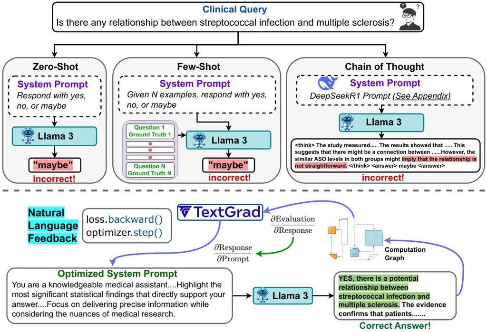

# AutoMedPrompt: A New Framework for Optimizing LLM Medical Prompts Using Textual Gradients

Sean Wu Affiliation: Keck Data Science Institute, Pepperdine University
Affiliation: Department of Medicine, University of California, Los
Angeles    Michael Koo Affiliation: Biological Sciences Division,
University of Chicago    Fabien Scalzo Affiliation: Keck Data Science
Institute, Pepperdine University Affiliation: Department of Medicine,
University of California, Los Angeles    Ira Kurtz ^(†)^(†)thanks:
Corresponding author: IKurtz@mednet.ucla.edu Affiliation: Department of
Medicine, University of California, Los Angeles Affiliation: Brain
Research Institute, University of California, Los Angeles

###### Abstract

Large language models (LLMs) have demonstrated increasingly
sophisticated performance in medical and other fields of knowledge.
Traditional methods of creating specialist LLMs require extensive
fine-tuning and training of models on large datasets. Recently, prompt
engineering, instead of fine-tuning, has shown potential to boost the
performance of general foundation models. However, prompting methods
such as chain-of-thought (CoT) may not be suitable for all subspecialty,
and k-shot approaches may introduce irrelevant tokens into the context
space. We present AutoMedPrompt, which explores the use of textual
gradients to elicit medically relevant reasoning through system prompt
optimization. AutoMedPrompt leverages TextGrad’s automatic
differentiation via text to improve the ability of general foundation
LLMs. We evaluated AutoMedPrompt on Llama 3, an open-source LLM, using
several QA benchmarks, including MedQA, PubMedQA, and the nephrology
subspecialty-specific NephSAP. Our results show that prompting with
textual gradients outperforms previous methods on open-source LLMs and
surpasses proprietary models such as GPT-4, Claude 3 Opus, and Med-PaLM 2. AutoMedPrompt sets a new state-of-the-art (SOTA) performance on
PubMedQA with an accuracy of 82.6%, while also outperforming previous
prompting strategies on open-sourced models for MedQA (77.7%) and
NephSAP (63.8%).

## 1 Introduction

In recent years, the widespread adoption of large language models (LLMs)
in healthcare has sparked significant interest in their potential to
transform medical practice, medical research, and teaching
Thirunavukarasu et al. (2023). However, although proprietary models such
as GPT-4 OpenAI (2023) and Med-PaLM 2 Singhal et al. (2022) have
achieved SOTA performance in benchmarks like medical examinations, their
high resource consumption in both training and inference create a high
barrier of entry for widespread adoption.

As a potential strategy for widespread integration of LLM models in the
healthcare field, open-source models provide a valid alternative to
proprietary systems because they offer greater flexibility,
transparency, and compliance benefits, which are crucial advantages.
Moreover, models such as DeepSeek-v3 Liu et al. (2024), Falcon
Almazrouei et al. (2023), Mixtral 8x7B Jiang et al. (2024), and Qwen2
Chu et al. (2024) have demonstrated competitive performances while using
significantly fewer parameters and resources to train than their
proprietary counterparts.

However, in both proprietary and open-source foundation models, the
traditional optimization approaches such as fine-tuning and manual
prompt engineering, present significant challenges when adapted to the
medical field Guluzade et al. (2025). Fine-tuning methods like low-rank
adaption Hu et al. (2021) require substantial computational resources
that are often unavailable to healthcare institutions, and manual prompt
engineering demands high domain expertise in both medical knowledge and
computational systems.

Automatic prompt optimization frameworks are a more structured approach
to enhance performance of out-out-the-box LLMs. Such methods
systematically refine prompts to elicit more accurate and contextually
relevant responses from LLMs without modifying their underlying weights.
Some methods leverage computational techniques like Bayesian search
optimization Opsahl-Ong et al. (2024), in-context learning Dong et al.
(2022), and reinforcement learning Ernst and Louette (2024). To address
the high barrier to adaptation of open-source LLMs for medical
applications, there has been increasing interest in optimizing
open-source models for medical question-answering (QA) without explicit
parameter updates.

### 1.1 Related Works

Recent research has introduced automated methods to improve LLMs, which
reduces the need for expert intervention and even surpassing parameter
updated based methods Pryzant et al. (2023); Li et al. (2024); Kepel and
Valogianni (2024).

Reflexion introduced a reinforcement learning framework that enables
language agents to self-improve through verbal feedback Shinn et al.
(2023). Instead of fine-tuning model weights, Reflexion agents
iteratively generate linguistic reflections on past errors, storing
insights in episodic memory for future decision-making. This framework
allows LLMs to learn from mistakes without explicit retraining.
Reflexion demonstrated significant improvements in coding tasks,
decision-making scenarios, and reasoning-based QA.

Medprompt is another method that enhances the performance of GPT-4 on
challenging medical problems through systematic prompt creation. Nori
et al. (2023). Medprompt’s strategy relies on a composition of multiple
general-purpose prompting strategies, including in-context learning and
CoT prompting. The approach eliminates the need for expert-crafted
exemplars by having the model semantically selecting in-context learning
examples based on word embeddings. MedPrompt was the first to achieve an
accuracy of greater than 90% on the MedQA benchmark Nori et al. (2023).

DSPy created a declarative programming model for optimizing LLM
pipelines Khattab et al. (2023). DSPy treats LLM calls as modular
components within a text transformation graph, where declarative modules
replace manually crafted prompt templates. DSPy’s framework includes a
compiler that iteratively refines prompts and fine-tuning strategies to
optimize model performance. This framework achieves substantial
performance gains in multi-hop retrieval and complex QA tasks,
outperforming expert-crafted few-shot demonstrations in comparison. The
approach generalizes well across different tasks and LLM architectures,
enabling a scalable and self-improving prompt engineering method.



Figure 1: Schematic of AutoMedPrompt, where textual gradients can be
superior to traditional prompting strategies.

OpenMedLM is the current favored SOTA prompting strategy for open-source
models, which applies the techniques used by MedPrompt to open-weight
LLMs Maharjan et al. (2024). OpenMedLM evaluated various open-source
models, including Yi34B 01.AI (2024), on prominent medical benchmarks
such as MedQA, MedMCQA Pal and et al (2022), and PubMedQA, without
resorting to external data or fine-tuning. By utilizing a combination of
zero-shot, few-shot, CoT reasoning, and ensemble/self-consistency voting
strategies to optimize responses, OpenMedLM demonstrates that strategic
prompting alone can outperform fine-tuned specialized models.

Recently, TextGrad is a package that applies the concept of
backpropagation with textual gradients for optimizing complex multi-step
LLM agents Yuksekgonul et al. (2024). Specifically, TextGrad’s framework
constructs a computation graph where nodes such as prompts, tool calls,
and responses receive textual feedback from LLMs, functioning as
“textual gradients" that inform iterative refinements. The framework
allows for automatic prompt optimization without human intervention,
which significantly improves LLM performance on diverse tasks, including
question-answering, reasoning, and biomedical applications. TextGrad
demonstrates that prompting can be systematically optimized through
backpropagation, analogous to differentiable optimization in neural
networks.

### 1.2 Overview

We present AutoMedPrompt, a new framework for automatically optimizing
medical system prompts with textual gradients. This method outperforms
both traditional fine-tuning approaches and black-box proprietary
models. Our framework builds upon collective advancements in text-based
reflection Shinn et al. (2023), textual gradients Yuksekgonul et al.
(2024), and transforming generalist LLMs into specialized models through
promptingNori et al. (2023). We demonstrate AutoMedPrompt’s
effectiveness with Llama-3 Touvron et al. (2024) by improving its
performance beyond proprietary LLMs and previous prompting strategies
across multiple standard medical benchmarks, including MedQA, PubMedQA,
and the specialized NephSAP multiple choice question benchmark Wu et al.
(2024a).

AutoMedPrompt achieves SOTA performance on medical benchmarks while
significantly reducing optimization constraints. By optimizing only one
parameter (the system prompt), AutoMedPrompt helps overcome the
computational and expertise barriers that can hinder the widespread
adoption of LLMs in the healthcare field. AutoMedPrompt represents a
significant advancement in tuning the behavior of general foundation
models, enabling them to surpass fine-tuned LLMs through prompt
engineering alone. It represents a novel method designed to democratize
high-performing medical LLMs using textual gradients, as opposed to CoT
or few-shot examples. All code and data are open-source and available on
our [Github](https://github.com/SeanWu25/AutoMedPrompt).

## 2 Methodology

There has been much work done to demonstrate the effectiveness of
prompting and, how few-shot and CoT methods can be used to improve the
ability to answer medical questions Brown et al. (2020); Wei et al.
(2022); Ge et al. (2023). AutoMedPrompt aims to unify these methods by
leveraging textual gradients to dynamically optimize prompts for
specific tasks rather than a general one-method-fits-all approach.

### 2.1 Baseline Prompting Methods

We evaluated AutoMedPrompt on the following traditional prompting
strategies as a baseline.

Zero-Shot Question Answering with large language models (LLMs) can be
formulated as a simple inference problem. Given a medical question from
our benchmarks $`Q`$, the model $`\mathcal{M}`$ predicts the answer
$`A^{*}`$ by maximizing the probability distribution over possible
answers.

Few-shot in-context learning (ICL) is another baseline to improve
medical QA performance. Given a context containing $`k`$ randomly
selected example question-answer pairs
$`C=\{(Q_{i},A_{i})\}_{i=1}^{k}\},`$ the model $`\mathcal{M}`$ generates
an answer $`A^{*}`$ for a new question $`Q`$, but now, the model
$`\mathcal{M}`$ conditions its generated response on the retrieved
examples.

Chain-of-Thought (CoT) is another method we used to improve medical QA
by having the LLM use intermediate reasoning before generating the final
answer. Here, we leverage the SOTA DeepSeek R1’s CoT process template,
where the model $`\mathcal{M}`$ generates a reasoning step $`R`$ and
final answer $`A^{*}`$ as

```math
R,A^{*}=\mathcal{M}(Q,\mathcal{P}_{\text{CoT}})
```

See Appendix for the full CoT template.

### 2.2 TextGrad Based Optimization


We leverage TextGrad’s autograd engine to (1) automatically construct
the computational graphs for medical QA datasets and (2) enable the
backpropagation of textual gradients derived from a natural language
loss function (LLM call). This method ensures that gradient-based
optimization directly influences the LLM’s system prompt, which allows
it to dynamically adapt to the current batch of medical queries. Since
we focus on a simple medical QA setting, the computational graph for
each given query is structured as follows

```math
\displaystyle=\mathcal{F}_{\text{LLM}}(\text{Query},\text{Prompt}),
```

```math
\displaystyle=\mathcal{F}_{\text{LLM}}(\text{Prediction},\text{Eval})
```

where Eval represents a medically validated ground truth taken from a
benchmark. TextGrad’s autograd engine internally automatically
constructs this computational graph, propagating information through the
nodes Query, Prompt, and Response. The optimization process focuses only
on improving the Prompt, and ensures that the prompt remains flexible to
specific medical contexts and reasoning. This is achieved by requiring
the prompt to have gradients during the backpropagation process
(requires_grad = True).

The backpropagation mechanism in TextGrad is conceptually similar to
training a neural network, where the optimizable parameter is the
Prompt. Given the natural language loss function
$`\mathcal{L}_{\text{NL}}`$ (LLM call), the TextGrad generates textual
gradients to determine how the Response should be refined to better
align with the ground truth answer $`G`$. This corresponds to computing
the partial textual derivative

```math
\displaystyle\frac{\partial\mathcal{L}_{\text{NL}}}{\partial\text{Response}}=\nabla_{\text{LLM}}(\text{Response},G),
```

which is really just the LLM-driven textual gradient
$`\nabla_{\text{LLM}}`$, which generates structured linguistic feedback
such as


This textual gradient then propagates through the computational graph to
evaluate the effect of the Prompt on the loss function. This provides
insight into how the prompt should be modified to improve the medical
response accuracy and reasoning.

```math
\displaystyle\frac{\partial\mathcal{L}_{\text{NL}}}{\partial\text{Prompt}}=\nabla_{\text{LLM}}\left(\text{Prompt},\text{Response},\frac{\partial\mathcal{L}_{\text{NL}}}{\partial\text{Response}}\right).
```

As an example, the LLM can assess how the system prompt contributed to
the response and suggests refinements such as


By iteratively applying Textual Gradient Descent (TGD), the clincal
system prompt is refined using these updates.

```math
\displaystyle\text{Prompt}^{(t+1)}=\text{TGD.Step}\left(\text{Prompt}^{(t)},\frac{\partial\mathcal{L}_{\text{NL}}}{\partial\text{Prompt}}\right).
```

Over multiple batch iterations, this optimization process ensures that
the system prompt updates to generate more medically accurate responses,
improve alignment with medical knowledge, and enhanced clarity. An
example of one step of this optimization process can be found in the
table above.

### 2.3 Optimization Trajectory

When training neural network-based models, it is common for the
optimization trajectory to reach suboptimal minima Bashir et al. (2010)
or even experience mode collapse in GANs Durall et al. (2020). The same
issue arises when using textual gradients to optimize any part of a
TextGrad computation graph. Often, the $`\nabla\text{Textual Gradient}`$
leads to the optimization of suboptimal prompts that do not improve or
even degrade performance on some benchmarks.

Accordingly, if $`p_{i}`$ is the system prompt at training iteration
$`i`$, let $`\mathcal{A}(p_{i})`$ represent the validation accuracy
computed on a set of medical questions and answers. The optimization
process is constrained by only allowing a system prompt update
$`p_{i+1}`$ if it achieves a higher validation accuracy than the
previous best prompt $`p^{*}`$. Mathematically, this can be expressed as

```math
p_{i+1}=\begin{cases}p_{\text{new}}&\text{if }\mathcal{A}(p_{\text{new}})>\mathcal{A}(p^{*}),\\
p_{i}&\text{otherwise},\end{cases}
```

where $`p_{\text{new}}`$ is the candidate prompt generated by the
optimization step. If the updated prompt does not perform better, the
system reverts to the previous prompt $`p_{i}`$, and another batch of
training is completed. Finally, we define a stopping criterion to
terminate the optimization process if no improvements are observed
within $`n`$ iterations. By doing so, we ensure that every update of the
system prompt will directly improve the medical question answering
ability of LLama 3.

## 3 Experiments

We tested AutoMedPrompt’s textual gradient based optimization on several
medical benchmarks, including general popular QA benchmarks like MedQA
and PubMedQA, as well as the domain-specific NephSAP, which focuses on
nephrology multiple-choice questions. For each benchmark, we tested the
zero-shot performance of Llama 3 alongside the randomized few-shot, CoT
reasoning with a DeepSeek R1 prompt, and finally prompt optimization
with textual gradients.

### 3.1 Proprietary and Open-Source LLMs

Our goal is to combine AutoMedPrompt with the open-source LLM LLama 3 to
surpass both proprietary foundation models and also fine-tuned
specialists models.

Llama 3 is a foundation language model created by Meta AI Dubey et al.
(2024), which has models ranging from 8 billion, 70 billion, to 405
billion parameters. The context window of Llama 3 is 128k tokens. Llama
3 is multilingual and was shown to be superior at generating code. Llama
3 is fully open-source, and in this study, we used the
70-billion-parameter version because it is the perfect tradeoff with
fitting on commonly used GPUs vs. quality of response.

GPT-4 is OpenAI’s fourth-generation Generative Pre-trained Transformer,
which is a large-scale multimodal model capable of processing both text
and images to generate human-like text outputs OpenAI (2023). In this
study we compare AutoMedPrompt with Llama 3 to both GPT-4 and GPT-4 with
MedPrompt.

Claude 3 Opus is another proprietary LLM we compare that was designed
for complex reasoning tasks and is capable of processing both text and
images. It surpassed benchmarks in mathematics, programming, and logical
reasoning.

Meditron is an open-source LLM adapted from Meta’s Llama-2 Chen et al.
(2023). We use the 70-billion-parameter version. After fine-tuning,
Meditron-70B outperforms models like GPT-3.5 and Flan-PaLM Chung et al.
(2024) on various medical reasoning tasks and performs comparably to
GPT-4 and Med-PaLM 2. Meditron is trained on custom-curated medical
corpora, including PubMed articles and abstracts, which makes it
promising for medical applications. We used Ollama’s python library to
run Meditron 70b.

Med-PaLM 2 is the final proprietary LLM we evaluated. It was created by
combining the base language model (PaLM 2) with specialized fine-tuning
in the medical domain and innovative prompting strategies, including a
novel ensemble refinement approach Singhal et al. (2025).

### 3.2 Benchmarks

MedQA is a benchmark that consists of 1273 multiple-choice questions
based on the US medical licensing exam (USMLE). The dataset covers both
English and Chinese, but our evaluations were only on the English
testing subset. The questions were taken from the USMLE Step 1, 2, and 3
exams and are not multimodal.

PubMedQA is a curated question-answering dataset based on PubMed
abstracts. The language models are asked to respond with either “yes”,
“no”, or “maybe.” Each question format is as follows: The
reasoning-required setting is a short context from a PubMed abstract,
and the goal is to leverage the context to answer the question. A
training and testing set is provided.

NephSAP dataset comprises 858 multiple-choice questions and answers in
the subspecialty medical field of nephrology, drawn from the Nephrology
Self-Assessment Program (nephSAP). The questions are contextualized by
patient scenarios. In a prior study Wu et al. (2024a), we demonstrated
that open-source models did poorly Wu et al. (2024b) compared to GPT-4.
The poor results of open-source models Wu et al. (2024a) was a
motivation for the current study to improve their success.

### 3.3 Experimental Settings

For system prompt optimization, we require a training set, a development
set, and a testing set. The MedQA dataset consists of 10.2k training
examples and 1,273 testing examples. To create a development set, we
randomly sample 50 examples from the training set. MedQA follows a
multiple-choice question format with four possible answer choices.

PubMedQA consists of 500 training examples and 500 randomly selected
testing examples. A development set is created by randomly selecting 50
examples from the training set. Unlike MedQA, PubMedQA includes a
reasoning section where a short snippet from a PubMed abstract is
provided as context, and the model must classify the answer as yes, no,
or maybe.

The NephSAP dataset contains 858 questions. The split randomly allocates
50 selected questions to the development set, 500 to the testing set,
and the remainder to the training set.

To access Llama 3, we leveraged Together AI’s API platform and used
TextGrad’s BlackBoxLM function for the forward pass. We set the
backwards engine of TextGrad for the loss and gradient backpropagation
to OpenAI’s GPT-4o and GPT-4o-mini.

### 3.4 Evaluating LLM-Generated Responses

To extract and evaluate the responses generated by the LLMs without the
usage of an evaluator API, we define a more systematic approach using
regular expressions. The goal is quite simple, to identify and extract
the LLM selected answer choice $`\{A,B,C,D,E\}`$.

For every LLM generated response, we used the simple expression

```math
\mathcal{M}=\text{Regex}(\backslash b[A-E]\backslash b)
```

where $`\mathcal{M}`$ represents the first detected instance of a valid
answer choice. This is checked both manually and by system prompt
instructions. If a match $`\mathcal{M}`$ is found, the extracted
character is taken as the predicted answer. This is similar for DeepSeek
R1’s chain of thought prompting, where the correct answer is explicitly
stated within \<answer\> tags. If this is the case, we use a similar
regular expression to extract the answer within the \<answer\> field. We
follow a similar process for the yes/no/maybe extraction for PubMedQA.

|                           |               |             |                   |              |       |         |
| ------------------------- | ------------- | ----------- | ----------------- | ------------ | ----- | ------- |
| Prompting Strategy        | Model Size    | Open-Weight | Avoids Finetuning | Accuracy (%) |       |         |
|                           |               |             |                   | PubMedQA     | MedQA | NephSAP |
| Heuristic Baselines       |               |             |                   |              |       |         |
| Random Choice             | \-            | \-          | \-                | 33.3         | 25.0  | 24.1    |
| Human Performance         | \-            | \-          | \-                | 78.0         | 60.0  | 76.0    |
| Large Language Models     |               |             |                   |              |       |         |
| GPT-4-base                | $`\sim`$1.76T | ✗           | ✓                 | 80.4         | 81.7  | 63.6    |
| Claude 3 Opus             | $`\sim`$100B  | ✗           | ✓                 | 74.9         | 64.7  | 40.8    |
| Med-PaLM 2                | $`\sim`$1.6T  | ✗           | ✗                 | 81.8         | 85.4  | N/A     |
| MEDITRON                  | 70B           | ✓           | ✗                 | 80.0         | 65.4  | 29.8    |
| GPT-4 (Medprompt)         | $`\sim`$1.76T | ✗           | ✓                 | 82.0         | 90.2  | N/A     |
| OpenMedLM                 | 34B           | ✓           | ✓                 | 77.3         | 72.6  | N/A     |
| Llama 3 (Zero-Shot)       | 70B           | ✓           | ✓                 | 71.6         | 75.2  | 61.6    |
| Llama 3 (Few-Shot)        | 70B           | ✓           | ✓                 | 76.0         | 75.4  | 58.8    |
| Llama 3 (DeepSeek R1 CoT) | 70B           | ✓           | ✓                 | 71.4         | 76.4  | 48.0    |
| Llama 3 (AutoMedPrompt)   | 70B           | ✓           | ✓                 | 82.6         | 77.7  | 63.8    |

Table 1: Comparison of various prompting strategies across multiple
medical datasets (PubMedQA, MedQA, and NephSAP).

## 4 Results

We compare the performance of AutoMedPrompt with the open-source Llama 3
70B against previous SOTA methods and proprietary LLMs. Additionally, we
conduct ablation studies on Llama 3 using various prompting strategies,
along with several heuristic baselines.

### 4.1 Heuristic Baselines

We compare the LLMs against two heuristic baselines. Firstly, the models
should perform well above random choice, which is simply
$`\frac{1}{\text{number options}}`$. In cases where the number of
options varies per benchmark, such as in NephSAP, we take the average.
Human performance is also an important reference to determine how far
the LLMs are from expert-level performance. The PubMedQA human
performance score was obtained from a single test taker, who achieved
78%, which is higher than most LLMs. For MedQA and NephSAP, we use the
passing score as the human benchmark performance (see Table 1).

### 4.2 AutoMedPrompt Performance

In the PubMedQA benchmark, AutoMedPrompt outperforms not only
proprietary models such as GPT-4 by 2.2% but also previous prompting
strategies like OpenMedLM by 5.3% and Gpt-4 with Medprompt by 0.6%.
AutoMedPrompt with Llama 3 achieves an accuracy of 82.6% on PubMedQA,
which is 11% higher than Llama 3’s zero-shot performance. This approach
also improves accuracy by 6.6% compared to few-shot prompting.
Furthermore, learning the prompt automatically with textual gradients
leads to an 11.2% improvement over the fixed DeepSeek R1 CoT prompt.
More comparisons against Med-Palm 2 and MEDITRON can be found in Table

1.

We observe similar results in the MedQA benchmark, where AutoMedPrompt
surpasses zero-shot performance by 2.5%, few-shot performance by 2.3%,
and CoT prompting by 1.3%. While the improvement is less pronounced than
in the PubMedQA benchmark, textual gradients still enhance performance
more effectively than traditional methods. Additionally, AutoMedPrompt
outperforms the previous SOTA open-source model, OpenMedLM, by 5.1%.

Finally, in the NephSAP benchmark, which is a challenging nephrology
self-assessment, we observe that traditional prompting strategies not
only fail to improve performance, but few-shot prompting decreases
accuracy by 2.8% and CoT prompting reduces performance by 13.6%. This
suggests that more robust prompting techniques may be necessary
depending on the nature of the benchmark questions. AutoMedPrompt with
Llama 3 outperforms zero-shot performance by 2.2% and also surpasses
GPT-4 by 0.2%.

## 5 Discussion

AutoMedPrompt formally utilizes textual gradients when automatically
optimizing system prompts for medical use cases. By automatically
optimizing only one parameter (system prompt), we demonstrate
improvements on all three medical benchmarks beyond previous SOTA
open-sourced no fine-tuning methods. We also show that we surpassed
proprietary models like GPT-4.

### 5.1 More Intuitive Prompting

Backpropagating textual gradients intuitively would be predicted to
enhance the robustness of medical LLMs compared to traditional methods
as we demonstrated. Few-shot prompting retrieves question-answer pairs
relevant to a similar topic or use case. However, when high-quality
answers are unavailable, this approach may fail to improve reasoning,
especially if the retrieved examples are only loosely related to the
given problem. In the worst cases, irrelevant examples can clutter the
context window, consuming valuable space without contributing meaningful
insights.

CoT prompting strengthens reasoning by explicitly instructing the LLM to
engage in structured thinking before reaching a conclusion. However, not
all benchmarks and medical tasks benefit from the same CoT strategies. A
one-size-fits-all CoT approach may be suboptimal when different tasks
require distinct reasoning approaches.

TextGrad optimization enables more precise system prompts tailored to
each specific task. Instead of relying on generic CoT strategies,
textual gradients dynamically refine prompts to match the reasoning
patterns essential for optimal performance.

For instance, lets consider the differences in system prompts optimized
for two distinct medical benchmarks.

|           |                                                                                                                                                                                                      |
| --------- | ---------------------------------------------------------------------------------------------------------------------------------------------------------------------------------------------------- |
| Benchmark | Optimized Prompt                                                                                                                                                                                     |
| NephSAP   | "You are a precise medical assistant…consider differential diagnoses and reference guidelines…ensure clarity and logical reasoning, and address misconceptions or counterarguments."                 |
| PubMedQA  | "You provide clear, concise, evidence-based answers…encourage further investigation when findings are preliminary but maintain assertiveness…focus on precision while considering research nuances." |

Table 2: Optimized prompts for medical QA datasets

From these optimized prompts, we can observe that success in NephSAP
requires reasoning through differential diagnoses and addressing
counterarguments, while success in PubMedQA emphasizes further
investigation of research findings while maintaining clarity and
assertiveness.

This shows that while CoT prompting is beneficial, a more granular
approach guided by textual gradients is optimal for building more robust
medical LLMs.

### 5.2 Why AutoMedPrompt Beats Fine-Tuning

The idea of leveraging a generalist foundation model to outperform a
fine-tuned specialist model was introduced in MedPrompt Nori et al.
(2023), where they used GPT-4 to achieve SOTA results on benchmarks like
PubMedQA. It is not surprising that prompting with textual gradients
allows for even further improvement compared to semantic few-shot
examples and CoT reasoning, because it enables a more precise adaptation
of system prompts to each unique medical task. For example, the prompt
optimization for a cardiology question-answering scenario would differ
from that of ophthalmology. This is where textual gradients become
useful. We found that automatic prompt engineering allows open-sourced,
out-of-the-box models such as Llama 3 to surpass their proprietary
counterparts and outperform previous strategies like CoT prompting and
few-shot examples. Finally, this framework is generalizable to domains
beyond medicine, where textual gradients provide instructions on how to
refine task-specific system prompts.

## 6 Conclusion

In conclusion, we introduce AutoMedPrompt, which is an open-source
framework leveraging textual gradients for automatic medical prompt
optimization. AutoMedPrompt enhances the open-source model Llama 3,
surpassing proprietary models such as GPT-4 and Claude 3 Opus.
Additionally, it outperform the previous SOTA OpenMedLM in open-source
prompt engineering on the PubMedQA and MedQA benchmarks. The
AutoMedPrompt code is fully open-source and accessible via a simple
command-line interface. In this paper, we focus on automatic
optimization for medical system prompts, but incorporating an additional
step for solution refinement via TextGrad could further improve results.
Additionally, more work on interpretability is necessary to develop a
more theoretical understanding of why specific prompts are capable of
enhancing benchmark performance.

## Limitations

There are a few limitations to this study. Backpropagating textual
gradients leads to rapid convergence when updating just one parameter.
While we address this issue by using a batch size, it may still not be
optimal. This results in underutilization of the training data, as the
training converges before all the provided examples are processed. Such
premature convergence is suboptimal for achieving the most robust
learning. In future work, we plan to explore methods such as active
learning and coreset selection to more systematically sample elements of
the training set. A similar issue arises with the validation set. With
only 50 random samples chosen, it is highly likely that the validation
set is not representative of the dataset as a whole. This can lead to
terminating the training process before reaching the optimal system
prompt parameter. Increasing the size of the validation set is likely
necessary to address this limitation. Another limitation is the absence
of GPT-4 with MedPrompt and OpenMedLM results using the NephSAP
benchmark. Previous SOTA methods, such as these, require extensive
preprocessing, including $`K`$-nearest neighbors, rerunning questions
$`n`$ times, and employing CoT reasoning. However, these approaches are
too computationally expensive for our API-based setup. Finally, Med-Palm
2 was not available for this study due to lack of permission, which
could have provided a valuable new insight to the work.

## Acknowledgments

Ira Kurtz is supported in part by funds from the Smidt Family
Foundation, Factor Family Foundation, Davita Allen Nissenson Research
Fund, Ralph Block Family Fund and Kleeman Family Fund.

## References

- 01.AI (2024) 01.AI. 2024. [Yi: Open foundation models by
  01.ai](https://arxiv.org/abs/2403.04652). _arXiv preprint
  arXiv:2403.04652_.
- Almazrouei et al. (2023) Ebtesam Almazrouei, Hamza Alobeidli,
  Abdulaziz Alshamsi, Alessandro Cappelli, Ruxandra Cojocaru, Mérouane
  Debbah, Étienne Goffinet, Daniel Hesslow, Julien Launay, Quentin
  Malartic, et al. 2023. The falcon series of open language models.
  _arXiv preprint arXiv:2311.16867_.
- Bashir et al. (2010) D Bashir, GD Montanez, S Sehra, P Sandoval
  Segura, and J Lauw. 2010. An information-theoretic perspective on
  overfitting and underfitting.” arxiv, nov. 06, 2020. doi: 10.48550.
  _arXiv_.
- Brown et al. (2020) Tom Brown, Benjamin Mann, Nick Ryder, Melanie
  Subbiah, Jared D Kaplan, Prafulla Dhariwal, Arvind Neelakantan, Pranav
  Shyam, Girish Sastry, Amanda Askell, et al. 2020. Language models are
  few-shot learners. _Advances in neural information processing
  systems_, 33:1877–1901.
- Chen et al. (2023) Zeming Chen, Alejandro Hernández Cano, Angelika
  Romanou, Antoine Bonnet, Kyle Matoba, Francesco Salvi, Matteo
  Pagliardini, Simin Fan, Andreas Köpf, Amirkeivan Mohtashami,
  et al. 2023. Meditron-70b: Scaling medical pretraining for large
  language models. _arXiv preprint arXiv:2311.16079_.
- Chu et al. (2024) Yunfei Chu, Jin Xu, Qian Yang, Haojie Wei, Xipin
  Wei, Zhifang Guo, Yichong Leng, Yuanjun Lv, Jinzheng He, Junyang Lin,
  et al. 2024. Qwen2-audio technical report. _arXiv preprint
  arXiv:2407.10759_.
- Chung et al. (2024) Hyung Won Chung, Le Hou, Shayne Longpre, Barret
  Zoph, Yi Tay, William Fedus, Yunxuan Li, Xuezhi Wang, Mostafa
  Dehghani, Siddhartha Brahma, et al. 2024. Scaling
  instruction-finetuned language models. _Journal of Machine Learning
  Research_, 25(70):1–53.
- Dong et al. (2022) Qingxiu Dong, Lei Li, Damai Dai, Ce Zheng, Jingyuan
  Ma, Rui Li, Heming Xia, Jingjing Xu, Zhiyong Wu, Tianyu Liu,
  et al. 2022. A survey on in-context learning. _arXiv preprint
  arXiv:2301.00234_.
- Dubey et al. (2024) Abhimanyu Dubey, Abhinav Jauhri, Abhinav Pandey,
  Abhishek Kadian, Ahmad Al-Dahle, Aiesha Letman, Akhil Mathur, Alan
  Schelten, Amy Yang, Angela Fan, et al. 2024. The llama 3 herd of
  models. _arXiv preprint arXiv:2407.21783_.
- Durall et al. (2020) Ricard Durall, Avraam Chatzimichailidis, Peter
  Labus, and Janis Keuper. 2020. Combating mode collapse in gan
  training: An empirical analysis using hessian eigenvalues. _arXiv
  preprint arXiv:2012.09673_.
- Ernst and Louette (2024) Damien Ernst and Arthur Louette. 2024.
  Introduction to reinforcement learning. _Feuerriegel, S., Hartmann,
  J., Janiesch, C., and Zschech, P_, pages 111–126.
- Ge et al. (2023) Yao Ge, Yuting Guo, Sudeshna Das, Mohammed Ali
  Al-Garadi, and Abeed Sarker. 2023. Few-shot learning for medical text:
  A review of advances, trends, and opportunities. _Journal of
  Biomedical Informatics_, page 104458.
- Guluzade et al. (2025) Aynur Guluzade, Naguib Heiba, Zeyd Boukhers,
  Florim Hamiti, Jahid Hasan Polash, Yehya Mohamad, and Carlos A
  Velasco. 2025. Elmtex: Fine-tuning large language models for
  structured clinical information extraction. a case study on clinical
  reports. _arXiv preprint arXiv:2502.05638_.
- Hu et al. (2021) Edward J Hu, Yelong Shen, Phillip Wallis, Zeyuan
  Allen-Zhu, Yuanzhi Li, Shean Wang, Lu Wang, and Weizhu Chen. 2021.
  Lora: Low-rank adaptation of large language models. _arXiv preprint
  arXiv:2106.09685_.
- Jiang et al. (2024) Albert Q Jiang, Alexandre Sablayrolles, Antoine
  Roux, Arthur Mensch, Blanche Savary, Chris Bamford, Devendra Singh
  Chaplot, Diego de las Casas, Emma Bou Hanna, Florian Bressand,
  et al. 2024. Mixtral of experts. _arXiv preprint arXiv:2401.04088_.
- Kepel and Valogianni (2024) Daan Kepel and Konstantina
  Valogianni. 2024. Autonomous prompt engineering in large language
  models. _arXiv preprint arXiv:2407.11000_.
- Khattab et al. (2023) Omar Khattab, Arnav Singhvi, Paridhi Maheshwari,
  Zhiyuan Zhang, Keshav Santhanam, Sri Vardhamanan, Saiful Haq, Ashutosh
  Sharma, Thomas T. Joshi, Hanna Moazam, et al. 2023. [Dspy: Compiling
  declarative language model calls into self-improving
  pipelines](https://doi.org/10.48550/arXiv.2310.03714). _arXiv preprint
  arXiv:2310.03714_.
- Li et al. (2024) WeiJie Li, Jin Wang, and Xuejie Zhang. 2024.
  Promptist: Automated prompt optimization for text-to-image synthesis.
  In _CCF International Conference on Natural Language Processing and
  Chinese Computing_, pages 295–306. Springer.
- Liu et al. (2024) Aixin Liu, Bei Feng, Bing Xue, Bingxuan Wang, Bochao
  Wu, Chengda Lu, Chenggang Zhao, Chengqi Deng, Chenyu Zhang, Chong
  Ruan, et al. 2024. Deepseek-v3 technical report. _arXiv preprint
  arXiv:2412.19437_.
- Maharjan et al. (2024) Jaya Maharjan, Anusha Garikipati, N. P. Singh,
  et al. 2024. [Openmedlm: Prompt engineering can out-perform
  fine-tuning in medical question-answering with open-source large
  language models](https://doi.org/10.1038/s41598-024-64827-6).
  _Scientific Reports_, 14(1):14156.
- Nori et al. (2023) Harsha Nori, Yin Tat Lee, Sheng Zhang, Dean
  Carignan, Richard Edgar, Nicolo Fusi, Nicholas King, Jonathan Larson,
  Yuanzhi Li, Weishung Liu, Renqian Luo, Scott Mayer McKinney,
  Robert Osazuwa Ness, Hoifung Poon, Tao Qin, Naoto Usuyama, Chris
  White, and Eric Horvitz. 2023. [Can generalist foundation models
  outcompete special-purpose tuning? case study in
  medicine](https://www.microsoft.com/en-us/research/publication/can-generalist-foundation-models-outcompete-special-purpose-tuning-case-study-in-medicine/).
  _Microsoft Research_.
- OpenAI (2023) OpenAI. 2023. [Gpt-4 technical
  report](https://cdn.openai.com/papers/gpt-4.pdf).
- Opsahl-Ong et al. (2024) Krista Opsahl-Ong, Michael J Ryan, Josh
  Purtell, David Broman, Christopher Potts, Matei Zaharia, and Omar
  Khattab. 2024. Optimizing instructions and demonstrations for
  multi-stage language model programs. _arXiv preprint
  arXiv:2406.11695_.
- Pal and et al (2022) Ankit Pal and et al. 2022. [Medmcqa : A
  large-scale multi-subject multi-choice dataset for medical domain
  question answering](https://arxiv.org/abs/2203.14371). _arXiv preprint
  arXiv:2203.14371_.
- Pryzant et al. (2023) Reid Pryzant, Dan Iter, Jerry Li, Yin Tat Lee,
  Chenguang Zhu, and Michael Zeng. 2023. Automatic prompt optimization
  with" gradient descent" and beam search. _arXiv preprint
  arXiv:2305.03495_.
- Shinn et al. (2023) Noah Shinn, Federico Cassano, Edward Berman,
  Ashwin Gopinath, Karthik Narasimhan, and Shunyu Yao. 2023. [Reflexion:
  Language agents with verbal reinforcement
  learning](https://doi.org/10.48550/arXiv.2303.11366). _arXiv preprint
  arXiv:2303.11366_.
- Singhal et al. (2022) Karan Singhal, Shekoofeh Azizi, Tong N. Tu,
  Shravya S. Mahdavi, Jason Wei, Hyung Won Chung, Nathan Scales, Aneesh
  Tanwani, Heather Cole-Lewis, Stephen Pfohl, et al. 2022. [Med-palm:
  Large language models encode clinical
  knowledge](https://sites.research.google/med-palm/).
- Singhal et al. (2025) Karan Singhal, Tao Tu, Juraj Gottweis, Rory
  Sayres, Ellery Wulczyn, Mohamed Amin, Le Hou, Kevin Clark, Stephen R
  Pfohl, Heather Cole-Lewis, et al. 2025. Toward expert-level medical
  question answering with large language models. _Nature Medicine_,
  pages 1–8.
- Thirunavukarasu et al. (2023) Anuj J. Thirunavukarasu, Daniel S. J.
  Ting, Karthik Elangovan, Luis Gutierrez, Tien F. Tan, and Daniel S. W.
  Ting. 2023. [Large language models in
  medicine](https://doi.org/10.1038/s41591-023-02448-8). _Nature
  Medicine_, 29(8):1930–1940.
- Touvron et al. (2024) Hugo Touvron, Thibaut Lavril, Gautier Izacard,
  Xavier Martinet, Marie-Anne Lachaux, Timothée Lacroix, Baptiste
  Rozière, Naman Goyal, Shagun Batra, Daniel Haziza, et al. 2024. [The
  llama 3 herd of
  models](https://ai.meta.com/research/publications/the-llama-3-herd-of-models/).
- Wei et al. (2022) Jason Wei, Xuezhi Wang, Dale Schuurmans, Maarten
  Bosma, Fei Xia, Ed Chi, Quoc V Le, Denny Zhou, et al. 2022.
  Chain-of-thought prompting elicits reasoning in large language models.
  _Advances in neural information processing systems_, 35:24824–24837.
- Wu et al. (2024a) Sean Wu, Michael Koo, Lesley Blum, Andy Black, Liyo
  Kao, Zhe Fei, Fabien Scalzo, and Ira Kurtz. 2024a. Benchmarking
  open-source large language models, gpt-4 and claude 2 on
  multiple-choice questions in nephrology. _NEJM AI_, 1(2):AIdbp2300092.
- Wu et al. (2024b) Sean Wu, Michael Koo, Li Yo Kao, Andy Black, Lesley
  Blum, Fabien Scalzo, and Ira Kurtz. 2024b. Adversarial databases
  improve success in retrieval-based large language models. _arXiv
  preprint arXiv:2407.14609_.
- Yuksekgonul et al. (2024) Mert Yuksekgonul, Federico Bianchi, Joseph
  Boen, Sheng Liu, Zhi Huang, Carlos Guestrin, and James Zou. 2024.
  [Textgrad: Automatic "differentiation" via
  text](https://doi.org/10.48550/arXiv.2406.07496). _arXiv preprint
  arXiv:2406.07496_.

## Appendix A DeepSeek R1 CoT Template


## Appendix B PubMedQA Additional Example


## Appendix C MedQA Additional Example


## Appendix D NephSAP Additional Example


